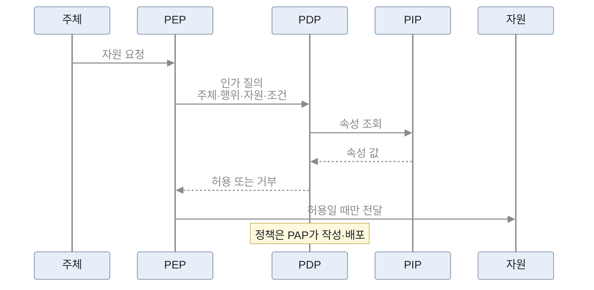
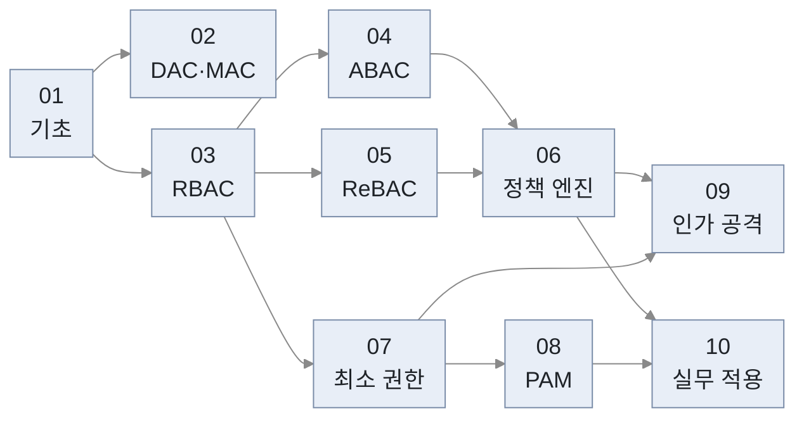

# Access Control (접근 통제)

> 약어: NIST=미국 국립표준기술연구소, NIST SP=NIST 특별 간행물, ANSI=미국 국가표준협회, INCITS=국제정보기술표준위원회, OASIS=구조화 정보 표준 촉진 기구, ISO/IEC=국제표준화기구/국제전기기술위원회, 3GPP=3세대 이동통신 표준화 기구

인증을 마친 주체가 **무엇을, 어떤 조건에서 할 수 있는지** 정하고 집행하는 인가(Authorization)를 다루는 하위 영역이다.
접근 통제 모델(DAC·MAC·RBAC·ABAC·ReBAC), 정책 엔진, 최소 권한, 특권 접근 관리, 인가 공격까지 하나의 흐름으로 정리한다.

> **구분 주의**: 인증(Authentication, 누구인가)은 [PKI & Identity](../pki-identity/README.md)에서 다룬다.
> 인증이 성공해도 인가가 없으면 접근할 수 없고, 인가가 잘못 설계되면 정상 로그인한 사용자가 남의 데이터를 읽는다.
> Zero Trust처럼 매 요청마다 인가를 다시 판단하는 설계는 [Security Architecture](../security-architecture/README.md)에서 다룬다.

---

## 1. 접근 통제 지도

### 1.1 인가 판단의 구성 요소

모든 접근 통제는 "**주체(Subject)** 가 **자원(Resource/Object)** 에 **행위(Action)** 를 하려 할 때, **조건(Context)** 을 보고 허용할지" 판단하는 문제다.
실제 시스템에서는 이 판단을 역할별로 나눈다.

| 구성 요소 | 역할 | 예 |
|-----------|------|----|
| PEP(Policy Enforcement Point) | 요청을 가로채 결정을 묻고, 결과대로 막거나 통과시킨다 | API Gateway, 애플리케이션 미들웨어, Kubernetes API Server |
| PDP(Policy Decision Point) | 정책과 속성을 근거로 허용·거부를 결정한다 | OPA(Open Policy Agent), Cedar 엔진, 클라우드 IAM(Identity and Access Management) 평가기 |
| PIP(Policy Information Point) | 판단에 필요한 속성(부서, 소유자, 위치 등)을 제공한다 | 디렉터리, HR(Human Resources) 시스템, 자원 메타데이터 |
| PAP(Policy Administration Point) | 정책을 작성·배포·관리한다 | 정책 저장소, 관리 콘솔, Git 기반 정책 저장소 |

텍스트 설명: 주체의 요청은 먼저 PEP가 받는다. PEP는 PDP에 "이 주체가 이 자원에 이 행위를 해도 되는가"를 묻고,
PDP는 PAP가 배포한 정책과 PIP에서 가져온 속성으로 결정한다. PEP는 허용된 요청만 자원으로 넘긴다.
PEP를 거치지 않는 경로가 하나라도 있으면 나머지 통제가 모두 무의미해진다(완전 중재 원칙).

### 1.2 접근 통제 모델 비교

모델은 "무엇을 근거로 판단하는가"로 구분한다. 실제 시스템은 보통 여러 모델을 섞어 쓴다.

| 모델 | 판단 근거 | 대표 사용처 | 강점 | 약점 |
|------|-----------|-------------|------|------|
| DAC(Discretionary Access Control) | 자원 소유자가 준 권한 | 파일 시스템 권한, 문서 공유 | 단순하고 유연하다 | 소유자 실수로 권한이 퍼진다 |
| MAC(Mandatory Access Control) | 시스템이 강제하는 보안 등급·레이블 | 군·정부 시스템, SELinux(Security-Enhanced Linux) | 사용자가 정책을 바꿀 수 없다 | 운영이 경직되고 무겁다 |
| RBAC(Role-Based Access Control) | 주체에게 부여된 역할 | 기업 업무 시스템, Kubernetes RBAC | 이해·감사가 쉽다 | 역할이 계속 늘어난다(역할 폭증) |
| ABAC(Attribute-Based Access Control) | 주체·자원·행위·환경의 속성 | 클라우드 IAM 조건, 민감도 기반 데이터 접근 | 세밀하고 상황을 반영한다 | 정책이 복잡해지고 검증이 어렵다 |
| ReBAC(Relationship-Based Access Control) | 주체와 자원 사이의 관계 | 문서·폴더 공유, 협업 SaaS(Software as a Service) | 소유·공유·상속 구조에 자연스럽다 | 관계 그래프 관리와 일관성이 과제다 |
| PBAC(Policy-Based Access Control) | 코드·선언형으로 관리하는 정책 | OPA, Cedar, 정책을 코드로 관리하는 조직 | 버전 관리·테스트가 가능하다 | 정책 언어와 엔진 운영 역량이 필요하다 |

- ACL(Access Control List)은 "자원마다 접근 가능한 주체 목록을 붙이는" **구현 방식**이며, DAC·RBAC 어느 쪽에도 쓰일 수 있다.
- PBAC는 독립 모델이라기보다 ABAC·ReBAC 정책을 **엔진과 코드로 운영하는 방식**에 가깝다. 용어 정의는 문헌마다 차이가 있다.

> 예: 같은 직원이라도 소속 부서, 직급, 담당 프로젝트, 접속 위치, 접근 시간, 대상 데이터의 민감도에 따라 접근이 달라질 수 있다.
> RBAC는 역할, ABAC는 이런 속성, ReBAC는 "문서 소유자", "같은 팀" 같은 관계로 판단한다.

### 1.3 설계 원칙

모델과 무관하게 지켜야 하는 원칙이다. 각 문서에서 반복해 연결한다.

| 원칙 | 의미 | 깨지면 |
|------|------|--------|
| 기본 거부(Default Deny) | 명시적으로 허용하지 않은 요청은 거부한다 | 정책 누락이 곧 허용이 된다 |
| 완전 중재(Complete Mediation) | 모든 접근 요청을 매번 검사한다 | 우회 경로, 캐시된 결정 악용 |
| 최소 권한(Least Privilege) | 업무에 필요한 최소 권한만 준다 | 계정 하나 탈취로 피해가 커진다 |
| 권한 분리(Separation of Duties) | 위험한 작업은 한 사람이 혼자 끝낼 수 없게 나눈다 | 내부자 부정, 단일 계정 장악 |
| 서버 측 집행 | 인가는 신뢰할 수 있는 서버에서 판단한다 | 클라이언트 조작으로 우회 |

---

## 2. 문서 목록

| 순서 | 문서 | 핵심 내용 | 과정 |
|:---:|------|-----------|:---:|
| 01 | [Access Control Fundamentals](access-control-fundamentals.md) | 인가의 정의, 주체·자원·행위·조건, PEP·PDP·PIP·PAP, ACL과 Capability, 기본 거부·완전 중재, 인가 결정 위치 | 핵심 |
| 02 | [DAC & MAC](dac-mac.md) | 소유자 기반 권한, Unix 권한과 Windows ACL, 보안 등급·레이블, Bell-LaPadula·Biba 모델, SELinux·AppArmor | 핵심 |
| 03 | [RBAC](rbac.md) | 역할·권한·사용자 관계, 역할 계층, 정적·동적 권한 분리, 역할 폭증과 역할 설계 | 핵심 |
| 04 | [ABAC & PBAC](abac-pbac.md) | 속성 기반 정책, 환경 조건, XACML(eXtensible Access Control Markup Language) 구조, RBAC와 ABAC의 결합 | 핵심 |
| 05 | [ReBAC](rebac.md) | 관계 그래프, 소유·공유·상속, Google Zanzibar 모델, 일관성 문제 | 핵심 |
| 06 | [Policy Engines](policy-engines.md) | OPA/Rego, Cedar, 정책을 코드로 관리하기, 정책 테스트·배포, 중앙 PDP와 분산 PDP, 표준 인가 API | 핵심 |
| 07 | [Least Privilege](least-privilege.md) | 최소 권한 설계, JIT(Just-In-Time) 접근, 권한 검토·재인증, 권한 누적(Privilege Creep) 제거 | 확장 |
| 08 | [PAM](pam.md) | PAM(Privileged Access Management), 특권 계정 식별, 비밀번호 금고, 세션 중계·기록, 긴급 접근(Break-glass) | 확장 |
| 09 | [Authorization Attacks](authorization-attacks.md) | IDOR(Insecure Direct Object Reference)·BOLA(Broken Object Level Authorization), 기능 수준 인가 누락, 수평·수직 권한 상승, Confused Deputy, 정책 설정 오류, 탐지 | 확장 |
| 10 | [Access Control in Practice](access-control-in-practice.md) | Web·API, Kubernetes, 클라우드 IAM, 5G SBA(Service Based Architecture), AI 에이전트에 모델과 원칙을 적용하는 방법 | 확장 |

- **핵심 과정(01~06)**: 접근 통제 모델과 정책 엔진의 구조를 이해하는 데 필요한 내용이다.
- **확장 과정(07~10)**: 운영(최소 권한·특권 관리), 공격자 관점, 실제 시스템 적용으로 넓힌다.
- 각 문서는 일반 IT 실무자를 위한 본문과, 보안 컨설턴트·점검자를 위한 "심화" 절로 나뉜다.

### 문서 간 의존 관계

텍스트 설명: 01 기초에서 판단 구조와 원칙을 정리한 뒤, 고전 모델(02)과 역할 모델(03)로 나뉜다.
RBAC의 한계를 이해하면 속성(04)과 관계(05) 모델로 넓힐 수 있고, 두 모델은 정책 엔진(06)에서 실제로 구현된다.
최소 권한(07)과 PAM(08)은 운영 관점이며, 인가 공격(09)과 실무 적용(10)에서 앞의 내용이 합쳐진다.

### 권장 학습 우선순위

1. **판단 구조 + 기본 원칙** — PEP·PDP 분리, 기본 거부, 완전 중재 (01)
2. **RBAC + ABAC** — 기업·클라우드 인가의 대부분을 차지하는 두 모델 (03, 04)
3. **인가 공격** — OWASP 웹·API 위험 1순위인 인가 결함의 실제 형태 (09)
4. **정책 엔진 + ReBAC** — 정책을 코드로 다루는 현대적 구현 (05, 06)
5. **최소 권한 + PAM** — 계정 탈취 이후 피해를 줄이는 운영 통제 (07, 08)
6. **실무 적용 + Zero Trust** — 각 영역 적용과 아키텍처 연결 (10, [Security Architecture](../security-architecture/README.md))

---

## 3. 기준 표준

각 문서가 인용하는 표준과 자료다.

| 영역 | 표준·자료 | 문서 |
|------|-----------|:---:|
| 보호 설계 원칙 | Saltzer·Schroeder, "The Protection of Information in Computer Systems" — 최소 권한·기본 거부·완전 중재 원칙의 출처 | 01, 07 |
| 기밀성·무결성 모델 | Bell-LaPadula 모델, Biba 모델 | 02 |
| RBAC | *ANSI INCITS 359* | 03 |
| ABAC | *NIST SP 800-162*, *NIST SP 800-178* (XACML과 NGAC(Next Generation Access Control) 비교) | 04 |
| 정책 언어 | *OASIS XACML 3.0* | 04, 06 |
| 관계 기반 인가 | Google, "Zanzibar: Google's Consistent, Global Authorization System" | 05 |
| 정책 엔진 | OPA(Rego), Cedar | 06 |
| 표준 인가 API | OpenID AuthZEN Authorization API | 06 |
| 정책 검증 | *NIST SP 800-192* | 06 |
| 접근 통제 통제군 | *NIST SP 800-53 Rev. 5* AC(Access Control) 통제군, *ISO/IEC 27002* 접근 통제 관련 통제 | 07, 08 |
| 웹 인가 위험 | OWASP(Open Worldwide Application Security Project) Top 10:2025 — A01 Broken Access Control | 09 |
| API 인가 위험 | OWASP API Security Top 10 2023 — API1 BOLA, API3 BOPLA(Broken Object Property Level Authorization), API5 BFLA(Broken Function Level Authorization) | 09 |
| 공격 기법 분류 | MITRE ATT&CK(Adversarial Tactics, Techniques, and Common Knowledge) Privilege Escalation 전술 | 09 |
| 5G SBA 인가 | *3GPP TS 33.501 V19.7.0 (Release 19)* — NF(Network Function) 서비스 접근의 OAuth 2.0 인가 | 10 |
| Kubernetes 인가 | Kubernetes RBAC, Admission Control | 10 |

- 공통 표준의 정의는 [Security Fundamentals References](../references/README.md)에도 정리되어 있다.

---

## 4. 범위 경계

- **인증 방식, 토큰 형식과 검증(OAuth 2.0·OIDC(OpenID Connect)·JWT(JSON Web Token))** → [PKI & Identity](../pki-identity/README.md). 여기서는 토큰에 담긴 scope·claim을 **인가 판단에 쓰는 방법**만 다룬다.
- **Zero Trust, 지속적 접근 평가 아키텍처** → [Security Architecture](../security-architecture/README.md)
- **클라우드별 IAM 정책 문법과 설정** → [Cloud IAM](../../cloud-security/iam/README.md) (작성 예정)
- **IDOR·BOLA 외 웹 취약점** → [Web & Application Security](../web-app-security/README.md)
- **5G SBA 위협 상세** → [5G Security](../../5g-security/README.md)
- **접근 로그 수집·탐지 체계** → [Security Operations](../security-operations/README.md) (작성 예정)

## 5. 다른 영역과의 연결

| 영역 | 연결되는 접근 통제 개념 |
|------|------------------------|
| PKI & Identity | OAuth 2.0 scope, Access Token claim을 인가 근거로 사용 → [OAuth 2.0 · OpenID Connect](../pki-identity/oauth2-oidc.md), [Token Security](../pki-identity/token-security.md) |
| 5G | NRF(Network Repository Function)가 발급한 Access Token으로 NF 서비스 접근 인가, 슬라이스별 접근 제한 → [OAuth 2.0 · OpenID Connect 3.9 5G SBA의 OAuth 2.0](../pki-identity/oauth2-oidc.md#39-5g-sba의-oauth-20) |
| Cloud | IAM 정책(RBAC·ABAC 혼합), 조건 키, 권한 경계, 서비스 계정 최소 권한 |
| Web | 객체·기능 수준 인가, 서버 측 집행, 멀티테넌트 데이터 분리 |
| AI | AI 에이전트의 도구 호출 권한, 사용자 권한을 넘는 행동을 막는 위임 범위 제한, RAG(Retrieval-Augmented Generation) 문서 접근 필터 |
