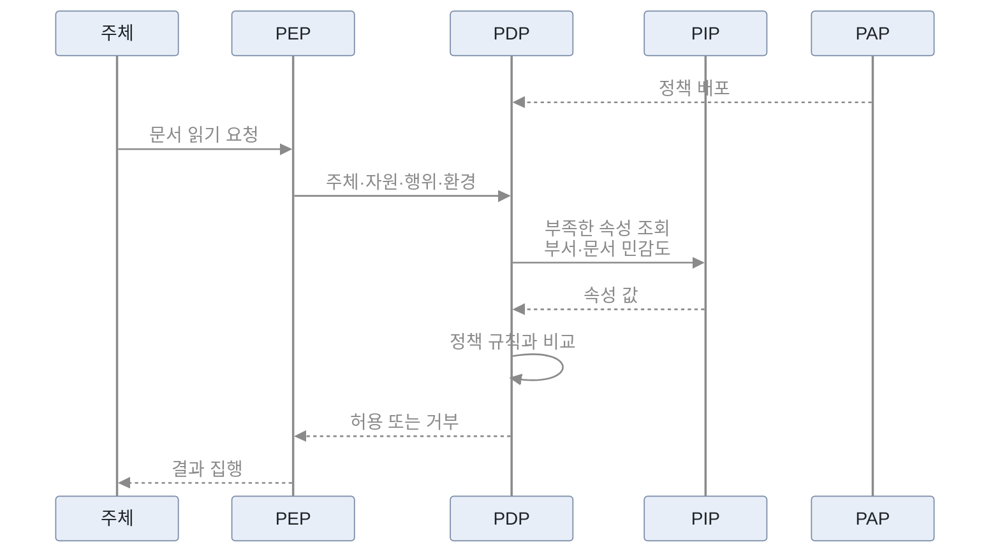
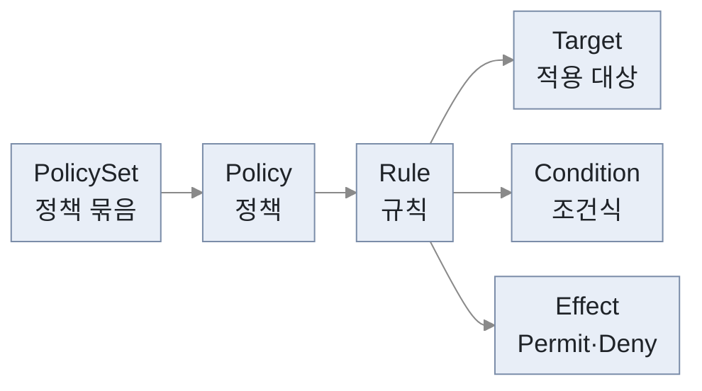

# ABAC & PBAC (속성·정책 기반 접근 통제)

> 약어: NIST=미국 국립표준기술연구소, SP=NIST 특별 간행물, OASIS=구조화 정보 표준 촉진 기구, ANSI=미국 국가표준협회, INCITS=국제정보기술표준위원회, 3GPP=이동통신 표준화 기구

## 1. 개요 (What)

ABAC(Attribute-Based Access Control, 속성 기반 접근 통제)는 **주체·자원·행위·환경의 속성을 정책 규칙과 비교해** 접근을 판단하는 모델이다.

> 예: "**부서가 재무**인 직원은, **민감도가 '내부'** 이하인 **재무 문서**를, **업무 시간에 회사 관리 기기**로 읽을 수 있다."
> 이 한 문장에 주체 속성(부서), 자원 속성(민감도·분류), 행위(읽기), 환경 속성(시간·기기 상태)이 모두 들어 있다.

RBAC(Role-Based Access Control)가 역할 하나로 판단한다면, ABAC는 역할을 포함한 **여러 속성을 조합**해 판단한다.
그래서 RBAC의 역할 폭증 문제를 줄이고, 위치·시간·위험도 같은 상황 조건을 표현할 수 있다 → [RBAC 3.2 역할 폭증 (Role Explosion)](rbac.md#32-역할-폭증-role-explosion)

PBAC(Policy-Based Access Control, 정책 기반 접근 통제)는 문헌마다 정의가 다르다. 이 지식베이스에서는 **인가 정책을 애플리케이션 코드에서 분리해 정책 언어로 작성하고, 중앙에서 버전 관리·테스트·배포하는 운영 방식**으로 본다.
ABAC가 "무엇을 근거로 판단하는가"라면, PBAC는 "그 판단 규칙을 어떻게 만들고 관리하는가"에 가깝다. 실제 엔진(OPA(Open Policy Agent), Cedar)은 [Policy Engines](policy-engines.md)에서 다룬다.

## 2. 배경 / 원리 (Why & How)

### 2.1 왜 속성인가

| 상황 | RBAC로 표현하면 | ABAC로 표현하면 |
|------|----------------|----------------|
| 부서별로 자기 부서 문서만 | 부서 수만큼 역할 | `subject.department == resource.department` 규칙 하나 |
| 업무 시간에만 | 시간대별 역할 (사실상 불가) | `environment.time`이 업무 시간 범위 |
| 외부 협력사 직원 | 협력사·프로젝트 조합마다 역할 | `subject.organization`, `subject.project` 속성 |
| 데이터 민감도 | 등급별 역할 | `resource.classification <= subject.clearance` |
| 위험 신호가 있으면 차단 | 표현 불가 | `environment.risk_score < 임계값` |

- 사용자를 미리 알 필요가 없다. 처음 보는 외부 사용자라도 신뢰할 수 있는 속성(소속, 자격)만 있으면 판단할 수 있다.
- 대가는 복잡성이다. 규칙이 속성 조합으로 표현되므로 **"이 사람은 결국 무엇을 할 수 있는가"를 답하기 어렵다**. RBAC는 역할 목록을 보면 되지만, ABAC는 정책을 모든 속성 조합에 대해 평가해야 한다.

### 2.2 네 종류의 속성

| 범주 | 예 | 주로 나오는 곳 |
|------|----|----------------|
| 주체 (Subject) | 부서, 직급, 소속 조직, 비밀취급 인가, 역할, 인증 강도(MFA(Multi-Factor Authentication) 여부) | 디렉터리, HR(Human Resources) 시스템, IdP(Identity Provider) 토큰 claim |
| 자원 (Resource / Object) | 소유 부서, 민감도, 데이터 유형, 프로젝트, 태그 | 자원 메타데이터, 데이터 분류 시스템 |
| 행위 (Action) | 읽기, 쓰기, 삭제, 승인, 다운로드 | 요청 자체 |
| 환경 (Environment) | 시간, 접속 위치·네트워크, 기기 관리 여부, 위험 점수 | 요청 컨텍스트, 기기 관리 시스템, 위험 엔진 |

### 2.3 판단 흐름



텍스트 설명: PAP(Policy Administration Point)가 배포한 정책을 가진 PDP(Policy Decision Point)는, PEP(Policy Enforcement Point)가 보낸 요청 정보에 부족한 속성을 PIP(Policy Information Point)에서 가져와 규칙과 비교한다.
판단 구조 자체는 다른 모델과 같고, ABAC에서는 **PIP와 속성의 품질**이 판단의 정확성을 좌우한다 → [Access Control Fundamentals 2.2 판단과 집행의 분리](access-control-fundamentals.md#22-판단과-집행의-분리)

## 3. 상세 (Details)

### 3.1 속성은 믿을 수 있어야 한다

ABAC의 판단은 속성 값이 맞다는 전제 위에 있다. 속성이 틀리면 정책이 아무리 정교해도 결과가 틀린다.

| 점검 항목 | 질문 | 잘못되면 |
|-----------|------|----------|
| 권위 있는 출처 | 이 속성을 정하는 공식 시스템은 어디인가 (HR, 자산 관리, 데이터 분류) | 여러 시스템의 값이 엇갈린다 |
| 변경 권한 | 누가 이 속성을 바꿀 수 있는가 | **주체가 자기 속성이나 자원 태그를 직접 바꿔 권한을 얻는다** |
| 최신성 | 값이 언제 갱신되는가 | 부서 이동·퇴사가 늦게 반영된다 |
| 전달 경로 | 속성이 PDP까지 어떻게 오는가 | 클라이언트가 보낸 값을 그대로 쓰면 위조된다 |
| 누락 시 동작 | 속성이 없으면 어떻게 판단하는가 | 부정 조건에서 누락이 허용으로 바뀐다 → [5.3 속성 누락과 부정 조건](#53-속성-누락과-부정-조건) |

- 가장 흔한 사고는 **변경 권한**이다. 클라우드에서 자원 태그로 접근을 정하는데 사용자가 태그를 직접 붙이고 바꿀 수 있으면, 원하는 자원에 자기 부서 태그를 붙여 접근할 수 있다. 접근 판단에 쓰는 태그는 변경 권한을 따로 통제한다.
- 토큰 claim으로 받은 속성은 서명을 검증하고, 발급자가 그 속성을 보증할 자격이 있는지 확인한다 → [Token Security](../pki-identity/token-security.md)

### 3.2 정책 작성 원칙

- **기본은 거부**로 두고 허용 규칙을 쌓는다. 거부 규칙은 예외적인 강제 차단(위험 신호, 수출 통제 등)에만 쓴다.
- 규칙은 자연어 요구사항에서 출발한다. "재무 부서는 자기 부서의 내부 문서를 읽을 수 있다"를 먼저 쓰고, 그 문장을 정책으로 옮긴다. 요구사항 문장이 그대로 테스트 케이스가 된다.
- 속성 이름과 값의 형식(대소문자, 코드값)을 조직 전체에서 통일한다. `Finance`와 `finance`가 다르게 평가되면 정책이 조용히 실패한다.
- **역할은 버리지 않는다.** 직무 단위 역할로 1차 범위를 정하고 속성으로 좁히는 방식이 운영하기 쉽다 → [RBAC 5.4 RBAC와 ABAC의 결합 방식](rbac.md#54-rbac와-abac의-결합-방식)
- 정책 결합 방식(거부 우선 등)을 정하고 문서화한다 → [Access Control Fundamentals 3.3 판단 결과와 충돌 처리](access-control-fundamentals.md#33-판단-결과와-충돌-처리)

### 3.3 정책을 코드로 관리하기 (PBAC)

정책이 많아지면 정책 자체를 소프트웨어처럼 다뤄야 한다.

| 관행 | 내용 |
|------|------|
| 코드와 분리 | 인가 규칙을 애플리케이션 `if` 문에서 빼내 정책 파일로 둔다 |
| 버전 관리 | 정책을 Git 등에 두고 변경 이력·검토·승인을 남긴다 |
| 테스트 | 허용돼야 하는 요청과 거부돼야 하는 요청을 테스트 케이스로 만들어 정책 변경마다 실행한다 |
| 단계 배포 | 기록만 하는 모드로 먼저 배포해 실제 요청에 대한 결과 차이를 확인한 뒤 차단 모드로 바꾼다 |
| 결정 기록 | 어떤 정책 버전이 어떤 결정을 냈는지 로그로 남긴다 |

- 정책이 코드가 되면 **정책 저장소의 쓰기 권한이 곧 모든 자원의 접근 권한**이 된다. 정책 저장소와 배포 파이프라인을 특권 자산으로 보호한다.

### 3.4 어디에 쓰이는가

| 영역 | ABAC 구현 | 속성 예 |
|------|-----------|---------|
| AWS IAM | 정책의 Condition 블록에서 주체·자원 태그 비교 | `aws:PrincipalTag/department`, `aws:ResourceTag/project`, `aws:SourceIp` |
| Microsoft Azure | Azure RBAC 역할 할당에 조건 추가 (Blob Storage, Data Lake Storage Gen2, Queue 등 지원 서비스) | 주체의 사용자 지정 보안 속성, Blob 인덱스 태그·경로, 컨테이너 이름, 요청 작업 |
| Google Cloud | IAM Conditions — 역할 바인딩에 CEL(Common Expression Language) 조건식 | 요청 시간, 자원 이름·유형, 태그 |
| Kubernetes | ABAC 인가 모드(파일 기반 정책) | 사용자, 그룹, 네임스페이스, 자원 |
| 데이터 플랫폼 | 행·열 수준 보안, 데이터 분류 태그 기반 마스킹 | 열 민감도 태그, 사용자 부서 |
| 5G SBA(Service Based Architecture) | NRF(Network Repository Function)의 Access Token 발급 판단 | 소비자 NF(Network Function)의 Instance ID·유형·PLMN(Public Land Mobile Network) ID·S-NSSAI(Single Network Slice Selection Assistance Information), 제공자 NF의 허용 조건 |
| AI·RAG(Retrieval-Augmented Generation) | 검색 단계에서 문서 접근 필터 | 문서 분류·부서 태그, 질의한 사용자의 속성 |

- Azure에서 Blob 인덱스 태그를 조건으로 쓰는 기능은 저장소 유형에 따라 제한이 있다. 계층형 네임스페이스를 켠 Data Lake Storage에서는 Blob 인덱스 태그 조건을 쓰는 데 제약이 있으므로 지원 범위를 확인한다.
- Google Cloud Storage에서 객체 목록 조회 권한은 버킷 수준에서 판단되므로, `resource.name` 조건만으로 버킷 안 특정 경로의 **목록 조회**를 세밀하게 막을 수는 없다. 객체 읽기와 목록 조회를 따로 생각해야 한다.
- Kubernetes의 ABAC 모드는 정책 파일을 API Server 시작 시 읽으므로, 바꾸려면 API Server를 다시 시작해야 한다. 관리가 불편한 레거시 방식이라 새 클러스터에서는 RBAC를 쓰고, 필요하면 Webhook 인가나 Admission 정책을 더한다.
- 5G에서는 세 당사자의 속성 방향을 구분해야 한다.
  - **소비자(NF Service Consumer)**: 자기 NF Instance ID, NF 유형, PLMN ID, 지원 S-NSSAI를 토큰 요청에 담는다. NRF는 이 값을 소비자 인증서나 NF 프로필과 대조해 위조 여부를 확인한다.
  - **제공자(NF Service Producer)**: NF 프로필에 제공하는 서비스와, 서비스를 허용할 조건(허용 슬라이스 등)이 반영되어 있다.
  - **NRF**: 확인된 소비자 속성을 제공자의 허용 조건과 요청한 서비스의 접근 정책에 비교해 토큰 발급 여부를 정한다. 역할보다 속성 비교에 가까운 판단이다 → [OAuth 2.0 · OpenID Connect 3.9 5G SBA의 OAuth 2.0](../pki-identity/oauth2-oidc.md#39-5g-sba의-oauth-20)
- RAG에서 문서를 검색한 **뒤에** 걸러내면, 이미 모델 문맥에 들어간 내용이 응답으로 샐 수 있다. 접근 필터는 검색 단계에서 적용한다.

## 4. 보안 관점 (Security Relevance)

| 실수 | 결과 | 대응 |
|------|------|------|
| 주체가 접근 판단용 태그·속성을 직접 수정 가능 | 자기 속성을 바꿔 권한 획득 | 판단용 속성의 변경 권한 분리, 태그 변경 정책 |
| 클라이언트가 보낸 속성 사용 | 요청 조작으로 권한 상승 | 서버가 권위 있는 출처에서 속성 조회, 토큰은 서명 검증 |
| 속성 누락을 고려하지 않은 부정 조건 | 속성이 없는 주체가 오히려 허용 | 누락 시 거부, 존재 여부를 명시적으로 확인 |
| 속성 갱신 지연 | 부서 이동·퇴사 후에도 접근 | 권위 있는 출처와 동기화 주기 단축, 이벤트 기반 갱신 |
| 값 형식 불일치 (대소문자, 공백) | 정책이 의도와 다르게 평가 | 속성 값 표준화, 테스트 케이스 |
| 정책이 너무 복잡해 검증 불가 | 숨은 허용 경로 | 정책 테스트, 시뮬레이션, 단순한 규칙 유지 |
| PIP 장애 시 허용 | 장애 유도로 통제 우회 | 속성 조회 실패 시 거부 |
| 정책 저장소 쓰기 권한 관리 소홀 | 정책 변경으로 모든 통제 무력화 | 정책 변경 검토·승인, 배포 파이프라인 보호 |
| 검색 후 필터링 (RAG) | 권한 없는 문서 내용이 응답에 포함 | 검색 단계에서 속성 필터 적용 |

점검 시 확인할 것: 판단에 쓰는 속성 목록과 각 속성의 권위 있는 출처, 속성·태그 변경 권한, 속성 누락 시 동작, 부정 조건 사용 여부, 속성 갱신 주기, 정책 테스트 존재 여부, 정책 변경 절차, PIP 장애 시 동작.

## 5. 심화 (Advanced)

> 보안 컨설턴트·점검자를 위한 세부다. 본문만으로 개념 이해에는 충분하다.

### 5.1 *NIST SP 800-162*의 ABAC 정의

*NIST SP 800-162*는 ABAC를 주체, 객체, 요청된 작업, 그리고 경우에 따라 환경 조건의 속성을 정책·규칙·관계와 비교 평가해 접근을 결정하는 논리적 접근 통제 방식으로 정의한다.

- 기능 구성 요소로 PDP·PEP·PIP·PAP를 쓰고, 속성의 생성·관리·공유, 정책 관리, 환경 조건을 ABAC 도입 시 고려 사항으로 다룬다.
- 조직 간 ABAC에서는 **속성의 의미와 신뢰를 조직끼리 합의**하는 것이 핵심 과제다. 같은 "clearance" 속성이라도 발급 기준이 다르면 비교할 수 없다.
- *NIST SP 800-178*은 ABAC 표준인 XACML(eXtensible Access Control Markup Language)과 NGAC(Next Generation Access Control)를 비교한다.

### 5.2 XACML 정책 구조

*OASIS XACML 3.0*의 정책은 계층 구조다.



텍스트 설명: PolicySet은 Policy를 묶고, Policy는 Rule을 묶는다. 각 단계에는 적용 대상(Target)과 하위 결과를 합치는 결합 알고리즘이 있다.
Rule은 Target이 맞고 Condition이 참일 때 Effect(Permit 또는 Deny)를 낸다. Condition은 생략할 수 있으며, 없으면 Target만으로 적용 여부가 정해진다.

| 요소 | 역할 |
|------|------|
| Target | 이 정책·규칙이 어떤 요청에 적용되는지 (빠른 선별) |
| Condition | 속성을 비교하는 세부 조건식 (선택 사항) |
| Effect | 규칙이 적용될 때의 결과 (Permit 또는 Deny) |
| 결합 알고리즘 | 여러 Rule·Policy의 결과를 하나로 합치는 방법 |
| Obligation·Advice | 결정과 함께 PEP에 전달하는 의무·참고 정보 |

- 요청은 주체·자원·행위·환경 등 **범주(Category)별 속성 묶음**으로 전달된다.
- 결정 값과 결합 알고리즘은 [Access Control Fundamentals 5.2 XACML의 결정 값과 결합 알고리즘](access-control-fundamentals.md#52-xacml의-결정-값과-결합-알고리즘)에 정리되어 있다.
- XACML의 정책 언어와 데이터 모델은 XML 기반이라 직접 작성하기 무겁다. JSON Profile은 **요청·응답**을 JSON으로 표현하는 방법을 정할 뿐이며, 정책 자체가 JSON 언어로 바뀌는 것은 아니다. 실무에서는 더 가벼운 정책 언어로 같은 구조를 구현하는 경우가 많다.

### 5.3 속성 누락과 부정 조건

부정 조건("~가 아니면 허용")은 속성이 **없을 때** 위험하다.

> 예: 급여 보고서를 인사팀만 읽게 하려고 "모든 직원 읽기 허용" 규칙에 "부서가 인사팀이 **아니면** 거부" 규칙을 더했다고 하자.
> 부서 속성이 아예 없는 주체(외부 시스템 계정, 동기화에 실패한 계정)는 "인사팀이 아님"이 판단되지 않아, 엔진에 따라 거부 규칙을 건너뛰고 "모든 직원 읽기 허용"에 걸릴 수 있다.

- 정책 언어마다 누락 속성의 처리가 다르다. 어떤 엔진은 비교 자체를 거짓으로, 어떤 엔진은 오류(Indeterminate)로, 어떤 엔진은 부정 연산자의 결과를 참으로 처리한다.
- AWS IAM에서는 조건 키가 요청에 없을 때 연산자에 따라 결과가 다르다.

| 연산자 | 키가 없을 때 |
|--------|-------------|
| `StringEquals`, `StringLike`, `ArnEquals` 등 긍정 연산자 | 거짓 |
| `StringNotEquals`, `StringNotLike`, `ArnNotEquals` 등 부정 연산자 | **참** |
| `...IfExists`가 붙은 연산자 | 참 (키가 있으면 값을 비교) |
| `Null` | 키의 **존재 여부**만 검사. `"true"`는 키가 없을 때, `"false"`는 키가 있을 때 참 |

- `...IfExists`는 "키가 없으면 통과시킨다"는 뜻이고, `Null`은 "키가 있는지 확인한다"는 뜻이라 서로 대체할 수 없다.
- 예: `Allow` 문에 `StringNotEquals`로 "부서가 인사가 아니면"을 걸면, 부서 태그가 없는 주체도 조건을 통과한다. 태그가 반드시 있어야 하면 `"Null": {"aws:PrincipalTag/department": "false"}`를 함께 건다.
- `Deny` 문에 `StringNotEqualsIfExists`를 쓰면 키가 없는 요청도 조건이 참이 되어 거부된다. 거부 범위가 의도보다 넓어질 수 있으므로 키가 없는 경우를 따로 시험한다.
- 대응: 필요한 속성이 **존재하는지 먼저 확인**하고, 없으면 거부하는 규칙을 둔다. 허용 조건은 긍정형("부서가 재무**이면** 허용")으로 쓰는 것이 안전하다.

### 5.4 클라우드 ABAC 예시

**AWS — 주체 태그와 자원 태그가 같을 때만 허용**

```json
{
  "Effect": "Allow",
  "Action": ["ec2:StartInstances", "ec2:StopInstances"],
  "Resource": "arn:aws:ec2:*:*:instance/*",
  "Condition": {
    "StringEquals": {
      "aws:ResourceTag/project": "${aws:PrincipalTag/project}"
    }
  }
}
```

- 이 정책은 "같은 프로젝트 태그를 가진 인스턴스만 시작·중지"를 뜻한다. 프로젝트가 늘어도 정책을 바꿀 필요가 없다. 시작·중지 외의 권한(인스턴스 조회 등)은 주지 않으므로 필요하면 따로 허용한다.
- 대신 **자원 태그와 주체 태그를 누가 바꿀 수 있는지**가 보안의 핵심이 된다. 태그 생성·변경 권한(`ec2:CreateTags` 등)을 제한하거나, 태그 변경 요청 자체에 조건(`aws:RequestTag`, `aws:TagKeys`)을 건다.

**Google Cloud — IAM Conditions (CEL)**

```text
request.time < timestamp("2027-01-01T00:00:00Z") &&
resource.name.startsWith("projects/_/buckets/finance-reports")
```

- 역할 바인딩에 조건식을 붙여 "이 기간까지, 이 버킷에 대해서만" 역할을 적용한다. 임시 접근 부여에 쓸 수 있다. 객체는 `projects/_/buckets/버킷이름/objects/객체이름` 형식이라 경로 접두사로 좁힐 수 있지만, 위에서 말한 목록 조회 제한은 그대로 남는다.

### 5.5 NGAC

NGAC는 NIST 연구를 바탕으로 *ANSI INCITS 565*로 표준화된 접근 통제 프레임워크로, 정책을 **그래프**로 표현한다.

| 요소 | 의미 |
|------|------|
| 사용자·사용자 속성 | 사용자와, 사용자를 묶는 속성 노드 (부서, 역할 등) |
| 객체·객체 속성 | 자원과, 자원을 묶는 속성 노드 (프로젝트, 분류 등) |
| 정책 클래스 | 독립된 접근 통제 영역. 여러 정책 클래스를 동시에 적용할 수 있다 |
| 배정 (Assignment) | 노드 간 포함 관계 |
| 연관 (Association) | "이 사용자 속성은 이 객체 속성에 이 작업을 할 수 있다" |
| 금지 (Prohibition) | 연관으로 부여된 권한을 제한하는 거부 관계 |
| 의무 (Obligation) | 특정 이벤트가 일어나면 정책 요소를 자동으로 바꾸는 규칙. EPP(Event Processing Point)가 처리한다 |

- 접근 결정은 사용자·객체가 속한 정책 클래스, 배정과 연관 관계, 금지를 종합해 이루어진다. "모든 정책 클래스를 무조건 만족해야 한다"는 단순한 AND 조건으로 일반화하지 않는다.

- RBAC(역할을 사용자 속성으로), MAC(등급을 정책 클래스로) 같은 기존 모델을 같은 그래프 구조로 표현할 수 있다.
- XACML이 "요청마다 규칙을 평가"한다면 NGAC는 "관계 그래프를 따라가 허용 작업을 계산"한다. 그래서 "이 사용자가 접근할 수 있는 모든 객체" 같은 검토 질의에 강하다. 이 성격은 [ReBAC](rebac.md)와도 이어진다.

## 관련 문서

- 이전: [RBAC](rbac.md)
- 다음: [ReBAC](rebac.md), [Policy Engines](policy-engines.md)
- 판단 구조와 XACML 결정 값: [Access Control Fundamentals](access-control-fundamentals.md)
- 속성의 출처인 토큰 claim: [OAuth 2.0 · OpenID Connect](../pki-identity/oauth2-oidc.md), [Token Security](../pki-identity/token-security.md)
- 로드맵: [Access Control](README.md)

## 출처

| 문서 | 이 문서에서의 사용 |
|------|-------------------|
| *NIST SP 800-162* | ABAC 정의, 기능 구성 요소, 도입 고려 사항 |
| *NIST SP 800-178* | XACML과 NGAC 비교 |
| *ANSI INCITS 565* | NGAC 구성 요소 |
| *OASIS XACML 3.0* | 정책 구조(PolicySet·Policy·Rule·Target·Condition·Effect), 요청 범주 |
| AWS IAM 문서 (ABAC, 조건 연산자) | 태그 기반 ABAC, 부정 연산자와 누락 키 동작, `IfExists`·`Null` |
| Microsoft Azure ABAC 문서 | 역할 할당 조건 |
| Google Cloud IAM Conditions 문서 | CEL 조건식 |
| Kubernetes 공식 문서 (ABAC Mode) | 파일 기반 ABAC 인가 모드 |
| *3GPP TS 33.501 V19.7.0 (Release 19)* | NRF의 Access Token 발급 시 소비자 확인 |

- 그 외 내용은 ABAC·PBAC의 일반 원리를 재구성한 해설이다.
