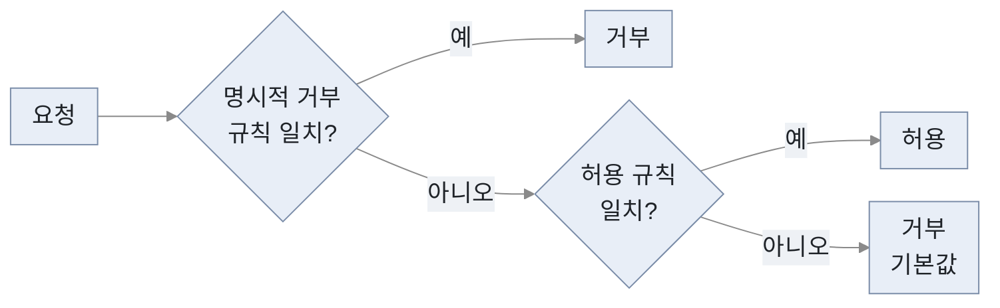

# Access Control Fundamentals (접근 통제 기초)

> 약어: NIST=미국 국립표준기술연구소, SP=NIST 특별 간행물, RFC=IETF 표준 문서, IETF=인터넷 표준화 기구, OASIS=구조화 정보 표준 촉진 기구, 3GPP=이동통신 표준화 기구

## 1. 개요 (What)

접근 통제(Access Control)는 **"이 주체가 이 자원에 이 행위를 해도 되는가"** 를 판단하고, 그 판단대로 막거나 통과시키는 일이다.
판단하는 부분을 인가(Authorization)라고 부르고, 판단 결과를 실제로 적용하는 부분을 집행(Enforcement)이라고 부른다.

인가는 인증(Authentication) 다음 단계다. 인증은 "요청한 주체가 누구인가"를 확인하고, 인가는 "확인된 주체가 무엇을 할 수 있는가"를 정한다.
로그인에 성공한 사용자가 다른 사람의 주문 내역을 열람할 수 있다면 인증은 정상이고 인가가 깨진 것이다.
이런 인가 결함은 OWASP(Open Worldwide Application Security Project) Top 10:2025에서 A01 Broken Access Control로 가장 위에 있다.

이 문서는 Access Control 하위 영역의 출발점이다. 이후 문서(DAC·MAC·RBAC·ABAC·ReBAC·정책 엔진)가 함께 쓰는 판단 구조, 용어, 원칙을 정리한다.
인증 쪽 기초는 [Identity Fundamentals](../pki-identity/identity-fundamentals.md)에서 다룬다.

## 2. 배경 / 원리 (Why & How)

### 2.1 인가 질문의 네 요소

모든 인가 판단은 같은 형태의 질문으로 바꿀 수 있다.

| 요소 | 뜻 | 예 |
|------|----|----|
| 주체 (Subject) | 행위를 요청하는 사람·서비스 | 사용자 `alice`, 서비스 계정 `billing-svc`, AI 에이전트 |
| 행위 (Action) | 하려는 동작 | 읽기, 수정, 삭제, 승인, 배포 |
| 자원 (Resource / Object) | 행위의 대상 | 주문 `#1042`, S3 버킷, Kubernetes Pod, 문서 폴더 |
| 조건 (Context / Environment) | 요청이 일어나는 상황 | 시간, 접속 위치, 기기 상태, 인증 강도, 위험 점수 |

> 예: "`alice`가(주체) 주문 `#1042`를(자원) 환불 처리해도(행위) 되는가, 사내망 밖 미등록 기기에서(조건)?"

접근 통제 모델은 이 네 요소 중 **무엇을 근거로 답을 내는가**에서 갈린다.
RBAC(Role-Based Access Control)는 주체의 역할을, ABAC(Attribute-Based Access Control)는 네 요소의 속성 전체를, ReBAC(Relationship-Based Access Control)는 주체와 자원 사이의 관계를 본다.
모델 비교는 [Access Control 1.2 접근 통제 모델 비교](README.md#12-접근-통제-모델-비교)에 정리되어 있다.

### 2.2 판단과 집행의 분리

인가를 코드 곳곳에 `if` 문으로 흩어 두면 정책을 바꾸거나 감사하기 어렵다. 그래서 역할을 나눠 설계한다.

| 구성 요소 | 하는 일 | 비유 |
|-----------|---------|------|
| PEP(Policy Enforcement Point) | 요청을 가로채 판단을 묻고, 결과대로 막거나 통과시킨다 | 출입문 경비원 |
| PDP(Policy Decision Point) | 정책과 속성으로 허용·거부를 결정한다 | 출입 규정을 보고 판정하는 담당자 |
| PIP(Policy Information Point) | 판단에 필요한 속성을 가져다준다 | 인사 기록·출입 명부 |
| PAP(Policy Administration Point) | 정책을 작성·배포·관리한다 | 출입 규정을 만드는 부서 |

- PEP는 **빠짐없이** 요청 경로에 있어야 하고, PDP는 **정확하게** 판단해야 한다. 둘 중 하나만 실패해도 통제가 무너진다.
- 작은 애플리케이션에서는 네 역할이 한 코드 안에 함께 있을 수 있다. 중요한 것은 물리적 분리가 아니라 **역할을 구분해 설계하는 것**이다.
- PDP를 분리하면 여러 서비스가 같은 정책을 공유하고, 정책을 코드와 별도로 테스트·배포할 수 있다. 구현은 [Policy Engines](policy-engines.md)에서 다룬다.

### 2.3 기본 원칙

접근 통제 설계의 기본 원칙은 Saltzer·Schroeder의 고전 논문 "The Protection of Information in Computer Systems"에서 정리된 보호 설계 원칙에 뿌리를 둔다.
실무에서 특히 자주 깨지는 원칙은 다음과 같다. 전체 목록은 [5.1 Saltzer·Schroeder 설계 원칙](#51-saltzerschroeder-설계-원칙)에 있다.

| 원칙 | 의미 | 깨진 예 |
|------|------|---------|
| 기본 거부 (Fail-safe Defaults) | 명시적으로 허용한 것만 허용한다 | 새 API를 추가했는데 인가 규칙이 없어 누구나 호출 |
| 완전 중재 (Complete Mediation) | 모든 접근을 매번 검사한다 | 목록 화면만 검사하고 상세 조회 API는 검사하지 않음 |
| 최소 권한 (Least Privilege) | 업무에 필요한 최소 권한만 준다 | 배치 작업 계정에 관리자 권한 부여 |
| 권한 분리 (Separation of Privilege / Duties) | 위험한 작업은 둘 이상의 조건이나 사람을 요구한다 | 송금 요청자와 승인자가 같은 계정 |
| 실패 시 닫힘 (Fail Closed) | 판단할 수 없으면 거부한다 | PDP 장애 시 "일단 허용"으로 동작 |

- "실패 시 닫힘"은 기본 거부 원칙을 장애 상황에 적용한 것이다. 가용성 때문에 열림(Fail Open)을 택하는 경우에는 그 범위를 좁히고 기록을 남긴다.
- 최소 권한의 운영 방법(JIT(Just-In-Time) 접근, 권한 검토)은 [Least Privilege](least-privilege.md)에서 다룬다.

## 3. 상세 (Details)

### 3.1 접근 통제 행렬 — ACL과 Capability

주체를 행, 자원을 열로 놓고 칸마다 허용된 행위를 적은 표를 **접근 통제 행렬(Access Control Matrix)** 이라고 한다.

| 주체 \ 자원 | 급여 파일 | 공지 게시판 | 배포 파이프라인 |
|-------------|-----------|-------------|-----------------|
| alice (인사팀) | 읽기·쓰기 | 읽기 | — |
| bob (개발자) | — | 읽기·쓰기 | 실행 |
| ci-bot (서비스) | — | — | 실행 |

이 행렬은 너무 크고 비어 있는 칸이 많아 그대로 저장하지 않는다. 대신 두 방향 중 하나로 잘라서 저장한다.

| 방식 | 저장 방향 | 확인 질문 | 실제 예 |
|------|-----------|-----------|---------|
| ACL(Access Control List) | 자원(열)마다 "누가 무엇을 할 수 있나" | 이 파일에 접근할 수 있는 사람은 누구인가 | 파일 시스템 권한, S3 버킷 정책, 공유 폴더 권한 |
| Capability | 주체(행)마다 "무엇에 무엇을 할 수 있나"를 담은 증표 | 이 증표를 가진 사람은 무엇을 할 수 있나 | OAuth Access Token의 scope, 서명된 다운로드 URL, Unix 파일 디스크립터 |

- ACL은 자원 기준 감사(이 데이터에 누가 접근 가능한가)가 쉽고, 권한 회수가 간단하다.
- Capability는 증표만 있으면 되므로 분산 환경에 맞지만, **증표가 유출되면 가진 사람이 곧 권한자**가 된다. 그래서 수명을 짧게 하고 대상과 범위를 좁힌다.
  Bearer Token이 이 성격을 가지며, 송신자 제한 방법은 [Token Security](../pki-identity/token-security.md)에서 다룬다.

### 3.2 인가는 어느 계층에서 하는가

하나의 요청은 여러 계층을 지나며, 계층마다 볼 수 있는 정보가 다르다.

텍스트 설명: 네트워크 계층은 출발지와 포트만 보고, API Gateway는 토큰의 유효성과 scope 정도를 본다.
서비스는 "이 사용자가 환불 기능을 쓸 수 있는가" 같은 기능 권한을 판단하고, 데이터 계층에 가까울수록 "이 주문이 이 사용자 것인가" 같은 객체 단위 판단이 가능하다.

| 계층 | 판단 단위 | 강점 | 한계 |
|------|-----------|------|------|
| 네트워크 | 출발지·목적지·포트 | 노출 자체를 줄인다 | 주체와 자원을 모른다 |
| API Gateway | 인증 여부, scope, 경로 | 중앙에서 일관되게 적용 | 객체 소유 관계를 모른다 |
| 서비스(애플리케이션) | 기능·업무 규칙 | 업무 맥락을 안다 | 서비스마다 구현이 흩어지기 쉽다 |
| 데이터 계층 | 객체·행·열 | 우회 경로가 있어도 마지막에 막는다 | 업무 규칙 표현이 어렵다 |

- **거친 판단(Coarse-grained)** 은 앞 계층에서, **세밀한 판단(Fine-grained)** 은 자원을 아는 계층에서 한다.
  게이트웨이에서 "로그인한 사용자"만 확인하고 서비스가 객체 소유를 확인하지 않으면 IDOR(Insecure Direct Object Reference)가 된다.
- 여러 계층에서 겹쳐 검사하는 것은 낭비가 아니라 심층 방어다. 다만 **최종 판단 책임이 어느 계층에 있는지**는 명확히 정한다.

### 3.3 판단 결과와 충돌 처리

정책이 여러 개면 한 요청에 허용 규칙과 거부 규칙이 동시에 맞을 수 있다. 그래서 엔진마다 결합 규칙이 있다.

텍스트 설명: 거부 우선(Deny-overrides) 결합에서는 명시적 거부가 하나라도 맞으면 다른 허용 규칙과 관계없이 거부한다.
거부 규칙이 없으면 허용 규칙을 찾고, 허용 규칙도 없으면 기본 거부로 끝난다.

| 결합 방식 | 동작 | 사용 예 |
|-----------|------|---------|
| 거부 우선 (Deny-overrides) | 거부가 하나라도 있으면 거부 | AWS(Amazon Web Services) IAM(Identity and Access Management) 정책 평가: 기본은 암묵적 거부, 명시적 Deny가 Allow보다 우선 |
| 허용 우선 (Permit-overrides) | 허용이 하나라도 있으면 허용 | 예외 허용을 쌓는 구조. 잘못 쓰면 거부 규칙이 무력해진다 |
| 첫 일치 (First-applicable) | 순서대로 보고 처음 맞는 규칙을 따른다 | 방화벽 규칙 목록 |
| 허용만 누적 (Additive) | 거부 규칙이 없고 허용의 합집합만 있다 | Kubernetes RBAC: Role·ClusterRole은 허용 규칙만 정의 |

- 허용만 누적하는 구조에서는 "특정 권한을 빼는" 표현이 불가능하다. 권한을 줄이려면 넓은 역할을 쪼개야 한다.
- 단, 모델 하나에 거부 규칙이 없다고 시스템 전체에 거부가 없는 것은 아니다. Kubernetes API Server는 여러 인가 모듈을 설정 순서대로 묻고, 앞 모듈이 허용·거부를 내면 그 결과를 쓰며 의견 없음(NoOpinion)이면 다음 모듈로 넘긴다. 모두 의견이 없으면 거부한다. 그래서 RBAC 앞에 둔 Webhook 모듈은 명시적 거부를 낼 수 있다.
- AWS 평가도 실제로는 신원 기반 정책만이 아니라 자원 기반 정책, 권한 경계(Permissions Boundary), 세션 정책, 조직 정책(SCP(Service Control Policy) 등)이 함께 작용한다. 위 표는 기본 원칙만 단순화한 것이다.
- 결정 값은 허용·거부 둘만 있는 것이 아니다. 정책이 적용되지 않음, 판단 오류(속성 조회 실패 등) 같은 상태도 있으며, PEP는 이를 **거부로 처리**해야 한다. 세부는 [5.2 XACML의 결정 값과 결합 알고리즘](#52-xacml의-결정-값과-결합-알고리즘)에 있다.

### 3.4 판단 근거는 언제 얻는가

PDP가 쓰는 속성은 두 방식으로 얻는다. 어느 쪽이든 **권한 변경이 반영되기까지의 지연**을 고려해야 한다.

| 방식 | 예 | 장점 | 위험 |
|------|----|------|------|
| 토큰에 담아 전달 | Access Token의 `scope`, `roles` claim | 빠르다. PDP가 외부 조회 없이 판단 | 토큰 만료 전까지 권한 회수가 반영되지 않는다 |
| 요청 시점에 조회 | 디렉터리·DB에서 현재 역할·소유자 조회 | 최신 상태 반영 | 지연·장애가 판단에 영향 |

- 퇴사자 권한 회수나 계정 잠금이 즉시 반영돼야 하는 자원은 토큰 수명을 짧게 하거나, 요청 시점 조회와 이벤트 기반 폐기를 함께 쓴다.
  토큰 폐기와 세션 강제 종료는 [Session & Token Lifecycle](../pki-identity/session-token-lifecycle.md)에서 다룬다.
- 클라이언트가 보낸 값(요청 본문의 `role=admin`, 숨겨진 폼 필드, 쿠키 속 역할)은 **판단 근거로 쓰지 않는다.** 서버가 신뢰할 수 있는 출처에서 직접 얻은 속성만 쓴다.

### 3.5 결정 기록

인가 결정은 사고 조사와 권한 검토의 핵심 증거다.

- 기록할 것: 주체, 행위, 자원, 결정(허용·거부), 적용된 정책 식별자, 시각, 요청 출처.
- **거부 기록**은 공격 탐지 신호다. 같은 주체가 다른 사용자의 객체 ID를 순서대로 바꿔가며 거부당하면 IDOR 탐색일 가능성이 크다.
- **허용 기록**은 "이 데이터에 실제로 누가 접근했는가"에 답한다. 민감 자원은 허용도 남긴다.
- 로그 수집·탐지 체계는 [Security Operations](../security-operations/README.md) (작성 예정)에서 다룬다.

### 3.6 어디에 쓰이는가

| 영역 | PEP | PDP와 판단 근거 |
|------|-----|-----------------|
| Web·API | 애플리케이션 미들웨어, API Gateway | 세션·토큰의 사용자 정보 + 객체 소유 관계 |
| Kubernetes | API Server | 활성화된 인가 모듈(Node, RBAC, ABAC, Webhook 중 설정된 것)이 순서대로 사용자·그룹·동사·자원을 판단 |
| 클라우드 | 각 클라우드 서비스 API | IAM 정책 평가기가 정책 문서·조건 키로 판단 |
| 5G SBA(Service Based Architecture) | 서비스를 제공하는 NF(Network Function), 즉 NF Service Producer | NRF(Network Repository Function)가 발급한 Access Token의 서명·대상·범위·만료를 검증 |
| AI 에이전트 | 도구 호출 게이트웨이 | 에이전트가 아니라 **위임한 사용자의 권한**과 허용된 도구 범위로 판단 |

5G에서는 OAuth 2.0 역할이 정해져 있다. NRF가 인가 서버로 접근 권한을 확인해 Access Token을 발급하고, 서비스를 요청하는 NF Service Consumer가 클라이언트, 서비스를 제공하는 NF Service Producer가 자원 서버다.
요청마다 NRF에 다시 묻는 것이 아니라 **Producer가 토큰을 직접 검증해** 서비스 제공 여부를 정하므로, Producer가 PEP 역할을 맡는다.
세부 흐름과 토큰 claim은 [OAuth 2.0 · OpenID Connect 3.9 5G SBA의 OAuth 2.0](../pki-identity/oauth2-oidc.md#39-5g-sba의-oauth-20)에 있다.

## 4. 보안 관점 (Security Relevance)

| 실수 | 결과 | 대응 |
|------|------|------|
| 인증만 하고 객체 소유를 확인하지 않음 | ID만 바꿔 남의 데이터 조회(IDOR·BOLA(Broken Object Level Authorization)) | 객체마다 소유·관계 확인, 추측 어려운 ID는 보조 수단일 뿐 |
| 화면에서 버튼만 숨김 | API 직접 호출로 관리 기능 실행 | 서버 측에서 기능 단위 인가 |
| 새 경로를 추가하며 인가 누락 | 기본 허용 상태의 엔드포인트 노출 | 프레임워크 수준의 기본 거부, 인가 누락 탐지 테스트 |
| 클라이언트가 보낸 역할·ID를 신뢰 | 파라미터 조작으로 권한 상승 | 서버가 신뢰할 수 있는 출처에서 속성 획득 |
| PDP 장애 시 허용 | 장애를 유도해 통제 우회 | Fail Closed, 예외 시 범위 제한과 기록 |
| 토큰에 권한을 넣고 수명을 길게 설정 | 권한 회수 후에도 접근 지속 | 짧은 수명, 요청 시점 조회, 폐기 이벤트 |
| 허용 우선 결합에 거부 규칙 의존 | 거부 규칙이 무력화 | 결합 방식 확인, 기본은 거부 우선 |
| 서비스가 자기 권한으로 사용자 요청 처리 | 사용자가 못 하는 일을 서비스가 대신 수행(Confused Deputy) | 사용자 권한을 함께 전달해 판단, 위임 범위 제한 |
| 거부 기록을 남기지 않음 | 권한 탐색 공격을 탐지하지 못함 | 인가 결정 로그, 반복 거부 탐지 |

점검 시 확인할 것: 모든 경로에 PEP가 있는지(우회 경로), 기본 거부 여부, 객체 단위 인가 위치, 판단 근거의 출처(클라이언트 값 사용 여부), 정책 결합 방식, 장애 시 동작, 권한 회수 반영 지연, 인가 결정 로그.
공격 형태별 상세는 [Authorization Attacks](authorization-attacks.md)에서 다룬다.

## 5. 심화 (Advanced)

> 보안 컨설턴트·점검자를 위한 세부다. 본문만으로 개념 이해에는 충분하다.

### 5.1 Saltzer·Schroeder 설계 원칙

| 원칙 | 의미 | 현대 적용 |
|------|------|-----------|
| Economy of Mechanism | 보호 장치는 작고 단순해야 검증할 수 있다 | 인가 로직을 한 곳(PDP·라이브러리)으로 모은다 |
| Fail-safe Defaults | 접근 결정은 허용이 아니라 거부를 기본으로 한다 | 기본 거부, Fail Closed |
| Complete Mediation | 모든 객체 접근을 매번 검사한다 | 캐시된 결정의 수명 제한, 우회 경로 제거 |
| Open Design | 설계를 비밀로 해서 보안을 얻지 않는다 | 추측 어려운 URL·ID에 의존하지 않는다 |
| Separation of Privilege | 하나가 아니라 둘 이상의 조건을 요구한다 | 이중 승인, MFA(Multi-Factor Authentication) 기반 특권 작업 |
| Least Privilege | 필요한 최소 권한만 쓴다 | 역할 최소화, JIT 접근, 짧은 수명 자격 증명 |
| Least Common Mechanism | 여러 사용자가 공유하는 장치를 최소화한다 | 멀티테넌트 자원 분리, 공유 서비스 계정 지양 |
| Psychological Acceptability | 보호 장치가 쓰기 쉬워야 올바르게 쓰인다 | 권한 요청·승인 절차를 단순하게 만들어 우회를 줄인다 |

- 이 원칙들은 특정 기술이 아니라 설계 판단의 기준이다. 이후 문서의 모델과 엔진은 이 원칙을 구현하는 방법으로 읽을 수 있다.

### 5.2 XACML의 결정 값과 결합 알고리즘

*OASIS XACML 3.0*(eXtensible Access Control Markup Language)은 PEP·PDP·PIP·PAP 구조와 정책 결합 방식을 정형화한 표준이다.
정책 언어 자체보다 **용어와 판단 모델**이 다른 엔진에도 널리 영향을 주었다.

| 결정 값 | 의미 | PEP 처리 |
|---------|------|----------|
| Permit | 허용 | 통과 |
| Deny | 거부 | 차단 |
| NotApplicable | 요청에 적용되는 정책이 없음 | 기본 거부로 차단 |
| Indeterminate | 판단 중 오류(속성 누락, 평가 실패 등) | 차단 |

- 정책 평가 내부에서는 Indeterminate를 "결과가 났다면 무엇이었을지"에 따라 Indeterminate{D}·{P}·{DP}로 세분해 결합 알고리즘이 쓴다. PDP가 최종 응답으로 돌려주는 값은 위 네 가지다.

| 결합 알고리즘 | 동작 |
|---------------|------|
| Deny-overrides | 하나라도 Deny면 Deny |
| Permit-overrides | 하나라도 Permit이면 Permit |
| First-applicable | 순서대로 평가해 처음으로 NotApplicable이 아닌 결과 |
| Only-one-applicable | 정책의 **Target**이 요청과 맞는 정책이 하나도 없으면 NotApplicable, 정확히 하나면 그 정책의 평가 결과, 둘 이상이거나 Target 평가에 오류가 나면 Indeterminate |
| Deny-unless-permit | Permit이 있으면 Permit, 그 외에는 모두 Deny (NotApplicable·Indeterminate를 남기지 않음) |
| Permit-unless-deny | Deny가 있으면 Deny, 그 외에는 모두 Permit |

- 결합 알고리즘은 위 표보다 더 있으며(순서 보장 변형 등), 여기서는 판단 구조를 이해하는 데 필요한 것만 골랐다.
- Only-one-applicable은 정책의 **평가 결과**가 아니라 **적용 대상(Target) 일치 여부**로 "하나뿐인가"를 센다. 예를 들어 정책 A의 Target만 맞고 B·C는 맞지 않으면 A의 결과를 쓰고, A·B 둘 다 맞으면 Indeterminate다.
- Permit-unless-deny는 정책 누락이 곧 허용이 되므로 기본 거부 원칙과 맞지 않는다. 쓰려면 거부 규칙이 빠짐없이 있다는 근거가 필요하다.
- **Obligation**은 결정과 함께 PEP가 반드시 수행해야 하는 지시다(예: "허용하되 접근 기록을 남겨라", "민감 필드를 가려라"). Permit에 Obligation이 붙어 있으면 PEP는 그것을 **이해하고, 이행할 수 있고, 실제로 이행할 때만** 접근을 허용한다. 하나라도 안 되면 Permit이어도 차단한다.
- **Advice**는 참고 정보라 PEP가 무시해도 결정의 효력에 영향이 없다.
- PEP·PDP 용어는 IETF의 정책 기반 승인 제어 프레임워크(*RFC 2753*, Informational)에서 정의되어 쓰였고, *OASIS XACML 3.0*, *NIST SP 800-162*에서도 같은 의미로 쓰인다. 구조와 ABAC 정책 작성은 [ABAC & PBAC](abac-pbac.md)에서 다룬다.

### 5.3 ACL 기반 권한과 Confused Deputy

ACL 방식에서는 프로그램이 **자기 자신의 권한**(ambient authority)으로 자원에 접근한다.
그래서 높은 권한을 가진 프로그램이 낮은 권한 사용자의 요청을 받아 처리하면, 사용자가 직접 할 수 없는 일을 프로그램이 대신 하게 될 수 있다. 이를 Confused Deputy 문제라고 한다.

- 예: 파일 변환 서비스가 "결과를 이 경로에 써 달라"는 요청을 받아 자신의 권한으로 시스템 설정 파일을 덮어쓴다.
- 예: 클라우드 서비스가 고객이 지정한 자원에 자기 역할로 접근하는데, 다른 고객의 자원을 지정해도 막지 않는다. 클라우드에서는 역할 위임 시 외부 ID·출처 조건으로 이를 막는다.
- 대응: 요청자의 권한을 함께 전달해 판단하거나(사용자 위임 토큰), 요청에 접근 대상을 담은 Capability를 쓰게 한다.
- AI 에이전트는 사용자 지시와 외부 콘텐츠를 함께 받아 자기 권한으로 도구를 호출하므로 이 문제에 특히 취약하다.

## 관련 문서

- 다음: [DAC & MAC](dac-mac.md), [RBAC](rbac.md)
- 인증 기초: [Identity Fundamentals](../pki-identity/identity-fundamentals.md)
- 토큰 기반 인가 근거: [OAuth 2.0 · OpenID Connect](../pki-identity/oauth2-oidc.md), [Token Security](../pki-identity/token-security.md)
- 로드맵: [Access Control](README.md)

## 출처

| 문서 | 이 문서에서의 사용 |
|------|-------------------|
| Saltzer·Schroeder, "The Protection of Information in Computer Systems" | 보호 설계 원칙 |
| *OASIS XACML 3.0* | PEP·PDP·PIP·PAP 구조, 결정 값, 결합 알고리즘, Obligation·Advice |
| *NIST SP 800-162* | ABAC 구조와 용어 |
| *RFC 2753* | PEP·PDP 용어 |
| OWASP Top 10:2025 | A01 Broken Access Control |
| *3GPP TS 33.501 V19.7.0 (Release 19)* | 5G SBA의 NF 서비스 접근 인가 |

- 그 외 내용은 접근 통제의 일반 원리를 재구성한 해설이다.
