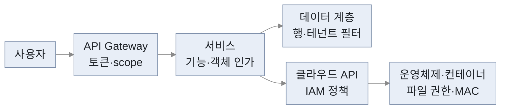
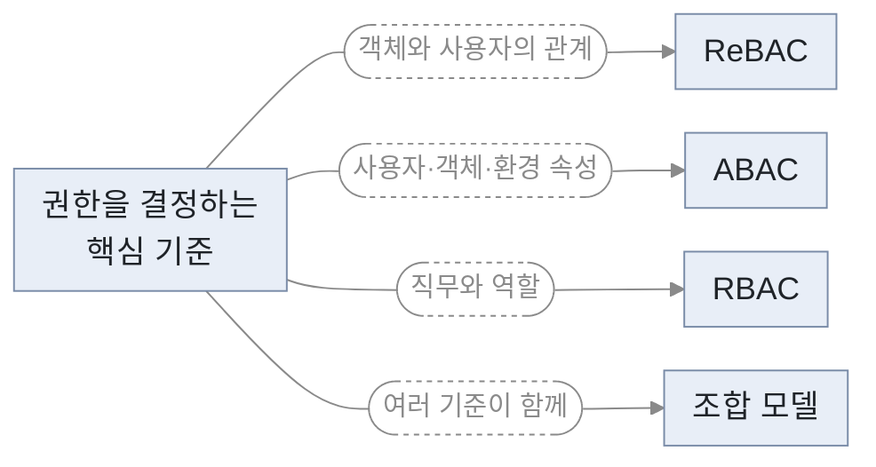

# Access Control in Practice (접근 통제 실무 적용)

> 약어: 3GPP=이동통신 표준화 기구

## 1. 개요 (What)

이 문서는 Access Control 하위 영역의 앞선 아홉 문서를 **실제 시스템에 어떻게 함께 적용하는가**로 묶는 연결 지도다.
새로운 개념을 더하기보다, 영역별로 "판단은 어디서 하고(PDP(Policy Decision Point)), 집행은 어디서 하며(PEP(Policy Enforcement Point)), 어떤 모델을 쓰고, 어디서 자주 뚫리는가"를 정리한다.

| 앞선 문서 | 이 문서에서 쓰는 내용 |
|-----------|----------------------|
| [Access Control Fundamentals](access-control-fundamentals.md) | 판단·집행 분리, 기본 거부, 완전 중재, 판단 계층 |
| [DAC & MAC](dac-mac.md) | 운영체제·컨테이너의 파일 권한과 MAC(Mandatory Access Control) 프로필 |
| [RBAC](rbac.md) | 직무 역할, 범위가 있는 역할 배정, Kubernetes·클라우드 RBAC(Role-Based Access Control) |
| [ABAC & PBAC](abac-pbac.md) | 속성 조건, 태그 기반 정책, 속성의 신뢰 |
| [ReBAC](rebac.md) | 객체 공유·소유 관계, 멀티테넌트 |
| [Policy Engines](policy-engines.md) | 정책을 코드로 관리, 엔진 배치 |
| [Least Privilege](least-privilege.md) | 권한 범위·시간 줄이기, 수명주기, 검토 |
| [PAM](pam.md) | 특권 계정과 세션 |
| [Authorization Attacks](authorization-attacks.md) | 실제로 뚫리는 방식과 시험 방법 |

## 2. 배경 / 원리 (Why & How)

### 2.1 하나의 요청은 여러 겹의 인가를 지난다

텍스트 설명: 사용자의 요청은 API Gateway에서 토큰과 scope로 1차 확인을 받고, 서비스에서 기능과 객체 단위로 판단된다.
서비스가 데이터베이스를 읽을 때는 행·테넌트 필터가, 클라우드 자원을 쓸 때는 서비스 계정의 IAM(Identity and Access Management) 정책이, 그 아래에서는 운영체제의 파일 권한과 MAC가 다시 작동한다.

- 각 겹은 **볼 수 있는 정보가 다르다.** 게이트웨이는 객체 소유를 모르고, 데이터 계층은 업무 규칙을 모른다. 그래서 "어느 겹이 무엇을 최종 책임지는가"를 정해 두어야 한다 → [Access Control Fundamentals 3.2 인가는 어느 계층에서 하는가](access-control-fundamentals.md#32-인가는-어느-계층에서-하는가)
- 위쪽 겹은 **사용자의 권한**, 아래쪽 겹은 **서비스의 권한**으로 판단한다. 서비스 계정의 권한이 넓으면, 위쪽 인가가 한 번 뚫릴 때 아래쪽이 막아 주지 못한다. 서비스 계정 최소 권한이 심층 방어의 바닥이다.

### 2.2 모델 고르기

모델 선택은 "하나만 고르는 문제"가 아니라 **권한을 결정하는 핵심 기준이 무엇인가**에서 출발한다.

텍스트 설명: 소유자·공유·그룹·프로젝트 멤버십처럼 객체와 사용자의 관계가 권한을 정하면 ReBAC(Relationship-Based Access Control), 부서·등급·위치·시간·기기 상태 같은 속성이 정하면 ABAC(Attribute-Based Access Control), 관리자·운영자·감사자 같은 직무가 정하면 RBAC를 먼저 검토한다.
기준이 여럿이면 조합한다. 이것은 설계의 출발점이며, 세 모델은 서로 배타적이지 않다.

| 조합 | 예 |
|------|----|
| RBAC + ABAC | "편집자 역할이면서, 업무 시간에 관리 기기에서" |
| RBAC + ReBAC | "관리자 역할은 전체 문서, 일반 사용자는 공유받은 문서만" |
| ReBAC + ABAC | "프로젝트 멤버이면서 보안 등급이 문서 등급 이상인 사용자" |
| ABAC 단독 | 역할이 의미 없는 환경에서 속성 규칙만으로 판단 |

- 실제 시스템에서 가장 흔한 형태는 **직무 역할(RBAC) + 조건(ABAC) + 객체 소유·공유(ReBAC 또는 애플리케이션 로직)** 이다.
- 등급 레이블로 강제해야 하는 환경(군·공공 비밀 등급)이나 운영체제·컨테이너 격리에는 MAC를 별도 겹으로 둔다.
- 규칙이 여러 서비스에 걸쳐 반복되거나 자주 바뀌면 정책 엔진으로 빼낸다 → [Policy Engines 2.1 왜 엔진으로 빼는가](policy-engines.md#21-왜-엔진으로-빼는가)

## 3. 상세 (Details)

### 3.1 Web·API

| 항목 | 실무 |
|------|------|
| PEP | 인증 미들웨어, API Gateway(거친 판단), 서비스 핸들러(세밀한 판단) |
| PDP | 공통 인가 라이브러리 또는 정책 엔진 |
| 모델 | 역할(관리자·일반) + 객체 소유 확인 + 필요 시 공유 관계 |
| 판단 근거 | 검증된 Access Token의 사용자·scope, 서버 데이터의 소유자·테넌트 |
| 자주 뚫리는 곳 | 객체 소유 미확인(BOLA(Broken Object Level Authorization)), 숨긴 관리 API, 대량 할당, 내보내기·검색 같은 간접 경로 |

- **PEP를 API Gateway에만 두면 부족하다.** 게이트웨이는 인증과 거친 판단을 하고, 게이트웨이를 통과한 뒤의 내부 서비스 API도 객체 소유, 작업 권한(조회뿐 아니라 수정·삭제), 속성 접근을 각자 확인해야 한다. 화면에서 버튼을 숨기는 것은 인가가 아니다.
- 체크 포인트: 모든 라우트가 기본 거부인지, 객체를 다루는 모든 질의가 사용자·테넌트 범위로 한정되는지, 역할 매트릭스 테스트가 CI(Continuous Integration)에 있는지 → [Authorization Attacks 5.3 시험](authorization-attacks.md#53-시험)
- 토큰의 scope는 "이 클라이언트가 위임받은 범위"이지 "이 사용자가 이 객체에 접근할 권한"이 아니다. scope 확인 뒤에 객체 단위 인가가 따로 있어야 한다 → [OAuth 2.0 · OpenID Connect](../pki-identity/oauth2-oidc.md)

### 3.2 Kubernetes

| 항목 | 실무 |
|------|------|
| PEP | API Server |
| PDP | API Server의 인가 처리 과정에서 쓰는 인가 모듈(Node, RBAC, Webhook 등)을 순서대로 평가하고, 이어서 Admission 정책을 적용한다. 모듈은 API Server와 별개의 PEP가 아니라 그 안의 판단 구성 요소다 |
| 모델 | RBAC(네임스페이스 범위 Role 우선) + Admission 정책(무엇을 만드는가) + 노드의 MAC·capability |
| 판단 근거 | 사용자·그룹·Service Account, 요청한 자원·동사, 생성하려는 객체 내용 |
| 자주 뚫리는 곳 | `cluster-admin` 바인딩, `system:masters` 그룹 인증서 발급, `bind`·`escalate`·`impersonate`, Pod·워크로드 생성으로 다른 Service Account 사용, 토큰 자동 마운트 방치, 특권 컨테이너, Admission 예외 범위 |

- RBAC는 **누가** 요청하는지를, Admission 정책은 **무엇을** 만들려는지를 본다. 둘 중 하나만 있으면 다른 쪽 경로로 권한이 새어 나간다 → [RBAC 5.2 Kubernetes RBAC의 권한 상승 방지](rbac.md#52-kubernetes-rbac의-권한-상승-방지), [Policy Engines 5.4 Kubernetes Admission 정책](policy-engines.md#54-kubernetes-admission-정책)
- 워크로드 쪽은 Service Account 분리, 토큰 자동 마운트 해제, root가 아닌 실행, capability 최소화를 기본으로 둔다 → [Least Privilege 3.5 프로그램·서비스의 최소 권한](least-privilege.md#35-프로그램서비스의-최소-권한)

### 3.3 클라우드

| 항목 | 실무 |
|------|------|
| PEP | 각 클라우드 서비스 API |
| PDP | 클라우드의 관리형 IAM 정책 평가 체계. 각 서비스가 요청을 처리하는 과정에서 정책을 평가하며, 내부 배치는 서비스마다 다르다 |
| 모델 | 역할·정책(RBAC 성격) + 조건 키·태그(ABAC) + 리소스 계층 상속 + 조직 수준 상한 정책 |
| 판단 근거 | 주체 신원·태그, 자원 태그, 요청 조건(출발지, MFA(Multi-Factor Authentication) 등) |
| 자주 뚫리는 곳 | 와일드카드 정책, 상위 범위의 넓은 배정, 역할 신뢰 정책의 주체 제한 미흡, 자원 정책과 신원 정책의 관계 오해, 태그 변경 권한 미통제, 공개 저장소, 교차 계정 위임의 Confused Deputy, 최고 권한 일상 사용 |

- 계정·구독·프로젝트를 환경별로 나누는 것이 가장 강한 경계다. 그 위에 조직 수준 상한 정책을 두고, 그 아래에서 역할을 좁힌다.
- 태그 기반 정책을 쓰면 태그를 누가 바꿀 수 있는지가 곧 권한이다 → [ABAC & PBAC 5.4 클라우드 ABAC 예시](abac-pbac.md#54-클라우드-abac-예시)
- 클라우드별 세부 설정은 [Cloud IAM](../../cloud-security/iam/README.md) (작성 예정)에서 다룬다.

### 3.4 5G 코어 (SBA)

| 항목 | 실무 |
|------|------|
| PEP | 서비스를 제공하는 NF(Network Function), 즉 NF Service Producer |
| PDP | 두 단계로 나뉜다. NRF(Network Repository Function)가 토큰 발급 시 소비자 신원과 서비스 접근 권한을 판단하고, Producer가 **요청마다** 토큰과 서비스 접근 권한을 다시 검증한다. NRF가 모든 서비스 요청의 중앙 PDP인 것은 아니다 |
| 모델 | 소비자 NF의 속성(NF 유형, PLMN(Public Land Mobile Network), 슬라이스)과 제공자의 허용 조건 비교 — 속성 기반에 가깝다 |
| 판단 근거 | NF 인증서와 NF 프로필로 확인된 소비자 속성, 토큰의 대상·scope·만료 |
| 자주 뚫리는 곳 | Producer의 토큰 서명 검증 누락, `aud`·`exp` 등 claim 검증 오류, scope와 요청 서비스의 불일치 허용, NF 인증서의 신원과 토큰의 소비자 신원 불일치 미확인, 슬라이스 경계 미확인, 운영·관리(OAM(Operations, Administration and Maintenance)) 인터페이스의 상시 원격 접근 |

- 기준 규격은 *3GPP TS 33.501 V19.7.0 (Release 19)*이다. NF 간 서비스 인가는 이 규격의 OAuth 2.0 방식을 따르고, 장비 운영 접근은 PAM으로 별도 통제한다 → [OAuth 2.0 · OpenID Connect 3.9 5G SBA의 OAuth 2.0](../pki-identity/oauth2-oidc.md#39-5g-sba의-oauth-20), [PAM 3.6 어디에 쓰이는가](pam.md#36-어디에-쓰이는가)
- 클라우드 네이티브 NF는 Kubernetes 위에서 돌므로, 3.2의 Kubernetes 통제가 그대로 5G 보안의 일부가 된다.
- 5G 위협 상세는 [5G Security](../../5g-security/README.md)에서 다룬다.

### 3.5 AI 에이전트와 RAG

| 항목 | 실무 |
|------|------|
| PEP | **실제로 도구를 실행하고 데이터를 조회하는 모든 지점**: 도구 실행 지점, 검색(Retrieval) 단계, 데이터 커넥터, 원본 문서 다운로드 API. 에이전트 앞의 게이트웨이 하나로는 부족하다 |
| PDP | 정책 엔진 또는 원본 시스템의 권한 서비스 |
| 모델 | **사용자를 대신하는 위임**: 에이전트 권한 ≤ 사용자 권한. 문서 접근은 원본의 공유 관계(ReBAC) 반영 |
| 판단 근거 | 실제 사용자 신원, 호출하려는 도구·인자, 데이터 민감도 |
| 자주 뚫리는 곳 | 에이전트가 사용자보다 넓은 서비스 계정으로 모든 작업 수행, 사용자 권한과 에이전트 권한 혼동, 도구 호출 시점의 인가 생략, 에이전트가 다른 도구를 연쇄 호출하며 권한 범위 확대, 프롬프트 인젝션에 의한 도구 오용(Confused Deputy), 검색 후 필터링, 검색 결과는 막았지만 원본 다운로드 API는 열림, 원본과 인덱스의 권한 불일치 |

- 프롬프트나 시스템 지침은 인가를 대신하지 못한다. 모델에게 "권한 없는 문서는 쓰지 말라"고 지시하는 것은 통제가 아니다.
- 원칙은 세 가지다. 필요한 도구만 연결하고, 도구 권한을 사용자 권한 이하로 묶고, 쓰기·삭제·송금 같은 영향 큰 행동은 사람 확인을 거친다 → [Least Privilege 3.6 어디에 쓰이는가](least-privilege.md#36-어디에-쓰이는가)
- RAG(Retrieval-Augmented Generation)의 접근 필터는 **검색 단계**에서 적용한다. 모델 문맥에 들어간 내용은 응답으로 샐 수 있다 → [ReBAC 3.4 어디에 쓰이는가](rebac.md#34-어디에-쓰이는가)

### 3.6 기업 IT·데이터 플랫폼

| 항목 | 실무 |
|------|------|
| PEP | 애플리케이션, 운영체제, 파일 서버, 데이터베이스, 관리 콘솔, 데이터 플랫폼 |
| PDP | 디렉터리 그룹·역할 정책, 애플리케이션 정책, PAM(Privileged Access Management) 정책, 데이터베이스 권한·행 수준 보안 |
| 모델 | 디렉터리 그룹(RBAC), 파일 ACL(DAC(Discretionary Access Control)), 데이터 분류 태그 기반 마스킹(ABAC), 특권은 PAM |
| 자주 뚫리는 곳 | 입사·이동·퇴사 시 권한 회수 누락, 장기 미사용 계정, 공유 계정, 특권 계정과 업무 계정 미분리, 관리자 권한 상시 부여, 그룹 중첩으로 숨은 권한, Everyone·전체 공유, 동일 로컬 관리자 비밀번호, 애플리케이션 DB 계정의 과도한 권한, 데이터 웨어하우스의 넓은 분석가 권한 |

- 데이터 계층의 인가를 애플리케이션 로그인만으로 대신하지 않는다. DB 권한과 행 수준 보안을 함께 둔다 → [Authorization Attacks 6.3 데이터 접근 계층에서 막기](authorization-attacks.md#63-데이터-접근-계층에서-막기)
- 계정 수명주기(입사·이동·퇴사)를 HR(Human Resources) 기준으로 자동화하는 것이 기업 IT 최소 권한의 출발점이다 → [Least Privilege 3.1 계정 수명주기 — 입사·이동·퇴사](least-privilege.md#31-계정-수명주기--입사이동퇴사)

## 4. 보안 관점 (Security Relevance)

영역을 가리지 않고 반복되는 실수와 이를 다루는 문서다.

| 반복되는 실수 | 영역 예 | 대응 문서 |
|---------------|---------|-----------|
| 기본 허용 | 새 API 라우트, 새 클라우드 서비스 | [Access Control Fundamentals](access-control-fundamentals.md) |
| 객체 소유 미확인 | Web·API, GraphQL, RAG | [Authorization Attacks](authorization-attacks.md), [ReBAC](rebac.md) |
| 클라이언트·요청 값 신뢰 | 역할·테넌트 헤더, 토큰 claim 미검증, 사용자 변경 가능 태그 | [ABAC & PBAC](abac-pbac.md) |
| 넓은 역할·와일드카드 | `cluster-admin`, 클라우드 `*` 정책 | [RBAC](rbac.md), [Least Privilege](least-privilege.md) |
| 상시 특권 | 전역 관리자, 루트, Domain Admins | [PAM](pam.md) |
| 오류 시 허용 | 정책 엔진 장애, Webhook `Ignore` | [Policy Engines](policy-engines.md) |
| 권한 회수 지연 | 퇴사자 토큰, 캐시된 권한 판단 | [Least Privilege](least-privilege.md), [ReBAC](rebac.md) |
| 서비스가 자기 권한으로 대신 처리 | SSRF, 교차 계정 위임, AI 에이전트 | [Authorization Attacks](authorization-attacks.md) |

> 핵심 원칙: PDP가 어디에 있든, 보호해야 할 API·객체·데이터·도구에 **실제로 접근하는 지점마다 PEP가 있어야 한다.** 인증된 사용자라는 사실만으로 내부 자원 접근을 허용하지 않는다.

점검 순서 제안: (1) 판단 계층과 최종 책임 지점 확인 → (2) 기본 거부와 오류 처리 → (3) 객체·테넌트 단위 인가 → (4) 판단 근거의 출처 → (5) 역할·정책의 넓이 → (6) 특권 계정과 상시 권한 → (7) 회수·검토 절차 → (8) 결정 로그와 탐지.

## 5. 심화 (Advanced)

> 보안 컨설턴트·점검자를 위한 세부다. 본문만으로 개념 이해에는 충분하다.

### 5.1 하드코딩된 인가에서 정책 기반으로 옮기기

| 단계 | 할 일 |
|------|-------|
| 1. 목록화 | 코드에 흩어진 인가 판단 지점을 찾아 목록으로 만든다 |
| 2. 매트릭스 | 역할 × 기능 × 객체 관계로 현재 동작을 표로 정리하고, 그대로 테스트로 만든다 |
| 3. 공통화 | 판단을 공통 함수·미들웨어로 모은다 (아직 엔진은 아님) |
| 4. 외부화 | 공통 함수 뒤를 정책 엔진 호출로 바꾼다. 처음에는 기록 모드로 기존 결과와 비교 |
| 5. 전환 | 결과 차이가 사라지면 엔진 결정으로 집행한다 |
| 6. 운영 | 정책 저장소 검토·테스트·서명 배포, 결정 로그 수집 |

- 2단계의 매트릭스 테스트가 전체 이전의 안전망이다. 이전 전후 결과가 같다는 것을 테스트로 보장해야 정책 엔진으로 옮긴 뒤 숨은 허용이 생기지 않는다.

### 5.2 인가 아키텍처 점검 질문

| 질문 | 확인 대상 |
|------|-----------|
| 모든 요청이 PEP를 지나는가 | 우회 경로(직접 DB 접속, 내부 API, 관리 포트) |
| PDP를 못 쓰면 어떻게 되는가 | 오류·시간 초과·undefined 처리 |
| 판단 근거는 어디서 오는가 | 토큰 검증, 서버 데이터, 클라이언트 값 사용 여부 |
| 권한 데이터는 얼마나 최신인가 | 캐시, 토큰 수명, 동기화 주기 |
| 정책은 누가 바꿀 수 있는가 | 정책 저장소·태그·관계 쓰기 권한 |
| 서비스 자신의 권한은 얼마나 넓은가 | 서비스 계정, 클라우드 역할, DB 연결 계정 |
| 결정이 기록되는가 | 허용·거부 로그, 정책 버전, 민감 정보 마스킹 |
| 이 구조를 테스트하는가 | 역할 매트릭스, 두 계정 시험, 회귀 테스트 |

### 5.3 지표

| 지표 | 의미 |
|------|------|
| 인가 테스트 커버리지 | 역할 × 엔드포인트 중 테스트로 검증된 비율 |
| 객체 단위 인가 누락 발견 수 | 점검·버그 바운티에서 나온 BOLA·BFLA(Broken Function Level Authorization) 건수 |
| 상시 특권 수 | 늘 켜진 관리자 권한 보유자 |
| 와일드카드 정책 수 | 행위·자원이 `*`인 정책 |
| 권한 회수 소요 시간 | 이동·퇴사부터 실제 회수까지 |
| 정책 변경 리드타임 | 정책 변경 요청부터 테스트·배포까지 (짧고 안전해야 예외 남발이 줄어든다) |

## 관련 문서

- 이전: [Authorization Attacks](authorization-attacks.md)
- 인증 쪽 연결 지도: [PKI & Identity](../pki-identity/README.md)
- 아키텍처 연결: [Security Architecture](../security-architecture/README.md) (작성 예정)
- 로드맵: [Access Control](README.md)

## 출처

| 문서 | 이 문서에서의 사용 |
|------|-------------------|
| *3GPP TS 33.501 V19.7.0 (Release 19)* | 5G SBA의 NF 서비스 인가 구조 |

- 이 문서는 Access Control 01~09의 내용을 영역별로 다시 묶은 연결 지도이며, 개별 사실의 출처는 각 문서의 출처 절에 있다.
