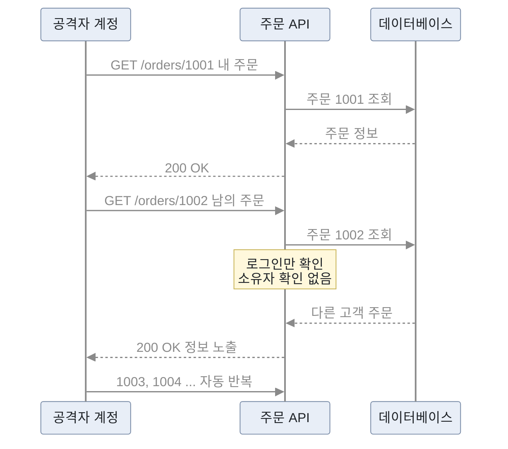

# Authorization Attacks (인가 공격)

## 1. 개요 (What)

인가 공격은 **로그인에는 정상적으로 성공한 공격자가, 허락받지 않은 데이터나 기능에 접근하는 것**이다.
인증을 뚫는 공격([Identity Attacks](../pki-identity/identity-attacks.md))과 달리, 인가 공격은 대부분 **평범한 계정 하나**로 시작한다. 공격자는 자기 계정으로 가입한 뒤, 요청의 ID나 경로를 바꿔 다른 사람의 것을 건드린다.

이 유형은 웹·API에서 가장 흔하고 피해가 큰 결함이다.

| 기준 | 해당 항목 |
|------|-----------|
| OWASP(Open Worldwide Application Security Project) Top 10:2025 | A01:2025 Broken Access Control |
| OWASP API Security Top 10 2023 | API1:2023 BOLA(Broken Object Level Authorization), API3:2023 BOPLA(Broken Object Property Level Authorization), API5:2023 BFLA(Broken Function Level Authorization) |
| CWE(Common Weakness Enumeration) | 누락된 인가(CWE-862), 잘못된 인가(CWE-863), 사용자가 제어하는 키를 통한 인가 우회(CWE-639) 등 |

인가 결함이 흔한 이유는 단순하다. 인증은 프레임워크가 한 곳에서 처리하지만, 인가는 **"이 사용자가 이 객체에 이 행위를 해도 되는가"를 기능마다, 객체마다** 확인해야 하기 때문이다. 하나라도 빠뜨리면 그곳이 구멍이 된다.

## 2. 공격 대상과 원리 (Target & Why possible)

### 2.1 권한 상승의 두 방향

| 방향 | 의미 | 예 |
|------|------|----|
| 수평 권한 상승 (Horizontal) | 같은 권한 수준의 **다른 사용자** 자원에 접근 | 고객 A가 고객 B의 주문 조회 |
| 수직 권한 상승 (Vertical) | 더 **높은 권한**의 기능을 실행 | 일반 사용자가 관리자 기능 호출 |

### 2.2 왜 가능한가

| 근본 원인 | 설명 |
|-----------|------|
| 객체 단위 확인 누락 | "로그인했는가"만 보고 "이 객체가 이 사용자의 것인가"를 보지 않는다 |
| 클라이언트를 믿음 | 숨긴 버튼, 클라이언트가 보낸 역할·테넌트 ID·가격을 그대로 쓴다 |
| 인가가 흩어짐 | 기능마다 개발자가 직접 `if` 문을 쓰다가 일부를 빠뜨린다 |
| 기본 허용 | 새 엔드포인트가 인가 규칙 없이 열린다 |
| 계층 간 불일치 | 게이트웨이와 백엔드가 경로·파라미터를 다르게 해석한다 |
| 간접 경로 | 내보내기·검색·보고서·일괄 처리 API에는 같은 확인을 하지 않는다 |

설계 원칙 관점에서는 기본 거부와 완전 중재가 깨진 것이다 → [Access Control Fundamentals 2.3 기본 원칙](access-control-fundamentals.md#23-기본-원칙)

## 3. 공격 유형과 시나리오 (Attack Scenario)

### 3.1 객체 수준 인가 결함 — IDOR·BOLA

IDOR(Insecure Direct Object Reference)는 요청에 담긴 객체 ID를 바꿔 다른 사람의 객체에 접근하는 결함이다. API 맥락에서는 BOLA라고 부른다.

텍스트 설명: 공격자는 자기 주문(1001)을 정상 조회한 뒤 번호만 바꿔 1002를 요청한다. API가 로그인 여부만 확인하고 주문 소유자를 확인하지 않으면 다른 고객의 주문이 그대로 반환된다.
번호가 순서대로라면 공격자는 스크립트로 전체 주문을 수집할 수 있다.

- ID가 추측하기 어려운 UUID(Universally Unique Identifier)여도 **해결이 아니다.** ID는 URL 공유, 로그, 다른 API 응답, 브라우저 기록으로 새어 나간다. 예측 불가능한 ID는 대량 수집을 어렵게 하는 보조 수단일 뿐이다.
- 읽기만이 아니라 수정·삭제(`PUT /orders/1002`, `DELETE /orders/1002`)에서도 같은 확인이 필요하다. 조회는 막고 수정은 열어 두는 경우가 흔하다.
- 객체 ID는 경로뿐 아니라 쿼리 문자열, 요청 본문, 헤더, 쿠키, 파일 이름에도 들어 있다.

### 3.2 기능 수준 인가 결함 — BFLA

일반 사용자가 관리자용 기능을 직접 호출하는 수직 권한 상승이다.

| 수법 | 예 |
|------|----|
| 숨긴 관리 기능 직접 호출 | 화면에 없는 `POST /api/admin/users`를 호출 |
| 경로 추측 | `/api/v1/users/me`가 있으면 `/api/v1/admin/users`, `/api/internal/...` 시도 |
| HTTP 메서드 변경 | `GET /users/42`는 허용, 같은 경로의 `DELETE`·`PUT`은 확인 없음 |
| 이전 버전 API | 새 버전은 막았지만 `/api/v1/`은 확인 없이 남아 있음 |
| 기능 플래그·파라미터 | `?admin=true`, `debug=1`로 관리 동작 활성화 |

### 3.3 속성 수준 인가 결함 — BOPLA

객체 자체에는 접근해도 되지만, **객체의 일부 속성**을 읽거나 바꿀 권한은 없는 경우다.

| 형태 | 예 | 대응 |
|------|----|------|
| 대량 할당 (Mass Assignment) | 프로필 수정 요청에 `"role": "admin"`, `"balance": 100000`, `"is_verified": true`를 끼워 넣으면 그대로 저장 | 바꿀 수 있는 필드를 허용 목록으로 지정, 요청 모델과 저장 모델 분리 |
| 과도한 데이터 노출 | 응답에 비밀번호 해시, 내부 메모, 다른 사용자 이메일이 포함되고 화면에서만 숨김 | 응답 필드를 서버에서 역할별로 선택, 응답 스키마 고정 |
| 가격·수량 조작 | 주문 요청의 `price` 필드를 클라이언트가 보낸 값으로 결제 | 가격은 서버의 기준 데이터에서 계산 |

### 3.4 클라이언트 측 집행

| 클라이언트에서만 한 일 | 우회 |
|------------------------|------|
| 관리 버튼을 숨김 | API 직접 호출 |
| 역할을 쿠키·로컬 저장소에 저장 | 값 수정 |
| 모바일 앱에서 권한 확인 | 앱 수정, API 직접 호출 |
| 서명 검증 없이 토큰 claim 읽기 | 토큰 내용 조작 → [Token Security](../pki-identity/token-security.md) |

- 클라이언트는 사용자 편의를 위해 화면을 바꿀 수 있을 뿐, **모든 인가는 서버에서 다시 판단**해야 한다.

### 3.5 멀티테넌트 격리 실패

여러 고객사(테넌트)가 같은 시스템을 쓰는 SaaS(Software as a Service)에서, 다른 테넌트의 데이터에 접근하는 결함이다.

- 테넌트 ID를 요청 헤더·파라미터로 받아 그대로 쓰면, 공격자는 값을 바꿔 다른 회사 데이터에 접근한다. 테넌트는 **인증된 신원에서** 결정해야 한다.
- 데이터베이스 질의마다 테넌트 조건을 직접 붙이면 하나라도 빠질 수 있다. 데이터 접근 계층에서 테넌트 조건을 자동으로 붙이거나, 데이터베이스의 행 수준 보안을 쓴다.
- 캐시 키, 검색 인덱스, 파일 저장 경로, 백그라운드 작업에도 테넌트 구분이 들어가야 한다. 캐시 키에 테넌트가 없으면 다른 회사 사용자에게 같은 응답이 돌아간다.

### 3.6 경로·입력 해석 차이를 이용한 우회

인가 규칙이 프록시·WAF(Web Application Firewall)·게이트웨이에 문자열 경로로 걸려 있으면, 같은 자원을 다르게 표현해 규칙을 피할 수 있다. 이를 경로 혼동(Path Confusion)이라고 한다.

| 변형 | 예 | 차이가 생기는 곳 |
|------|----|------------------|
| 대소문자 | `/ADMIN` | 대소문자를 구분하는 규칙과 구분하지 않는 서버 |
| 끝 슬래시 | `/admin/` | 라우팅과 접근 규칙의 일치 방식 |
| 점 세그먼트·반복 슬래시 | `/admin/./`, `/admin//users` | 정규화를 하는 구성 요소와 하지 않는 구성 요소 |
| 퍼센트 인코딩 | `/%61dmin`, `/admin%2Fusers` | 인코딩을 푸는 시점과 횟수 |
| 세미콜론 경로 매개변수 | `/admin;x=1` | 일부 서버·프레임워크는 `;` 뒤를 경로 매개변수로 떼어 낸다 |

- 이런 변형이 실제 우회가 되는지는 대상 시스템의 라우팅·정규화 방식에 따라 다르다. 같은 경로로 해석되는 환경도, 다른 경로로 해석되는 환경도 있으므로 구성 요소별로 시험한다.
- 경로 혼동은 **파일 경로 탐색(Directory Traversal)** 과 다르다. 경로 탐색은 `../` 같은 입력으로 허용된 디렉터리 밖의 **파일**에 접근하는 결함이고, 경로 혼동은 구성 요소들이 같은 URL을 **서로 다르게 해석**하는 결함이다. 확장자처럼 보이는 경로(`/account/x.css`)를 캐시가 정적 파일로 저장해 개인 응답이 노출되는 웹 캐시 기만(Web Cache Deception)도 해석 차이에서 오지만 별개의 유형이다.
- **파라미터 중복**(HTTP Parameter Pollution)도 같은 원리다. 같은 이름의 파라미터를 여러 번 보내면(`user_id=me&user_id=1002`) 프레임워크·파서에 따라 첫 값, 마지막 값, 전체 배열, 쉼표로 병합한 값 중 하나로 처리된다. 보안 필터는 첫 값을 검사하고 애플리케이션은 마지막 값을 쓰면 필터가 우회된다.
- 근본 원인은 **인가를 판단하는 계층과 실제 처리 계층이 입력을 다르게 해석**하는 것이다. 경로를 정규화한 뒤 판단하고, 객체 단위 인가는 실제 데이터를 아는 백엔드에서 한다.

### 3.7 간접 경로 — 같은 데이터, 다른 입구

| 입구 | 흔한 누락 |
|------|-----------|
| 내보내기·보고서 | 화면 조회는 막았지만 CSV(Comma-Separated Values) 내보내기는 전체 데이터 |
| 검색·자동 완성 | 검색 결과에 권한 없는 문서 제목·요약 노출 |
| 일괄 처리 API | 단건 API는 확인하지만 `POST /orders/batch`는 목록 전체를 처리 |
| GraphQL | 최상위 질의는 확인하지만 중첩 필드·연관 객체를 통해 다른 사용자 데이터 접근 |
| 파일·첨부 | 게시물은 비공개인데 첨부 파일 URL은 누구나 접근 |
| 웹훅·알림 | 알림 메일·푸시에 권한 없는 사람의 정보 포함 |
| AI 검색·요약 | RAG(Retrieval-Augmented Generation)가 권한 없는 문서를 근거로 답변 |

### 3.8 시점 문제 — 확인과 사용 사이

확인한 시점과 실제로 쓰는 시점 사이에 상태가 바뀌면 인가가 틀어진다. TOCTOU(Time-Of-Check to Time-Of-Use) 문제다.

- 권한을 확인한 뒤 긴 작업을 시작했는데, 그 사이 권한이 회수되어도 작업이 끝까지 진행된다.
- 쿠폰·한도 확인 후 사용 처리 전에 같은 요청을 동시에 여러 번 보내 한도를 넘긴다(경쟁 조건).
- 대응: 확인과 변경을 하나의 트랜잭션·원자적 연산으로 묶고, 긴 작업은 단계마다 다시 확인한다. 권한 데이터의 최신성 문제는 [ReBAC 3.3 일관성 — "새로운 적" 문제](rebac.md#33-일관성--새로운-적-문제)에서 다룬다.

### 3.9 위임 경로 악용 — Confused Deputy

높은 권한을 가진 서비스가 요청자의 권한을 확인하지 않고 **자기 권한으로** 대신 처리하는 결함이다 → [Access Control Fundamentals 5.3 ACL 기반 권한과 Confused Deputy](access-control-fundamentals.md#53-acl-기반-권한과-confused-deputy)

| 형태 | 예 |
|------|----|
| 서버 측 요청 위조 | 서버가 사용자가 준 URL을 대신 호출해, 내부 관리 API나 클라우드 메타데이터 서비스에 접근 → [Workload Identity](../pki-identity/workload-identity.md) |
| 교차 계정 위임 | 외부 서비스에 역할을 위임했는데, 다른 고객이 내 계정 자원을 지정해 그 서비스를 움직임 |
| AI 에이전트 | 문서·웹페이지에 숨긴 지시(프롬프트 인젝션)가 에이전트를 움직여, 사용자가 시키지 않은 도구 호출 실행 |

### 3.10 설정·정책 오류

애플리케이션 코드가 아니라 **인가 설정**이 잘못된 경우다.

- 클라우드 저장소·스냅샷을 공개로 설정, 조건 없는 와일드카드 IAM(Identity and Access Management) 정책
- Kubernetes에서 `cluster-admin` 바인딩, `bind`·`escalate`·`impersonate` 동사 허용 → [RBAC 5.2 Kubernetes RBAC의 권한 상승 방지](rbac.md#52-kubernetes-rbac의-권한-상승-방지)
- 접근 판단에 쓰는 태그·속성을 사용자가 직접 바꿀 수 있음 → [ABAC & PBAC 3.1 속성은 믿을 수 있어야 한다](abac-pbac.md#31-속성은-믿을-수-있어야-한다)
- 정책 엔진의 기본값 누락, undefined를 허용으로 처리 → [Policy Engines](policy-engines.md)

## 4. 영향 (Impact)

| 관점 | 영향 |
|------|------|
| 기밀성 | 다른 고객의 개인정보·주문·의료·금융 정보 대량 유출 |
| 무결성 | 다른 사용자 데이터 수정·삭제, 가격·잔액 조작, 권한 자가 부여 |
| 가용성 | 다른 사용자 계정·자원 삭제, 관리 기능 악용으로 서비스 중단 |
| 프라이버시 | 순차 ID 열거로 전체 사용자 데이터 수집, 테넌트 간 데이터 혼재 |
| 법·규제 | 개인정보 유출 신고 의무, 계약상 테넌트 격리 위반 |

- 인가 결함은 대부분 **정상 요청 형태**를 띤다. 특수 문자나 악성 코드가 없어 일반적인 웹 방화벽 규칙으로는 잡기 어렵다.

## 5. 대응 방안 (Countermeasure)

### 5.1 예방

| 통제 | 방법 |
|------|------|
| 기본 거부 | 프레임워크 수준에서 모든 엔드포인트를 기본 거부로 두고 명시적으로 허용 |
| 인가 로직 중앙화 | 공통 미들웨어·정책 엔진으로 판단을 모은다 → [Policy Engines](policy-engines.md) |
| 객체 단위 확인 | 객체를 조회·수정·삭제하는 모든 지점에서 소유·관계 확인. 질의 자체를 사용자 범위로 한정(`WHERE owner_id = :현재사용자`) |
| 테넌트 범위 강제 | 테넌트는 인증된 신원에서 결정, 데이터 접근 계층에서 자동 적용 |
| 필드 허용 목록 | 쓰기 가능한 필드와 응답 필드를 역할별로 명시 |
| 서버 측 판단 | 역할·가격·테넌트는 서버의 기준 데이터에서 가져온다 |
| 입력 정규화 | 경로·파라미터를 정규화한 뒤 판단, 게이트웨이와 백엔드의 해석 일치 |
| 간접 경로 포함 | 내보내기·검색·일괄 처리·첨부·GraphQL 필드에 같은 인가 적용 |
| 원자적 처리 | 확인과 변경을 하나의 트랜잭션으로 |

### 5.2 탐지

| 신호 | 의미 |
|------|------|
| 한 사용자가 짧은 시간에 많은 서로 다른 객체 ID 요청 | ID 열거·대량 수집 |
| 403·404 응답의 급증 | 권한 탐색 |
| 자기 테넌트가 아닌 객체에 대한 접근 시도 | 테넌트 격리 공격 |
| 일반 사용자 계정의 관리 엔드포인트 호출 | 기능 수준 공격 |
| 요청 본문에 평소 없는 필드(`role`, `is_admin`) | 대량 할당 시도 |
| 권한 변경 직후의 특권 작업 | 권한 자가 부여 |

- 인가 거부 로그를 남겨야 이런 신호를 볼 수 있다 → [Access Control Fundamentals 3.5 결정 기록](access-control-fundamentals.md#35-결정-기록)
- MITRE ATT&CK(Adversarial Tactics, Techniques, and Common Knowledge)에서는 외부에 공개된 애플리케이션의 결함을 악용해 들어오는 것이 Exploit Public-Facing Application(T1190, Initial Access 전술)이고, 들어온 뒤 권한을 높이는 행위는 Privilege Escalation(TA0004) 전술이다. 클라우드 역할을 스스로 추가하는 행위는 Account Manipulation의 하위 기법 Additional Cloud Roles(T1098.003)로, 권한 상승과 지속성 확보에 함께 쓰인다.

### 5.3 시험

인가 결함은 자동 스캐너가 잘 찾지 못한다. 스캐너는 "이 데이터가 누구의 것이어야 하는가"를 모르기 때문이다. 업무 맥락을 아는 시험이 필요하다.

| 방법 | 내용 |
|------|------|
| 두 계정 시험 | 사용자 A로 만든 객체를 사용자 B로 조회·수정·삭제 시도 |
| 역할 매트릭스 시험 | 역할 × 엔드포인트 × 메서드 표를 만들고, 기대 결과(허용·거부)와 실제 결과 비교 |
| 비인증 시험 | 인증 정보 없이 같은 요청 반복 |
| 파라미터 변조 | 객체 ID, 테넌트 ID, 숨은 필드, 메서드, 경로 표현 바꾸기 |
| 간접 경로 점검 | 내보내기·검색·일괄 처리·첨부·GraphQL 중첩 질의 |
| 자동 회귀 | 역할 매트릭스를 CI(Continuous Integration) 테스트로 만들어 배포마다 실행 |

- 웹 프록시 도구의 확장 기능 중에는 한 계정의 요청을 다른 계정의 세션으로 자동 재전송해 응답을 비교하는 것이 있어, 두 계정 시험을 효율적으로 할 수 있다.
- OWASP WSTG(Web Security Testing Guide)는 인가 시험 범주에서 경로 탐색·파일 포함, 인가 체계 우회, 권한 상승, IDOR를 다루고, 경로 혼동과 파라미터 중복은 각각 설정·배포 관리와 주입 범주의 시험 항목으로 다룬다.

## 6. 심화 (Advanced)

> 보안 컨설턴트·점검자를 위한 세부다. 본문만으로 개념 이해에는 충분하다.

### 6.1 분류 대응표

| 이 문서의 유형 | OWASP API Security Top 10 2023 | CWE |
|----------------|-------------------------------|-----|
| 객체 수준 (IDOR·BOLA) | API1:2023 | CWE-639, CWE-862 |
| 속성 수준 — 대량 할당 | API3:2023 | CWE-915(동적으로 결정되는 객체 속성의 부적절한 수정 통제) |
| 속성 수준 — 과도한 데이터 노출 | API3:2023 | 원인에 따라 CWE-862·CWE-863 등 |
| 기능 수준 (BFLA) | API5:2023 | CWE-862(인가 누락), CWE-863(잘못된 인가) |
| 잘못된 인가 판단 | — | CWE-863 |
| 경로 혼동 | — | CWE-41(경로 동등성 해석 오류) |
| 파일 경로 탐색 | — | CWE-22(제한 디렉터리 밖 경로 접근) |
| 서버 측 요청 위조 | API7:2023 | CWE-918 |
| 확인-사용 시점 문제 | — | CWE-367 |

- OWASP Top 10:2025의 A01 Broken Access Control은 위 유형 대부분을 포괄하는 웹 범주다.
- CWE-285(Improper Authorization)는 CWE-862·CWE-863을 아우르는 상위 개념이라, CWE가 개별 취약점 매핑에는 쓰지 않도록 권고한다. 인가 검사가 없으면 CWE-862, 있는데 틀리면 CWE-863을 우선 검토한다.
- 대량 할당이 모두 인가 결함은 아니다. `role`, `isAdmin`, `ownerId`처럼 **보호해야 할 속성**을 바꿀 수 있을 때 인가 우회가 된다.

### 6.2 GraphQL의 인가

- GraphQL은 하나의 엔드포인트로 여러 객체와 관계를 한 번에 질의하므로, **엔드포인트 단위 인가가 의미가 없다.** 객체와 필드마다 인가가 필요하다.
- 인가 로직은 리졸버(필드·객체를 가져오는 함수)마다 따로 구현하기보다 **중앙의 업무 로직 계층**에 두고 리졸버가 그것을 호출하게 한다. GraphQL 공식 문서의 권고 방향이며, 같은 객체가 여러 경로로 노출돼도 같은 규칙이 적용된다.
- 중첩 질의(`user { orders { customer { email } } }`)를 따라가면 처음 객체에는 권한이 있어도 연관 객체에는 권한이 없을 수 있다. 연관(edge)과 객체(node) 양쪽에서 확인한다.
- ID로 아무 객체나 가져오는 범용 질의(`node(id: ...)`, `nodes`)는 객체 수준 인가 결함의 대표 지점이다. ID가 Base64로 인코딩되어 있어도 보호 수단이 아니며, **ID를 안다는 사실만으로 접근을 허용하지 않는다.**
- 운영 환경에서 스키마 조회(Introspection)를 열어 두면 숨은 관리 필드가 드러난다. 다만 스키마를 숨기는 것은 인가를 대신하지 않는다.

### 6.3 데이터 접근 계층에서 막기

애플리케이션 로직이 아무리 정확해도 질의 하나가 빠질 수 있다. 데이터 계층에서 한 번 더 막으면 누락의 영향을 줄인다.

| 방법 | 내용 |
|------|------|
| 범위가 정해진 저장소 | 모든 질의 함수가 현재 사용자·테넌트를 인자로 받아 조건을 자동 추가 |
| 행 수준 보안 | 데이터베이스가 세션 변수(현재 테넌트·사용자)로 행을 걸러 낸다 |
| 테넌트별 분리 | 스키마·데이터베이스·암호화 키를 테넌트별로 분리 (비용과 격리 수준의 균형) |

- 행 수준 보안을 쓸 때는 **애플리케이션이 데이터베이스에 연결하는 계정이 그 정책을 우회하는 권한을 갖지 않는지** 확인한다. PostgreSQL 예:

| 역할 | 행 수준 보안 적용 |
|------|-------------------|
| 일반 역할 | 적용 (정책이 하나도 없으면 기본 거부) |
| 테이블 소유자 | 기본적으로 우회. `FORCE ROW LEVEL SECURITY`를 설정하면 적용 |
| 슈퍼유저, `BYPASSRLS` 속성 역할 | 항상 우회 (`FORCE`로도 막을 수 없다) |

- 따라서 애플리케이션 연결 계정은 테이블 소유자·슈퍼유저·`BYPASSRLS` 역할이 아닌 별도 역할로 둔다.

### 6.4 교차 계정 위임의 Confused Deputy 방지

외부 서비스에 자기 클라우드 계정의 역할을 위임할 때, 그 서비스가 다른 고객의 요청으로 내 역할을 쓰지 못하게 해야 한다.

AWS에서는 신뢰 관계의 종류에 따라 쓰는 조건이 다르며, 서로 대체할 수 없다.

| 상황 | 조건 | 내용 |
|------|------|------|
| 제3자 사업자의 계정이 여러 고객의 역할을 넘겨받음(AssumeRole) | `sts:ExternalId` | 역할 신뢰 정책에 사업자가 고객마다 고유하게 관리하는 외부 ID를 조건으로 건다. 다른 고객이 내 역할 ARN을 사업자에게 넣어도 외부 ID가 달라 넘겨받지 못한다. 외부 ID는 비밀번호가 아니라 고객 구분용 식별자다 |
| AWS 서비스가 고객을 대신해 다른 자원에 접근 | `aws:SourceArn`, `aws:SourceAccount` (조직 단위는 `aws:SourceOrgID`, `aws:SourceOrgPaths`) | 자원 정책이나 신뢰 정책에서 어느 원본 자원·계정을 위한 요청인지 제한한다. 가능하면 구체적인 `aws:SourceArn`을 쓰고, ARN에 계정 ID가 없으면 `aws:SourceAccount`를 함께 건다 |

## 관련 문서

- 이전: [PAM](pam.md)
- 다음: [Access Control in Practice](access-control-in-practice.md)
- 인증 공격: [Identity Attacks](../pki-identity/identity-attacks.md)
- 객체 관계 모델: [ReBAC](rebac.md)
- 웹 위험 분류: [OWASP Top 10](../web-app-security/owasp/top-10/README.md)
- 로드맵: [Access Control](README.md)

## 출처

| 문서 | 이 문서에서의 사용 |
|------|-------------------|
| OWASP Top 10:2025 | A01:2025 Broken Access Control |
| OWASP API Security Top 10 2023 | API1·API3·API5·API7 분류 |
| MITRE CWE | 인가 관련 약점 분류 |
| OWASP WSTG | 인가 시험 범주 |
| MITRE ATT&CK Enterprise | 관련 공격 기법 분류 |
| AWS IAM 문서 (제3자 접근, Confused Deputy 방지) | `sts:ExternalId`, `aws:SourceArn`, `aws:SourceAccount` 조건 |
| GraphQL 공식 문서, OWASP GraphQL Cheat Sheet | 인가 위치, node·edge 확인 |
| PostgreSQL 문서 (Row Security Policies) | 행 수준 보안 적용·우회 규칙 |

- 그 외 내용은 인가 결함의 일반 원리와 점검 경험을 재구성한 해설이다.
