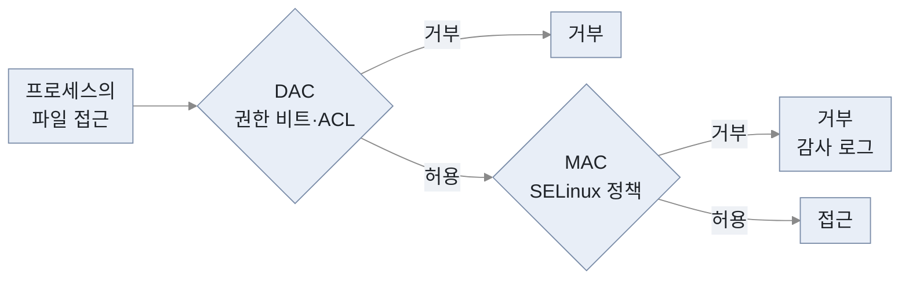
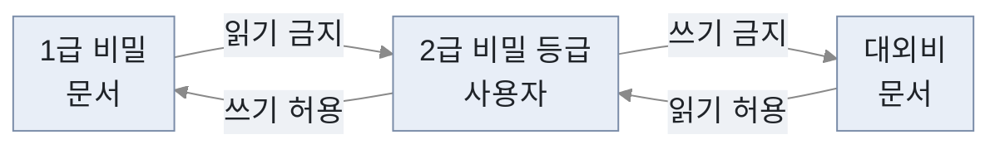

# DAC & MAC (임의적·강제적 접근 통제)

## 1. 개요 (What)

DAC(Discretionary Access Control, 임의적 접근 통제)와 MAC(Mandatory Access Control, 강제적 접근 통제)는 **"권한을 누가 정하는가"** 로 나뉘는 가장 오래된 두 접근 통제 모델이다.

| 구분 | 권한을 정하는 주체 | 한 줄 요약 | 대표 예 |
|------|-------------------|------------|---------|
| DAC | 자원의 **소유자** | "내 파일은 내가 누구에게 열어 줄지 정한다" | Unix 파일 권한, Windows 파일 ACL, 문서 공유 링크 |
| MAC | **시스템(보안 관리자의 정책)** | "소유자라도 정책을 넘어서 열어 줄 수 없다" | 군·정부의 비밀 등급, SELinux(Security-Enhanced Linux), AppArmor |

두 용어는 미국 국방부의 컴퓨터 보안 평가 기준인 TCSEC(Trusted Computer System Evaluation Criteria, 일명 Orange Book)에서 보안 통제 유형으로 체계화되었다. 개념 자체는 그 이전의 보안 모델 연구에서 나왔고, TCSEC가 평가 기준으로 정리한 것이다.
지금도 거의 모든 운영체제는 DAC를 기본으로 쓰고, 그 위에 MAC를 **추가 방어선**으로 얹는다.
이후 문서의 RBAC·ABAC·ReBAC는 이 두 모델의 한계를 보완하는 방향으로 발전했다.

공통 판단 구조(주체·행위·자원·조건, PEP·PDP)는 [Access Control Fundamentals](access-control-fundamentals.md)를 바탕으로 한다.

## 2. 배경 / 원리 (Why & How)

### 2.1 DAC — 소유자가 정한다

DAC에서는 자원을 만든 주체가 소유자가 되고, 소유자가 다른 주체에게 권한을 주거나 회수한다.
구현은 대부분 자원에 접근 목록을 붙이는 ACL(Access Control List) 방식이다 → [Access Control Fundamentals 3.1 접근 통제 행렬 — ACL과 Capability](access-control-fundamentals.md#31-접근-통제-행렬--acl과-capability)

- **장점**: 단순하고 유연하다. 관리자를 거치지 않고 사용자가 직접 협업 범위를 정한다.
- **약점 1 — 권한이 퍼진다**: 소유자가 실수로 "모두에게 읽기"를 주면 그대로 노출된다. 조직 전체의 정책을 강제할 방법이 없다.
- **약점 2 — 트로이 목마**: 사용자가 실행한 프로그램은 **사용자의 권한을 그대로** 가진다. 악성 프로그램이 사용자의 기밀 파일을 읽어 누구나 읽을 수 있는 위치에 복사해도 DAC는 막지 못한다. 사용자 자신이 그렇게 할 권한이 있기 때문이다.

### 2.2 MAC — 시스템이 강제한다

MAC에서는 주체와 자원에 시스템이 **레이블**(보안 등급, 유형 등)을 붙이고, 정책이 레이블 조합으로 접근을 결정한다.
사용자나 소유자는 레이블과 정책을 바꿀 수 없다.

- DAC의 트로이 목마 문제를 막는다. 악성 프로그램이 사용자 권한으로 실행되어도, 높은 등급 정보를 낮은 등급 위치로 옮기는 것은 정책이 거부한다.
- 대가로 운영이 경직된다. 정책을 잘못 만들면 정상 업무가 막히고, 그래서 실무에서 MAC를 꺼 버리는 일이 흔하다.

### 2.3 두 모델은 함께 쓴다

현대 운영체제에서는 DAC와 MAC를 **둘 다 통과해야** 접근이 허용된다. 어느 한쪽이 거부하면 거부다.

텍스트 설명: Linux에서 프로세스가 파일을 열면 먼저 파일 권한 비트·ACL(DAC)을 확인하고, 통과하면 SELinux 같은 MAC 정책을 확인한다.
둘 다 허용해야 접근이 성공하며, MAC 거부는 감사 로그에 남는다. MAC는 DAC가 허용한 것을 **더 좁힐 수만** 있고, DAC가 거부한 것을 허용하지는 않는다.

## 3. 상세 (Details)

### 3.1 Unix·Linux 파일 권한

가장 널리 쓰이는 DAC다. 파일마다 소유자(user)·그룹(group)·기타(other) 세 범주에 읽기(r)·쓰기(w)·실행(x) 권한을 준다.

| 권한 | 파일에서 | 디렉터리에서 |
|------|----------|--------------|
| r | 내용 읽기 | 안의 파일 이름 목록 보기 |
| w | 내용 수정 | 안에 파일 만들기·지우기·이름 바꾸기 |
| x | 프로그램으로 실행 | 디렉터리 안으로 들어가기(경로 통과) |

- **파일 삭제는 파일이 아니라 디렉터리 권한으로 정해진다.** 디렉터리에 w(항목 변경)와 x(검색)가 있으면, 파일 자체에 쓰기 권한이 없어도 일반적으로 지울 수 있다. 단, Sticky bit, 파일 시스템의 변경 불가(immutable) 속성, MAC 정책 등이 이를 추가로 막을 수 있다.
- 공유 디렉터리(`/tmp`)는 **Sticky bit**를 켠다. 그러면 그 안의 파일은 **파일 소유자, 디렉터리 소유자, 특권 프로세스**만 지우거나 이름을 바꿀 수 있다.
- **setuid·setgid**: 실행 파일에 붙이면 실행한 사용자가 아니라 **파일 소유자(또는 그룹)의 권한으로** 실행된다. `passwd`처럼 꼭 필요한 경우에만 쓰며, root 소유 setuid 파일의 취약점은 곧 권한 상승이다.
- 새 파일의 기본 권한은 `umask`로 정해진다. 기본값이 느슨하면 만들어지는 모든 파일이 과하게 열린다.
- 세 범주로 부족하면 POSIX(Portable Operating System Interface) ACL(`setfacl`·`getfacl`)로 사용자·그룹별 권한을 추가한다.
- **root는 DAC를 무시한다.** 파일 권한 검사는 root에게 거의 적용되지 않으므로, root로 실행되는 서비스가 탈취되면 DAC는 방어가 되지 못한다. 이 빈틈을 MAC와 Linux capabilities로 메운다 → [5.4 root 권한 쪼개기 — Linux capabilities](#54-root-권한-쪼개기--linux-capabilities)

### 3.2 Windows 접근 제어 목록

Windows는 파일, 레지스트리 키, 서비스 등 보안 객체마다 **보안 기술자(Security Descriptor)** 를 붙인다.

| 구성 | 역할 |
|------|------|
| 소유자(Owner) | 객체의 소유자. 소유자는 DACL을 바꿀 수 있다 |
| DACL(Discretionary ACL) | 누가 무엇을 할 수 있는지. 허용·거부 ACE(Access Control Entry) 목록 |
| SACL(System ACL) | 어떤 접근을 감사 로그에 남길지 |

- ACE에는 **거부(Deny)** 항목이 있다. Unix 기본 권한 비트와 다른 점이다.
- 폴더의 권한은 하위 파일·폴더로 **상속**된다. 상위 폴더에 넓은 권한을 주면 그 아래 전체가 열린다.
- **DACL이 아예 없는 것(NULL DACL)과 비어 있는 DACL은 정반대다.** NULL DACL은 모든 사람에게 모든 접근을 허용하고, 빈 DACL은 ACE를 통한 접근을 하나도 허용하지 않는다. 다만 빈 DACL이어도 소유자의 암묵적 권한(보안 기술자 읽기·DACL 수정)은 남는다. 코드에서 보안 기술자를 만들 때 NULL DACL을 실수로 넣는 일이 잦다.
- ACE 평가 순서는 [5.3 Windows ACE 평가 순서](#53-windows-ace-평가-순서)에 있다.

### 3.3 MAC 구현 — SELinux와 AppArmor

| 구분 | SELinux | AppArmor |
|------|---------|----------|
| 레이블 기준 | 파일·프로세스에 붙인 **보안 컨텍스트**(유형 등) | 파일 **경로** 기반 프로필 |
| 핵심 방식 | Type Enforcement: "이 유형의 프로세스는 이 유형의 파일에 이 동작을 할 수 있다" | 프로그램별 프로필: "이 프로그램은 이 경로에 이 동작을 할 수 있다" |
| 주요 배포판 | RHEL(Red Hat Enterprise Linux)·Fedora 계열, Android | Ubuntu, Debian 계열, SUSE 계열 |
| 모드 | Enforcing(차단) / Permissive(기록만) / Disabled | Enforce(차단) / Complain(기록만) |

- **SELinux 예**: 웹 서버 프로세스는 `httpd_t` 유형으로 실행되고, 웹 콘텐츠 파일은 `httpd_sys_content_t` 유형이다. 웹 서버가 탈취되어 root 권한을 얻어도, 정책이 허용하지 않은 `/etc/shadow`(유형 `shadow_t`) 읽기는 거부된다.
- **컨테이너 격리**: SELinux를 쓰는 컨테이너 환경에서는 컨테이너 프로세스에 같은 유형을 주되 컨테이너마다 다른 MCS(Multi-Category Security) 범주(예: `s0:c123,c456`)를 붙여, 한 컨테이너가 다른 컨테이너의 파일에 접근하지 못하게 한다. 이 분리는 컨테이너 런타임과 정책 설정에 따라 달라지므로 실제 적용 여부를 확인한다. AppArmor도 컨테이너 런타임의 기본 프로필로 쓰인다.
- Kubernetes는 Pod·컨테이너의 `securityContext`에서 SELinux 옵션(`seLinuxOptions`)과 AppArmor 프로필(`appArmorProfile`)을 지정할 수 있다. AppArmor 프로필 유형은 런타임 기본값(RuntimeDefault), 노드에 설치한 사용자 정의 프로필(Localhost), 제한 없음(Unconfined)이며, Localhost 프로필은 노드에 미리 올려 두어야 한다. 예전 방식인 annotation 대신 이 필드를 쓴다.
- **Windows의 MAC**: Windows는 프로세스와 객체에 무결성 수준(Low·Medium·High·System)을 붙이는 MIC(Mandatory Integrity Control)를 쓴다. 일반 사용자 프로세스는 Medium, 권한 상승한 관리자 프로세스는 High로 실행된다. 무결성 검사는 DACL 평가보다 먼저 이루어지며, 기본 정책은 낮은 무결성 프로세스가 높은 무결성 객체에 **쓰지 못하게**(No Write Up) 하는 것이다. 브라우저 샌드박스가 이를 활용한다.

### 3.4 고전 MAC 모델 — 기밀성과 무결성

MAC의 이론적 기반은 두 고전 모델이다. 둘은 방향이 정반대다.

| 모델 | 지키는 것 | 읽기 규칙 | 쓰기 규칙 |
|------|-----------|-----------|-----------|
| Bell-LaPadula | **기밀성** (비밀이 아래로 새지 않게) | 자기보다 **높은** 등급은 읽을 수 없다 (No Read Up) | 자기보다 **낮은** 등급에 쓸 수 없다 (No Write Down) |
| Biba | **무결성** (오염된 정보가 위로 올라오지 않게) | 자기보다 **낮은** 무결성은 읽을 수 없다 (No Read Down) | 자기보다 **높은** 무결성에 쓸 수 없다 (No Write Up) |

텍스트 설명: Bell-LaPadula에서 2급 비밀 등급 사용자는 자기보다 높은 1급 비밀 문서를 읽을 수 없고, 낮은 대외비 문서는 읽을 수 있다.
반대로 쓰기는 자기 등급 이상으로만 가능하다. 2급 비밀 내용을 대외비 문서에 옮겨 적는 것(유출 경로)을 막기 위해서다.

- 같은 등급 안에서도 업무가 다르면 접근을 막기 위해 **범주(Category, Compartment)** 를 함께 쓴다. "2급 비밀·작전"인 사용자는 "2급 비밀·인사" 문서를 읽을 수 없다.
- 실무 MAC는 이 모델을 그대로 쓰기보다 변형해 쓴다. SELinux의 MLS(Multi-Level Security) 정책이 Bell-LaPadula 계열이고, Windows MIC의 No Write Up은 Biba 계열이다.
- 상업 환경의 무결성은 등급보다 "정해진 절차를 거쳐서만 데이터를 바꾼다"가 중요하다. 이 관점의 Clark-Wilson 모델과 상세 규칙은 [5.1 Bell-LaPadula와 Biba의 규칙](#51-bell-lapadula와-biba의-규칙)에 있다.

### 3.5 어디에 쓰이는가

| 영역 | DAC | MAC |
|------|-----|-----|
| 운영체제 | 파일 권한, Windows ACL | SELinux, AppArmor, Windows MIC |
| 모바일 | 앱별 사용자 ID로 앱 데이터 분리 | Android는 SELinux로 시스템 서비스와 앱을 격리하며, 출시 기기는 Enforcing이어야 한다(개발용 빌드만 Permissive 전환 가능) |
| 클라우드 | 객체 스토리지 ACL, 문서 공유 링크 | 조직 단위 정책이 계정 내 권한 위에 상한을 두는 구조(MAC와 비슷한 효과) |
| 컨테이너·Kubernetes | 컨테이너 안 파일 권한, 실행 사용자 | SELinux·AppArmor 프로필로 컨테이너 탈출 시 피해 제한 |
| 5G | NF(Network Function) 호스트·컨테이너의 파일 권한 | 클라우드 네이티브 NF 호스트 강화에 SELinux·AppArmor 적용 → [5G Security](../../5g-security/README.md) |
| 군·공공 | — | 비밀 등급 기반 정보 시스템 |

- 클라우드 객체 스토리지의 ACL은 DAC의 약점(소유자 실수로 공개)을 그대로 가진다. 그래서 ACL을 끄고 정책 중심으로 관리하는 추세다. 예를 들어 Amazon S3의 새 일반 목적 버킷은 기본적으로 Bucket owner enforced 설정이라 ACL이 비활성화된다. 다만 생성 요청에서 Object Ownership을 다르게 지정할 수 있으므로 실제 설정을 확인한다.
- 협업 도구의 "링크가 있는 모든 사용자" 공유도 DAC다. 조직 정책으로 외부 공유를 막는 것은 그 위에 MAC 같은 상한을 두는 것이다.

## 4. 보안 관점 (Security Relevance)

| 실수 | 결과 | 대응 |
|------|------|------|
| `chmod 777`, 누구나 쓸 수 있는 디렉터리 | 다른 사용자가 파일 변조·삭제, 실행 파일 바꿔치기 | 최소 권한 비트, 공유 디렉터리는 Sticky bit, 정기 점검 |
| 불필요한 root 소유 setuid 파일 | 그 프로그램 취약점이 곧 root 권한 상승 | setuid 목록 점검·제거, capabilities로 대체 |
| 느슨한 `umask` | 새로 만든 설정·키 파일이 다른 사용자에게 노출 | 서비스별 `umask` 설정, 키 파일 권한 확인 |
| 서비스를 root로 실행 | 탈취 시 DAC 무력화 | 전용 계정으로 실행, capabilities 최소화 |
| SELinux를 끄거나 Permissive로 방치 | MAC 방어선이 없어져 탈취 피해 확대 | Enforcing 유지, 거부 로그를 보고 정책 조정 |
| 거부 로그를 그대로 허용 정책으로 변환 | 공격 행위까지 허용하는 과도한 정책 | 거부 원인을 먼저 분석, 기존 boolean·유형 활용 |
| Windows NULL DACL | 모든 사용자에게 전체 권한 | 명시적 DACL 작성, 코드 리뷰에서 확인 |
| 상위 폴더에 넓은 권한 상속 | 하위 전체 노출 | 상속 구조 점검, 민감 폴더는 상속 차단 후 명시 권한 |
| 소유자가 문서·버킷을 공개로 공유 | 데이터 유출 | 조직 수준 공개 차단 정책, 공유 현황 정기 검토 |

점검 시 확인할 것: 누구나 쓸 수 있는 파일·디렉터리, setuid·setgid 파일 목록, 서비스 실행 계정, `umask`, 민감 파일(키·설정) 권한, SELinux·AppArmor 모드와 적용 범위, 컨테이너의 MAC 프로필, Windows 공유 폴더의 상속과 Everyone 권한, 클라우드 객체의 공개 여부.

## 5. 심화 (Advanced)

> 보안 컨설턴트·점검자를 위한 세부다. 본문만으로 개념 이해에는 충분하다.

### 5.1 Bell-LaPadula와 Biba의 규칙

**Bell-LaPadula** (기밀성)

| 규칙 | 내용 |
|------|------|
| Simple Security Property | 주체는 자기 비밀취급 인가 등급보다 높은 객체를 읽을 수 없다 (No Read Up) |
| *-Property (Star Property) | 주체는 자기 등급보다 낮은 객체에 쓸 수 없다 (No Write Down) |
| Discretionary Security Property | 위 두 규칙을 만족해도, 접근 통제 행렬에 그 주체의 해당 접근이 명시적으로 허용되어 있어야 한다 |

- 등급 비교는 단순 높낮이가 아니라 **등급 + 범주의 지배 관계(dominance)** 로 한다. A가 B를 지배하려면 A의 등급이 B 이상이고, A의 범주가 B의 범주를 모두 포함해야 한다.
- *-Property 때문에 높은 등급 사용자가 낮은 등급 사용자에게 메시지를 보낼 수 없다. 실무에서는 신뢰된 주체(Trusted Subject)에게 예외를 주고, 등급을 낮추는 일(Declassification)을 별도 절차로 둔다.
- 이 모델은 허용된 경로만 통제한다. 자원 사용량·타이밍 같은 **은닉 채널(Covert Channel)** 로 새는 정보는 별도로 분석해야 한다.

**Biba** (무결성, Strict Integrity Policy)

| 규칙 | 내용 |
|------|------|
| Simple Integrity Property | 주체는 자기보다 낮은 무결성 수준의 객체를 읽을 수 없다 (No Read Down) |
| *-Integrity Property | 주체는 자기보다 높은 무결성 수준의 객체에 쓸 수 없다 (No Write Up) |
| Invocation Property | 주체는 자기보다 높은 무결성 수준의 주체를 호출할 수 없다. 낮은 무결성 주체가 높은 무결성 주체를 움직여 간접적으로 쓰기를 하는 경로를 막는다 |

**Clark-Wilson** (상업 무결성)

| 용어 | 역할 | 은행 예 |
|------|------|---------|
| CDI(Constrained Data Item) | 무결성을 보장해야 하는 보호 대상 데이터 | 계좌 잔액 |
| UDI(Unconstrained Data Item) | 아직 검증·통제되지 않은 입력 데이터 | 외부에서 들어온 거래 요청 |
| TP(Transformation Procedure) | CDI를 유효한 상태에서 다른 유효한 상태로 바꾸는, 인증된 절차 | 입금·출금 처리 프로그램 |
| IVP(Integrity Verification Procedure) | CDI가 유효한 상태인지 확인하는 절차 | 잔액과 거래 내역의 정합성 검증 |

- 사용자는 CDI를 직접 고칠 수 없고, 허용된 TP를 통해서만 바꾼다. UDI는 TP를 거쳐야 CDI가 된다.
- 업무를 나눠 한 사람이 혼자 처리하지 못하게 한다(권한 분리).
- 은행 거래·회계처럼 "누가, 어떤 절차로" 바꿨는지가 중요한 시스템의 설계 원리이며, RBAC의 권한 분리와 이어진다.

### 5.2 Unix 권한 비트와 특수 비트

| 표기 | 8진수 | 의미 |
|------|:-----:|------|
| `rwxr-xr-x` | 755 | 소유자 전체, 그룹·기타 읽기·실행 |
| `rw-r-----` | 640 | 소유자 읽기·쓰기, 그룹 읽기, 기타 없음 |
| `rw-------` | 600 | 소유자만 읽기·쓰기 (개인키 파일 권장) |
| setuid | 4000 | 실행 시 파일 소유자 권한으로 실행 (`ls`에서 소유자 x 자리에 `s`) |
| setgid | 2000 | 실행 시 파일 그룹 권한. 디렉터리에 붙이면 새 파일이 디렉터리 그룹을 상속 |
| Sticky bit | 1000 | 디렉터리 안의 파일은 파일 소유자, 디렉터리 소유자, 특권 프로세스(`CAP_FOWNER`)만 삭제·이름 변경 (`ls`에서 기타 x 자리에 `t`) |

- `umask 022`이면 새 파일은 644, 새 디렉터리는 755가 된다. `umask 077`이면 600·700이다.
- POSIX ACL을 쓰면 `ls -l`의 권한 문자열 끝에 `+`가 붙고, 그룹 권한 자리는 **mask**(이름 붙은 사용자·그룹에 줄 수 있는 최대 권한)를 표시한다. 예를 들어 `user:alice:rwx`가 있어도 mask가 `r--`면 alice의 실제 권한은 `r--`다. 그룹 권한 자리만 보고 판단하지 말고 `getfacl`로 확인한다.

### 5.3 Windows ACE 평가 순서

DACL의 ACE는 정해진 **정규 순서(canonical order)** 로 정렬된다.

1. 직접 지정한 거부 ACE
2. 직접 지정한 허용 ACE
3. 상속된 ACE — 부모에서 받은 것부터 조상 방향으로, 각 상속 수준 안에서는 거부가 허용보다 앞

- 시스템은 ACE를 앞에서부터 보며, 요청한 권한이 모두 허용되거나 어느 하나라도 거부되면 평가를 멈춘다. 끝까지 허용되지 않은 권한이 남으면 거부다.
- 정규 순서에서는 **직접 지정한 허용이 상속된 거부보다 앞에** 있다. 그래서 요청한 권한이 직접 허용 ACE로 모두 충족되면 상속된 거부 ACE까지 가지 않고 허용된다. 이는 고정된 우선순위가 아니라 순서대로 누적 평가한 결과이므로, 실제 결과는 ACE 순서, 대상 SID(Security Identifier), 요청한 권한에 따라 달라진다.
- 소유자는 DACL과 관계없이 보안 기술자를 읽고(READ_CONTROL) DACL을 바꿀 수 있는(WRITE_DAC) 암묵적 권한을 가진다. DACL에 OWNER RIGHTS SID(`S-1-3-4`) ACE를 두면 이 암묵적 권한 대신 그 ACE의 권한이 적용된다.
- 관리자 계정은 소유권 가져오기 권한으로 어떤 객체든 소유자가 될 수 있으므로, DAC만으로는 관리자로부터 보호할 수 없다.

### 5.4 root 권한 쪼개기 — Linux capabilities

Linux는 root의 권한을 수십 개의 **capability**로 나눠, 프로세스에 필요한 것만 줄 수 있게 한다.

| capability | 허용하는 것 | 위험 |
|------------|-------------|------|
| `CAP_DAC_OVERRIDE` | 파일 권한 비트 무시 | 사실상 DAC 무력화 |
| `CAP_NET_BIND_SERVICE` | 1024 미만 포트 사용 | 낮음. 웹 서버를 root 없이 80·443에 띄울 때 사용 |
| `CAP_SYS_ADMIN` | 마운트 등 광범위한 관리 작업 | 매우 높음. 컨테이너에 주면 탈출 경로가 된다 |
| `CAP_SYS_PTRACE` | 다른 프로세스 추적·메모리 접근 | 높음. 다른 프로세스의 비밀 탈취 |

- `CAP_DAC_OVERRIDE`와 `CAP_FOWNER`는 다르다. 전자는 읽기·쓰기·실행 권한 검사를 우회하고, 후자는 소유자 확인이 필요한 검사(Sticky bit 디렉터리의 삭제 제한 포함)를 우회한다. 읽기·디렉터리 검색만 우회하는 `CAP_DAC_READ_SEARCH`도 있다.
- 컨테이너 런타임은 기본적으로 capability 일부만 남기고 나머지를 뺀다. Kubernetes에서 `privileged: true`로 실행하면 capability 제한이 풀리고, seccomp는 Unconfined가 되며, AppArmor 프로필은 무시되고, SELinux는 제한 없는 도메인으로 실행된다. Namespace·cgroup 같은 격리는 남지만 호스트 커널에 대한 접근이 크게 넓어지므로 운영 환경에서 피한다.
- capability는 MAC가 아니라 **root 권한의 최소화**다. SELinux·AppArmor와 함께 써야 탈취 이후 피해를 줄일 수 있다.

### 5.5 SELinux 보안 컨텍스트

SELinux 레이블은 `사용자:역할:유형:수준` 네 필드로 이루어진다. 예: `system_u:system_r:httpd_t:s0`

| 필드 | 의미 |
|------|------|
| 사용자 (user) | SELinux 사용자. Linux 사용자와 매핑된다 |
| 역할 (role) | 사용자가 들어갈 수 있는 유형을 제한한다 (RBAC 요소) |
| 유형 (type) | Type Enforcement의 핵심. 대부분의 정책 결정이 유형 조합으로 이루어진다 |
| 수준 (level) | MLS·MCS 등급과 범주 (예: `s0:c1,c2`) |

- RHEL·Fedora 계열의 기본은 targeted 정책이다(배포판마다 다르다). 지정된 서비스만 제한된 유형으로 가두고, 나머지 프로세스는 제한 없는 유형으로 실행한다. 등급 기반 통제가 필요하면 MLS 정책을 쓴다.
- 파일 레이블이 틀리면(예: 다른 경로에서 옮겨 온 파일) 정상 접근도 거부된다. 이때는 정책을 넓히기보다 `restorecon` 등으로 레이블을 바로잡는다.
- 정책을 켜고 끄지 않고 조정하는 수단으로 boolean(미리 정의된 정책 스위치)이 있다.

## 관련 문서

- 이전: [Access Control Fundamentals](access-control-fundamentals.md)
- 다음: [RBAC](rbac.md)
- 컨테이너·호스트 강화: [Cloud Native Security](../../cloud-security/cloud-native/README.md) (작성 예정)
- 로드맵: [Access Control](README.md)

## 출처

| 문서 | 이 문서에서의 사용 |
|------|-------------------|
| Bell, LaPadula, "Secure Computer Systems" 계열 보고서 | Bell-LaPadula 모델 규칙 |
| Biba, "Integrity Considerations for Secure Computer Systems" | Biba 무결성 모델 규칙 |
| Clark, Wilson, "A Comparison of Commercial and Military Computer Security Policies" | Clark-Wilson 모델 |
| 미국 국방부, TCSEC (Trusted Computer System Evaluation Criteria) | DAC·MAC 용어 체계 |
| SELinux 프로젝트·배포판 기술 문서 | 보안 컨텍스트, 모드, targeted·MLS 정책 |
| Microsoft 기술 문서 (Access Control, Mandatory Integrity Control) | 보안 기술자, DACL·SACL, ACE 순서, NULL DACL, 무결성 수준 |
| Linux man-pages (capabilities, chmod, acl) | 권한 비트, 특수 비트, POSIX ACL, capabilities |

- 그 외 내용은 접근 통제 모델의 일반 원리를 재구성한 해설이다.
