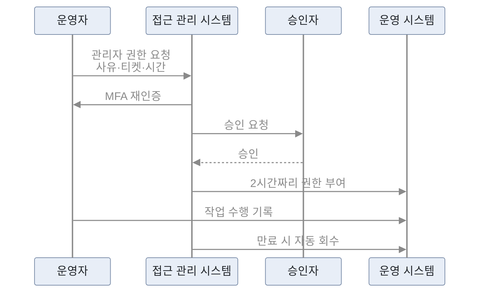

# Least Privilege (최소 권한)

> 약어: NIST=미국 국립표준기술연구소, SP=NIST 특별 간행물, ISO/IEC=국제표준화기구/국제전기기술위원회

## 1. 개요 (What)

최소 권한(Least Privilege)은 **사람·프로그램·서비스가 맡은 일을 하는 데 필요한 권한만, 필요한 동안만 갖게 하는 원칙**이다.
Saltzer·Schroeder의 보호 설계 원칙 가운데 하나이며 → [Access Control Fundamentals 5.1 Saltzer·Schroeder 설계 원칙](access-control-fundamentals.md#51-saltzerschroeder-설계-원칙),
*NIST SP 800-53 Rev. 5*의 접근 통제 통제군과 *ISO/IEC 27002*의 접근 권한 관리 통제도 이 원칙을 요구한다.

원칙 자체는 한 줄이지만, 실제로는 **운영의 문제**다. 처음에 권한을 잘 설계해도 시간이 지나면 권한은 늘어나기만 한다.
이 문서는 앞의 모델(RBAC(Role-Based Access Control)·ABAC(Attribute-Based Access Control)·ReBAC(Relationship-Based Access Control))로 만든 권한을 **어떻게 작게 유지하는가**를 다룬다.

> 비유: 건물 출입카드를 생각하면 된다. 신입 직원에게 모든 층 출입을 열어 주면 편하지만, 카드를 잃어버리면 건물 전체가 위험하다.
> 자기 층만 열어 주고, 서버실은 작업이 있는 날 그 시간에만 열어 주는 것이 최소 권한이다.

## 2. 배경 / 원리 (Why & How)

### 2.1 왜 필요한가 — 피해 반경 줄이기

최소 권한은 공격을 **막는** 통제라기보다, 계정이나 프로그램이 뚫렸을 때 **피해 범위(blast radius)를 줄이는** 통제다.

| 상황 | 권한이 넓으면 | 최소 권한이면 |
|------|---------------|---------------|
| 직원 계정이 피싱으로 탈취 | 공격자가 회사 전체 데이터에 접근 | 그 직원 업무 범위로 제한 |
| 웹 서버 취약점으로 원격 코드 실행 | 서버 계정으로 DB 전체·다른 서버 접근 | 그 서비스가 쓰는 테이블만 |
| 직원의 실수 (잘못된 삭제 명령) | 운영 환경 전체 삭제 | 개발 환경에서만 가능 |
| 내부자의 부정 | 감사 기록 삭제까지 가능 | 작업은 가능하나 기록은 못 지움 |
| 유출된 API 키 | 계정 내 모든 자원 | 키가 쓰이던 하나의 기능 |

- 침해 사고에서 공격자가 처음 얻는 계정은 대부분 평범한 계정이다. 그 계정의 권한이 작으면 공격자는 **권한 상승**이라는 추가 단계를 거쳐야 하고, 그 과정에서 탐지될 기회가 생긴다.

### 2.2 권한의 다섯 가지 차원

"권한을 줄인다"는 말은 여러 방향으로 줄인다는 뜻이다.

| 차원 | 질문 | 줄이는 방법 |
|------|------|-------------|
| 행위 (What) | 무엇을 할 수 있는가 | 읽기·쓰기·삭제·관리 권한을 나눈다. 와일드카드(`*`) 금지 |
| 범위 (Where) | 어느 자원에 대해 | 전체 계정이 아니라 특정 프로젝트·네임스페이스·테이블 |
| 시간 (When) | 언제, 얼마 동안 | 상시 권한 대신 필요할 때만 일시적으로 (JIT(Just-In-Time)) |
| 조건 (How) | 어떤 상황에서 | MFA(Multi-Factor Authentication) 인증, 관리 기기, 사내망에서만 |
| 주체 (Who) | 누가 갖는가 | 사람·서비스마다 별도 계정, 공유 계정 금지 |

- 가장 효과가 큰 것은 **시간 차원**이다. 관리자 권한을 늘 켜 두는 상시 권한(Standing Privilege)을 없애면, 계정이 탈취되어도 그 순간에 권한이 없을 가능성이 크다.

### 2.3 권한은 저절로 늘어난다 — 권한 누적

텍스트 설명: 직원이 부서를 옮기고 프로젝트에 참여할 때마다 새 권한은 추가되지만, 이전 권한은 회수되지 않는 경우가 많다.
몇 년이 지나면 한 사람이 여러 직무의 권한을 모두 가진다. 이를 권한 누적(Privilege Creep)이라고 한다.

- 원인은 단순하다. 권한이 없으면 업무가 막혀 바로 요청이 오지만, 권한이 남아 있어도 아무도 불평하지 않는다. 그래서 **회수는 자동화하거나 정기 검토로 강제**해야 한다.

## 3. 상세 (Details)

### 3.1 계정 수명주기 — 입사·이동·퇴사

권한 관리는 사람의 이동과 묶어야 한다. 흔히 JML(Joiner-Mover-Leaver)이라고 부른다.

| 단계 | 할 일 | 흔한 실패 |
|------|-------|-----------|
| 입사 (Joiner) | 직무 역할을 자동 배정, 기본 권한만 | "옆 사람과 똑같이" 권한 복사 |
| 이동 (Mover) | 새 직무 역할 배정과 **이전 역할 회수를 한 번에** | 새 권한만 추가 |
| 퇴사 (Leaver) | 모든 계정 비활성화, 세션·토큰 폐기, 개인 소유 자원 이관 | SaaS(Software as a Service)·로컬 계정 누락, 남은 API 키 |

- HR(Human Resources) 시스템을 권위 있는 출처로 두고, 디렉터리·IdP(Identity Provider)·SaaS로 자동 전파한다. SCIM(System for Cross-domain Identity Management)이 이 동기화 표준으로, *RFC 7643*이 사용자·그룹 데이터 구조를, *RFC 7644*가 HTTP 기반 프로비저닝 프로토콜을 정의한다. SCIM은 신원 정보의 생성·변경·삭제를 전달할 뿐 접근 판단을 하지는 않는다 → [Enterprise Identity](../pki-identity/enterprise-identity.md)
- 퇴사 처리에는 **이미 발급된 세션과 토큰의 폐기**가 포함되어야 한다. 계정만 막으면 살아 있는 Refresh Token으로 접근이 이어질 수 있다 → [Session & Token Lifecycle](../pki-identity/session-token-lifecycle.md)

### 3.2 필요할 때만 주기 — JIT 접근

JIT 접근은 권한을 상시로 주지 않고, **요청 → 승인 → 일정 시간 동안만 활성화 → 자동 만료**로 운영하는 방식이다.

텍스트 설명: 운영자는 사유와 작업 티켓, 필요한 시간을 적어 권한을 요청하고 MFA로 다시 인증한다.
승인자가 승인하면 정해진 시간 동안만 권한이 활성화되고, 작업은 기록되며, 시간이 지나면 자동으로 회수된다.

- 승인 단계는 위험도에 따라 다르게 둔다. 자주 하는 저위험 작업은 자기 승인(사유 기록 + MFA)으로, 운영 데이터 접근은 다른 사람의 승인으로.
- **권한을 가질 자격**과 **지금 활성화된 권한**을 나눠 관리하면 JIT를 구현하기 쉽다. 예를 들어 Microsoft Entra PIM(Privileged Identity Management)은 두 배정을 구분한다.

| 배정 | 의미 |
|------|------|
| Eligible | 역할을 활성화할 **자격**만 있다. 평소에는 그 역할의 권한이 없다 |
| Active | 역할의 권한이 실제로 부여된 상태. 영구 배정과 기간 제한 배정이 있다 |

- Eligible 사용자가 활성화를 요청하면, 역할별 정책(MFA, 승인자 승인, 활성화 사유, 최대 활성화 시간)에 따라 **일시적인 Active 배정**이 생기고 시간이 지나면 제거된다. 상시 특권을 줄이려면 영구 Active 배정을 최소화하고 Eligible을 기본으로 둔다.
- JIT가 자리 잡으려면 요청이 빠르고 쉬워야 한다. 절차가 번거로우면 사람들은 상시 권한을 다시 요구하거나 공유 계정을 쓴다.

### 3.3 권한 검토와 회수

| 방법 | 내용 | 주의 |
|------|------|------|
| 정기 권한 검토 (Access Review) | 관리자·자원 소유자가 주기적으로 "이 사람에게 이 권한이 아직 필요한가" 확인 | 검토자가 내용을 보지 않고 일괄 승인(rubber-stamping)하기 쉽다 |
| 사용 기반 정리 | 일정 기간 쓰지 않은 권한·역할·계정을 찾아 회수 | 분기·연간 작업, 재해 복구처럼 드물게 쓰는 권한까지 지우면 장애 |
| 이벤트 기반 회수 | 이동·퇴사·프로젝트 종료 이벤트에 맞춰 자동 회수 | 이벤트 연동이 빠진 시스템 |
| 만료일 부여 | 임시 권한은 처음부터 만료일을 붙여 준다 | 만료 연장 요청이 습관화 |

- 검토를 실효성 있게 하려면 검토자에게 **판단 근거**(마지막 사용일, 위험도, 권한 내용 설명)를 함께 보여 주고, 위험한 권한부터 검토하게 한다.
- 클라우드 사업자는 사용 기록을 분석하는 도구를 제공한다. 결과는 **초안**으로 보고 사람이 검토해 적용한다.

| 도구 | 기능 |
|------|------|
| AWS IAM Access Analyzer | 미사용 접근 분석, CloudTrail 활동을 바탕으로 한 정책 초안 생성 |
| Google Cloud IAM Recommender | 권한 사용 내역을 분석해 쓰지 않는 권한이 든 역할의 제거·교체를 추천 (자동 적용하지 않음) |
| Microsoft Entra Access Reviews | 그룹 멤버십, 애플리케이션 접근, Entra 역할, Azure 리소스 역할의 정기 검토 |

- 도구가 무엇을 근거로 분석하는지 알아야 한다 → [5.2 사용 기반 권한 정리의 함정](#52-사용-기반-권한-정리의-함정)

### 3.4 사람의 계정 — 일상 계정과 관리 계정 분리

- 관리자도 메일·웹 서핑은 **일반 계정**으로 하고, 관리 작업만 **별도 관리 계정**으로 한다. 관리 계정이 피싱 메일을 열 일이 없어진다.
- 관리 작업은 전용 관리 단말에서 하는 것이 좋다. 기업 디렉터리의 계층 모델이 이 원칙을 체계화한 것이다 → [Enterprise Identity](../pki-identity/enterprise-identity.md)
- Windows 서버 관리에서는 JEA(Just Enough Administration)로 **허용된 명령만 실행할 수 있는 제한된 PowerShell 관리 창구**를 만들어, 관리자 그룹 전체 권한을 주지 않고도 특정 작업을 맡길 수 있다.
  - 역할 기능 파일(`.psrc`)에 허용할 명령·함수를 정의하고, 세션 구성 파일(`.pssc`)에서 사용자·그룹을 역할에 연결하고 엔드포인트와 실행 계정을 설정한다.
  - 허용한 사용자 정의 함수나 외부 프로그램이 임의 명령 실행 경로를 열면 제한이 무너진다. 허용 목록 자체를 검토한다.

### 3.5 프로그램·서비스의 최소 권한

사람보다 수가 많고 눈에 덜 띄는 것이 서비스 계정이다.

| 대상 | 최소 권한 적용 |
|------|----------------|
| 서비스 계정 | 서비스마다 별도 계정. 여러 서비스가 하나의 강한 계정을 공유하지 않는다 |
| API 토큰 | 필요한 scope와 대상(audience)만, 짧은 수명 → [Token Security](../pki-identity/token-security.md) |
| 클라우드 역할 | 함수·작업 단위 역할, 특정 자원 ARN(Amazon Resource Name)·리소스 이름 지정 |
| Kubernetes | 워크로드별 Service Account, 네임스페이스 범위 Role. API 접근이 필요 없으면 `automountServiceAccountToken: false`로 토큰 자동 마운트 해제(Service Account와 Pod 둘 다 설정하면 Pod 설정이 우선). 자동 마운트 해제가 다른 자격 증명 경로까지 막지는 않는다 |
| 컨테이너 | root가 아닌 사용자로 실행, 불필요한 capability 제거, 읽기 전용 루트 파일 시스템 → [DAC & MAC 5.4 root 권한 쪼개기 — Linux capabilities](dac-mac.md#54-root-권한-쪼개기--linux-capabilities) |
| 데이터베이스 | 애플리케이션 계정은 DML(Data Manipulation Language)만, 스키마 변경은 배포 계정으로 분리 |
| CI·CD | 파이프라인 단계별 권한, 운영 배포 권한은 보호된 브랜치에서만 → [Workload Identity](../pki-identity/workload-identity.md) |

### 3.6 어디에 쓰이는가

| 영역 | 최소 권한 적용 예 |
|------|-------------------|
| Web·API | 사용자 역할별 기능 제한, 객체 단위 인가, 관리 API 분리 |
| 클라우드 | 계정·프로젝트 분리, 권한 경계, 사용하지 않는 권한 정리, 루트 계정 사용 금지 |
| 5G | NF(Network Function)는 필요한 서비스 소비자에게만 서비스 허용, NRF(Network Repository Function) 토큰의 scope를 필요한 서비스로 한정, 운영·관리 인터페이스(OAM(Operations, Administration and Maintenance)) 접근 분리 |
| AI 에이전트 | 필요한 도구만 연결, 도구별 권한을 사용자 권한 이하로 제한, 쓰기·삭제·송금 같은 영향 큰 행동은 사람 확인 |

- AI 에이전트에서 이 원칙은 "최소 행위 권한(Least Agency)"으로도 불린다. OWASP(Open Worldwide Application Security Project) Top 10 for LLM Applications 2025의 LLM06:2025 Excessive Agency는 에이전트에 필요 이상의 기능(도구), 권한, 자율성을 준 결과로 생기는 위험이며, 이 세 가지를 각각 줄이는 것이 대응이다.

## 4. 보안 관점 (Security Relevance)

| 실수 | 결과 | 대응 |
|------|------|------|
| 상시 관리자 권한 | 계정 탈취 즉시 전체 장악 | JIT 접근, 관리자 수 최소화 |
| 이동 시 이전 권한 미회수 | 권한 누적, 권한 분리 붕괴 | 이동 이벤트에 회수 연동, 정기 검토 |
| 퇴사 시 토큰·API 키 미폐기 | 퇴사 후 접근 지속 | 퇴사 절차에 세션·토큰·키 폐기 포함 |
| "옆 사람과 똑같이" 권한 복사 | 그 사람의 누적 권한까지 복사 | 역할 기반 배정, 복사 금지 |
| 와일드카드 권한 | 새 자원·기능에 자동 권한 | 행위·자원 명시 |
| 여러 서비스가 한 서비스 계정 공유 | 하나의 탈취가 전체 서비스로 확대 | 서비스별 계정 |
| 관리 계정으로 메일·웹 사용 | 피싱이 곧 관리자 탈취 | 일상 계정과 관리 계정 분리 |
| 권한 검토 일괄 승인 | 검토가 형식에 그침 | 판단 근거 제공, 위험 권한 우선, 검토 결과 표본 점검 |
| 사용 기록만 보고 권한 일괄 삭제 | 드문 업무(재해 복구 등) 장애 | 관찰 기간 설정, 예외 목록, 단계적 적용 |
| 에이전트에 사용자보다 넓은 권한 | 프롬프트 조작으로 사용자가 못 하는 일 수행 | 사용자 권한 위임, 도구 범위 제한, 사람 확인 |

점검 시 확인할 것: 상시 관리자 수와 실제 사용 빈도, JIT 적용 여부, 이동·퇴사 처리의 자동화와 토큰 폐기, 최근 사용 기록이 없는 권한·계정, 와일드카드 권한, 공유·서비스 계정의 범위, 관리 계정 분리, 권한 검토의 실제 수행 기록.

## 5. 심화 (Advanced)

> 보안 컨설턴트·점검자를 위한 세부다. 본문만으로 개념 이해에는 충분하다.

### 5.1 측정 지표

최소 권한은 "지켜졌다/아니다"보다 **얼마나 가까운가**로 관리한다.

| 지표 | 의미 |
|------|------|
| 권한 격차 (Permission Gap) | 부여된 권한 중 일정 기간 실제로 쓰지 않은 권한의 비율 |
| 상시 특권 수 | 늘 켜져 있는 관리자 권한을 가진 사람·서비스 수 |
| 회수 소요 시간 | 이동·퇴사 이벤트부터 권한이 실제로 회수되기까지 걸린 시간 |
| 직접 부여 비율 | 역할이 아니라 사람에게 직접 준 권한의 비율 |
| 검토 완료율·회수율 | 정기 검토에서 실제로 회수된 권한 비율 (회수율이 늘 0이면 검토가 형식적일 수 있다) |
| 만료 없는 임시 권한 | 만료일 없이 남아 있는 예외·임시 권한 수 |

### 5.2 사용 기반 권한 정리의 함정

사용 기록으로 권한을 줄이는 방법은 효과적이지만, 기록이 **무엇을 담고 있는가**를 먼저 확인해야 한다.

- **관찰 기간**: 30일 기록으로는 분기 결산, 연간 감사, 재해 복구 훈련 같은 업무를 볼 수 없다. 업무 주기에 맞춰 기간을 정하고, 드문 업무는 예외 목록으로 관리한다.
- **기록되지 않는 작업**: 감사 로그가 모든 작업을 남기지는 않는다. 예를 들어 AWS CloudTrail은 관리 이벤트(리소스 생성·삭제, 정책 변경 등)는 기본으로 남기지만, S3 객체 읽기·쓰기, Lambda 함수 실행 같은 **데이터 이벤트는 따로 켜야** 기록된다(별도 비용, 고급 이벤트 선택기로 대상 제한 가능). 기록이 없다고 "안 쓴다"고 판단하면 정상 업무가 막힌다.
- **간접 사용**: 다른 서비스를 통해 대신 쓰이는 권한(서비스가 역할을 넘겨받아 쓰는 경우 등)은 원래 주체의 사용 기록에 드러나지 않을 수 있다.
- **정책 초안 생성**: 사용 기록으로 만든 정책은 "지금까지 한 일"만 허용한다. 그 안에 이미 과도한 행동이 포함되어 있을 수 있으므로, 생성된 정책도 업무 요구사항과 대조한다.
- **도구별 사각지대**: AWS IAM Access Analyzer의 정책 생성은 CloudTrail 추적(trail)이 있어야 하며, S3 데이터 이벤트 같은 작업은 생성 정책에서 작업 단위로 식별되지 않는다. 역할을 서비스에 넘겨주는 `iam:PassRole`도 추적되지 않아 생성 정책에 빠지므로 직접 추가해야 한다.
- **단계적 적용**: 회수 전에 기록 모드나 경고를 먼저 두고, 회수 후에는 빠른 복구 절차를 준비한다.

### 5.3 권한 분리와의 관계 — 위험한 조합

최소 권한은 개별 권한의 크기를 본다면, 권한 분리(Separation of Duties)는 **권한의 조합**을 본다. 둘 다 지켜야 한다.

| 위험한 조합 | 이유 |
|-------------|------|
| 거래 생성 + 거래 승인 | 혼자 부정 거래를 완결 |
| 계정 생성 + 권한 부여 | 자기 자신에게 권한 부여 |
| 시스템 변경 + 감사 로그 삭제 | 흔적 제거 |
| 코드 작성 + 운영 배포 승인 | 검토 없는 운영 반영 |
| 정책 작성 + 정책 배포 | 통제 자체를 우회 |

- 각 권한은 작아도 조합이 위험하면 문제다. 위험한 조합 목록을 미리 정하고, 역할 배정과 권한 검토 때 자동으로 확인한다 → [RBAC 2.4 권한 분리 제약](rbac.md#24-권한-분리-제약)

### 5.4 표준과 통제 기준

| 기준 | 최소 권한 관련 요구 |
|------|--------------------|
| *NIST SP 800-53 Rev. 5* | 최소 권한 통제와 그 세부 강화(보안 기능 접근 허가, 비보안 기능에는 비특권 계정 사용, 사용자 권한 정기 검토, 특권 기능 사용 기록 등), 계정 관리 통제 |
| *ISO/IEC 27002:2022* | 접근 통제 정책, 접근 권한의 부여·검토·변경·회수, 특권 접근 권한 관리, 정보 접근 제한 |
| Saltzer·Schroeder 원칙 | 최소 권한, 기본 거부, 공통 메커니즘 최소화 |

- 표준은 "무엇을 해야 하는가"를 말하고 방법은 조직에 맡긴다. 점검자는 통제 문구보다 **실제로 회수가 일어나는지**(검토 기록, 회수 소요 시간, 상시 특권 수)를 증거로 확인한다.

## 관련 문서

- 이전: [Policy Engines](policy-engines.md)
- 다음: [PAM](pam.md)
- 역할 설계와 권한 분리: [RBAC](rbac.md)
- 계정 수명주기와 프로비저닝: [Enterprise Identity](../pki-identity/enterprise-identity.md), [Identity Fundamentals](../pki-identity/identity-fundamentals.md)
- 로드맵: [Access Control](README.md)

## 출처

| 문서 | 이 문서에서의 사용 |
|------|-------------------|
| Saltzer·Schroeder, "The Protection of Information in Computer Systems" | 최소 권한 원칙 |
| *NIST SP 800-53 Rev. 5* | 최소 권한·계정 관리 통제 |
| *ISO/IEC 27002* | 접근 권한 관리, 특권 접근 권한 |
| AWS CloudTrail 문서 | 관리 이벤트와 데이터 이벤트 기록 범위 |
| Microsoft JEA(Just Enough Administration) 문서 | 제한된 관리 창구 |
| OWASP Top 10 for LLM Applications 2025 | LLM06:2025 Excessive Agency |
| *RFC 7643*, *RFC 7644* | SCIM 스키마와 프로토콜 |
| Microsoft Entra PIM·Access Reviews, AWS IAM Access Analyzer, Google Cloud IAM Recommender 문서 | JIT 배정, 정기 검토, 사용 기반 분석과 한계 |

- 그 외 내용은 최소 권한 운영의 일반 원리와 관행을 재구성한 해설이다.
