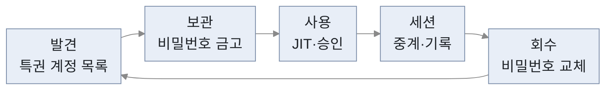
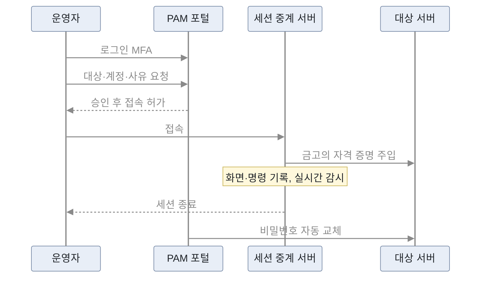

# PAM (특권 접근 관리)

> 약어: NIST=미국 국립표준기술연구소, SP=NIST 특별 간행물, ISO/IEC=국제표준화기구/국제전기기술위원회

## 1. 개요 (What)

PAM(Privileged Access Management, 특권 접근 관리)은 **시스템 전체를 바꿀 수 있는 강한 권한을 찾아내고, 보관하고, 필요할 때만 쓰게 하고, 쓰는 동안 기록하는** 관리 체계다.

특권 계정은 일반 계정과 달리 **한 번의 탈취로 조직 전체가 무너질 수 있는** 계정이다. 그래서 일반 접근 통제 위에 별도의 통제를 더 얹는다.

| 특권 계정 유형 | 예 |
|----------------|----|
| 운영체제 관리자 | Windows 로컬 Administrator, Linux root, `sudo` 권한 사용자 |
| 디렉터리 관리자 | Active Directory Domain Admins·Enterprise Admins |
| 클라우드 최고 권한 | AWS 루트 사용자, Microsoft Entra 전역 관리자, Google Cloud 최고 관리자 |
| 데이터베이스 관리자 | DBA(Database Administrator) 계정, `sa`·`postgres` 같은 기본 관리 계정 |
| 네트워크·보안 장비 | 라우터·방화벽·통신 장비 관리자 계정 |
| 강한 권한의 서비스 계정 | 백업·배포·모니터링 서비스 계정, CI·CD 배포 자격 증명 |
| 비상 계정 | 정상 경로가 막혔을 때 쓰는 Break-glass 계정 |

PAM은 [Least Privilege](least-privilege.md)의 원칙을 **가장 위험한 권한**에 집중해서 구현하는 실무 체계라고 볼 수 있다.

## 2. 배경 / 원리 (Why & How)

### 2.1 왜 특권에 별도 통제가 필요한가

침해 사고의 전형적인 흐름은 "일반 계정 탈취 → 내부 확산 → **특권 계정 획득** → 목표 달성(데이터 탈취, 랜섬웨어 배포)"이다. 특권 계정은 공격의 **목적지**다.

| 특권 계정의 특징 | 위험 |
|------------------|------|
| 권한 범위가 넓다 | 탈취 하나로 전체 시스템 장악 |
| 여러 사람이 함께 쓰는 경우가 많다 | 누가 했는지 추적 불가 |
| 비밀번호를 오래 바꾸지 않는다 | 퇴사자·협력사가 계속 알고 있음 |
| 스크립트·설정 파일에 박혀 있다 | 저장소·백업 유출 시 노출 |
| 어디에 몇 개 있는지 모른다 | 관리 대상에서 누락 |

### 2.2 PAM의 구성 요소

텍스트 설명: 먼저 조직에 있는 특권 계정을 모두 찾아 목록을 만들고, 자격 증명을 금고에 넣는다.
사용자는 승인을 받아 필요한 시간만 쓰고, 접속은 중계 서버를 거치며 기록된다. 사용이 끝나면 비밀번호를 바꿔 다음 사용 전까지 아무도 모르게 한다.

| 구성 요소 | 하는 일 |
|-----------|---------|
| 발견 (Discovery) | 서버·디렉터리·클라우드·장비를 스캔해 특권 계정과 저장된 자격 증명을 찾는다 |
| 자격 증명 금고 (Vault) | 특권 비밀번호·키를 암호화해 보관하고, 꺼내 쓰는 사람과 시간을 기록한다 |
| 접근 승인·JIT(Just-In-Time) | 사용 요청·승인·시간 제한 → [Least Privilege 3.2 필요할 때만 주기 — JIT 접근](least-privilege.md#32-필요할-때만-주기--jit-접근) |
| 세션 관리 | 중계 서버(Jump Server, 프록시)를 통해 접속시키고, 화면·명령을 기록한다 |
| 자격 증명 교체 | 사용 후 또는 주기적으로 비밀번호·키를 자동 교체한다 |
| 단말 권한 관리 | 사용자 PC의 로컬 관리자 권한을 없애고, 필요한 프로그램만 권한 상승을 허용한다 |
| 비밀 관리 (Secrets Management) | 서비스·스크립트가 쓰는 비밀을 코드 밖에서 짧은 수명으로 발급한다 |

### 2.3 목표 — 상시 특권 없애기

PAM의 발전 방향은 "특권 비밀번호를 잘 보관하는 것"에서 "**특권을 상시로 두지 않는 것**(Zero Standing Privilege)"으로 옮겨 왔다.

| 단계 | 모습 |
|------|------|
| 1. 통제 없음 | 관리자 비밀번호를 여러 사람이 알고, 바꾸지 않는다 |
| 2. 금고 보관 | 비밀번호를 금고에 넣고 꺼낼 때 기록한다 |
| 3. 자동 교체 | 꺼내 쓴 뒤 자동으로 바꾼다. 아무도 비밀번호를 오래 알지 못한다 |
| 4. 중계 접속 | 사용자는 비밀번호를 보지 않고, 중계 서버가 대신 넣어 접속시킨다 |
| 5. 상시 특권 없음 | 특권 계정 자체를 평소에는 비활성화하거나, 요청 시 임시 권한·임시 자격 증명을 발급한다 |

## 3. 상세 (Details)

### 3.1 특권 세션 관리

텍스트 설명: 운영자는 MFA(Multi-Factor Authentication)로 PAM 포털에 로그인해 접속할 대상과 계정, 사유를 요청한다.
승인되면 세션 중계 서버를 통해 접속하고, 중계 서버가 금고의 자격 증명을 대신 넣어 주므로 운영자는 비밀번호를 보지 않는다. 세션은 기록되고, 끝나면 비밀번호가 바뀐다.

- **자격 증명 주입**이 핵심이다. 사용자가 비밀번호를 알지 못하면, 사용자 PC가 감염되어도 특권 비밀번호가 새지 않는다.
- 세션 기록은 사고 조사의 증거이자 억제 효과가 있다. 위험 명령(`rm -rf`, 계정 생성, 로그 삭제)을 실시간으로 탐지해 경고하거나 세션을 끊을 수 있다.
- **우회 경로를 막아야** 의미가 있다. 대상 서버가 중계 서버 외의 경로(직접 SSH, 원격 데스크톱)로도 접속을 받으면 PAM은 우회된다. 네트워크와 대상 서버 설정에서 중계 서버 출발 접속만 허용한다.

### 3.2 운영체제 수준의 특권 통제

**Windows**
- 사용자 PC의 로컬 관리자 권한을 없애고, 필요한 프로그램만 권한 상승을 허용한다(단말 권한 관리).
- 모든 PC의 로컬 Administrator 비밀번호가 같으면, 한 대에서 얻은 해시로 전체 PC에 접속할 수 있다(Pass-the-Hash 확산) → [Identity Attacks](../pki-identity/identity-attacks.md). Windows LAPS(Local Administrator Password Solution)는 장치마다 고유한 로컬 관리자 비밀번호를 만들고, 설정한 수명에 따라 주기적으로 바꾼다. 비밀번호는 장치의 가입 상태와 정책에 따라 Active Directory 또는 Microsoft Entra ID **중 하나**에 백업된다(양쪽 동시 백업은 안 된다).
- 도메인 관리자 계정은 도메인 컨트롤러 같은 최상위 자산에만 로그인하게 하고, 일반 PC에는 로그인하지 않는다 → [Enterprise Identity](../pki-identity/enterprise-identity.md)

**Linux**
- root로 직접 로그인하지 않고, 개인 계정으로 로그인한 뒤 `sudo`로 필요한 명령만 실행한다. 누가 무엇을 했는지 개인 단위로 기록된다.
- `sudo` 규칙은 명령을 구체적으로 지정한다. `ALL`을 주면 root와 같다.
- **허용한 명령이 셸을 열 수 있으면 제한이 무너진다.** 예를 들어 편집기(`vi`)의 외부 명령 실행, 페이저(`less`)의 `!` 명령, `find`의 `-exec` 옵션, 일부 스크립트 인터프리터는 안에서 셸을 띄울 수 있다. 이런 명령을 `sudo`로 허용하면, 띄운 셸이 root 권한을 그대로 이어받아 사실상 root 권한을 준 것이 된다.
- 그래서 `sudoers`에서 **명령 이름만 제한하는 것은 충분하지 않다.** 허용할 인자까지 제한하고, 셸 기능이 없는 전용 스크립트나 도구로 대체하며, 실행 파일과 그 경로를 일반 사용자가 바꿀 수 없게 한다.
- `sudo`로 실행하는 스크립트 파일이나 그 디렉터리에 일반 사용자가 쓸 수 있으면, 스크립트를 고쳐 root로 실행할 수 있다 → [DAC & MAC](dac-mac.md)

### 3.3 클라우드 최고 권한 보호

| 대상 | 보호 방법 |
|------|-----------|
| AWS 루트 사용자 | 루트 자격 증명이 꼭 필요한 작업에만 쓴다. MFA 필수(패스키·보안 키 같은 피싱 저항 MFA 권장, 여러 장치 등록), 루트 액세스 키를 만들지 않는다, 로그인·사용 활동 모니터링. AWS Organizations에서는 멤버 계정의 루트 자격 증명을 중앙에서 제거할 수 있다 |
| Microsoft Entra 전역 관리자 | Microsoft 권고는 **5명 미만**이며, 비상 계정도 이 수에 포함된다. 업무에 맞는 더 좁은 관리 역할을 우선 쓰고, PIM(Privileged Identity Management)으로 JIT 활성화 |
| Google Cloud 최고 관리자 | 일상 작업용 계정과 분리, 강한 인증, 조직 관리 역할로 분산 |
| 클라우드 관리 콘솔 전반 | 피싱 저항 MFA, 관리 접근은 관리 단말·조건부 접근으로 제한 |

- 클라우드 최고 권한은 **조직 전체 계정·구독·프로젝트**에 영향을 준다. 사용 이벤트는 실시간 경보 대상으로 둔다.

### 3.4 비상 계정 (Break-glass)

IdP(Identity Provider) 장애, MFA 시스템 장애, 조건부 접근 정책 실수로 모든 관리자가 잠겼을 때 쓰는 계정이다.

- 최소 둘 이상 두고, 특정 사람에게 묶이지 않게 한다.
- 장애 원인이 될 수 있는 외부 의존(연합 IdP, 온프레미스 동기화, 특정 MFA 시스템)을 피한다. 클라우드 IdP에서는 클라우드 전용 계정으로 만든다.
- 피싱 저항 인증(FIDO2 보안 키, 인증서 기반 인증 등)을 쓰고, 자격 증명은 나눠서 물리적으로 안전하게 보관한다.
- **사용되면 즉시 경보**가 울리게 한다. 비상 계정 로그인은 정상 운영에서 거의 일어나지 않으므로 그 자체가 사고 신호다.
- 정기적으로 실제로 쓸 수 있는지 시험한다. Microsoft는 최소 90일마다 검증하도록 권고한다. 시험하지 않은 비상 계정은 정작 필요할 때 동작하지 않는다.
- Microsoft Entra에서는 로그인을 **차단하거나 제한하는** 조건부 접근 정책에서 비상 계정을 제외한다. 로그인을 막지 않는 보고 전용(Report-only) 정책까지 제외할 필요는 없다.
- 비상 계정의 관리자 역할은 PIM 활성화 절차에 묶지 않고 영구 활성으로 둔다. 활성화 절차 자체가 장애 원인일 때도 쓸 수 있어야 하기 때문이다. 상시 특권의 예외이므로 그만큼 경보와 보관을 엄격히 한다.

### 3.5 서비스·기계의 특권 — 비밀 관리

사람보다 서비스 계정의 특권 자격 증명이 더 많고, 더 오래 바뀌지 않는다.

| 방식 | 내용 |
|------|------|
| 금고에서 조회 | 애플리케이션이 시작할 때 비밀 관리 시스템에서 자격 증명을 받아 온다. 코드·설정 파일에 넣지 않는다 |
| 동적 비밀 (Dynamic Secret) | 요청할 때마다 짧은 수명의 DB 계정·클라우드 자격 증명을 새로 만들어 임대(lease) 기간을 붙이고, 만료되거나 폐기되면 무효화한다(예: HashiCorp Vault의 데이터베이스·AWS 비밀 엔진). 생성·폐기 방식은 대상 시스템과 엔진 구현에 따라 다르며, 실제 무효화는 폐기 처리가 정상 수행된다는 전제 위에 있다 |
| 워크로드 신원 | 비밀 자체를 없애고 플랫폼이 증명한 신원으로 임시 자격 증명을 받는다 → [Workload Identity](../pki-identity/workload-identity.md) |
| SSH 인증서 | 장기 SSH 키를 서버마다 등록하는 대신, 내부 인증 기관(CA)이 사용자 공개키에 서명해 짧은 수명의 인증서를 발급한다. OpenSSH 서버는 `TrustedUserCAKeys`로 CA를 신뢰하고, 인증서에 담긴 접속 가능 계정(principal)과 유효 기간을 검증한다. 인증서 만료는 새 인증 시점에 적용되며 이미 연결된 세션을 끊지는 않는다 |

- 금고 자체가 모든 비밀의 집합이므로 **최상위 자산**이다. 금고 관리자 권한, 금고 백업, 금고 장애 시 대체 절차(금고의 Break-glass)까지 함께 설계한다 → [Key Management](../cryptography/key-management.md)

### 3.6 어디에 쓰이는가

| 영역 | PAM 적용 |
|------|----------|
| 기업 IT | 서버·도메인·DB 관리자 접근 중계, 로컬 관리자 비밀번호 관리 |
| 클라우드 | 최고 권한 보호, 관리 역할 JIT 활성화, 콘솔·API 관리 세션 기록 |
| 5G·통신 | 네트워크 장비·NF(Network Function)의 OAM(Operations, Administration and Maintenance) 접근, **장비 제조사의 원격 유지보수 접근**을 PAM으로 중계·기록 |
| 협력사 접근 | 외부 유지보수 인력에게 계정을 주지 않고, 승인된 시간에 중계 세션만 허용 |
| OT(Operational Technology)·산업 시설 | 제어 시스템 원격 접근의 단일 관문화와 세션 기록 |
| AI 에이전트 | 에이전트가 운영 작업을 할 때 특권 자격 증명을 직접 주지 않고, 승인·시간 제한·기록이 있는 경로로만 실행 |

- 통신망에서는 장비 제조사·협력사의 원격 접근이 공급망 위협의 주요 경로다. 항상 열려 있는 원격 접근 대신, 요청·승인·시간 제한·세션 기록을 갖춘 경로로만 허용한다 → [5G Security](../../5g-security/README.md)

## 4. 보안 관점 (Security Relevance)

| 실수 | 결과 | 대응 |
|------|------|------|
| 특권 계정 목록이 없음 | 관리되지 않는 관리자 계정이 공격 경로 | 정기 발견 스캔, 목록과 소유자 관리 |
| 관리자 비밀번호 공유·장기 미변경 | 퇴사자·협력사가 계속 접근, 행위자 추적 불가 | 금고 보관, 사용 후 자동 교체, 개인별 접근 |
| 모든 PC 로컬 관리자 비밀번호 동일 | 한 대 탈취가 전체 PC로 확산 | Windows LAPS 등으로 PC별 비밀번호 |
| 중계 서버 우회 경로 존재 | PAM 기록·통제 무력화 | 대상 서버는 중계 서버 출발 접속만 허용 |
| `sudo`에 셸을 열 수 있는 명령 허용 | 사실상 root 권한 | 허용 명령 검토, 셸 탈출 가능한 명령 제외 |
| 스크립트·설정에 특권 비밀번호 저장 | 저장소·백업 유출 시 노출 | 비밀 관리 시스템, 동적 비밀, 워크로드 신원 |
| 클라우드 루트·전역 관리자를 일상 사용 | 피싱 한 번으로 조직 전체 장악 | 일상 계정 분리, 최고 권한 최소 인원, 사용 경보 |
| 비상 계정 미시험·사용 경보 없음 | 필요할 때 동작 안 함, 악용돼도 모름 | 정기 시험, 로그인 즉시 경보 |
| 금고 자체의 권한 관리 소홀 | 금고 관리자 탈취가 곧 전체 탈취 | 금고 관리자 분리·MFA·감사, 금고 백업 보호 |
| 세션 기록을 아무도 보지 않음 | 이상 행위 놓침 | 위험 명령 실시간 탐지, 표본 검토 |
| 협력사 상시 원격 접근 | 협력사 침해가 곧 내부 침해 | 요청·승인·시간 제한 중계 접근 |

점검 시 확인할 것: 특권 계정 목록과 발견 주기, 공유 계정 여부, 비밀번호 교체 방식, 중계 서버 우회 가능성, 로컬 관리자 비밀번호 관리, `sudo` 규칙, 코드·설정의 하드코딩 비밀, 클라우드 최고 권한 보유자 수와 사용 기록, 비상 계정 시험과 경보, 금고 관리자 권한, 세션 기록 검토 여부, 협력사 원격 접근 경로.

## 5. 심화 (Advanced)

> 보안 컨설턴트·점검자를 위한 세부다. 본문만으로 개념 이해에는 충분하다.

### 5.1 특권 사용 탐지 신호

| 신호 | 의미 |
|------|------|
| 금고를 거치지 않은 특권 계정 로그인 | 우회 경로 또는 유출된 자격 증명 사용 |
| 비상 계정 로그인 | 장애 대응 또는 악용. 즉시 확인 |
| 평소와 다른 시간·출발지의 관리자 로그인 | 계정 탈취 가능성 |
| 특권 그룹 멤버 추가 | 권한 상승 또는 지속성 확보 시도 |
| 감사 정책 변경·로그 삭제 | 흔적 제거 |
| 서비스 계정의 대화형 로그인 | 서비스 계정 자격 증명 탈취 |
| 짧은 시간 안에 여러 서버에 같은 관리자 계정 로그인 | 내부 확산 |

- MITRE ATT&CK(Adversarial Tactics, Techniques, and Common Knowledge)에서는 이런 행위가 Valid Accounts(T1078), Account Manipulation(T1098) 기법과 Privilege Escalation(TA0004) 전술 등으로 분류된다. T1098에는 클라우드 자격 증명·클라우드 역할 추가, SSH authorized_keys 추가, 로컬·도메인 그룹 추가 같은 하위 기법이 있고, 권한 상승뿐 아니라 지속성(Persistence) 확보에도 쓰인다. 탐지 규칙을 기법 분류에 맞춰 두면 누락을 찾기 쉽다 → [Identity Attacks](../pki-identity/identity-attacks.md)

### 5.2 금고 설계의 위험

| 위험 | 대응 |
|------|------|
| 금고가 단일 장애점 | 고가용성 구성, 금고 장애 시 비상 접근 절차 |
| 금고 관리자가 모든 비밀 조회 가능 | 관리 권한과 비밀 조회 권한 분리, 이중 승인 |
| 금고와 대상 시스템 사이의 교체 계정 | 교체용 계정 자체가 강한 특권. 별도 보호와 감사 |
| 금고 백업 | 백업 파일과 복호화 키를 분리 보관 |
| 비밀 조회 API 토큰 | 애플리케이션의 금고 접근 토큰도 짧은 수명·범위 제한 |

### 5.3 세션 기록의 범위와 개인정보

- 세션 기록에는 화면, 입력 명령, 파일 전송 내역이 담기며, 그 안에 고객 데이터나 비밀번호 입력이 포함될 수 있다. 기록 자체를 민감 데이터로 보고 접근 권한·보관 기간을 정한다.
- 기록은 **위변조를 막는 저장소**에 둔다. 특권 사용자가 자기 세션 기록을 지울 수 있으면 증거 가치가 없다.
- 기록 대상과 목적을 사용자에게 알리고, 조직의 개인정보·노동 관련 규정에 맞춘다.

### 5.4 통제 기준

| 기준 | PAM 관련 요구 |
|------|---------------|
| *NIST SP 800-53 Rev. 5* | 특권 계정의 별도 관리, 최소 권한, 특권 기능 사용 기록, 원격 접근 통제, 세션 감사 |
| *ISO/IEC 27002:2022* | 특권 접근 권한 관리(관리 계정과 일반 계정 분리, 임시 특권 포함), 인증 정보 관리, 특권 유틸리티 프로그램 사용 제한, 로그 기록 |
| MITRE ATT&CK | Valid Accounts(T1078), Account Manipulation(T1098), Privilege Escalation(TA0004) |

- 점검자는 PAM 도입 여부보다 **우회 경로가 없는지, 교체가 실제로 일어나는지, 기록을 누가 보는지**를 증거로 확인한다.

## 관련 문서

- 이전: [Least Privilege](least-privilege.md)
- 다음: [Authorization Attacks](authorization-attacks.md)
- 관리 계층 모델·서비스 계정: [Enterprise Identity](../pki-identity/enterprise-identity.md)
- 서비스의 비밀 없는 인증: [Workload Identity](../pki-identity/workload-identity.md)
- 금고의 키 보호: [Key Management](../cryptography/key-management.md)
- 로드맵: [Access Control](README.md)

## 출처

| 문서 | 이 문서에서의 사용 |
|------|-------------------|
| *NIST SP 800-53 Rev. 5* | 특권 계정·원격 접근·감사 통제 |
| *ISO/IEC 27002:2022* | 특권 접근 권한, 비밀 인증 정보, 특권 유틸리티 |
| Microsoft 문서 (Windows LAPS, 비상 접근 계정, Entra 역할 모범 사례) | 로컬 관리자 비밀번호 관리, Break-glass 계정 관행, 전역 관리자 인원 권고 |
| HashiCorp Vault 문서 | 동적 비밀과 임대 |
| OpenSSH `sshd_config` 매뉴얼 | SSH 사용자 인증서 신뢰 |
| GTFOBins | `sudo` 허용 명령의 셸 탈출 사례 |
| AWS 문서 (루트 사용자 보호) | 루트 사용자 사용 원칙 |
| MITRE ATT&CK Enterprise | 특권 관련 공격 기법 분류 |

- 그 외 내용은 PAM의 일반 원리와 운영 관행을 재구성한 해설이다.
