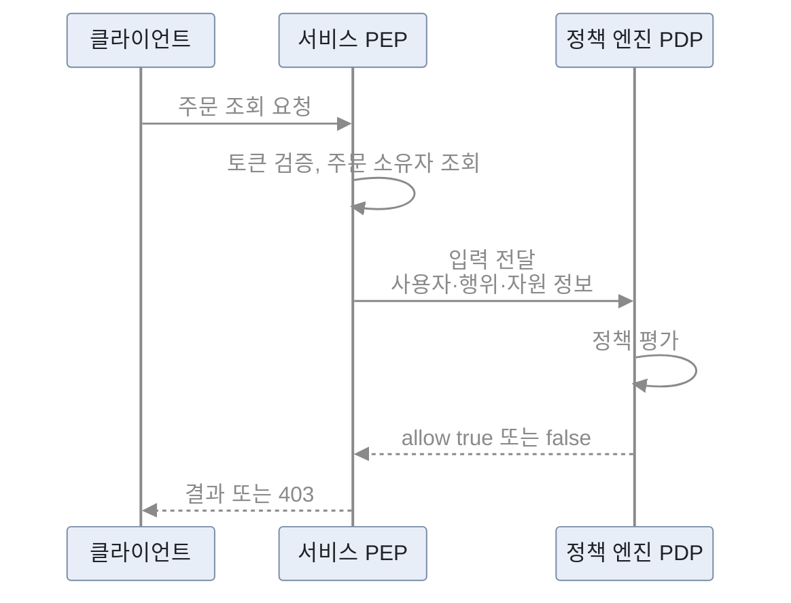
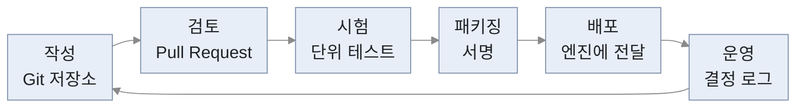

# Policy Engines (정책 엔진)

> 약어: NIST=미국 국립표준기술연구소, SP=NIST 특별 간행물

## 1. 개요 (What)

정책 엔진(Policy Engine)은 **인가 판단을 애플리케이션 밖에서 대신 해 주는 소프트웨어**다.
애플리케이션은 "이 요청을 허용해도 되는가"를 묻고, 엔진은 미리 배포된 정책과 데이터로 답한다. 판단 구조로 보면 엔진이 PDP(Policy Decision Point)이고, 묻는 애플리케이션이 PEP(Policy Enforcement Point)다 → [Access Control Fundamentals 2.2 판단과 집행의 분리](access-control-fundamentals.md#22-판단과-집행의-분리)

| 엔진 | 정책 언어 | 성격 | 대표 사용처 |
|------|-----------|------|-------------|
| OPA(Open Policy Agent) | Rego | 범용. JSON으로 된 어떤 입력이든 판단 | 마이크로서비스 API 인가, Kubernetes Admission, 인프라 코드 검사 |
| Cedar | Cedar | 인가 전용. 주체·행위·자원 중심 문법, 정책 분석을 고려한 설계 | 애플리케이션 권한, Amazon Verified Permissions |
| ReBAC 엔진 | 관계 모델 | 관계 그래프 계산 | 문서 공유, 멀티테넌트 SaaS(Software as a Service) → [ReBAC](rebac.md) |

이 문서는 OPA와 Cedar를 중심으로, 정책을 코드로 관리하는 방법(PBAC(Policy-Based Access Control))과 엔진을 배치하는 방식을 다룬다 → [ABAC & PBAC 3.3 정책을 코드로 관리하기 (PBAC)](abac-pbac.md#33-정책을-코드로-관리하기-pbac)

## 2. 배경 / 원리 (Why & How)

### 2.1 왜 엔진으로 빼는가

| 문제 | 코드 안 `if` 문 | 정책 엔진 |
|------|-----------------|-----------|
| 서비스마다 같은 규칙을 다르게 구현 | 언어·팀마다 제각각 | 같은 정책을 여러 서비스가 공유 |
| 규칙 변경 | 애플리케이션 재배포 | 정책만 배포 |
| "누가 무엇을 할 수 있나" 감사 | 코드를 다 읽어야 함 | 정책 파일과 결정 로그로 확인 |
| 테스트 | 기능 테스트에 섞임 | 정책 단위 테스트를 따로 실행 |
| 보안팀 검토 | 개발 코드 검토 필요 | 정책 저장소만 검토 |

- 엔진을 써도 **인가 판단에 필요한 정보(누가 소유자인가 등)** 는 누군가 엔진에 넘겨야 한다. 엔진은 판단 규칙을 옮겨 줄 뿐, 데이터 문제를 없애 주지 않는다.

### 2.2 판단 흐름



텍스트 설명: 서비스는 토큰을 검증하고 판단에 필요한 정보(주문 소유자 등)를 모아 엔진에 넘긴다. 엔진은 정책으로 평가해 결정을 돌려주고, 서비스는 그대로 집행한다.
**엔진에 넘기는 입력을 무엇으로 채우는가**가 보안의 절반이다. 클라이언트가 보낸 값을 검증 없이 넣으면 정책이 맞아도 판단이 틀린다.

### 2.3 배치 방식

| 방식 | 구조 | 장점 | 단점 |
|------|------|------|------|
| 중앙 PDP | 하나의 인가 서비스를 모든 서비스가 네트워크로 호출 | 정책·데이터 관리가 한 곳 | 지연이 늘고, 인가 서비스 장애가 전체 장애가 된다 |
| 사이드카·호스트 에이전트 | 서비스 옆에 엔진을 두고 로컬로 호출 | 지연이 짧고 장애가 격리된다 | 정책·데이터를 각 엔진에 배포해야 한다 |
| 라이브러리 | 애플리케이션 프로세스 안에 엔진을 넣는다 | 가장 빠르다 | 언어 의존, 배포가 애플리케이션과 묶인다 |
| 관리형 서비스 | 클라우드가 운영하는 인가 서비스 | 운영 부담이 적다 | 특정 클라우드 의존, 호출 비용·지연 |

- 분산 배치에서는 **모든 엔진이 같은 버전의 정책과 데이터로 판단하는지**가 과제다. 정책 배포가 일부만 성공하면 서비스마다 결과가 달라진다.
- 어떤 방식이든 엔진에 연결할 수 없거나 오류가 나면 **거부**로 처리한다(Fail Closed).

## 3. 상세 (Details)

### 3.1 OPA와 Rego

OPA는 정책(Rego)과 데이터(JSON)를 메모리에 올려 두고, 요청마다 받은 입력(`input`)으로 질의를 평가한다.

```text
package httpapi.authz

default allow := false

allow if {
    input.method == "GET"
    input.path == ["orders", order_id]
    data.orders[order_id].owner == input.user
}
```

- `default allow := false`: 어떤 규칙도 성립하지 않을 때 돌려줄 기본값이다. Rego에서 **undefined와 false는 다르다.**

| 상황 | `allow`의 결과 |
|------|----------------|
| 규칙 성립 | `true` |
| 규칙 불성립, `default` 없음 | undefined (값이 없음) |
| 규칙 불성립, `default allow := false` | `false` |

- PEP가 "false일 때만 거부"로 구현하면 undefined가 통과될 수 있다. 정책에 기본값을 두고, PEP는 true가 아닌 모든 결과를 거부로 처리한다.
- 규칙은 "본문의 모든 조건이 참이면 성립"한다. 같은 이름의 규칙을 여러 개 쓰면 그중 하나만 성립해도 된다(OR). 규칙은 선언 순서에 의존하지 않는다(`else` 체인은 예외).
- 판단에 쓰는 데이터는 요청 입력(`input`)이나 미리 올린 데이터(`data`)에서 온다. 위 예의 `data.orders`처럼 큰 데이터를 엔진에 계속 동기화하기 어려우면, 서비스가 필요한 값만 `input`에 담아 넘긴다.
- OPA는 판단 결과가 꼭 참·거짓일 필요가 없다. "허용 + 가릴 필드 목록"처럼 구조화된 결정을 돌려줄 수 있다.

**OPA가 쓰이는 곳**

| 영역 | 연결 방식 |
|------|-----------|
| 마이크로서비스 API | 서비스가 OPA REST API·라이브러리 호출, 또는 Envoy 외부 인가(ext_authz) 연동 |
| Kubernetes Admission | Gatekeeper가 생성·수정 요청을 검사하고 기존 리소스를 감사 ("모든 Pod는 리소스 제한 필수" 등). 정책 코드는 Rego가 기본이며 CEL도 지원한다 |
| 인프라 코드 | Conftest 등으로 Kubernetes 매니페스트, Terraform plan을 배포 전에 검사. Terraform은 plan을 JSON으로 변환해 넣으며, 도구가 Terraform을 실행하는 것은 아니다 |
| CI·CD | 파이프라인 단계에서 배포 조건 검사 |

### 3.2 Cedar

Cedar는 인가 전용 언어다. 정책은 **허용(`permit`)과 금지(`forbid`)** 두 종류이고, 주체(principal)·행위(action)·자원(resource)과 조건으로 쓴다.

```text
permit (
  principal in Group::"finance",
  action == Action::"readReport",
  resource
)
when { resource.department == principal.department };

forbid (
  principal,
  action == Action::"exportReport",
  resource
)
unless { context.mfa_authenticated == true };
```

- 첫 정책: 재무 그룹에 속한 주체는 자기 부서 보고서를 읽을 수 있다.
- 둘째 정책: MFA(Multi-Factor Authentication) 인증이 없으면 보고서 내보내기를 금지한다.
- 평가 규칙은 단순하다. **허용 정책이 하나도 맞지 않으면 거부**, **금지 정책이 하나라도 맞으면 허용 정책과 관계없이 거부**다. 결합 방식을 따로 고를 필요가 없다.
- `when`은 조건이 참일 때, `unless`는 조건이 **거짓**일 때 정책이 적용된다. 둘째 정책은 "MFA 인증이 참이 아니면 금지"가 된다.
- `in`은 문자열 비교가 아니라 **엔티티 계층을 따라가는 관계 연산**이다. 사용자 → 그룹 → 상위 그룹처럼 중첩된 부모 관계를 따라 멤버십을 확인한다. 계층과 속성은 애플리케이션이 엔티티 데이터로 함께 넘긴다.
- 스키마를 정의하면 존재하지 않는 엔티티 유형·행위·속성, 허용되지 않는 주체·자원 조합, 잘못된 타입을 배포 전에 잡을 수 있다. 다만 스키마 검증은 정책이 **업무 요구사항을 맞게 표현했는지**까지 증명하지는 않는다.

### 3.3 Rego와 Cedar 비교

| 관점 | OPA·Rego | Cedar |
|------|----------|-------|
| 범위 | 범용 (인가, Admission, 설정 검사 등) | 애플리케이션 인가 |
| 결정 형태 | 자유로운 JSON 결과 | 허용·거부 (+ 어떤 정책이 결정했는지) |
| 기본 판단 | 정책에서 `default`로 정한다 | 기본 거부, 금지 우선이 언어에 내장 |
| 표현력 | 반복·집계 등 강력하다 | 의도적으로 제한해 분석하기 쉽다 |
| 정책 분석 | 테스트 중심 | 스키마 검증과 정책 분석 도구 |
| 학습 비용 | 높은 편 | 낮은 편 |

- 범용성이 필요하면 OPA, 애플리케이션 권한을 읽기 쉽게 관리하고 분석하고 싶으면 Cedar가 맞는다. 조직이 둘 다 쓰는 경우도 흔하다(인프라는 OPA, 앱은 Cedar).

### 3.4 정책 수명주기



텍스트 설명: 정책은 Git에서 작성하고 Pull Request로 검토한 뒤, 단위 테스트를 통과하면 서명된 묶음으로 만들어 엔진에 배포한다.
운영 중 쌓이는 결정 로그는 정책이 의도대로 동작하는지 확인하는 근거가 되고, 다음 정책 수정으로 이어진다.

| 단계 | 할 일 |
|------|-------|
| 작성 | 요구사항 문장을 정책 옆에 주석·문서로 남긴다 |
| 검토 | 정책 변경은 보안 담당 검토를 필수로 한다 |
| 시험 | 허용·거부 양쪽 사례를 테스트로 만든다. OPA는 `opa test`, Cedar는 정책 검증·테스트 도구를 쓴다 |
| 패키징 | 정책·데이터를 묶고 서명한다. OPA 번들은 서명과 검증을 지원하지만, 엔진 쪽에서 검증을 강제하도록 설정해야 한다 → [5.1 OPA 운영 세부](#51-opa-운영-세부) |
| 배포 | 기록만 하는 모드로 먼저 돌려 현재 동작과 결과를 비교한 뒤 차단으로 바꾼다 |
| 운영 | 결정 로그를 수집한다. 로그에 담길 민감 정보는 마스킹 정책으로 직접 지정해 가린다 |

### 3.5 표준 인가 API — AuthZEN

엔진마다 호출 방식이 다르면 PEP를 엔진에 묶어 버린다. OpenID Foundation의 AuthZEN 작업 그룹은 PEP와 PDP 사이의 **표준 인가 API**를 정의한다.

```json
{
  "subject":  { "type": "user", "id": "alice" },
  "action":   { "name": "read" },
  "resource": { "type": "document", "id": "plan" },
  "context":  { "time": "2026-11-27T10:00:00Z" }
}
```

- 요청은 주체·행위·자원·조건 네 요소로 구성된다. 주체와 자원은 `type`·`id`, 행위는 `name`이 필수이고, 각 요소에 추가 속성(`properties`)을 붙일 수 있다.
- 응답은 필수 필드 `decision`(true는 허용, false는 거부)을 가진 객체이며, 선택적으로 `context`를 함께 돌려줄 수 있다. 단건 확인 외에 주체·자원·행위를 찾는 검색 API도 정의되어 있다.
- 이 구조는 이 지식베이스가 1장부터 써 온 인가 질문의 네 요소와 같다 → [Access Control Fundamentals 2.1 인가 질문의 네 요소](access-control-fundamentals.md#21-인가-질문의-네-요소)
- PEP가 이 API로 호출하면 뒤쪽 엔진(OPA, Cedar, ReBAC 엔진 등)을 바꿔도 애플리케이션 코드를 덜 고친다.

### 3.6 어디에 쓰이는가

| 영역 | 엔진 활용 |
|------|-----------|
| Web·API | 게이트웨이 또는 서비스에서 OPA·Cedar 호출, 객체 단위 판단 |
| Kubernetes | Admission 단계 정책(Gatekeeper 등), Webhook 인가 |
| 클라우드 | 관리형 인가 서비스(Amazon Verified Permissions는 Cedar 사용), 인프라 코드 검사 |
| 5G | 클라우드 네이티브 NF(Network Function) 배포 정책 검사, 운영 API 인가. NF 간 서비스 인가는 3GPP가 정한 NRF(Network Repository Function) 토큰 방식이 기준이다 → [OAuth 2.0 · OpenID Connect 3.9 5G SBA의 OAuth 2.0](../pki-identity/oauth2-oidc.md#39-5g-sba의-oauth-20) |
| AI 에이전트 | 도구 호출 전 정책 확인: "이 사용자를 대신해 이 도구를 이 인자로 호출해도 되는가" |

- AI 에이전트의 도구 호출 인가는 정책 엔진이 잘 맞는 영역이다. 에이전트가 만든 요청을 그대로 믿지 않고, **실제 사용자 신원·도구·인자·데이터 민감도**를 입력으로 엔진에 묻는다.

## 4. 보안 관점 (Security Relevance)

| 실수 | 결과 | 대응 |
|------|------|------|
| `default` 거부 없이 정책 작성, undefined를 허용으로 처리 | 정책이 맞지 않는 요청이 통과 | 기본 거부 명시, PEP는 거부·오류·undefined를 모두 거부로 |
| 엔진 연결 실패 시 허용 | 엔진 장애 유도로 우회 | Fail Closed, 엔진 가용성 확보 |
| 클라이언트 값을 그대로 `input`에 넣음 | 입력 조작으로 판단 왜곡 | 검증된 토큰·서버 데이터로 입력 구성 |
| 엔진 관리 API를 인증 없이 노출 | 누구나 정책·데이터 교체 | 관리 API 인증·인가 설정, 로컬 바인딩, 네트워크 차단 |
| 서명 없는 정책 번들 | 배포 경로에서 정책 바꿔치기 | 번들 서명·검증, 배포 서버 보호 |
| 정책 저장소 쓰기 권한 관리 소홀 | 정책 수정으로 모든 통제 무력화 | 보호된 브랜치, 필수 검토, 변경 감사 |
| 테스트 없이 정책 배포 | 숨은 허용·과잉 차단 | 허용·거부 테스트, 기록 모드 선행 |
| Kubernetes Admission Webhook을 호출 실패 시 통과(`failurePolicy: Ignore`)로 설정 | Webhook 장애 동안 정책 우회 | 보안 정책은 기본값인 `Fail` 유지, Webhook 가용성 확보 |
| 결정 로그에 토큰·개인정보 기록 | 로그 유출 시 2차 피해 | 민감 필드 마스킹 |
| 엔진마다 정책 버전이 다름 | 서비스별 판단 불일치 | 배포 상태 모니터링, 버전 확인 |

점검 시 확인할 것: 기본 거부와 undefined 처리, PEP의 오류 처리, 입력을 채우는 출처, 엔진 관리 API의 노출과 인증, 번들 서명, 정책 저장소 권한과 검토 절차, 정책 테스트, Admission Webhook의 실패 정책, 결정 로그의 민감 정보, 엔진별 정책 버전.

## 5. 심화 (Advanced)

> 보안 컨설턴트·점검자를 위한 세부다. 본문만으로 개념 이해에는 충분하다.

### 5.1 OPA 운영 세부

| 기능 | 내용 |
|------|------|
| 번들 (Bundle) | 정책·데이터 묶음을 원격 서버에서 주기적으로 내려받아 재시작 없이 활성화한다. 엔진마다 받는 시점이 달라 반영은 결국 일치(eventual consistency) 방식이다 |
| 번들 서명 | 번들에 서명 파일을 넣고 엔진에 검증용 공개키를 설정한다. **공개키만 등록하고 번들별 서명 검증 설정을 하지 않으면 서명 없는 번들도 활성화될 수 있으므로**, 번들 설정에서 서명 검증을 명시해 강제한다 |
| 결정 로그 (Decision Log) | 각 결정의 입력·결과·번들 정보 등을 원격으로 보낸다. 민감 정보는 자동으로 찾아 주지 않으며, 관리자가 마스킹 정책(`system.log.mask`)으로 지울 필드나 바꿀 값을 지정한다 |
| 상태 보고 (Status) | 번들 활성화 성공·실패를 보고한다. 배포 누락을 찾는 데 쓴다 |
| REST API 보안 | 기본 설정에서는 인증·인가가 모두 꺼져 있다. `--authentication`(token 또는 tls)으로 요청의 신원 정보를 추출하고, `--authorization=basic`으로 `system.authz` Rego 정책에 의한 인가를 켠다. `basic`은 HTTP Basic 인증이 아니며, 토큰이 유효한지도 인가 정책이 판단한다. 함께 쓰거나, 로컬에서만 접근하게 한다 |
| 부분 평가 (Partial Evaluation) | 일부 입력을 모르는 상태로 정책을 평가해 남은 조건을 돌려준다. "볼 수 있는 행만 조회" 같은 데이터 필터를 SQL 조건으로 바꾸는 데 쓴다. OPA는 조건을 만들어 줄 뿐 질의 실행은 애플리케이션이 하며, 모든 Rego 표현이 SQL로 변환되지는 않는다 |

- 목록 조회 인가는 항목마다 엔진을 부르면 느리다. 부분 평가로 조건을 뽑아 데이터베이스 질의에 넣거나, ReBAC 엔진의 객체 목록 조회를 쓴다.

### 5.2 Cedar의 검증 가능성

- Cedar는 언어 기능을 의도적으로 제한해 **정책 분석**이 가능하도록 설계되었고, 별도 분석 도구로 다음을 확인할 수 있다. 이는 정책 변경 검토용 도구 기능이며, 런타임 평가에 자동으로 적용되는 것은 아니다.

| 분석 | 확인하는 것 |
|------|-------------|
| 정책 집합 비교 | 새 정책 집합이 이전과 같은지, 더 많이 허용하는지, 더 적게 허용하는지, 서로 비교 불가인지 |
| 가려진 허용 | 다른 정책 때문에 효과가 없는 permit |
| 불가능한 조건 | 절대 참이 될 수 없는 조건 |
| 금지에 덮인 허용 | forbid 때문에 효과가 사라진 permit |
- 스키마 검증은 존재하지 않는 엔티티 유형·속성, 타입 불일치를 배포 전에 잡는다. 정책 오타가 조용히 "아무것도 허용하지 않음" 또는 "예상치 못한 허용"으로 이어지는 것을 막는다.

### 5.3 정책 검증 방법

*NIST SP 800-192*는 접근 통제 정책과 모델의 검증·시험 방법을 다룬다. 실무에서 쓰는 방법은 다음과 같다.

| 방법 | 확인하는 것 |
|------|-------------|
| 단위 테스트 | 정해진 입력에 기대한 결정이 나오는가 |
| 속성 기반 테스트 | 무작위 입력에서도 불변 조건("관리자 아닌 사람은 삭제 불가")이 지켜지는가 |
| 변경 영향 분석 | 정책 변경 전후로 결정이 달라지는 요청이 무엇인가 (과거 결정 로그 재생) |
| 정적 분석·정형 검증 | 충돌, 도달 불가능한 규칙, 허용 범위 확대 여부 |
| 커버리지 | 테스트가 정책의 어느 규칙을 실행했는가 |

- 과거 결정 로그를 새 정책으로 다시 평가해 차이를 보는 방법은 운영 환경의 실제 요청을 기준으로 하므로 효과가 크다. 로그의 민감 정보 처리와 함께 설계한다.

### 5.4 Kubernetes Admission 정책

| 도구 | 방식 |
|------|------|
| Gatekeeper | OPA 기반. ConstraintTemplate(정책 로직과 파라미터 스키마. Rego 또는 CEL)과 Constraint(적용할 리소스 종류·범위·파라미터)로 구성. 요청 검사와 기존 리소스 감사를 함께 한다 |
| Kyverno | Kubernetes 리소스 형태(YAML)로 정책을 쓴다. 검증(Validate), 변경(Mutate), 생성(Generate), 이미지 검증(Verify Images)을 지원하며 CEL 기반 정책 리소스도 있다 |
| ValidatingAdmissionPolicy | Kubernetes 내장 기능. 외부 Webhook 없이 API Server 안에서 CEL(Common Expression Language) 식으로 검증한다. 정책(ValidatingAdmissionPolicy)과 적용 범위(ValidatingAdmissionPolicyBinding)를 함께 만들어야 적용된다 |

- Admission 정책은 "누가 요청했는가"보다 "**무엇을 만들려 하는가**"(특권 컨테이너, 호스트 경로 마운트, 다른 Service Account 지정 등)를 검사한다. RBAC가 못 막는 위험한 설정을 여기서 막는다 → [RBAC 5.2 Kubernetes RBAC의 권한 상승 방지](rbac.md#52-kubernetes-rbac의-권한-상승-방지)
- `failurePolicy`는 두 곳에서 뜻이 다르다.
  - Admission Webhook: Webhook **호출이 실패**했을 때(응답 없음, 오류)의 처리. 기본값은 `Fail`(거부)이고 `Ignore`면 요청을 통과시킨다. Webhook이 정상 응답으로 거부(`allowed: false`)를 돌려주면 `Ignore`여도 거부된다.
  - ValidatingAdmissionPolicy: 정책 설정 오류나 CEL **평가 오류**의 처리.
- 적용 제외 네임스페이스도 함께 점검한다. 제외 범위가 넓으면 정책이 사실상 적용되지 않는다.

## 관련 문서

- 이전: [ReBAC](rebac.md)
- 다음: [Least Privilege](least-privilege.md)
- 정책 모델: [ABAC & PBAC](abac-pbac.md)
- 판단 결과와 결합: [Access Control Fundamentals](access-control-fundamentals.md)
- 로드맵: [Access Control](README.md)

## 출처

| 문서 | 이 문서에서의 사용 |
|------|-------------------|
| OPA 공식 문서 | Rego 문법, 기본값과 undefined, 번들·서명, 결정 로그, REST API 보안, 부분 평가 |
| Cedar 공식 문서 | 정책 구조, permit·forbid 평가 규칙, 엔티티 계층, 스키마 검증 |
| OpenID AuthZEN Authorization API | 표준 인가 요청·응답 구조 |
| *NIST SP 800-192* | 접근 통제 정책 검증·시험 방법 |
| Gatekeeper, Kyverno, Kubernetes 공식 문서 | Admission 정책 방식, `failurePolicy` |

- 그 외 내용은 정책 엔진의 일반 원리와 운영 관행을 재구성한 해설이다.
