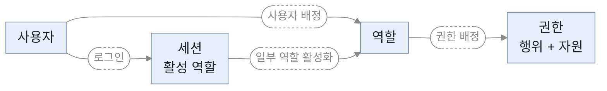
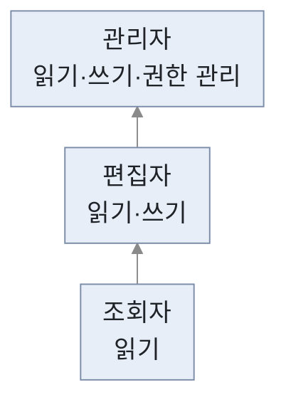

# RBAC (역할 기반 접근 통제)

> 약어: NIST=미국 국립표준기술연구소, ANSI=미국 국가표준협회, INCITS=국제정보기술표준위원회

## 1. 개요 (What)

RBAC(Role-Based Access Control, 역할 기반 접근 통제)는 권한을 사람에게 직접 주지 않고 **역할(Role)에 묶어 두고, 사람에게는 역할을 배정**하는 모델이다.

> 예: "회계 담당자" 역할에 "전표 조회·전표 작성" 권한을 묶고, 회계팀에 새로 온 직원에게는 이 역할만 배정한다.
> 직원이 다른 팀으로 옮기면 역할 배정만 바꾸면 되고, 권한 하나하나를 찾아 지울 필요가 없다.

기업 업무 시스템, 데이터베이스, Kubernetes, 클라우드 IAM(Identity and Access Management) 등 대부분의 시스템이 RBAC를 기본 인가 모델로 쓴다.
NIST가 연구 모델로 정리한 것이 *ANSI INCITS 359*로 표준화되었으며, 기본 구조·역할 계층·권한 분리 제약을 정의한다.

DAC(Discretionary Access Control)가 "소유자가 정한다", MAC(Mandatory Access Control)가 "등급 레이블로 강제한다"였다면, RBAC는 **"조직 안에서 맡은 일로 정한다"** 이다 → [DAC & MAC](dac-mac.md)

## 2. 배경 / 원리 (Why & How)

### 2.1 왜 역할로 묶는가

사용자에게 권한을 직접 주면 관리해야 할 연결이 "사용자 수 × 권한 수"만큼 늘어난다.
역할을 가운데 두면 "사용자 → 역할"과 "역할 → 권한" 두 가지 연결만 관리하면 되고, 역할의 수는 사용자보다 훨씬 적다.

| 질문 | 직접 부여 | RBAC |
|------|-----------|------|
| 신규 입사자에게 권한 주기 | 필요한 권한을 하나씩 부여 | 직무 역할 하나 배정 |
| 직무 변경 | 옛 권한을 찾아 회수하고 새 권한 부여 | 역할 배정 교체 |
| "이 사람은 무엇을 할 수 있나" 감사 | 개별 권한 목록을 모두 조회 | 배정된 역할로 설명 |
| 업무 절차가 바뀌어 권한 추가 | 해당 직무의 모든 사람에게 개별 부여 | 역할 하나만 수정 |

### 2.2 기본 구조 — 사용자, 역할, 권한, 세션

텍스트 설명: 사용자는 역할에 배정되고, 역할에는 권한이 배정된다. 권한은 "행위 + 자원"(예: 전표 작성)의 묶음이다.
사용자가 로그인하면 세션이 만들어지고, 세션에서는 배정된 역할 중 일부만 활성화할 수 있다. 인가 판단은 세션에서 활성화된 역할의 권한으로 한다.

| 요소 | 의미 | 예 |
|------|------|----|
| 사용자 (User) | 사람 또는 서비스 계정 | `alice`, `ci-bot` |
| 역할 (Role) | 조직 안의 직무·책임 | 회계 담당자, 배포 담당자, 읽기 전용 감사자 |
| 권한 (Permission) | 자원에 대한 행위 허가 | 전표 작성, Pod 조회, 버킷 객체 읽기 |
| 세션 (Session) | 사용자가 역할을 활성화해 작업하는 단위 | 로그인 한 번, 관리자 권한 상승 한 번 |

- **세션에서 필요한 역할만 켠다**는 생각이 최소 권한과 이어진다. 평소에는 일반 역할로 일하고, 관리 작업을 할 때만 관리자 역할을 활성화한다.
- 인가 판단 자체는 "활성 역할 중 하나라도 이 권한을 가졌는가"다. 역할끼리는 허용이 누적되며, 거부 규칙은 기본 모델에 없다.

### 2.3 역할 계층 — 상위 역할은 하위 역할의 권한을 물려받는다

텍스트 설명: 화살표는 "물려준다"는 방향이다. 편집자는 조회자의 읽기 권한을 물려받고 쓰기를 더한다.
관리자는 편집자의 권한을 모두 물려받고 권한 관리를 더한다. 역할마다 같은 권한을 반복해 적지 않아도 된다.

- 역할 계층은 편리하지만, **상위 역할에 쌓이는 권한이 보이지 않게** 된다. 관리자 역할 하나에 얼마나 많은 권한이 모였는지 주기적으로 펼쳐서 확인한다.
- 계층이 깊어지면 "왜 이 사람이 이 권한을 가졌는가"를 추적하기 어려워진다. 실무에서는 2~3단계 정도로 얕게 둔다.

### 2.4 권한 분리 제약

RBAC는 역할 배정에 **제약(Constraint)** 을 걸어 권한 분리(Separation of Duties)를 강제한다.

| 종류 | 막는 시점 | 예 |
|------|-----------|----|
| 정적 권한 분리 SSD(Static Separation of Duty) | **역할 배정** 시점 | "구매 요청자"와 "구매 승인자" 역할을 한 사람에게 함께 배정할 수 없다 |
| 동적 권한 분리 DSD(Dynamic Separation of Duty) | **세션 활성화** 시점 | 두 역할을 모두 배정받을 수는 있지만, 한 세션에서 동시에 켤 수는 없다 |

- SSD는 단순하고 감사하기 쉽지만 경직적이다. 작은 조직에서 한 사람이 여러 업무를 맡아야 하면 DSD를 쓴다.
- 실제 부정을 막으려면 역할 제약만으로 부족할 때가 많다. "자기가 요청한 건은 자기가 승인할 수 없다"처럼 **같은 거래 단위**로 확인해야 하는 규칙은 애플리케이션 로직이나 ABAC(Attribute-Based Access Control) 조건으로 구현한다.
- 권한 분리의 고전적 근거는 Clark-Wilson 모델이다 → [DAC & MAC 5.1 Bell-LaPadula와 Biba의 규칙](dac-mac.md#51-bell-lapadula와-biba의-규칙)

## 3. 상세 (Details)

### 3.1 역할 설계

| 방식 | 방법 | 장점 | 주의 |
|------|------|------|------|
| 하향식 (Top-down) | 조직도·직무 기술서를 분석해 역할 정의 | 업무 의미가 분명하다 | 실제 시스템 사용과 어긋날 수 있다 |
| 상향식 (Bottom-up, Role Mining) | 현재 사용자별 권한을 분석해 공통 묶음을 역할로 추출 | 현실을 반영한다 | 지금의 과잉 권한까지 역할로 굳어진다 |
| 혼합 | 하향식으로 뼈대를 만들고 상향식으로 검증 | 실무에서 가장 흔하다 | 지속적인 검토가 필요하다 |

좋은 역할의 기준:
- 역할 이름만 보고 **무엇을 하는 사람인지** 알 수 있다 (`finance-approver`, `k8s-namespace-viewer`).
- 한 역할이 너무 많은 일을 하지 않는다. "관리자" 하나에 모든 권한을 몰지 않는다.
- 역할마다 **소유자**(누가 이 역할의 권한 범위를 책임지는가)가 있다.
- 사람에게 권한을 직접 주는 예외를 최소화한다. 예외가 많으면 RBAC가 아니라 DAC로 돌아간 것이다.

### 3.2 역할 폭증 (Role Explosion)

RBAC의 가장 큰 운영 문제는 역할이 계속 늘어나는 것이다.

> 예: "회계 담당자"가 부서·지역·프로젝트·근무 시간대마다 조금씩 다른 권한이 필요하면
> `회계-서울-A프로젝트`, `회계-부산-A프로젝트`, `회계-서울-B프로젝트`... 로 조합 수만큼 역할이 생긴다.

- 원인: RBAC는 역할이라는 한 가지 기준만으로 판단하므로, 부서·위치·시간·데이터 민감도 같은 **조건을 표현하려면 역할을 쪼갤 수밖에 없다**.
- 결과: 역할이 사용자 수에 가까워지면 관리 이점이 사라지고, 어느 역할이 무엇을 하는지 아무도 모르게 된다.
- 대응:
  - 역할은 직무 단위로 굵게 두고, 조건은 **속성(ABAC)** 으로 표현한다 → [ABAC & PBAC](abac-pbac.md)
  - "이 문서의 소유자", "같은 팀" 같은 관계는 **ReBAC**로 표현한다 → [ReBAC](rebac.md)
  - 범위(scope)를 역할과 분리한다. "편집자" 역할을 "프로젝트 A 범위"에 배정하는 식이다. Kubernetes 네임스페이스, 클라우드 리소스 그룹이 이 방식이다.

### 3.3 RBAC가 답하지 못하는 질문

| 질문 | RBAC만으로는 | 필요한 것 |
|------|--------------|-----------|
| "이 주문이 이 고객의 것인가" | 역할은 "주문 조회 가능"까지만 말한다 | 객체 소유 확인 (ReBAC, 애플리케이션 로직) |
| "업무 시간에 사내망에서만" | 역할에 조건이 없다 | 환경 속성 조건 (ABAC) |
| "자기가 만든 요청은 자기가 승인 불가" | 역할 제약은 역할 단위 | 거래 단위 규칙 |
| "기밀 등급 데이터는 인가 등급 이상만" | 역할로 등급을 흉내 내면 역할 폭증 | 레이블·속성 (MAC, ABAC) |

- 특히 첫 번째 질문을 놓치면 IDOR(Insecure Direct Object Reference)·BOLA(Broken Object Level Authorization)가 된다. "고객" 역할이 "주문 조회" 권한을 가졌다고 해서 **모든 주문**을 조회할 수 있어서는 안 된다.

### 3.4 어디에 쓰이는가

| 영역 | 역할 | 권한 | 배정 |
|------|------|------|------|
| Kubernetes | Role(네임스페이스 범위), ClusterRole(클러스터 범위) | API 그룹·자원·동사(get, list, create 등) | RoleBinding, ClusterRoleBinding으로 사용자·그룹·Service Account에 연결 |
| Microsoft Azure | 역할 정의(기본 제공·사용자 정의) | 허용 작업(Actions) 목록 | 역할 할당 = 보안 주체 + 역할 + **범위**(관리 그룹·구독·리소스 그룹·리소스). 하위 범위로 상속 |
| Google Cloud | 기본·사전 정의·커스텀 역할 | 권한 목록 | 리소스 계층(조직·폴더·프로젝트·리소스)의 IAM 정책에 바인딩, 하위로 상속 |
| 데이터베이스 | DB 역할 (예: PostgreSQL role. 사용자와 그룹을 모두 role로 다루며, 로그인 가능한 role이 사용자 역할을 한다) | `GRANT`로 테이블·스키마 권한 | 역할을 다른 role에 `GRANT`해 멤버로 만든다. PostgreSQL 16부터는 멤버십마다 권한 자동 상속(INHERIT), 역할 전환(SET), 재부여(ADMIN) 여부를 따로 지정할 수 있어, 멤버라고 해서 항상 권한이 자동 상속되는 것은 아니다 |
| 기업 디렉터리 | AD(Active Directory) 그룹 | 그룹에 부여한 파일·시스템 권한 | 그룹 멤버십 |
| 애플리케이션 | 앱 역할 | 앱 기능 | IdP(Identity Provider)가 토큰의 역할 claim으로 전달. 예: Microsoft Entra ID는 앱에 정의한 역할을 사용자 로그인 시 ID Token의 `roles`, API 호출 시 그 API를 대상(`aud`)으로 한 Access Token의 `roles`에 담는다. API는 자기 앞으로 발급된 토큰의 역할만 신뢰한다 |
| 5G SBA(Service Based Architecture) | NF(Network Function) 유형 | 접근 가능한 NF 서비스(scope) | NRF(Network Repository Function)가 Access Token 발급 시 확인 |

- **AWS IAM의 "Role"은 RBAC의 역할과 뜻이 다르다.** AWS IAM Role은 권한 정책이 붙은 **신원**이다. 신뢰 정책(Trust Policy)이 허용한 주체가 이 Role을 Assume하면 임시 자격 증명이 발급되고, 그 자격 증명으로 Role의 권한을 쓴다. Role 자체가 임시 자격 증명인 것은 아니며, 권한 판단은 정책 문서 평가로 이루어진다 → [Cloud IAM](../../cloud-security/iam/README.md) (작성 예정)
- 5G SBA는 엄밀한 RBAC는 아니지만, "어떤 NF 유형이 어떤 서비스를 쓸 수 있는가"를 NRF가 정책으로 판단하는 구조라 역할 기반 판단과 닮았다 → [OAuth 2.0 · OpenID Connect 3.9 5G SBA의 OAuth 2.0](../pki-identity/oauth2-oidc.md#39-5g-sba의-oauth-20)
- **그룹과 역할의 차이**: 그룹은 "사용자의 모음", 역할은 "권한의 모음"이다. 실무에서는 그룹에 역할을 배정하고 사람을 그룹에 넣는 방식으로 함께 쓴다.

## 4. 보안 관점 (Security Relevance)

| 실수 | 결과 | 대응 |
|------|------|------|
| 관리자 역할을 넓게 배정 | 계정 하나 탈취가 전체 장악으로 이어진다 | 관리자 역할 최소 인원, 필요할 때만 활성화(JIT(Just-In-Time)) |
| 와일드카드 권한(`*`)을 역할에 넣음 | 새 자원·기능이 생기면 자동으로 권한 확대 | 필요한 자원·동사를 명시 |
| 직무 이동 후 옛 역할 유지 (Privilege Creep) | 권한이 누적되어 과잉 권한 | 이동·퇴사 시 자동 회수, 정기 권한 검토 |
| 역할 폭증 | 역할의 의미를 아무도 모름, 검토 불가 | 직무 단위 역할 + 속성 조건, 사용 안 하는 역할 정리 |
| 사용자에게 권한 직접 부여 | 역할 기반 감사에서 누락 | 직접 부여 금지 또는 예외 기록·만료 |
| 권한 분리 제약 미적용 | 한 사람이 요청·승인을 모두 수행 | SSD·DSD 정의, 거래 단위 검증 |
| 역할만 확인하고 객체 소유 미확인 | 같은 역할의 다른 사용자 데이터 접근 (IDOR·BOLA) | 객체 단위 인가를 함께 수행 |
| 클라이언트가 보낸 역할 값을 신뢰 | 요청 조작으로 권한 상승 | 서버가 신뢰할 수 있는 출처(검증된 토큰·디렉터리)의 역할만 사용 |
| Kubernetes에서 `bind`·`escalate`·`impersonate` 동사를 넓게 허용 | 자기 권한을 스스로 키우는 경로 | 이 동사는 관리자에게만, 정기 점검 |
| `cluster-admin`을 일반 사용자·Service Account에 바인딩 | 클러스터 전체 장악 | 네임스페이스 범위 Role 사용, ClusterRoleBinding 점검 |

점검 시 확인할 것: 관리자 역할 보유자 수와 실제 사용 여부, 와일드카드 권한, 사용하지 않는 역할과 배정, 직접 부여된 권한, 권한 분리 대상 업무와 제약 여부, 역할 소유자 지정, 역할 판단 근거의 출처, Kubernetes의 ClusterRoleBinding과 위험 동사.

## 5. 심화 (Advanced)

> 보안 컨설턴트·점검자를 위한 세부다. 본문만으로 개념 이해에는 충분하다.

### 5.1 *ANSI INCITS 359*의 구성 요소

| 구성 요소 | 내용 |
|-----------|------|
| Core RBAC | 사용자, 역할, 권한(행위 + 객체), 세션, 사용자 배정(UA(User Assignment)), 권한 배정(PA(Permission Assignment)). 세션은 한 사용자에 속하고 배정된 역할 중 일부를 활성화한다 |
| Hierarchical RBAC | 역할 간 상속. 상위 역할(Senior)이 하위 역할(Junior)의 권한을 물려받는다. **General**은 역할 간 부분 순서를 허용해 다중 상속이 가능한 일반 계층이고, **Limited**는 다중 상속을 막고 트리 형태의 단순 구조로 제한한 계층이다 |
| Static SoD | 사용자 배정에 대한 제약. 역할 집합 RS와 정수 n(2 이상)으로 정의하며, 한 사용자의 역할 중 RS에 속하는 것이 n개 미만이어야 한다(최대 n-1개). 예: RS = {회계 담당자, 감사자}, n = 2면 둘을 함께 배정할 수 없다 |
| Dynamic SoD | 세션 활성화에 대한 제약. "이 역할 집합에서 n개 이상을 한 세션에서 동시에 활성화할 수 없다" |

- 역할 계층과 SSD를 함께 쓸 때는 직접 배정한 역할 이름만이 아니라 **상속으로 유효해지는 역할까지 포함한 집합**으로 제약을 검사해야 한다. 예를 들어 "관리자"가 "회계 담당자"를 물려받는다면, 관리자 배정은 회계 담당자 배정과 같은 효과를 낸다. 이를 빠뜨리면 상위 역할 배정으로 SSD를 우회할 수 있다.
- 표준은 기능 명세(관리 함수, 검토 함수, 시스템 함수)까지 정의한다. 예를 들어 "이 사용자에게 배정된 역할", "이 역할을 가진 사용자"를 조회하는 검토 함수는 감사의 기반이다.

### 5.2 Kubernetes RBAC의 권한 상승 방지

Kubernetes RBAC API는 사용자가 RBAC 객체를 만들어 자기 권한을 키우는 것을 막는다.

| 작업 | 허용 조건 |
|------|-----------|
| Role·ClusterRole 생성·수정 | 역할 객체를 만들거나 고칠 API 권한에 더해, 그 역할에 담긴 권한을 같은 범위에서 **이미 모두 가졌거나** 역할 객체에 대한 `escalate` 동사를 가졌을 때 |
| RoleBinding·ClusterRoleBinding 생성·수정 | 바인딩 객체를 만들거나 고칠 API 권한에 더해, 참조하는 역할의 권한을 같은 범위에서 **이미 모두 가졌거나** 그 역할에 대한 `bind` 동사를 가졌을 때 |
| 다른 사용자로 요청 | `impersonate` 동사가 있으면 다른 사용자·그룹·Service Account로 행동할 수 있다 |

- 따라서 `escalate`·`bind`·`impersonate`는 사실상 관리자 권한이다. 와일드카드 동사(`*`)는 이들을 모두 포함한다.
- `escalate`·`bind`는 역할 객체를 만드는 권한을 대신하지 않는다. "자기 권한을 넘는 내용을 담거나 연결해도 된다"는 별도의 허가다.
- **Pod 생성 권한은 간접적인 상승 경로다.** 네임스페이스에 Pod(또는 Deployment 같은 워크로드)를 만들 수 있으면, 별도 제한이 없는 한 Pod의 `spec.serviceAccountName`에 그 네임스페이스의 **다른 Service Account**를 지정할 수 있다. 높은 권한의 Service Account 토큰이 Pod에 마운트되면 그 권한을 그대로 얻는다. Admission 정책(Validating Admission Policy, Admission Webhook 등)으로 지정 가능한 Service Account를 제한할 수 있다.
- Secret 읽기 권한은 Service Account 토큰 등 다른 자격 증명 노출로 이어질 수 있다.
- 기본 사용자용 ClusterRole은 다음과 같다. `admin`·`edit`·`view`는 ClusterRole이지만 RoleBinding으로 특정 네임스페이스에만 적용할 수 있다.

| ClusterRole | 범위 | 주의할 점 |
|-------------|------|-----------|
| `cluster-admin` | 클러스터 전체 | 모든 자원에 대한 최고 권한 |
| `admin` | 네임스페이스 | 네임스페이스 안에서 Role·RoleBinding까지 만들 수 있다 |
| `edit` | 네임스페이스 | Secret을 읽을 수 있고, 네임스페이스의 어떤 Service Account로든 Pod를 실행할 수 있어 그 Service Account들의 권한을 얻을 수 있다 |
| `view` | 네임스페이스 | 대부분 읽기 전용. Secret은 볼 수 없고 Role·RoleBinding을 바꿀 수 없다 |
- `system:masters` 그룹은 RBAC 검사를 거치지 않는 최고 권한이다. RoleBinding·ClusterRoleBinding을 지워도 이 그룹의 권한은 줄지 않는다. 회수하려면 **인증 단계**에서 그 신원이 더 이상 이 그룹으로 인증되지 않게 해야 한다. 이 그룹이 담긴 클라이언트 인증서라면 인증서 교체·클러스터 CA(Certificate Authority) 신뢰 관리의 문제이므로, 이런 인증서는 비상용으로만 두고 발급·보관을 엄격히 관리한다.

### 5.3 범위와 상속 — 클라우드 RBAC

Azure와 Google Cloud의 역할 배정은 "누구에게 + 어떤 역할을 + **어느 범위에**"의 세 요소로 이루어진다.

- 상위 범위(구독, 조직·폴더)에 배정한 역할은 그 아래 모든 리소스에 상속된다. 상위 범위의 넓은 배정은 생각보다 훨씬 많은 자원에 영향을 준다.
- 하위 범위에서 상위 배정을 빼는 방법은 기본 RBAC에 없다. 플랫폼별 거부 기능은 성격이 다르다.
  - Azure 거부 할당(Deny Assignment)은 허용 역할 할당이 있어도 특정 작업을 막는다. 다만 주로 Azure가 관리하는 시스템 보호용이며, 고객이 일반 기능처럼 자유롭게 만드는 것은 아니다.
  - Google Cloud IAM 거부 정책(Deny Policy)은 허용 정책과 따로 관리되고 조직·폴더·프로젝트에 붙여 하위로 상속되며, 허용보다 우선한다. 거부 정책을 지원하는 권한에만 적용된다.
- Google Cloud의 기본 역할(Owner·Editor·Viewer)은 범위가 매우 넓어, 운영 환경에서는 서비스별 사전 정의 역할이나 커스텀 역할로 좁히는 것이 권장된다.

### 5.4 RBAC와 ABAC의 결합 방식

| 방식 | 설명 | 예 |
|------|------|----|
| 역할 + 조건 | 역할로 1차 허용, 속성 조건으로 좁힌다 | "편집자 역할 **이고** 리소스 태그의 부서가 사용자 부서와 같을 때" |
| 속성으로 역할 배정 | 속성 규칙으로 역할을 자동 배정한다 | "부서 = 재무, 직급 = 팀장 → 재무 승인자 역할" |
| 역할을 속성으로 취급 | 역할을 여러 속성 중 하나로 정책에 넣는다 | ABAC 정책 안에서 `subject.role == "auditor"` |

- 세 번째 방식에 이르면 RBAC는 ABAC의 특수한 경우가 된다. 상세는 [ABAC & PBAC](abac-pbac.md)에서 다룬다.

## 관련 문서

- 이전: [DAC & MAC](dac-mac.md)
- 다음: [ABAC & PBAC](abac-pbac.md), [ReBAC](rebac.md)
- 판단 구조: [Access Control Fundamentals](access-control-fundamentals.md)
- 운영: [Least Privilege](least-privilege.md)
- 기업 디렉터리 그룹: [Enterprise Identity](../pki-identity/enterprise-identity.md)
- 로드맵: [Access Control](README.md)

## 출처

| 문서 | 이 문서에서의 사용 |
|------|-------------------|
| *ANSI INCITS 359* (Role Based Access Control) | Core RBAC, 역할 계층, SSD·DSD 구성 |
| Sandhu, Ferraiolo, Kuhn, "The NIST Model for Role-Based Access Control: Towards a Unified Standard" | NIST RBAC 모델 |
| Kubernetes 공식 문서 (Using RBAC Authorization) | Role·ClusterRole·Binding, 권한 상승 방지, 기본 ClusterRole |
| Microsoft Azure RBAC 문서 | 역할 정의·할당·범위 상속 |
| Google Cloud IAM 문서 | 역할 종류, 리소스 계층 상속 |
| AWS IAM 문서 | IAM Role 개념 |

- 그 외 내용은 RBAC의 일반 원리와 운영 경험을 재구성한 해설이다.
