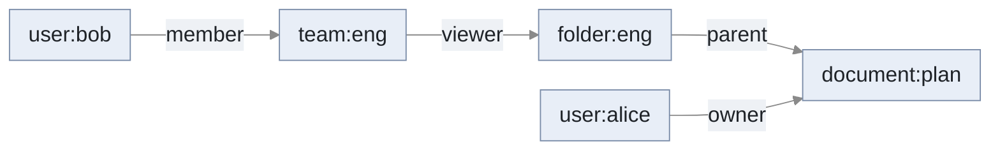
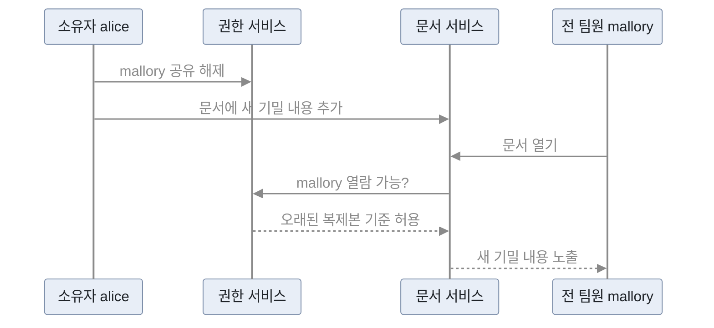

# ReBAC (관계 기반 접근 통제)

## 1. 개요 (What)

ReBAC(Relationship-Based Access Control, 관계 기반 접근 통제)는 **주체와 자원 사이의 관계**로 접근을 판단하는 모델이다.

> 예: "alice는 이 문서의 **소유자**다", "bob은 eng 팀의 **멤버**이고, eng 팀은 이 폴더의 **열람자**이며, 이 문서는 그 폴더 **안에 있다**."
> 그러면 alice는 문서를 고칠 수 있고, bob은 문서를 읽을 수 있다. 권한은 관계를 따라가서 계산된다.

문서 공유 서비스, 협업 도구, 멀티테넌트 SaaS(Software as a Service)처럼 **누가 무엇을 누구와 공유했는가**가 권한의 핵심인 시스템에 맞는다.
Google이 Drive, YouTube 등 여러 서비스의 권한을 하나로 처리하기 위해 만든 Zanzibar 시스템(논문 "Zanzibar: Google's Consistent, Global Authorization System")이 이 방식을 대규모로 구현했고,
이후 OpenFGA, SpiceDB 같은 오픈소스 구현이 나왔다.

RBAC(Role-Based Access Control)는 "이 사람의 역할"을, ABAC(Attribute-Based Access Control)는 "이 사람과 자원의 속성"을 본다면,
ReBAC는 **"이 사람과 이 자원이 어떻게 이어져 있는가"** 를 본다 → [RBAC](rbac.md), [ABAC & PBAC](abac-pbac.md)

## 2. 배경 / 원리 (Why & How)

### 2.1 왜 관계인가

| 요구사항 | RBAC로는 | ReBAC로는 |
|----------|----------|-----------|
| 문서 소유자만 삭제 | "소유자" 역할은 문서마다 다르다 | `document#owner` 관계 |
| 폴더를 공유하면 안의 문서도 공유 | 문서마다 권한을 복사 | 문서 → 부모 폴더 관계를 따라 상속 |
| 팀 단위 공유 | 팀 × 문서 조합마다 역할 | 팀 멤버 관계 + 팀이 가진 관계 |
| 테넌트 A 사용자는 테넌트 A 자원만 | 테넌트마다 역할 복제 | 자원 → 테넌트, 사용자 → 테넌트 관계 |
| "나와 공유된 문서 목록" | 모든 문서를 돌며 검사 | 관계 그래프의 역방향 조회 |

- 권한이 **객체마다 다르고**, 사용자가 **직접 공유를 만든다**는 점에서 DAC(Discretionary Access Control)의 현대적 형태로 볼 수도 있다. 차이는 공유 규칙(누가 누구에게 무엇을 넘길 수 있는가)을 모델로 명시하고, 중앙 서비스가 일관되게 계산한다는 점이다.
- IDOR(Insecure Direct Object Reference)·BOLA(Broken Object Level Authorization)의 근본 원인인 "객체 소유 확인 누락"을 모델 차원에서 다룬다 → [RBAC 3.3 RBAC가 답하지 못하는 질문](rbac.md#33-rbac가-답하지-못하는-질문)

### 2.2 관계 튜플과 권한 계산

ReBAC 시스템은 관계를 **튜플(tuple)** 로 저장한다. 형태는 "객체 # 관계 @ 주체"다.

| 튜플 | 뜻 |
|------|----|
| `document:plan#owner@user:alice` | alice는 plan 문서의 소유자 |
| `document:plan#parent@folder:eng` | plan 문서의 부모는 eng 폴더 |
| `folder:eng#viewer@team:eng#member` | eng 팀의 **멤버 전체**는 eng 폴더의 열람자 |
| `team:eng#member@user:bob` | bob은 eng 팀의 멤버 |

그리고 **권한 모델(스키마)** 이 관계를 어떻게 조합해 권한을 만드는지 정한다.

- 문서의 편집자 = 직접 지정된 편집자 **또는** 소유자
- 문서의 열람자 = 직접 지정된 열람자 **또는** 편집자 **또는** 부모 폴더의 열람자



텍스트 설명: bob은 eng 팀의 멤버이고, eng 팀은 eng 폴더의 열람자이며, plan 문서의 부모는 eng 폴더다.
"bob이 plan을 읽을 수 있는가"를 물으면, 시스템은 "문서 열람자 = 부모 폴더의 열람자" 규칙에 따라 폴더로 가고, 폴더 열람자인 eng 팀의 멤버에 bob이 있는지 확인한다.
alice는 문서의 소유자이므로 "편집자 = 소유자 포함" 규칙에 따라 편집할 수 있다.

### 2.3 묻는 질문의 종류

| 질문 | 예 | 용도 |
|------|----|------|
| 확인 (Check) | "bob이 plan을 볼 수 있는가" | 요청마다 인가 판단 (PDP(Policy Decision Point) 역할) |
| 객체 목록 (List Objects) | "bob이 볼 수 있는 문서 전체" | 목록 화면, 검색 결과 필터 |
| 주체 목록 (List Users·Expand) | "plan을 볼 수 있는 사람 전체" | 공유 대화상자, 감사 |
| 관계 쓰기 (Write) | "plan을 carol과 공유" | 공유·소유권 변경 |

- 목록 질문은 ReBAC가 RBAC·ABAC보다 잘하는 부분이다. 관계 그래프를 역방향으로 따라가면 "누가 접근할 수 있는가"를 계산할 수 있어 권한 검토·감사에 유리하다.

## 3. 상세 (Details)

### 3.1 권한 모델 예

OpenFGA의 모델 언어로 위 예를 쓰면 다음과 같다.

```text
model
  schema 1.1

type user

type team
  relations
    define member: [user]

type folder
  relations
    define viewer: [user, team#member]

type document
  relations
    define parent: [folder]
    define owner: [user]
    define editor: [user] or owner
    define viewer: [user, team#member] or editor or viewer from parent
```

- `[user, team#member]`: 이 관계에 **직접 저장할 수 있는 주체 유형의 제한**이다. 개별 사용자나 "어떤 팀의 멤버 전체"만 넣을 수 있고, 관계 튜플을 쓸 때도 이 유형 제한을 지켜야 한다.
- `or owner`: 소유자이면 편집자이기도 하다 (관계 간 포함).
- `viewer from parent`: 문서의 `parent` 관계를 따라가 연결된 폴더의 `viewer`를 계산한다. 부모 폴더의 열람자는 이 문서의 열람자다 (관계를 따라가는 상속).
- 이 밖에 교집합은 `and`, 제외는 `but not`으로 쓴다.
- 이 모델에는 "삭제 권한" 같은 동작을 따로 정의하지 않았다. 실무에서는 `can_delete` 같은 **권한(동작)** 을 관계 조합으로 정의하고, 애플리케이션은 관계가 아니라 이 권한을 확인한다. 그래야 관계 구조가 바뀌어도 애플리케이션 코드가 바뀌지 않는다.

### 3.2 관계 데이터를 누가 쓰는가

ReBAC에서는 **관계 튜플을 쓰는 것이 곧 권한을 주는 것**이다.

| 쓰기 경로 | 예 | 통제 |
|-----------|----|------|
| 사용자의 공유 동작 | "이 문서를 carol과 공유" | 공유할 수 있는 권한(예: 편집자만 공유 가능)을 모델로 정의하고, 쓰기 전에 Check |
| 애플리케이션의 데이터 변경 | 문서 생성 시 `owner` 튜플, 폴더 이동 시 `parent` 튜플 변경 | 애플리케이션 서비스 계정만 해당 관계를 쓸 수 있게 |
| 조직 동기화 | HR·디렉터리에서 팀 멤버 관계 동기화 | 동기화 작업의 권한·감사 |
| 관리자 작업 | 테넌트 관리자 지정 | 특권 작업으로 기록·승인 |

- 관계 저장소에 아무 서비스나 쓸 수 있으면, 그 서비스 하나의 탈취가 곧 **모든 자원의 권한 탈취**다.
- 애플리케이션 데이터와 관계 데이터가 **따로 저장**되므로 둘이 어긋날 수 있다. 문서를 지웠는데 관계가 남거나, 폴더를 옮겼는데 `parent`가 안 바뀌면 권한이 틀어진다. 데이터 변경과 관계 쓰기를 함께 처리하는 방법(아웃박스 패턴 등)이 필요하다.

### 3.3 일관성 — "새로운 적" 문제

관계 변경과 콘텐츠 변경 사이의 **순서**가 꼬이면 보안 문제가 생긴다. Zanzibar 논문은 이를 "새로운 적(New Enemy) 문제"라고 불렀다.



텍스트 설명: alice가 mallory의 공유를 해제한 **뒤에** 새 기밀 내용을 추가했다. 그런데 권한 서비스가 공유 해제가 반영되지 않은 오래된 데이터로 판단하면, mallory는 해제 이후에 추가된 내용까지 보게 된다.
권한 판단은 "적어도 이 콘텐츠 버전만큼 최신인 권한 데이터"로 해야 한다.

Zanzibar는 zookie라는 시점 토큰으로 이 문제를 막는다.

1. 콘텐츠 서비스는 콘텐츠 변경을 받아들이기 전에, 변경 권한을 **최신 권한 데이터**로 확인한다.
2. 허용되면 Zanzibar가 그 판단에 쓴 권한 데이터의 시점을 담은 zookie를 돌려준다.
3. 콘텐츠 서비스는 새 콘텐츠 버전과 zookie를 함께 저장한다.
4. 나중에 그 콘텐츠를 열 때 저장된 zookie를 권한 확인 요청에 넘긴다.
5. Zanzibar는 그 zookie보다 오래되지 않은 데이터로 판단한다. 공유 해제가 콘텐츠 변경보다 먼저였다면 해제가 반영된 데이터로 판단하게 된다.

- zookie는 콘텐츠 저장 시각이 아니라 **변경을 승인할 때 쓴 권한 데이터의 기준점**이다. zookie가 스스로 권한을 회수하는 것도 아니어서, 콘텐츠 서비스가 버전과 zookie를 올바르게 묶어 확인 때 넘겨야 효과가 있다.

오픈소스 구현은 일관성을 제어하는 방식이 서로 다르므로 같은 동작으로 보면 안 된다.

| 구현 | 기본 동작 | 최신성을 높이는 방법 |
|------|-----------|---------------------|
| OpenFGA | 조회 API의 기본 옵션은 지연 최소화(`MINIMIZE_LATENCY`). 다만 캐시는 기본 설치에서 꺼져 있어, 캐시를 켰을 때만 오래된 결과가 나올 수 있다 | `HIGHER_CONSISTENCY`로 캐시를 우회해 저장소에서 직접 읽는다. 시점 토큰을 주고받는 방식은 아니다 |
| SpiceDB | 관계 쓰기·삭제와 스키마 API는 최신 데이터로 처리하고, 그 밖의 조회 API는 기본이 `minimize_latency`라 캐시된 시점을 쓸 수 있다 | 쓰기 응답의 ZedToken을 저장했다가 `at_least_as_fresh`로 넘기거나, `fully_consistent`로 최신 데이터를 요구한다. 정확한 시점 지정(`at_exact_snapshot`)도 있다 |

- 즉 SpiceDB에서는 권한을 삭제한 직후의 확인 요청이 기본 옵션이면 이전 권한을 잠시 인정할 수 있고, OpenFGA에서는 캐시를 켠 상태에서 같은 일이 생길 수 있다. 민감한 작업은 최신성을 높이는 옵션으로 확인한다.

### 3.4 어디에 쓰이는가

| 영역 | 관계 예 |
|------|---------|
| 문서·파일 공유 | 소유자, 편집자, 열람자, 부모 폴더, "링크가 있는 모든 사용자" |
| 협업·코드 호스팅 | 조직 → 팀 → 저장소, 저장소 관리자·쓰기·읽기 권한 |
| 멀티테넌트 SaaS | 사용자 → 테넌트, 자원 → 테넌트, 테넌트 관리자 |
| 의료·금융 | 담당 의사 → 환자, 계좌 소유자 → 계좌, 위임 대리인 |
| 클라우드 리소스 계층 | 조직 → 폴더 → 프로젝트 → 리소스 상속 (관계 기반 상속과 같은 구조) |
| AI·RAG(Retrieval-Augmented Generation) | 문서 원본의 공유 관계를 검색 인덱스에 반영해, 질의한 사용자가 볼 수 있는 문서만 검색 |
| AI 에이전트 | 에이전트가 "누구를 대신해" 행동하는지 위임 관계로 표현하고, 그 사용자의 관계 범위 안에서만 도구 호출 |

- RAG에서는 원본 시스템(문서 저장소)의 공유 관계와 검색 인덱스의 권한 정보가 어긋나기 쉽다. 공유를 해제했는데 인덱스에는 남아 있으면 AI 답변으로 내용이 샌다. 검색 시점에 권한 서비스에 확인하거나, 관계 변경을 인덱스에 빠르게 반영한다.

## 4. 보안 관점 (Security Relevance)

| 실수 | 결과 | 대응 |
|------|------|------|
| 관계 쓰기 권한을 넓게 허용 | 튜플 하나로 아무 자원이나 접근 | 관계 유형별 쓰기 주체 제한, 공유 권한을 모델로 정의 |
| 공유 전에 공유 자격을 확인하지 않음 | 열람자가 다른 사람에게 편집 권한 부여 | 쓰기 전에 "공유 가능" 권한 Check |
| 전체 공개 관계(`user:*`)를 무심코 허용 | 의도치 않은 공개. 지금 있는 사용자뿐 아니라 **앞으로 생길 사용자**까지 포함된다 | 모델에서 와일드카드를 허용하는 관계를 최소화, 공개 관계를 쓸 수 있는 주체 제한, 공개 현황 감사 |
| 앱 데이터와 관계 데이터 불일치 | 삭제·이동 후 옛 권한 잔존 | 데이터 변경과 관계 쓰기를 함께 처리, 정기 정합성 점검 |
| 캐시·지연된 데이터로 판단 | 권한 회수 직후 접근 허용 (새로운 적 문제) | 일관성 토큰, 민감 작업은 최신 데이터로 확인 |
| 목록을 다 가져온 뒤 화면에서만 숨김 | API 응답에 권한 없는 객체 포함 | 서버에서 객체 목록 조회 또는 항목별 Check |
| 테넌트 경계 관계 누락 | 다른 테넌트 자원 접근 | 모든 자원을 테넌트에 연결, 테넌트 일치를 권한 조건에 포함 |
| 그래프 깊이·순환으로 판단 실패 시 허용 | 오류 유도로 우회 | 판단 실패 시 거부, 모델의 깊이·순환 점검 |
| 애플리케이션이 관계 이름을 직접 확인 | 모델 변경 시 권한 누락 | 동작 단위 권한(`can_view` 등)을 정의해 확인 |

점검 시 확인할 것: 권한 모델(스키마)과 각 관계의 쓰기 주체, 공유 동작의 사전 확인, 공개 관계 사용 현황, 앱 데이터와 관계 데이터의 정합성 처리, 일관성 옵션, 목록 화면의 서버 측 필터, 테넌트 경계, 판단 실패 시 동작.

## 5. 심화 (Advanced)

> 보안 컨설턴트·점검자를 위한 세부다. 본문만으로 개념 이해에는 충분하다.

### 5.1 Zanzibar의 구조

| 개념 | 내용 |
|------|------|
| 관계 튜플 | `object#relation@user` 형태. 주체 자리에 개별 사용자 또는 **userset**(`group:eng#member`처럼 "어떤 객체의 어떤 관계를 가진 주체 전체")이 올 수 있다 |
| 네임스페이스 설정 | 객체 유형별로 관계와 관계 간 규칙을 정의 |
| userset rewrite 규칙 | 관계를 다른 관계로부터 계산. 직접 저장된 튜플(`_this`), 같은 객체의 다른 관계(`computed_userset`), 튜플로 연결된 다른 객체의 관계(`tuple_to_userset`)를 합집합·교집합·차집합으로 조합. 논문 표기는 `_this`이며 제품 DSL의 키워드와는 별개다 |
| zookie | 권한 데이터의 시점을 담은 불투명 토큰. 콘텐츠 변경과 함께 저장했다가 확인 시 "이 시점 이후로 판단"을 요구 |
| 스냅샷 읽기 | 하나의 판단은 하나의 일관된 시점 데이터로 계산 |
| Leopard 인덱스 | 깊고 넓은 그룹 중첩을 빠르게 판단하기 위한 별도 인덱스 |

- 차집합(exclusion)은 "열람자이지만 차단 목록에 없는" 같은 표현을 가능하게 하지만, 부정 조건처럼 **데이터 누락에 민감**하다. 차단 관계가 동기화에 실패하면 차단이 사라진다.

### 5.2 오픈소스 구현

| 구현 | 스키마 표현 | 일관성 제어 | 조건 표현 |
|------|-------------|-------------|-----------|
| OpenFGA | 모델 언어(DSL) 또는 JSON. `define` 하나로 직접 관계와 계산 관계를 함께 표현 | 요청별 옵션으로 캐시 사용 여부 제어 (`MINIMIZE_LATENCY`, `HIGHER_CONSISTENCY`) | 조건부 관계 튜플: 모델에 정의한 CEL(Common Expression Language) 조건을 튜플에 연결하고, 확인 요청 때 조건에 필요한 컨텍스트를 넘긴다 |
| SpiceDB | 스키마 언어. `relation`(저장하는 관계)과 `permission`(계산 결과, 튜플로 저장하지 않음)을 분리. 연산자 `+`(합집합), `&`(교집합), `-`(제외), `->`(연결된 객체로 이동) | ZedToken과 일관성 옵션(`minimize_latency`, `at_least_as_fresh`, `at_exact_snapshot`, `fully_consistent`) | Caveat: CEL 조건을 `with`로 관계에 붙인다 |

SpiceDB 스키마 예:

```text
definition user {}

definition document {
  relation owner: user
  relation viewer: user
  permission edit = owner
  permission view = viewer + owner
}
```

- 두 구현 모두 관계에 **조건**을 붙일 수 있다. "이 공유는 업무 시간에만 유효", "허용된 IP 대역에서만" 같은 ABAC 조건을 관계와 함께 표현하는 하이브리드 방식이다.
- 조건 평가에 필요한 컨텍스트(현재 시각, 요청 IP 등)를 요청에 빠뜨리면 판단이 오류로 끝날 수 있다. 애플리케이션은 오류를 거부로 처리해야 한다.
- 두 구현 모두 `user:*` 같은 와일드카드 관계를 지원하지만, 모델(스키마)에서 그 관계에 와일드카드를 허용해야 쓸 수 있다.
- OpenFGA의 `define`과 SpiceDB의 `relation`·`permission`은 일대일로 대응하지 않는다. 한 제품의 모델을 다른 제품으로 옮길 때는 저장 관계와 계산 권한을 다시 나눠야 한다.
- 관계(relation)와 권한(permission)을 문법으로 구분하는 스키마에서는, 애플리케이션이 권한만 확인하도록 강제하기 쉽다.

### 5.3 다른 모델을 ReBAC로 표현하기

| 모델 | ReBAC 표현 |
|------|-----------|
| RBAC | 역할을 객체로 두고 `role:auditor#member@user:alice`, 자원에 `#viewer@role:auditor#member` |
| 범위가 있는 RBAC | `project:a#editor@user:bob` (프로젝트 A 범위의 편집자) |
| DAC | 소유자가 공유 튜플을 직접 쓰고, 모델이 소유자에게만 공유 권한을 준다 |
| 계층 상속 | `parent` 관계를 따라 상위 객체의 권한을 물려받는다 |

- 속성 비교(`resource.classification <= subject.clearance`)나 환경 조건은 관계로 표현하기 어렵다. 이런 판단은 조건식이나 ABAC 엔진과 결합한다 → [Policy Engines](policy-engines.md)

## 관련 문서

- 이전: [ABAC & PBAC](abac-pbac.md)
- 다음: [Policy Engines](policy-engines.md)
- 판단 구조와 일관성 원칙: [Access Control Fundamentals](access-control-fundamentals.md)
- 객체 수준 인가 결함: [Authorization Attacks](authorization-attacks.md)
- 로드맵: [Access Control](README.md)

## 출처

| 문서 | 이 문서에서의 사용 |
|------|-------------------|
| Google, "Zanzibar: Google's Consistent, Global Authorization System" (USENIX ATC 2019) | 관계 튜플, userset rewrite, zookie, 새로운 적 문제, Leopard 인덱스 |
| OpenFGA 공식 문서 | 모델 언어, 일관성 옵션, 조건부 관계, 목록 조회 API |
| SpiceDB 공식 문서 | 스키마 언어, ZedToken, Caveat |

- 그 외 내용은 ReBAC의 일반 원리를 재구성한 해설이다.
