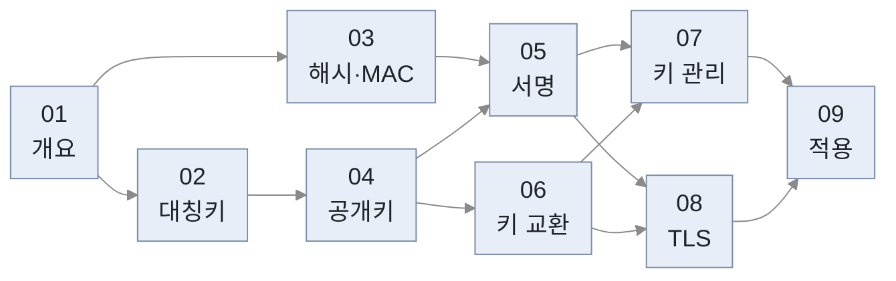

# Cryptography (암호학 기초)

> 약어: NIST=미국 국립표준기술연구소, SP=NIST 특별 간행물, FIPS=미국 연방 정보처리 표준, RFC=인터넷 표준 문서, IETF=인터넷 표준화 기구, 3GPP=이동통신 표준화 기구

보안의 토대가 되는 **암호학**을 구조 중심으로 정리하는 하위 영역입니다.
알고리즘 나열이 아니라 "목적 → 수단 → 적용" 흐름으로 구성합니다.

> 이 영역의 개념은 [5G 키 계층](../../5g-security/fundamentals/01-01-5G_Key_Hierarchy.md), [Cloud 데이터 보호](../../cloud-security/data-protection/README.md),
> [Web·애플리케이션 보안](../web-app-security/README.md)의 TLS(Transport Layer Security) 등 다른 영역에서도 기반 지식으로 쓰인다.

---

## 1. 서술 순서 (구조 중심)

1. 암호학의 목적 — 기밀성·무결성·인증·부인방지
2. 대칭키 / 공개키 암호
3. Hash / MAC(Message Authentication Code) / Digital Signature
4. Key Exchange — DH(Diffie-Hellman) / ECDH(Elliptic Curve Diffie-Hellman)
5. PKI(Public Key Infrastructure)와 인증서 (→ `../pki-identity/`)
6. TLS Handshake
7. 실제 적용 — 5G(SUCI(Subscription Concealed Identifier)/키 계층) · Cloud(KMS(Key Management Service)) · AI(Artificial Intelligence) · Web(TLS)

## 2. 문서 간 의존 관계

앞 문서가 뒤 문서의 선수 지식이 되도록 구성했다.

텍스트 설명: overview에서 목적을 정의한 뒤, 대칭키와 해시를 먼저 다룬다. 공개키는 대칭키 한계에서 출발하고,
서명은 공개키와 해시를 결합한다. 키 교환·서명·키 관리가 갖춰져야 TLS와 도메인 적용을 설명할 수 있다.

---

## 3. 문서 로드맵

| 순서 | 파일 | 핵심 내용 | 선수 문서 | 주요 교차 참조 |
|:---:|-----------|-----------|-----------|----------------|
| 01 | `cryptography-overview.md` | 기밀성·무결성·인증·부인방지와 암호 기능의 대응, Kerckhoffs 원칙, 위협 모델과 공격자 능력, 안전성(보안 강도) 개념 | — | `../threat-modeling/` |
| 02 | `symmetric-encryption.md` | 블록·스트림 암호, 운용 모드(CBC(Cipher Block Chaining)/CTR(Counter)/GCM(Galois/Counter Mode)), 인증 암호화(AEAD, Authenticated Encryption with Associated Data), IV(Initialization Vector)·Nonce 재사용 위험 | 01 | 5G NEA(NR Encryption Algorithm)/NIA(NR Integrity Algorithm), Cloud 저장 데이터 암호화 |
| 03 | `hashing-mac.md` | 해시 성질(충돌·역상 저항), SHA(Secure Hash Algorithm)-2/SHA-3, MAC·HMAC(Hash-based MAC), KDF(Key Derivation Function), 패스워드 해시와의 구분 | 01 | 5G 키 파생(KDF), 패스워드 저장 |
| 04 | `asymmetric-encryption.md` | 공개키 개념, RSA(Rivest-Shamir-Adleman)·ECC(Elliptic Curve Cryptography) 원리 수준, 공개키 암호화 vs KEM(Key Encapsulation Mechanism) 구분, 키 크기와 보안 강도, 양자 위협과 PQC 지형도(*FIPS 203*~205 개요) | 02 | `../pki-identity/` |
| 05 | `digital-signature.md` | 서명의 목적(무결성·인증·부인방지), RSA/ECDSA(Elliptic Curve Digital Signature Algorithm)/EdDSA(Edwards-curve Digital Signature Algorithm) 개념, 해시-서명 결합, PQC 서명(ML-DSA(Module-Lattice-Based Digital Signature Algorithm)·SLH-DSA(Stateless Hash-Based Digital Signature Algorithm)) 상세 | 03, 04 | 코드 서명, 인증서, JWT(JSON Web Token) |
| 06 | `key-exchange.md` | DH/ECDH, PFS(Perfect Forward Secrecy), 중간자 공격과 인증된 키 교환, ML-KEM(Module-Lattice-Based Key-Encapsulation Mechanism) 상세와 하이브리드 키 교환 | 04 | 5G SUCI(ECIES, Elliptic Curve Integrated Encryption Scheme), TLS |
| 07 | `key-management.md` | 키 수명주기(생성·저장·회전·폐기), 키 계층, HSM(Hardware Security Module)/KMS, 키 래핑 | 05, 06 | 5G 키 계층, Cloud `data-protection` KMS |
| 08 | `tls-overview.md` | TLS 1.2 vs 1.3 핸드셰이크, 암호 스위트, 인증서 검증, 흔한 설정 오류 | 05, 06 | Web, 5G SBA(Service Based Architecture)(HTTP/2(Hypertext Transfer Protocol 2)·TLS), `../web-app-security/` |
| 09 | `cryptography-in-practice.md` | 도메인별 적용 지도(5G·Cloud·AI·Web) — 개념 → 실제 사용처 링크 허브 | 07, 08 | 5G / Cloud / AI 각 영역 |

### 권장 읽기 순서
1. **01 overview** → 용어와 기본 틀
2. **02 symmetric**, **03 hashing-mac** → 순서 무관
3. **04 asymmetric** → **05 digital-signature** → **06 key-exchange**
4. **07 key-management** → **08 tls-overview** → **09 in-practice**

5G 보안 문서를 함께 읽는다면 06(ECIES/ECDH 기반 SUCI), 07(키 계층), 02·03(NEA/NIA, KDF)이 특히 도움이 된다.

---

## 4. 기준 표준

| 표준 | 용도 | 상태 |
|------|------|------|
| *FIPS 197* (AES, Advanced Encryption Standard) | 대칭 블록 암호 | 현행 (2023 개정) |
| *FIPS 180-4* (SHS, Secure Hash Standard) | SHA-2 계열 | 현행 |
| *FIPS 202* (SHA-3) | SHA-3 계열 | 현행 |
| *FIPS 186-5* (DSS, Digital Signature Standard) | 디지털 서명 | 현행 (2023) |
| TLS 1.3 (*RFC 9846*, *RFC 8446* 대체) | 전송 구간 보안 | 현행 (Standards Track) |
| *RFC 10024* (TLS 1.3 PQ/T 하이브리드 키 합의) / *RFC 9954* (하이브리드 설계) | 양자내성 하이브리드 키 교환 | Proposed Standard (2026-08) / Informational |
| *RFC 5869* (HKDF, HMAC-based Key Derivation Function) | 키 파생 | Informational |
| *NIST SP 800-57 Part 1 Rev. 5* (키 관리 일반) | 키 생명주기·사용 기간·보안 강도 | 현행 (2020-05-04 Final) |
| *FIPS 140-3* | 암호 모듈 보안 요구사항·검증 | 현행 (2019-03-22 승인) |
| *FIPS 203* (ML-KEM) / *204* (ML-DSA) / *205* (SLH-DSA) | PQC(Post-Quantum Cryptography, 양자내성암호) 확정 표준 | 확정 (2024-08-13 발행) |
| *FIPS 206* (FN-DSA, FFT over NTRU-Lattice-Based Digital Signature Algorithm), HQC(Hamming Quasi-Cyclic) | PQC 후속 표준화 | FN-DSA 개발 중, HQC는 2025-03 선정 (둘 다 최종 표준 아님) |
| *3GPP TS 33.501 V19.7.0 (Release 19)* | 5G NEA/NIA, 5G KDF 입력, 키 계층 | Release 19 최종판, 이 지식베이스의 기준판 (Release 20 판과 혼용하지 않음) |
| *3GPP TS 33.220 V19.1.0 (Release 19)* | 범용 KDF(HMAC-SHA-256) | Release 19 발행본 |

> 표준별 정의는 [References](../references/README.md)에 정리되어 있다.

## 5. 범위 경계

- **인증서 구조·CA(Certificate Authority)·신뢰 모델** → [PKI & Identity](../pki-identity/README.md) (여기서는 서명·키 교환까지 다룬다)
- **Authentication·OAuth·OIDC(OpenID Connect)** → [PKI & Identity](../pki-identity/README.md)
- **TLS 서버 설정 점검·웹 취약점** → [Web & Application Security](../web-app-security/README.md)
- **5G 키 계층·SUCI 상세** → [5G Key Hierarchy](../../5g-security/fundamentals/01-01-5G_Key_Hierarchy.md), [SUPI Exposure](../../5g-security/security-risks/01-ue-privacy/01-01-SUPI_Exposure.md) (여기서는 일반 원리만 다룬다)
- **Cloud KMS 서비스별 구성** → [Cloud Data Protection](../../cloud-security/data-protection/README.md)

## 문서 목록

- [Cryptography Overview](cryptography-overview.md) — 01. 암호학의 목적·용어·안전성 개념
- [Symmetric Encryption](symmetric-encryption.md) — 02. 블록/스트림 암호, 운용 모드, AEAD, Nonce 관리
- [Hashing & MAC](hashing-mac.md) — 03. 해시 성질, HMAC, KDF, 패스워드 저장
- [Asymmetric Encryption](asymmetric-encryption.md) — 04. 공개키 원리, RSA·ECC, KEM, 양자 위협과 PQC 지형도
- [Digital Signature](digital-signature.md) — 05. 서명·검증 원리, RSA·ECDSA·EdDSA, ML-DSA·SLH-DSA, 서명 실수와 대응
- [Key Exchange](key-exchange.md) — 06. DH·ECDH·KEM·HKDF 구분, PFS, TLS 1.2/1.3 비교, 하이브리드(X25519MLKEM768), 5G SUCI ECIES
- [Key Management](key-management.md) — 07. 키 생명주기, KEK/DEK·봉투 암호화, HSM·KMS, 침해 대응, Cloud·5G 사례, *FIPS 140-3*

_나머지 문서는 로드맵 순서대로 추가될 예정이다._
