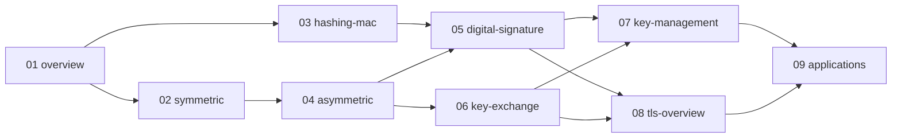
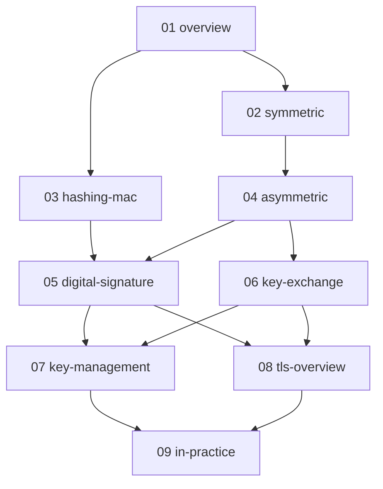
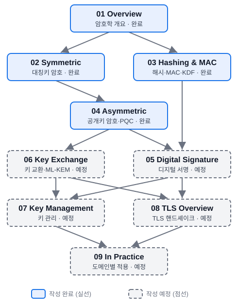

# Cryptography (암호학 기초)

보안의 토대가 되는 **암호학**을 구조 중심으로 정리하는 하위 영역입니다.
알고리즘 나열이 아니라 "목적 → 수단 → 적용" 흐름으로 구성합니다.

> 콘텐츠 타입: `concept` (rules-authoring §3.2 개념 템플릿).
> 5G `fundamentals/01-01-5G_Key_Hierarchy`, Cloud `data-protection`, Web TLS(Transport Layer Security) 등이 이 영역을 **교차 참조**한다.
> 공통 개념의 원본은 이곳에 두고, 도메인 문서는 링크로 가져간다(중복 서술 금지).

---

## 1. 서술 순서 (구조 중심)

1. 암호학의 목적 — 기밀성·무결성·인증·부인방지
2. 대칭키 / 공개키 암호
3. Hash / MAC(Message Authentication Code) / Digital Signature
4. Key Exchange — DH(Diffie-Hellman) / ECDH(Elliptic Curve Diffie-Hellman)
5. PKI(Public Key Infrastructure)와 인증서 (→ `../pki-identity/`)
6. TLS Handshake
7. 실제 적용 — 5G(SUCI(Subscription Concealed Identifier)/키 계층) · Cloud(KMS(Key Management Service)) · AI(Artificial Intelligence) · Web(TLS)

## 2. 문서 간 의존 관계

앞 문서가 뒤 문서의 선수 지식이 되도록 작성 순서를 잡는다.

> **표시 방식 테스트 중**: 같은 그림을 세 가지 방식으로 넣었다. GitBook·GitHub에서 크기와 확대 동작을 비교한 뒤 하나만 남긴다.

### 방식 A — Mermaid (가로 배치, 기존)

### 방식 B — Mermaid (세로 배치)

### 방식 C — SVG + 크게 보기

[크게 보기 (SVG 원본 열기)](../../.gitbook/assets/cryptography_doc_dependency.svg)

텍스트 설명: overview에서 목적을 정의한 뒤, 대칭키와 해시를 먼저 다룬다. 공개키는 대칭키 한계에서 출발하고,
서명은 공개키와 해시를 결합한다. 키 교환·서명·키 관리가 갖춰져야 TLS와 도메인 적용을 설명할 수 있다.
(방식 C 그림에서 실선 상자는 작성 완료, 점선 상자는 작성 예정 문서다.)

---

## 3. 문서 로드맵

| 순서 | 파일 | 핵심 내용 | 선수 문서 | 주요 교차 참조 |
|:---:|-----------|-----------|-----------|----------------|
| 01 | `cryptography-overview.md` | 기밀성·무결성·인증·부인방지와 암호 기능의 대응, Kerckhoffs 원칙, 위협 모델과 공격자 능력, 안전성(보안 강도) 개념 | — | `../threat-modeling/` |
| 02 | `symmetric-encryption.md` | 블록·스트림 암호, 운용 모드(CBC(Cipher Block Chaining)/CTR(Counter)/GCM(Galois/Counter Mode)), 인증 암호화(AEAD, Authenticated Encryption with Associated Data), IV(Initialization Vector)·Nonce 재사용 위험 | 01 | 5G NEA(NR Encryption Algorithm)/NIA(NR Integrity Algorithm), Cloud 저장 데이터 암호화 |
| 03 | `hashing-mac.md` | 해시 성질(충돌·역상 저항), SHA(Secure Hash Algorithm)-2/SHA-3, MAC·HMAC(Hash-based MAC), KDF(Key Derivation Function), 패스워드 해시와의 구분 | 01 | 5G 키 파생(KDF), 패스워드 저장 |
| 04 | `asymmetric-encryption.md` | 공개키 개념, RSA(Rivest-Shamir-Adleman)·ECC(Elliptic Curve Cryptography) 원리 수준, 공개키 암호화 vs KEM(Key Encapsulation Mechanism) 구분, 키 크기와 보안 강도, 양자 위협과 PQC 지형도(FIPS 203~205 개요) | 02 | `../pki-identity/` |
| 05 | `digital-signature.md` | 서명의 목적(무결성·인증·부인방지), RSA/ECDSA(Elliptic Curve Digital Signature Algorithm)/EdDSA(Edwards-curve Digital Signature Algorithm) 개념, 해시-서명 결합, PQC 서명(ML-DSA(Module-Lattice-Based Digital Signature Algorithm)·SLH-DSA(Stateless Hash-Based Digital Signature Algorithm)) 상세 | 03, 04 | 코드 서명, 인증서, JWT(JSON Web Token) |
| 06 | `key-exchange.md` | DH/ECDH, 전방 비밀성(PFS, Perfect Forward Secrecy), 중간자 공격과 인증된 키 교환, ML-KEM(Module-Lattice-Based Key-Encapsulation Mechanism) 상세와 하이브리드 키 교환 | 04 | 5G SUCI(ECIES, Elliptic Curve Integrated Encryption Scheme), TLS |
| 07 | `key-management.md` | 키 수명주기(생성·저장·회전·폐기), 키 계층, HSM(Hardware Security Module)/KMS, 키 래핑 | 05, 06 | 5G 키 계층, Cloud `data-protection` KMS |
| 08 | `tls-overview.md` | TLS 1.2 vs 1.3 핸드셰이크, 암호 스위트, 인증서 검증, 흔한 설정 오류 | 05, 06 | Web, 5G SBA(Service Based Architecture)(HTTP/2(Hypertext Transfer Protocol 2)·TLS), `../web-app-security/` |
| 09 | `cryptography-in-practice.md` | 도메인별 적용 지도(5G·Cloud·AI·Web) — 개념 → 실제 사용처 링크 허브 | 07, 08 | 5G / Cloud / AI 각 영역 |

> 번호(순서)는 **작성 순서**이며 파일명에는 붙이지 않는다(의미 기반 파일명, rules-authoring §3.2).

### 우선 작성 순서 (제안)
1. **01 overview** → 용어·틀을 먼저 고정한다.
2. **02 symmetric**, **03 hashing-mac** → 병렬 가능.
3. **04 asymmetric** → **05 digital-signature** → **06 key-exchange**
4. **07 key-management** → **08 tls-overview** → **09 in-practice**

5G 문서가 가장 많이 당겨 쓰는 것은 06(ECIES/ECDH 기반 SUCI), 07(키 계층), 02·03(NEA/NIA, KDF)이므로
5G 집필과 병행할 때는 이 세 문서를 우선한다.

---

## 4. 문서별 작성 기준

- 모든 기술은 **세 관점**으로 설명한다: ① 왜 필요한가(Why) ② 어떤 원리로 동작하는가(How) ③ 5G·Cloud·Web 등 실제로 어디에 쓰이는가(Where).

- 각 문서는 개념 템플릿 4섹션(개요 / 배경·원리 / 상세 / 보안 관점)을 따른다.
- **보안 관점** 섹션에서 "이 개념이 깨지면 어떤 공격이 되는가"를 짧게 연결한다(예: Nonce 재사용, 약한 해시, PFS 부재).
- 수식은 **원리 이해 수준**으로 제한한다. 구현·수학적 증명은 범위 밖이다.
- 다이어그램(핸드셰이크, 키 교환 등)은 Mermaid로 직접 작성한다(rules-diagrams).
- 표준·알고리즘 이름/버전은 **공식 출처로 확인한 것만** 적는다(환각 금지).
- 약어는 각 문서 첫 등장 시 풀네임을 병기한다(rules-authoring §5).

## 5. 기준 표준 (확인 상태)

| 표준 | 용도 | 상태 |
|------|------|------|
| FIPS(Federal Information Processing Standards) 197 (AES, Advanced Encryption Standard) | 대칭 블록 암호 | 사용자 확인값 2023 |
| FIPS 180-4 (SHS, Secure Hash Standard) | SHA-2 계열 | 사용자 확인값 |
| FIPS 202 (SHA-3) | SHA-3 계열 | 사용자 확인값 |
| FIPS 186-5 (DSS, Digital Signature Standard) | 디지털 서명 | 사용자 확인값 2023 |
| TLS 1.3 (IETF(Internet Engineering Task Force) RFC(Request for Comments)) | 전송 구간 보안 | **확인 예정** — 08 작성 시 공식 RFC로 확인 |
| NIST(National Institute of Standards and Technology) SP(Special Publication) 800-57 (키 관리) 등 | 키 수명주기·강도 | **확인 예정** — 07 작성 시 공식 출처로 확인 |
| FIPS 203 (ML-KEM) / 204 (ML-DSA) / 205 (SLH-DSA) | PQC(Post-Quantum Cryptography, 양자내성암호) 확정 표준 | 사용자 확인값 — 2024-08-13 최종 발행 |
| FIPS 206 (FN-DSA, FFT over NTRU-Lattice-Based Digital Signature Algorithm), HQC(Hamming Quasi-Cyclic) | PQC 후속 표준화 | 사용자 확인값 — FN-DSA 개발 중, HQC는 2025-03 선정(최종 표준 아님). **확정 표준과 구분해 기재** |
| 3GPP TS 33.501 Rel-18 V18.11.0 | 5G NEA/NIA, 5G KDF 입력(Annex A) | 사용자 확인값 |
| 3GPP TS 33.220 Annex B | 범용 KDF(HMAC-SHA-256) | 사용자 확인값 — 인용 릴리스는 현행판으로 재확인 예정 |

> 정의 상세는 `../references/README.md`(공통 표준 정의집)에서 관리한다.

## 6. 범위 경계

- **인증서 구조·CA(Certificate Authority)·신뢰 모델** → `../pki-identity/` (여기서는 서명·키 교환까지, 인증서는 링크)
- **Authentication·OAuth·OIDC(OpenID Connect)** → `../pki-identity/`
- **TLS 서버 설정 점검·웹 취약점** → `../web-app-security/`
- **5G 키 계층·SUCI 상세** → `5g-security/fundamentals/` (여기서는 일반 원리만, 5G 적용은 링크)
- **Cloud KMS 서비스별 구성** → `cloud-security/data-protection/`

## 문서 목록

- [Cryptography Overview](cryptography-overview.md) — 01. 암호학의 목적·용어·안전성 개념
- [Symmetric Encryption](symmetric-encryption.md) — 02. 블록/스트림 암호, 운용 모드, AEAD, Nonce 관리
- [Hashing & MAC](hashing-mac.md) — 03. 해시 성질, HMAC, KDF, 패스워드 저장
- [Asymmetric Encryption](asymmetric-encryption.md) — 04. 공개키 원리, RSA·ECC, KEM, 양자 위협과 PQC 지형도

_나머지 문서는 로드맵 순서대로 추가하며, 이 목록과 `SUMMARY.md`를 함께 갱신합니다._
