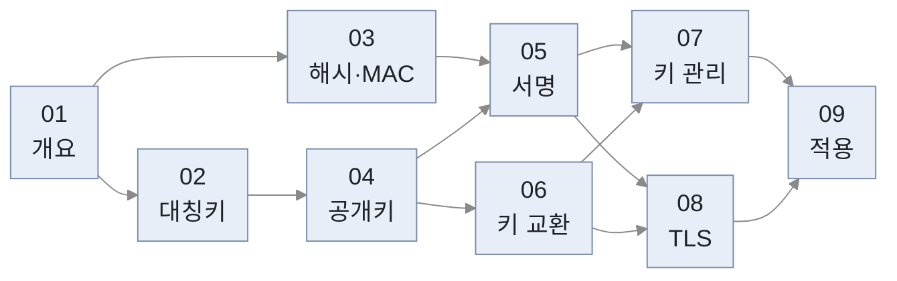

# Cryptography (암호학 기초)

> 약어: NIST=미국 국립표준기술연구소, NIST SP=NIST 특별 간행물, FIPS=미국 연방 정보처리 표준, RFC=IETF 표준 문서, IETF=인터넷 표준화 기구, 3GPP=이동통신 표준화 기구

보안의 토대가 되는 **암호학**을 구조 중심으로 정리하는 하위 영역이다.
알고리즘 나열이 아니라 **목적 → 수단 → 적용** 흐름으로 구성한다. 기밀성·무결성·인증·부인방지라는 목적에서 출발해 대칭키·해시·공개키·서명·키 교환이라는 수단을 다루고, 키 관리와 TLS(Transport Layer Security)를 거쳐 5G·Cloud·Web·AI의 실제 사용처로 연결한다.

> 이 영역의 개념은 [5G 키 계층](../../5g-security/fundamentals/01-01-5G_Key_Hierarchy.md), [Cloud 데이터 보호](../../cloud-security/data-protection/README.md) (작성 예정),
> [PKI & Identity](../pki-identity/README.md)의 인증서·토큰 서명 등 다른 영역에서 기반 지식으로 쓰인다.

---

## 1. 문서 목록

| 순서 | 문서 | 핵심 내용 | 선수 문서 |
|:---:|------|-----------|:---:|
| 01 | [Cryptography Overview](cryptography-overview.md) | 기밀성·무결성·인증·부인방지와 암호 기능의 대응, Kerckhoffs 원칙, 위협 모델과 공격자 능력, 안전성(보안 강도) 개념 | — |
| 02 | [Symmetric Encryption](symmetric-encryption.md) | 블록·스트림 암호, 운용 모드(CBC(Cipher Block Chaining)/CTR(Counter)/GCM(Galois/Counter Mode)), 인증 암호화 AEAD(Authenticated Encryption with Associated Data), IV(Initialization Vector)·Nonce 재사용 위험 | 01 |
| 03 | [Hashing & MAC](hashing-mac.md) | 해시 성질(충돌·역상 저항), SHA(Secure Hash Algorithm)-2/SHA-3, MAC(Message Authentication Code)·HMAC(Hash-based MAC), KDF(Key Derivation Function), 패스워드 저장 | 01 |
| 04 | [Asymmetric Encryption](asymmetric-encryption.md) | 공개키 원리, RSA(Rivest-Shamir-Adleman)·ECC(Elliptic Curve Cryptography), 공개키 암호화와 KEM(Key Encapsulation Mechanism) 구분, 키 크기와 보안 강도, 양자 위협과 PQC(Post-Quantum Cryptography, 양자내성암호) 지형도 | 02 |
| 05 | [Digital Signature](digital-signature.md) | 서명·검증 원리, RSA·ECDSA(Elliptic Curve Digital Signature Algorithm)·EdDSA(Edwards-curve Digital Signature Algorithm), ML-DSA(Module-Lattice-Based Digital Signature Algorithm)·SLH-DSA(Stateless Hash-Based Digital Signature Algorithm), 서명 실수와 대응 | 03, 04 |
| 06 | [Key Exchange](key-exchange.md) | DH(Diffie-Hellman)·ECDH(Elliptic Curve Diffie-Hellman)·KEM·HKDF(HMAC-based Key Derivation Function) 구분, PFS(Perfect Forward Secrecy), 인증된 키 교환, ML-KEM(Module-Lattice-Based Key-Encapsulation Mechanism)과 하이브리드 키 교환, 5G SUCI(Subscription Concealed Identifier)의 ECIES(Elliptic Curve Integrated Encryption Scheme) | 04 |
| 07 | [Key Management](key-management.md) | 키 생명주기(생성·저장·회전·폐기), KEK(Key Encryption Key)/DEK(Data Encryption Key)·봉투 암호화, HSM(Hardware Security Module)·KMS(Key Management Service), 침해 대응 | 05, 06 |
| 08 | [TLS Overview](tls-overview.md) | 핸드셰이크와 레코드, TLS 1.2/1.3 비교, 암호 스위트, 인증서 검증, mTLS(mutual TLS), 0-RTT(Zero Round Trip Time), 설정 실수와 대응 | 05, 06 |
| 09 | [Cryptography in Practice](cryptography-in-practice.md) | 5G·Cloud·Web·AI·공급망별 암호 적용 지도, 공통 점검 질문, 양자 전환 순서 | 07, 08 |

- 각 문서는 일반 IT 실무자를 위한 본문과, 보안 컨설턴트·점검자를 위한 "심화" 절로 나뉜다.

### 문서 간 의존 관계

앞 문서가 뒤 문서의 선수 지식이 되도록 구성했다.

텍스트 설명: 01 개요에서 목적을 정의한 뒤, 대칭키와 해시를 먼저 다룬다. 공개키는 대칭키의 한계에서 출발하고,
서명은 공개키와 해시를 결합한다. 키 교환·서명·키 관리가 갖춰져야 TLS와 도메인별 적용을 설명할 수 있다.

### 권장 읽기 순서

1. **01 개요** → 용어와 기본 틀
2. **02 대칭키**, **03 해시·MAC** → 순서 무관
3. **04 공개키** → **05 서명** → **06 키 교환**
4. **07 키 관리** → **08 TLS** → **09 적용**

5G 보안 문서를 함께 읽는다면 06(ECIES·ECDH 기반 SUCI), 07(키 계층), 02·03(5G 암호화·무결성 알고리즘, KDF)이 특히 도움이 된다.
인증서와 인증 방식은 이어서 [PKI & Identity](../pki-identity/README.md)에서 다룬다.

---

## 2. 기준 표준

각 문서가 인용하는 표준과 현재 지위다. 확정 표준과 개발 중인 표준을 구분한다.

| 표준 | 용도 | 상태 | 문서 |
|------|------|------|:---:|
| *FIPS 197* (AES, Advanced Encryption Standard) | 대칭 블록 암호 | 현행 (2023 개정) | 02 |
| *FIPS 180-4* (SHS, Secure Hash Standard) | SHA-2 계열 | 현행 | 03 |
| *FIPS 202* (SHA-3) | SHA-3 계열 | 현행 | 03 |
| *RFC 5869* (HKDF, HMAC-based Key Derivation Function) | 키 파생 | Informational | 03, 06 |
| *FIPS 186-5* (DSS, Digital Signature Standard) | 디지털 서명 | 현행 (2023) | 05 |
| *FIPS 203* (ML-KEM) / *204* (ML-DSA) / *205* (SLH-DSA) | PQC 확정 표준 | 확정 (2024-08-13 발행) | 04, 05, 06 |
| *FIPS 206* (FN-DSA, FFT over NTRU-Lattice-Based Digital Signature Algorithm), HQC(Hamming Quasi-Cyclic) | PQC 후속 표준화 | FN-DSA 개발 중, HQC는 2025-03 선정 (둘 다 최종 표준 아님) | 04, 05 |
| *NIST SP 800-57 Part 1 Rev. 5* (키 관리 일반) | 키 생명주기·사용 기간·보안 강도 | 현행 (2020-05-04 Final) | 04, 07 |
| *FIPS 140-3* | 암호 모듈 보안 요구사항·검증 | 현행 (2019-03-22 승인) | 07 |
| TLS 1.3 (*RFC 9846*, *RFC 8446*·*RFC 5246* 대체) | 전송 구간 보안 | 현행 (Standards Track, 2026-07) | 06, 08 |
| *RFC 8996* / *RFC 9325* / *RFC 9852* / *RFC 10015* | TLS 버전 폐기·안전한 사용 권고 | BCP(Best Current Practice) 195 등 (→ [TLS Overview](tls-overview.md)) | 08 |
| *RFC 10024* (TLS 1.3 PQ/T 하이브리드 키 합의) / *RFC 9954* (하이브리드 설계) | 양자내성 하이브리드 키 교환 | Proposed Standard (2026-08) / Informational | 06, 08 |
| *3GPP TS 33.501 V19.7.0 (Release 19)* | 5G 암호화·무결성 알고리즘, 5G KDF 입력, 키 계층 | Release 19 최종판, 이 지식베이스의 기준판 (Release 20 판과 혼용하지 않음) | 02, 03, 06, 09 |
| *3GPP TS 33.220 V19.1.0 (Release 19)* | 범용 KDF(HMAC-SHA-256) | Release 19 발행본 | 03 |

- 공통 표준의 정의는 [Security Fundamentals References](../references/README.md)에도 정리되어 있다.

---

## 3. 범위 경계

- **인증서 구조·CA(Certificate Authority)·신뢰 모델** → [PKI & Certificates](../pki-identity/pki-certificates.md). 여기서는 서명·키 교환까지 다룬다.
- **인증 방식·OAuth·OIDC(OpenID Connect)·토큰** → [PKI & Identity](../pki-identity/README.md)
- **TLS 서버 설정 점검·웹 취약점** → [Web & Application Security](../web-app-security/README.md)
- **위협 모델링 방법론** → [Threat Modeling](../threat-modeling/README.md) (작성 예정). 여기서는 암호 관점의 공격자 능력만 다룬다.
- **5G 키 계층·SUCI 상세** → [5G Key Hierarchy](../../5g-security/fundamentals/01-01-5G_Key_Hierarchy.md), [SUPI Exposure](../../5g-security/security-risks/01-ue-privacy/01-01-SUPI_Exposure.md). 여기서는 일반 원리만 다룬다.
- **Cloud KMS 서비스별 구성** → [Cloud Data Protection](../../cloud-security/data-protection/README.md) (작성 예정)

## 4. 다른 영역과의 연결

| 영역 | 연결되는 암호 개념 |
|------|-------------------|
| 5G | SUCI의 ECIES, 키 계층과 KDF, NAS(Non-Access Stratum)·AS(Access Stratum) 암호화·무결성, SBA(Service Based Architecture)의 TLS → [Cryptography in Practice 3.1 5G](cryptography-in-practice.md#31-5g) |
| PKI & Identity | 서명 → X.509 인증서·JWT(JSON Web Token)·FIDO2, HMAC → JWT HS256·TOTP(Time-based One-Time Password) → [PKI & Identity](../pki-identity/README.md) |
| Cloud | 봉투 암호화, KMS·HSM, 저장·전송 구간 암호화 → [Key Management](key-management.md) |
| Web | TLS, HSTS(HTTP Strict Transport Security), 인증서 검증 → [TLS Overview](tls-overview.md) |
| AI | 모델·데이터 암호화, 모델 서명, 공급망 무결성 → [Cryptography in Practice 3.4 AI 시스템](cryptography-in-practice.md#34-ai-시스템) |
