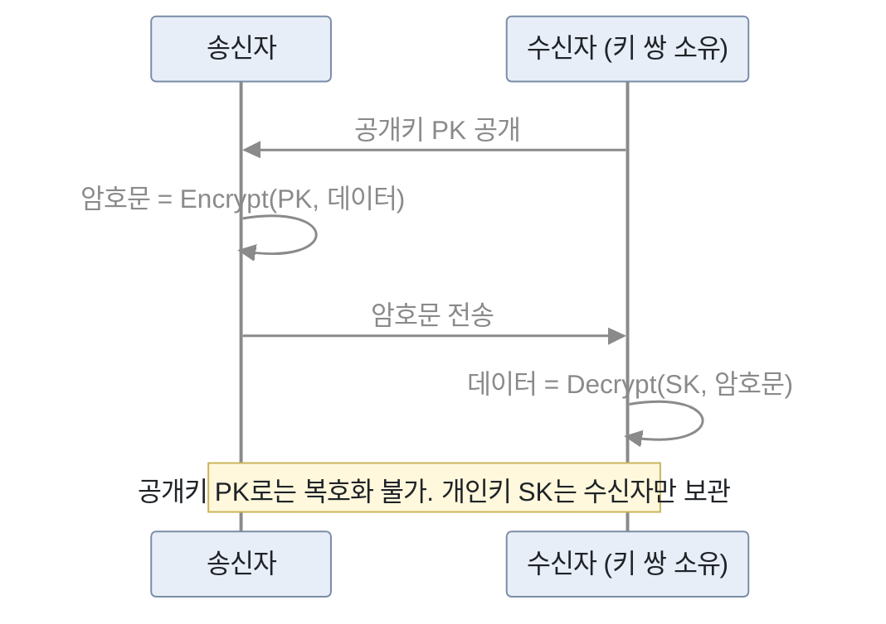
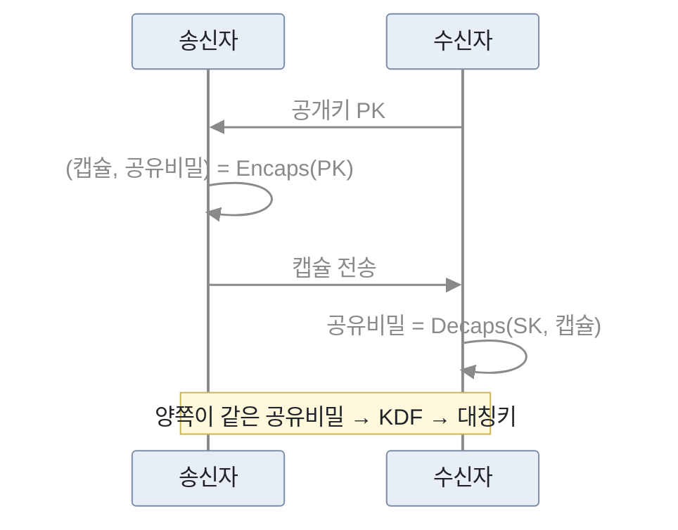
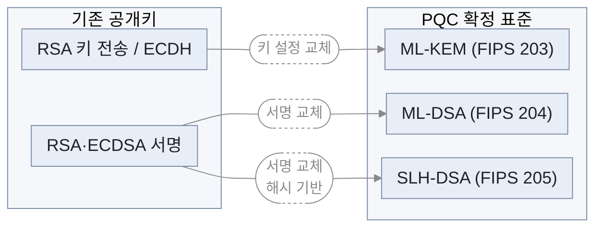

# Asymmetric Encryption (공개키 암호)

> 약어: NIST=미국 국립표준기술연구소, SP=NIST 특별 간행물, FIPS=미국 연방 정보처리 표준, RFC=인터넷 표준 문서, 3GPP=이동통신 표준화 기구

## 1. 개요 (What)

공개키 암호(Public-key cryptography, 비대칭키 암호)는 **서로 다른 두 키, 즉 공개키(Public key)와 개인키(Private key)를 한 쌍으로 쓰는 암호 방식**이다.
공개키는 누구에게나 공개해도 되고, 개인키는 소유자만 보관한다. 공개키로 한 연산은 짝이 되는 개인키로만 되돌리거나 검증할 수 있다.

**왜 필요한가.** 대칭키 암호(→ [Symmetric Encryption](symmetric-encryption.md))는 빠르지만, 통신 전에 비밀키를 안전하게 나눠 가져야 한다.
n명이 서로 대칭키로 통신하려면 n(n-1)/2개의 키가 필요하고, 처음 만난 상대와는 키를 나눌 안전한 통로조차 없다.
공개키 암호는 "공개해도 되는 키"를 도입해 이 **키 배포 문제**를 푼다.

공개키 암호는 하나의 기술이 아니라 **세 가지 다른 기능**의 기반이다. 이 문서는 공통 원리와 암호화·KEM(Key Encapsulation Mechanism, 키 캡슐화 메커니즘)을 다루고, 나머지는 별도 문서에서 다룬다.

| 기능 | 하는 일 | 다루는 문서 |
|------|---------|-------------|
| 공개키 암호화 / KEM | 공개키로 데이터나 공유 비밀을 보호해 개인키 소유자만 얻게 한다 | 이 문서 |
| 디지털 서명 | 개인키로 서명하고 공개키로 누구나 검증한다 | [Digital Signature](digital-signature.md) |
| 키 교환 | 두 당사자가 공개 값만 주고받아 공유 비밀을 만든다 | [Key Exchange](key-exchange.md) |

## 2. 배경 / 원리 (Why & How)

### 2.1 공개키와 개인키

텍스트 설명: 수신자가 공개키를 공개하면, 누구든 그 공개키로 암호화해 보낼 수 있다.
복호화는 개인키를 가진 수신자만 할 수 있다. 사전에 비밀을 공유할 필요가 없다는 점이 대칭키와의 결정적 차이다.

### 2.2 원리 — 한쪽 방향만 쉬운 수학 문제

공개키 암호는 **한 방향 계산은 쉽고 반대 방향은 매우 어려운 수학 문제**에 기반한다.
개인키는 그 어려운 방향을 쉽게 만들어 주는 "trapdoor" 정보 역할을 한다.

| 체계 | 기반 문제 | 쉬운 방향 | 어려운 방향 |
|------|-----------|-----------|-------------|
| RSA(Rivest-Shamir-Adleman) | 소인수분해 | 큰 소수 두 개를 곱한다 | 곱한 결과로부터 두 소수를 찾는다 |
| ECC(Elliptic Curve Cryptography, 타원곡선 암호) | 타원곡선 이산로그 문제(ECDLP, Elliptic Curve Discrete Logarithm Problem) | 곡선 위 점을 정수배 한다 | 결과 점으로부터 그 정수를 찾는다 |
| DH(Diffie-Hellman) | 이산로그 문제 | 거듭제곱을 계산한다 | 결과로부터 지수를 찾는다 |

- 수식 세부는 이 문서의 범위 밖이다. "공개키에서 개인키를 계산하는 것이 현실적으로 불가능하다"는 성질이 핵심이다.
- 이 성질은 **고전 컴퓨터 기준**이다. 양자 컴퓨터는 이 가정을 깬다(→ [3.4 양자 컴퓨터의 영향](#id-3.4)).

### 2.3 하이브리드 암호 — 실제로는 공개키로 데이터를 직접 암호화하지 않는다

공개키 연산은 대칭키보다 훨씬 느리고, 한 번에 처리할 수 있는 데이터 크기도 작다.
그래서 실제 시스템은 **공개키로 대칭키(또는 공유 비밀)만 보호하고, 데이터는 대칭키로 암호화**한다.

텍스트 설명: 공개키는 대칭키를 안전하게 전달하거나 합의하는 데만 쓰고, 실제 데이터 보호는 빠른 대칭키 AEAD(Authenticated Encryption with Associated Data)가 맡는다.
TLS(Transport Layer Security), 5G SUCI(Subscription Concealed Identifier), 이메일 암호화 등이 모두 이 구조다.

### 2.4 공개키 암호화 vs KEM

| 구분 | 공개키 암호화 (PKE, Public-Key Encryption) | KEM |
|------|------------------------------|-----|
| 입력 | 송신자가 고른 메시지 | 수신자 공개키만 |
| 출력 | 암호문 | 캡슐(암호문) + **새로 생성된 공유 비밀** |
| 송신자의 선택 | 무엇을 보낼지 정한다 | 공유 비밀 값을 고르지 않는다(무작위 생성) |
| 이후 처리 | — | 공유 비밀을 KDF(Key Derivation Function)에 넣어 대칭키를 만든다 |

텍스트 설명: KEM은 "메시지를 암호화"하는 대신 "양쪽이 같은 무작위 공유 비밀을 갖게" 만든다.
송신자가 Encaps로 공유 비밀과 캡슐을 만들고, 수신자는 개인키로 캡슐을 열어 같은 공유 비밀을 얻는다.

> 해설: 하이브리드 암호에서 공개키가 실제로 하는 일은 "대칭키를 안전하게 전달"하는 것이므로, 처음부터 그 목적만 수행하는 KEM이 설계상 더 단순하고 안전하게 증명하기 쉽다.
> 양자내성 표준 ML-KEM이 "공개키 암호화"가 아니라 **KEM**인 이유가 여기에 있다. ML-KEM을 "RSA 같은 공개키 암호화 알고리즘"이라고 설명하면 정확하지 않다.

## 3. 상세 (Details)

### 3.1 RSA

- 키 생성: 큰 소수 두 개를 곱한 모듈러스와 지수로 공개키를 만든다. 개인키는 두 소수에 대한 정보에서 나온다.
- 같은 키 구조로 **암호화와 서명을 모두** 할 수 있다(용도별로 키를 분리하는 것이 원칙).
- **textbook RSA(패딩 없는 RSA)는 안전하지 않다.** 같은 평문이면 항상 같은 암호문이 나오고, 수학적 변조 가능.
  실제로는 반드시 **패딩(padding)** 을 붙인다.

| 패딩 | 평가 |
|------|------|
| 패딩 없음 (textbook RSA) | 사용 금지 |
| PKCS(Public-Key Cryptography Standards) #1 v1.5 암호화 패딩 | 패딩 오라클 공격(Bleichenbacher 계열)으로 반복 문제. 신규 사용 지양 |
| OAEP(Optimal Asymmetric Encryption Padding) | 암호화용 권장 패딩 |

### 3.2 ECC

- 같은 보안 강도를 RSA보다 **훨씬 짧은 키**로 얻는다. 연산·전송 부담이 작아 모바일·IoT(Internet of Things)·5G 단말에 유리하다.
- ECC 자체는 "곡선 위 연산"이며, 이를 이용한 **용도별 방식**이 따로 있다.

| 방식 | 용도 |
|------|------|
| ECDH(Elliptic Curve Diffie-Hellman) | 키 교환 → [Key Exchange](key-exchange.md) |
| ECDSA(Elliptic Curve Digital Signature Algorithm), EdDSA(Edwards-curve Digital Signature Algorithm) | 서명 → [Digital Signature](digital-signature.md) |
| ECIES(Elliptic Curve Integrated Encryption Scheme) | 암호화(ECDH + KDF + 대칭키 암호를 묶은 하이브리드 방식) |

- 곡선 선택이 안전성에 영향을 준다. 표준화되고 널리 검증된 곡선(예: P-256, Curve25519)을 쓰며, 임의 곡선을 만들지 않는다.

### 3.3 키 길이와 보안 강도

공개키 암호는 키 길이와 보안 강도가 일대일로 대응하지 않는다. *NIST SP 800-57 Part 1 Rev. 5* 기준 대표 대응은 다음과 같다(전체 표 → [5.1 보안 강도 대응표](asymmetric-encryption.md#51-보안-강도-대응표)).

| 보안 강도 | RSA 모듈러스 | ECC 키 |
|:--------:|:-----------:|:------:|
| 약 128비트 | 약 3072비트 | 약 256비트 |

- RSA는 강도를 올릴수록 키가 급격히 길어지고, ECC는 완만하게 늘어난다.
- 권고 최소 길이와 사용 기한은 기관 표준(*NIST SP 800-57* 등)을 따른다 → [5.1 보안 강도 대응표](asymmetric-encryption.md#51-보안-강도-대응표), [Key Management](key-management.md)

### 3.4 양자 컴퓨터의 영향

| 대상 | 영향 | 이유 |
|------|------|------|
| RSA, ECC, DH/ECDH | **근본적으로 깨진다** | Shor 알고리즘이 소인수분해·이산로그를 효율적으로 푼다 |
| 대칭키(AES(Advanced Encryption Standard) 등), 해시 | 강도가 줄지만 키·출력 길이를 늘려 대응 가능 | Grover 알고리즘은 전수 조사를 제곱근 수준으로만 가속 |

- 키 길이를 늘려서는 RSA/ECC를 지킬 수 없다. **알고리즘 자체를 교체**해야 한다.
- **Harvest Now, Decrypt Later**: 공격자가 지금 암호문을 저장해 두었다가 양자 컴퓨터가 나오면 해독하는 위협이다.
  오래 기밀을 유지해야 하는 데이터는 양자 컴퓨터 등장 이전부터 위험하다. 특히 **키 교환·KEM이 우선 교체 대상**이다.
- 서명은 "위조 시점"에 양자 컴퓨터가 있어야 하므로 위협 시점이 다르다. 다만 장기간 검증되는 서명(펌웨어, 루트 인증서)은 미리 준비가 필요하다.

### 3.5 PQC 지형도

PQC(Post-Quantum Cryptography, 양자내성암호)는 양자 컴퓨터로도 풀기 어렵다고 여겨지는 수학 문제에 기반한 공개키 암호다.
**고전 컴퓨터에서 동작**하며, 양자 통신(QKD, Quantum Key Distribution)과는 다른 개념이다.

| 표준 | 알고리즘 | 기능 | 기존 대응 | 상태 |
|------|---------|------|-----------|------|
| *FIPS 203* | ML-KEM(Module-Lattice-Based Key-Encapsulation Mechanism) | 키 설정(KEM) | RSA 키 전송, (EC)DH | 확정 (2024-08-13 발행) |
| *FIPS 204* | ML-DSA(Module-Lattice-Based Digital Signature Algorithm) | 서명 | RSA·ECDSA 서명 | 확정 (2024-08-13 발행) |
| *FIPS 205* | SLH-DSA(Stateless Hash-Based Digital Signature Algorithm) | 서명(해시 기반) | RSA·ECDSA 서명 | 확정 (2024-08-13 발행) |
| *FIPS 206* | FN-DSA(FFT over NTRU-Lattice-Based Digital Signature Algorithm) | 서명 | — | 개발 중 (확정 표준 아님) |
| — | HQC(Hamming Quasi-Cyclic) | KEM(예비) | — | 2025-03 추가 표준화 대상 선정 (최종 표준 아님) |

- ML-KEM은 CRYSTALS-Kyber, ML-DSA는 CRYSTALS-Dilithium, SLH-DSA는 SPHINCS+로 알려졌던 방식이다.
- **ML-KEM = 키 설정**, **ML-DSA·SLH-DSA = 서명**이다. 기능이 다르므로 서로 대체하지 않는다.
- 상세: ML-KEM과 하이브리드 키 교환 → [Key Exchange](key-exchange.md), ML-DSA·SLH-DSA → [Digital Signature](digital-signature.md).

텍스트 설명: 기존 키 설정 기능(RSA 키 전송, ECDH)은 ML-KEM으로, 기존 서명 기능(RSA·ECDSA)은 ML-DSA 또는 SLH-DSA로 교체된다.
전환 초기에는 기존 방식과 PQC를 함께 쓰는 **하이브리드** 구성이 널리 논의된다(→ [Key Exchange 3.4 양자내성 하이브리드 키 교환](key-exchange.md#34-양자내성-하이브리드-키-교환)).

### 3.6 다른 영역에서의 사용

| 영역 | 사용처 |
|------|--------|
| 5G | 단말은 홈 네트워크 공개키로 영구 식별자 SUPI(Subscription Permanent Identifier)를 SUCI로 은닉한다. ECIES 기반 보호 방식(Profile A: Curve25519/X25519, Profile B: secp256r1)을 사용한다(*3GPP TS 33.501*) → [Key Exchange 3.5 5G SUCI의 ECIES](key-exchange.md#35-5g-suci의-ecies--실제-적용-사례), [SUPI Exposure](../../5g-security/security-risks/01-ue-privacy/01-01-SUPI_Exposure.md) |
| Web | TLS 인증서의 서버 공개키(RSA·ECDSA)로 서버를 인증한다. TLS 1.3(*RFC 9846*)은 정적 RSA 키 전송을 제거하고 (EC)DHE((Elliptic Curve) Diffie-Hellman Ephemeral) 키 교환을 쓴다. RSA는 서명 용도로 계속 쓰인다 → [Key Exchange 3.2 TLS 1.2와 TLS 1.3의 키 교환 비교](key-exchange.md#32-tls-12와-tls-13의-키-교환-비교) |
| PKI | 공개키가 "정말 그 주체의 것인지"를 인증서와 CA(Certificate Authority)로 보증한다 → [PKI & Certificates](../pki-identity/pki-certificates.md) |
| Cloud | KMS(Key Management Service)·HSM(Hardware Security Module)에서 비대칭 키 쌍을 생성·보관하고, 개인키를 외부로 내보내지 않은 채 서명·복호화 연산만 제공한다 → [Data Protection](../../cloud-security/data-protection/README.md) (작성 예정) |

> 해설: 5G SUCI는 이 문서의 하이브리드 구조([2.3 하이브리드 암호](asymmetric-encryption.md#23-하이브리드-암호--실제로는-공개키로-데이터를-직접-암호화하지-않는다))를 그대로 보여 주는 사례다. 단말이 매번 새 임시 키로 홈 네트워크 공개키와 ECDH를 수행하고,
> 그 결과로 대칭키를 파생해 SUPI를 암호화한다. 같은 단말이라도 SUCI 값이 매번 달라지는 이유가 여기에 있다.

## 4. 보안 관점 (Security Relevance)

| 실수 | 결과 | 대응 |
|------|------|------|
| textbook RSA(패딩 없음) 사용 | 같은 평문 → 같은 암호문, 수학적 변조 | OAEP 패딩 또는 KEM 사용 |
| PKCS #1 v1.5 암호화 패딩 유지 | 패딩 오라클로 복호화 | OAEP 전환, 오류 응답 차별화 제거 |
| 짧은 키 / 비표준 곡선 | 해독 가능 | 권고 키 길이·표준 곡선 사용 |
| 공개키 진위 미검증 | 중간자 공격(MITM, Man-in-the-Middle)으로 공격자 공개키 주입 | 인증서·PKI로 공개키 바인딩 검증 |
| 개인키 평문 저장·반출 | 위장·복호화·서명 위조 | HSM/KMS 보관, 반출 금지 |
| 한 키 쌍을 암호화·서명에 겸용 | 용도 간 공격 전이 | 용도별 키 분리 |
| 장기 데이터에 기존 공개키만 사용 | Harvest Now, Decrypt Later | 암호 인벤토리 작성, PQC·하이브리드 전환 계획(Crypto agility) |

점검 시 확인할 것: 알고리즘·키 길이·패딩(또는 곡선), 공개키 진위 검증 방식, 개인키 보관 위치, 용도별 키 분리, 양자 전환 대상 식별 여부.

## 5. 심화 (Advanced)

> 보안 컨설턴트·점검자를 위한 규격 세부다. 본문만으로 개념 이해에는 충분하다.

### 5.1 보안 강도 대응표

기준: *NIST SP 800-57 Part 1 Rev. 5*

| 보안 강도 | 대칭키 알고리즘 | RSA 모듈러스 (IFC) | ECC 키 (ECC) |
|:--------:|:--------------:|:------------------:|:------------:|
| 112비트 | 3TDEA | 2048 | 224~255 |
| 128비트 | AES-128 | 3072 | 256~383 |
| 192비트 | AES-192 | 7680 | 384~511 |
| 256비트 | AES-256 | 15360 | 512 이상 |

- 읽는 법: 약 128비트 보안 강도는 RSA 3072비트 또는 ECC 256비트 이상의 키 크기에 대응한다.
- ECC 값은 키 크기 범위이며, 실제 강도는 곡선과 파라미터에 따라 달라진다. 특정 곡선을 예로 들 때는 해당 곡선 규격을 따로 확인한다.
- IFC(Integer Factorization Cryptography)는 RSA처럼 소인수분해에 기반한 방식, ECC는 타원곡선 기반 방식을 말한다.
- 같은 권고는 해시 함수의 보안 강도, 여러 알고리즘을 조합했을 때의 실질 강도, 강도별 사용 가능 기간도 따로 정한다(→ [Key Management 5.1 *SP 800-57* 문서 구성과 지위](key-management.md#51-sp-800-57-문서-구성과-지위)).
- 이 강도는 고전 컴퓨터 기준이다. 양자 컴퓨터에 대해서는 [3.4 양자 컴퓨터의 영향](asymmetric-encryption.md#34-양자-컴퓨터의-영향)을 참고한다.

## 관련 문서

- 이전: [Symmetric Encryption](symmetric-encryption.md), [Hashing & MAC](hashing-mac.md)
- 다음: [Digital Signature](digital-signature.md), [Key Exchange](key-exchange.md)
- 신뢰 모델: [PKI & Certificates](../pki-identity/pki-certificates.md)
- 로드맵: [Cryptography](README.md)

## 출처

- PQC 표준: NIST, *FIPS 203 / FIPS 204 / FIPS 205* (2024-08-13 발행), *FIPS 206*·HQC 진행 상황.
- 5G SUCI 보호 방식: 3GPP, *TS 33.501 V19.7.0 (Release 19)* (세부는 [Key Exchange 5.3 5G SUCI ECIES 프로파일](key-exchange.md#53-5g-suci-ecies-프로파일)).
- 보안 강도 대응: *NIST SP 800-57 Part 1 Rev. 5* (2020-05-04). https://doi.org/10.6028/NIST.SP.800-57pt1r5
- 그 외 내용은 공개키 암호의 일반 원리를 재구성한 해설이다.
