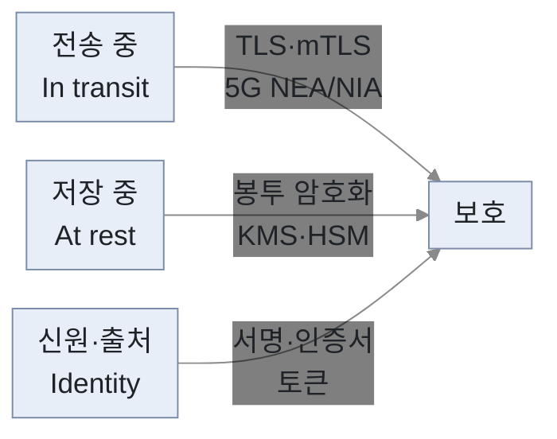

# Cryptography in Practice (암호학의 실제 적용)

> 약어: NIST=미국 국립표준기술연구소, SP=NIST 특별 간행물, FIPS=미국 연방 정보처리 표준, RFC=인터넷 표준 문서, 3GPP=이동통신 표준화 기구

## 1. 개요 (What)

이 문서는 Cryptography 문서 01~08에서 다룬 개념이 **5G·Cloud·Web·AI 등 실제 시스템의 어디에 쓰이는지**를 한곳에 모은 연결 지도다.
새로운 개념을 설명하지 않고, "이 시스템의 이 부분은 어떤 암호 기능이 지키고 있고, 자세한 설명은 어느 문서에 있는가"를 찾는 용도로 쓴다.

**왜 필요한가.** 암호 개념은 따로 배우면 추상적이지만, 실무에서는 항상 **조합**으로 나타난다.
예를 들어 HTTPS 한 번의 접속에도 키 교환, 디지털 서명, 인증서, AEAD(Authenticated Encryption with Associated Data), 키 파생이 함께 동작한다.
점검이나 설계를 할 때는 "어떤 알고리즘인가"보다 **"어느 지점을 어떤 기능이 보호하는가, 그 기능의 키는 어떻게 관리되는가"** 를 먼저 묻는 것이 효과적이다.

| 문서 | 핵심 질문 |
|------|-----------|
| [01 Cryptography Overview](cryptography-overview.md) | 무엇을 보호하려는가 (기밀성·무결성·인증·부인방지) |
| [02 Symmetric Encryption](symmetric-encryption.md) | 대량 데이터를 어떻게 빠르게 암호화하는가 |
| [03 Hashing & MAC](hashing-mac.md) | 변조를 어떻게 탐지하고, 키를 어떻게 파생하는가 |
| [04 Asymmetric Encryption](asymmetric-encryption.md) | 미리 비밀을 나누지 않고 어떻게 보호하는가 |
| [05 Digital Signature](digital-signature.md) | 누가 만들었는지 어떻게 증명하는가 |
| [06 Key Exchange](key-exchange.md) | 처음 만난 상대와 어떻게 같은 키를 갖는가 |
| [07 Key Management](key-management.md) | 키를 어떻게 만들고, 보관하고, 바꾸고, 없애는가 |
| [08 TLS Overview](tls-overview.md) | 위 기능들이 통신 보호에서 어떻게 조합되는가 |

## 2. 배경 / 원리 (Why & How)

### 2.1 보호 지점으로 보는 법

시스템의 데이터는 크게 세 가지 상태에 있다. 상태마다 쓰는 암호 기능이 다르다.

텍스트 설명: 전송 중인 데이터는 TLS와 같은 통신 보호 프로토콜(이동통신 무선 구간은 NEA/NIA)이 지킨다. 저장된 데이터는 봉투 암호화와 KMS(Key Management Service)·HSM(Hardware Security Module)이 지킨다.
"누가 보냈는가, 누가 만들었는가"는 디지털 서명, 인증서, 서명된 토큰이 보장한다. 세 지점 모두 마지막에는 **키 관리**에 의존한다.

| 보호 지점 | 주로 쓰는 암호 기능 | 실패하면 |
|-----------|---------------------|----------|
| 전송 중 | 키 교환 + 서명·인증서 + AEAD (TLS) | 도청, 변조, 중간자 공격 |
| 저장 중 | 대칭키 암호(DEK(Data Encryption Key)) + 키 래핑(KEK(Key Encryption Key)) | 저장소·백업 유출 시 평문 노출 |
| 신원·출처 | 디지털 서명, MAC(Message Authentication Code), 인증서, 서명된 토큰 | 위장, 위조 배포물, 권한 탈취 |
| 키 자체 | 키 생명주기 관리, 암호 모듈 | 위 모든 보호가 한꺼번에 무력화 |

### 2.2 같은 질문을 반복하는 점검 틀

어느 영역이든 아래 다섯 질문을 차례로 던지면 암호 사용의 빈틈을 대부분 찾을 수 있다.

1. **무엇을 보호하는가**: 기밀성인가, 무결성·출처인가, 둘 다인가
2. **어떤 기능을 쓰는가**: 목적에 맞는 기능인가 (예: 무결성에 해시만 쓰고 있지 않은가)
3. **알고리즘·설정은 현행 기준인가**: 폐기된 알고리즘, 짧은 키, 위험한 모드가 없는가
4. **상대를 검증하는가**: 인증서·서명 검증을 끄거나 생략하지 않았는가
5. **키는 어떻게 관리되는가**: 어디에 보관되고, 누가 쓸 수 있고, 언제 바뀌는가

## 3. 상세 (Details)

### 3.1 5G

| 보호 대상 | 쓰이는 암호 기능 | 자세한 설명 |
|-----------|------------------|-------------|
| 가입자 영구 식별자 SUPI(Subscription Permanent Identifier) | 홈 네트워크 공개키 기반 ECIES(Elliptic Curve Integrated Encryption Scheme)로 SUCI(Subscription Concealed Identifier) 생성 | [Key Exchange 3.5 5G SUCI의 ECIES](key-exchange.md#35-5g-suci의-ecies--실제-적용-사례), [SUPI Exposure](../../5g-security/security-risks/01-ue-privacy/01-01-SUPI_Exposure.md) |
| 가입자 인증과 키 생성 | 장기 키 K에서 계층적으로 키 파생 (KDF(Key Derivation Function)) | [Key Management 3.4 다른 영역의 키 관리 사례](key-management.md#34-다른-영역의-키-관리-사례), [5G Key Hierarchy](../../5g-security/fundamentals/01-01-5G_Key_Hierarchy.md) |
| NAS(Non-Access Stratum)·무선 구간 데이터 | 암호화(NEA, NR Encryption Algorithm)와 무결성(NIA, NR Integrity Algorithm)을 별도 알고리즘으로 적용 | [Symmetric Encryption 3.4 다른 영역에서의 사용](symmetric-encryption.md#34-다른-영역에서의-사용), [Hashing & MAC 3.4 다른 영역에서의 사용](hashing-mac.md#34-다른-영역에서의-사용) |
| 코어 NF(Network Function) 간 통신 | mTLS(mutual TLS)와 HTTPS | [TLS Overview 5.4 5G SBA의 TLS 요구사항](tls-overview.md#54-5g-sba의-tls-요구사항) |
| NF 서비스 이용 권한 | 서명 또는 MAC으로 보호된 JWT(JSON Web Token) 형식 Access Token | [Digital Signature 5.4 5G SBA Access Token](digital-signature.md#54-5g-sba-access-token) |

> 해설: 5G는 키 생명주기의 상당 부분을 **표준 절차로 고정**한 영역이다. 그래서 점검의 초점은 알고리즘 선택보다 홈 네트워크 개인키, 장기 키 K, NF 인증서 같은 **핵심 키의 보관과 설정**(예: SUCI 보호 방식이 Null로 설정되지 않았는가)에 있다.

### 3.2 Cloud

| 보호 대상 | 쓰이는 암호 기능 | 자세한 설명 |
|-----------|------------------|-------------|
| 저장 데이터 (스토리지, DB(Database)) | 봉투 암호화: DEK로 데이터 암호화, KMS 안의 KEK로 DEK 래핑 | [Key Management 3.1 키 계층과 KEK/DEK](key-management.md#31-키-계층과-kekdek) |
| 키 보관과 사용 권한 | KMS·HSM, 키 정책, 사용 감사 로그 | [Key Management 3.4 다른 영역의 키 관리 사례](key-management.md#34-다른-영역의-키-관리-사례) |
| 서명 키 | KMS·HSM 안에서 서명만 수행하고 개인키는 반출하지 않음 | [Digital Signature 3.6 다른 영역에서의 사용](digital-signature.md#36-다른-영역에서의-사용) |
| 서비스 간 통신 | 로드 밸런서·API(Application Programming Interface) 게이트웨이의 TLS, 서비스 메시의 mTLS | [TLS Overview 3.4 mTLS](tls-overview.md#34-mtls--클라이언트도-인증서로-인증) |
| API 요청 출처 | HMAC(Hash-based MAC) 기반 요청 서명 | [Hashing & MAC 3.4 다른 영역에서의 사용](hashing-mac.md#34-다른-영역에서의-사용) |
| 암호 모듈 신뢰성 | 검증된 암호 모듈(*FIPS 140-3*) 사용 여부 | [Key Management 3.5 암호 모듈 검증](key-management.md#35-암호-모듈-검증--fips-인증이-뜻하는-것) |

Cloud 영역의 서비스별 구성은 [Cloud Data Protection](../../cloud-security/data-protection/README.md) (작성 예정)에서 다룬다.

### 3.3 Web·API

| 보호 대상 | 쓰이는 암호 기능 | 자세한 설명 |
|-----------|------------------|-------------|
| 브라우저 ↔ 서버 통신 | HTTPS(TLS), HSTS(HTTP Strict Transport Security) | [TLS Overview](tls-overview.md) |
| 서버 신원 | 인증서 체인과 호스트 이름 검증 | [TLS Overview 3.3 인증서 검증](tls-overview.md#33-인증서-검증--tls-보안의-절반) |
| 로그인 토큰 | JWT 서명(RS256·ES256·EdDSA) 또는 HMAC(HS256) | [Digital Signature 3.6 다른 영역에서의 사용](digital-signature.md#36-다른-영역에서의-사용) |
| 패스워드 | 느린 패스워드 해시 + 고유 Salt | [Hashing & MAC 3.3 패스워드 저장](hashing-mac.md#33-패스워드-저장) |
| 비밀번호 없는 로그인 | FIDO2/WebAuthn(Web Authentication)·Passkey: 기기 개인키로 Challenge 서명 | [Digital Signature 3.6 다른 영역에서의 사용](digital-signature.md#36-다른-영역에서의-사용) |

인증·토큰 체계 자체는 [PKI & Identity](../pki-identity/README.md) (로드맵, 문서 작성 예정), 웹 취약점은 [Web & Application Security](../web-app-security/README.md) (작성 예정)에서 다룬다.

### 3.4 AI 시스템

AI 시스템도 암호 관점에서는 일반 서비스와 같은 보호 지점을 가진다. 다만 보호해야 할 자산에 모델과 학습 데이터가 추가된다.

| 보호 대상 | 쓰이는 암호 기능 | 자세한 설명 |
|-----------|------------------|-------------|
| 모델 API 호출 | TLS, 서명된 Access Token | [TLS Overview](tls-overview.md) |
| 모델 파일·학습 데이터 저장 | 봉투 암호화, KMS 키 권한 분리 | [Key Management 3.1 키 계층과 KEK/DEK](key-management.md#31-키-계층과-kekdek) |
| 모델·배포물의 출처 | 디지털 서명으로 배포물의 출처와 무결성 확인 | [Digital Signature 3.6 다른 영역에서의 사용](digital-signature.md#36-다른-영역에서의-사용) |
| 외부 서비스 API 키·토큰 | 비밀 관리 서비스·KMS 보관, 최소 권한, 교체 | [Key Management 4. 보안 관점](key-management.md#4-보안-관점-security-relevance) |

AI 영역의 위협과 대응은 [AI Security](../../ai-security/README.md) (로드맵, 문서 작성 예정)에서 다룬다.

### 3.5 소프트웨어 공급망

| 보호 대상 | 쓰이는 암호 기능 | 자세한 설명 |
|-----------|------------------|-------------|
| 배포 파일·업데이트 | 코드 서명, 패키지·컨테이너 이미지 서명 | [Digital Signature 3.6 다른 영역에서의 사용](digital-signature.md#36-다른-영역에서의-사용) |
| 다운로드 무결성 | 해시 게시 + 서명 (해시만으로는 게시처 변조에 무력) | [Hashing & MAC 3.4 다른 영역에서의 사용](hashing-mac.md#34-다른-영역에서의-사용) |
| 장기 검증 서명 (펌웨어, 루트 인증서) | 양자 전환 계획이 먼저 필요한 대상 | [Asymmetric Encryption 3.4 양자 컴퓨터의 영향](asymmetric-encryption.md#34-양자-컴퓨터의-영향) |

### 3.6 양자 전환 — 모든 영역의 공통 과제

양자 컴퓨터는 RSA·ECC·DH 같은 공개키 암호를 깨뜨린다. 영역과 관계없이 전환 순서는 비슷하다.

| 순서 | 할 일 | 자세한 설명 |
|:---:|-------|-------------|
| 1 | 암호 인벤토리 작성: 어디서 어떤 공개키 알고리즘과 키를 쓰는지 목록화 | [Key Management 3.3 키 침해 대응](key-management.md#33-키-침해-대응-key-compromise) |
| 2 | 오래 기밀을 지켜야 하는 통신의 키 교환부터 전환 (Harvest Now, Decrypt Later 대비) | [Key Exchange 3.4 양자내성 하이브리드 키 교환](key-exchange.md#34-양자내성-하이브리드-키-교환) |
| 3 | 장기 검증 서명(펌웨어, 루트 인증서)의 전환 계획 | [Digital Signature 3.3 양자내성 서명](digital-signature.md#33-양자내성-서명) |
| 4 | 알고리즘을 쉽게 바꿀 수 있는 구조(Crypto agility) 확보 | [Asymmetric Encryption 3.5 PQC 지형도](asymmetric-encryption.md#35-pqc-지형도) |

## 4. 보안 관점 (Security Relevance)

영역은 달라도 반복해서 나오는 실패는 같다. 아래 표는 01~08 문서의 "보안 관점" 표에서 공통으로 나타나는 실수를 모은 것이다.

| 공통 실수 | 나타나는 모습 (예) | 자세한 설명 |
|-----------|--------------------|-------------|
| 검증 생략 | `verify=False`, JWT `alg` 헤더 그대로 신뢰, 서명 검증 결과 무시 | [TLS Overview 4. 보안 관점](tls-overview.md#4-보안-관점-security-relevance), [Digital Signature 4. 보안 관점](digital-signature.md#4-보안-관점-security-relevance) |
| 키 하드코딩·평문 보관 | 소스코드·설정 파일·컨테이너 이미지 안의 키 | [Key Management 4. 보안 관점](key-management.md#4-보안-관점-security-relevance) |
| Nonce·난수 관리 실패 | AES-GCM Nonce 재사용, ECDSA Nonce 재사용 | [Symmetric Encryption 3.2 IV / Nonce 관리](symmetric-encryption.md#32-iv--nonce-관리), [Digital Signature 3.2 ECDSA의 Nonce 문제](digital-signature.md#32-ecdsa의-nonce-문제) |
| 목적에 맞지 않는 기능 | 무결성에 해시만 사용, 패스워드를 빠른 해시로 저장 | [Hashing & MAC 4. 보안 관점](hashing-mac.md#4-보안-관점-security-relevance) |
| 폐기된 알고리즘·버전 유지 | TLS 1.0·1.1, MD5(Message Digest 5)·SHA(Secure Hash Algorithm)-1 서명, CBC 스위트 | [TLS Overview 3.1 버전별 현황](tls-overview.md#31-버전별-현황) |
| 키 인벤토리 없음 | 침해 대응·양자 전환 범위를 알 수 없음 | [Key Management 3.3 키 침해 대응](key-management.md#33-키-침해-대응-key-compromise) |

점검 시 확인할 것: 2.2의 다섯 질문을 영역별 표의 각 보호 대상에 차례로 적용한다.

## 5. 심화 (Advanced)

> 보안 컨설턴트·점검자를 위한 정리다. 본문만으로 개념 이해에는 충분하다.

### 5.1 영역별 기준 표준 모음

각 문서에서 인용한 기준 표준을 영역별로 모았다. 판과 지위는 각 문서의 출처 표를 따른다.

| 영역 | 기준 표준 | 다루는 문서 |
|------|-----------|-------------|
| 대칭키·해시 | *FIPS 197* (AES(Advanced Encryption Standard)), *FIPS 180-4* (SHA-2), *FIPS 202* (SHA-3) | 02, 03 |
| 서명 | *FIPS 186-5*, *FIPS 204* (ML-DSA), *FIPS 205* (SLH-DSA), *RFC 6979* | 05 |
| 키 교환 | *FIPS 203* (ML-KEM), *RFC 5869* (HKDF), *RFC 10024*, *RFC 9954* | 06 |
| 키 관리 | *NIST SP 800-57 Part 1 Rev. 5*, *FIPS 140-3* | 07 |
| TLS | *RFC 9846*, *RFC 8996*, *RFC 9325*, *RFC 9852*, *RFC 10015*, *NIST SP 800-52 Rev. 2* | 08 |
| 5G | *3GPP TS 33.501 V19.7.0 (Release 19)*, *3GPP TS 33.220 V19.1.0 (Release 19)* | 02, 03, 05, 06, 07, 08 |

표준별 정의는 [References](../references/README.md)에 정리되어 있다.

## 관련 문서

- 이전: [TLS Overview](tls-overview.md), [Key Management](key-management.md)
- 처음부터: [Cryptography Overview](cryptography-overview.md)
- 로드맵: [Cryptography](README.md)

## 출처

- 이 문서는 Cryptography 01~08 문서의 내용을 영역별로 다시 묶은 연결 문서다. 새로운 표준 내용을 옮기지 않았으며, 각 사실의 출처는 해당 문서의 출처 표를 따른다.
