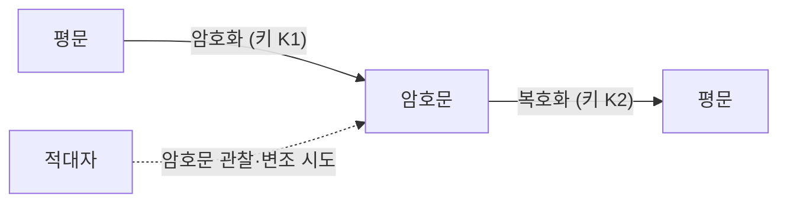
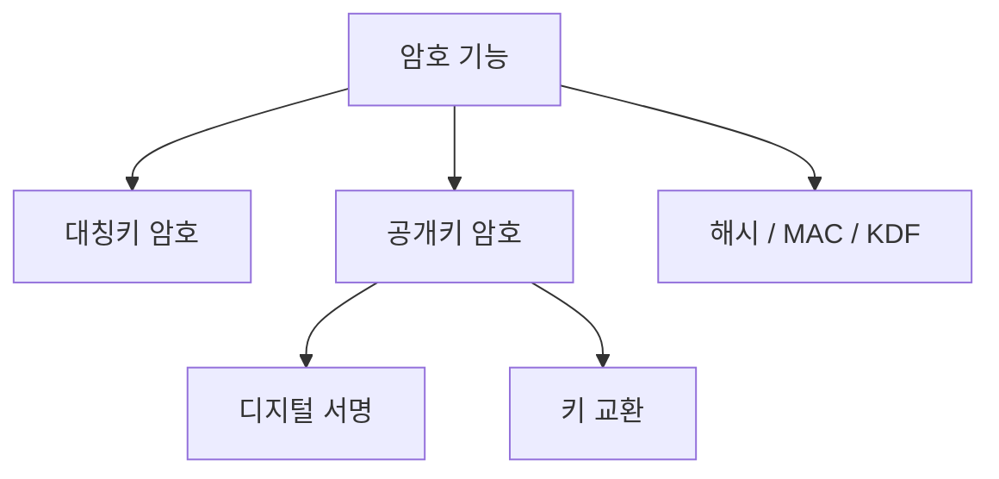

# Cryptography Overview (암호학 개요)

## 1. 개요 (What)

암호학(Cryptography)은 **적대자가 있는 환경에서 정보를 안전하게 다루기 위한 수학적 기법**의 모음이다.
단순히 "데이터를 숨기는 기술"이 아니라, 아래 네 가지 보안 목적을 **수학적으로 뒷받침하는 도구**로 이해하는 것이 정확하다.

| 목적 | 의미 | 대표 수단 |
|------|------|-----------|
| 기밀성 (Confidentiality) | 허가받지 않은 자가 내용을 알 수 없다 | 대칭키·공개키 암호 |
| 무결성 (Integrity) | 데이터가 변조되지 않았음을 확인할 수 있다 | 해시, MAC(Message Authentication Code), 디지털 서명 |
| 인증 (Authentication) | 데이터·통신 상대의 출처/신원을 확인할 수 있다 | MAC, 디지털 서명, 인증서 |
| 부인방지 (Non-repudiation) | 행위자가 나중에 자신의 행위를 부인할 수 없다 | 디지털 서명 |

이 문서는 암호학 하위 영역의 **출발점**으로, 이후 문서(대칭키·해시·공개키·서명·키 교환·키 관리·TLS(Transport Layer Security))가
공통으로 사용하는 용어와 사고방식을 고정한다. 개별 알고리즘의 내부 동작은 각 문서에서 다룬다.

## 2. 배경 / 원리 (Why & How)

### 2.1 암호 기능의 구성 요소

암호 시스템은 보통 다음 요소로 설명한다.

| 용어 | 설명 |
|------|------|
| 평문 (Plaintext) | 보호하려는 원본 데이터 |
| 암호문 (Ciphertext) | 암호화 결과 |
| 키 (Key) | 암호화/복호화(또는 서명/검증)를 좌우하는 비밀 또는 공개 값 |
| 알고리즘 (Algorithm) | 키와 데이터를 입력받아 변환을 수행하는 절차 |
| 적대자 (Adversary) | 시스템을 깨려는 공격자. 능력 가정이 안전성 판단의 기준이 된다 |

텍스트 설명: 송신자가 키로 평문을 암호문으로 바꾸고, 수신자가 대응하는 키로 복원한다.
적대자는 통신 경로에서 암호문을 관찰하거나 변조하려 한다. 대칭키 암호에서는 K1과 K2가 같고,
공개키 암호에서는 서로 다른 한 쌍이다.

### 2.2 Kerckhoffs의 원칙

> 시스템의 안전성은 **알고리즘의 비밀**이 아니라 **키의 비밀**에만 의존해야 한다.

- 알고리즘은 공개되어 많은 전문가에게 검증받는 것이 안전하다.
- 자체 개발한 비공개 알고리즘("security through obscurity")은 검증되지 않은 채 운용되어 위험하다.
- 실무 결론: **검증된 표준 알고리즘과 라이브러리를 쓰고, 보호 노력은 키 관리에 집중한다.**

### 2.3 암호 기능 분류

- **대칭키 암호**: 같은 키로 암호화·복호화. 빠르지만 키 배포 문제가 있다.
- **공개키 암호**: 공개키/개인키 쌍 사용. 키 배포·서명에 유리하지만 상대적으로 느리다.
- **해시 / MAC / KDF(Key Derivation Function, 키 파생 함수)**: 데이터 지문, 키 기반 무결성 검증, 키 파생.
- 실제 시스템은 이들을 **조합**한다(예: TLS는 공개키로 키를 합의하고, 대칭키로 데이터를 보호한다).

### 2.4 안전성의 개념

- **계산적 안전성(Computational security)**: 이론상 깨질 수 있어도, 현실적 자원으로는 깨기 어렵다는 가정.
  현대 암호 대부분이 여기에 속한다.
- **보안 강도(Security strength)**: 공격에 필요한 작업량을 비트로 표현한 값(예: 128비트 강도).
  키 길이와 알고리즘 구조에 따라 정해지며, 알고리즘별로 같은 키 길이가 같은 강도를 뜻하지 않는다.
- **공격자 능력 가정**: 암호문만 관찰(ciphertext-only), 평문-암호문 쌍 보유(known-plaintext),
  원하는 평문을 암호화시킴(chosen-plaintext) 등. 강한 공격자 모델에서도 안전해야 좋은 설계다.

## 3. 상세 (Details)

### 3.1 목적별 올바른 도구 선택

| 하고 싶은 것 | 쓰는 도구 | 흔한 오해 |
|--------------|-----------|-----------|
| 내용을 숨긴다 | 암호화(대칭/공개키) | 암호화만 하면 변조도 막힌다? → 아니다. 무결성 별도 필요(AEAD(Authenticated Encryption with Associated Data) 권장) |
| 변조를 탐지한다 | MAC, 서명 | 해시만으로는 키가 없어 공격자가 해시를 다시 계산할 수 있다 |
| 누가 보냈는지 증명한다 | 서명, 인증서 | MAC은 비밀키를 공유한 양쪽 모두 만들 수 있어 부인방지가 안 된다 |
| 비밀번호를 저장한다 | 패스워드 해시(느린 KDF) | 일반 해시(SHA(Secure Hash Algorithm)-2 등)를 단독으로 쓰면 무차별 대입에 취약하다 |
| 안전하게 키를 합의한다 | 키 교환(DH(Diffie-Hellman)/ECDH(Elliptic Curve Diffie-Hellman)) | 인증 없는 키 교환은 중간자 공격에 취약하다 |

### 3.2 인코딩·난독화와의 구분

- **Base64 같은 인코딩**은 형식 변환일 뿐 키가 없으므로 보안 기능이 아니다.
- **난독화(obfuscation)** 역시 암호가 아니다.
- **압축**은 암호화 대체재가 아니다.

### 3.3 암호 사용에서 반복되는 실패 유형

암호 알고리즘 자체보다 **사용 방식**에서 사고가 더 자주 난다.

| 유형 | 설명 |
|------|------|
| 직접 설계 | 비표준 알고리즘·프로토콜을 자체 구현 |
| 약한/폐기된 알고리즘 | 현재 권고되지 않는 알고리즘·짧은 키 사용 |
| 잘못된 모드·파라미터 | IV(Initialization Vector)/Nonce(Number used once) 재사용, 무결성 없는 모드 사용 |
| 나쁜 난수 | 예측 가능한 난수로 키·Nonce 생성 |
| 키 관리 실패 | 키 하드코딩, 평문 저장, 회전·폐기 부재 |
| 검증 누락 | 인증서·서명 검증을 생략하거나 우회 |

각 유형은 이후 문서의 "보안 관점" 섹션에서 구체 사례로 다룬다.

## 4. 보안 관점 (Security Relevance)

- 암호는 **다른 모든 통제의 전제**다. 인증·접근통제·전송 보안·저장 보호가 모두 암호 기능 위에서 동작한다.
- 보안 사고의 상당수는 알고리즘 해독이 아니라 **구현·설정·키 관리 오류**에서 비롯된다.
  따라서 점검 시에는 "어떤 알고리즘인가"뿐 아니라 "어떻게, 어떤 키로, 어떻게 관리하며 쓰는가"를 함께 본다.
- 이 영역의 개념은 각 도메인에서 다음과 같이 사용된다.

| 영역 | 연결되는 암호 개념 | 링크 |
|------|--------------------|------|
| 5G | 키 계층, KDF, SUCI(Subscription Concealed Identifier, 공개키 기반 식별자 은닉), NAS(Non-Access Stratum) 보호 | [5G Key Hierarchy](../../5g-security/fundamentals/01-01-5G_Key_Hierarchy.md) |
| Cloud | KMS(Key Management Service), 저장·전송 데이터 암호화, 키 회전 | [Data Protection](../../cloud-security/data-protection/README.md) |
| Web | TLS, 인증서, 세션·토큰 서명 | [Web & Application Security](../web-app-security/README.md) |
| PKI(Public Key Infrastructure) | 인증서·CA(Certificate Authority) 신뢰 모델 | [PKI & Identity](../pki-identity/README.md) |

## 관련 문서

- 다음 문서: [Symmetric Encryption](symmetric-encryption.md), [Hashing & MAC](hashing-mac.md)
- 로드맵: [Cryptography](README.md)
- 위협 사고방식: [Threat Modeling](../threat-modeling/README.md)

## 출처

- 본 문서는 암호학의 일반 원리를 재구성한 개념 해설이며 특정 표준 문구를 옮기지 않았다.
- Kerckhoffs의 원칙은 암호학의 고전 설계 원칙이다.
- 특정 알고리즘·표준의 버전/권고 수치는 해당 문서 작성 시 공식 출처로 확인해 기재한다.
