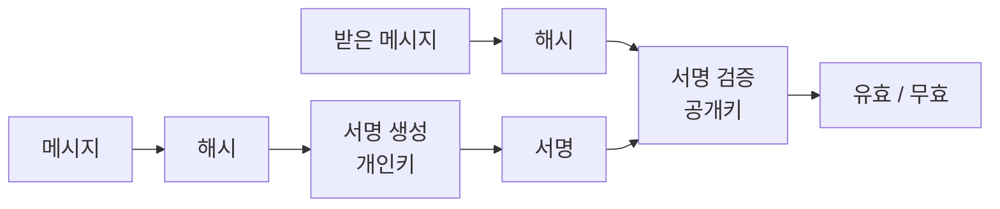

# Digital Signature (디지털 서명)

> 약어: NIST=미국 국립표준기술연구소, FIPS=미국 연방 정보처리 표준, RFC=인터넷 표준 문서, IETF=인터넷 표준화 기구, 3GPP=이동통신 표준화 기구, ETSI=유럽 전기통신 표준 기구

## 1. 개요 (What)

디지털 서명(Digital Signature)은 **개인키로 데이터에 서명하고, 누구나 공개키로 그 서명을 검증할 수 있게 하는 공개키 암호 기능**이다.
서명이 검증되면 "이 데이터는 개인키 소유자가 만들었고, 그 뒤로 바뀌지 않았다"는 것을 확인할 수 있다.

**왜 필요한가.** MAC(Message Authentication Code)도 무결성과 출처를 확인해 주지만, 비밀키를 공유한 양쪽 모두 같은 태그를 만들 수 있다.
그래서 제3자에게 "누가 만들었는지"를 증명하지 못하고, 키를 공유하지 않은 사람은 검증조차 할 수 없다(→ [Hashing & MAC](hashing-mac.md) §3.1).
디지털 서명은 **서명은 한 사람만, 검증은 누구나** 할 수 있어 이 한계를 넘는다.

| 보안 목적 | 서명이 제공하는 방식 |
|-----------|----------------------|
| 무결성 (Integrity) | 데이터가 1비트라도 바뀌면 검증이 실패한다 |
| 인증 (Authentication) | 검증에 쓴 공개키의 짝인 개인키 소유자가 서명했음을 확인한다 |
| 부인방지 (Non-repudiation) | 개인키는 서명자만 가지므로, 서명자가 나중에 부인하기 어렵다 |

인증서, 소프트웨어 업데이트, JWT(JSON Web Token), 패스키 로그인, 전자계약이 모두 디지털 서명 위에서 동작한다.

## 2. 배경 / 원리 (Why & How)

### 2.1 서명과 검증 흐름

텍스트 설명: 서명자는 메시지를 해시한 값에 개인키로 서명하고, 메시지와 서명을 함께 보낸다.
검증자는 받은 메시지를 같은 방식으로 해시한 뒤, 서명자의 공개키로 서명이 그 해시에 대해 유효한지 확인한다.

### 2.2 왜 해시한 뒤 서명하는가 (Hash-then-Sign)

- 공개키 연산은 느리고 입력 크기가 제한된다. 긴 데이터 대신 **고정 길이 해시값**에 서명한다.
- 그 결과 서명의 안전성은 **서명 알고리즘과 해시 함수 둘 다**에 달려 있다.
  해시 충돌을 만들 수 있으면, 서로 다른 두 문서가 같은 해시를 가져 한쪽에 받은 서명을 다른 쪽에 그대로 쓸 수 있다.
  이 때문에 충돌 공격이 실용화된 MD5(Message Digest 5)·SHA(Secure Hash Algorithm)-1은 서명에 쓰지 않는다(→ [Hashing & MAC](hashing-mac.md) §2.2).

### 2.3 흔한 오해 — "서명 = 개인키로 암호화"

RSA(Rivest-Shamir-Adleman)에서는 서명 연산이 수학적으로 복호화와 비슷해 "개인키로 암호화하는 것"이라고 설명하는 경우가 많다. 하지만 정확하지 않다.

- 서명은 **기밀성을 제공하지 않는다.** 메시지는 그대로 보이며, 공개키를 가진 누구나 검증한다.
- ECDSA(Elliptic Curve Digital Signature Algorithm)·EdDSA(Edwards-curve Digital Signature Algorithm)·ML-DSA 같은 서명 방식에는 대응하는 "암호화" 연산 자체가 없다.
- 서명과 암호화는 **별도의 기능**으로 보고, 키도 용도별로 분리한다.

## 3. 상세 (Details)

### 3.1 주요 서명 알고리즘

| 알고리즘 | 기반 | 특징 | 주의점 |
|----------|------|------|--------|
| RSA (PKCS #1 v1.5) | 소인수분해 | 가장 오래되고 널리 쓰임 (인증서, JWT RS256) | 구현 시 패딩 검증을 엄격히 해야 한다 |
| RSA-PSS(Probabilistic Signature Scheme) | 소인수분해 | 확률적 패딩, 안전성 근거가 더 강함 | 신규 설계에서 권장 |
| ECDSA | 타원곡선 | 짧은 키·서명 (JWT ES256, TLS 인증서) | **서명마다 쓰는 임시값이 재사용·예측되면 개인키가 노출**된다 |
| EdDSA (Ed25519, Ed448) | 타원곡선 | 임시값을 결정적으로 만들어 구현이 단순하고 빠름 | 검증된 라이브러리 사용 |

- 미국 연방 서명 표준(FIPS 186-5)은 RSA·ECDSA·EdDSA를 승인하며, 예전 방식인 **DSA(Digital Signature Algorithm)는 새 서명을 만드는 용도에서 제외**했다. 기존 DSA 서명의 검증에만 쓴다. → §5.1

### 3.2 ECDSA의 임시값 문제

ECDSA는 서명할 때마다 일회용 비밀 값(임시값 k)을 새로 만든다. 이 값이 두 서명에서 같거나 일부라도 예측 가능하면, **공개된 서명 두 개로 개인키를 계산**할 수 있다.
난수 생성기 결함으로 실제 개인키가 유출된 사례가 있다.

- 대응 1: **결정적 ECDSA** — 임시값을 난수 생성기 대신 개인키와 메시지로부터 정해진 절차로 만든다. 같은 메시지에는 같은 값, 다른 메시지에는 예측할 수 없는 다른 값이 나온다. 검증 방법은 기존과 같다. → §5.2
- 대응 2: 처음부터 결정적 임시값을 쓰도록 설계된 **EdDSA**

> 해설: 대칭키의 Nonce 재사용(→ [Symmetric Encryption](symmetric-encryption.md) §3.2)과 같은 교훈이다.
> 암호 알고리즘 자체보다 **난수와 일회용 값 관리**에서 사고가 더 자주 난다.

### 3.3 양자내성 서명

RSA·ECDSA·EdDSA는 양자 컴퓨터에 취약하다(→ [Asymmetric Encryption](asymmetric-encryption.md) §3.4). 이를 대체할 PQC(Post-Quantum Cryptography, 양자내성암호) 서명은 다음과 같다.

| 알고리즘 | 기반 | 한 줄 요약 |
|---------|------|-----------|
| ML-DSA(Module-Lattice-Based Digital Signature Algorithm) | 격자 문제 | 범용 서명의 주력. 키·서명이 기존보다 수십 배 크다 |
| SLH-DSA(Stateless Hash-Based Digital Signature Algorithm) | 해시 함수만 | 가장 보수적인 "보험". 서명이 매우 크고 서명 속도가 느리다 |
| FN-DSA | 격자 문제 | 서명이 상대적으로 작다. 아직 개발 중인 표준이다 |

- 모두 "서명" 기능이다. 키 설정용인 ML-KEM과 혼동하지 않는다.
- SLH-DSA는 격자 같은 새로운 수학 가정에 기대지 않아, 격자 방식에 예상치 못한 약점이 발견될 때를 대비하는 성격이 있다.
- **크기가 커지는 것이 전환의 현실적인 부담**이다. 인증서 체인, TLS(Transport Layer Security) 핸드셰이크, 저전력 기기, 토큰 크기를 함께 검토해야 한다. 파라미터별 정확한 크기 → §5.3

### 3.4 서명의 신뢰는 공개키의 신뢰에서 나온다

서명 검증이 성공해도 그것은 "**이 공개키의 짝인 개인키**로 서명했다"는 뜻일 뿐이다. 그 공개키가 정말 주장하는 주체의 것인지는 별개의 문제다.

- 공격자가 자신의 공개키를 상대방 것인 척 건네면, 공격자가 서명한 위조 데이터도 검증을 통과한다.
- 그래서 공개키를 주체 신원과 묶어 주는 **인증서와 CA(Certificate Authority)** 가 필요하다. 인증서 자체도 CA의 디지털 서명이다.
  → [PKI & Identity](../pki-identity/README.md)

### 3.5 시간과 키 폐기

- 개인키가 유출되면 그 뒤로 만들어진 서명은 신뢰할 수 없다. 공개키(인증서)를 **폐기**해야 한다.
- 장기 보관 문서는 "서명 당시 키가 유효했는가"를 증명하기 위해 **타임스탬프** 서명을 함께 쓴다.
- 오래 검증되어야 하는 서명(펌웨어, 루트 인증서)은 양자 전환 계획을 먼저 세워야 하는 대상이다.

### 3.6 다른 영역에서의 사용

| 영역 | 사용처 |
|------|--------|
| PKI | X.509 인증서는 CA가 주체 공개키에 서명한 데이터다 → [PKI & Identity](../pki-identity/README.md) |
| Web·API | JWT의 서명(RS256=RSA, ES256=ECDSA, EdDSA). HS256은 서명이 아니라 HMAC(Hash-based MAC)이다 → [Hashing & MAC](hashing-mac.md) |
| 인증 | FIDO2/WebAuthn(Web Authentication)·Passkey는 서버가 보낸 Challenge에 기기의 개인키로 서명해 로그인한다 |
| 소프트웨어 공급망 | 코드 서명, 업데이트 패키지·컨테이너 이미지 서명으로 배포물의 출처와 무결성을 확인한다 |
| 5G | 5G 코어의 NF(Network Function)들은 서로 TLS 인증서로 신뢰를 확인하고, 서비스 이용 권한은 서명(또는 MAC)된 JWT 형식 토큰으로 주고받는다 → §5.4, [OAuth Token Abuse](../../5g-security/security-risks/06-sba-security/06-06-OAuth_Token_Abuse.md) |
| Cloud | KMS(Key Management Service)·HSM(Hardware Security Module)에서 서명 키를 보관하고, 개인키를 반출하지 않은 채 서명 연산만 제공한다 → [Data Protection](../../cloud-security/data-protection/README.md) |

## 4. 보안 관점 (Security Relevance)

| 실수 | 결과 | 대응 |
|------|------|------|
| MD5·SHA-1 해시로 서명 | 충돌을 이용한 서명 위조 | SHA-2 이상 사용 |
| ECDSA 임시값 재사용·약한 난수 | 서명 두 개로 개인키 계산 | 결정적 ECDSA 또는 EdDSA |
| DSA로 새 서명 생성 | 연방 표준 비승인 | RSA-PSS·ECDSA·EdDSA로 전환, DSA는 기존 서명 검증에만 사용 |
| 서명 검증 생략·검증 결과 무시 | 위조 데이터 수용 | 검증 실패 시 반드시 거부, 검증 경로 테스트 |
| JWT `alg` 헤더를 그대로 신뢰 | `none` 알고리즘 허용, RS256 공개키를 HS256 비밀키로 쓰는 알고리즘 혼동 공격 | 서버가 허용 알고리즘을 고정, 키와 알고리즘을 묶어 관리 |
| 공개키 출처 미확인 | 공격자 공개키로 검증 통과 | 인증서 체인 검증, 키 고정(pinning) 검토 |
| 개인키를 소스·서버 파일에 저장 | 키 유출로 서명 위조 | HSM/KMS 보관, 접근 통제와 로깅 |
| 한 키를 서명·암호화에 겸용 | 용도 간 공격 전이 | 용도별 키 분리 |
| 유출 키 폐기 지연 | 유출 뒤 위조 서명 계속 유효 | 폐기 절차·인증서 수명 단축 |
| 장기 서명에 기존 알고리즘만 사용 | 양자 컴퓨터 등장 후 위조 가능 | 서명 인벤토리 작성, PQC·하이브리드 전환 계획 |

점검 시 확인할 것: 서명 알고리즘과 해시, 임시값 생성 방식, 검증 실패 처리, 허용 알고리즘 고정 여부, 공개키·인증서 검증 경로, 개인키 보관 위치, 폐기 절차.

## 5. 심화 (Advanced)

> 보안 컨설턴트·점검자를 위한 규격 세부다. 본문만으로 개념 이해에는 충분하다.

### 5.1 FIPS 186-5의 승인 범위

| 알고리즘 | FIPS 186-5 기준 |
|----------|-----------------|
| RSA (PKCS #1 v1.5, PSS) | 신규 서명 생성 및 검증 |
| ECDSA (결정적 ECDSA 포함, §6.3.2) | 신규 서명 생성 및 검증 |
| EdDSA (Ed25519, Ed448) | 신규 서명 생성 및 검증 |
| DSA | **기존 서명 검증만 허용** |

### 5.2 결정적 ECDSA — RFC 6979와 FIPS 186-5의 관계

- **RFC 6979** "Deterministic Usage of the Digital Signature Algorithm (DSA) and Elliptic Curve Digital Signature Algorithm (ECDSA)"는 **Informational** RFC다(Standards Track 아님).
  임시값 k를 개인키와 메시지 해시를 입력으로 하는 **HMAC 기반 절차**로 만든다(§3.2).
- **FIPS 186-5**는 결정적 ECDSA를 승인된 서명 생성 방식으로 규정한다(§6.3.2). k 생성 절차(Appendix A.3.3)는 HMAC_DRBG(HMAC-based Deterministic Random Bit Generator)를 쓰며 RFC 6979 §3.2를 참조한다.
- 즉 **RFC 6979가 절차를 정의하고, FIPS 186-5가 그 방식을 연방 표준으로 인정**한다. RFC 6979 문서 자체가 FIPS 승인을 받았다는 뜻은 아니다.

### 5.3 PQC 서명 파라미터와 크기 (바이트)

**ML-DSA** — FIPS 204 Table 2

| 파라미터 세트 | 공개키 | 개인키 (확장형) | 서명 |
|--------------|-------:|---------------:|-----:|
| ML-DSA-44 | 1,312 | 2,560 | 2,420 |
| ML-DSA-65 | 1,952 | 4,032 | 3,309 |
| ML-DSA-87 | 2,592 | 4,896 | 4,627 |

- 개인키는 FIPS 204의 **확장형 개인키 인코딩** 기준이다. 32바이트 시드(seed)만 보관하고 필요할 때 확장형 키를 다시 만드는 방식도 허용된다.

**SLH-DSA** — FIPS 205 Table 2 (SHA2 계열과 SHAKE 계열은 같은 크기)

| 파라미터 세트 | 공개키 | 개인키 | 서명 |
|--------------|-------:|-------:|-----:|
| SLH-DSA-128s | 32 | 64 | 7,856 |
| SLH-DSA-128f | 32 | 64 | 17,088 |
| SLH-DSA-192s | 48 | 96 | 16,224 |
| SLH-DSA-192f | 48 | 96 | 35,664 |
| SLH-DSA-256s | 64 | 128 | 29,792 |
| SLH-DSA-256f | 64 | 128 | 49,856 |

- 숫자(128/192/256)는 목표 보안 수준, 전체 이름은 해시 계열을 포함한다(예: SLH-DSA-SHA2-128s, SLH-DSA-SHAKE-128f).
- **s(small)**: 서명이 작은 대신 서명 생성이 느리다. **f(fast)**: 서명 생성이 빠른 대신 서명이 크다.
- 키는 매우 작지만 서명이 크므로 서명 빈도가 낮고 오래 검증되는 용도(펌웨어, 루트 서명)에 적합하다.
- **상태 저장형 해시 서명과의 차이**: LMS(Leighton-Micali Signature)·XMSS(eXtended Merkle Signature Scheme)는 이미 쓴 일회용 키를 다시 쓰지 않도록 서명 상태를 관리해야 한다. SLH-DSA는 이 관리가 필요 없다.
- **FN-DSA**(FFT over NTRU-Lattice-Based Digital Signature Algorithm)는 FIPS 206으로 개발 중이며 확정 표준이 아니다.

**기존 서명과 비교 (참고)**

| 방식 | 공개키 | 서명 | 비고 |
|------|-------:|-----:|------|
| Ed25519 | 32 | 64 | |
| ECDSA P-256 | 64 (비압축 좌표) | 64 (r‖s) | DER 인코딩 시 서명 최대 72 |
| RSA-3072 | 384 (모듈러스) | 384 | 공개 지수 별도 |

### 5.4 5G SBA Access Token

- NRF(Network Repository Function)는 OAuth 2.0 Authorization Server 역할을 하며, **Client Credentials Grant**로 NF Service Consumer에게 **JWT 형식**의 Access Token을 발급한다.
- 토큰은 JWS(JSON Web Signature, RFC 7515) 기반 **디지털 서명 또는 MAC**으로 보호되고, NF Service Producer가 유효성을 검증한다.
- MAC으로 보호하려면 NRF와 NF Service Producer가 대칭키를 미리 공유해야 한다.
- 규격이 JWT·JWS를 정의한다고 해서 모든 장비가 같은 서명 알고리즘이나 키 관리 방식을 쓰는 것은 아니다.

| 구분 | 내용 |
|------|------|
| 규격 | 3GPP TS 33.501 |
| Release / 버전 | Release 19 / V19.7.0 (ETSI TS 133 501 V19.7.0) |
| 조항 | §13.4.1.0 General (§13.4.1 OAuth 2.0 based authorization of NF service access) |
| 공식 배포처 | ETSI |
| 원문 대조 | V19.7.0 원문 조항 대조 확인 예정 |

## 관련 문서

- 이전: [Hashing & MAC](hashing-mac.md), [Asymmetric Encryption](asymmetric-encryption.md)
- 다음: [Key Exchange](key-exchange.md)
- 신뢰 모델·인증서·JWT·FIDO2: [PKI & Identity](../pki-identity/README.md)
- 로드맵: [Cryptography](README.md)

## 출처

| 문서 | 판 / 지위 | 인용 위치 | 공식 링크 |
|------|-----------|-----------|-----------|
| NIST FIPS 186-5 "Digital Signature Standard (DSS)" | 2023-02, Final | 승인 알고리즘, DSA 지위, §6.3.2, Appendix A.3.3 | https://doi.org/10.6028/NIST.FIPS.186-5 |
| NIST FIPS 204 "Module-Lattice-Based Digital Signature Standard" | 2024-08-13, Final | Table 2 | https://doi.org/10.6028/NIST.FIPS.204 |
| NIST FIPS 205 "Stateless Hash-Based Digital Signature Standard" | 2024-08-13, Final | Table 2 | https://doi.org/10.6028/NIST.FIPS.205 |
| NIST FIPS 206 (FN-DSA) | 개발 중 | — | — |
| IETF RFC 6979 | Informational | §3.2 | https://www.rfc-editor.org/rfc/rfc6979 |
| IETF RFC 7515 (JWS) | Standards Track | — | https://www.rfc-editor.org/rfc/rfc7515 |
| 3GPP TS 33.501 | V19.7.0, Release 19 | §13.4.1.0 | 위 §5.4 표 참조 |

- 그 외 내용은 디지털 서명의 일반 원리를 재구성한 해설이다.
