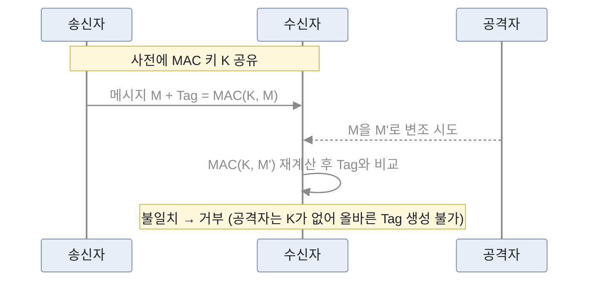

# Hashing & MAC (해시·메시지 인증 코드)

> 약어: NIST=미국 국립표준기술연구소, FIPS=미국 연방 정보처리 표준, 3GPP=이동통신 표준화 기구

## 1. 개요 (What)

이 문서는 **"데이터가 바뀌지 않았는가, 누가 만들었는가"** 를 확인하는 세 가지 도구를 다룬다.

| 도구 | 키 | 제공하는 것 |
|------|----|-------------|
| 해시 함수 (Hash function) | 없음 | 임의 길이 데이터 → 고정 길이 지문(digest). 우연·비의도적 변경 탐지 |
| MAC(Message Authentication Code) | 공유 비밀키 | 무결성 + 출처 인증 (키를 가진 쪽만 만들 수 있음) |
| KDF(Key Derivation Function, 키 파생 함수) | 비밀 입력값 | 하나의 비밀에서 용도별 키를 안전하게 파생 |

세 도구는 서로 다르다. **해시는 키가 없어 공격자도 다시 계산할 수 있으므로, 단독으로는 악의적 변조를 막지 못한다.**
이 구분이 이 문서의 핵심이다.

## 2. 배경 / 원리 (Why & How)

### 2.1 암호학적 해시 함수의 성질

| 성질 | 의미 | 깨지면 |
|------|------|--------|
| 역상 저항성 (Preimage resistance) | 해시값만으로 원래 입력을 찾기 어렵다 | 해시로부터 원문 복원 |
| 제2 역상 저항성 (Second-preimage resistance) | 주어진 입력과 같은 해시를 갖는 다른 입력을 찾기 어렵다 | 특정 파일을 같은 해시의 가짜로 바꿔치기 |
| 충돌 저항성 (Collision resistance) | 같은 해시를 갖는 임의의 두 입력을 찾기 어렵다 | 서로 다른 두 문서에 같은 서명 적용 가능 |

- 해시 출력이 n비트이면 충돌 탐색은 대략 2^(n/2) 수준의 작업량이 든다(생일 역설). 그래서 충돌 저항 강도는 출력 길이의 절반으로 본다.
- 입력이 조금만 바뀌어도 출력이 크게 바뀐다(눈사태 효과).

### 2.2 대표 해시 계열

| 계열 | 상태 (일반 인식) | 비고 |
|------|------------------|------|
| MD5(Message Digest 5) | 사용 금지 | 실용적 충돌 공격 공개 |
| SHA(Secure Hash Algorithm)-1 | 사용 금지(서명 용도) | 실용적 충돌 사례 공개 |
| SHA-2 (SHA-256, SHA-384, SHA-512 등) | 현행 | *FIPS 180-4* |
| SHA-3 (SHA3-256 등, SHAKE) | 현행 | *FIPS 202*. SHA-2와 다른 스펀지(Sponge) 구조 |

> SHA-3는 SHA-2가 깨져서 만든 대체재가 아니라, **구조가 다른 예비 표준**이다. SHA-2는 현재도 현행이다.

### 2.3 MAC — 키가 있는 무결성

텍스트 설명: 송신자는 공유키 K로 메시지의 태그를 계산해 함께 보낸다. 수신자는 같은 K로 태그를 다시 계산해 비교한다.
공격자는 메시지를 바꿀 수는 있어도 K가 없으므로 맞는 태그를 만들지 못하고, 변조는 탐지된다.

대표 MAC 구성:
- **HMAC(Hash-based MAC)**: 해시 함수(SHA-256 등)와 키를 결합한 구조. 가장 널리 쓰인다.
- **CMAC(Cipher-based MAC)**: 블록 암호(AES, Advanced Encryption Standard) 기반 MAC.
- **AEAD(Authenticated Encryption with Associated Data)의 인증 태그**: 암호화와 MAC을 통합(→ [Symmetric Encryption 2.4 인증 암호화 (AEAD)](symmetric-encryption.md#24-인증-암호화-aead)).

### 2.4 왜 `Hash(Key || Message)`가 아닌 HMAC인가

SHA-2 같은 Merkle–Damgård 구조 해시로 `Hash(Key || Message)`를 직접 만들면 **길이 확장 공격(Length extension attack)** 에 노출된다.
공격자가 원래 키를 몰라도, 태그와 메시지 길이만으로 "메시지 뒤에 데이터를 덧붙인 것"의 유효한 태그를 계산할 수 있다.
HMAC은 키를 두 번 섞는 구조로 이 문제를 피한다. **MAC이 필요하면 직접 조합하지 말고 HMAC을 쓴다.**

## 3. 상세 (Details)

### 3.1 MAC과 디지털 서명의 차이

| 구분 | MAC | 디지털 서명 |
|------|-----|-------------|
| 키 | 양쪽이 같은 비밀키 공유 | 서명자 개인키 / 검증자 공개키 |
| 검증 가능자 | 키를 가진 쪽만 | 공개키를 가진 누구나 |
| 부인방지 | 불가 (양쪽 다 태그 생성 가능) | 가능 |
| 속도 | 빠름 | 상대적으로 느림 |

→ 서명은 [Digital Signature](digital-signature.md)에서 다룬다.

### 3.2 KDF — 키 파생

하나의 마스터 비밀에서 용도별 키를 만들 때 KDF를 쓴다. 같은 키를 여러 용도에 재사용하지 않기 위해서다.

| 종류 | 입력 | 용도 | 예 |
|------|------|------|----|
| 키 기반 KDF | 충분히 랜덤한 비밀(키 교환 결과 등) | 세션 키·용도별 키 파생 | HKDF(HMAC-based KDF) |
| 패스워드 기반 KDF | 사람이 고른 낮은 엔트로피 비밀 | 패스워드 저장, 패스워드로부터 키 생성 | PBKDF2(Password-Based KDF 2), scrypt, Argon2 |

- 키 파생에는 보통 **용도 라벨(context)** 을 함께 넣어, 같은 마스터 비밀에서 나온 키라도 용도별로 서로 다른 값이 되게 한다.
- 이 "마스터 → 용도별 키" 구조가 키 계층(Key hierarchy)의 기본 원리다(→ [5G Key Hierarchy](../../5g-security/fundamentals/01-01-5G_Key_Hierarchy.md)).

### 3.3 패스워드 저장

| 방법 | 평가 |
|------|------|
| 평문 저장 | 금지 |
| 가역 암호화 | 금지 (키 유출 시 전부 복원) |
| 일반 해시 단독 (SHA-256 등) | 부적절. 너무 빨라 무차별 대입·사전 공격에 취약 |
| 일반 해시 + Salt | 레인보우 테이블은 막지만 여전히 빠름 |
| **느린 패스워드 해시 + 고유 Salt** (Argon2, scrypt, PBKDF2 등) | 권장 방향. work factor로 공격 비용을 높인다 |

- Salt는 사용자마다 다른 랜덤 값이며 비밀이 아니다. 같은 패스워드라도 해시값을 다르게 만든다.
- 구체 파라미터(반복 횟수, 메모리 크기 등)는 사용하는 표준·라이브러리의 현행 권고를 따른다.

### 3.4 다른 영역에서의 사용

| 영역 | 사용처 |
|------|--------|
| 5G | 키 계층의 각 키는 상위 키에서 KDF로 파생된다. 범용 KDF는 HMAC-SHA-256 기반이며(*3GPP TS 33.220*), 5G 키별 입력 파라미터와 FC(Function Code) 값은 *TS 33.501*이 정의한다. 즉 모든 키가 "같은 연산"으로 나오는 것이 아니라 **키마다 입력 구성이 달라 서로 다른 키가 파생**된다. NAS(Non-Access Stratum)·RRC(Radio Resource Control) 메시지 무결성은 NIA(NR(New Radio) Integrity Algorithm) 알고리즘이 담당하며 128-NIA2는 AES-CMAC 기반이다(*TS 33.501*) → [5G Key Hierarchy](../../5g-security/fundamentals/01-01-5G_Key_Hierarchy.md) |
| Web | 세션 토큰·JWT(JSON Web Token)의 HMAC 서명(HS256 등), 패스워드 저장 → [Web & Application Security](../web-app-security/README.md) (작성 예정) |
| Cloud | 객체 무결성 검사(체크섬), API(Application Programming Interface) 요청 서명(HMAC 기반) → [Cloud Security](../../cloud-security/README.md) (로드맵, 문서 작성 예정) |
| 공급망 | 배포 파일 해시 게시 — 해시만으로는 게시처가 변조되면 무의미하므로 서명과 함께 쓴다 |

## 4. 보안 관점 (Security Relevance)

| 실수 | 결과 | 대응 |
|------|------|------|
| 무결성 검증에 해시만 사용 | 공격자가 데이터와 해시를 함께 바꿈 | MAC 또는 서명 사용 |
| `Hash(Key \|\| Message)` 직접 구성 | 길이 확장 공격 | HMAC 사용 |
| MD5/SHA-1로 서명·인증서 | 충돌 기반 위조 | SHA-2 이상 |
| 태그 비교에 일반 문자열 비교 | 타이밍 공격으로 태그 추측 | constant-time 비교 함수 |
| 태그 길이 과도 절단 | 위조 확률 증가 | 표준이 정한 태그 길이 사용 |
| 빠른 해시로 패스워드 저장 | 유출 시 대량 크래킹 | 느린 패스워드 해시 + Salt |
| 한 키를 여러 용도에 재사용 | 용도 간 공격 전이 | KDF로 용도별 키 분리 |

점검 시 확인할 것: 무결성 보호 수단이 키 기반인지(MAC/서명), 사용 해시 계열, 태그 비교 방식, 패스워드 저장 방식, 키 용도 분리 여부.

## 관련 문서

- 이전: [Cryptography Overview](cryptography-overview.md)
- 함께 읽기: [Symmetric Encryption](symmetric-encryption.md)
- 다음: [Digital Signature](digital-signature.md)
- 로드맵: [Cryptography](README.md)

## 출처

- SHA-2: NIST, *FIPS 180-4* / SHA-3: NIST, *FIPS 202*.
- 5G 128-NIA2 = AES-CMAC, 5G 키 파생 입력 구성: 3GPP, *TS 33.501 V19.7.0 (Release 19)* /
  범용 KDF(HMAC-SHA-256): *TS 33.220* (세부는 [5G Key Hierarchy](../../5g-security/fundamentals/01-01-5G_Key_Hierarchy.md)에서 다룬다).
- 그 외 내용은 해시·MAC·KDF의 일반 원리를 재구성한 해설이다. 패스워드 해시 파라미터 등 구체 수치는 다루지 않았다.
