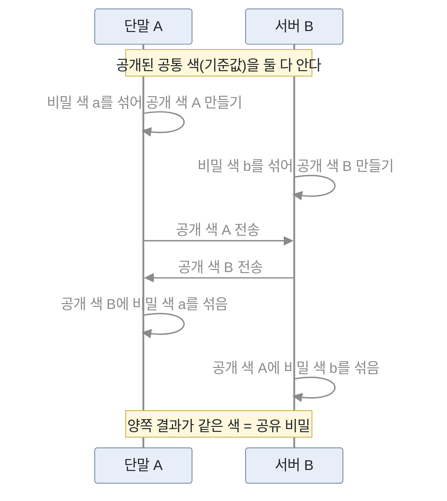
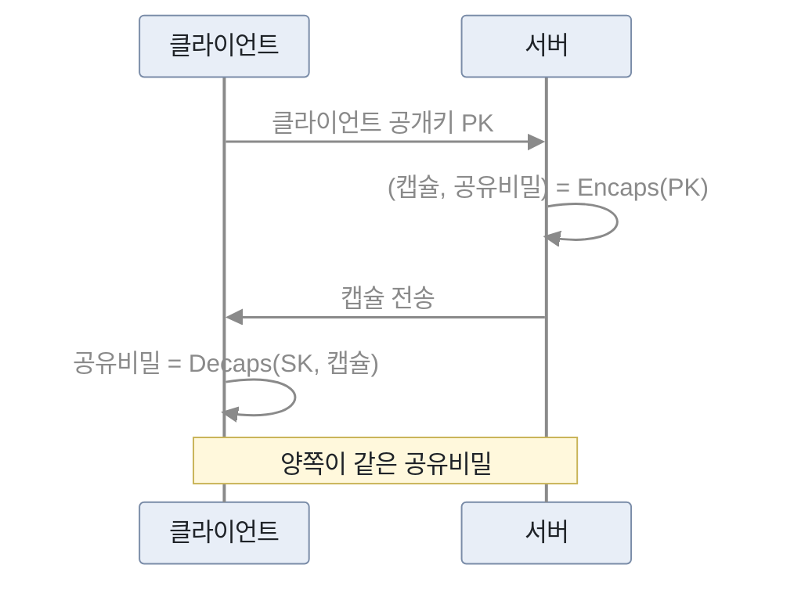
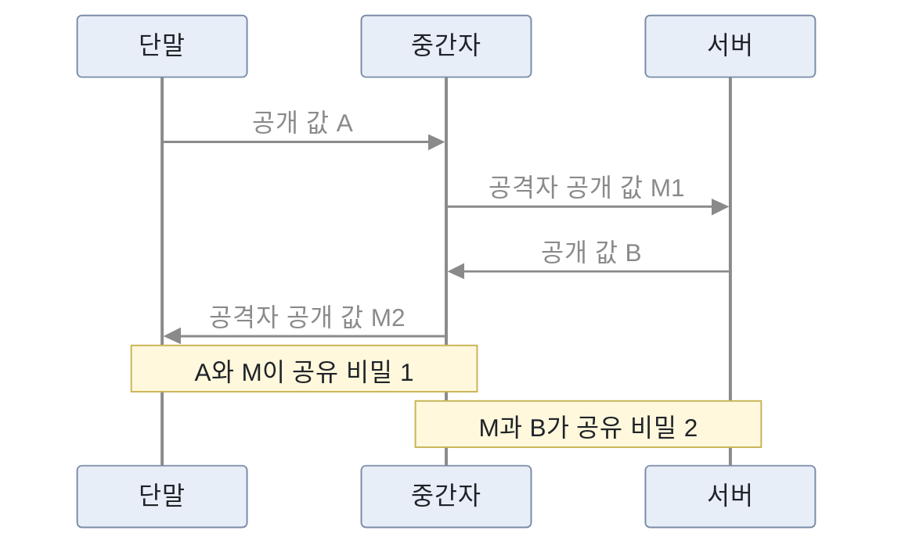
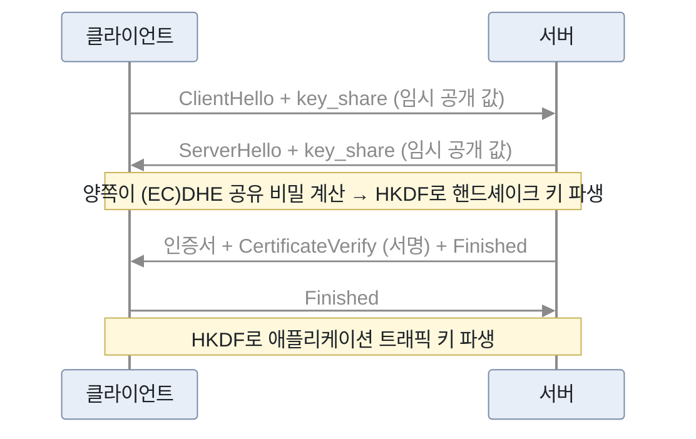
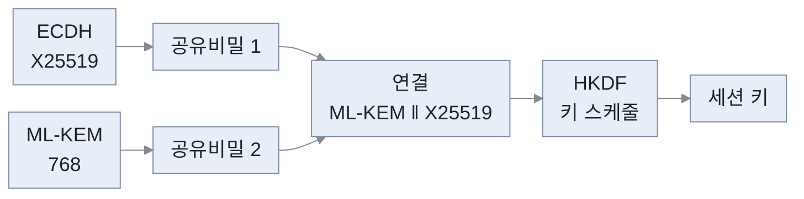
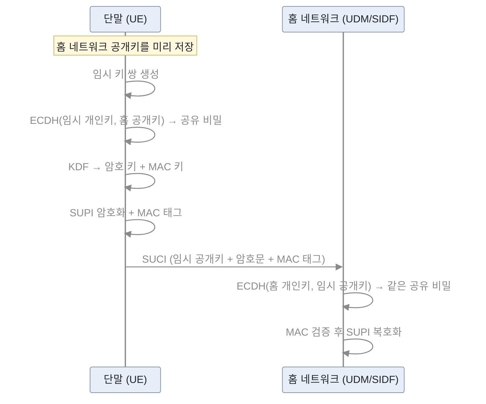

# Key Exchange (키 교환)

> 약어: NIST=미국 국립표준기술연구소, FIPS=미국 연방 정보처리 표준, RFC=인터넷 표준 문서, IETF=인터넷 표준화 기구, 3GPP=이동통신 표준화 기구

## 1. 개요 (What)

키 교환(Key Exchange, Key Agreement)은 **처음 만난 두 당사자가 도청되는 통신로 위에서 공개 값만 주고받아, 둘만 아는 같은 비밀(공유 비밀)을 만드는 방법**이다.
이렇게 만든 공유 비밀에서 대칭키를 파생해 실제 데이터를 보호한다.

**왜 필요한가.** 대칭키 암호(→ [Symmetric Encryption](symmetric-encryption.md))는 빠르지만, 양쪽이 같은 키를 미리 갖고 있어야 한다.
키를 어떻게 안전하게 나눠 가질지가 문제인데, 키 교환은 **비밀을 직접 보내지 않고도** 양쪽이 같은 비밀에 도달하게 해 준다.
TLS(Transport Layer Security), VPN(Virtual Private Network), 메신저, 5G 가입자 식별자 보호(SUCI(Subscription Concealed Identifier))가 모두 이 원리를 쓴다.

이 문서에서 구분해야 할 세 가지는 다음과 같다.

| 기술 | 하는 일 | 대표 예 |
|------|---------|---------|
| DH(Diffie-Hellman)·ECDH(Elliptic Curve Diffie-Hellman) | 양쪽이 각자 공개 값을 보내고, 상대 공개 값과 자기 개인 값으로 **같은 공유 비밀을 계산** | X25519, P-256 ECDH |
| KEM(Key Encapsulation Mechanism) | 한쪽이 상대 공개키로 **공유 비밀을 만들어 캡슐에 담아 보내고**, 상대가 개인키로 꺼냄 | ML-KEM |
| HKDF(HMAC-based Key Derivation Function) | 위에서 얻은 공유 비밀을 **용도별 대칭키로 파생** | TLS 1.3 키 스케줄 |

DH·ECDH와 KEM은 "공유 비밀을 만드는 방법", HKDF는 "공유 비밀을 실제로 쓸 키로 바꾸는 방법"이다. 역할이 다르다.

## 2. 배경 / 원리 (Why & How)

### 2.1 DH를 직관적으로 이해하기 — 물감 섞기 비유



텍스트 설명: 둘 다 아는 기준값에 각자 비밀 값을 섞어 공개 값을 만들고 교환한다. 상대 공개 값에 자기 비밀 값을 다시 섞으면 양쪽이 같은 결과를 얻는다.
도청자는 공개 값 두 개를 봐도, 섞인 색에서 원래 비밀 색을 분리할 수 없어(이산로그 문제) 공유 비밀을 만들지 못한다.

- DH는 정수 거듭제곱, ECDH는 타원곡선 위 점의 정수배로 같은 일을 한다. ECDH가 훨씬 짧은 값으로 같은 강도를 얻는다(→ [Asymmetric Encryption 3.2 ECC](asymmetric-encryption.md#32-ecc)).
- 공유 비밀은 **한 번도 통신로에 실리지 않는다.** 이것이 키 교환의 핵심이다.

### 2.2 KEM은 방향이 다르다



텍스트 설명: DH는 양쪽이 대칭적으로 공개 값을 보내 같은 값을 계산하지만, KEM은 한쪽(Encaps 측)이 공유 비밀을 만들어 상대 공개키로 캡슐화해 보낸다.
상대는 자기 개인키로 캡슐을 열어 같은 공유 비밀을 얻는다(→ [Asymmetric Encryption 2.4 공개키 암호화 vs KEM](asymmetric-encryption.md#24-공개키-암호화-vs-kem)).

| 구분 | DH / ECDH | KEM |
|------|-----------|-----|
| 메시지 구조 | 양쪽이 각자 공개 값을 보냄 | 한쪽은 공개키, 다른 쪽은 캡슐을 보냄 |
| 공유 비밀 생성 | 양쪽이 각자 계산 | Encaps 측이 생성, Decaps 측이 복원 |
| 양자 내성 | 없음 (Shor 알고리즘에 취약) | ML-KEM은 양자내성 설계 |

### 2.3 공유 비밀을 바로 키로 쓰지 않는다 — HKDF

DH·KEM으로 얻은 공유 비밀은 그 자체로 균일한 랜덤 키가 아니고, 한 값으로 여러 용도를 쓰면 위험하다(→ [Hashing & MAC 3.2 KDF](hashing-mac.md#32-kdf--키-파생)).
HKDF는 두 단계로 공유 비밀을 다듬는다.

1. **Extract**: 공유 비밀을 고르게 퍼진 의사난수 키로 압축한다.
2. **Expand**: 용도 라벨(예: "client handshake", "server application")을 넣어 용도별 키를 여러 개 뽑는다.

TLS 1.3의 키 스케줄 전체가 HKDF로 구성되어 있다.

### 2.4 인증 없는 키 교환은 중간자 공격에 취약하다



텍스트 설명: 키 교환 자체는 "상대가 누구인지"를 확인하지 않는다. 중간자(MITM, Man-in-the-Middle)가 양쪽과 각각 키 교환을 하면, 양쪽 모두 중간자와 비밀을 공유하게 된다.

그래서 실제 프로토콜은 키 교환에 **인증**을 결합한다.
- TLS: 서버가 인증서의 개인키로 핸드셰이크 내용에 **디지털 서명**한다(→ [Digital Signature](digital-signature.md)).
- 사전 공유 키(PSK, Pre-Shared Key)로 양쪽을 확인하는 방식도 있다.
- 5G SUCI: 단말이 미리 저장된 **홈 네트워크 공개키**를 사용해, 처음부터 정해진 상대와만 키를 합의한다.

## 3. 상세 (Details)

### 3.1 PFS (Perfect Forward Secrecy)

PFS(Perfect Forward Secrecy)는 **장기 개인키가 나중에 유출되더라도, 과거 세션의 키를 복원할 수 없는 성질**이다.

- 세션마다 새로 만든 **임시(ephemeral) 키**로 키 교환을 하고, 세션이 끝나면 임시 개인키를 버린다.
- 장기 키(서버 인증서 키)는 "누구인지 증명(서명)"에만 쓰고, 세션 키 생성에는 쓰지 않는다.
- 이름에 붙는 "E"(DHE, ECDHE)가 임시 키 교환을 뜻한다.

### 3.2 TLS 1.2와 TLS 1.3의 키 교환 비교

| 구분 | TLS 1.2 | TLS 1.3 |
|------|---------|---------|
| 정적 RSA(Rivest-Shamir-Adleman) 키 전송 | 허용 (클라이언트가 세션 비밀을 서버 RSA 공개키로 암호화해 전송) | **제거** |
| 정적 DH | 허용 | 제거 |
| (EC)DHE((Elliptic Curve) Diffie-Hellman Ephemeral) | 선택 사항 | **기본** (PSK와 결합 가능) |
| PFS | 설정에 따라 없을 수 있음 | (EC)DHE 사용 시 항상 보장 |
| 키 파생 | PRF(Pseudo-Random Function) | HKDF 기반 키 스케줄 |
| 양자내성 하이브리드 | — | 하이브리드 그룹 정의됨 ([3.4](key-exchange.md#34-양자내성-하이브리드-키-교환)) |

- 정적 RSA 키 전송에서는 서버 RSA 개인키가 유출되면 **그 키로 저장해 둔 과거 트래픽을 모두 복호화**할 수 있었다. TLS 1.3이 이를 제거한 핵심 이유가 PFS다.
- **RSA 자체가 TLS 1.3에서 사라진 것은 아니다.** RSA는 인증서 서명·핸드셰이크 서명으로 계속 쓰인다. 제거된 것은 "RSA로 키를 전송하는 방식"이다.
- PSK만 쓰고 (EC)DHE를 결합하지 않는 모드는 PFS를 제공하지 않는다.
- 같은 서버가 이전 TLS 버전의 정적 RSA를 함께 켜 두면 그 경로로 공격받을 수 있다 → [5.4 정적 RSA에 대한 공격](key-exchange.md#54-정적-rsa에-대한-공격)

### 3.3 TLS 1.3 핸드셰이크에서의 키 교환



텍스트 설명: 클라이언트와 서버가 첫 메시지에서 임시 공개 값(key_share)을 교환해 바로 공유 비밀을 만든다. 이후 메시지는 이미 암호화된다.
서버는 인증서 개인키로 핸드셰이크 내용에 서명(CertificateVerify)해 중간자가 아님을 증명한다.

### 3.4 양자내성 하이브리드 키 교환

양자 컴퓨터는 DH·ECDH를 깨뜨린다. 공격자가 지금 트래픽을 저장해 두었다가 나중에 해독하는 **Harvest Now, Decrypt Later** 위협 때문에, 키 교환은 서명보다 먼저 양자내성으로 전환해야 한다(→ [Asymmetric Encryption 3.4 양자 컴퓨터의 영향](asymmetric-encryption.md#34-양자-컴퓨터의-영향)).

**하이브리드 키 교환**은 기존 ECDH와 양자내성 KEM을 **동시에** 수행하고, 두 공유 비밀을 이어 붙여 키를 만든다.



텍스트 설명: 한 번의 핸드셰이크에서 X25519 ECDH와 ML-KEM-768을 함께 수행한다. 두 공유 비밀을 이어 붙여 TLS 1.3 키 스케줄(HKDF)에 넣는다.
공격자는 **두 방식을 모두 깨야** 세션 키를 얻을 수 있다.

**왜 둘 다 쓰는가.**
- ECDH는 오랫동안 검증되었지만 양자 컴퓨터에 취약하다.
- ML-KEM은 양자내성 설계지만 상대적으로 새로운 방식이라 구현·분석 이력이 짧다.
- 하이브리드는 **어느 한쪽이 깨져도 다른 쪽이 안전하면 세션 키가 안전**하도록 위험을 분산한다.

대표 조합은 **X25519MLKEM768**(X25519 + ML-KEM-768)이다. 첫 메시지가 수십 바이트에서 1KB 남짓으로 커지므로, 오래된 네트워크 장비·미들박스와의 호환성을 점검해야 한다.
정의된 그룹 목록, 결합 순서, 정확한 크기 → [5.1 TLS 1.3 하이브리드 그룹과 결합 순서](key-exchange.md#51-tls-13-하이브리드-그룹과-결합-순서), [5.2 크기](key-exchange.md#52-크기-바이트)

### 3.5 5G SUCI의 ECIES — 실제 적용 사례

5G 단말은 영구 식별자 SUPI(Subscription Permanent Identifier)를 평문으로 보내지 않고, **홈 네트워크 공개키로 은닉한 SUCI**로 보낸다.
이때 쓰는 ECIES(Elliptic Curve Integrated Encryption Scheme)는 ECDH 키 합의 + KDF + 대칭 암호 + MAC을 묶은 방식이다.



텍스트 설명: 단말은 SUCI를 만들 때마다 새 임시 키 쌍을 만들고, 미리 저장한 홈 네트워크 공개키와 ECDH를 수행한다.
여기서 나온 공유 비밀로 암호 키와 MAC 키를 파생해 SUPI를 암호화한다. 홈 네트워크의 SIDF(Subscription Identifier De-concealing Function)는 자기 개인키와 단말의 임시 공개키로 같은 공유 비밀을 계산해 SUPI를 복원한다.

**TLS 하이브리드와 비교하면**

| 구분 | 5G SUCI (ECIES) | TLS 1.3 (X25519MLKEM768) |
|------|------------------|---------------------------|
| 상대 인증 | 미리 저장한 홈 네트워크 공개키 | 서버 인증서 + 서명 |
| 단말(클라이언트) 측 키 | 매번 새 임시 키 | 매번 새 임시 키 |
| 상대 측 키 | **장기 고정 키** (홈 네트워크 개인키) | 임시 키 |
| 장기 키 유출 시 | 그 개인키로 과거 SUCI를 복호화할 수 있다 | 과거 세션은 안전 (PFS) |
| 양자 내성 | 없음 (ECDH 기반) | 있음 (ML-KEM 결합) |

> 해설: SUCI는 한 방향 메시지(단말 → 홈 네트워크)라 상대 측이 매번 임시 키를 만들 수 없다. 그래서 TLS의 PFS와 같은 성질을 갖지 못하고,
> 홈 네트워크 개인키 보호가 SUCI 전체 보안의 핵심이 된다. 또한 ECDH 기반이므로 장기적으로는 양자내성 전환 대상이다.
> 프로파일별 알고리즘과 보안 강도 → [5.3 5G SUCI ECIES 프로파일](key-exchange.md#53-5g-suci-ecies-프로파일), 5G 위협 관점 → [SUPI Exposure](../../5g-security/security-risks/01-ue-privacy/01-01-SUPI_Exposure.md)

## 4. 보안 관점 (Security Relevance)

| 실수 | 결과 | 대응 |
|------|------|------|
| 인증 없는 키 교환 | 중간자 공격 | 서명·인증서·PSK로 키 교환 인증 |
| 정적 RSA 키 전송·정적 DH 사용 | 장기 키 유출 시 과거 트래픽 전부 복호화 | TLS 1.3, (EC)DHE 사용 |
| 임시 키 재사용 | PFS 상실 | 세션마다 새 임시 키 생성, 사용 후 폐기 |
| 공유 비밀을 그대로 키로 사용 | 키 품질·용도 분리 실패 | HKDF 등 KDF로 용도별 키 파생 |
| 상대 공개 값 검증 생략 | 잘못된 곡선 점을 이용한 개인키 유출(Invalid curve attack) | 공개 값 유효성 검증, 검증된 라이브러리 |
| 약한 DH 그룹·짧은 파라미터 | 공유 비밀 계산 가능 | 표준 그룹·곡선 사용 |
| 장기 보호 트래픽에 ECDH만 사용 | Harvest Now, Decrypt Later | 하이브리드 키 교환(X25519MLKEM768 등) 도입 검토 |
| 5G 홈 네트워크 개인키 관리 소홀 | 과거·미래 SUCI 복호화로 가입자 추적 | HSM(Hardware Security Module) 보관, 키 교체 절차 |

점검 시 확인할 것: TLS 버전과 허용 그룹(하이브리드 포함 여부), 정적 키 교환 사용 여부, PFS 보장, 키 교환 인증 방식, KDF 사용, 공개 값 검증, 장기 키 보관 위치.

## 5. 심화 (Advanced)

> 보안 컨설턴트·점검자를 위한 규격 세부다. 본문만으로 개념 이해에는 충분하다.

### 5.1 TLS 1.3 하이브리드 그룹과 결합 순서

- ***RFC 9954*** **"Hybrid Key Exchange in TLS 1.3"** (Informational): 하이브리드 키 교환의 **일반 설계 프레임워크**다. 각 방식의 공유 비밀을 연결해 TLS 1.3 키 스케줄에 넣는 구조를 설명한다.
- ***RFC 10024*** **"Post-Quantum Traditional (PQ/T) Hybrid Key Agreement Mechanisms for TLS 1.3"** (Proposed Standard): ML-KEM과 ECDHE를 결합한 **구체적인 TLS 1.3 그룹**과 데이터 형식을 정의한다.

| 그룹 | 기존 방식 | 양자내성 방식 |
|------|-----------|---------------|
| X25519MLKEM768 | X25519 | ML-KEM-768 |
| SecP256r1MLKEM768 | ECDH P-256 (secp256r1) | ML-KEM-768 |
| SecP384r1MLKEM1024 | ECDH P-384 (secp384r1) | ML-KEM-1024 |

**X25519MLKEM768의 공유 비밀 결합 순서**

```
공유 비밀 = ML-KEM Shared Secret (32바이트) ‖ X25519 Shared Secret (32바이트)  → 64바이트
```

- 순서는 **ML-KEM이 앞, X25519가 뒤**다. 연결 순서는 실제 프로토콜 데이터 형식이므로 구현 간 반드시 일치해야 한다.
- 다른 그룹의 연결 순서는 *RFC 10024*의 해당 정의를 따른다.

### 5.2 크기 (바이트)

**ML-KEM** — *FIPS 203*

| 파라미터 세트 | 캡슐화 키(Encapsulation Key) | 복호화 키(Decapsulation Key) | 암호문(Ciphertext) | 공유 비밀(Shared Secret) |
|--------------|------------------:|------------------:|-------------:|----------:|
| ML-KEM-512 | 800 | 1,632 | 768 | 32 |
| ML-KEM-768 | 1,184 | 2,400 | 1,088 | 32 |
| ML-KEM-1024 | 1,568 | 3,168 | 1,568 | 32 |

**X25519MLKEM768 key_share** — *RFC 10024*

| 방향 | 구성 | 크기 |
|------|------|-----:|
| 클라이언트 (ClientHello) | ML-KEM-768 Encapsulation Key 1,184 + X25519 공개 값 32 | 1,216 |
| 서버 (ServerHello) | ML-KEM-768 Ciphertext 1,088 + X25519 공개 값 32 | 1,120 |

X25519 단독 key_share는 32바이트다.

### 5.3 5G SUCI ECIES 프로파일

기준: *3GPP TS 33.501 V19.7.0 (Release 19)*

| 구분 | Profile A | Profile B |
|------|-----------|-----------|
| 키 합의 곡선 | Curve25519 (X25519) | secp256r1 (P-256) |
| 암호 | AES-128-CTR | AES-128-CTR |
| MAC | HMAC-SHA-256, 64비트 태그 | HMAC-SHA-256, 64비트 태그 |

**보안 강도는 구성 요소별로 따로 본다.**
- 키 합의: P-256은 128비트 강도로 분류되고, Curve25519는 약 128비트 수준(엄밀히는 이보다 약간 낮음)으로 설명된다.
- 암호: AES-128은 128비트 키를 쓴다.
- MAC 태그: 64비트로 잘라 쓰므로, **위조 저항은 태그 길이에 따라 정해진다.**
- 따라서 "SUCI는 128비트 보안"처럼 한 숫자로 단정하지 않고, 어느 구성 요소의 강도인지를 구분해 말한다.

### 5.4 정적 RSA에 대한 공격

- *RFC 9846*: TLS 1.3은 RSA 키 전송을 쓰지 않으므로 Bleichenbacher 유형의 패딩 오라클 공격에 직접 노출되지 않는다.
- 다만 같은 서버가 이전 TLS 버전의 정적 RSA 키 교환을 함께 지원하면, 그 경로를 통한 공격 위험이 별도로 남을 수 있다. 정적 RSA를 지원하는 이전 버전은 비활성화를 검토한다.

## 관련 문서

- 이전: [Asymmetric Encryption](asymmetric-encryption.md), [Digital Signature](digital-signature.md)
- 다음: [Key Management](key-management.md), [TLS Overview](tls-overview.md)
- 5G 적용: [SUPI Exposure](../../5g-security/security-risks/01-ue-privacy/01-01-SUPI_Exposure.md), [5G Key Hierarchy](../../5g-security/fundamentals/01-01-5G_Key_Hierarchy.md)
- 로드맵: [Cryptography](README.md)

## 출처

| 구분 | 규격 | 지위 / 버전 | 인용 위치 |
|------|------|-------------|-----------|
| TLS 1.3 | *IETF RFC 9846* (*RFC 8446* 대체) | Standards Track | 정적 RSA 키 교환 제거, (EC)DHE, HKDF 키 스케줄, 정적 RSA 공격 |
| TLS 하이브리드 키 교환 | *RFC 10024* "Post-Quantum Traditional (PQ/T) Hybrid Key Agreement Mechanisms for TLS 1.3" (2026-08) | Standards Track / Proposed Standard | 그룹 정의, key_share 크기, 공유 비밀 결합 순서 |
| 하이브리드 설계 프레임워크 | *RFC 9954* "Hybrid Key Exchange in TLS 1.3" | Informational | 공유 비밀 연결 구조 (일반 설계) |
| HKDF | *RFC 5869* | Informational | Extract-then-Expand 구조 |
| ML-KEM | *NIST FIPS 203* (2024-08-13 발행) | Final | 키·암호문 크기. https://doi.org/10.6028/NIST.FIPS.203 |
| 5G SUCI ECIES | *3GPP TS 33.501 V19.7.0 (Release 19)* | — | Profile A·B의 곡선, AES-128-CTR, HMAC-SHA-256, 64비트 MAC 태그 |

- 그 외 내용은 키 교환의 일반 원리를 재구성한 해설이다.
