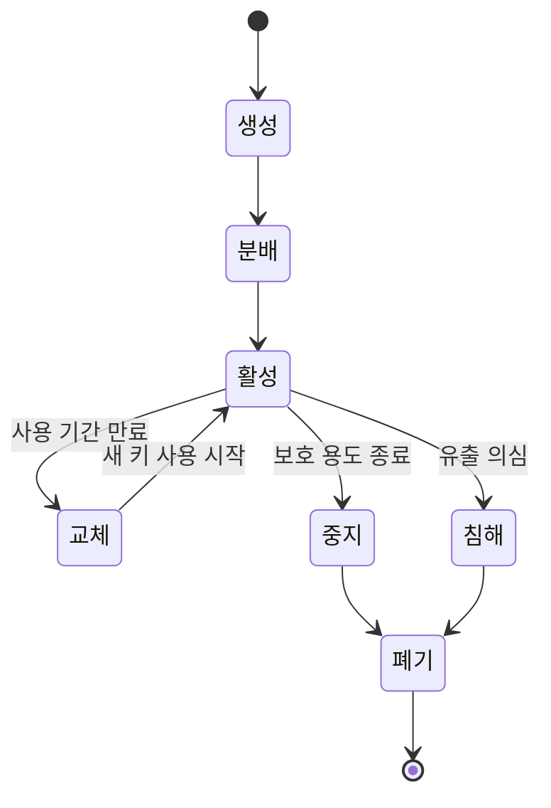
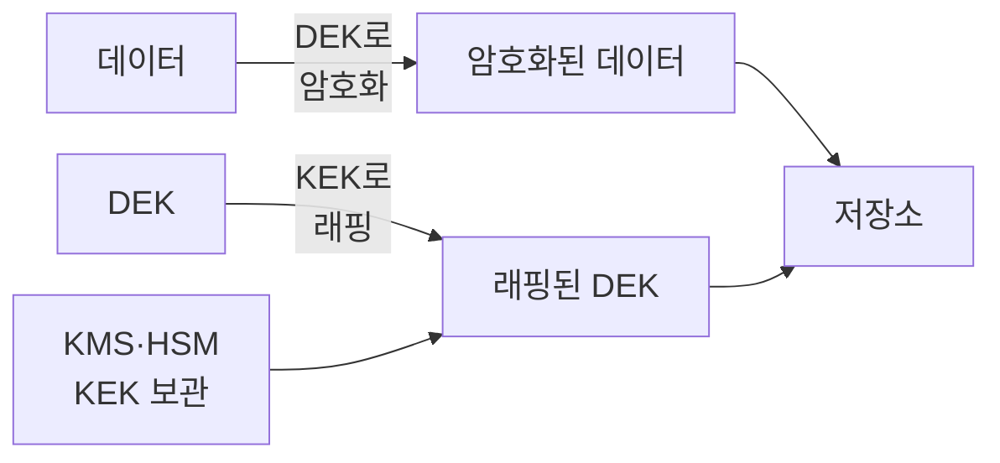
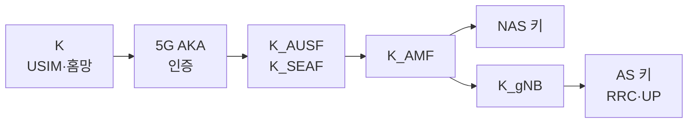
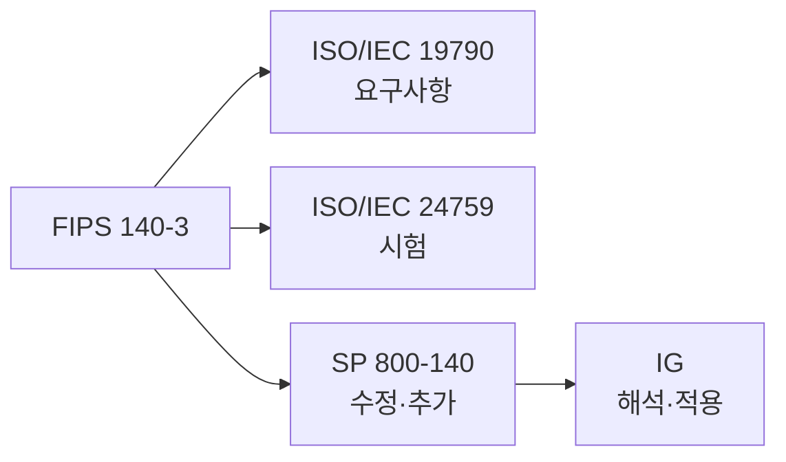

# Key Management (키 관리)

> 약어: NIST=미국 국립표준기술연구소, SP=NIST 특별 간행물(Special Publication), FIPS=미국 연방 정보처리 표준, ISO/IEC=국제 표준화 기구, 3GPP=이동통신 표준화 기구, ETSI=유럽 전기통신 표준 기구

## 1. 개요 (What)

키 관리(Key Management)는 **암호키를 만들고, 나눠 주고, 보관하고, 쓰고, 바꾸고, 없애는 전 과정(키 생명주기)을 안전하게 통제하는 일**이다.

**왜 필요한가.** Kerckhoffs 원칙에 따르면 암호 시스템의 안전성은 알고리즘이 아니라 **키의 비밀**에 달려 있다(→ [Cryptography Overview](cryptography-overview.md) §2.2).
AES(Advanced Encryption Standard)나 ML-KEM이 아무리 강해도, 키가 소스코드에 박혀 있거나 백업 파일로 새어 나가면 보호는 사라진다.
실제 사고의 상당수가 알고리즘 해독이 아니라 **키 관리 실패**에서 일어난다.

이 문서는 서로 다른 두 질문을 구분해 다룬다.

| 질문 | 기준 | 이 문서의 절 |
|------|------|--------------|
| 키를 **어떻게 관리해야** 하는가 | NIST SP 800-57 (키 관리 권고) | §2, §3.1~§3.4 |
| 키를 다루는 **장치·소프트웨어(암호 모듈)는 믿을 만한가** | FIPS 140-3 (암호 모듈 보안 요구사항·검증) | §3.5, §5.2 |

둘은 같은 개념이 아니다. 좋은 키 관리 절차도 검증되지 않은 모듈 위에서는 약해지고, 검증된 HSM을 써도 키 관리 절차가 없으면 사고가 난다.

## 2. 배경 / 원리 (Why & How)

### 2.1 키 생명주기

텍스트 설명: 키는 생성되어 필요한 곳에 분배된 뒤 활성 상태로 쓰인다. 정해진 사용 기간이 끝나면 새 키로 교체하고,
보호 용도가 끝나면 사용을 중지한다. 유출이 의심되면 즉시 침해 상태로 보고 대응한다. 마지막에는 복구할 수 없도록 폐기한다.
(SP 800-57 Part 1은 키 상태와 상태 전이를 별도로 정의한다(§7, Figure 3). 위 그림은 이해를 돕기 위해 단순화한 흐름이다.)

### 2.2 단계별 핵심

| 단계 | 하는 일 | 핵심 원칙 |
|------|---------|-----------|
| 생성 (Generation) | 승인된 난수 생성기로 키를 만든다 | 예측 불가능한 난수, 충분한 보안 강도 |
| 분배 (Distribution) | 키를 사용할 주체에게 전달한다 | 평문 전송 금지. 키 교환(→ [Key Exchange](key-exchange.md))이나 키 래핑으로 보호 |
| 저장 (Storage) | 사용 전·후 키를 보관한다 | 평문 저장 금지. HSM(Hardware Security Module)·KMS(Key Management Service) 또는 KEK로 암호화해 보관 |
| 사용 (Usage) | 정해진 용도로만 키를 쓴다 | **한 키 한 용도**(암호화·서명·키 래핑 분리), 최소 권한 |
| 교체 (Rotation) | 사용 기간(cryptoperiod)이 끝나면 새 키로 바꾼다 | 사용량·노출 위험에 따른 주기 설정 |
| 백업·복구 (Backup/Recovery) | 키 분실에 대비해 사본을 보관한다 | 복호화 키는 백업 필요, **서명용 개인키는 원칙적으로 백업하지 않는다**(부인방지 유지) |
| 폐기 표시 (Revocation) | 더 이상 신뢰하지 않도록 알린다 | 인증서 폐기, 토큰 무효화, 키 상태 변경 전파 |
| 파기 (Destruction) | 키를 복구할 수 없게 없앤다 | 모든 사본·백업 포함, 메모리 잔존값 제거 |

### 2.3 사용 기간 (Cryptoperiod)

사용 기간은 **한 키를 쓸 수 있는 허용 기간**이다. 길수록 공격자가 분석할 데이터가 늘고, 유출 시 피해 범위가 커진다.
SP 800-57 Part 1은 키 종류별 **권장** 사용 기간을 제시한다(§5.3.6, Table 1). 이 값은 반드시 지켜야 하는 고정 유효기간이 아니라 권장값이며, 적용 환경과 위험에 따라 조정할 수 있다.

- 데이터를 **보호하는(적용하는) 기간**과 보호된 데이터를 **처리하는(풀어 보는) 기간**은 다를 수 있다.
  예: 암호화 키로 새 데이터를 암호화하는 것은 멈췄어도, 기존 데이터를 복호화하려면 키를 한동안 보관해야 한다.

## 3. 상세 (Details)

### 3.1 키 계층과 KEK/DEK

키를 한 단계로 관리하면 키 하나가 모든 것을 보호하게 된다. 실제 시스템은 **키가 키를 보호하는 계층**을 만든다.

| 구분 | 역할 | 특징 |
|------|------|------|
| DEK(Data Encryption Key) | 실제 데이터를 암호화 | 데이터 가까이에 둔다. 많고 자주 바뀐다 |
| KEK(Key Encryption Key) | DEK를 암호화(래핑) | HSM·KMS 안에 두고 밖으로 내보내지 않는다 |
| 루트 키 / 마스터 키 | KEK를 보호 | 가장 강하게 보호. 거의 쓰지 않는다 |

#### 봉투 암호화 (Envelope Encryption)

텍스트 설명: 데이터는 DEK로 암호화하고, DEK는 KMS·HSM 안의 KEK로 래핑해 암호화된 데이터 옆에 함께 저장한다.
복호화할 때는 래핑된 DEK를 KMS에 보내 풀고, 그 DEK로 데이터를 복호화한다. KEK는 KMS 밖으로 나가지 않는다.

- 장점: 대량 데이터는 빠른 대칭키로 현장에서 처리하고, 중요한 KEK는 한곳에서 강하게 보호·감사할 수 있다.
- KEK를 교체할 때 데이터를 전부 다시 암호화할 필요 없이 **DEK만 다시 래핑**하면 된다.
- KEK를 파기하면 그 아래의 모든 데이터를 복구할 수 없게 된다(**crypto-shredding**, 암호학적 삭제).

### 3.2 HSM과 KMS

| 구분 | HSM | KMS |
|------|-----|-----|
| 정체 | 키를 생성·보관·연산하는 **전용 하드웨어** | 키를 정책·권한·감사와 함께 관리하는 **서비스** |
| 키 반출 | 일반적으로 개인키·KEK를 평문으로 내보내지 않는다 | 키는 내부에 두고 API(Application Programming Interface)로 연산만 제공 |
| 관계 | KMS가 내부적으로 HSM을 쓰는 경우가 많다 | 클라우드 KMS, 온프레미스 키 관리 시스템 |
| 신뢰 판단 | 암호 모듈 검증(FIPS 140-3) 여부 (§3.5) | 사용하는 암호 모듈의 검증 여부, 접근 정책, 감사 로그 |

### 3.3 키 침해 대응 (Key Compromise)

키가 유출되었거나 유출이 의심되면 다음 순서로 대응한다.

1. **범위 파악**: 어떤 키가, 언제부터, 어떤 데이터·시스템을 보호했는지 확인한다(키 인벤토리 필요).
2. **사용 중지·폐기 표시**: 해당 키로 새 보호를 하지 않게 막고, 인증서·토큰 등을 폐기한다.
3. **새 키 발급·교체**: 새 키를 생성해 분배하고, 필요한 데이터를 새 키로 다시 보호한다.
4. **영향 평가**: 유출 기간 동안 위조된 서명·복호화된 데이터의 영향을 평가한다.
5. **원인 제거와 기록**: 유출 경로를 막고, 대응 과정을 감사 기록으로 남긴다.

> 해설: 키 침해 대응은 **키 인벤토리**(어떤 키가 어디서 무엇을 보호하는지 목록)가 없으면 사실상 불가능하다.
> 양자내성 전환에서 강조되는 "암호 인벤토리"도 같은 기반 위에 있다.

### 3.4 다른 영역의 키 관리 사례

#### Cloud KMS

| 개념 | 클라우드에서의 모습 |
|------|---------------------|
| 봉투 암호화 | 스토리지·DB(Database) 암호화가 데이터 키(DEK)를 KMS 키(KEK)로 래핑 |
| 교체 | KMS 키 자동 교체 옵션, 이전 버전 키는 복호화용으로 유지 |
| 접근 통제 | 키 정책·IAM(Identity and Access Management)으로 "누가 어떤 키로 무엇을 할 수 있나" 제한 |
| 감사 | 키 사용 이력을 로그로 남김 |
| 고객 키 관리 | BYOK(Bring Your Own Key) 등 고객이 키를 직접 제공·통제하는 방식 |

세부 구성은 [Cloud Data Protection](../../cloud-security/data-protection/README.md)에서 다룬다.

#### 5G AKA·NAS·AS 키 관리

5G는 표준이 키 생명주기의 상당 부분을 **절차로 고정**해 둔 사례다.

텍스트 설명: 장기 키 K는 USIM과 홈 네트워크에만 있고 통신로로 나가지 않는다. 5G AKA(Authentication and Key Agreement) 인증을 할 때마다 K에서 새 키가 파생되고,
계층을 따라 NAS(Non-Access Stratum) 보호 키와 기지국용 K_gNB, 다시 AS(Access Stratum) 키가 만들어진다(→ [5G Key Hierarchy](../../5g-security/fundamentals/01-01-5G_Key_Hierarchy.md)).

| 키 관리 단계 | 5G에서의 구현 |
|--------------|---------------|
| 생성·저장 | 장기 키 K는 USIM과 홈 네트워크(UDM(Unified Data Management)/ARPF(Authentication credential Repository and Processing Function))에만 저장 |
| 분배 | 상위 키를 직접 보내지 않고, 각 노드가 받은 키에서 **하위 키를 파생**해 사용 |
| 용도 분리 | NAS 암호화·무결성, RRC(Radio Resource Control)·UP(User Plane) 키를 서로 다른 입력으로 따로 파생 |
| 교체 | 재인증으로 상위 키를 새로 만들고, 핸드오버 시 기지국 키를 새로 파생 |
| 파기 | 세션·연결 종료 시 하위 키 폐기 |

세부 절차는 3GPP TS 33.501 §6.2(키 계층·파생·분배) → §5.3, 5G 위협 관점은 [5G Security](../../5g-security/README.md) 문서에서 다룬다.

### 3.5 암호 모듈 검증 — "FIPS 인증"이 뜻하는 것

HSM·암호 라이브러리처럼 키를 실제로 다루는 장치·소프트웨어를 **암호 모듈**이라고 한다.
FIPS 140-3은 암호 모듈이 갖춰야 할 보안 요구사항과 그 검증 기준이다. "FIPS 인증 HSM", "FIPS 모드"는 이 기준으로 검증된 모듈이나 그 운영 모드를 말한다.

실무에서 기억할 점은 세 가지다.

- **"FIPS 호환", "FIPS 알고리즘 사용"은 검증받았다는 뜻이 아니다.** 검증 인증서가 있는지 확인한다.
- 인증서에 적힌 **모듈 버전·운영 환경**이 실제 배포 환경과 같아야 한다.
- 검증된 모듈이라도 **승인 모드(approved mode)로 운영**해야 검증 범위 안에 있다.

- 실무에서는 FIPS 140-2 검증 모듈이 2026-09-22부터 **Historical 목록**으로 옮겨졌다는 점도 알아 둔다(→ §5.2).

FIPS 140-3과 관련 문서(ISO/IEC 19790·24759, SP 800-140, IG)의 관계, FIPS 140-2와의 관계 → §5.2

## 4. 보안 관점 (Security Relevance)

| 실수 | 결과 | 대응 |
|------|------|------|
| 키를 소스코드·설정 파일에 하드코딩 | 저장소·이미지 유출 시 키 유출 | KMS·비밀 관리 서비스 사용, 코드 스캔 |
| 예측 가능한 난수로 키 생성 | 키 추측 | 승인된 난수 생성기, 검증된 암호 모듈 |
| 한 키를 여러 용도에 사용 | 용도 간 공격 전이 | 용도별 키 분리, KDF로 파생 |
| 교체 주기 없음 | 유출 시 피해 범위 확대, 분석 데이터 누적 | 사용 기간 정의, 자동 교체 |
| 서명 개인키를 백업·공유 | 부인방지 상실, 유출 경로 증가 | 서명 키는 HSM 내부 생성·비반출 |
| 복호화 키 백업 없음 | 키 분실 시 데이터 영구 손실 | 복호화 키 백업·복구 절차, 접근 통제 |
| 폐기 시 백업·사본 누락 | 파기했다고 믿은 키가 남음 | 사본 목록 관리, 파기 확인 |
| 키 인벤토리 없음 | 침해 대응·양자 전환 불가 | 키 인벤토리·소유자·용도·위치 관리 |
| KMS 키 권한 과다 | 내부자·탈취 계정의 대량 복호화 | 최소 권한 키 정책, 사용 감사 |
| "FIPS 호환"을 검증으로 오인 | 검증되지 않은 모듈 사용 | CMVP(Cryptographic Module Validation Program) 검증 인증서·버전·운영 모드 확인 |
| 5G 장기 키·홈 네트워크 키 보호 소홀 | 가입자 인증 위조, SUCI(Subscription Concealed Identifier) 복호화 | HSM 보관, 접근 통제, 키 교체 절차 |

점검 시 확인할 것: 키 인벤토리, 키별 용도·소유자·위치, 생성 방식, 저장 보호(HSM·KMS·KEK), 교체 주기, 백업·복구 절차, 폐기 기록, 침해 대응 절차, 사용 중인 암호 모듈의 검증 상태.

## 5. 심화 (Advanced)

> 보안 컨설턴트·점검자를 위한 규격 세부다. 본문만으로 개념 이해에는 충분하다.

### 5.1 SP 800-57 문서 구성과 지위

| 문서 | 다루는 범위 | 판 / 발행일 | 지위 |
|------|------------|------------|------|
| Part 1 Rev. 5 "General" | 키 종류, 키 상태와 전이, 사용 기간, 보안 강도 등 일반 원칙 | 2020-05-04 | **최종본 (이 문서의 핵심 기준)** |
| Part 1 Rev. 6 | Part 1 개정안 | 2025-12-05 | **Initial Public Draft — 최종본 아님, 참고만** |
| Part 2 Rev. 1 "Best Practices for Key Management Organizations" | 조직 차원의 키 관리 체계 | 2019-05-23 | 최종본 (NIST 검토 중) |
| Part 3 Rev. 1 "Application-Specific Key Management Guidance" | 응용·프로토콜별 키 관리 지침 | 2015-01-22 | 최종본 (NIST 검토 중) |

- Rev. 6 초안의 내용은 최종본이 나올 때까지 본문 기준으로 쓰지 않는다.

**Part 1 Rev. 5 주요 조항**

| 주제 | 위치 |
|------|------|
| 키 사용 목적과 제한 (Key Usage) | §5.2 |
| 사용 기간(Cryptoperiod)의 개념과 결정 요인 | §5.3, §5.3.1~§5.3.3 |
| 비대칭 키 사용 기간 | §5.3.4 |
| 대칭 키 사용 기간 | §5.3.5 |
| 키 유형별 권장 사용 기간 | §5.3.6, Table 1 (권장값이며 환경·위험에 따라 조정 가능) |
| 보안 강도 비교 | §5.6.1.1, Table 2 |
| 해시·해시 기반 함수의 보안 강도 | §5.6.1.2, Table 3 |
| 알고리즘 조합의 실질 보안 강도 | §5.6.2 |
| 보안 강도의 적용 가능 기간 | §5.6.3, Table 4 |
| 키 상태와 전이 | §7, Figure 3 |

### 5.2 FIPS 140-3 문서 체계

| 문서 | 역할 |
|------|------|
| FIPS 140-3 (2019-03-22 승인) | 미국 연방 표준. 요구사항 본문을 국제 표준에 위임하고, 미국 연방 사용을 위한 조건을 정한다 |
| ISO/IEC 19790:2012 | 암호 모듈 **보안 요구사항** (FIPS 140-3이 참조) |
| ISO/IEC 24759:2017 | 암호 모듈 **시험 요구사항** — 요구사항을 어떻게 시험하는가 (FIPS 140-3이 참조) |
| SP 800-140 시리즈 | ISO/IEC 19790 또는 24759의 특정 요구사항을 **보완·수정**한다 (아래 표). FIPS 140-3 자체를 대체하지 않는다 |
| FIPS 140-3 IG(Implementation Guidance) | 검증 프로그램이 요구사항을 **어떻게 해석·적용하는지** 설명하는 지침. 수시로 개정된다 (Updated 2026-11-20) |

**SP 800-140 시리즈** (모두 Final)

| 문서 | 판 | 발행일 |
|------|----|--------|
| SP 800-140 | Rev. 표기 없음 | 2020-03-20 |
| SP 800-140A | Rev. 표기 없음 | 2020-03-20 |
| SP 800-140B | Rev. 1 | 2023-11-17 |
| SP 800-140C | Rev. 2 | 2023-07-25 |
| SP 800-140D | Rev. 2 | 2023-07-25 |
| SP 800-140E | Rev. 표기 없음 | 2020-03-20 |
| SP 800-140F | Rev. 표기 없음 | 2020-03-20 |

텍스트 설명: FIPS 140-3은 요구사항과 시험 방법을 ISO/IEC 19790·24759에 위임하고, SP 800-140 시리즈로 미국 연방용 수정 사항을 더한다.
IG는 이 전체를 실제 검증에서 어떻게 해석할지 설명하는 지침이다.

**FIPS 140-2와의 관계 (현재 상태)**
- FIPS 140-3은 FIPS 140-2를 **대체**하는 후속 표준이다. 신규 검증은 FIPS 140-3 기준으로 진행된다.
- FIPS 140-2 검증 모듈은 **2026-09-21**까지 신규 시스템에 사용할 수 있었고, **2026-09-22부터 Active 목록에서 Historical 목록으로 이동**했다.
- **Historical은 Revoked(취소)와 다르다.** 이미 운영 중인 기존 시스템에서 계속 쓸지는 기관의 위험 평가에 따른다.
- 따라서 지금 "FIPS 140-2 인증"으로 표시된 제품은 **신규 도입 기준으로는 충족하지 않는다**고 보고, FIPS 140-3 검증 여부를 확인해야 한다.

### 5.3 5G 키 계층·파생·분배 조항

기준: 3GPP TS 33.501 V19.7.0, Release 19 (2026-08)

| 주제 | 위치 |
|------|------|
| 키 계층 구조 | §6.2.1 |
| 키 파생 및 분배 | §6.2.2 |
| 네트워크 엔티티의 키 | §6.2.2.1 |
| UE의 키 | §6.2.2.2 |
| 사용자 관련 키 관리 | §6.2.3 |
| 키 설정 | §6.2.3.1 |
| 키 식별 | §6.2.3.2 |
| 키 수명 | §6.2.3.3 |

- 키 계층의 중심 흐름: K → CK/IK → K_AUSF → K_SEAF → K_AMF → K_NASenc/K_NASint, 그리고 K_AMF → K_gNB → AS 키(RRC·UP).

## 관련 문서

- 이전: [Digital Signature](digital-signature.md), [Key Exchange](key-exchange.md)
- 다음(예정): `tls-overview.md`
- 5G 키 계층: [5G Key Hierarchy](../../5g-security/fundamentals/01-01-5G_Key_Hierarchy.md)
- Cloud: [Data Protection](../../cloud-security/data-protection/README.md)
- 로드맵: [Cryptography](README.md)

## 출처

| 문서 | 판 / 발행일 | 지위 | 이 문서에서의 사용 | 공식 링크 |
|------|------------|------|-------------------|-----------|
| NIST SP 800-57 Part 1 Rev. 5 "Recommendation for Key Management: Part 1 – General" | 2020-05-04 | **최종본 (핵심 기준)** | §5.2, §5.3~§5.3.6 (Table 1), §5.6.1.1 (Table 2), §5.6.1.2 (Table 3), §5.6.2, §5.6.3 (Table 4), §7 (Figure 3) | https://doi.org/10.6028/NIST.SP.800-57pt1r5 |
| NIST SP 800-57 Part 1 Rev. 6 | 2025-12-05 | **Initial Public Draft (최종본 아님, 참고만)** | 인용하지 않음 | https://doi.org/10.6028/NIST.SP.800-57pt1r6.ipd |
| NIST SP 800-57 Part 2 Rev. 1 "Best Practices for Key Management Organizations" | 2019-05-23 | 최종본 (NIST 검토 중) | 조직 차원의 키 관리 | https://doi.org/10.6028/NIST.SP.800-57pt2r1 |
| NIST SP 800-57 Part 3 Rev. 1 "Application-Specific Key Management Guidance" | 2015-01-22 | 최종본 (NIST 검토 중) | 응용별 키 관리 | https://doi.org/10.6028/NIST.SP.800-57pt3r1 |
| FIPS 140-3 "Security Requirements for Cryptographic Modules" | 2019-03-22 승인 | 최종 표준 | 암호 모듈 보안 요구사항·검증 | https://doi.org/10.6028/NIST.FIPS.140-3 |
| ISO/IEC 19790:2012 / ISO/IEC 24759:2017 | 2012 / 2017 | 국제 표준 (유료) | FIPS 140-3이 참조하는 요구사항·시험 요구사항 | https://www.iso.org/ |
| NIST SP 800-140, 140A~140F | 문서별 판·발행일은 §5.2 표 | Final | ISO/IEC 19790·24759 요구사항 보완·수정 | NIST CMVP Publications 목록 |
| NIST CMVP, FIPS 140-3 Implementation Guidance | Updated 2026-11-20 | 수시 개정 지침 | 검증 시 해석·적용 | https://csrc.nist.gov/projects/cryptographic-module-validation-program |
| NIST CMVP, FIPS 140-2 전환 안내 | 2026-09-21 신규 사용 마지막 날, 2026-09-22 Historical 이동 | 공식 공지 | FIPS 140-2 모듈 상태 | https://csrc.nist.gov/projects/cryptographic-module-validation-program |
| 3GPP TS 33.501 | V19.7.0, Release 19 (2026-08) | — | §6.2.1, §6.2.2(.1·.2), §6.2.3(.1~.3) 5G 키 계층·파생·분배·수명 | ETSI 배포본 (ETSI TS 133 501 V19.7.0) |

- 그 외 내용은 키 관리의 일반 원리를 재구성한 해설이다. ISO/IEC 표준은 유료이므로 명칭과 역할만 적었다.
