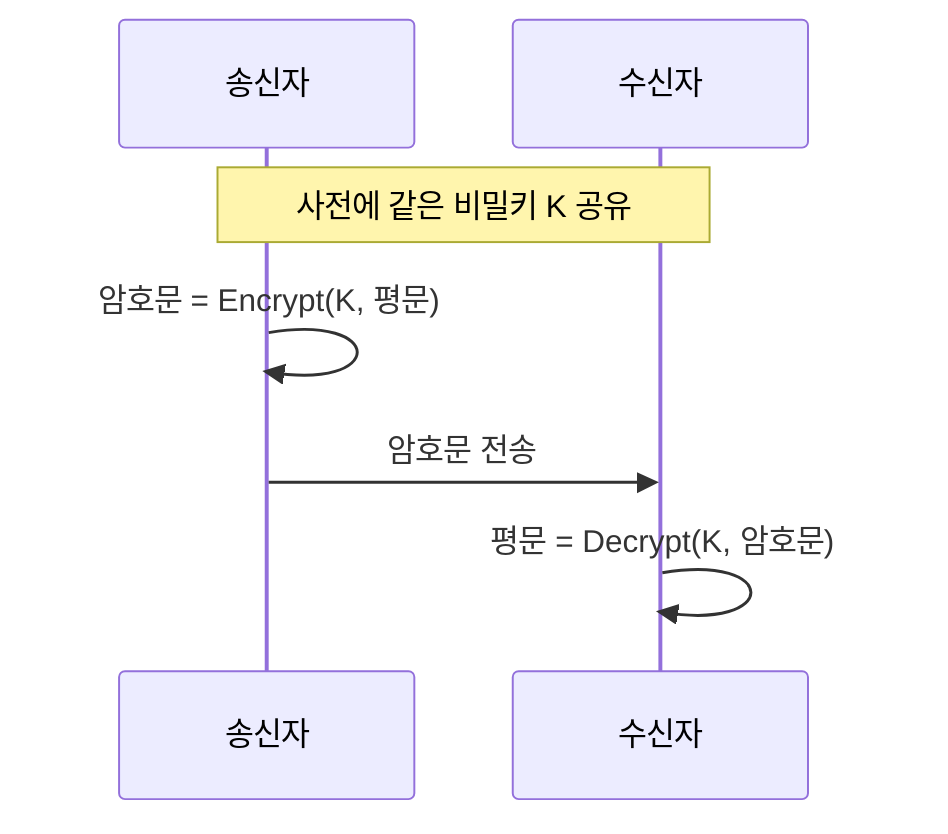
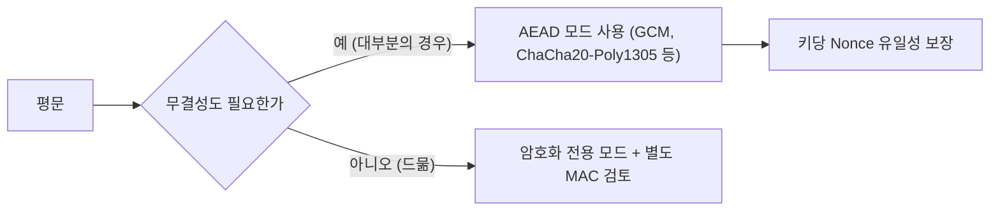

# Symmetric Encryption (대칭키 암호)

> 약어: NIST=미국 국립표준기술연구소, FIPS=미국 연방 정보처리 표준, 3GPP=이동통신 표준화 기구

## 1. 개요 (What)

대칭키 암호(Symmetric-key cryptography)는 **암호화와 복호화에 같은 키를 쓰는 암호 방식**이다.
송신자와 수신자가 미리 같은 비밀키를 공유하고 있어야 하며, 그 키를 모르는 제3자는 암호문에서 평문을 얻을 수 없다.

대칭키 암호는 연산이 빨라 **대량 데이터 보호의 실질적인 주력**이다. 디스크·DB(Database) 암호화,
TLS(Transport Layer Security) 데이터 구간, VPN(Virtual Private Network), 이동통신 무선 구간 암호화가 모두 대칭키 암호로 데이터를 보호한다.
반면 "키를 어떻게 안전하게 공유하는가(키 배포 문제)"는 대칭키 암호만으로 풀 수 없어,
공개키 암호·키 교환과 함께 쓰인다(→ [Key Exchange](key-exchange.md)).

## 2. 배경 / 원리 (Why & How)

### 2.1 기본 동작

텍스트 설명: 양쪽이 같은 키 K를 가진 상태에서, 송신자는 K로 암호화하고 수신자는 같은 K로 복호화한다.
통신 경로의 공격자는 K가 없으므로 암호문만 볼 수 있다.

### 2.2 블록 암호와 스트림 암호

| 구분 | 동작 | 예 |
|------|------|----|
| 블록 암호 (Block cipher) | 고정 길이 블록 단위로 변환한다. 블록보다 긴 데이터는 **운용 모드**로 처리한다 | AES(Advanced Encryption Standard) |
| 스트림 암호 (Stream cipher) | 키와 Nonce(Number used once)로 키스트림을 만들어 평문과 XOR(배타적 논리합)한다 | ChaCha20 |

- AES는 블록 크기 128비트, 키 길이 128/192/256비트를 쓰는 블록 암호로, FIPS 197에 규정되어 있다.
- 블록 암호도 CTR(Counter) 같은 운용 모드를 쓰면 스트림 암호처럼 동작한다.

### 2.3 운용 모드 (Mode of operation)

블록 암호 자체는 "블록 하나를 바꾸는 함수"일 뿐이다. 실제 데이터를 안전하게 암호화하는 방법은 **운용 모드**가 결정한다.

| 모드 | 특징 | 주의점 |
|------|------|--------|
| ECB(Electronic Codebook) | 블록을 각각 독립적으로 암호화 | 같은 평문 블록 → 같은 암호문 블록. **평문 패턴이 그대로 드러나 사용하지 않는다** |
| CBC(Cipher Block Chaining) | 이전 암호문 블록을 다음 블록에 연쇄 | 예측 불가능한 IV(Initialization Vector) 필요. 무결성 없음. 패딩 오라클 공격 위험 |
| CTR | 카운터를 암호화해 키스트림 생성 | 같은 키에서 **카운터/Nonce 재사용 시 기밀성 붕괴**. 무결성 없음 |
| GCM(Galois/Counter Mode) | CTR 암호화 + 인증 태그 | AEAD(Authenticated Encryption with Associated Data) 모드. **Nonce 재사용 시 기밀성과 무결성 모두 붕괴** |

텍스트 설명: 실무에서는 거의 항상 무결성이 함께 필요하므로 AEAD 모드를 기본으로 선택한다.
어떤 모드든 같은 키 아래에서 Nonce/IV가 겹치지 않도록 관리하는 것이 핵심이다.

### 2.4 인증 암호화 (AEAD)

AEAD는 **암호화(기밀성)와 무결성·출처 검증을 한 번에 제공**하는 방식이다.

- 출력: 암호문 + 인증 태그(Tag).
- 복호화 시 태그 검증에 실패하면 **평문을 내놓지 않고 거부**한다.
- AD(Associated Data, 연관 데이터): 암호화하지 않지만 변조는 막아야 하는 값(헤더, 시퀀스 번호 등)을 무결성 보호 범위에 넣을 수 있다.
- 대표 예: AES-GCM, ChaCha20-Poly1305.

> 해설: "암호화했으니 변조도 막힌다"는 흔한 오해다. 암호화 전용 모드(CBC, CTR)는 공격자가 암호문 비트를 바꿔
> 복호화 결과를 조작하는 것을 막지 못한다. 그래서 현대 프로토콜은 AEAD를 기본으로 쓴다.

## 3. 상세 (Details)

### 3.1 키 길이와 보안 강도

- 잘 설계된 대칭키 암호는 키 길이 n비트일 때 약 n비트 보안 강도를 목표로 한다(전수 조사가 최선의 공격이 되도록).
- 키 길이가 같아도 알고리즘이 다르면 강도가 같다고 단정하지 않는다. 공개키 암호와 비교할 때는 특히 그렇다(→ [Cryptography Overview](cryptography-overview.md) §2.4).
- 양자 컴퓨터의 Grover 알고리즘은 대칭키 전수 조사를 제곱근 수준으로 가속한다고 알려져 있어,
  장기 보호 데이터에는 더 긴 키(예: 256비트)를 고려하는 논의가 있다. 구체적 권고는 기관 표준을 따른다.

### 3.2 IV / Nonce 관리

| 항목 | 요구 | 실패 시 |
|------|------|---------|
| CBC의 IV | 예측 불가능한 랜덤 값 | 선택 평문 공격에 노출 |
| CTR/GCM의 Nonce | 같은 키에서 **절대 중복 금지** (랜덤일 필요는 모드별로 다름) | 키스트림 재사용 → 두 평문의 XOR 노출, GCM은 인증 키 유출 위험 |

- Nonce(Number used once)는 암호 연산에서 **재사용되지 않도록 관리하는 값**이다. 반드시 무작위일 필요는 없으며,
  알고리즘에 따라 고유성(CTR, GCM) 또는 예측 불가능성(CBC의 IV)이 요구된다.
- Nonce는 비밀이 아니다. 암호문과 함께 전송해도 된다. 중요한 것은 **유일성**이다.
- 랜덤 Nonce를 쓰면 한 키로 암호화할 수 있는 메시지 수에 한계가 생긴다. 그 전에 키를 교체한다(→ 키 관리, 작성 예정).

### 3.3 대표 알고리즘 현황

| 알고리즘 | 상태 (일반 인식) | 비고 |
|----------|------------------|------|
| AES | 현행 표준 | FIPS 197 (2023 개정판) |
| ChaCha20-Poly1305 | 널리 사용 | 하드웨어 AES 가속이 없는 환경에서 유리 |
| DES(Data Encryption Standard) | 폐기 | 56비트 키로 전수 조사 가능 |
| 3DES(Triple DES) | 퇴출 단계 | 블록 크기가 64비트로 작아 대량 데이터에 취약 |
| RC4(Rivest Cipher 4) | 사용 금지 | 키스트림 편향 문제 |

> 폐기·퇴출 시점 등 구체 일정은 각 기관의 공식 발표를 따른다.

### 3.4 다른 영역에서의 사용

| 영역 | 사용처 |
|------|--------|
| 5G | 무선·NAS(Non-Access Stratum) 구간 암호화 알고리즘(NEA, NR(New Radio) Encryption Algorithm) 중 128-NEA2가 AES-CTR 기반이다. 무결성 알고리즘(NIA, NR Integrity Algorithm)은 별도로 적용된다(3GPP TS 33.501 §5.11.1.1) |
| Cloud | 저장 데이터 암호화(봉투 암호화의 데이터 키) → [Data Protection](../../cloud-security/data-protection/README.md) |
| Web | TLS 1.3 레코드 보호는 AEAD 암호만 사용한다 → `tls-overview.md`(작성 예정) |

> 해설: 5G는 암호화(NEA)와 무결성(NIA)을 **분리된 알고리즘**으로 운용하는 구조라, AEAD 한 번으로 둘을 묶는 TLS 1.3과 설계가 다르다.
> 무결성 알고리즘이 빠지거나 Null로 협상되면 변조 공격 여지가 생긴다(5G NAS 관련 이슈 참조).

## 4. 보안 관점 (Security Relevance)

| 실수 | 결과 | 대응 |
|------|------|------|
| ECB 모드 사용 | 평문 패턴 노출 | AEAD 모드 사용 |
| 암호화만 하고 무결성 생략 | 암호문 조작·패딩 오라클 | AEAD 또는 Encrypt-then-MAC(MAC: Message Authentication Code) |
| Nonce/IV 재사용 | 기밀성 붕괴, GCM은 위조 가능 | 카운터 기반 Nonce, 키 교체 주기 관리 |
| 키 하드코딩·소스 저장 | 키 유출 = 전체 데이터 노출 | KMS(Key Management Service)/HSM(Hardware Security Module) 사용 |
| 직접 구현 | 부채널·구현 오류 | 검증된 라이브러리의 고수준 API 사용 |
| 폐기 알고리즘 유지 | 해독 가능 | 알고리즘 인벤토리·교체 계획(Crypto agility) |

점검 시 확인할 것: 사용 알고리즘과 모드, 무결성 보호 여부, Nonce 생성 방식, 키 저장 위치와 교체 주기.

## 관련 문서

- 이전: [Cryptography Overview](cryptography-overview.md)
- 함께 읽기: [Hashing & MAC](hashing-mac.md)
- 다음: [Asymmetric Encryption](asymmetric-encryption.md)
- 로드맵: [Cryptography](README.md)

## 출처

- AES 규격: NIST, FIPS 197 (2023 개정판).
- 5G 128-NEA2 = AES-CTR: 3GPP, TS 33.501 V19.7.0 (Release 19) §5.11.1.1 (세부는 5G 영역 문서에서 다룬다).
- 그 외 내용은 대칭키 암호의 일반 원리를 재구성한 해설이다. 폐기 일정·권고 키 길이 등 구체 수치는 다루지 않았다.
