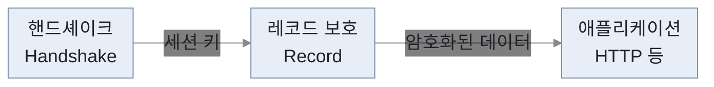
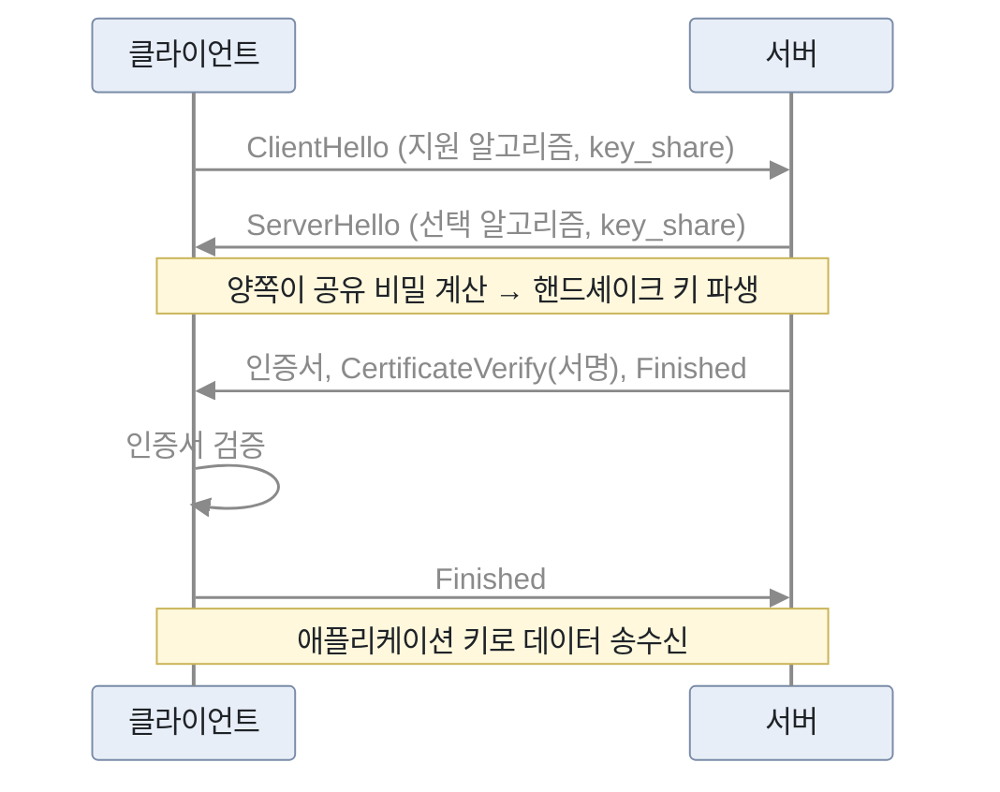
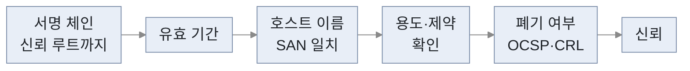

# TLS Overview (TLS 개요)

> 약어: RFC=인터넷 표준 문서, IETF=인터넷 표준화 기구, NIST=미국 국립표준기술연구소, SP=NIST 특별 간행물, 3GPP=이동통신 표준화 기구

## 1. 개요 (What)

TLS(Transport Layer Security)는 **네트워크로 주고받는 데이터를 도청·변조·위장으로부터 보호하는 프로토콜**이다.
웹의 HTTPS(Hypertext Transfer Protocol Secure), 메일, API(Application Programming Interface) 호출, VPN(Virtual Private Network) 일부, 5G 코어의 NF(Network Function) 간 통신까지 대부분의 인터넷 통신이 TLS 위에서 동작한다.
예전 이름인 SSL(Secure Sockets Layer)은 이미 폐기된 프로토콜이며, "SSL 인증서"라는 말은 관습적으로 남은 표현이다.

**왜 필요한가.** 인터넷 경로 위의 누구든 패킷을 볼 수 있고 바꿀 수 있다. TLS는 앞 문서들에서 다룬 암호 기능을 하나의 절차로 묶어 다음 세 가지를 제공한다.

| 보안 목적 | TLS가 제공하는 방식 | 바탕이 되는 문서 |
|-----------|---------------------|------------------|
| 기밀성 | 세션 키로 데이터를 암호화 | [Symmetric Encryption](symmetric-encryption.md) |
| 무결성 | AEAD(Authenticated Encryption with Associated Data)로 변조 탐지 | [Symmetric Encryption 2.4 인증 암호화 (AEAD)](symmetric-encryption.md#24-인증-암호화-aead) |
| 서버 인증 (선택적으로 클라이언트 인증) | 인증서와 디지털 서명으로 상대가 누구인지 확인 | [Digital Signature](digital-signature.md) |

세션 키는 통신할 때마다 키 교환으로 새로 만든다(→ [Key Exchange](key-exchange.md)).
즉 TLS는 새로운 암호 알고리즘이 아니라 **키 교환 + 서명 + 인증서 + AEAD를 조합한 프로토콜**이다.

## 2. 배경 / 원리 (Why & How)

### 2.1 TLS의 두 단계 — 핸드셰이크와 레코드



텍스트 설명: TLS는 먼저 핸드셰이크에서 상대를 확인하고 세션 키를 만든다. 그다음 레코드 계층이 그 세션 키로 실제 데이터를 암호화·무결성 보호해 애플리케이션 데이터를 실어 나른다.

| 단계 | 하는 일 | 쓰는 암호 기능 |
|------|---------|----------------|
| 핸드셰이크 | 버전·알고리즘 협상, 키 교환, 서버(필요 시 클라이언트) 인증, 세션 키 파생 | (EC)DHE((Elliptic Curve) Diffie-Hellman Ephemeral), 서명, 인증서, HKDF(HMAC-based Key Derivation Function) |
| 레코드 | 애플리케이션 데이터 암호화와 무결성 보호 | AEAD (AES(Advanced Encryption Standard)-GCM(Galois/Counter Mode), ChaCha20-Poly1305) |

### 2.2 TLS 1.3 핸드셰이크 한눈에 보기



텍스트 설명: 클라이언트가 지원하는 알고리즘과 키 교환 값(key_share)을 보내면, 서버가 하나를 골라 자기 키 교환 값과 함께 답한다.
이 시점에 양쪽이 공유 비밀을 계산하므로, 서버의 인증서부터는 이미 암호화되어 전송된다. 서버는 인증서의 개인키로 핸드셰이크 내용에 서명(CertificateVerify)해 자신이 인증서의 주인임을 증명하고,
클라이언트는 인증서를 검증한 뒤 Finished로 핸드셰이크를 마친다. 한 번의 왕복(1-RTT, Round Trip Time)으로 데이터 전송을 시작할 수 있다.

- 키 교환의 세부(공유 비밀 계산, PFS(Perfect Forward Secrecy), 하이브리드 키 교환) → [Key Exchange 3.3 TLS 1.3 핸드셰이크에서의 키 교환](key-exchange.md#33-tls-13-핸드셰이크에서의-키-교환)
- **서명이 빠지면 키 교환은 중간자 공격에 무력하다.** TLS에서 "상대가 누구인가"를 보장하는 것은 인증서와 CertificateVerify 서명이다.

### 2.3 TLS 1.2와 무엇이 달라졌나

| 구분 | TLS 1.2 | TLS 1.3 |
|------|---------|---------|
| 핸드셰이크 왕복 | 2-RTT | 1-RTT (재접속 시 0-RTT 선택 가능) |
| 핸드셰이크 암호화 | 인증서가 평문으로 전송 | ServerHello 이후 암호화 |
| 키 교환 | 정적 RSA(Rivest-Shamir-Adleman) 키 전송, 정적 DH, (EC)DHE 중 선택 | 정적 RSA·정적 DH 제거. (EC)DHE 사용 (PSK(Pre-Shared Key)와 결합 가능) |
| PFS | 정적 RSA 키 전송을 쓰면 **없음** (서버 개인키 유출 시 저장해 둔 과거 트래픽 복호화 가능) | (EC)DHE를 쓰면 항상 제공. PSK 단독 모드는 제외 |
| 데이터 암호 | CBC(Cipher Block Chaining)+HMAC(Hash-based MAC), RC4(Rivest Cipher 4) 등 다양 | **AEAD만 허용** |
| 암호 스위트 | 키 교환·인증·암호·해시를 한 이름에 모두 묶음 | AEAD와 해시만 지정 (키 교환·서명은 따로 협상) |
| 제거된 기능 | — | 재협상, 압축, 정적 RSA, 비AEAD 암호, MD5(Message Digest 5)·SHA(Secure Hash Algorithm)-1 서명 |

PFS의 원리와 정적 RSA 제거 이유 → [Key Exchange 3.1 PFS (Perfect Forward Secrecy)](key-exchange.md#31-pfs-perfect-forward-secrecy), [Key Exchange 3.2 TLS 1.2와 TLS 1.3의 키 교환 비교](key-exchange.md#32-tls-12와-tls-13의-키-교환-비교)

TLS 1.3은 "선택지를 줄여 잘못 설정할 여지를 없앤" 버전이다. 오래된 공격(패딩 오라클, 압축 공격, 정적 RSA 공격)의 대부분이 TLS 1.2 이하의 선택지에서 나왔다.

## 3. 상세 (Details)

### 3.1 버전별 현황

| 버전 | 상태 | 비고 |
|------|------|------|
| SSL 2.0 / 3.0 | 사용 금지 | 설계 결함 |
| TLS 1.0 / 1.1 | 사용 금지 | *RFC 8996*이 폐기(Deprecated)하고 협상을 금지 |
| TLS 1.2 | 기존 시스템 호환을 위해 사용 가능 | 보안 설정 강화가 전제. *RFC 10015*가 TLS 1.2의 오래된 DH·RSA 키 교환을 폐기하고 정적 ECDH 사용도 억제 |
| TLS 1.3 | 신규 시스템의 우선 선택 | *RFC 9846*. *RFC 9852*는 TLS를 쓰는 **새 프로토콜**이 TLS 1.3을 요구하도록 규정 |

- *RFC 9852*의 요구는 새로 설계하는 프로토콜에 대한 것이다. 이미 운영 중인 시스템의 TLS 1.2를 즉시 금지한다는 뜻은 아니며, 기존 시스템은 아래 5.2의 강화된 구성을 따른다.
- "TLS 1.2를 쓴다"만으로는 안전 여부를 말할 수 없다. 1.2는 **어떤 암호 스위트를 허용했는지**에 따라 안전한 설정과 취약한 설정이 갈린다.
- 서버가 1.3을 지원해도 1.0·1.1을 함께 열어 두면, 공격자가 낮은 버전으로 유도하는 다운그레이드 위험이 남는다.

### 3.2 암호 스위트 (Cipher Suite)

암호 스위트는 **TLS 연결에서 쓸 알고리즘 조합의 이름**이다. TLS 1.2와 1.3은 이름의 구조가 다르다.

```
TLS 1.2: TLS_ECDHE_RSA_WITH_AES_128_GCM_SHA256
             │     │        │            └ PRF 해시
             │     │        └ 레코드 암호 (AEAD)
             │     └ 서버 인증 (서명)
             └ 키 교환

TLS 1.3: TLS_AES_128_GCM_SHA256
             │            └ HKDF 해시
             └ 레코드 암호 (AEAD)
```

- TLS 1.2 이름에 `ECDHE`·`DHE`가 없으면(예: `TLS_RSA_WITH_…`) 정적 RSA 키 전송이라 PFS가 없다.
- TLS 1.2 이름에 `CBC`·`RC4`·`3DES`·`NULL`·`EXPORT`·`anon`이 있으면 취약하거나 인증이 없는 조합이다.
- TLS 1.3은 스위트가 소수이고 모두 AEAD다. 키 교환 그룹(X25519, P-256, 하이브리드 X25519MLKEM768 등)과 서명 알고리즘은 별도 확장으로 협상한다.
- TLS 1.3 스위트 목록과 TLS 1.2 권장 조합 → 아래 5.1, 5.2

### 3.3 인증서 검증 — TLS 보안의 절반

암호화가 아무리 강해도 **상대가 진짜인지 확인하지 않으면** 중간자와 안전하게 통신하는 것일 뿐이다. 클라이언트는 서버 인증서를 다음 순서로 검증한다.



텍스트 설명: 서버 인증서에서 시작해 중간 CA(Certificate Authority) 인증서를 거쳐 클라이언트가 신뢰하는 루트 CA까지 서명이 이어지는지 확인한다.
그다음 유효 기간, 접속한 호스트 이름과 인증서의 SAN(Subject Alternative Name) 일치, 인증서 용도, 폐기 여부를 차례로 확인한다. 하나라도 실패하면 연결을 거부한다.

| 검증 항목 | 생략하면 생기는 일 |
|-----------|---------------------|
| 서명 체인 | 공격자가 스스로 만든(자체 서명) 인증서도 통과 |
| 호스트 이름 | 다른 사이트용 정상 인증서로 위장 가능 |
| 유효 기간 | 만료·유출된 오래된 인증서 수용 |
| 폐기 여부 | 개인키가 유출되어 폐기된 인증서 수용 |

- 서버는 **중간 CA 인증서까지 함께 보내야** 한다. 빠지면 일부 클라이언트에서만 연결이 실패하는 문제가 생긴다.
- 폐기 확인은 OCSP(Online Certificate Status Protocol)나 CRL(Certificate Revocation List)로 한다. 서버가 OCSP 응답을 핸드셰이크에 붙여 주는 방식(OCSP stapling)을 쓰면 클라이언트 부담이 줄어든다.
- 인증서·CA·신뢰 체인의 구조와 각 검증 단계의 원리는 [PKI & Certificates](../pki-identity/pki-certificates.md)에서 다룬다.

> 해설: 실제 사고에서 자주 보이는 것은 암호 해독이 아니라 **검증을 끈 코드**다. 개발 중 `verify=False`, `InsecureSkipVerify: true`, "모든 인증서 신뢰" 설정을 넣고 그대로 배포하는 경우다.
> 이 한 줄이 TLS 전체를 무력화한다.

### 3.4 mTLS — 클라이언트도 인증서로 인증

일반 TLS는 서버만 인증서로 인증한다. mTLS(mutual TLS)는 **클라이언트도 인증서를 제시**해 양쪽이 서로를 인증한다.

| 구분 | 일반 TLS | mTLS |
|------|----------|------|
| 서버 인증 | 인증서 | 인증서 |
| 클라이언트 인증 | 보통 애플리케이션 계층(비밀번호, 토큰) | 클라이언트 인증서 |
| 주 사용처 | 웹 브라우저 ↔ 서버 | 서비스 ↔ 서비스, API, 5G NF 간, 서비스 메시 |

- mTLS는 사람보다 **기계(워크로드) 간 인증**에 주로 쓰인다. 클라이언트 인증서 발급·교체·폐기를 자동화하지 않으면 운영이 어렵다.
- 워크로드 신원 체계(SPIFFE(Secure Production Identity Framework for Everyone) 등)와의 관계는 [PKI & Identity](../pki-identity/README.md) (로드맵, 문서 작성 예정)에서 다룬다.

### 3.5 0-RTT와 세션 재개

TLS 1.3은 이전에 접속한 적이 있으면 PSK로 **세션을 재개**할 수 있고, 첫 메시지에 데이터를 함께 보내는 0-RTT(Early Data)도 허용한다.

- 0-RTT 데이터는 **재전송(Replay) 공격에 취약**하다. 공격자가 같은 요청을 다시 보내도 서버가 구분하기 어렵다.
- 따라서 0-RTT는 조회처럼 여러 번 실행돼도 문제없는 요청에만 쓰고, 결제·상태 변경 요청에는 쓰지 않는다. 기본 비활성화가 안전하다.

### 3.6 다른 영역에서의 사용

| 영역 | 사용처 |
|------|--------|
| Web | HTTPS. HSTS(HTTP Strict Transport Security)로 브라우저가 항상 HTTPS로만 접속하게 강제한다 → [Web & Application Security](../web-app-security/README.md) (작성 예정) |
| 5G | 5G 코어의 SBA(Service Based Architecture)에서 모든 NF는 SBI(Service Based Interface)에 mTLS와 HTTPS를 지원해야 한다. HTTP/2(Hypertext Transfer Protocol 2) 위에서 동작한다(*3GPP TS 33.501*). 세부 요구사항은 아래 5.4 → [OAuth Token Abuse](../../5g-security/security-risks/06-sba-security/06-06-OAuth_Token_Abuse.md) (작성 예정) |
| Cloud | 로드 밸런서·API 게이트웨이의 TLS 종료, 서비스 메시의 mTLS, 인증서 관리 서비스 → [Cloud Security](../../cloud-security/README.md) (로드맵, 문서 작성 예정) |
| 양자 전환 | TLS 1.3 하이브리드 키 교환(X25519MLKEM768)으로 Harvest Now, Decrypt Later에 대비 → [Key Exchange 3.4 양자내성 하이브리드 키 교환](key-exchange.md#34-양자내성-하이브리드-키-교환) |

## 4. 보안 관점 (Security Relevance)

| 실수 | 결과 | 대응 |
|------|------|------|
| 인증서 검증 비활성화 (`verify=False` 등) | 중간자 공격에 그대로 노출 | 검증 강제, 테스트 환경은 별도 사설 CA 사용 |
| 호스트 이름 검증 생략 | 다른 도메인 인증서로 위장 | 라이브러리 기본 검증 사용, 직접 구현 금지 |
| TLS 1.0·1.1 허용 | 오래된 공격·다운그레이드 | TLS 1.2 이상만 허용, 가능하면 1.3 |
| TLS 1.2에서 CBC·RC4·정적 RSA 스위트 허용 | 패딩 오라클, PFS 상실 | ECDHE + AEAD 스위트만 허용 |
| 중간 CA 인증서 누락 | 일부 클라이언트 연결 실패 | 전체 체인 구성, 외부 점검 도구로 확인 |
| 인증서 만료 방치 | 서비스 중단 | 발급·갱신 자동화, 만료 모니터링 |
| 서버 개인키 평문 보관·공유 | 위장·트래픽 복호화 | HSM(Hardware Security Module)·KMS(Key Management Service) 보관, 키 교체 → [Key Management](key-management.md) |
| 0-RTT 무분별 허용 | 재전송 공격 | 기본 비활성화, 멱등 요청에만 제한 |
| HTTPS 강제 없음 | 첫 접속을 평문으로 가로채는 공격 | HTTP→HTTPS 리다이렉트 + HSTS |
| 내부망이라 평문 허용 | 내부 침입 후 도청·변조 | 내부 서비스 간에도 TLS·mTLS |

점검 시 확인할 것: 허용 버전, 허용 암호 스위트와 키 교환 그룹, 인증서 체인·유효 기간·호스트 이름, 클라이언트 측 검증 코드, 폐기 확인 방식, 0-RTT 설정, HSTS, 개인키 보관 위치, 내부 통신의 TLS 적용 여부.

## 5. 심화 (Advanced)

> 보안 컨설턴트·점검자를 위한 규격 세부다. 본문만으로 개념 이해에는 충분하다.

### 5.1 TLS 1.3 암호 스위트

*RFC 9846*이 TLS 1.3 기본 규격으로 정의한 암호 스위트는 다음 5개다. 구현 요구 수준이 서로 다르므로 5개를 같은 수준으로 권장하지 않는다.

| 스위트 | 레코드 암호 | 해시 | 구현 요구 (*RFC 9846*) | 비고 |
|--------|------------|------|------------------------|------|
| TLS_AES_128_GCM_SHA256 | AES-128-GCM | SHA-256 | **MUST** | 가장 널리 쓰임 |
| TLS_AES_256_GCM_SHA384 | AES-256-GCM | SHA-384 | SHOULD | 더 긴 키가 필요한 환경 |
| TLS_CHACHA20_POLY1305_SHA256 | ChaCha20-Poly1305 | SHA-256 | SHOULD | AES 하드웨어 가속이 없는 기기에서 유리 |
| TLS_AES_128_CCM_SHA256 | AES-128-CCM | SHA-256 | 필수 아님 | 주로 IoT(Internet of Things) 등 제한된 환경 |
| TLS_AES_128_CCM_8_SHA256 | AES-128-CCM (8바이트 태그) | SHA-256 | 필수 아님 | 태그가 짧아 일반 용도에는 권장하지 않음 |

- *RFC 9150*은 기밀성 없이 인증·무결성만 제공하는 TLS 1.3 암호 스위트를 별도로 정의한다. 위 기본 5개와는 다른 문서이며, 일반 용도로 쓰지 않는다.

- 해시는 HKDF 키 스케줄과 핸드셰이크 무결성에 쓰인다. 서명 알고리즘(ECDSA(Elliptic Curve Digital Signature Algorithm), RSA-PSS(Probabilistic Signature Scheme), EdDSA(Edwards-curve Digital Signature Algorithm))은 `signature_algorithms` 확장으로, 키 교환 그룹은 `supported_groups`·`key_share` 확장으로 따로 협상한다.

### 5.2 TLS 1.2 권장 구성

TLS 1.2를 유지해야 한다면 다음 조건을 모두 만족하는 스위트만 허용한다.

| 요소 | 허용 | 제외 |
|------|------|------|
| 키 교환 | ECDHE (또는 충분한 크기의 DHE) | 정적 RSA (`TLS_RSA_WITH_…`), 정적 DH, 익명(`anon`) |
| 서버 인증 | ECDSA, RSA | NULL 인증 |
| 레코드 암호 | AES-GCM, ChaCha20-Poly1305 | CBC 모드, RC4, 3DES(Triple DES), NULL, EXPORT 등급 |

- 예: `TLS_ECDHE_ECDSA_WITH_AES_128_GCM_SHA256`, `TLS_ECDHE_RSA_WITH_AES_256_GCM_SHA384`, `TLS_ECDHE_ECDSA_WITH_CHACHA20_POLY1305_SHA256`
- 세부 권고는 *RFC 9325*(BCP(Best Current Practice) 195)를 따르되, 이 문서를 갱신한 *RFC 9852*(신규 프로토콜의 TLS 1.3 요구)와 *RFC 10015*(TLS 1.2의 오래된 키 교환 폐기)를 함께 반영한다.
- 미국 연방 시스템 기준은 *NIST SP 800-52 Rev. 2*다. NIST가 개정을 결정했지만 후속판은 아직 나오지 않았으므로, 개정 예정 내용을 현재 규정처럼 적용하지 않는다(아래 5.3).

### 5.3 표준 문서 체계

| 문서 | 내용 | 지위 |
|------|------|------|
| *RFC 9846* | TLS 1.3 (*RFC 8446*·*RFC 5246* 대체) | Standards Track (2026-07) |
| *RFC 5246* | TLS 1.2 원래 규격 | Proposed Standard, *RFC 9846*에 의해 Obsoleted. TLS 1.2 프로토콜 사용 자체가 금지된 것은 아님 |
| *RFC 8996* | TLS 1.0·1.1 폐기 | BCP 195 |
| *RFC 9325* | TLS·DTLS(Datagram TLS) 안전한 사용 권고 | BCP 195. *RFC 9852*·*RFC 10015*가 갱신 |
| *RFC 9852* | TLS를 쓰는 새 프로토콜은 TLS 1.3을 요구 | 2026-07 (제목·지위 확인 예정) |
| *RFC 10015* | TLS 1.2의 오래된 DH·RSA 키 교환 폐기, 정적 ECDH 억제 | 2026-07 (제목·지위 확인 예정) |
| *RFC 9150* | TLS 1.3 인증·무결성 전용 암호 스위트 | 지위 확인 예정 |
| *RFC 5280* | X.509 인증서·CRL 프로파일 | Standards Track |
| *RFC 6066* | TLS 확장 (SNI(Server Name Indication), OCSP stapling 요청 등) | Proposed Standard. *RFC 9846* 등이 일부 갱신 |
| *RFC 6797* | HSTS | Proposed Standard |
| *RFC 10024* | TLS 1.3 PQ/T 하이브리드 키 합의 | Proposed Standard |
| *NIST SP 800-52 Rev. 2* | 미국 연방 시스템의 TLS 선택·구성 지침 | Final (2019-08). 2026-11-19 NIST가 개정을 결정했으며 후속판은 아직 발행되지 않음 |

**NIST SP 800-52 개정 예정 방향** (NIST 공개 내용, 아직 확정 규정 아님): TLS 1.2 지원 권고를 SHOULD에서 MAY로 낮춤, TLS 1.0·1.1 일반적 불허,
TLS 1.2의 SHA-1·DSA(Digital Signature Algorithm)·정적 키 교환·RSA 키 교환 제거 또는 불허, 양자내성 알고리즘 내용 추가, 최소 보안 강도 128비트로 상향.

### 5.4 5G SBA의 TLS 요구사항

기준: *3GPP TS 33.501 V19.7.0 (Release 19)*

| 요구사항 | 내용 |
|----------|------|
| 상호 인증 | 모든 NF는 SBI에서 mTLS와 HTTPS를 지원해야 한다 |
| 인증서 | 서버·클라이언트 인증서를 모두 지원하고, 인증서의 주체 식별 정보를 인증과 정책 검사에 사용한다 |
| TLS 프로파일 | *3GPP TS 33.210*이 정의하는 3GPP 공통 TLS 프로파일을 따른다 (TLS 1.3·TLS 1.2 프로파일을 각각 정의) |
| 인증서 프로파일 | *3GPP TS 33.310*이 정의하는 SBA 인증서 프로파일을 따른다 |
| HTTP/2·SNI | HTTP/2 프로파일과 호환되어야 하며, TLS 클라이언트는 SNI 확장을 포함해야 한다 |

- 위는 규격의 의무사항이다. 실제 장비가 어떤 TLS 버전·암호 스위트·인증서 관리 방식을 쓰는지는 구현마다 다르므로 점검에서 따로 확인한다.
- *TS 33.210*·*TS 33.310*의 판은 확인 예정이다.

## 관련 문서

- 이전: [Key Exchange](key-exchange.md), [Digital Signature](digital-signature.md), [Key Management](key-management.md)
- 다음: [Cryptography in Practice](cryptography-in-practice.md)
- 인증서·신뢰 체인: [PKI & Certificates](../pki-identity/pki-certificates.md)
- 로드맵: [Cryptography](README.md)

## 출처

| 문서 | 지위 / 버전 | 이 문서에서의 사용 | 공식 링크 |
|------|-------------|-------------------|-----------|
| *IETF RFC 9846* | Standards Track (2026-07, *RFC 8446*·*RFC 5246* 대체) | TLS 1.3 핸드셰이크, 기본 암호 스위트와 구현 요구 수준, 0-RTT | https://www.rfc-editor.org/rfc/rfc9846 |
| *IETF RFC 5246* | Proposed Standard, Obsoleted | TLS 1.2 구조 비교 | https://www.rfc-editor.org/rfc/rfc5246 |
| *IETF RFC 8996* | BCP 195 | TLS 1.0·1.1 폐기 | https://www.rfc-editor.org/rfc/rfc8996 |
| *IETF RFC 9325* | BCP 195 | TLS 1.2·1.3 권장 구성 | https://www.rfc-editor.org/rfc/rfc9325 |
| *IETF RFC 9852* | 2026-07 | 신규 프로토콜의 TLS 1.3 요구 | https://www.rfc-editor.org/rfc/rfc9852 |
| *IETF RFC 10015* | 2026-07 | TLS 1.2의 오래된 키 교환 폐기 | https://www.rfc-editor.org/rfc/rfc10015 |
| *IETF RFC 9150* | 지위 확인 예정 | 인증·무결성 전용 스위트 구분 | https://www.rfc-editor.org/rfc/rfc9150 |
| *IETF RFC 5280* | Standards Track | 인증서 검증 항목 | https://www.rfc-editor.org/rfc/rfc5280 |
| *IETF RFC 6066* | Proposed Standard | SNI, OCSP stapling 요청 | https://www.rfc-editor.org/rfc/rfc6066 |
| *IETF RFC 6797* | Proposed Standard | HSTS | https://www.rfc-editor.org/rfc/rfc6797 |
| *NIST SP 800-52 Rev. 2* | Final (2019-08), 2026-11-19 개정 결정·후속판 미발행 | TLS 구성 지침 | https://csrc.nist.gov/ |
| *3GPP TS 33.501 V19.7.0 (Release 19)* | — | 5G SBA의 mTLS·HTTPS 요구사항 | ETSI 배포본 |
| *3GPP TS 33.210* / *3GPP TS 33.310* | 판 확인 예정 | 3GPP TLS 프로파일 / SBA 인증서 프로파일 | ETSI 배포본 |

- 그 외 내용은 TLS의 일반 원리를 재구성한 해설이다. 실제 장비·라이브러리의 기본값은 제품마다 다르다.
