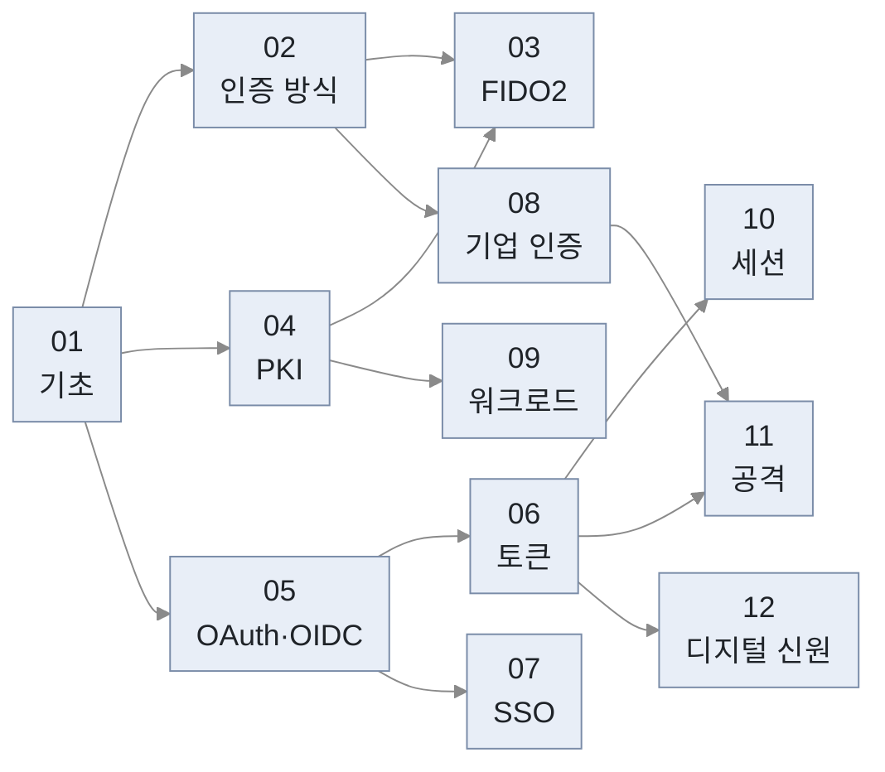

# PKI & Identity (PKI·신원·인증)

> 약어: NIST=미국 국립표준기술연구소, NIST SP=NIST 특별 간행물, RFC=IETF 표준 문서, IETF=인터넷 표준화 기구, W3C=웹 표준화 기구, OASIS=구조화 정보 표준 촉진 기구, ISO/IEC=국제표준화기구/국제전기기술위원회

공개키 기반구조 PKI(Public Key Infrastructure)와 **디지털 신원·인증**을 다루는 하위 영역이다.
사용자 인증, 토큰, 연합 인증, 서비스 간 인증, 인증 공격, 디지털 자격 증명까지 현대 인증 체계를 하나의 흐름으로 정리한다.

> **구분 주의**: Authentication(인증, 누구인가) ≠ Authorization(인가, 무엇을 할 수 있나).
> 인가 모델은 [Access Control](../access-control/README.md) (작성 예정), Zero Trust 설계는 [Security Architecture](../security-architecture/README.md) (작성 예정)에서 다룬다.
> 암호 원리(공개키·서명·해시)는 [Cryptography](../cryptography/README.md)를 바탕으로 한다.

---

## 1. 기술별 역할 지도

인증 관련 기술은 이름이 비슷해도 하는 일이 다르다. 먼저 역할을 구분한다.

| 기술 | 분류 | 핵심 역할 |
|------|------|-----------|
| OAuth 2.0 | 인가 프레임워크 | 사용자를 대신해 자원에 접근할 **권한을 위임** |
| OIDC(OpenID Connect) | 인증 계층 | OAuth 2.0 위에서 **사용자 인증과 신원 정보** 전달 |
| JWT(JSON Web Token) | 토큰 형식 | 서명·암호화 가능한 **정보 담는 그릇** (인증 방식 자체가 아님) |
| SAML(Security Assertion Markup Language) 2.0 | 연합 인증 | 조직 간 인증·속성 정보(Assertion) 교환, 기업 SSO(Single Sign-On) |
| FIDO2 | 사용자 인증 | 기기의 개인키로 서명하는 **공개키 기반 인증** |
| WebAuthn(Web Authentication) | 웹 API 표준 | 브라우저에서 FIDO2 공개키 인증을 수행하는 API |
| Passkey | 사용 형태 | FIDO2/WebAuthn 자격증명을 기기·계정 간 사용하는 비밀번호 없는 로그인 |
| mTLS(mutual TLS) | 상호 인증 | 양쪽이 인증서로 서로를 인증 (주로 서비스 간) |
| Kerberos | 네트워크 인증 | 티켓 기반 인증 (기업 디렉터리 환경) |
| VC(Verifiable Credentials) | 디지털 자격 증명 | 발급자가 서명한 주장을 사용자가 지갑에 보관했다가 직접 제시 |

```mermaid
%%{init: {"theme": "base", "themeVariables": {"fontSize": "18px", "primaryColor": "#e8eef7", "primaryTextColor": "#1f2328", "primaryBorderColor": "#7a8ca8", "secondaryColor": "#eef1f5", "tertiaryColor": "#f5f7fa", "lineColor": "#8a8a8a", "edgeLabelBackground": "#eef1f5", "clusterBkg": "#f5f7fa", "clusterBorder": "#7a8ca8", "actorBkg": "#e8eef7", "actorBorder": "#7a8ca8", "actorTextColor": "#1f2328", "actorLineColor": "#8a8a8a", "signalColor": "#8a8a8a", "signalTextColor": "#8a8a8a", "noteBkgColor": "#fff8dc", "noteTextColor": "#1f2328", "noteBorderColor": "#c9b458"}, "flowchart": {"nodeSpacing": 25, "rankSpacing": 30, "padding": 8}, "sequence": {"width": 110, "height": 40, "boxMargin": 6, "noteMargin": 6, "actorMargin": 40}}}%%
flowchart LR
    U["사용자"] --- U1(["Password·MFA<br>FIDO2·Passkey"]) --> IDP["IdP<br>인증 제공자"]
    IDP --- I1(["OIDC·SAML"]) --> APP["서비스<br>애플리케이션"]
    APP --- A1(["OAuth 2.0<br>Access Token"]) --> API["API<br>자원 서버"]
    API --- S1(["mTLS·SPIFFE"]) --> SVC["다른 서비스"]
    classDef aux fill:transparent,stroke:#8a8a8a,stroke-dasharray:3 3,color:#8a8a8a,font-size:15px
    class U1,I1,A1,S1 aux
```

텍스트 설명: 사용자는 Password·MFA(Multi-Factor Authentication)·FIDO2 등으로 IdP(Identity Provider)에 인증한다.
IdP는 OIDC나 SAML로 서비스에 신원을 전달하고, 서비스는 OAuth 2.0 Access Token으로 API를 호출한다.
API 뒤의 서비스 간 통신은 mTLS나 SPIFFE(Secure Production Identity Framework for Everyone) 같은 워크로드 신원으로 서로를 인증한다.

---

## 2. 문서 목록

| 순서 | 문서 | 핵심 내용 | 과정 |
|:---:|------|-----------|:---:|
| 01 | [Identity Fundamentals](identity-fundamentals.md) | 신원·인증·인가·기록 구분, 인증 요소, 신원 증명·인증·연합, 사람·워크로드 신원, 생명주기 | 핵심 |
| 02 | [Authentication Methods](authentication-methods.md) | Password, SMS(Short Message Service) OTP(One-Time Password), TOTP(Time-based One-Time Password)/HOTP(HMAC-based One-Time Password), Push, 인증서, FIDO2, MFA 조합, Risk-based 인증, 계정 복구, 피싱 저항성 | 핵심 |
| 03 | [FIDO2 · WebAuthn · Passkey](fido2-webauthn-passkey.md) | 등록·인증 흐름, Origin 기반 피싱 저항성, 동기화·기기 고정 Passkey, Cross-device, Attestation | 핵심 |
| 04 | [PKI & Certificates](pki-certificates.md) | 신뢰 체인과 신뢰 앵커, X.509, 발급(CSR(Certificate Signing Request)·ACME(Automatic Certificate Management Environment)), 만료와 폐기(CRL(Certificate Revocation List)·OCSP(Online Certificate Status Protocol)), 공개·사설 CA(Certificate Authority), CT(Certificate Transparency) | 핵심 |
| 05 | [OAuth 2.0 · OpenID Connect](oauth2-oidc.md) | 권한 위임과 인증의 차이, Authorization Code + PKCE(Proof Key for Code Exchange), ID Token vs Access Token, Grant 유형, OAuth 2.1 방향, 5G SBA(Service Based Architecture)의 OAuth | 핵심 |
| 06 | [Token Security](token-security.md) | JWT·JWS(JSON Web Signature)·JWE(JSON Web Encryption), JWKS(JSON Web Key Set)와 키 교체, 검증 순서, Refresh Token Rotation, DPoP(Demonstrating Proof of Possession)·mTLS 송신자 제한, 폐기·Introspection, 저장 위치 | 핵심 |
| 07 | [Federation & SSO](federation-sso.md) | SAML 2.0 흐름과 Assertion, 메타데이터 신뢰, SAML과 OIDC 비교, 프로비저닝, 로그아웃, XSW(XML Signature Wrapping)·Golden SAML | 확장 |
| 08 | [Enterprise Identity](enterprise-identity.md) | LDAP(Lightweight Directory Access Protocol), Active Directory, Kerberos, NTLM(NT LAN Manager) 레거시, SCIM(System for Cross-domain Identity Management), 계층 모델, AD CS(Active Directory Certificate Services) 설정 오류, 하이브리드 신원 | 확장 |
| 09 | [Workload Identity](workload-identity.md) | Secret Zero, API Key의 한계, Kubernetes Service Account, 메타데이터 서비스와 SSRF(Server-Side Request Forgery), Workload Identity Federation, mTLS, SPIFFE/SPIRE(SPIFFE Runtime Environment) | 확장 |
| 10 | [Session & Token Lifecycle](session-token-lifecycle.md) | 세션 발급·갱신·만료·폐기, 쿠키 속성, 세션 탈취 방어와 기기 결합, OIDC 로그아웃, 강제 종료, NIST 재인증 기준 | 확장 |
| 11 | [Identity Attacks](identity-attacks.md) | 비밀번호 추측, AiTM(Adversary-in-the-Middle) 피싱, MFA 우회, 세션·토큰 탈취, Pass-the-Hash·Kerberoasting, 발급자 장악, 탐지 신호, MITRE ATT&CK(Adversarial Tactics, Techniques, and Common Knowledge)·OWASP(Open Worldwide Application Security Project) 대응 | 확장 |
| 12 | [Digital Credentials](digital-credentials.md) | 발급자·소지자·검증자 모델, DID(Decentralized Identifier), VC, SD-JWT(Selective Disclosure for JWT)·mdoc(mobile document) 선택적 공개, 연결 불가능성, 상태 목록, 지갑 보안, 발급·제시 프로토콜 | 확장 |

- **핵심 과정(01~06)**: 현대 웹·API 인증 구조를 이해하는 데 반드시 필요한 내용이다.
- **확장 과정(07~12)**: 기업 환경, 서비스 간 인증, 공격, 디지털 자격 증명으로 넓힌다.
- 각 문서는 일반 IT 실무자를 위한 본문과, 보안 컨설턴트·점검자를 위한 "심화" 절로 나뉜다.

### 문서 간 의존 관계

텍스트 설명: 01 기초에서 인증·인가 개념을 정리한 뒤, 사용자 인증(02→03), 인증서(04), 위임·로그인(05→06) 세 갈래로 나뉜다.
FIDO2는 인증 방식과 공개키 인증서를 함께 알아야 이해하기 쉽다. 토큰(06)을 이해하면 세션, 공격, 디지털 신원으로 넓힐 수 있다.

### 권장 학습 우선순위

1. **OAuth 2.0 + OIDC + JWT + PKCE** — 현대 웹·API 인증 구조의 핵심 (05, 06)
2. **FIDO2 + WebAuthn + Passkey** — 비밀번호 없는 인증의 핵심 (03)
3. **SAML + LDAP + Kerberos + mTLS** — 기업·통신 인프라 인증 (07, 08, 09)
4. **세션 + 공격** — 인증 이후의 방어와 공격자 관점 (10, 11)
5. **SPIFFE + SD-JWT VC + DID** — 차세대 서비스 신원과 디지털 자격 증명 (09, 12)
6. **인가 모델 + Zero Trust** — 인증 이후의 접근 통제 ([Access Control](../access-control/README.md) (작성 예정), [Security Architecture](../security-architecture/README.md) (작성 예정))

---

## 3. 기준 표준

각 문서가 인용하는 표준과 현재 지위다. 정식판과 초안(Internet-Draft, Working Draft 등)을 구분한다.

**공통·사용자 인증**

| 영역 | 표준 | 상태 | 문서 |
|------|------|------|:---:|
| 디지털 신원 전반 | *NIST SP 800-63-4* (63A·63B·63C 포함) | 2025 Final | 01, 02, 07, 10, 11 |
| TOTP / HOTP | *RFC 6238* / *RFC 4226* | 현행 | 02 |
| WebAuthn | *W3C WebAuthn Level 3* | W3C Recommendation (2026-08-25) | 03 |
| FIDO2 CTAP(Client to Authenticator Protocol) | *FIDO Alliance CTAP 2.3* | Proposed Standard (2026-02-26). *CTAP 2.3.1*은 Working Draft (2026-05-29)로 기준에서 제외 | 03 |
| X.509 인증서 프로파일 / OCSP | *RFC 5280* / *RFC 6960* | 현행 | 04 |

**OAuth·OIDC·토큰**

| 영역 | 표준 | 상태 | 문서 |
|------|------|------|:---:|
| OAuth 2.0 | *RFC 6749*, *RFC 6750*(Bearer Token) | 현행 | 05 |
| PKCE | *RFC 7636* | 현행 | 05 |
| OAuth 보안 모범 사례 | *RFC 9700* | BCP(Best Current Practice) 240 (2025-01) | 05 |
| 네이티브 앱 / 브라우저 앱 OAuth | *RFC 8252* / *RFC 10017* | BCP 212 / BCP 212 (2026-08) | 05 |
| OAuth 2.1 | *draft-ietf-oauth-v2-1-17* | **Internet-Draft (2026-10-30), 최종 RFC 아님** | 05 |
| Device Authorization Grant | *RFC 8628* | Proposed Standard (2019-08) | 05, 11 |
| OIDC | *OpenID Connect Core 1.0 incorporating errata set 2*, *OpenID Connect Discovery 1.0 incorporating errata set 2* | OpenID Foundation Final | 05 |
| JWT / JWT 보안 모범 사례 | *RFC 7519* / *RFC 8725* (BCP 225) | 현행. 후속 개정 *draft-ietf-oauth-rfc8725bis-10*(2026-08-21)은 IESG(Internet Engineering Steering Group) 승인 후 RFC Editor 발행 대기 중인 **Internet-Draft**이며, *RFC 8725*는 아직 대체되지 않았다 | 06 |
| JWS / JWE / JWK | *RFC 7515* / *RFC 7516* / *RFC 7517* | 현행 | 06 |
| JOSE(JSON Object Signing and Encryption)·COSE(CBOR(Concise Binary Object Representation) Object Signing and Encryption) 알고리즘 식별자 | *RFC 9864* | Proposed Standard (2025-10). 다형적 EdDSA를 Deprecated, Ed25519·Ed448 식별자 정의 | 06 |
| JWT Access Token 프로파일 | *RFC 9068* | 현행 | 06 |
| 토큰 폐기 / 검사 | *RFC 7009* / *RFC 7662* | 현행 | 06, 10 |
| JWT 형식의 Introspection 응답 | *RFC 9701* | Proposed Standard (2025-01) | 06 |
| mTLS 클라이언트 인증·인증서 바인딩 토큰 | *RFC 8705* | 현행 | 06, 09 |
| DPoP | *RFC 9449* | 현행 | 06 |

**연합·기업·워크로드**

| 영역 | 표준 | 상태 | 문서 |
|------|------|------|:---:|
| SAML | *OASIS SAML 2.0* | OASIS Standard (2005-03-15 발행), Errata 05 (2012-05-01 승인) | 07 |
| XML 서명·암호화 | *W3C XML Signature 1.1*, *W3C XML Encryption 1.1* | W3C Recommendation (2013-04-11) | 07 |
| Kerberos / LDAP / SCIM | *RFC 4120* / *RFC 4511* / *RFC 7643·7644* | Proposed Standard (*RFC 7642* 개념 문서는 Informational) | 08 |
| Kerberos RC4·3DES 폐기 | *RFC 8429* | BCP 218 (*RFC 4757* RC4-HMAC은 Historic) | 08 |
| SPIFFE | CNCF(Cloud Native Computing Foundation) SPIFFE 사양군: SPIFFE ID, SVID(SPIFFE Verifiable Identity Document), X.509-SVID, JWT-SVID, Workload API, Trust Domain and Bundle, Federation | 단일 버전 번호 없음. 핵심 사양 Stable, Filesystem Delivery Incubating. SPIFFE·SPIRE 모두 CNCF Graduated (2022-08) | 09 |

**세션·공격**

| 영역 | 표준 | 상태 | 문서 |
|------|------|------|:---:|
| 쿠키 | *RFC 6265* / *draft-ietf-httpbis-rfc6265bis-22* | Proposed Standard (2011-04) / **Internet-Draft**, RFC Editor 최종 승인 대기, 아직 RFC 아님 | 10 |
| OIDC 로그아웃 | *OpenID Connect RP-Initiated Logout 1.0*, *Front-Channel Logout 1.0*, *Back-Channel Logout 1.0* | OpenID Foundation Final (2022-09-12). Back-Channel은 Errata Set 1 반영본 (2023-12-15) | 07, 10 |
| 보안 이벤트 공유 | *OpenID Shared Signals Framework 1.0*, *CAEP 1.0*, *RISC 1.0* (CAEP(Continuous Access Evaluation Profile), RISC(Risk Incident Sharing and Coordination)) | OpenID Foundation Final (2025-08-29 발행) | 10 |
| 기기 결합 세션 | *W3C Device Bound Session Credentials* | First Public Working Draft (2025-08-21), Recommendation 아님 | 10 |
| 신원 공격 분류 | MITRE ATT&CK Enterprise / Mobile | Enterprise v20.1 (2026-11-05). SIM Card Swap은 Mobile | 08, 11 |
| 웹·API 인증 위험 | OWASP Top 10:2025 / OWASP API Security Top 10 2023 | A07:2025 Authentication Failures (Final, 2021판 대체) / API2:2023 Broken Authentication | 11 |

**디지털 자격 증명**

| 영역 | 표준 | 상태 | 문서 |
|------|------|------|:---:|
| DID | *W3C DID 1.0* / *DID 1.1* | *DID 1.0*: W3C Recommendation (2022-07-19) / *DID 1.1*: Candidate Recommendation Snapshot (2026-03-05, 최종 표준 아님) | 12 |
| VC 데이터 모델·보호 | *W3C VC Data Model 2.0* / *Securing Verifiable Credentials using JOSE and COSE* | W3C Recommendation (2025-05-15, 2.1은 Working Draft) / W3C Recommendation (2026-10-13) | 12 |
| VC 증명·상태 | *VC Data Integrity 1.0*, ECDSA·EdDSA·BBS Cryptosuites, *Bitstring Status List v1.0* | Data Integrity·ECDSA·EdDSA·Bitstring Status List: W3C Recommendation (2025-05-15) / BBS: Candidate Recommendation Draft (2026-09-10), 정식판 아님 | 12 |
| SD-JWT / SD-JWT VC / Token Status List | *RFC 9901* / *draft-ietf-oauth-sd-jwt-vc-27* / *draft-ietf-oauth-status-list-21* | Proposed Standard (2025-11) / **Internet-Draft** (2026-11-16), IESG 검토 중 / **Internet-Draft** (2026-06-21), RFC Editor 편집 중 | 12 |
| 자격 증명 발급·제시 | *OpenID4VCI 1.0* / *OpenID4VP 1.0* (OpenID for Verifiable Credential Issuance / Presentations) | OpenID Foundation Final (2025-09-16 / 2025-07-10) | 12 |
| 모바일 신분증 | *ISO/IEC 18013-5:2021* / *ISO/IEC TS 18013-7:2025* | 제1판, 개정판 DIS(Draft International Standard) 개발 중 / TS(Technical Specification) 제2판 (2025-05-29) | 12 |
| 브라우저 지갑 연동 | *W3C Digital Credentials API* | Working Draft | 12 |
| EU 디지털 신원 | EU(European Union) 규정 2024/1183 (eIDAS(electronic IDentification, Authentication and trust Services) 개정) | 2024-05-20 발효. 회원국 EUDI(European Digital Identity) Wallet 제공 기한 2026-12-24 | 12 |

- 공통 표준의 정의는 [Security Fundamentals References](../references/README.md)에도 정리되어 있다.
- Token Binding(*RFC 8471~8473*)은 주요 브라우저에서 채택되지 않은 방식이라 [Token Security](token-security.md)에서 역사적 배경으로만 다룬다. 현재 토큰을 송신자에 묶는 방법은 DPoP와 *RFC 8705*다.

---

## 4. 범위 경계

- **인가 모델(RBAC(Role-Based Access Control)·ABAC(Attribute-Based Access Control)·ReBAC(Relationship-Based Access Control)·PBAC(Policy-Based Access Control)·OPA(Open Policy Agent)·Cedar 등), PAM(Privileged Access Management)** → [Access Control](../access-control/README.md) (작성 예정)
- **Zero Trust, Continuous Authentication, Risk-based Access 설계** → [Security Architecture](../security-architecture/README.md) (작성 예정). 여기서는 인증 요소로서의 Risk-based 인증만 다룬다.
- **공개키·서명·해시의 원리** → [Cryptography](../cryptography/README.md)
- **쿠키·세션 이외의 웹 취약점** → [Web & Application Security](../web-app-security/README.md)
- **클라우드 IAM(Identity and Access Management) Role, 클라우드별 Workload Identity 설정** → [Cloud IAM](../../cloud-security/iam/README.md) (작성 예정)
- **5G 가입자 인증(5G-AKA(Authentication and Key Agreement)), SBA 위협** → [5G Security](../../5g-security/README.md)

## 5. 다른 영역과의 연결

| 영역 | 연결되는 신원·인증 개념 |
|------|------------------------|
| Cryptography | RSA(Rivest-Shamir-Adleman)·ECC(Elliptic Curve Cryptography) 서명 → JWT 서명, X.509, FIDO2 Challenge 서명 / HMAC(Hash-based Message Authentication Code) → JWT HS256, TOTP |
| 5G | SUPI(Subscription Permanent Identifier)/SUCI(Subscription Concealed Identifier) 신원 보호, 5G-AKA 가입자 인증, SBA의 OAuth 2.0 Access Token, NF(Network Function) 간 TLS(Transport Layer Security) → [OAuth 2.0 · OpenID Connect 3.9 5G SBA의 OAuth 2.0](oauth2-oidc.md#39-5g-sba의-oauth-20) |
| Cloud | IAM, Workload Identity Federation, 서비스 메시 mTLS → [Workload Identity](workload-identity.md) |
| Web | 세션·쿠키, Passkey 로그인, OAuth/OIDC 소셜 로그인 → [Session & Token Lifecycle](session-token-lifecycle.md) |
| AI | AI 에이전트·API의 토큰 위임, 서비스 계정 권한, 에이전트의 자격 증명 제시 |
