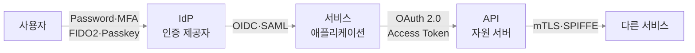
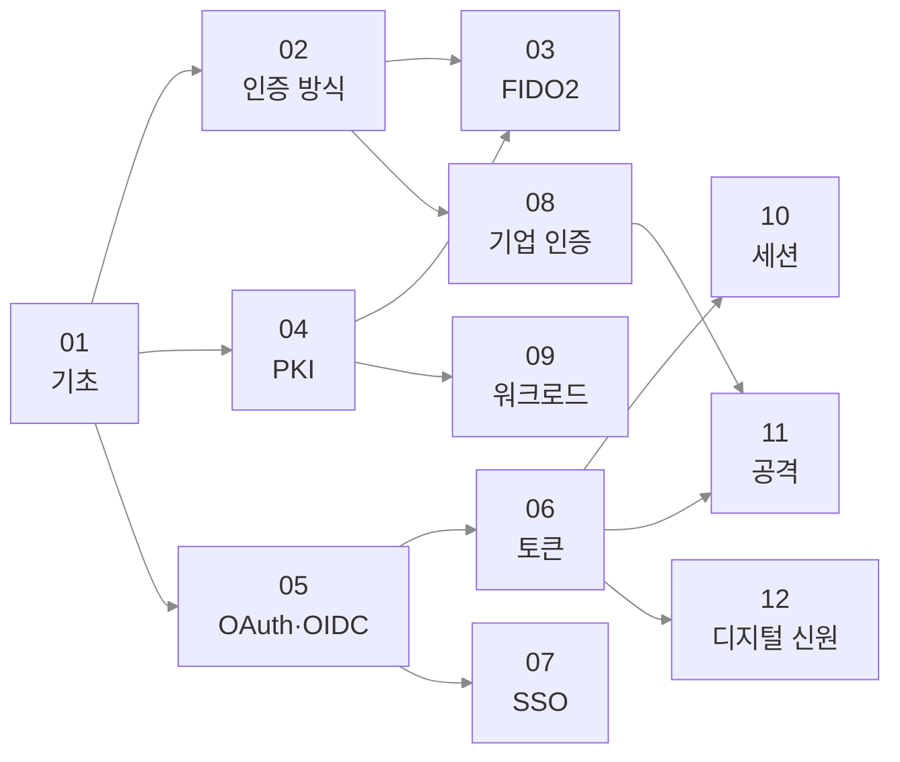

# PKI & Identity (PKI·신원·인증)

> 약어: NIST=National Institute of Standards and Technology, SP=Special Publication, RFC=Request for Comments, IETF=Internet Engineering Task Force, W3C=World Wide Web Consortium, OASIS=Organization for the Advancement of Structured Information Standards

공개키 기반구조(PKI, Public Key Infrastructure)와 **디지털 신원·인증**을 다루는 하위 영역입니다.
사용자 인증, 토큰, 연합 인증, 서비스 간 인증, 인증 공격까지 현대 인증 체계를 하나의 흐름으로 정리합니다.

> **구분 주의**: Authentication(인증, 누구인가) ≠ Authorization(인가, 무엇을 할 수 있나).
> 인가 모델은 [Access Control](../access-control/README.md), Zero Trust 설계는 [Security Architecture](../security-architecture/README.md)에서 다룬다.
> 암호 원리(공개키·서명·해시)는 [Cryptography](../cryptography/README.md)를 바탕으로 한다.

---

## 1. 기술별 역할 지도

인증 관련 기술은 이름이 비슷해도 하는 일이 다르다. 먼저 역할을 구분한다.

| 기술 | 분류 | 핵심 역할 |
|------|------|-----------|
| OAuth 2.0 | 인가 프레임워크 | 사용자를 대신해 자원에 접근할 **권한을 위임** |
| OIDC(OpenID Connect) | 인증 계층 | OAuth 2.0 위에서 **사용자 인증과 신원 정보** 전달 |
| JWT(JSON Web Token) | 토큰 형식 | 서명·암호화 가능한 **정보 담는 그릇** (인증 방식 자체가 아님) |
| SAML(Security Assertion Markup Language) 2.0 | 연합 인증 | 조직 간 인증·속성 정보(Assertion) 교환, 기업 SSO(Single Sign-On) |
| FIDO2 | 사용자 인증 | 기기의 개인키로 서명하는 **공개키 기반 인증** |
| WebAuthn(Web Authentication) | 웹 API 표준 | 브라우저에서 FIDO2 공개키 인증을 수행하는 API |
| Passkey | 사용 형태 | FIDO2/WebAuthn 자격증명을 기기·계정 간 사용하는 비밀번호 없는 로그인 |
| mTLS(mutual TLS) | 상호 인증 | 양쪽이 인증서로 서로를 인증 (주로 서비스 간) |
| Kerberos | 네트워크 인증 | 티켓 기반 인증 (기업 디렉터리 환경) |

텍스트 설명: 사용자는 Password·MFA(Multi-Factor Authentication)·FIDO2 등으로 IdP(Identity Provider)에 인증한다.
IdP는 OIDC나 SAML로 서비스에 신원을 전달하고, 서비스는 OAuth 2.0 Access Token으로 API를 호출한다.
API 뒤의 서비스 간 통신은 mTLS나 SPIFFE(Secure Production Identity Framework for Everyone) 같은 워크로드 신원으로 서로를 인증한다.

---

## 2. 문서 로드맵

| 순서 | 파일 | 핵심 내용 | 과정 | 주요 교차 참조 |
|:---:|------|-----------|:---:|----------------|
| 01 | `identity-fundamentals.md` | Identity·Authentication·Authorization 구분, 인증 요소(지식·소유·생체), 기술별 역할 지도 | 핵심 | [Access Control](../access-control/README.md) |
| 02 | `authentication-methods.md` | Password, MFA, TOTP(Time-based One-Time Password)/HOTP(HMAC-based One-Time Password), Push 인증, 인증서 기반 인증, Risk-based 인증 | 핵심 | [Hashing & MAC](../cryptography/hashing-mac.md) (패스워드 저장·HMAC) |
| 03 | `fido2-webauthn-passkey.md` | Challenge 서명 구조, 등록·인증 흐름, Passkey, 피싱 저항성 | 핵심 | [Digital Signature](../cryptography/digital-signature.md) |
| 04 | `pki-certificates.md` | PKI, X.509 인증서, CA(Certificate Authority), 신뢰 체인, 폐기(CRL(Certificate Revocation List)/OCSP(Online Certificate Status Protocol)) | 핵심 | [Asymmetric Encryption](../cryptography/asymmetric-encryption.md) |
| 05 | `oauth2-oidc.md` | OAuth 2.0 역할·흐름, Authorization Code + PKCE(Proof Key for Code Exchange), OIDC, OAuth 2.1(Draft) 방향 | 핵심 | 5G [OAuth Token Abuse](../../5g-security/security-risks/06-sba-security/06-06-OAuth_Token_Abuse.md) |
| 06 | `token-security.md` | JWT/JWS(JSON Web Signature)/JWE(JSON Web Encryption), JWK(JSON Web Key)/JWKS(JWK Set), Access·Refresh·ID Token, Revocation, Introspection, DPoP(Demonstrating Proof of Possession), 인증서 바인딩 토큰 | 핵심 | [OWASP API Security Top 10](../web-app-security/owasp/api-security-top-10/README.md) |
| 07 | `federation-sso.md` | *SAML 2.0*, IdP/SP(Service Provider), Identity Federation, SSO | 확장 | 05 OIDC |
| 08 | `enterprise-identity.md` | LDAP(Lightweight Directory Access Protocol), Active Directory, Kerberos, SCIM(System for Cross-domain Identity Management) | 확장 | 11 공격(Kerberoasting 등) |
| 09 | `workload-identity.md` | mTLS, SPIFFE/SPIRE(SPIFFE Runtime Environment), Service Account, API Key의 한계 | 확장 | [Cloud IAM](../../cloud-security/iam/README.md), [Cloud Native](../../cloud-security/cloud-native/README.md), 5G SBA |
| 10 | `session-token-lifecycle.md` | 세션과 토큰의 발급·갱신·만료·폐기, 로그아웃 처리 | 확장 | [Web & Application Security](../web-app-security/README.md) (쿠키·웹 취약점) |
| 11 | `identity-attacks.md` | Credential Stuffing, Brute Force, Password Spraying, Session Hijacking, Token Theft, Replay, MFA Fatigue, AiTM(Adversary-in-the-Middle) 피싱, Pass-the-Hash, Kerberoasting | 확장 | MITRE ATT&CK, OWASP |
| 12 | `digital-credentials.md` | DID(Decentralized Identifier), VC(Verifiable Credentials), SD-JWT(Selective Disclosure JWT) VC, 디지털 신원 지갑, 선택적 공개 | 확장 | — |

- **핵심 과정(01~06)**: 현대 웹·API 인증 구조를 이해하는 데 반드시 필요한 내용. 깊이 있게 다룬다.
- **확장 과정(07~12)**: 기업 환경·서비스 간 인증·공격·최신 기술. 핵심 과정을 바탕으로 넓힌다.

### 문서 간 의존 관계

텍스트 설명: 01 기초에서 인증·인가 개념을 정리한 뒤, 사용자 인증(02→03), 인증서(04), 위임·로그인(05→06) 세 갈래로 나뉜다.
FIDO2는 인증 방식과 공개키 인증서를 함께 알아야 이해하기 쉽다. 토큰(06)을 이해하면 세션, 공격, 디지털 신원으로 넓힐 수 있다.

### 권장 학습 우선순위
1. **OAuth 2.0 + OIDC + JWT + PKCE** — 현대 웹·API 인증 구조의 핵심 (05, 06)
2. **FIDO2 + WebAuthn + Passkey** — 비밀번호 없는 인증의 핵심 (03)
3. **SAML + LDAP + Kerberos + mTLS** — 기업·통신 인프라 인증 (07, 08, 09)
4. **인가 모델 + Zero Trust** — 인증 이후의 접근 통제 ([Access Control](../access-control/README.md), [Security Architecture](../security-architecture/README.md))
5. **SPIFFE + SD-JWT VC + DID** — 차세대 서비스 신원과 디지털 자격증명 (09, 12)

---

## 3. 기준 표준

| 영역 | 표준 | 상태 |
|------|------|------|
| 디지털 신원 전반 | *NIST SP 800-63-4* (63A·63B·63C 포함) | 현행 (2025 Final) |
| OAuth 2.0 | *RFC 6749*, *RFC 6750*(Bearer Token) | 현행 |
| PKCE | *RFC 7636* | 현행 |
| OAuth 보안 모범 사례 | *RFC 9700* | 현행 |
| OAuth 2.1 | *draft-ietf-oauth-v2-1-17* | **Draft (확정 표준 아님)** |
| 토큰 폐기 / 검사 | *RFC 7009* / *RFC 7662* | 현행 |
| mTLS 클라이언트 인증·인증서 바인딩 토큰 | *RFC 8705* | 현행 |
| DPoP | *RFC 9449* | 현행 |
| JWT / JWT 보안 모범 사례 | *RFC 7519* / *RFC 8725* (BCP) | 현행. 후속 개정 *draft-ietf-oauth-rfc8725bis-10*은 **Internet-Draft (RFC 미확정)** 이며, *RFC 8725*는 아직 대체되지 않았다 |
| JWS / JWE / JWK | *RFC 7515* / *RFC 7516* / *RFC 7517* | 현행 |
| JWT Access Token 프로파일 | *RFC 9068* | 현행 |
| OIDC | *OpenID Connect Core 1.0* | 현행 |
| SAML | *OASIS SAML 2.0* | 현행 |
| WebAuthn | *W3C WebAuthn Level 3* | W3C Recommendation (2026-08) |
| FIDO2 CTAP(Client to Authenticator Protocol) | *FIDO Alliance CTAP 2.3* | Proposed Standard (2026-02-26). *CTAP 2.3.1*은 Working Draft (2026-05-29)로 기준에서 제외 |
| TOTP / HOTP | *RFC 6238* / *RFC 4226* | 현행 |
| X.509 인증서 프로파일 / OCSP | *RFC 5280* / *RFC 6960* | 현행 |
| Kerberos / LDAP / SCIM | *RFC 4120* / *RFC 4511* / *RFC 7643·7644* | 현행 |
| SPIFFE | CNCF(Cloud Native Computing Foundation) SPIFFE 사양군: SPIFFE ID, SVID(SPIFFE Verifiable Identity Document), X.509-SVID, JWT-SVID, Workload API, Trust Domain and Bundle, Federation | 단일 버전 번호 없음. 핵심 문서는 공식 저장소에 Stable 표시, 개별 사양의 안정성 표시는 확인 예정 |
| DID | *W3C DID 1.0* / *DID 1.1* | *DID 1.0*: W3C Recommendation (2022-07-19) / *DID 1.1*: Candidate Recommendation Snapshot (2026-03-05, 최종 표준 아님) |
| VC | *W3C VC Data Model 2.0* / Securing Verifiable Credentials using JOSE(JSON Object Signing and Encryption) and COSE(CBOR(Concise Binary Object Representation) Object Signing and Encryption) | *VC Data Model 2.0*: W3C Recommendation (2025-05-15) / JOSE·COSE 보안 규격: W3C Recommendation (발행일 확인 예정) |
| SD-JWT / SD-JWT VC | IETF SD-JWT, IETF SD-JWT VC (서로 다른 사양) | 각 사양의 현재 지위 확인 예정 |

> 표준별 정의는 [References](../references/README.md)에 정리한다.
> Token Binding(*RFC 8471~8473*)은 주요 브라우저에서 지원이 중단된 방식으로, 06 문서에서 역사적 배경으로만 다룬다. 현재의 토큰 바인딩은 DPoP와 *RFC 8705*가 담당한다.

---

## 4. 범위 경계

- **인가 모델(RBAC·ABAC·ReBAC·PBAC·OPA·Cedar 등), PAM** → [Access Control](../access-control/README.md)
- **Zero Trust, Continuous Authentication, Risk-based Access 설계** → [Security Architecture](../security-architecture/README.md) (여기서는 인증 요소로서의 Risk-based 인증만 다룬다)
- **공개키·서명·해시의 원리** → [Cryptography](../cryptography/README.md)
- **쿠키·세션 관련 웹 취약점** → [Web & Application Security](../web-app-security/README.md)
- **클라우드 IAM Role, Workload Identity Federation** → [Cloud IAM](../../cloud-security/iam/README.md)
- **5G 가입자 인증(5G-AKA), SBA의 OAuth 2.0** → [5G Security](../../5g-security/README.md)

## 5. 다른 영역과의 연결

| 영역 | 연결되는 신원·인증 개념 |
|------|------------------------|
| Cryptography | RSA·ECC 서명 → JWT 서명, X.509, FIDO2 Challenge 서명 / HMAC → JWT HS256, TOTP |
| 5G | SUPI/SUCI 신원 보호, 5G-AKA 가입자 인증, SBA의 OAuth 2.0 Access Token, NF 간 TLS |
| Cloud | IAM, Workload Identity, 서비스 메시 mTLS |
| Web | 세션·쿠키, Passkey 로그인, OAuth/OIDC 소셜 로그인 |
| AI | AI Agent·API의 토큰 위임, 서비스 계정 권한 |

## 문서 목록

_아직 문서가 준비 중입니다._
