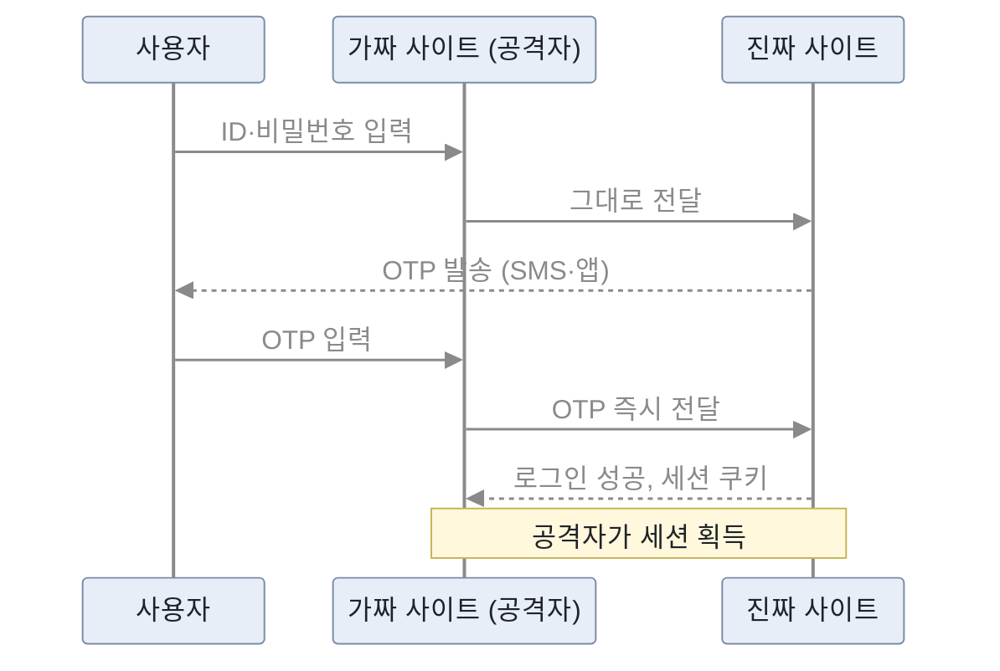
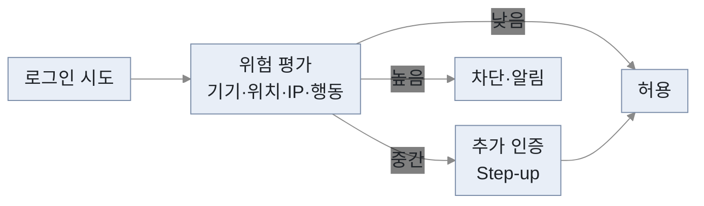

# Authentication Methods (인증 방식)

> 약어: NIST=미국 국립표준기술연구소, SP=NIST 특별 간행물, RFC=IETF 표준 문서, IETF=인터넷 표준화 기구, FIPS=미국 연방 정보처리 표준

## 1. 개요 (What)

인증 방식(Authentication Method)은 **"지금 요청하는 주체가 등록된 그 주체인가"** 를 확인하는 구체적인 수단이다.
비밀번호, SMS(Short Message Service) OTP(One-Time Password), 인증 앱의 6자리 코드, 휴대폰 Push 승인, 보안 키, 클라이언트 인증서가 모두 여기에 속한다.

인증 방식은 흔히 "강한 것"과 "약한 것"으로 나누지만, 실무에서는 그보다 **"어떤 공격에 버티고 어떤 공격에 무너지는가"** 로 비교하는 편이 정확하다.
같은 MFA(Multi-Factor Authentication)라도 SMS OTP는 실시간 피싱 중계에 뚫리고, FIDO2 보안 키는 버틴다.
이 문서는 대표 인증 방식의 동작 원리를 설명한 뒤 공격 저항성 기준으로 비교한다.

인증 요소(지식·소유·생체)와 신원 증명·인증·연합의 구분은 [Identity Fundamentals](identity-fundamentals.md)를 바탕으로 한다.
공개키 기반 인증의 상세는 [FIDO2 · WebAuthn · Passkey](fido2-webauthn-passkey.md), 인증 공격 유형 전체는 [Identity Attacks](identity-attacks.md)에서 다룬다.

## 2. 배경 / 원리 (Why & How)

### 2.1 모든 인증 방식의 공통 구조

인증 방식은 달라도 구조는 같다. **등록할 때 무언가를 서버에 맡기고, 인증할 때 그것과 맞는 증거를 낸다.**

| 방식 | 등록 시 서버가 저장하는 것 | 인증 시 사용자가 내는 것 | 서버 저장소가 유출되면 |
|------|---------------------------|--------------------------|--------------------|
| 비밀번호 | 패스워드 해시 (Salt 포함) | 비밀번호 자체 | 오프라인 추측 공격의 재료가 된다 |
| SMS·이메일 OTP | 전화번호·이메일 주소 | 받은 일회용 코드 | 코드 생성에는 영향 없음 (전달 경로가 약점) |
| TOTP(Time-based OTP) | 사용자와 **공유하는 비밀 키** | 비밀 키로 계산한 코드 | 공격자가 코드를 직접 만들 수 있다 |
| Push 승인 | 등록된 기기 정보·기기 공개키 | 기기에서 "승인" 응답 | 기기 키가 없으면 응답을 위조할 수 없다 |
| FIDO2·Passkey | 사용자 **공개키** | 개인키로 만든 서명 | 공개키만으로는 서명을 만들 수 없다 |
| 클라이언트 인증서 | 신뢰하는 CA(Certificate Authority) 또는 인증서 | 개인키로 만든 서명 + 인증서 | 공개 정보뿐이라 직접 피해는 없다 |

- **서버가 비밀을 갖고 있는 방식**(비밀번호 해시, TOTP 공유 키)은 서버 유출이 곧 사용자 위험이 된다.
- **서버가 공개키만 갖는 방식**(FIDO2, 인증서)은 서버가 털려도 인증 수단 자체는 안전하다. 공개키 인증이 선호되는 핵심 이유다.

### 2.2 공격자가 노리는 지점

인증 공격은 대부분 아래 네 가지 중 하나다. 이후 비교표의 기준이기도 하다.

| 공격 지점 | 뜻 | 예 |
|-----------|----|----|
| 추측·재사용 | 비밀을 맞히거나 다른 곳에서 유출된 값을 그대로 쓴다 | Brute Force, Password Spraying, Credential Stuffing |
| 전달 경로 가로채기 | 코드가 사용자에게 가는 길목을 가로챈다 | SIM(Subscriber Identity Module) 바꿔치기(SIM Swap), 통신망 가로채기, 이메일 계정 탈취 |
| 실시간 중계 (피싱) | 가짜 사이트가 사용자 입력을 받아 진짜 사이트에 즉시 넘긴다 | AiTM(Adversary-in-the-Middle) 피싱 |
| 사용자 속이기·지치게 하기 | 사용자가 스스로 승인하게 만든다 | MFA Fatigue(Push 폭탄), 상담원 사칭 |

### 2.3 피싱 저항성 (Phishing Resistance)

OTP를 쓰는 MFA도 실시간 중계 피싱에는 뚫린다. 사용자가 가짜 사이트에 코드를 입력하면, 공격자는 그 코드를 30초 안에 진짜 사이트에 넣으면 된다.

텍스트 설명: 사용자는 가짜 사이트를 진짜로 믿고 비밀번호와 OTP를 입력한다. 공격자는 두 값을 실시간으로 진짜 사이트에 넘겨 로그인에 성공하고, 발급된 세션 쿠키를 가져간다.
OTP는 "어느 사이트에 입력하는지"를 모르는 값이라 이 공격을 막지 못한다.

**피싱 저항성**은 인증 증거가 **접속한 사이트(또는 통신 채널)와 묶여 있어서** 다른 사이트로 옮겨 쓸 수 없는 성질이다.

- **FIDO2·Passkey**: 브라우저가 실제 접속 중인 도메인(Origin)을 서명 대상에 넣는다. 가짜 도메인에서 만든 서명은 진짜 사이트에서 통과하지 않는다.
- **클라이언트 인증서(mTLS(mutual TLS))**: 서명이 그 TLS(Transport Layer Security) 연결의 핸드셰이크 내용에 묶인다. 공격자가 중간에서 연결을 끊고 새로 맺으면 서명을 재사용할 수 없다.
- 비밀번호·SMS OTP·TOTP·단순 Push 승인은 피싱 저항성이 없다.

→ 정의의 두 방식(채널 바인딩, 검증자 이름 바인딩)은 아래 5.4 참조.

## 3. 상세 (Details)

### 3.1 비밀번호 (Password)

가장 흔하지만 단독으로는 가장 공격받기 쉬운 방식이다. 현대 지침은 **"복잡하게, 자주 바꾸게"** 에서 **"길게, 유출 여부를 확인하고, 바뀔 때만 바꾸게"** 로 방향이 바뀌었다.

| 예전 관행 | 현재 권고 방향 | 이유 |
|-----------|----------------|------|
| 대문자·숫자·특수문자 조합 강제 | 조합 규칙 대신 **충분한 길이** | 조합 규칙은 `Password1!` 같은 예측 가능한 패턴을 낳는다 |
| 90일마다 강제 변경 | **유출 증거가 있을 때만** 변경 | 잦은 변경은 끝자리 숫자만 바꾸는 습관을 만든다 |
| 비밀번호 힌트·보안 질문 | 사용하지 않음 | 답이 소셜 미디어 등에서 쉽게 알려진다 |
| 붙여넣기 금지 | 붙여넣기·비밀번호 관리자 허용 | 관리자를 쓰면 길고 고유한 비밀번호를 쓰기 쉽다 |
| — | **유출·흔한 비밀번호 목록과 대조** | Credential Stuffing과 Password Spraying 대응 |
| — | 로그인 시도 횟수 제한 | 온라인 무차별 대입 대응 |

- 서버는 비밀번호를 **느린 패스워드 해시 + 고유 Salt**로 저장한다 → [Hashing & MAC 3.3 패스워드 저장](../cryptography/hashing-mac.md#33-패스워드-저장)
- 비밀번호는 **사이트마다 다르게** 쓰는 것이 핵심이다. 한 사이트 유출이 다른 사이트 탈취로 이어지는 것이 Credential Stuffing이다.
- 구체적인 길이 기준은 아래 5.1 참조.

### 3.2 SMS·음성·이메일 OTP

서버가 일회용 코드를 만들어 등록된 전화번호나 이메일로 보낸다.

- **장점**: 별도 앱 없이 누구나 쓸 수 있다. 비밀번호만 쓰는 것보다는 확실히 낫다.
- **약점**:
  - **SIM 바꿔치기**: 공격자가 통신사를 속여 피해자 번호를 자기 SIM으로 옮기면 코드가 공격자에게 간다.
  - **번호 재할당**: 해지된 번호가 다른 사람에게 넘어가면 그 사람이 코드를 받는다.
  - **이메일 OTP**는 이메일 계정 보안에 그대로 의존한다. 이메일이 털리면 함께 털린다.
  - 실시간 중계 피싱에 무력하다(2.3).
- *NIST SP 800-63B-4*는 SMS·음성 같은 공중 전화망 기반 전달을 **제한적(Restricted) 인증 수단**으로 분류한다. 쓸 수는 있지만 조직이 그 위험을 평가해 수용해야 하고, 제한되지 않은 대체 인증 수단을 하나 이상 제공해야 하며, 사용자에게 위험과 대안이 있다는 사실을 알려야 한다.

### 3.3 TOTP / HOTP — 인증 앱의 6자리 코드

Google Authenticator 같은 인증 앱이 쓰는 방식이다. 등록할 때 QR(Quick Response) 코드로 **서버와 앱이 같은 비밀 키를 나눠 갖고**, 이후 양쪽이 같은 계산으로 코드를 만든다.

| 방식 | 코드를 바꾸는 기준 | 표준 |
|------|-------------------|------|
| HOTP(HMAC-based OTP) | 사용할 때마다 1씩 늘어나는 카운터 | *RFC 4226* |
| TOTP(Time-based OTP) | 현재 시각 (기본 30초 단위) | *RFC 6238* |

- 코드 = HMAC(Hash-based Message Authentication Code)(공유 키, 카운터 또는 시각)을 잘라 6~8자리 숫자로 만든 것이다. 계산 구조는 아래 5.3 참조.
- **장점**: 통신망을 거치지 않아 SIM 바꿔치기에 안전하다. 오프라인에서도 동작한다.
- **약점**:
  - 실시간 중계 피싱에 무력하다(2.3).
  - 서버가 공유 키를 갖고 있으므로 **서버 DB(Database) 유출 시 공격자가 코드를 만들 수 있다.** 공유 키는 패스워드처럼 해시할 수 없고(원래 값이 있어야 계산 가능), 암호화해 저장해야 한다.
  - 등록 QR 코드가 노출되면 키가 그대로 복제된다.
- 서버는 같은 코드의 재사용을 막고, 시계 오차를 고려해 앞뒤 한 구간 정도만 허용한다.

### 3.4 Push 승인

로그인 시도 시 등록된 휴대폰 앱에 "로그인을 승인하시겠습니까?" 알림을 보내고, 사용자가 누르면 앱이 기기 키로 서명한 응답을 서버에 보낸다.

- **장점**: 코드 입력이 없어 편하다. 응답이 기기 키로 서명되므로 전달 경로 위조가 어렵다.
- **약점 — MFA Fatigue**: 공격자가 이미 알아낸 비밀번호로 로그인을 반복 시도해 알림을 수십 번 보낸다. 지친 사용자가 "그만 오게" 하려고 승인을 누른다.
- **약점 — 맥락 없는 승인**: 사용자는 지금 승인하는 로그인이 자기 것인지 공격자 것인지 알 수 없다.

| 대응 | 효과 |
|------|------|
| **번호 일치 (Number Matching)** | 로그인 화면에 뜬 숫자를 앱에 입력해야 승인된다. 사용자가 로그인 화면을 보고 있지 않으면 승인할 수 없다 |
| 추가 맥락 표시 | 요청 위치·기기·앱 이름을 보여줘 이상한 요청을 알아채게 한다 |
| 알림 횟수 제한·거부 신고 | 짧은 시간의 반복 요청을 막고, 사용자가 "내가 아님"을 신고하면 계정을 잠근다 |

> 해설: 번호 일치는 MFA Fatigue는 크게 줄이지만 피싱 저항성을 주지는 않는다. 가짜 사이트가 진짜 사이트의 숫자를 그대로 보여주면 사용자는 여전히 승인할 수 있다.

### 3.5 인증서 기반 인증

사용자나 기기가 **개인키와 인증서**를 갖고, 서버가 인증서 체인과 서명을 검증한다.

| 형태 | 쓰는 곳 |
|------|---------|
| 스마트카드·PIV(Personal Identity Verification) 카드 | 정부·기업 직원 로그인 (*FIPS 201-3*) |
| TLS 클라이언트 인증서 (mTLS) | 기기 인증, VPN(Virtual Private Network), 서비스 간 통신 |
| 기기 인증서 | 회사 관리 기기만 사내 시스템에 접속 허용 |

- **장점**: 피싱 저항성이 있고(2.3), 서버는 공개 정보만 갖는다.
- **약점**: 인증서 발급·갱신·폐기 운영 부담이 크다. 개인키가 파일로 저장되어 복사 가능하면 탈취 위험이 있으므로, 스마트카드·TPM(Trusted Platform Module) 같은 하드웨어에 **추출 불가능하게** 두는 것이 바람직하다.
- 인증서 검증 원리는 [PKI & Certificates](pki-certificates.md), mTLS 동작은 [TLS Overview 3.4 mTLS — 클라이언트도 인증서로 인증](../cryptography/tls-overview.md#34-mtls--클라이언트도-인증서로-인증)에서 다룬다.

### 3.6 FIDO2 · Passkey

FIDO(Fast IDentity Online)2는 사이트마다 별도의 키 쌍을 만들고, 로그인 때 서버가 보낸 Challenge에 개인키로 서명하는 방식이다.
Passkey는 이 자격증명을 비밀번호 대신 쓰는 형태로, 클라우드 계정을 통해 여러 기기에 동기화되거나 보안 키 같은 한 기기에 고정될 수 있다.

- 피싱 저항성(2.3), 서버 유출 안전(2.1), 사이트별 키로 인한 재사용 불가를 동시에 갖춘다.
- 생체 인증은 서버로 가지 않고 **기기 안에서 개인키 사용을 허락하는 용도**로만 쓰인다.
- 등록·인증 흐름, 동기화 Passkey와 기기 고정 Passkey의 차이는 [FIDO2 · WebAuthn · Passkey](fido2-webauthn-passkey.md)에서 다룬다.

### 3.7 MFA 조합과 Risk-based 인증

**MFA는 요소의 개수보다 조합의 질이 중요하다.** 비밀번호 + SMS OTP는 MFA지만, 둘 다 실시간 피싱에 뚫린다.
피싱 저항성이 있는 수단을 하나라도 포함해야 피싱에 버티는 MFA가 된다.

**Risk-based 인증(Adaptive Authentication)** 은 매번 같은 강도로 묻지 않고, 로그인 상황의 위험도에 따라 추가 인증을 요구한다.

텍스트 설명: 로그인 시도마다 기기, 위치, IP(Internet Protocol) 평판, 평소 행동과의 차이를 보고 위험도를 매긴다. 위험이 낮으면 그대로 허용하고, 중간이면 추가 인증(Step-up)을 요구하며, 높으면 차단하고 사용자에게 알린다.

| 위험 신호 | 예 |
|-----------|----|
| 기기 | 처음 보는 기기·브라우저, 관리되지 않는 기기 |
| 위치·네트워크 | 평소와 다른 국가, 짧은 시간에 먼 거리 이동(Impossible Travel), 익명 프록시·악성 IP |
| 행동 | 평소와 다른 시간대, 연속 실패 후 성공 |
| 요청 내용 | 비밀번호 변경, 송금, 관리자 기능처럼 민감한 작업 |

- Risk-based 인증은 **MFA를 대체하지 않는다.** 위험이 "낮음"으로 잘못 판정되면 그대로 통과되므로, 기본 인증 수단 자체도 충분히 강해야 한다.
- 민감한 작업 직전에 다시 인증을 요구하는 Step-up은 세션이 탈취된 경우의 피해를 줄인다.
- 지속적 인증과 Zero Trust 접근 결정 설계는 [Security Architecture](../security-architecture/README.md) (작성 예정)에서 다룬다.

### 3.8 계정 복구 — 가장 약한 고리

[Identity Fundamentals](identity-fundamentals.md)에서 본 것처럼 계정 복구는 신원 증명을 다시 하는 절차다. **복구 수단이 로그인 수단보다 약하면, 전체 강도는 복구 수단 수준으로 떨어진다.**

- Passkey를 도입해도 "SMS로 비밀번호 재설정"이 남아 있으면 공격자는 SMS 경로를 노린다.
- 복구 코드(Recovery Code)는 한 번만 쓰게 하고, 해시해 저장한다.
- 인증 수단 추가·삭제, 전화번호·이메일 변경은 **기존 강한 수단으로 재인증**한 뒤에만 허용하고, 기존 연락처로 알림을 보낸다.

### 3.9 공격 저항성 비교

| 방식 | 추측·재사용 | 전달 경로 가로채기 | 실시간 중계 피싱 | 사용자 속이기 (Fatigue 등) | 서버 DB 유출 |
|------|:---:|:---:|:---:|:---:|:---:|
| 비밀번호 단독 | 취약 | 해당 없음 | 취약 | 취약 | 취약 (해시 추측) |
| SMS·음성 OTP | 강함 | **취약** (SIM 바꿔치기) | 취약 | 취약 | 강함 |
| 이메일 OTP | 강함 | 취약 (이메일 탈취) | 취약 | 취약 | 강함 |
| TOTP 앱 | 강함 | 강함 | 취약 | 취약 | **취약** (공유 키) |
| Push (단순 승인) | 강함 | 강함 | 취약 | **취약** (MFA Fatigue) | 강함 |
| Push (번호 일치) | 강함 | 강함 | 취약 | 보통 | 강함 |
| FIDO2·Passkey | 강함 | 강함 | **강함** | 강함 | 강함 |
| 클라이언트 인증서 (하드웨어 보관) | 강함 | 강함 | **강함** | 강함 | 강함 |

- "강함"은 그 공격 유형에 대해 구조적으로 버틴다는 뜻이지, 모든 공격에 안전하다는 뜻이 아니다. 예를 들어 FIDO2도 사용자 기기가 악성코드에 감염되거나 **로그인 후 세션 쿠키가 탈취되면** 막지 못한다.
- 비밀번호 행에서 "추측·재사용"이 취약한 것은 사람이 고른 값이기 때문이다. OTP 계열은 코드가 매번 바뀌어 추측·재사용에 강하지만, 대개 비밀번호와 함께 쓰이므로 첫 단계의 비밀번호는 여전히 노출된다.
- 같은 방식이라도 **복구 절차**(3.8)와 **세션 관리**가 약하면 비교표의 강점이 사라진다. 세션 관리는 [Session & Token Lifecycle](session-token-lifecycle.md)에서 다룬다.

## 4. 보안 관점 (Security Relevance)

| 실수 | 결과 | 대응 |
|------|------|------|
| 비밀번호 조합 규칙·주기 변경 강제 | 예측 가능한 패턴, 재사용 증가 | 길이 기준 + 유출 목록 대조, 유출 시에만 변경 |
| 유출 비밀번호 대조·시도 제한 없음 | Credential Stuffing, Password Spraying 성공 | 유출 목록 대조, 계정·IP별 시도 제한, 이상 탐지 |
| 패스워드를 빠른 해시나 평문으로 저장 | 유출 시 대량 복원 | 느린 패스워드 해시 + 고유 Salt |
| SMS OTP를 고위험 계정의 유일한 2차 수단으로 사용 | SIM 바꿔치기로 계정 탈취 | 관리자·고위험 계정은 FIDO2·인증서 |
| "MFA 적용했으니 피싱 안전" 판단 | AiTM 피싱으로 OTP·세션 탈취 | 피싱 저항성 수단 도입, 세션 탈취 탐지 |
| Push 단순 승인 | MFA Fatigue로 승인 유도 | 번호 일치, 맥락 표시, 반복 요청 제한 |
| TOTP 공유 키를 평문 저장 | DB 유출 시 모든 사용자 코드 생성 가능 | 공유 키 암호화 저장, 키 관리 분리 |
| OTP 재사용·무제한 입력 허용 | 6자리 코드 무차별 대입, 재전송 공격 | 1회 사용 처리, 시도 횟수 제한 |
| 복구 절차가 로그인보다 약함 | 재설정 경로로 우회 탈취 | 복구에도 강한 인증, 변경 시 기존 연락처 알림 |
| 레거시 프로토콜에서 MFA 미적용 | 오래된 메일·디렉터리 프로토콜로 비밀번호만으로 접속 | 레거시 인증 차단, 모든 경로에 같은 정책 |

점검 시 확인할 것: 비밀번호 정책(길이·유출 대조·시도 제한), 패스워드 저장 방식, 계정 유형별 MFA 수단(관리자·고위험 계정의 피싱 저항성), Push 방식의 번호 일치 여부, OTP 재사용·시도 제한, TOTP 공유 키 보관, 복구 절차와 연락처 변경 절차, 레거시 인증 경로, Risk-based 정책의 판정 기준.

## 5. 심화 (Advanced)

> 보안 컨설턴트·점검자를 위한 규격 세부다. 본문만으로 개념 이해에는 충분하다.

### 5.1 *NIST SP 800-63B-4*의 비밀번호 요구사항

*NIST SP 800-63B-4*는 이전 판의 Memorized Secret 대신 Password라는 용어를 쓰며, 비밀번호에 대해 다음을 요구한다. 규범 수준은 SHALL(반드시), SHALL NOT(금지), SHOULD(권고)로 구분한다.

| 항목 | 요구 | 수준 |
|------|------|:---:|
| 최소 길이 (단일 요소) | 15자 이상 | SHALL |
| 최소 길이 (MFA의 한 요소) | 8자 이상 | SHALL |
| 최대 길이 | 64자 이상 허용 | SHOULD |
| 문자 종류 | 출력 가능한 ASCII(American Standard Code for Information Interchange) 문자·공백·Unicode 허용 | SHOULD |
| 조합 규칙 | 대·소문자·숫자·특수문자 조합 강제 금지 | SHALL NOT |
| 주기적 변경 | 정기 변경 강제 금지 | SHALL NOT |
| 침해 증거가 있을 때 | 변경 요구 | SHALL |
| 차단 목록 | 흔하거나 예상 가능하거나 유출된 비밀번호 차단 | SHALL |
| 힌트·지식 기반 질문(KBA(Knowledge-Based Authentication)) | 사용 금지 | SHALL NOT |
| 비밀번호 관리자·자동 입력 | 허용 | SHALL |
| 붙여넣기 | 허용 | SHOULD |
| 실패 횟수 제한 (Rate Limiting) | 적용 | SHALL |

- Unicode 비밀번호의 길이는 Unicode code point 하나를 한 글자로 센다. 같은 글자가 다른 바이트열로 표현되는 문제를 막기 위해 NFC(Normalization Form C) 정규화를 적용하도록 권고한다.

- 이 지침은 미국 연방 기관용이지만, 민간에서도 비밀번호 정책의 사실상 기준으로 널리 참고된다.

### 5.2 AAL별 인증 수단 요구 (요약)

| 수준 | 요구 방향 |
|------|-----------|
| AAL1(Authenticator Assurance Level 1) | 단일 요소 인증 허용 |
| AAL2 | 서로 다른 두 요소 필요. 검증자는 피싱 저항성 있는 인증 선택지를 **하나 이상 제공해야 한다(SHALL)**. 동기화 Passkey 같은 동기화 가능 인증 수단(Syncable Authenticator) 사용 가능 |
| AAL3 | 서로 다른 두 요소 + 피싱 저항성 있는 공개키 암호 인증 수단 + **추출 불가능한(Non-exportable) 개인키** 필요 |

- 차이에 주의한다. AAL2는 피싱 저항 수단을 **선택지로 제공**해야 하는 수준이고, AAL3는 실제 인증이 **피싱 저항성을 충족**해야 하는 수준이다.

- 생체 정보는 단독 인증 수단으로 인정되지 않고, 보안 키·스마트카드의 지문 확인처럼 물리적 인증 수단을 활성화하는 요소로만 쓰인다.
- 이메일은 별도 채널(Out-of-Band) 인증 수단으로 쓸 수 없다. 이메일 주소 확인 코드나 계정 복구 코드는 로그인 인증과 별개의 절차로 구분한다.
- IAL·AAL·FAL 체계 전체는 [Identity Fundamentals](identity-fundamentals.md)의 심화 절에 정리되어 있다.

### 5.3 HOTP·TOTP 계산 구조

두 방식 모두 SHA(Secure Hash Algorithm) 계열 해시를 쓰는 HMAC 위에 만들어진다.

| 단계 | HOTP (*RFC 4226*) | TOTP (*RFC 6238*) |
|------|-------------------|-------------------|
| 입력 | 공유 키 K, 카운터 C | 공유 키 K, T = ⌊(현재 Unix 시각 − T0) / X⌋ (기본 X = 30초) |
| MAC 계산 | HMAC-SHA-1(K, C) | HMAC(K, T). SHA-1 외에 SHA-256·SHA-512 사용 가능 |
| 잘라내기 | 마지막 바이트로 위치를 정해 31비트 추출 (Dynamic Truncation) | HOTP와 동일 |
| 출력 | 추출값 mod 10^자리수 (6자리가 대표적, *RFC 4226*은 6~8자리 권고) | HOTP와 동일 |

- TOTP는 HOTP의 카운터 자리에 시간 구간 번호를 넣은 것이다. 30초는 기본값이며, 구현에 따라 다른 간격을 쓸 수 있다.
- HMAC-SHA-1의 사용은 HMAC 구조상 SHA-1 충돌 문제와 직접 관련되지 않는다 → [Hashing & MAC](../cryptography/hashing-mac.md)
- 두 RFC는 Informational 문서다.

### 5.4 피싱 저항성의 두 방식

*NIST SP 800-63B-4*는 피싱 저항성을 다음 두 방식으로 설명한다.

| 방식 | 원리 | 예 |
|------|------|----|
| 채널 바인딩 (Channel Binding) | 인증 결과를 사용자와 검증자 사이의 보호된 **통신 채널**(TLS 세션)에 암호학적으로 결합한다 | TLS 클라이언트 인증서 |
| 검증자 이름 바인딩 (Verifier Name Binding) | 인증 결과를 **검증자의 식별자**(인증된 도메인 이름 등)에 암호학적으로 결합한다 | FIDO2·WebAuthn(Web Authentication)의 Origin·RP(Relying Party) ID 확인 |

- 사용자가 OTP를 직접 입력하는 방식은 결과가 특정 세션에 결합되지 않아 피싱 저항성이 없다.
- 사용자가 화면을 보고 판단하는 행위(주소창 확인, 번호 비교)도 프로토콜의 피싱 저항성으로 인정되지 않는다. 사람의 판단에 의존하기 때문이다.

## 관련 문서

- 이전: [Identity Fundamentals](identity-fundamentals.md), [PKI & Certificates](pki-certificates.md)
- 다음: [FIDO2 · WebAuthn · Passkey](fido2-webauthn-passkey.md)
- 인증 공격 유형: [Identity Attacks](identity-attacks.md)
- 암호 기반: [Hashing & MAC](../cryptography/hashing-mac.md), [TLS Overview](../cryptography/tls-overview.md)
- 5G 가입자 인증과의 비교: [5G-AKA Attack Surface](../../5g-security/security-risks/02-auth-nas/02-01-5G-AKA_Attack_Surface.md)
- 로드맵: [PKI & Identity](README.md)

## 출처

| 문서 | 지위 / 버전 | 이 문서에서의 사용 |
|------|-------------|-------------------|
| *NIST SP 800-63B-4* "Authentication and Authenticator Management" | 2025-07 Final | 비밀번호 요구사항, 제한적 인증 수단, AAL 요구, 피싱 저항성 정의 |
| *RFC 4226* "HOTP: An HMAC-Based One-Time Password Algorithm" | Informational | HOTP 계산 구조 |
| *RFC 6238* "TOTP: Time-Based One-Time Password Algorithm" | Informational | TOTP 계산 구조, 기본 시간 간격 |
| *FIPS 201-3* "Personal Identity Verification (PIV) of Federal Employees and Contractors" | 2022-01 Final (*FIPS 201-2* 대체) | 스마트카드 기반 인증의 예 |

- 비교표와 대응 방안은 위 규격과 인증 공격의 일반 원리를 재구성한 해설이다.
