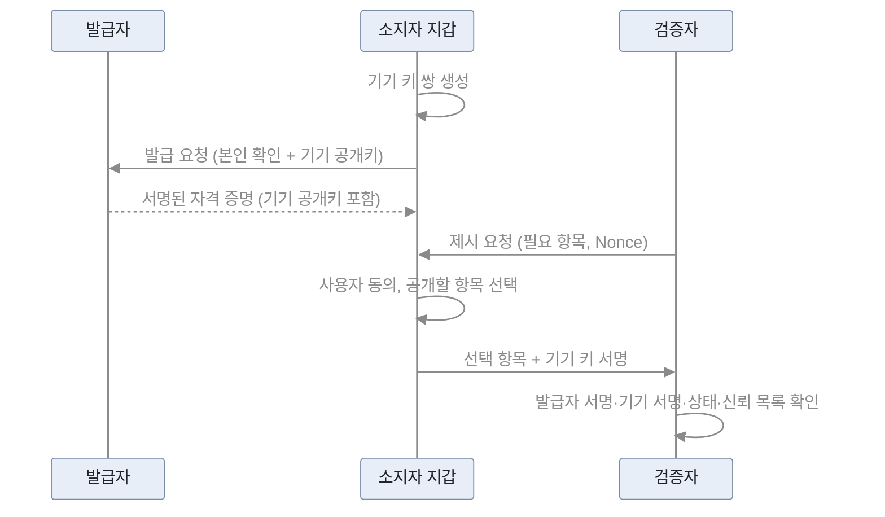

# Digital Credentials (디지털 자격 증명)

> 약어: W3C=웹 표준화 기구, IETF=인터넷 표준화 기구, RFC=IETF 표준 문서, ISO/IEC=국제표준화기구/국제전기기술위원회, NIST=미국 국립표준기술연구소

## 1. 개요 (What)

디지털 자격 증명(Digital Credential)은 **지갑 속 신분증·자격증을 디지털로 옮긴 것**이다. 발급 기관이 "이 사람은 성인이다", "이 사람은 이 대학을 졸업했다" 같은 내용에 전자서명을 해 주면, 사용자는 그것을 자기 기기의 지갑(Wallet)에 보관했다가 필요한 곳에 직접 제시한다.

| 역할 | 실물 비유 | 하는 일 |
|------|-----------|---------|
| 발급자 (Issuer) | 신분증을 발급하는 기관 | 사용자에 대한 주장(Claim)에 서명해 자격 증명을 발급 |
| 소지자 (Holder) | 신분증을 가진 사람 | 지갑에 보관하고, 필요한 항목만 골라 제시 |
| 검증자 (Verifier) | 신분증을 확인하는 가게·기관 | 서명과 발급자를 확인하고 내용을 믿을지 결정 |

연합 인증과 가장 큰 차이는 **확인할 때 발급자에게 묻지 않는다**는 점이다.

| 구분 | 연합 인증 (SAML(Security Assertion Markup Language)·OIDC(OpenID Connect)) | 디지털 자격 증명 |
|------|---------------------------|------------------|
| 로그인할 때 | 서비스가 사용자를 IdP(Identity Provider)로 보내고, IdP가 그때그때 결과를 발급 | 사용자가 미리 받아 둔 자격 증명을 지갑에서 직접 제시 |
| 발급자가 아는 것 | 사용자가 **언제 어느 서비스에** 로그인했는지 | 원칙적으로 제시 사실을 모른다 (상태 확인 방식에 따라 달라진다, 3.5) |
| 공개 범위 | IdP가 정한 속성을 전달 | 사용자가 필요한 항목만 골라 공개 가능 (선택적 공개) |
| 오프라인 | 어렵다 | 가능 (현장 신분 확인 등) |

이 문서는 W3C의 DID(Decentralized Identifier)와 VC(Verifiable Credentials), IETF의 SD-JWT(Selective Disclosure for JWT) 계열, 모바일 신분증 규격을 중심으로 **자격 증명이 어떻게 신뢰를 얻고, 어디서 깨지는지**를 다룬다. 연합 인증은 [Federation & SSO](federation-sso.md)를, 서명의 원리는 [Digital Signature](../cryptography/digital-signature.md)를 바탕으로 한다.

## 2. 배경 / 원리 (Why & How)

### 2.1 왜 필요한가

- **추적 문제**: 연합 인증에서 IdP는 사용자의 모든 로그인 기록을 본다. 국가 신원이나 대형 플랫폼 계정이 IdP가 되면 그 기록 자체가 민감 정보가 된다.
- **과다 공개**: 실물 신분증으로 나이를 확인하면 이름·주소·주민번호까지 보여 준다. 디지털로 옮기면 "성인 여부"만 보여 줄 수 있다.
- **사본 위변조**: 신분증 사진·스캔본은 위조와 재사용이 쉽다. 전자서명된 자격 증명은 변조를 검증으로 알아낼 수 있다.
- **사용자 통제**: 무엇을 누구에게 보여 줄지 사용자가 지갑에서 직접 결정한다.

### 2.2 기본 흐름



텍스트 설명: 지갑은 먼저 기기 안에 키 쌍을 만든다. 발급자는 본인 확인을 거친 뒤 사용자 정보와 **기기 공개키**를 함께 넣은 자격 증명에 서명해 지갑에 준다. 검증자가 필요한 항목과 일회용 값(Nonce)을 보내 제시를 요청하면, 사용자는 공개할 항목을 고르고 지갑은 그 항목과 함께 Nonce에 대한 기기 키 서명을 보낸다. 검증자는 발급자 서명, 기기 서명, 폐기 상태, 발급자가 신뢰 목록에 있는지를 확인한다. 이 과정에서 발급자에게는 연락하지 않는다.

### 2.3 신뢰는 어디서 오는가

서명이 맞다는 것만으로는 부족하다. 검증자는 세 가지를 따로 확인해야 한다.

| 질문 | 확인 수단 | 빠뜨리면 |
|------|-----------|----------|
| 이 내용이 변조되지 않았나 | 발급자 서명 검증 | 위조 자격 증명 수용 |
| 이 발급자를 믿어도 되나 | 신뢰 목록(Trust List)·신뢰 프레임워크, 발급자 인증서 체인 | **아무나 만든 "발급자"의 서명을 받아들인다** |
| 제시한 사람이 진짜 소지자인가 | 소지자 결합(Holder Binding): 기기 키 서명, Nonce·Audience | 복사된 자격 증명의 재사용 |

- 서명은 누구나 만들 수 있다. "정부가 발급한 운전면허"라는 의미는 **그 서명 키가 정부의 것이라는 신뢰 체계**에서 나온다. 인증서 체인의 원리는 [PKI & Certificates](pki-certificates.md)와 같다.
- 검증자가 받아들일 발급자 목록과 자격 증명 종류를 정하는 일이 실제 서비스 설계의 핵심이다.
- 반대 방향의 신뢰도 필요하다. 지갑도 **요청하는 검증자가 누구이고, 그 항목을 요청할 자격이 있는지** 확인해야 한다(3.7).

## 3. 상세 (Details)

### 3.1 DID — 발급자·소지자의 식별자

DID는 `did:{방식}:{식별자}` 형태의 식별자다. DID를 해석(Resolve)하면 **DID Document**가 나오고, 그 안에 공개키와 서비스 주소가 들어 있다.

```text
did:web:issuer.example.com
did:key:z6Mk...(공개키 자체를 인코딩)
```

| DID 방식 (예) | 공개키를 찾는 곳 | 특징 |
|--------------|-----------------|------|
| `did:web` | DNS(Domain Name System)로 찾은 도메인에서 HTTPS(Hypertext Transfer Protocol Secure)로 받은 DID Document | 운영이 쉽다. 신뢰는 DNS, 도메인 소유권, TLS(Transport Layer Security) 인증서(웹 PKI), 웹 서버 보안에 의존 |
| `did:key` | 식별자 자체 | 문서 갱신·키 교체가 없다. 일회성·단기 식별에 적합 |
| 블록체인·원장 기반 방식 | 분산 원장 | 중앙 운영자 없이 갱신 이력 공유. 방식마다 보안 성질이 다르다 |

- "탈중앙"은 **식별자 발급에 중앙 등록 기관이 필요 없다**는 뜻이지, 신뢰 문제를 없앤다는 뜻이 아니다. `did:web`이라면 도메인이나 웹 서버를 장악한 사람이 키를 바꿀 수 있다.
- DID 방식은 수백 가지가 등록되어 있고 보안 수준이 제각각이다. 검증자는 **받아들일 DID 방식을 명시적으로 제한**해야 한다.
- DID 방식 규격은 DID Core와 지위가 다르다. 예를 들어 `did:web` 규격은 W3C Recommendation이 아니라 W3C Credentials Community Group의 작업 문서다.
- 디지털 자격 증명에 DID가 반드시 필요한 것은 아니다. X.509 인증서나 발급자의 HTTPS 메타데이터로 발급자 키를 찾는 구조도 널리 쓰인다.

### 3.2 VC — 서명된 주장의 데이터 모델

W3C VC 데이터 모델은 자격 증명에 들어갈 내용을 정한다.

| 요소 | 뜻 | 필수 여부 |
|------|----|-----------|
| 발급자 (`issuer`) | 누가 발급했는가 | 필수 |
| 주체 (`credentialSubject`) | 누구에 대한 주장인가, 주장의 내용 | 필수 |
| 유효 기간 (`validFrom`·`validUntil`) | 정보가 언제부터 언제까지 유효한가 | 선택 |
| 상태 (`credentialStatus`) | 폐기·정지 여부를 어디서 확인하는가 | 선택 |
| 보안 수단 | 서명 방식 (아래) | 데이터 모델과 별도로 정한다 |

- 유효 기간 속성이 하나도 없으면 자격 증명은 만들어진 때부터 기한 없이 유효한 것으로 본다. 신분·자격 용도라면 유효 기간을 명시하고 상태 확인을 함께 둔다.
- 같은 데이터 모델을 **여러 방식으로 서명**할 수 있다. JSON(JavaScript Object Notation) 문서 안에 증명(Proof)을 넣는 Data Integrity 방식, JOSE(JSON Object Signing and Encryption)·COSE(CBOR(Concise Binary Object Representation) Object Signing and Encryption)로 감싸는 방식, SD-JWT 방식이 있다.
- 소지자가 하나 이상의 자격 증명을 묶어 검증자에게 내는 것이 VP(Verifiable Presentation)다. 소지자가 "지금 이 검증자에게, 이 Nonce로" 제시했다는 증명은 **선택한 보안 방식이 담당**한다. SD-JWT는 Key Binding JWT, Data Integrity는 소지자 증명의 `challenge`·`domain`, mdoc은 기기 인증으로 처리한다. 데이터 모델 자체가 모든 VP에 소지자 서명을 강제하지는 않는다.
- 형식이 여러 개라는 것은 **상호운용성 문제**이기도 하다. 국가·산업별 신뢰 프레임워크가 쓸 형식을 지정한다.

### 3.3 선택적 공개 (Selective Disclosure)

선택적 공개는 자격 증명의 **일부 항목만** 공개하면서도 발급자 서명을 검증할 수 있게 하는 기술이다.

SD-JWT의 원리는 단순하다.

1. 발급자는 각 항목을 무작위 Salt와 함께 해시하고, **해시값 목록에만** 서명한다.
2. 원래 항목 값과 Salt(Disclosure)는 서명 밖에서 따로 소지자에게 준다.
3. 소지자는 공개할 항목의 Disclosure만 검증자에게 보낸다.
4. 검증자는 받은 Disclosure를 해시해 서명된 목록에 있는지 확인한다. 보내지 않은 항목은 해시값만 보이므로 내용을 알 수 없다.

| 항목 | 발급 시 | 나이 확인 제시 시 |
|------|---------|-------------------|
| 이름 | 해시로 서명 | 공개 안 함 (해시만 보임) |
| 생년월일 | 해시로 서명 | 공개 안 함 |
| 성인 여부 (`age_over_19` 같은 별도 항목) | 해시로 서명 | **공개** |
| 주소 | 해시로 서명 | 공개 안 함 |

- Salt가 없으면 "성인 여부: true/false"처럼 값이 적은 항목은 해시를 대입해 알아낼 수 있다. **항목마다 따로 만든 암호학적 난수 Salt**가 필수이고, 권장 최소 길이는 128비트다 → 아래 5.1
- "19세 이상"을 증명하려면 발급자가 처음부터 그런 파생 항목을 넣어 주어야 한다. 생년월일만 있으면 생년월일을 공개해야 한다.
- 모바일 운전면허 규격의 mdoc(mobile document) 형식도 항목별 무작위 값과 해시에 발급자가 서명하는 같은 구조다 → 아래 5.2

### 3.4 연결 불가능성 (Unlinkability)

선택적 공개와 연결 불가능성은 **서로 다른 성질**이다. "필요한 항목만 보여 준다"가 "같은 사람인지 모른다"를 보장하지 않는다. 같은 자격 증명을 여러 곳에 내면 아래 단서로 연결될 수 있다.

| 추적 단서 | 이유 | 완화 |
|-----------|------|------|
| 발급자 서명 값 | 같은 자격 증명이면 서명 값이 매번 같다 | 같은 내용의 자격 증명을 여러 개 발급받아 검증자·세션마다 다른 것을 사용 (Batch Issuance) |
| 공개되지 않은 항목의 해시값 | 같은 자격 증명이면 해시 목록이 같다 | Batch Issuance, 자격 증명마다 새 Salt |
| 소지자 기기 공개키 | 같은 키면 같은 사람 | 자격 증명마다 새 기기 키 |
| 발급·만료 시각 | 정확한 시각이 같으면 같은 묶음 | 시각을 무작위화하거나 적당히 반올림 |
| 고유 일련번호·상태 목록 위치 | 항목 자체가 식별자 | 상태 목록 위치를 무작위로 배정 |

- 위험은 공모 주체에 따라 나눠 평가한다.
  - **검증자끼리 맞춰 보기**(Verifier/Verifier): Batch Issuance로 줄일 수 있다.
  - **발급자와 검증자가 맞춰 보기**(Issuer/Verifier): 발급자는 자기가 발급한 서명 값을 모두 알기 때문에, Salt 해시 방식의 선택적 공개로는 막을 수 없다. SD-JWT 규격도 익명 자격 증명(Anonymous Credential) 수준의 성질을 제공하지 않는다고 밝힌다. mdoc도 같다.
- 제시할 때마다 원래 서명에서 새 증명을 파생해 서명 값 자체로는 연결되지 않게 하는 BBS 서명 방식이 있다. W3C의 BBS 방식 규격은 아직 표준화 중이다(아래 5.4). BBS를 써도 공개한 항목 내용, 식별자, 메타데이터로 연결되는 것은 막지 못한다.

| 기술 | 선택적 공개 | 검증자 간 연결 불가능성 | 구조 |
|------|-------------|------------------------|------|
| SD-JWT | 지원 | 기본으로 보장하지 않음 (Batch Issuance로 완화) | 항목별 Salt 해시 + 발급자 서명 |
| mdoc | 지원 | 기본으로 보장하지 않음 (Batch Issuance로 완화) | MSO의 항목별 해시 + 발급자 서명 |
| BBS | 지원 | 제시마다 연결되지 않는 파생 증명 | Pairing 기반 서명 |

### 3.5 상태 확인과 폐기

발급된 자격 증명도 취소될 수 있다(면허 정지, 자격 상실, 기기 분실).

| 방식 | 동작 | 프라이버시 |
|------|------|-----------|
| 짧은 유효 기간 | 자주 다시 발급 | 좋음. 발급 부담이 크다 |
| 상태 목록 (Status List) | 발급자가 많은 자격 증명의 상태를 비트 목록 하나로 공개하고, 각 자격 증명은 자기 위치만 안다 | 검증자는 목록 전체를 받으므로 **어떤 자격 증명을 확인하는지 발급자가 알기 어렵다** (Herd Privacy) |
| 실시간 개별 조회 | 검증자가 발급자에게 개별 자격 증명 상태를 묻는다 | 나쁨. 어떤 자격 증명이 언제, 어느 검증자에게 확인됐는지 발급자가 알게 된다 |

- 많은 자격 증명 사이에 섞여 개별 확인이 드러나지 않는 효과를 W3C 상태 목록 규격은 group privacy, IETF 상태 목록 규격은 herd anonymity라고 부른다.
- 상태 목록도 만능은 아니다. 목록 갱신과 검증자 캐시 기간만큼 폐기 반영이 늦고, 목록을 내려받은 시점·IP(Internet Protocol) 같은 메타데이터는 남는다. 목록 크기, 갱신 주기, 캐시 정책을 위험도에 맞춰 정한다.
- 인증서 폐기의 CRL(Certificate Revocation List)·OCSP(Online Certificate Status Protocol)와 같은 문제다. 실시간 개별 조회는 추적 통로가 된다 → [PKI & Certificates](pki-certificates.md)

### 3.6 지갑과 소지자 결합

| 요소 | 역할 | 보안 포인트 |
|------|------|-------------|
| 기기 키 | 자격 증명을 이 기기에 묶는다 | 보안 하드웨어(Secure Element·TEE(Trusted Execution Environment)) 안에서 생성, 추출 불가 |
| 사용자 확인 | 지갑을 열 때 생체·PIN(Personal Identification Number) 확인 | 기기를 주운 사람이 쓰지 못하게 |
| 키 증명 (Key Attestation) | 자격 증명에 묶을 **키**가 안전한 저장소에 있다는 것을 발급자에게 증명 | 일반 저장소 키로의 발급 차단 |
| 지갑 증명 (Wallet Attestation) | **지갑 앱**이 지갑 제공자가 보증한 정상 앱임을 인가 서버에 증명 (클라이언트 인증) | 가짜 지갑 앱으로의 발급 차단 |
| 동의 화면 | 누가 무엇을 요청하는지 보여 준다 | 검증자 신원 표시, 등록 범위를 넘는 요청 경고 |
| 분실·교체 | 새 기기로 옮기거나 다시 발급 | 기기 키는 옮기지 않고 재발급이 원칙. 복구 절차가 가장 약한 고리 |

- 키 증명과 지갑 증명은 대상이 다르다. OpenID4VCI는 둘을 따로 정의하고, EU 지갑 체계는 지갑 단위의 진위를 확인하는 Wallet Unit Attestation과 지갑 인스턴스 무결성을 확인하는 Wallet Instance Attestation을 또 따로 둔다. 이름이 비슷해도 같은 것으로 묶어 쓰지 않는다.
- 소지자 결합이 없는(Bearer) 자격 증명은 파일을 복사한 사람이 곧 소지자다. 신분 확인 용도라면 소지자 결합이 사실상 필수다.
- 소지자 결합은 발급자가 자격 증명에 넣은 **기기 공개키**와 제시 때의 **기기 개인키 서명**이 함께 있어야 성립한다. 공개키가 들어 있다는 것만으로는 소유 증명이 되지 않는다.
- 기기 키 서명은 FIDO2의 인증기 서명과 같은 구조다. 단, FIDO2는 로그인용 키이고 여기서는 **자격 증명 제시용** 키다 → [FIDO2 · WebAuthn · Passkey](fido2-webauthn-passkey.md)

### 3.7 발급·제시 프로토콜

| 구간 | 규격 | 방식 |
|------|------|------|
| 발급 | OpenID4VCI(OpenID for Verifiable Credential Issuance) | OAuth 2.0으로 보호되는 발급 API. 지갑이 인가 서버에서 Access Token을 받아 Credential Endpoint를 호출 |
| 온라인 제시 | OpenID4VP(OpenID for Verifiable Presentations) | OAuth 2.0 기반. 검증자가 요청하고 지갑이 VP를 응답 |
| 대면 제시 | *ISO/IEC 18013-5* | QR 코드나 NFC(Near Field Communication)로 연결을 시작하고, BLE(Bluetooth Low Energy)·NFC·Wi-Fi Aware로 데이터 교환 |
| 원격 제시 (모바일 신분증) | *ISO/IEC TS 18013-7* | mdoc 제시를 인터넷을 통한 원격 환경으로 확장 |
| 브라우저 연동 | W3C Digital Credentials API | 웹 페이지가 브라우저를 통해 기기의 지갑에 발급·제시를 요청 |

- OpenID4VCI는 사용자 로그인과 동의를 거치는 Authorization Code 흐름 외에, 발급자가 미리 본인 확인을 마치고 코드를 주는 Pre-Authorized Code 흐름도 있다. 후자는 코드가 새면 남이 발급받을 수 있으므로 코드 전달 경로와 추가 PIN을 함께 설계한다.
- Digital Credentials API는 브라우저와 지갑을 **중개하는 인터페이스**일 뿐 자격 증명 형식을 정하지 않는다. 실제 형식과 프로토콜은 OpenID4VCI·OpenID4VP·mdoc 규격이 맡는다. 브라우저마다 지원 플랫폼, 발급·제시 기능, 지원 프로토콜이 달라 상호운용성을 따로 확인해야 한다(아래 5.4).
- 발급·제시 프로토콜은 OAuth·OIDC의 보안 문제를 그대로 물려받는다. redirect URI 검증, `state`·Nonce, 요청자 인증이 여기서도 중요하다 → [OAuth 2.0 · OpenID Connect](oauth2-oidc.md)
- **검증자 인증**이 빠지면 가짜 검증자가 "은행"이라고 표시하며 신분 정보를 요청할 수 있다. EU 지갑 체계에서는 지갑을 쓰는 서비스(RP(Relying Party))가 회원국 등록 기관에 등록해야 하고, 두 종류의 인증서를 받는다.
  - 접근 인증서(Access Certificate): RP가 지갑에 자기 신원을 인증
  - 등록 인증서(Registration Certificate): RP가 등록한 목적과 요청할 수 있는 자격 증명·항목의 범위를 증명. 지갑은 요청이 이 범위를 넘으면 사용자에게 경고한다.

### 3.8 다른 영역에서의 사용

| 영역 | 디지털 자격 증명의 모습 |
|------|------------------------|
| 정부 신원 | 모바일 운전면허 mDL(mobile Driving Licence), 국가 신원 지갑. EU(European Union)는 eIDAS(electronic IDentification, Authentication and trust Services) 개정 규정으로 회원국마다 최소 하나의 EUDI(European Digital Identity) Wallet을 제공하도록 정했다 (아래 5.4) |
| Web | 나이 확인, 본인 확인 대체, 계정 가입 시 신원 확인. 브라우저 Digital Credentials API |
| 기업 | 직원 자격·교육 이수 증명, 협력사 직원 출입 확인 |
| 금융 | 고객 확인 절차에서 신분 정보 재사용 |
| AI | AI 에이전트가 사용자를 대신해 자격 증명을 제시할 때의 위임·동의 범위, 생성 콘텐츠 출처 증명 → [AI Security](../../ai-security/README.md) (로드맵, 문서 작성 예정) |

## 4. 보안 관점 (Security Relevance)

| 실수 | 결과 | 대응 |
|------|------|------|
| 서명만 검증하고 발급자 신뢰 여부 미확인 | 공격자가 만든 "발급자"의 자격 증명 수용 | 신뢰 목록·신뢰 프레임워크로 발급자 제한 |
| 모든 DID 방식·서명 알고리즘 허용 | 약한 방식·자기 발급 키로 우회 | 받아들일 DID 방식·알고리즘 허용 목록 |
| 소지자 결합 없이 자격 증명 수용 | 복사된 자격 증명 재사용 | 기기 키 서명 확인. 정책상 요구했는데 없으면 거부 |
| 제시 응답의 Nonce·Audience 미검증 | 다른 검증자에게 낸 제시를 재사용(Replay) | 매 요청 새 Nonce, 대상 확인, 짧은 제시 유효 시간 |
| 선택적 공개 항목에 Salt 부족·재사용 | 값이 적은 항목을 해시 대입으로 복원 | 항목·위치마다 독립된 암호학적 난수 Salt (128비트 이상 권장) |
| 중복 해시나 어떤 해시와도 맞지 않는 Disclosure를 무시하고 처리 | 조작된 제시 수용 | 해당 SD-JWT 전체 거부 |
| 같은 자격 증명을 여러 검증자에게 제시 | 검증자 간 추적 | Batch Issuance, 자격 증명별 새 Salt·기기 키, 시각 반올림 |
| 선택적 공개를 익명성으로 오해 | 발급자·검증자 공모에 의한 추적을 놓침 | 공모 주체별 위험 평가, 필요 시 BBS 등 검토 |
| 실시간 개별 상태 조회 | 발급자가 사용자 활동을 알게 됨 | 상태 목록 방식 |
| 상태 확인 생략, 캐시를 오래 유지 | 폐기된 자격 증명 수용 | 상태 확인 필수, 갱신·캐시 주기 관리 |
| 검증자가 필요 이상 항목 요청 | 과다 수집, 개인정보 규제 위반 | 목적별 최소 항목, 지갑의 과다 요청 경고 |
| 검증자 신원 미표시·미인증 | 가짜 검증자에게 신분 정보 제공 | 검증자 등록·인증서, 동의 화면에 검증자 표시 |
| 기기 키를 일반 저장소에 보관 | 악성 앱이 키를 빼내 다른 기기에서 제시 | 보안 하드웨어, 키 증명 |
| 가짜 지갑 앱에 발급 | 통제되지 않은 앱이 자격 증명 보관 | 지갑 증명으로 클라이언트 인증 |
| Pre-Authorized Code를 평문 채널로 전달 | 제3자가 대신 발급받음 | 추가 PIN, 짧은 유효 시간, 안전한 전달 경로 |
| 발급 전 본인 확인이 약함 | 처음부터 남의 이름으로 발급 | 발급 단계의 신원 증명 수준을 용도에 맞게 → [Identity Fundamentals](identity-fundamentals.md) |
| 발급자 서명 키 관리 부실 | 대량 위조 | HSM(Hardware Security Module), 키 교체·폐기 절차 |
| 분실 후 재발급 절차가 약함 | 사회공학으로 남의 자격 증명 재발급 | 재발급 시 강한 신원 확인, 이전 자격 증명 폐기 |

점검 시 확인할 것: 검증자의 발급자 신뢰 목록과 허용 DID 방식·알고리즘, 서명·소지자 결합·Nonce·Audience·유효 기간·상태 확인 순서, SD-JWT 중복 해시·연결되지 않은 Disclosure 거부, 요청 항목의 최소성, 검증자 등록·인증과 동의 화면 표시, 선택적 공개의 Salt 생성, Batch Issuance 사용 여부, 상태 확인 방식과 갱신·캐시 주기, 지갑의 기기 키 보관 위치와 키 증명·지갑 증명, Pre-Authorized Code 전달 방식, 발급 시 신원 증명 수준, 발급자 서명 키 보관, 분실·재발급 절차.

## 5. 심화 (Advanced)

> 보안 컨설턴트·점검자를 위한 규격 세부다. 본문만으로 개념 이해에는 충분하다.

### 5.1 SD-JWT의 구성 (*RFC 9901*)

```text
Key Binding 없음:  <발급자 서명 JWT>~<Disclosure 1>~<Disclosure 2>~
Key Binding 있음:  <발급자 서명 JWT>~<Disclosure 1>~<Disclosure 2>~<Key Binding JWT>
```

| 구성 | 내용 |
|------|------|
| 발급자 서명 JWT(JSON Web Token) | 공개해도 되는 항목, 숨긴 항목의 해시 목록(`_sd`), 해시 알고리즘(`_sd_alg`, 최상위에만), 소지자 공개키 확인 정보(`cnf`) |
| Disclosure | 객체 항목은 `[Salt, 항목 이름, 값]`, 배열 원소는 `[Salt, 값]`. JSON 배열을 UTF-8로 직렬화해 base64url로 인코딩 |
| Key Binding JWT | 소지자 기기 키로 서명. 헤더 `typ`은 `kb+jwt`, `alg`는 `none` 금지. 본문에 `iat`, `aud`, `nonce`, 제시된 SD-JWT의 해시 `sd_hash` |

| 규칙 | 규범 수준 |
|------|-----------|
| `_sd_alg`가 없으면 `sha-256`으로 보며, 구현은 SHA-256을 지원 | MUST |
| Claim마다 독립된 Salt, 암호학적으로 안전한 난수 | MUST |
| Salt 무작위 부분 128비트 이상 | RECOMMENDED |
| 같은 해시 값이 두 번 이상 나타나지 않음, 검증 중 중복을 발견하면 거부 | MUST NOT / MUST |
| 어떤 해시와도 연결되지 않는 Disclosure가 있으면 거부 | MUST |
| 검증자가 Key Binding을 요구했는데 Key Binding JWT가 없으면 거부 | MUST |
| Key Binding JWT의 `typ`, `alg`, `iat`, `aud`, `nonce`, `sd_hash` | REQUIRED |

- Key Binding JWT가 없어도 마지막 `~`는 생략하지 않는다.
- Key Binding을 요구할지는 검증자 정책이다. `cnf`는 Key Binding을 가능하게 하는 정보일 뿐이고, 실제 소유 증명은 그 키로 서명한 Key Binding JWT다.
- 검증 순서: 발급자 서명 → 발급자 신뢰 → 각 Disclosure 해시가 `_sd`에 있는지, 중복·미연결 여부 → (요구 시) Key Binding JWT 서명(`cnf` 키)·`aud`·`nonce`·`iat`·`sd_hash` → 유효 기간·상태.
- 발급자 서명 JWT의 검증은 일반 JWT 검증 원칙을 따른다(`alg` 고정, `none` 거부) → [Token Security 2.2 JWT의 구조](token-security.md#22-jwt의-구조)
- **SD-JWT VC**는 *RFC 9901* 위에 자격 증명 규칙을 더한 별도 규격(Internet-Draft)이다. 헤더 `typ`은 `dc+sd-jwt`(미디어 타입 `application/dc+sd-jwt`), 자격 증명 종류는 `vct` Claim(대소문자 구분, 충돌하지 않는 이름)으로 표시한다. 예전 자료의 `vc+sd-jwt`는 현재 표기가 아니다. SD-JWT VC에서 선택적 공개는 선택 사항이다.
- Batch Issuance를 할 때는 자격 증명마다 새 Key Binding 키와 Salt를 쓰고, `iat`·`exp`·`nbf` 같은 시각 값을 무작위화하거나 반올림한다.

### 5.2 mdoc의 구성 (*ISO/IEC 18013-5*)

| 구성 | 내용 |
|------|------|
| 발급자 서명 항목 (IssuerSignedItem) | `digestID`, `random`(항목별 독립 난수, 최소 16바이트), `elementIdentifier`, `elementValue`. 항목을 CBOR로 인코딩해 해시 |
| 발급자 인증 (issuerAuth) | MSO(Mobile Security Object)를 COSE_Sign1로 서명. MSO에는 항목별 해시(ValueDigests)와 유효 정보(ValidityInfo)가 있다 |
| 기기 인증 (DeviceAuth) | 제시 세션 데이터에 대해 기기 개인키 서명(DeviceSignature, COSE_Sign1) 또는 공유 키 MAC(Message Authentication Code)(DeviceMac, COSE_Mac0) |
| 발급자 인증서 | 발급 기관의 인증서 체인. 검증자는 신뢰하는 발급 기관 루트 목록과 대조 |

- 발급자 인증은 **발급된 데이터의 무결성**을, 기기 인증은 **제시 시점에 그 기기가 세션에 결합된 데이터를 냈다는 것**을 확인한다. 둘 다 확인해야 복사본 제시를 막는다.
- 대면 제시는 연결 시작(Engagement: QR 코드·NFC)과 데이터 전송(BLE·NFC·Wi-Fi Aware) 두 단계다. 원격 제시는 *ISO/IEC TS 18013-7*이 다룬다.
- ISO 규격은 유료이므로 세부 구조는 공개 요약 범위로만 다룬다.

### 5.3 VC 데이터 모델 2.0 주요 속성

| 속성 | 뜻 | 필수 여부 | 1.1과의 관계 |
|------|----|-----------|--------------|
| `@context` | 용어 정의 위치 | 필수 | 동일 |
| `type` | 자격 증명 종류 | 필수 | 동일 |
| `issuer` | 발급자 식별자 (DID 또는 URL) | 필수 | 동일 |
| `credentialSubject` | 주체와 주장 | 필수 | 동일 |
| `validFrom` | 정보가 유효해지는 시점 | 선택 | `issuanceDate`를 대체. 발급 시점과 유효 시작 시점은 다를 수 있다 |
| `validUntil` | 유효 기간이 끝나는 시점 | 선택 | `expirationDate`를 대체 |
| `credentialStatus` | 상태 확인 정보 | 선택 | 동일 |
| `credentialSchema` | 데이터 구조 검증용 스키마 | 선택 | 동일 |

- 데이터 모델과 서명 방식은 분리되어 있다. 같은 모델을 Data Integrity, JOSE·COSE, SD-JWT로 보호할 수 있다.
- VP의 `holder` 속성은 선택이다. VP는 수명을 아주 짧게 두고 검증자가 준 Challenge에 결합하는 것이 권장(SHOULD)된다.
- Data Integrity 증명에서 `proofPurpose`는 증명의 목적이며, VP 인증에는 보통 `authentication`을 쓴다. `domain`은 선택이고, 있으면 검증자는 자기 도메인과 맞는지 확인하며(SHOULD) 이때 일회용 `challenge`도 함께 넣는 것이 권장(SHOULD)된다.
- 후속판 VC 데이터 모델 2.1은 Working Draft로 작업 중이다. 현재 정식판은 2.0이다.

### 5.4 표준 문서 체계

| 규격 | 다루는 내용 | 지위 |
|------|-------------|------|
| *W3C DID 1.0* | DID 문법, DID Document | W3C Recommendation (2022-07-19) |
| *W3C DID 1.1* | DID 개정판 | Candidate Recommendation Snapshot (2026-03-05), 이후 정식판 미발행 |
| *W3C VC Data Model 2.0* | VC 데이터 모델 | W3C Recommendation (2025-05-15). 2.1은 Working Draft |
| *W3C VC Data Integrity 1.0* | 문서 내장 증명 | W3C Recommendation (2025-05-15) |
| *W3C Data Integrity ECDSA Cryptosuites v1.0*, *EdDSA Cryptosuites v1.0* | Data Integrity 서명 방식 | W3C Recommendation (2025-05-15) |
| *W3C Data Integrity BBS Cryptosuites v1.0* | 연결되지 않는 파생 증명 | Candidate Recommendation Draft (2026-09-10), 정식판 아님 |
| *W3C Securing Verifiable Credentials using JOSE and COSE* | VC의 JOSE·COSE 보호 | W3C Recommendation (2026-10-13) |
| *W3C Bitstring Status List v1.0* | 상태 목록 | W3C Recommendation (2025-05-15) |
| *RFC 9901* Selective Disclosure for JSON Web Tokens | SD-JWT | Proposed Standard (2025-11) |
| *draft-ietf-oauth-sd-jwt-vc-27* | SD-JWT VC | Internet-Draft (2026-11-16), Proposed Standard 목표, IESG(Internet Engineering Steering Group) 검토 중 |
| *draft-ietf-oauth-status-list-21* | Token Status List | Internet-Draft (2026-06-21). IESG 승인 후 RFC Editor 편집 중, RFC 미발행 |
| *OpenID for Verifiable Credential Issuance 1.0* | 발급 프로토콜 | OpenID Foundation Final (2025-09-16) |
| *OpenID for Verifiable Presentations 1.0* | 제시 프로토콜 | OpenID Foundation Final (2025-07-10 승인, 문서 2025-07-09) |
| *ISO/IEC 18013-5:2021* | 모바일 운전면허, 대면 제시 | 2021 제1판 발행. 개정 대상이며 후속 DIS(Draft International Standard) 개발 중 |
| *ISO/IEC TS 18013-7:2025* | 모바일 운전면허, 원격 제시 | TS(Technical Specification) 제2판 (2025-05-29). 2024 제1판은 철회 |
| *W3C Digital Credentials API* | 브라우저와 지갑 연동 | Working Draft |
| 규정 (EU) 2024/1183 | eIDAS 개정, EUDI Wallet, RP 등록 | 2024-05-20 발효 |

- **eIDAS 지갑 제공 기한**: 회원국은 관련 시행 규정 발효(2024-12-24)로부터 24개월 안에 최소 하나의 EUDI Wallet을 제공해야 하므로 기한은 2026-12-24다. 이는 법적 의무 기한이며, 각국이 그날까지 인증을 마친 지갑을 실제로 배포한다는 뜻은 아니다. 지갑 단위 증명은 시행 규정 (EU) 2024/2979와 그 개정 규정 (EU) 2026/1731이 다룬다.
- **Digital Credentials API 브라우저 지원**: Chrome은 141부터 제시, 155부터 발급을 기본 지원한다. Edge는 제시를 지원하고 발급은 플랫폼·기능 플래그 조건이 있다. Safari 26은 제시를 지원하며 *ISO/IEC TS 18013-7* 기반 mdoc 중심이다. Firefox는 개발 중이다.
- PKI & Identity 전체의 규격 상태는 [PKI & Identity 3. 기준 표준](README.md#3-기준-표준)에 정리되어 있다.

## 관련 문서

- 이전: [Identity Attacks](identity-attacks.md)
- 신원 증명과 생명주기: [Identity Fundamentals](identity-fundamentals.md)
- 연합 인증과의 비교: [Federation & SSO](federation-sso.md), [OAuth 2.0 · OpenID Connect](oauth2-oidc.md)
- 토큰 형식: [Token Security](token-security.md)
- 신뢰 체인·폐기: [PKI & Certificates](pki-certificates.md)
- 암호 기반: [Digital Signature](../cryptography/digital-signature.md), [Hashing & MAC](../cryptography/hashing-mac.md)
- 로드맵: [PKI & Identity](README.md)

## 출처

| 문서 | 지위 / 버전 | 이 문서에서의 사용 |
|------|-------------|-------------------|
| *W3C DID 1.0* / *DID 1.1* | Recommendation (2022-07-19) / CR Snapshot (2026-03-05) | DID 구조 |
| W3C Credentials Community Group `did:web` 방식 규격 | 커뮤니티 그룹 작업 문서 | `did:web`의 DNS·TLS 의존 |
| *W3C VC Data Model 2.0* | Recommendation (2025-05-15) | VC 속성과 필수 여부, VP |
| *W3C VC Data Integrity 1.0*, ECDSA·EdDSA·BBS Cryptosuites | Recommendation (2025-05-15) / BBS는 Candidate Recommendation Draft (2026-09-10) | 증명 방식, `proofPurpose`·`domain`·`challenge` |
| *W3C Securing Verifiable Credentials using JOSE and COSE* | Recommendation (2026-10-13) | VC 보호 방식 |
| *W3C Bitstring Status List v1.0* | Recommendation (2025-05-15) | 상태 목록, group privacy |
| *RFC 9901* | Proposed Standard (2025-11) | SD-JWT 구조, 검증 규칙, 연결 불가능성 고려 사항 |
| *draft-ietf-oauth-sd-jwt-vc-27* | Internet-Draft (2026-11-16) | `dc+sd-jwt`, `vct` |
| *draft-ietf-oauth-status-list-21* | Internet-Draft (2026-06-21) | herd anonymity |
| *OpenID4VCI 1.0* / *OpenID4VP 1.0* | OpenID Foundation Final (2025-09-16 / 2025-07-10) | 발급·제시 프로토콜, 키 증명·지갑 증명 |
| *ISO/IEC 18013-5:2021* / *ISO/IEC TS 18013-7:2025* | 제1판(개정 중) / TS 제2판 | mdoc 구조, 대면·원격 제시 |
| NIST 모바일 신분증 제시 기술 설명 | 정부 기관 공개 자료 | 대면 제시 연결·전송 방식 |
| *W3C Digital Credentials API* | Working Draft | 브라우저·지갑 연동 |
| Chrome·WebKit 개발자 문서 | 제조사 기술 문서 | Digital Credentials API 지원 현황 |
| 규정 (EU) 2024/1183, 시행 규정 (EU) 2024/2979·2026/1731, EUDI ARF(Architecture and Reference Framework) | EU 규정 / 아키텍처 문서 | EUDI Wallet 기한, RP 등록·인증서, 지갑 증명 |

- 연합 인증과의 비교, 신뢰 질문 표, 연결 불가능성·상태 확인 비교, 실수·대응 표는 위 자료를 바탕으로 재구성한 해설이다.
