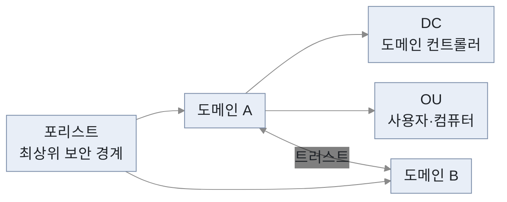
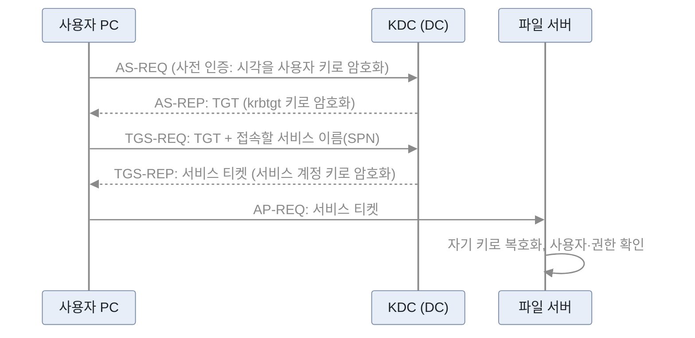
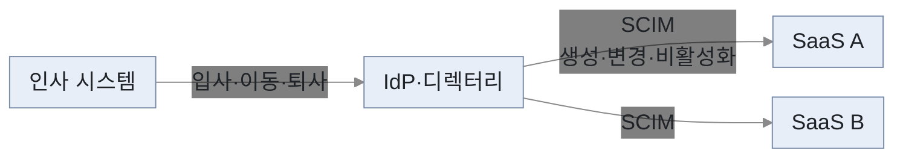

# Enterprise Identity (기업 디렉터리와 인증)

> 약어: RFC=IETF 표준 문서, IETF=인터넷 표준화 기구

## 1. 개요 (What)

기업의 신원 관리는 대부분 **디렉터리(Directory)** 를 중심으로 돌아간다. 디렉터리는 사용자·그룹·컴퓨터·서비스 계정 정보를 한곳에 모아 두고, 여러 시스템이 그 정보로 인증과 권한 판단을 하게 하는 저장소다.

| 기술 | 역할 | 비유 |
|------|------|------|
| LDAP(Lightweight Directory Access Protocol) | 디렉터리를 조회·수정하는 **표준 프로토콜** | 전화번호부를 찾아보는 방법 |
| AD(Active Directory) | Microsoft의 디렉터리 서비스. LDAP·Kerberos·DNS(Domain Name System)·그룹 정책을 묶은 **기업 신원 플랫폼** | 회사 전체의 인사·출입 관리 시스템 |
| Kerberos | 티켓으로 인증하는 **네트워크 인증 프로토콜**. AD 도메인 로그인의 기본 방식 | 매표소에서 받은 표로 각 시설에 입장 |
| SCIM(System for Cross-domain Identity Management) | 계정 생성·변경·삭제를 다른 시스템(SaaS(Software as a Service) 등)에 **자동 동기화**하는 API(Application Programming Interface) 규격 | 인사 발령을 각 부서 명부에 자동 반영 |

이 문서는 기업 내부 인증의 구조와 그 구조가 만드는 약점을 다룬다. SSO(Single Sign-On)와 외부 서비스 연합은 [Federation & SSO](federation-sso.md), 인증 공격 기법 전반은 [Identity Attacks](identity-attacks.md)에서 다룬다.

## 2. 배경 / 원리 (Why & How)

### 2.1 디렉터리의 구조

LDAP 디렉터리는 항목(Entry)을 나무 구조로 저장한다. 각 항목은 고유한 이름 DN(Distinguished Name)과 속성(Attribute)을 가진다.

```text
dc=example,dc=com                         ← 도메인 (최상위)
├── ou=Employees                          ← 조직 단위 (OU)
│   ├── cn=Alice Kim   (mail, memberOf …) ← 사용자 항목
│   └── cn=Bob Lee
├── ou=Servers
│   └── cn=web01                          ← 컴퓨터 항목
└── ou=Groups
    └── cn=Finance-Admins (member …)      ← 그룹 항목
```

| 개념 | 뜻 |
|------|----|
| DN | 항목의 전체 경로 이름. 예: `cn=Alice Kim,ou=Employees,dc=example,dc=com` |
| OU(Organizational Unit) | 항목을 묶는 폴더. 관리 위임과 정책 적용 단위 |
| 그룹 | 권한을 묶어 부여하는 단위. 그룹 안에 그룹을 넣는 중첩이 가능하다 |
| 바인드 (Bind) | LDAP 서버에 "나는 누구다"라고 인증하는 동작 |

**LDAP 바인드 방식**

| 방식 | 뜻 | 주의 |
|------|----|------|
| 익명 (Anonymous) | 인증 없이 조회 | 디렉터리 정보 노출. 꺼 두는 것이 원칙 |
| 단순 (Simple) | DN과 비밀번호를 그대로 전송 | **암호화되지 않은 연결에서는 비밀번호가 평문으로 노출**. LDAPS(LDAP over TLS(Transport Layer Security)) 또는 StartTLS 필수 |
| SASL(Simple Authentication and Security Layer) | Kerberos 등 별도 인증 방식을 사용 | 서명·채널 바인딩 설정을 함께 확인 |

### 2.2 Active Directory의 구조



텍스트 설명: 포리스트(Forest)는 하나 이상의 도메인을 묶는 최상위 단위이자 **실질적인 보안 경계**다. 각 도메인에는 디렉터리 데이터와 인증을 담당하는 DC(Domain Controller)가 있고, 사용자와 컴퓨터는 OU로 정리된다. 도메인 사이에는 트러스트(Trust)를 맺어 서로의 사용자를 인증할 수 있다.

| 구성 요소 | 역할 | 보안 의미 |
|-----------|------|-----------|
| DC | 디렉터리 데이터베이스 보관, Kerberos KDC(Key Distribution Center) 역할 | 모든 계정의 비밀 키를 가진다. **DC를 장악하면 도메인 전체를 장악**한다 |
| 그룹 정책 (GPO(Group Policy Object)) | 도메인 컴퓨터에 설정·스크립트를 일괄 배포 | GPO 수정 권한은 연결된 모든 컴퓨터의 관리자 권한과 같다 |
| 특권 그룹 | Domain Admins, Enterprise Admins 등 | 구성원 수를 최소화하고 변경을 감시한다 |
| 트러스트 | 다른 도메인·포리스트의 사용자 인증 허용 | 신뢰한 쪽이 뚫리면 이쪽도 영향받는다 |
| 서비스 계정 | 애플리케이션·서비스가 쓰는 계정 | 비밀번호가 오래 바뀌지 않고 권한이 과한 경우가 많다 |

### 2.3 Kerberos — 티켓으로 인증하기

Kerberos는 **비밀번호를 네트워크로 보내지 않고**, 신뢰하는 제3자(KDC)가 발급한 티켓으로 서비스에 인증한다.



텍스트 설명:
1. **로그인(AS(Authentication Service) 교환)**: 일반적인 사전 인증 방식에서 사용자 PC는 비밀번호에서 만든 장기 키로 현재 시각을 암호화해 보낸다(PA-ENC-TIMESTAMP). KDC는 이를 복호화해 사용자가 그 키를 가졌음을 확인한다. KDC가 이를 확인하면 TGT(Ticket Granting Ticket)를 준다. TGT는 KDC만 아는 `krbtgt` 계정의 키로 암호화되어 있다.
2. **서비스 티켓 요청(TGS(Ticket Granting Service) 교환)**: 파일 서버에 접속하려면 TGT를 제시하며 서비스 이름 SPN(Service Principal Name)을 말한다. KDC는 **그 서비스 계정의 키로 암호화한** 서비스 티켓을 준다.
3. **서비스 접속(AP(Application) 교환)**: 사용자 PC가 서비스 티켓을 파일 서버에 제시하면, 서버는 자기 키로 복호화해 사용자와 권한 정보를 확인한다.

- 한 번 로그인하면 TGT로 여러 서비스 티켓을 받으므로 사내 SSO가 된다.
- 티켓에는 유효기간이 있고, 클라이언트·KDC·서비스 서버의 **시계가 맞아야** 동작한다(재전송 방지). Windows 환경의 기본 허용 오차는 보통 5분이며 설정에 따라 다르다.
- AD에서는 TGT와 서비스 티켓에 사용자의 그룹 정보 등을 담은 PAC(Privilege Attribute Certificate)가 들어가, 서비스가 권한을 판단하는 데 쓴다. PAC는 표준 Kerberos(*RFC 4120*)가 아니라 **Microsoft 확장**(MS-KILE, MS-PAC)이며, 서비스 티켓에서는 조건에 따라 생략될 수도 있다.

**Kerberos 구조가 만드는 약점** — 이후 공격의 근거가 된다.

| 구조 | 약점 |
|------|------|
| TGT는 `krbtgt` 키로 암호화 | `krbtgt` 키가 유출되면 **누구의 TGT든 위조**할 수 있다 (Golden Ticket) |
| 서비스 티켓은 서비스 계정 키로 암호화 | 도메인 사용자는 누구나 서비스 티켓을 요청할 수 있으므로, 받은 티켓을 오프라인에서 대입해 **서비스 계정 비밀번호를 알아낼 수 있다** (Kerberoasting) |
| 서비스 계정 키를 알면 서비스 티켓 위조 가능 | 특정 서비스에 대한 티켓 위조 (Silver Ticket) |
| 사전 인증을 끈 계정 | 비밀번호 없이 AS-REP를 받아 오프라인 대입 가능 (AS-REP Roasting) |
| 티켓·키가 메모리에 있음 | 장악한 PC에서 티켓을 훔쳐 재사용 (Pass-the-Ticket) |

### 2.4 NTLM — 남아 있는 레거시

NTLM(NT LAN Manager)은 Kerberos 이전의 Windows 인증 방식으로, 서버가 보낸 Challenge에 **비밀번호 해시로 응답**한다.

| 공격 | 원리 | 핵심 |
|------|------|------|
| Pass-the-Hash | 탈취한 NT 해시로 비밀번호 원문 없이 인증 | NT 해시 자체가 자격 증명처럼 쓰인다. 주로 내부망 횡적 이동(Lateral Movement)에 악용 |
| NTLM Relay | 피해자의 NTLM 인증 메시지를 공격자가 다른 서버로 실시간 중계 | 해시를 훔치지 않아도 피해자 권한으로 접근한다. SMB·LDAP 서명, 채널 바인딩, EPA(Extended Protection for Authentication)로 막는다 |

- Kerberos를 쓸 수 없는 경우(IP(Internet Protocol) 주소로 접속, 도메인 외부 등) 자동으로 NTLM으로 내려가는 경우가 많다.
- **폐기 현황**: Microsoft는 NTLM을 Deprecated로 분류하고 Kerberos 중심으로 전환하는 단계적 계획을 추진하고 있다. NTLMv1은 Windows 11 24H2와 Windows Server 2025에서 제거됐고, NTLMv2는 아직 동작하지만 Deprecated 상태다. 다음 주요 Windows Server 릴리스에서는 네트워크 NTLM을 기본 비활성화할 계획이며, 이 단계에서도 정책으로 다시 켤 수 있다. "NTLM이 이미 제거됐다"는 설명은 정확하지 않다.

### 2.5 SCIM — 계정 생명주기 자동화

[Identity Fundamentals](identity-fundamentals.md)에서 본 입사–이동–퇴사(Joiner–Mover–Leaver) 흐름을 수십 개 SaaS에 일일이 반영하기는 어렵다. SCIM은 이를 **표준 REST(Representational State Transfer) API로 자동화**한다.



텍스트 설명: 인사 시스템의 변경이 IdP(Identity Provider)나 디렉터리에 반영되면, IdP는 SCIM API로 각 SaaS에 계정 생성·속성 변경·비활성화를 보낸다. 퇴사 처리 한 번으로 연결된 서비스의 계정이 함께 정리된다.

| 동작 | SCIM 요청 예 |
|------|--------------|
| 계정 생성 | `POST /Users` |
| 조회 | `GET /Users?filter=userName eq "alice"` |
| 속성 변경 | `PATCH /Users/{id}` |
| 비활성화 | `PATCH /Users/{id}` 로 `active`를 `false`로 |
| 삭제 | `DELETE /Users/{id}` |
| 그룹 관리 | `/Groups` 자원으로 구성원 추가·제거 |

- [Federation & SSO 3.4 계정 연결과 프로비저닝](federation-sso.md#34-계정-연결과-프로비저닝)에서 본 JIT 방식은 퇴사를 반영하지 못한다. SCIM은 **비활성화까지 전달**하므로 퇴사자 계정 정리에 유리하다.
- SCIM 엔드포인트는 계정을 만들고 권한 그룹을 바꿀 수 있는 강력한 API다. 접근 토큰을 짧은 수명·최소 권한으로 관리하고, 요청 출처를 제한한다.

## 3. 상세 (Details)

### 3.1 특권 계정 분리 — 계층 모델

AD 침해의 대부분은 **관리자 계정이 덜 안전한 컴퓨터에 로그인했다가 그 자격 증명을 빼앗기는** 데서 시작한다. 이를 막기 위해 자산을 중요도에 따라 층으로 나눈다.

| 계층 | 자산 | 원칙 |
|------|------|------|
| 최상위 (Tier 0) | DC, AD 관리 계정, IdP·동기화 서버, 인증서 발급 서버(AD CS(Active Directory Certificate Services)) | 이 계층 계정은 이 계층 시스템에만 로그인 |
| 서버 (Tier 1) | 업무 서버, 애플리케이션 | 서버 관리자 계정을 분리 |
| 사용자 (Tier 2) | 직원 PC, 업무 단말 | 일상 업무 계정. 상위 계층 계정으로 로그인 금지 |

- **상위 계층 계정은 하위 계층 시스템에 로그인하지 않는다.** 직원 PC가 악성코드에 감염되어도 도메인 관리자 자격 증명이 그 PC 메모리에 남지 않게 하기 위해서다.
- 관리 작업은 전용 관리 단말(PAW(Privileged Access Workstation))에서 한다.
- Microsoft는 이 계층 모델을 폐기하지 않고, 클라우드·SaaS·API·자동화까지 포함하는 Enterprise Access Model로 확장했다. 대략 Tier 0은 Control Plane, Tier 1은 Management Plane과 Data/Workload Plane, Tier 2는 일반 사용자·애플리케이션 접근 경로(User and App Access)에 대응한다.
- 특권 접근 관리 전반은 [Access Control](../access-control/README.md) (작성 예정)에서 다룬다.

### 3.2 서비스 계정 관리

| 문제 | 대응 |
|------|------|
| 사람이 정한 비밀번호, 수년간 미변경 | 관리형 서비스 계정 gMSA(group Managed Service Account). Windows가 긴 무작위 비밀번호를 자동 관리·주기 변경하고, 여러 서버가 같은 서비스 주체를 쓸 수 있어 SPN 관리도 쉬워진다. 운영자가 비밀번호를 직접 다루지 않는다 |
| 서비스 계정이 Domain Admins 구성원 | 필요한 권한만 부여, 대화형 로그인 금지 |
| SPN이 등록된 일반 사용자 계정 | Kerberoasting 대상. 비밀번호 강도 확인, 관리형 계정으로 전환 |
| 각 PC 로컬 관리자 비밀번호가 모두 같음 | 한 대가 뚫리면 Pass-the-Hash로 전체로 확산. **Windows LAPS**(Local Administrator Password Solution)로 기기마다 다른 로컬 관리자 비밀번호를 자동 변경해 AD 또는 Microsoft Entra ID에 안전하게 저장한다. DC의 DSRM(Directory Services Restore Mode) 계정도 관리할 수 있다. 예전의 별도 설치형 Legacy Microsoft LAPS는 Deprecated다 |

### 3.3 프로토콜 보호 설정

| 설정 | 막는 공격 |
|------|-----------|
| LDAP 서명·채널 바인딩 요구 | LDAP 중계·변조 |
| LDAPS 또는 StartTLS, 단순 바인드 평문 금지 | 비밀번호 도청 |
| SMB(Server Message Block) 서명 요구 | NTLM Relay를 통한 파일 서버 접근 |
| Kerberos 암호화 방식을 AES(Advanced Encryption Standard)로 제한, RC4 제거 | Kerberoasting 난이도 상승, 약한 암호 제거. RC4-HMAC은 NT 해시를 그대로 키로 쓴다 |
| NTLM 사용 감사 후 단계적 차단 | Pass-the-Hash, NTLM Relay |
| 특권 계정을 Protected Users 그룹에 추가 | 자격 증명 탈취와 재사용 (아래 표) |
| 제한 없는 위임(Unconstrained Delegation) 제거 | 위임된 서버에서 다른 사용자의 TGT 탈취 |

**Protected Users 그룹의 효과**

| 항목 | 효과 |
|------|------|
| NTLM | DC에서 NTLM 인증 불가 |
| Kerberos 암호화 | DES(Data Encryption Standard)·RC4 사용 불가, AES 필요 |
| 위임 | Kerberos 위임 불가 |
| 자격 증명 캐시 | NTLM·Digest·CredSSP(Credential Security Support Provider) 자격 증명 캐시 제한, 초기 TGT 이후 장기 키 캐시 제한 |
| TGT 수명 | 4시간으로 제한 |

- NTLM이나 위임에 의존하는 오래된 시스템은 인증이 실패할 수 있으므로 시험 후 적용한다.

**Kerberos RC4 폐기 일정**: Microsoft는 RC4를 단계적으로 줄여 왔다. 2022-11-08 업데이트부터 암호화 유형이 지정되지 않은 계정에 AES를 기본 사용하도록 바꿨고, 2026년에는 감사·준비(1월), KDC 기본 동작의 AES 전환과 임시 롤백 허용(4월)을 거쳐 7월 업데이트부터 Enforcement 단계를 적용했다. 모든 RC4 사용이 한 번에 사라진 것이 아니라 **DC의 서비스 티켓 발급 기본 처리**가 바뀐 것이므로, RC4에 의존하는 서비스 계정·비 Windows 장비·오래된 애플리케이션은 AES 지원 여부를 점검해 전환해야 한다.

### 3.4 하이브리드 신원 — 온프레미스와 클라우드

많은 기업은 온프레미스 AD를 클라우드 IdP와 동기화해 클라우드 서비스에도 같은 계정으로 로그인한다.

- **동기화 서버와 연합 서버는 최상위 계층 자산이다.** 이 서버를 장악하면 온프레미스와 클라우드 신원을 함께 조작할 수 있다. Golden SAML도 이 지점을 노린다 → [Federation & SSO](federation-sso.md)
- 클라우드 관리자 계정은 온프레미스에서 동기화된 계정이 아닌 **클라우드 전용(Cloud-native) 계정**으로 두고, 피싱 저항 인증과 조건부 접근을 적용하며, 온프레미스 계정에는 클라우드 관리자 권한을 주지 않는다(Microsoft 권고). 온프레미스 AD 침해가 클라우드 관리 권한으로 번지지 않게 하기 위해서다.
- 클라우드 쪽 역할·권한 설계는 [Cloud IAM](../../cloud-security/iam/README.md) (작성 예정)에서 다룬다.

### 3.5 AD CS 설정 오류 — PKI와 AD가 만나는 지점

AD CS는 도메인 안에서 인증서를 발급하고, AD는 그 인증서로 사용자 로그인(스마트카드·PKINIT(Public Key Cryptography for Initial Authentication) 등)을 받아들인다. 그래서 **인증서 템플릿 설정 하나가 도메인 관리자 권한으로 이어질 수 있다.**
SpecterOps가 2021년 발표한 연구 "Certified Pre-Owned: Abusing Active Directory Certificate Services"가 이런 오류 유형을 ESC1부터 번호를 붙여 정리했다.

대표 사례 ESC1은 다음 조건이 **함께** 있을 때 생긴다.

| 조건 | 뜻 |
|------|----|
| 낮은 권한 사용자가 등록(Enroll) 가능 | 일반 직원도 이 템플릿으로 인증서를 요청할 수 있다 |
| 요청자가 주체 이름을 지정 가능 | 요청 시 "나는 관리자다"라고 다른 사람의 이름을 SAN(Subject Alternative Name)에 넣을 수 있다 |
| 인증에 쓸 수 있는 EKU(Extended Key Usage) | Client Authentication 등 로그인에 쓰이는 용도가 들어 있다 |
| 관리자 승인 없음, 추가 서명 요구 없음 | 요청이 검토 없이 바로 발급된다 |

- 이 조건이 겹치면 일반 사용자가 도메인 관리자 명의의 인증서를 받아 그 인증서로 Kerberos 로그인을 할 수 있다.
- 점검은 "템플릿마다 누가 등록할 수 있고, 주체를 누가 정하며, 어떤 용도로 쓰이고, 승인 절차가 있는가"를 함께 본다. 인증서 발급 서버는 최상위 계층 자산이다 → [PKI & Certificates](pki-certificates.md)

### 3.6 다른 영역에서의 사용

| 영역 | 사용 예 |
|------|---------|
| 기업 IT | 직원 로그인, 파일 서버, 사내 웹 시스템의 Kerberos SSO |
| Cloud | 온프레미스 AD와 클라우드 IdP 동기화, SaaS 계정 SCIM 프로비저닝 |
| 통신 운영 | 5G 코어·OSS(Operations Support System) 운영자 계정을 기업 디렉터리와 연동. 운영 계정은 최상위 계층에 준해 관리 (가입자 인증인 5G-AKA(Authentication and Key Agreement)와는 다른 영역) |
| 개발 | LDAP을 인증 백엔드로 쓰는 애플리케이션. 사용자 입력을 검색 필터에 그대로 넣으면 LDAP 주입이 된다 |

## 4. 보안 관점 (Security Relevance)

| 실수 | 결과 | 대응 |
|------|------|------|
| 도메인 관리자가 일반 PC·서버에 로그인 | 그 PC에서 자격 증명 탈취 → 도메인 장악 | 계층 모델, 전용 관리 단말 |
| SPN이 붙은 서비스 계정에 약한 비밀번호 | Kerberoasting으로 비밀번호 복원 | gMSA, 긴 무작위 비밀번호, AES 전용 |
| 사전 인증 비활성화 계정 존재 | AS-REP Roasting | 사전 인증 필수, 해당 설정 정기 점검 |
| `krbtgt` 비밀번호 장기 미변경 | 유출 시 Golden Ticket이 오래 유효 | 정기 교체. 침해 의심 시 **두 번 재설정**하되 사이에 기본 10시간 이상(티켓 최대 수명보다 길게) 간격을 둔다. `krbtgt`는 최근 두 개의 비밀번호를 유효 키로 유지하기 때문이다 |
| DC 복제 권한이 일반 계정에 부여 | DCSync로 모든 계정 해시 추출 | 복제 권한 보유 계정 점검, 비정상 복제 요청 탐지 |
| 로컬 관리자 비밀번호 공통 | Pass-the-Hash로 전체 PC 확산 | Windows LAPS, 로컬 관리자 원격 로그인 제한 |
| NTLM·SMB·LDAP 서명 미적용 | NTLM Relay로 서버·디렉터리 조작 | 서명·채널 바인딩 요구, NTLM 축소 |
| LDAP 단순 바인드를 평문 연결로 사용 | 비밀번호 도청 | LDAPS·StartTLS 필수 |
| LDAP 익명 조회 허용 | 사용자·그룹 정보 수집 | 익명 바인드 비활성화 |
| 애플리케이션이 LDAP 필터에 입력을 그대로 삽입 | LDAP 주입으로 인증 우회·정보 노출 | 입력 이스케이프, 파라미터화된 조회 |
| AD CS 인증서 템플릿 설정 오류 (ESC1 등) | 일반 사용자가 관리자 명의 인증서를 발급받아 인증 | 등록 권한·주체 지정·EKU·승인 절차 점검 (3.5) |
| GPO·특권 그룹 변경 미감시 | 공격자가 지속성 확보 | 변경 감사와 알림 |
| SCIM 토큰 장기·과권한 | 토큰 유출 시 계정·그룹 임의 조작 | 짧은 수명, 최소 권한, 출처 제한 |
| 퇴사 시 디렉터리만 비활성화 | SaaS 계정·세션·API 키 잔존 | SCIM 비활성화, 세션·토큰 폐기 절차 |

점검 시 확인할 것: 특권 그룹 구성원과 변경 이력, 관리자 계정의 로그인 위치, SPN 등록 계정과 비밀번호 수명, 사전 인증 비활성화 계정, `krbtgt` 교체 이력, DC 복제 권한 보유 계정, 로컬 관리자 비밀번호 관리, LDAP·SMB 서명과 채널 바인딩, LDAP 익명·평문 바인드, Kerberos 암호화 방식, NTLM 사용 현황, 위임 설정, AD CS 템플릿, 동기화·연합 서버 보호, SCIM 연동과 퇴사 처리 절차.

## 5. 심화 (Advanced)

> 보안 컨설턴트·점검자를 위한 규격 세부다. 본문만으로 개념 이해에는 충분하다.

### 5.1 Kerberos 메시지와 키

메시지 전체가 하나의 키로 암호화되는 것이 아니라, 응답의 암호화된 부분(`enc-part`)과 그 안에 든 티켓이 **서로 다른 키**로 보호된다.

| 교환 | 보호 대상 | 키 |
|------|-----------|----|
| AS | AS-REP의 암호화된 응답 부분 | 사용자의 장기 키 (비밀번호에서 파생) |
| AS | AS-REP에 든 TGT | `krbtgt` 계정의 장기 키 |
| TGS | TGS-REP의 암호화된 응답 부분 | TGT 세션 키 (요청 Authenticator에 서브세션 키가 있으면 그 키) |
| TGS | TGS-REP에 든 서비스 티켓 | 대상 서비스 계정의 장기 키 |
| AP | AP-REQ의 Authenticator | 서비스 티켓에 든 클라이언트–서비스 세션 키 |

- 사전 인증(Pre-authentication)은 AS-REQ에 사용자 키로 암호화한 타임스탬프(PA-ENC-TIMESTAMP)를 넣어, KDC가 아무에게나 사용자 키로 암호화된 응답을 주지 않게 한다. Kerberos의 유일한 사전 인증 방식은 아니지만 가장 흔하다.
- AES 방식의 키는 비밀번호와 Salt(계정 정보)로부터 파생된다. RC4-HMAC 방식은 키가 NT 해시(MD4(Message Digest 4)(UTF-16 비밀번호))와 같아서, NT 해시 유출이 곧 Kerberos 키 유출이 된다. RC4-HMAC을 정의한 *RFC 4757*은 *RFC 8429*에 의해 Historic으로 옮겨졌다.

### 5.2 공격 기법과 MITRE ATT&CK 대응

MITRE ATT&CK(Adversarial Tactics, Techniques, and Common Knowledge) Enterprise v20.1의 기법 분류와 대응시키면 탐지 규칙과 점검 항목을 맞추기 쉽다.

| 공격 | ATT&CK 기법 | 탐지 단서 |
|------|-------------|-----------|
| Kerberoasting | Steal or Forge Kerberos Tickets: Kerberoasting (T1558.003) | 짧은 시간 다수의 서비스 티켓 요청, RC4 서비스 티켓 요청 |
| AS-REP Roasting | Steal or Forge Kerberos Tickets: AS-REP Roasting (T1558.004) | 사전 인증 없는 AS 요청 |
| Golden Ticket | Steal or Forge Kerberos Tickets: Golden Ticket (T1558.001) | KDC 발급 기록이 없는 TGT 사용, 비정상 수명 티켓 |
| Silver Ticket | Steal or Forge Kerberos Tickets: Silver Ticket (T1558.002) | DC에 TGS 요청 기록 없이 서비스 접속 |
| Pass-the-Hash | Use Alternate Authentication Material: Pass the Hash (T1550.002) | 비정상 NTLM 로그인 |
| Pass-the-Ticket | Use Alternate Authentication Material: Pass the Ticket (T1550.003) | 다른 호스트에서 같은 티켓 사용 |
| DCSync | OS Credential Dumping: DCSync (T1003.006) | DC가 아닌 호스트의 디렉터리 복제 요청 |

- Golden Ticket은 `krbtgt` 키로 **TGT**를, Silver Ticket은 특정 서비스 계정 키로 **그 서비스의 티켓**을 위조한다.
- DCSync는 티켓 위조가 아니라 **자격 증명 덤프**(Credential Access) 기법이다. DCSync로 `krbtgt` 해시를 얻은 뒤 Golden Ticket으로 이어지는 경우가 많다.
- 공격 단계별 상세와 다른 신원 공격(Credential Stuffing, MFA(Multi-Factor Authentication) Fatigue 등)은 [Identity Attacks](identity-attacks.md)에서 다룬다.

### 5.3 SCIM 2.0 규격 구성

| 규격 | 다루는 내용 |
|------|-------------|
| *RFC 7642* | SCIM 개념·사용 사례·요구 사항 |
| *RFC 7643* | 핵심 스키마 (User, Group, Enterprise User 확장) |
| *RFC 7644* | 프로토콜 (HTTP(Hypertext Transfer Protocol) 메서드, 필터, 페이지 처리, 일괄 요청) |

- SCIM은 인증·인가 방식을 스스로 정의하지 않는다. TLS 클라이언트 인증(mTLS), HTTP 표준 인증, OAuth 2.0 Bearer Token 등을 쓸 수 있으며, 규격의 예시가 Bearer Token을 쓰는 것은 구현 관행을 반영한 것이지 필수 요구가 아니다 → [Token Security](token-security.md)
- `active`를 `false`로 바꾸는 것은 삭제가 아니라 **비활성화**다. 계정과 이력은 남고 로그인만 막힌다.

```text
PATCH /Users/2819c223-7f76-453a-919d-413861904646
Authorization: Bearer <access_token>
Content-Type: application/scim+json

{
  "schemas": ["urn:ietf:params:scim:api:messages:2.0:PatchOp"],
  "Operations": [{ "op": "replace", "path": "active", "value": false }]
}
```

### 5.4 표준 문서 체계

| 규격 | 다루는 내용 |
|------|-------------|
| *RFC 4120* | Kerberos V5 (Proposed Standard, 이후 여러 RFC가 갱신) |
| *RFC 3961* / *RFC 3962* | Kerberos 암호화·체크섬 프레임워크 / AES 암호화 유형 |
| *RFC 4757* | RC4-HMAC 암호화 유형 (Historic) |
| *RFC 8429* | Kerberos의 RC4·3DES 사용 폐기 (BCP 218) |
| *RFC 4510~4519* | LDAPv3 기술 명세 묶음. *RFC 4510*이 로드맵, *RFC 4511*이 프로토콜 |
| *RFC 7642* / *RFC 7643* / *RFC 7644* | SCIM 2.0 개념(Informational) / 스키마 / 프로토콜 |
| Microsoft Open Specifications: MS-KILE (Kerberos Protocol Extensions), MS-PAC (Privilege Attribute Certificate Data Structure), MS-NLMP (NT LAN Manager (NTLM) Authentication Protocol) | AD의 Kerberos 확장, PAC 구조, NTLM |

- 규격 상태는 [PKI & Identity 3. 기준 표준](README.md#3-기준-표준)에 정리되어 있다.

## 관련 문서

- 이전: [Federation & SSO](federation-sso.md)
- 다음: [Workload Identity](workload-identity.md)
- 인증 공격 유형: [Identity Attacks](identity-attacks.md)
- 인증서 발급 서버: [PKI & Certificates](pki-certificates.md)
- 생명주기: [Identity Fundamentals](identity-fundamentals.md)
- 로드맵: [PKI & Identity](README.md)

## 출처

| 문서 | 지위 / 버전 | 이 문서에서의 사용 |
|------|-------------|-------------------|
| *RFC 4120* | Proposed Standard | Kerberos 메시지 흐름, 키 대응, 사전 인증, 시계 오차 |
| *RFC 4757* / *RFC 8429* | Historic / BCP 218 | RC4-HMAC 키와 NT 해시, RC4 폐기 |
| *RFC 4511* (*RFC 4510~4519*) | Proposed Standard | LDAP 바인드, 디렉터리 구조 |
| *RFC 7642* / *RFC 7643*, *RFC 7644* | Informational / Proposed Standard | SCIM 자원·프로토콜, 인증 방식 비강제 |
| Microsoft Open Specifications (MS-KILE, MS-PAC, MS-NLMP) | Microsoft 공개 규격 | AD Kerberos 확장, PAC, NTLM |
| Microsoft 보안 문서 (AD DS 계층 모델, Enterprise Access Model, Protected Users, gMSA, Windows LAPS, AD 포리스트 복구, NTLM·RC4 폐기 로드맵) | 제조사 기술 문서 | 운영 권고, 폐기 일정 |
| SpecterOps, "Certified Pre-Owned: Abusing Active Directory Certificate Services" (2021) | 보안 연구 | AD CS 설정 오류(ESC1) |
| MITRE ATT&CK Enterprise | v20.1 (2026-11-05) | 공격 기법 분류 |

- 계층 모델, 서비스 계정 관리, 프로토콜 보호 설정은 위 규격과 AD 보안 운영의 일반 원칙을 재구성한 해설이다.
