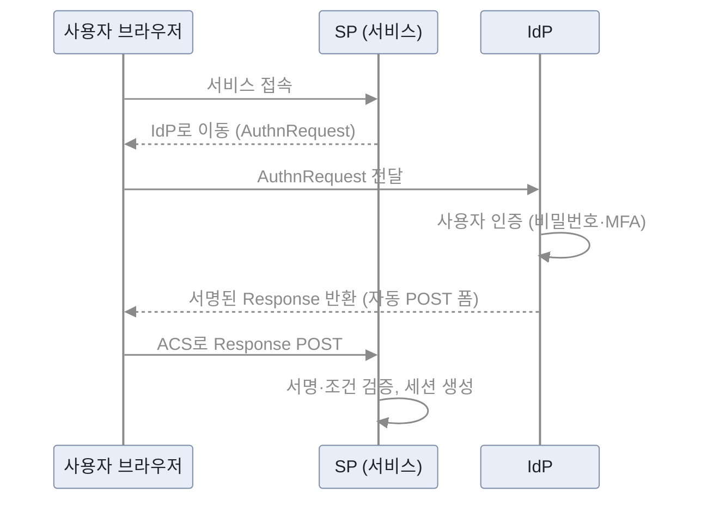

# Federation & SSO (연합 인증과 SSO)

> 약어: OASIS=구조화 정보 표준 촉진 기구, NIST=미국 국립표준기술연구소, NIST SP=NIST 특별 간행물, W3C=웹 표준화 기구

## 1. 개요 (What)

SSO(Single Sign-On)는 **한 번 로그인하면 여러 서비스를 다시 로그인하지 않고 쓰는 것**이다. 연합 인증(Identity Federation)은 그것을 가능하게 하는 **신뢰 구조**다.
한 기관의 IdP(Identity Provider)가 사용자를 인증하고, 다른 서비스(SP(Service Provider) 또는 RP(Relying Party))는 IdP가 보낸 **서명된 인증 결과**를 믿고 사용자를 받아들인다.

| 용어 | 뜻 |
|------|----|
| IdP | 사용자를 인증하고 인증 결과를 발급하는 쪽 |
| SP / RP | 인증 결과를 받아 사용자를 들여보내는 서비스. SAML(Security Assertion Markup Language)에서는 SP, OIDC(OpenID Connect)에서는 RP라고 부른다 |
| Assertion | IdP가 발급하는 서명된 인증 결과. SAML의 Assertion, OIDC의 ID Token이 여기에 해당한다 |
| 연합 (Federation) | IdP와 SP가 서로의 식별자·키·주소를 교환해 맺은 신뢰 관계 |

연합 인증은 [Identity Fundamentals](identity-fundamentals.md)에서 본 세 기능(신원 증명·인증·연합) 중 **연합**에 해당한다. 서비스가 직접 인증하지 않고 IdP의 결과를 믿는 구조이므로, **IdP의 서명 키와 SP의 검증 로직이 전체 보안을 좌우한다.**

이 문서는 기업 SSO에서 여전히 널리 쓰이는 SAML 2.0을 중심으로 연합 구조를 설명하고, OIDC와 비교한다. OIDC 자체의 흐름은 [OAuth 2.0 · OpenID Connect](oauth2-oidc.md)에서 다룬다.

## 2. 배경 / 원리 (Why & How)

### 2.1 왜 연합 인증을 쓰나

| 연합 없이 | 연합을 쓰면 |
|-----------|-------------|
| 서비스마다 계정·비밀번호가 따로 있다 | 사용자는 IdP 계정 하나만 관리한다 |
| 서비스마다 비밀번호를 저장하고 MFA(Multi-Factor Authentication)를 따로 구현한다 | 인증·MFA·잠금 정책을 IdP 한 곳에서 적용한다 |
| 퇴사자 계정을 서비스마다 지워야 한다 | IdP 계정을 막으면 새 로그인이 모두 막힌다 |
| 외부 협력사 직원에게 계정을 새로 만들어 준다 | 협력사 IdP를 신뢰해 그 직원 계정으로 접속시킨다 |

- 대신 **IdP가 단일 실패 지점**이 된다. IdP가 뚫리거나 서명 키가 유출되면 연결된 모든 서비스가 함께 뚫린다(4장의 Golden SAML).
- IdP 계정을 막아도 **이미 만들어진 서비스 세션**은 남아 있을 수 있다. 서비스 세션 수명과 로그아웃 처리를 함께 설계해야 한다(3.5).

### 2.2 신뢰는 어떻게 맺어지나 — 메타데이터

IdP와 SP는 연결 전에 **메타데이터(Metadata)** 를 교환한다.

| 메타데이터 항목 | 뜻 |
|-----------------|----|
| Entity ID | IdP·SP의 고유 식별자 (보통 URL(Uniform Resource Locator) 형태) |
| 서명·암호화 인증서 | IdP의 Assertion 서명 검증용 공개키, SP의 암호화용 공개키 |
| 엔드포인트 | SSO 요청을 받는 주소, Assertion을 받는 주소(ACS(Assertion Consumer Service)), 로그아웃 주소 |
| 지원 방식 | 사용 가능한 바인딩, 이름 식별자 형식 |

- SP가 신뢰하는 것은 결국 **메타데이터에 적힌 IdP 서명 인증서**다. 메타데이터를 어떤 경로로 받고 언제 갱신하는지가 신뢰의 출발점이다.
- SAML 서명 인증서는 웹 TLS(Transport Layer Security) 인증서와 달리 CA(Certificate Authority) 체인보다 **메타데이터에 고정된 인증서(또는 공개키)** 로 신뢰하는 경우가 많다. 그래서 인증서 만료나 교체 시 양쪽 메타데이터를 함께 바꿔야 한다 → [PKI & Certificates](pki-certificates.md)
- 대학·연구기관처럼 수많은 기관이 참여하는 다자간 연합에서는 연합 운영기관이 서명한 메타데이터 묶음을 배포해 신뢰를 관리한다.

### 2.3 SAML 2.0 Web Browser SSO (SP 시작 흐름)

텍스트 설명:
1. 사용자가 서비스(SP)에 접속하면, SP는 인증 요청(AuthnRequest)을 만들어 사용자를 IdP로 보낸다.
2. IdP는 사용자를 인증한다. 이미 IdP 세션이 있으면 다시 묻지 않는다. 이것이 SSO다.
3. IdP는 사용자 정보를 담은 Assertion에 서명해 Response를 만들고, 브라우저가 이를 SP의 ACS 주소로 자동 전송(POST)하게 한다.
4. SP는 서명과 유효 조건을 검증한 뒤 자기 세션을 만든다.

- Assertion은 **브라우저를 거쳐** 전달된다(Front-channel). 사용자나 공격자가 중간에 내용을 보고 바꿀 수 있으므로, SP는 서명 검증을 절대 생략하면 안 된다.
- *SAML 2.0* 규격의 기본 문법(Core)에서는 Response와 Assertion의 서명이 모두 선택 요소지만, Web Browser SSO 프로파일에서 HTTP POST 바인딩으로 Response를 보낼 때는 **안에 든 Assertion이 반드시 서명되어야 한다.** "Response에 서명이 있으니 충분하다"고 일반화하지 않는다. 상위 요소의 서명이 하위 요소를 덮는 서명 상속(Signature Inheritance)을 적용하려면 프로파일 요구와 서명 범위를 명시적으로 확인해야 하며, 실무에서는 Assertion 자체의 서명을 검증하는 구성을 우선한다.
- 개인정보가 많이 담기면 Assertion을 SP의 공개키로 **암호화**해 브라우저에서 내용이 보이지 않게 한다.

### 2.4 IdP 시작 흐름 (IdP-initiated)

사용자가 IdP 포털에서 앱 아이콘을 눌러 SP로 바로 들어가는 방식이다. 요청 없이 오는 응답(Unsolicited Response)이므로, Response와 Assertion 안의 SubjectConfirmationData **둘 다에 `InResponseTo`가 없어야 한다.** SP는 이 응답이 요청하지 않은 응답임을 구분해 처리해야 한다.

- SP는 "이 Response가 내가 요청한 것에 대한 답인가"를 확인할 수 없다. 그래서 **공격자가 자기 계정의 Response를 피해자 브라우저로 보내는 로그인 CSRF(Cross-Site Request Forgery)**, 가로챈 Response의 재전송에 더 취약하다.
- 가능하면 SP 시작 흐름을 쓰고, IdP 시작 흐름을 받는다면 재전송 방지와 짧은 유효기간을 엄격히 적용한다.

## 3. 상세 (Details)

### 3.1 SAML Assertion의 구성

| 요소 | 뜻 | SP가 확인할 것 |
|------|----|----------------|
| `Issuer` | 발급한 IdP의 Entity ID | 신뢰하는 IdP인지 |
| `Signature` | XML(Extensible Markup Language) 전자서명 | 메타데이터의 IdP 인증서로 검증, **검증한 바로 그 요소의 값**을 사용하는지 |
| `Subject` / `NameID` | 사용자 식별자 | 영구 식별자인지, 형식이 기대와 같은지 |
| `SubjectConfirmation` | 이 Assertion을 제시할 수 있는 조건 (수신 주소 `Recipient`, 만료 `NotOnOrAfter`, 요청 ID `InResponseTo`) | 자신의 ACS 주소, 만료, 자신이 보낸 요청 ID와 일치하는지 |
| `Conditions` | 유효 기간(`NotBefore`·`NotOnOrAfter`), 대상(`AudienceRestriction`) | 자신의 Entity ID가 대상에 포함되는지 |
| `AuthnStatement` | 인증 시각, 인증 방식(`AuthnContext`), IdP 세션 번호(`SessionIndex`) | 필요한 인증 강도(예: MFA)를 충족하는지 |
| `AttributeStatement` | 이메일, 부서, 그룹 등 속성 | 신뢰할 속성만, 기대한 범위에서만 사용 |

- `Issuer`와 `Subject`는 필수다. `Signature`는 Core에서는 선택이지만 프로파일이 요구할 수 있다(2.3). `Conditions`와 `AttributeStatement`는 선택이지만, `Conditions`가 있으면 그 조건을 **반드시 평가**해야 한다. Web Browser SSO의 성공 응답에는 `AuthnStatement`가 있어야 한다.
- 유효기간이 두 군데 있다. `Conditions`의 `NotBefore`·`NotOnOrAfter`는 **Assertion 전체**의 유효기간이고, `SubjectConfirmationData`의 `NotOnOrAfter`는 **이 Assertion을 제시할 수 있는 기한**이다. 둘을 혼동하지 않는다.
- `InResponseTo`도 두 군데 있다. Response 요소의 값과 SubjectConfirmationData의 값을 **각각** 자신이 보낸 요청 ID와 대조한다.
- SAML의 `AudienceRestriction`은 OIDC ID Token의 `aud`, `InResponseTo`는 OIDC의 `nonce`·`state`와 비슷한 역할을 한다.

### 3.2 SAML의 네 가지 구성 층

| 층 | 뜻 | 예 |
|----|----|----|
| Assertion | 인증·속성 정보를 담는 형식 | 인증 문장, 속성 문장 |
| Protocol | 요청과 응답 메시지 | AuthnRequest, Response, LogoutRequest |
| Binding | 메시지를 실어 나르는 방법 | HTTP(Hypertext Transfer Protocol) Redirect(GET 요청의 URL 파라미터), HTTP POST(HTML(HyperText Markup Language) 폼), HTTP Artifact, SOAP(Simple Object Access Protocol)(시스템 간 직접 통신) |
| Profile | 위 세 가지를 조합한 사용 시나리오 | Web Browser SSO, Single Logout |

- HTTP Artifact 바인딩은 브라우저에 실제 메시지 대신 **참조 값(Artifact)** 만 전달하고, SP와 IdP가 Artifact Resolution 절차(보통 SOAP 바인딩)로 실제 메시지를 직접 주고받는다. Assertion이 브라우저에 노출되지 않는다.
- 가장 흔한 조합은 AuthnRequest는 HTTP Redirect, Response는 HTTP POST다. Redirect는 메시지를 URL에 담아 길이 제한이 있고, Response는 Assertion과 속성 때문에 크기 때문이다. 다만 규칙이 아니라 일반적인 구성이며, AuthnRequest를 POST로, Response를 Artifact로 보낼 수도 있다.

### 3.3 SAML과 OIDC 비교

| 구분 | SAML 2.0 | OIDC |
|------|----------|------|
| 메시지 형식 | XML | JSON(JavaScript Object Notation), JWT(JSON Web Token) |
| 서명 | XML 전자서명 (XML Signature) | JWS(JSON Web Signature) |
| 주 사용처 | 기업 SSO, 대학 연합, 오래된 업무 시스템 | 소비자 로그인, 모바일 앱, 최신 SaaS(Software as a Service) |
| 모바일·SPA(Single Page Application) | 브라우저 POST 전제라 불편 | 잘 맞는다 |
| API 권한 위임 | 없음 (인증·속성 전달만) | OAuth 2.0과 함께 Access Token 사용 |
| 구현 난이도 | XML 서명 처리가 복잡하고 취약점이 잦다 | 상대적으로 단순하지만 검증 누락은 여전히 흔하다 |

- 새로 만드는 서비스는 OIDC를 우선 고려하는 경우가 많다. 다만 기업 고객이 SAML을 요구하는 경우가 많아, B2B(Business to Business) 서비스는 둘 다 지원하는 경우가 흔하다.
- 두 방식 모두 **IdP의 서명 키를 믿는 구조**라는 점은 같다. 보안 원칙도 대부분 겹친다.

### 3.4 계정 연결과 프로비저닝

연합 로그인이 성공했을 때 SP는 "이 사용자가 내 시스템의 어느 계정인가"를 정해야 한다.

| 방식 | 뜻 | 주의 |
|------|----|------|
| JIT(Just-in-Time) 프로비저닝 | 첫 로그인 때 Assertion 속성으로 계정을 자동 생성 | 퇴사·권한 변경이 SP에 반영되지 않는다 |
| SCIM(System for Cross-domain Identity Management) | IdP가 계정 생성·변경·삭제를 SP에 API(Application Programming Interface)로 미리 동기화 | 퇴사 시 SP 계정까지 정리된다 → [Enterprise Identity](enterprise-identity.md) |
| 이메일로 기존 계정 연결 | 같은 이메일의 기존 로컬 계정에 연결 | **위험.** IdP가 이메일 소유를 확인하지 않았거나, 다른 IdP가 같은 이메일을 주장하면 계정이 탈취된다 |

- 사용자 식별은 **IdP의 Entity ID(또는 `iss`) + 영구 식별자(NameID 또는 `sub`)** 조합으로 한다. 이메일이나 표시 이름은 식별자로 쓰지 않는다.
- 여러 IdP를 받는 SP(멀티 테넌트 SaaS)는 **IdP마다 허용 도메인·사용자 범위를 제한**해야 한다. 그렇지 않으면 A사 IdP 관리자가 B사 직원 이메일로 Assertion을 만들어 B사 계정에 들어갈 수 있다.

### 3.5 로그아웃과 세션

SSO 환경에는 세션이 여러 겹 있다.

| 세션 | 위치 | 끝나는 때 |
|------|------|-----------|
| IdP 세션 | IdP | IdP 로그아웃, 만료 |
| 서비스 세션 | 각 SP | 각 SP의 로그아웃, 만료 |

- 한 서비스에서 로그아웃해도 IdP 세션이 남아 있으면, 다시 접속하는 순간 비밀번호 없이 로그인된다.
- SLO(Single Logout)는 모든 SP 세션을 함께 끝내려는 기능이지만, SP 하나라도 응답하지 않으면 중간에 끊기는 등 **안정적으로 동작하기 어렵다.** 실무에서는 서비스 세션 수명을 짧게 두고, 퇴사·계정 정지 시 IdP 차단과 함께 SP 세션을 끊는 절차(SCIM 비활성화, 세션 강제 종료)를 별도로 둔다.
- 세션과 토큰의 수명·폐기 설계는 [Session & Token Lifecycle](session-token-lifecycle.md)에서 다룬다.

### 3.6 다른 영역에서의 사용

| 영역 | 사용 예 |
|------|---------|
| 기업 | 사내 IdP 하나로 업무 SaaS 전체 SSO, 협력사 IdP와의 연합 |
| Cloud | 클라우드 콘솔에 기업 IdP로 SAML·OIDC 로그인, 역할(Role)로 매핑 → [Cloud IAM](../../cloud-security/iam/README.md) (작성 예정) |
| 교육·연구 | 기관 간 다자간 연합으로 다른 기관 서비스 이용 |
| 통신 운영 | 5G 코어·운영 관리 포털의 운영자 로그인을 기업 IdP와 연합 (가입자 인증인 5G-AKA(Authentication and Key Agreement)와는 다른 영역) |

## 4. 보안 관점 (Security Relevance)

| 실수 | 결과 | 대응 |
|------|------|------|
| 서명 없는 Assertion·Response 수용, 서명 검증 생략 | 누구나 임의 사용자로 로그인 | 서명 필수, 메타데이터의 IdP 인증서로만 검증 |
| XML 서명 래핑(XSW(XML Signature Wrapping)): 서명된 요소와 실제로 읽는 요소가 다름 | 서명은 통과하고 위조된 사용자 정보가 사용됨 | 검증한 노드와 사용하는 노드의 동일성 보장, 서명 참조가 처리할 Assertion ID를 가리키는지 확인, 중복 ID 거부, 구조·Namespace 검증, 검증된 라이브러리 |
| `NameID`에 XML 주석을 끼워 넣는 공격 (`user@victim.com<!---->.attacker.com`) | 서명 검증(정규화)과 값 추출이 주석을 다르게 처리해 다른 사용자로 인식 | 서명 검증과 값 추출에 같은 해석 방식 적용, 전체 문자열 엄격 비교, 패치된 라이브러리 (사례는 아래 5.3) |
| XML 외부 엔티티 처리 허용 | XXE(XML External Entity)로 서버 파일 읽기·SSRF(Server-Side Request Forgery)·외부 유출, 엔티티 확장으로 DoS(Denial of Service) | DTD(Document Type Definition)·외부 엔티티 비활성화, 외부 DTD·스키마 로딩 제한, 엔티티 확장 제한. **서명 검증이 XXE를 막아 주지 않는다** |
| `Destination`·`Audience`·`Recipient`·`InResponseTo`·유효기간 미검증 | 다른 SP용 Assertion 재사용, 재전송 | 조건 전부 검증, 사용한 Assertion ID를 제시 기한까지 저장해 재사용 차단 |
| IdP 시작 흐름 무조건 허용 | 로그인 CSRF, 가로챈 Response 재전송 | SP 시작 우선, 짧은 유효기간과 재전송 방지 |
| `RelayState`를 검증 없이 리다이렉트 | 열린 리다이렉터로 피싱 | 허용 목록 내부 주소로만 이동 |
| 이메일 속성으로 기존 계정 자동 연결 | 다른 IdP·조작된 속성으로 계정 탈취 | Entity ID + 영구 식별자로 연결, IdP별 허용 도메인 제한 |
| IdP 서명 키·연합 신뢰 설정 보호 미흡 | **Golden SAML**: 서명 키를 훔치거나 연합 신뢰에 공격자 인증서를 추가해, 임의 사용자·권한의 Assertion을 직접 만들어 모든 SP에 접속 (MFA도 우회) | 서명 키를 HSM(Hardware Security Module)에 보관, IdP 서버 관리자 권한 최소화, 연합 신뢰 설정 변경 감시, 서명 인증서 교체·폐기 절차, IdP 발급 기록과 SP 로그인 대조, 비정상 MFA Claim 탐지 |
| 메타데이터를 검증 없이 원격에서 자동 갱신 | 위조 메타데이터로 공격자 인증서 신뢰 | 서명된 메타데이터, 신뢰 경로 고정, 변경 알림 |
| 인증서 만료 대응 부재 | 서명 인증서 만료 시 SSO 전체 중단 | 만료 모니터링, 새 인증서 병행 게시 후 교체 |
| IdP 차단 후 SP 세션 방치 | 퇴사자가 기존 세션으로 계속 접근 | 짧은 SP 세션, SCIM 비활성화, 세션 강제 종료 |

> 해설: Golden SAML은 2017년 CyberArk Labs가 공개한 공격 기법이다. 사용자 비밀번호나 MFA를 건드리지 않고, IdP의 서명 키를 손에 넣어 "IdP가 인증했다"는 증명을 직접 만든다. 2020년 SolarWinds 공급망 침해 사건에서는 공격자가 AD FS(Active Directory Federation Services) 서명 인증서를 탈취하거나 연합 신뢰 설정을 조작해 유효한 SAML 토큰을 만들고 클라우드 자원에 접근한 것으로 Microsoft와 CISA(Cybersecurity and Infrastructure Security Agency)가 보고했다.
> 핵심은 **서명 검증이 성공해도 IdP가 안전하다는 뜻은 아니라는 것**이다. 연합 구조에서 IdP 서명 키는 모든 서비스의 마스터 키와 같다.

점검 시 확인할 것: Assertion·Response 서명 요구와 검증 인증서 출처, 사용 중인 SAML 라이브러리와 버전(XSW·주석 공격 패치 여부), XML 파서 설정, `Audience`·`Recipient`·`InResponseTo`·유효기간 검증, Assertion ID 재사용 차단, IdP 시작 흐름 허용 여부, `RelayState` 처리, 계정 연결 기준, IdP별 도메인 제한, IdP 서명 키 보관 방식, 메타데이터 갱신 경로, 인증서 만료 관리, 퇴사 시 SP 세션 처리.

## 5. 심화 (Advanced)

> 보안 컨설턴트·점검자를 위한 규격 세부다. 본문만으로 개념 이해에는 충분하다.

### 5.1 SP의 SAML Response 검증 절차 (요약)

| 단계 | 항목 | 확인 내용 |
|:---:|------|-----------|
| 1 | 구조·상태 | XML 구조와 스키마, `Status`가 성공인지 |
| 2 | `Destination` | Response가 전달된 목적지가 실제 자신의 ACS 주소인지 |
| 3 | `InResponseTo` (Response) | SP 시작이면 자신이 보낸 AuthnRequest ID와 일치, IdP 시작이면 없어야 함 |
| 4 | 서명 | **메타데이터에 등록된 IdP 키**로 검증. HTTP POST 바인딩이면 Assertion 서명 필수. 서명 참조가 처리할 Assertion을 가리키는지 확인. 암호화된 Assertion이면 복호화 후 안쪽 서명 검증 |
| 5 | `Issuer` | 기대한 IdP Entity ID인지 |
| 6 | `Conditions` | `NotBefore`·`NotOnOrAfter`, `AudienceRestriction`에 자신의 Entity ID 포함 |
| 7 | `SubjectConfirmationData` | `Recipient`가 자신의 ACS, `NotOnOrAfter` 이전, `InResponseTo`가 요청 ID와 일치(IdP 시작이면 없음) |
| 8 | 재사용 방지 | 사용한 Assertion ID를 SubjectConfirmationData의 기한까지 저장해 재사용 차단 |
| 9 | 인증 수준·사용자 정보 | `AuthnContext`가 요구한 강도인지, 식별자와 속성이 허용 범위인지 확인 후 세션 생성 |

- `Destination`(Response가 전달되는 목적지)과 `Recipient`(Assertion을 제시할 수 있는 수신자)는 둘 다 ACS와 관련되지만 위치와 의미가 다른 값이다.
- HTTP POST 바인딩에서 Assertion ID 재사용 차단은 프로파일이 요구하는 사항이다. 세션 쿠키 관리만으로는 대신할 수 없다.

### 5.2 NameID 형식

| 형식 | 뜻 | 식별자로 쓰기 |
|------|----|---------------|
| Persistent | IdP와 SP(또는 SP 그룹) 사이에서만 쓰는 불투명한 영구 가명. 사용자 ID나 이메일을 그대로 쓰지 않는다 | 적합. SP 간 사용자 추적도 어렵게 한다 |
| Transient | 일시적으로만 쓰는 값 | 장기 사용자 식별·계정 연결에 부적합 |
| Email Address | 이메일 주소 형식의 값. **형식일 뿐 이메일 소유가 검증됐다는 뜻은 아니다** | 바뀌거나 재사용될 수 있어 영구 식별자로 부적합 |
| Unspecified | 규격이 값의 의미를 정하지 않고 구현에 맡긴다 | IdP와 형식을 미리 합의해야 한다 |

### 5.3 공개된 NameID 주석 삽입 취약점 사례

Duo Security가 2017년 12월에 발견해 CERT/CC(CERT Coordination Center)와 조율 후 2018년 2월 공개한 사례들이다. 원인은 XML 정규화(Canonicalization)와 DOM(Document Object Model) 텍스트 추출이 주석을 다르게 처리한 데 있었다.

| 대상 | 식별 번호 |
|------|-----------|
| OneLogin python-saml | CVE-2017-11427 |
| OneLogin ruby-saml | CVE-2017-11428 |
| saml2-js | CVE-2017-11429 |
| OmniAuth-SAML | CVE-2017-11430 |
| Shibboleth OpenSAML C++ | CVE-2018-0489 |
| Wizkunde SAMLBase | CVE-2018-5387 |

- 같은 유형이 이후에도 재발했다. 2026년에는 authentik에서 NameID 주석 삽입(GHSA-9wj8-xv4r-qwrp)과 주석에 의한 값 절단(GHSA-35v6-hv2g-6992) 취약점이 잇달아 공개됐다. 라이브러리를 직접 만들지 않더라도 **사용 중인 SAML 라이브러리의 보안 공지를 계속 추적**해야 한다.
- XSW는 2012년 USENIX Security 연구 "On Breaking SAML: Be Whoever You Want to Be"가 14개 SAML 프레임워크 중 11개에서 치명적 취약점을 보고하면서 널리 알려졌다.

### 5.4 *NIST SP 800-63C-4*의 연합 보증 수준 (FAL)

*NIST SP 800-63C-4*(Federation and Assertions)는 연합에서 Assertion을 얼마나 강하게 보호하는지를 FAL(Federation Assurance Level)로 나눈다. IAL·AAL과 서로 독립적인 축이다 → [Identity Fundamentals 5.1 *NIST SP 800-63-4*의 보증 수준](identity-fundamentals.md#51-nist-sp-800-63-4의-보증-수준)

| 요구 | FAL1 | FAL2 | FAL3 |
|------|------|------|------|
| Assertion 서명 | 필수 | 필수 | 필수 |
| 대상 제한 | 여러 RP 허용 (단일 RP 권장) | 단일 RP | 단일 RP |
| 재사용 방지 | RP별 필요 | 필수 | 필수 |
| Assertion 주입 방지 | 권고 (SHOULD) | 필수 | 필수 |
| RP 시작 흐름 | 권고 | 필수 | 필수 |
| 신뢰 합의 | 사용자 주도 또는 사전 설정 | 사전 설정 | 사전 설정 |
| 식별자·키 수립 | 동적 또는 수동 | 동적 또는 수동 | 수동 |
| 제시 방식 | Bearer Assertion | Bearer Assertion | Holder-of-Key Assertion 또는 Bound Authenticator |

- **FAL1에서도 서명은 필수다.** 주입 방지가 권고라고 해서 서명 검증이 선택인 것은 아니다.
- FAL2는 주입 방지와 RP 시작 흐름을 필수로 하고, Assertion을 **단일 RP 대상**으로 제한한다. A 서비스에 발급한 Assertion을 B 서비스에서 쓸 수 없어야 한다. 연합 식별자에 평문 개인정보를 넣지 않는다.
- FAL3는 Bearer 방식만으로는 부족하다. RP가 사용자의 인증 수단 소유를 **추가로 직접 확인**한다.

| 구분 | Holder-of-Key Assertion | Bound Authenticator |
|------|-------------------------|---------------------|
| 핵심 | Assertion에 사용자 공개키를 넣는다 | 사용자 인증 수단을 RP 계정에 미리 묶어 둔다 |
| 증명 | 그 개인키의 소유 증명 | 묶인 인증 수단으로 RP에서 인증 |
| 효과 | Assertion의 주체와 실제 키 소유자를 연결 | IdP와 독립된 추가 인증으로 IdP 침해 가능성까지 고려 |

> 주의: 이전 판(*NIST SP 800-63C-3*)에서는 FAL2를 "RP 공개키로 암호화된 Assertion", FAL3를 "Holder-of-Key + 암호화"로 설명했다. 4판에서는 FAL2의 핵심이 **주입 방지와 단일 RP 대상 제한**으로 바뀌었다. "FAL2는 암호화 수준"이라는 설명은 구판 기준이다.

### 5.5 표준 문서 체계

| 규격 | 발행 기관 | 다루는 범위 |
|------|------|-------------|
| *OASIS SAML 2.0* | OASIS | 아래 문서군 |
| *W3C XML Signature Syntax and Processing Version 1.1*, *W3C XML Encryption Syntax and Processing Version 1.1* | W3C | SAML이 쓰는 XML 서명·암호화 |
| *OpenID Connect Core 1.0 incorporating errata set 2* | OpenID Foundation | OIDC 기반 연합 로그인 |
| *NIST SP 800-63C-4* | NIST | 연합 보증 수준(FAL) |

| *SAML 2.0* 문서 | 다루는 범위 |
|-----------------|-------------|
| Assertions and Protocols (Core) | Assertion과 프로토콜 메시지 구조 |
| Bindings | HTTP Redirect·POST·Artifact, SOAP 등 전송 방식 |
| Profiles | Web Browser SSO, Single Logout 등 사용 시나리오 |
| Metadata | IdP·SP 식별자, 엔드포인트, 인증서 |
| Authentication Context | 인증 수준과 인증 방식 표현 |
| Conformance Requirements | 적합성 요구 |
| Security and Privacy Considerations | 보안·개인정보 고려 사항 |
| Glossary | 용어 정의 |

- *SAML 2.0*은 OASIS Standard이며, 승인된 정오표로 Errata 05가 있다. Errata Composite는 승인된 정정 사항을 원본 문서에 반영해 읽기 쉽게 묶은 통합 참고 문서이며, 별도의 새 표준이 아니다.
- *XML Signature 1.1*은 이전 *XML Signature Second Edition*을 잇는 개정판이다.
- 규격 상태는 [PKI & Identity 3. 기준 표준](README.md#3-기준-표준)에 정리되어 있다.

## 관련 문서

- 이전: [Token Security](token-security.md), [OAuth 2.0 · OpenID Connect](oauth2-oidc.md)
- 다음: [Enterprise Identity](enterprise-identity.md)
- 인증서·서명: [PKI & Certificates](pki-certificates.md), [Digital Signature](../cryptography/digital-signature.md)
- 인증 공격 유형: [Identity Attacks](identity-attacks.md)
- 로드맵: [PKI & Identity](README.md)

## 출처

| 문서 | 지위 / 버전 | 이 문서에서의 사용 |
|------|-------------|-------------------|
| *OASIS SAML 2.0* (Core, Bindings, Profiles, Metadata 등) | OASIS Standard, Errata 05 | Assertion 구성, 바인딩, 프로파일, POST 바인딩의 Assertion 서명·재사용 방지 요구, IdP 시작 응답, NameID 형식 |
| *W3C XML Signature Syntax and Processing Version 1.1*, *W3C XML Encryption Syntax and Processing Version 1.1* | W3C Recommendation | XML 서명·암호화 |
| *OpenID Connect Core 1.0 incorporating errata set 2* | OpenID Foundation Final | SAML과 OIDC 비교 |
| *NIST SP 800-63C-4* | Final | FAL 요구 비교, 구판과의 차이 |
| Somorovsky 외, "On Breaking SAML: Be Whoever You Want to Be", USENIX Security 2012 | 학술 논문 | XSW 사례 |
| CERT/CC 취약점 공지, GitHub Security Advisory | 공개 취약점 공지 | NameID 주석 삽입 사례 |
| Microsoft, CISA의 SolarWinds 침해 분석 보고 (2020) | 사고 분석 보고 | Golden SAML 실제 사용 |

- 공격 사례와 검증 절차는 위 규격과 공개된 SAML 취약점 사례를 바탕으로 재구성한 해설이다.
