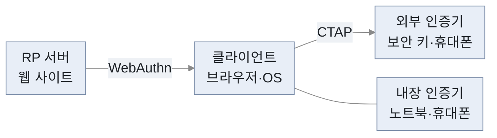
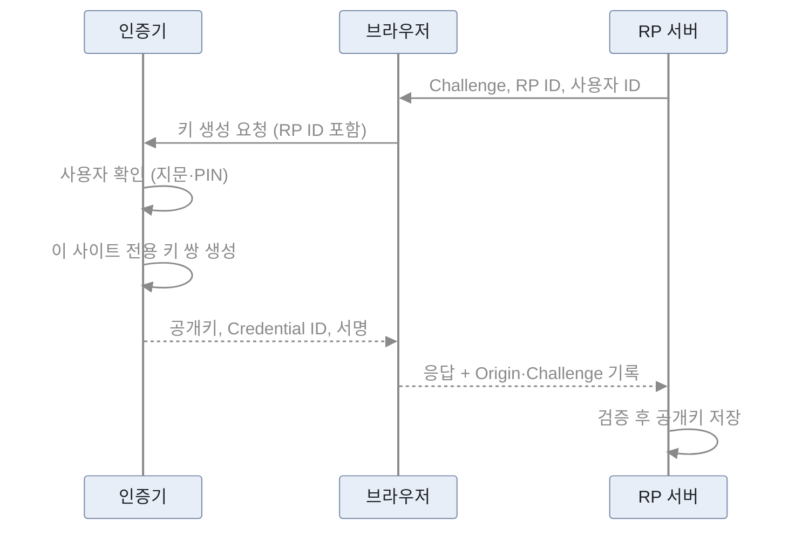
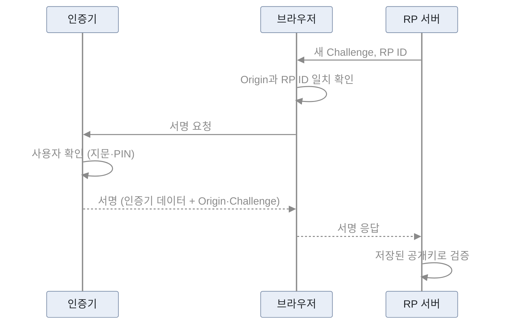

# FIDO2 · WebAuthn · Passkey

> 약어: W3C=웹 표준화 기구, NIST=미국 국립표준기술연구소, SP=NIST 특별 간행물

## 1. 개요 (What)

FIDO(Fast IDentity Online)2는 **비밀번호 대신 공개키 서명으로 로그인하는 인증 방식**이다.
사용자의 기기가 사이트마다 별도의 키 쌍을 만들고, 서버에는 공개키만 맡긴다. 로그인할 때 서버가 보낸 임의의 값(Challenge)에 기기가 개인키로 서명하면, 서버는 저장해 둔 공개키로 서명을 확인한다.

개념적으로 FIDO2는 두 규격의 조합으로 설명된다.
- **WebAuthn(Web Authentication)**: 웹 사이트(서버)와 브라우저 사이의 API(Application Programming Interface). W3C 규격이다.
- **CTAP(Client to Authenticator Protocol)**: 브라우저·OS(Operating System)와 외부 보안 키·휴대폰 같은 인증기(Authenticator) 사이의 통신 규약. FIDO Alliance 규격이다.

**Passkey**는 이 FIDO 자격증명(Credential)을 비밀번호를 대신하는 로그인 수단으로 쓰는 형태를 가리키는 이름이다.
클라우드 계정을 통해 여러 기기에 **동기화되는 Passkey**와, 보안 키처럼 **한 기기에 고정된 Passkey**가 있다.

이 문서는 [Authentication Methods](authentication-methods.md)에서 피싱 저항성이 가장 강한 방식으로 분류한 FIDO2의 동작 원리와 도입 시 판단 기준을 다룬다.
서명 원리 자체는 [Digital Signature](../cryptography/digital-signature.md)를 바탕으로 한다.

## 2. 배경 / 원리 (Why & How)

### 2.1 구성 요소

텍스트 설명: 웹 사이트(RP)는 WebAuthn API로 브라우저에 등록·인증을 요청한다. 브라우저·OS는 기기에 내장된 인증기를 직접 쓰거나, 외부 보안 키·휴대폰과 CTAP으로 통신한다.

| 구성 요소 | 역할 | 예 |
|-----------|------|----|
| RP(Relying Party) | 사용자를 인증하려는 서비스. Challenge를 만들고 서명을 검증한다 | 웹 사이트의 로그인 서버 |
| 클라이언트 (Client) | RP와 인증기 사이를 중계하고, **접속 중인 사이트 주소(Origin)를 기록**한다 | 브라우저, OS의 인증 기능 |
| 인증기 (Authenticator) | 키 쌍을 만들고 개인키를 보관하며 서명한다 | 지문 센서가 있는 노트북, 휴대폰, USB(Universal Serial Bus) 보안 키 |

- 인증기는 사이트(RP ID(RP Identifier), 보통 도메인)마다 **다른 키 쌍**을 만든다. 한 사이트의 공개키로 다른 사이트의 사용자를 추적하거나 연결할 수 없다.
- 개인키는 인증기 밖으로 나가지 않는 것이 원칙이다. 동기화 Passkey는 예외적으로 암호화된 상태로 같은 사용자의 기기들 사이에서 복제된다(3.2).

### 2.2 등록 (Registration)

텍스트 설명: 서버가 Challenge와 사이트 정보를 보내면, 브라우저는 인증기에 키 생성을 요청한다. 인증기는 지문이나 PIN(Personal Identification Number)으로 사용자를 확인한 뒤 이 사이트 전용 키 쌍을 만들고 공개키와 자격증명 ID(Credential ID)를 돌려준다.
브라우저는 실제 접속 중인 Origin과 Challenge를 응답에 기록해 서버로 보내고, 서버는 이를 확인한 뒤 공개키를 사용자 계정에 저장한다.

### 2.3 인증 (Authentication)

텍스트 설명: 로그인 때마다 서버는 새 Challenge를 만든다. 브라우저는 현재 사이트 주소가 요청된 RP ID에 속하는지 먼저 확인하고, 인증기에 서명을 요청한다.
인증기는 사용자를 확인한 뒤 인증기 데이터와 브라우저가 기록한 Origin·Challenge를 묶어 서명한다. 서버는 등록 때 저장한 공개키로 서명을 검증하고, Challenge와 Origin이 기대한 값인지 확인한다.

### 2.4 왜 피싱에 강한가

[Authentication Methods 2.3 피싱 저항성](authentication-methods.md#23-피싱-저항성-phishing-resistance)에서 본 실시간 중계 피싱이 FIDO2에서는 통하지 않는다.

| 공격 단계 | OTP라면 | FIDO2에서는 |
|-----------|---------|-------------|
| 사용자가 가짜 도메인 `examp1e.com`에 접속 | 사용자가 코드 입력 | 인증기에 `examp1e.com`용 키가 없어 응답할 수 없다 |
| 공격자가 진짜 사이트의 Challenge를 가져와 가짜 사이트에서 서명 요청 | — | 브라우저가 RP ID `example.com`이 현재 Origin `examp1e.com`과 맞지 않아 거부한다 |
| 어떻게든 받은 서명을 진짜 사이트에 제출 | 코드 그대로 통과 | 서명 안의 Origin이 `examp1e.com`이라 서버 검증에서 실패한다 |

- 보호의 핵심은 **사용자 판단이 아니라 브라우저가 기록하는 Origin**이다. 사용자가 가짜 사이트에 속더라도 키가 맞지 않는다.
- Challenge가 매번 새로 만들어지므로, 과거 서명을 다시 제출하는 재전송(Replay) 공격도 막힌다.
- 서버에는 공개키만 있으므로 서버 DB(Database)가 유출되어도 로그인에 쓸 비밀이 새지 않는다.

## 3. 상세 (Details)

### 3.1 인증기 종류

| 구분 | 내장 인증기 (Platform Authenticator) | 외부 인증기 (Roaming Authenticator) |
|------|--------------------------------------|-------------------------------------|
| 형태 | 노트북·휴대폰에 내장, TPM(Trusted Platform Module)·보안 칩 사용 | USB·NFC(Near Field Communication)·BLE(Bluetooth Low Energy) 보안 키, 다른 휴대폰 |
| 통신 | OS 내부 기능 | CTAP |
| 장점 | 별도 장비 없음, 편함 | 기기를 바꿔도 같은 키 사용, 하드웨어에 고정 |
| 주의 | 기기 분실·교체 시 키 처리 | 분실 대비 예비 키 등록 필요 |

### 3.2 동기화 Passkey와 기기 고정 Passkey

| 구분 | 동기화 Passkey (Synced) | 기기 고정 Passkey (Device-bound) |
|------|------------------------|---------------------------------|
| 저장 위치 | Passkey 제공자(OS·비밀번호 관리자)의 클라우드 계정을 통해 사용자 기기들에 복제 | 보안 키나 특정 기기 하나에만 존재 |
| 기기 분실 | 다른 기기나 새 기기에서 계속 사용 | 예비 인증 수단이 없으면 로그인 불가 |
| 개인키 추출 | 동기화를 위해 (암호화된 상태로) 복제 가능 | 추출 불가가 원칙 |
| 보안 경계 | **Passkey 제공자 계정의 보안**에 의존 | 기기의 물리적 보관에 의존 |
| 적합한 곳 | 일반 소비자 서비스, 비밀번호 대체 | 관리자 계정, 고보증 환경(규제·정부) |

- 동기화 Passkey도 피싱 저항성은 그대로 갖는다. 달라지는 것은 **키가 어디에 존재할 수 있는가**다.
- 동기화 Passkey의 위험은 피싱이 아니라 **동기화 계정 탈취**와 그 계정의 복구 절차다. 따라서 제공자 계정 자체를 강하게 보호해야 한다.
- 서버는 인증기 데이터의 백업 관련 플래그로 동기화 가능 여부를 알 수 있다(아래 5.1). 고보증 계정에 기기 고정 키만 허용하는 정책에 쓸 수 있다.

### 3.3 사용자 이름 없는 로그인

인증기 안에 사용자 정보까지 저장하는 자격증명을 **Discoverable Credential**(예전 이름 Resident Key·Resident Credential)이라 한다. WebAuthn API에는 하위 호환을 위해 `residentKey` 같은 예전 명칭이 남아 있다. Passkey는 보통 이 형태다.

- 사용자는 아이디를 입력하지 않고 "Passkey로 로그인"만 누르면, 인증기가 이 사이트용 계정 목록을 보여준다.
- 로그인 입력란의 자동 완성 목록에 Passkey를 함께 보여주는 방식(Conditional UI(User Interface))도 쓰인다. WebAuthn의 Conditional Mediation 기능으로, RP가 인증 요청에 `mediation: "conditional"`을 지정하면 브라우저가 인증 창을 바로 띄우지 않고 사용자가 입력란을 선택할 때 Passkey를 제시한다. 비밀번호에서 Passkey로 자연스럽게 옮겨 가게 한다.
- Discoverable이 아닌 자격증명은 서버가 먼저 사용자를 식별한 뒤 그 사용자의 Credential ID 목록을 인증기에 보내야 한다. 보안 키를 2단계 인증용으로만 쓰던 예전 방식이 이렇다.

### 3.4 다른 기기로 로그인 (Cross-device)

PC에 Passkey가 없어도 휴대폰의 Passkey로 PC 브라우저에 로그인할 수 있다.

1. PC 브라우저가 QR(Quick Response) 코드를 보여준다.
2. 휴대폰으로 QR 코드를 스캔하면, 두 기기가 BLE로 **물리적으로 가까이 있는지** 증명한다.
3. 실제 인증 데이터는 별도의 암호화된 채널로 전달된다. 터널 서비스를 거치는 네트워크 연결이나 로컬 연결이 쓰일 수 있다.

- BLE는 **근접성 증명**에 쓰이고, 데이터 전송 채널은 그와 따로 구성될 수 있다. "Bluetooth로 서명을 보낸다"는 설명은 정확하지 않다.
- 근접 확인이 있어서, 원격의 공격자가 QR 코드만 사용자에게 보내 승인받는 방식을 어렵게 만든다.
- 이 흐름은 *CTAP 2.2*에서 도입된 Hybrid 전송 방식이다.

### 3.5 User Presence와 User Verification

| 확인 | 뜻 | 방법 | 증명하는 것 |
|------|----|------|-------------|
| UP(User Presence) | 사람이 그 자리에 있다 | 보안 키 버튼 터치 | 소유 (악성코드의 무단 사용 방지) |
| UV(User Verification) | 그 사람이 기기 주인이다 | 지문, 얼굴, PIN | 소유 + 지식 또는 생체 |

- UV까지 수행하면 **한 번의 동작으로 두 요소**(기기 소유 + 지문·PIN)를 충족한다. Passkey 하나로 MFA(Multi-Factor Authentication)가 되는 이유다.
- 생체 정보는 인증기 안에서만 비교되고 서버로 가지 않는다. 서버는 "UV를 했다"는 플래그만 받는다.
- 서버가 UV를 요구한다면 응답의 UV 플래그를 **반드시 검증**해야 한다. 요청만 하고 확인하지 않으면 버튼 터치만으로 통과된다.

### 3.6 Attestation — 어떤 인증기인가

등록 시 인증기는 선택적으로 **Attestation**(자신이 어떤 제조사·모델의 인증기인지에 대한 서명된 증명)을 보낼 수 있다.

- **쓰는 곳**: 기업·고보증 환경에서 "인증된 하드웨어 보안 키만 등록 허용" 같은 정책을 적용할 때.
- 인증기 유형은 128비트 식별자인 AAGUID(Authenticator Attestation Globally Unique Identifier)로 구분하고, FIDO Alliance의 MDS(Metadata Service)에서 AAGUID로 모델별 특성과 인증·보안 상태를 조회한다.
- **AAGUID만으로는 진위가 증명되지 않는다.** AAGUID는 인증기가 스스로 보고하는 값이므로, Attestation 서명을 검증하고 신뢰할 수 있는 메타데이터와 대조해야 그 인증기가 실제로 그 모델임을 믿을 수 있다.
- **소비자 서비스에서는 보통 요구하지 않는다.** 소비자용 동기화 Passkey는 개인정보 보호 등의 이유로 제조사를 식별할 수 있는 Attestation을 제공하지 않는 경우가 많다(구현에 따라 다르다). *NIST SP 800-63B-4*도 일반 대중 대상 서비스에서는 Attestation이 없다는 이유로 동기화 인증기를 막지 않도록 권고한다.
- Attestation은 "어떤 기기인가"를 말할 뿐, "누구인가"를 증명하지 않는다. 신원 증명은 별도 절차다([Identity Fundamentals](identity-fundamentals.md)).

### 3.7 도입 시 고려 사항

| 주제 | 판단 기준 |
|------|-----------|
| 비밀번호 병행 | Passkey를 추가해도 비밀번호 로그인이 남아 있으면 공격자는 비밀번호 경로를 노린다. 점진적으로 비밀번호 없는 계정으로 전환하는 계획이 필요하다 |
| 복구 | 모든 Passkey를 잃었을 때의 복구 절차가 가장 약한 고리가 된다 → [Authentication Methods 3.8 계정 복구 — 가장 약한 고리](authentication-methods.md#38-계정-복구--가장-약한-고리) |
| 여러 개 등록 | 한 계정에 Passkey·보안 키를 여러 개 등록할 수 있게 하고, 계정 설정에서 목록 확인·삭제를 지원한다 |
| RP ID 설계 | RP ID는 등록 후 바꾸기 어렵다. 서브도메인 여러 곳에서 쓰려면 상위 도메인을 RP ID로 정한다 |
| 세션 보호 | FIDO2는 **로그인 순간**만 보호한다. 로그인 후 발급된 세션 쿠키·토큰이 탈취되면 막지 못한다 |

- 토큰 보호는 [Token Security](token-security.md), 세션 보호는 [Session & Token Lifecycle](session-token-lifecycle.md)에서 다룬다.

### 3.8 다른 영역에서의 사용

| 영역 | 사용 예 |
|------|---------|
| Web | 소비자 서비스의 Passkey 로그인, 비밀번호 대체 |
| 기업 | IdP(Identity Provider) 로그인에 보안 키·Passkey 적용, 관리자 계정의 피싱 저항 MFA |
| Cloud | 클라우드 콘솔 관리자 계정의 MFA 수단 → [Cloud IAM](../../cloud-security/iam/README.md) (작성 예정) |
| 통신 장비 운영 | 5G 코어·O-RAN(Open Radio Access Network) 관리 포털 같은 운영 접속의 관리자 인증 (가입자 인증인 5G-AKA(Authentication and Key Agreement)와는 다른 영역) |

## 4. 보안 관점 (Security Relevance)

| 실수 | 결과 | 대응 |
|------|------|------|
| Challenge를 재사용하거나 서버가 생성·만료 관리를 하지 않음 | 과거 서명 재전송 | 요청마다 새 무작위 Challenge, 1회 사용, 짧은 만료 |
| 서버가 Origin 검증 생략 | 다른 사이트에서 만든 서명 수용 → 피싱 저항성 상실 | 허용 Origin 목록과 정확히 비교 |
| RP ID 해시 검증 생략 | 다른 RP용 응답 수용 | 인증기 데이터의 RP ID 해시 확인 |
| UV 요구 후 UV 플래그 미확인 | 지문·PIN 없이 통과 | 정책에 맞게 UP·UV 플래그 검증 |
| Credential ID와 사용자 연결 미확인 | 다른 사용자의 자격증명으로 로그인 | 서명 검증에 쓴 공개키가 그 계정 소유인지 확인 |
| 비밀번호·SMS 로그인 경로 유지 | Passkey를 우회해 약한 경로로 탈취 | 약한 경로 단계적 제거, 고위험 계정은 Passkey 전용 |
| 복구 절차가 약함 | 복구 경로로 계정 탈취 | 예비 Passkey·보안 키, 강한 복구 절차 |
| 고보증 계정에 동기화 Passkey 허용 | 제공자 계정 탈취 시 키 복제 | 백업 플래그·Attestation으로 기기 고정 키만 허용 |
| 검증 로직 직접 구현 | 파싱·검증 누락 | 검증된 WebAuthn 서버 라이브러리 사용 |

점검 시 확인할 것: Challenge 생성·1회성·만료, Origin·RP ID 해시 검증, UP·UV 플래그 정책과 검증, 자격증명-계정 연결, 서명 카운터 처리, 비밀번호 등 대체 로그인 경로 존재 여부, 복구 절차, 고보증 계정의 인증기 제한(기기 고정·Attestation), 사용 중인 WebAuthn 라이브러리 버전.

## 5. 심화 (Advanced)

> 보안 컨설턴트·점검자를 위한 규격 세부다. 본문만으로 개념 이해에는 충분하다.

### 5.1 인증기 데이터 (Authenticator Data)

인증기가 서명하는 데이터의 앞부분이다. 서버 검증의 핵심 입력이며, 고정 부분의 길이는 37바이트다.

| 필드 | 크기 | 내용 |
|------|------|------|
| RP ID 해시 | 32바이트 | RP ID의 SHA(Secure Hash Algorithm)-256 해시 |
| 플래그 | 1바이트 | 아래 표 |
| 서명 카운터 (Sign Count) | 4바이트 | 인증기가 서명할 때마다 늘리는 값 (부호 없는 big-endian 정수). 지원하지 않으면 0 |
| 자격증명 데이터 (Attested Credential Data) | 가변 | 등록 시에만(AT=1): AAGUID, Credential ID, 공개키. 인증 응답에는 포함되지 않는다 |
| 확장 데이터 | 가변 | 확장 기능 사용 시 |

| 플래그 | 뜻 |
|--------|----|
| UP | User Presence 수행 |
| UV | User Verification 수행 |
| BE(Backup Eligibility) | 이 자격증명이 백업(동기화)될 수 있는 종류인지 |
| BS(Backup State) | 현재 백업(동기화)된 상태인지 |
| AT(Attested credential data) | 자격증명 데이터 포함 (등록 시) |
| ED(Extension Data) | 확장 데이터 포함 |

| BE | BS | 의미 |
|:---:|:---:|------|
| 0 | 0 | 단일 기기 자격증명 (Single-device credential) |
| 0 | 1 | 허용되지 않는 조합 |
| 1 | 0 | 다중 기기 자격증명, 현재 백업되지 않음 |
| 1 | 1 | 다중 기기 자격증명, 현재 백업됨 |

- BE는 자격증명 생성 시 정해지고 바뀌지 않는다. BS는 현재 백업 상태를 나타내므로 바뀔 수 있다.
- BE=0이면 단일 기기 자격증명으로 볼 수 있다. 다만 이 플래그가 나타내는 것은 **백업 가능성**이며, 이를 "개인키가 어떤 방법으로도 복제될 수 없다"는 보증으로 확대해석하지 않는다. 하드웨어 보관을 확인하려면 Attestation이 필요하다(3.6).
- 저장된 카운터와 새 카운터가 모두 0이 아니고 새 값이 이전 값 이하라면 인증기 복제를 **의심할 수 있는 신호**다. 확정 증거는 아니다. 기기 오작동이나 응답 처리 순서의 경쟁 상태(Race Condition)도 원인이 될 수 있다.
- 카운터를 지원하지 않는 인증기는 계속 0을 보낸다. 동기화 Passkey도 0인 경우가 흔하지만 항상 그렇지는 않다.

### 5.2 서버 검증 절차 (요약)

인증 응답을 받은 서버는 다음을 모두 확인한다.

1. 응답의 Credential ID가 이 계정에 등록된 것인지 확인한다.
2. 클라이언트 데이터(`clientDataJSON`, JSON(JavaScript Object Notation) 형식)의 `type`이 `webauthn.get`(등록 시 `webauthn.create`)인지 확인한다.
3. `challenge`가 서버가 이번 요청에 발급한 값과 같은지 확인한다.
4. `origin`이 허용된 Origin인지 확인한다.
5. 인증기 데이터의 RP ID 해시가 기대한 RP ID의 해시와 같은지 확인한다.
6. UP 플래그, 정책상 필요하면 UV 플래그를 확인한다.
7. 저장된 공개키로 `인증기 데이터 || SHA-256(clientDataJSON)`에 대한 서명을 검증한다.
8. 서명 카운터를 확인하고 갱신한다.

- 등록 시에는 여기에 Attestation 형식·서명 검증, 공개키 알고리즘 허용 여부 확인이 더해진다.

### 5.3 공개키 알고리즘

공개키는 COSE(CBOR(Concise Binary Object Representation) Object Signing and Encryption) 키 형식으로 전달되고, 알고리즘은 COSE 식별 번호로 지정한다.

| COSE 번호 | 이름 | 알고리즘 |
|:---:|------|----------|
| -7 | ES256 | ECDSA(Elliptic Curve Digital Signature Algorithm) P-256 + SHA-256 |
| -8 | EdDSA | EdDSA(Edwards-curve Digital Signature Algorithm). 특정 곡선이 아니라 Ed25519·Ed448 등을 포괄하는 식별자 |
| -257 | RS256 | RSASSA-PKCS1-v1_5(PKCS(Public-Key Cryptography Standards) #1 v1.5 방식 RSA 서명) + SHA-256 |

- RP는 등록 요청에 허용 알고리즘 목록을 선호 순서대로 보낸다. ES256은 대부분의 인증기가 지원한다.
- *RFC 9864*(2025-10)는 COSE에서도 곡선을 특정하지 않는 EdDSA 식별자를 Deprecated 처리하고 Ed25519·Ed448 전용 식별자를 정의했다. WebAuthn 환경에서는 여전히 -8이 널리 쓰이므로, 새 식별자 지원 여부는 사용하는 인증기·라이브러리에서 확인한다.
- 알고리즘 원리는 [Digital Signature](../cryptography/digital-signature.md) 참조.

### 5.4 표준 문서 체계

| 규격 | 발행 | 다루는 범위 |
|------|------|-------------|
| *W3C WebAuthn Level 3* | W3C | RP·브라우저 간 API, 인증기 데이터, 서버 검증 절차, 백업 플래그 |
| *FIDO Alliance CTAP 2.3* | FIDO Alliance | 브라우저·OS와 외부 인증기 간 통신, USB·NFC·BLE·Hybrid 전송, PIN·UV 처리 |
| FIDO Metadata Service | FIDO Alliance | 인증기 모델별 메타데이터와 인증 상태 |

- 예전 U2F(Universal 2nd Factor)는 CTAP1/U2F로 이어진다. *CTAP 2.3*은 CTAP1/U2F 호환을 다루며 인증기의 지원을 권고한다. CTAP2 인증기 중 상당수가 기존 U2F 클라이언트와의 호환을 위해 CTAP1/U2F를 함께 지원하지만, 실제 지원 여부는 제품별로 확인해야 한다.
- 규격 상태와 기준 판은 [PKI & Identity 3. 기준 표준](README.md#3-기준-표준)에 정리되어 있다.

### 5.5 *NIST SP 800-63B-4*와의 관계

- FIDO2는 검증자 이름 바인딩 방식의 피싱 저항 인증 수단에 해당한다 → [Authentication Methods 5.4 피싱 저항성의 두 방식](authentication-methods.md#54-피싱-저항성의-두-방식)
- 동기화 Passkey는 AAL2까지, 추출 불가능한 키를 가진 기기 고정 하드웨어 인증기는 AAL3 요건에 대응한다 → [Authentication Methods 5.2 AAL별 인증 수단 요구 (요약)](authentication-methods.md#52-aal별-인증-수단-요구-요약)

## 관련 문서

- 이전: [Authentication Methods](authentication-methods.md), [PKI & Certificates](pki-certificates.md)
- 다음: [OAuth 2.0 · OpenID Connect](oauth2-oidc.md)
- 암호 기반: [Digital Signature](../cryptography/digital-signature.md), [Hashing & MAC](../cryptography/hashing-mac.md)
- 인증 공격 유형: [Identity Attacks](identity-attacks.md)
- 로드맵: [PKI & Identity](README.md)

## 출처

| 문서 | 지위 / 버전 | 이 문서에서의 사용 |
|------|-------------|-------------------|
| *W3C WebAuthn Level 3* "Web Authentication: An API for accessing Public Key Credentials" | W3C Recommendation (2026-08-25) | 등록·인증 흐름, 인증기 데이터와 플래그, 서버 검증 절차 |
| *FIDO Alliance CTAP 2.3* | Proposed Standard (2026-02-26) | 외부 인증기 통신, Hybrid 전송 |
| *NIST SP 800-63B-4* | 2025-07 Final | 피싱 저항성, AAL 대응 |

- 동기화·기기 고정 비교와 도입 판단 기준은 위 규격을 바탕으로 재구성한 해설이다.
