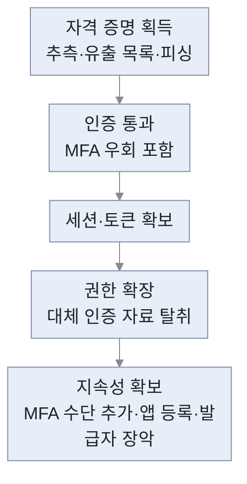
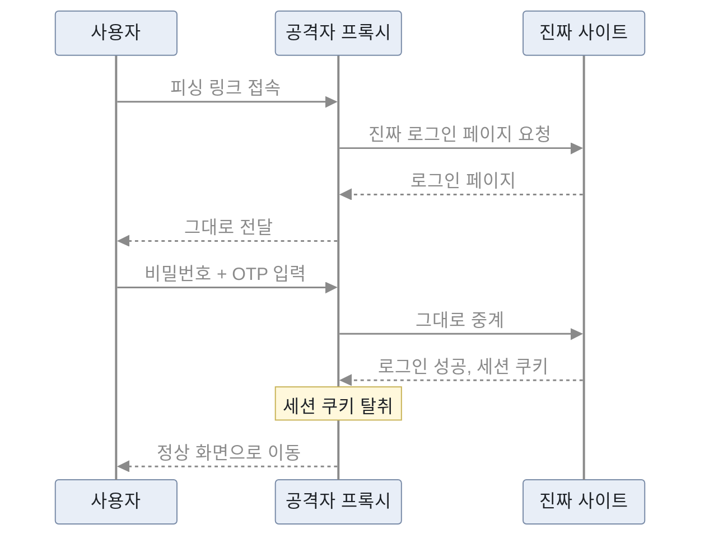

# Identity Attacks (신원·인증 공격)

> 약어: NIST=미국 국립표준기술연구소, NIST SP=NIST 특별 간행물, RFC=IETF 표준 문서, IETF=인터넷 표준화 기구

## 1. 개요 (What)

신원 공격(Identity Attack)은 **시스템을 부수는 대신 정상 사용자로 로그인하는** 공격이다. 공격자는 취약점을 찾기보다 비밀번호, MFA(Multi-Factor Authentication) 승인, 세션 쿠키, 토큰, 해시처럼 **"인증된 사용자임을 증명하는 자료"** 를 얻으려 한다. 그것을 얻으면 방화벽과 접근 통제는 공격자를 정상 사용자로 본다.

| 공격자가 노리는 것 | 대표 공격 | 이 문서 |
|-------------------|-----------|---------|
| 비밀을 **맞히기** | Brute Force, Password Spraying, Credential Stuffing | 3.1 |
| 비밀을 **훔치거나 중계하기** | 피싱, AiTM(Adversary-in-the-Middle) 피싱 | 3.2 |
| MFA를 **우회하기** | MFA Fatigue, OTP(One-Time Password) 중계, SIM Swap, 헬프데스크 사칭, Device Code 피싱, 동의 피싱 | 3.3 |
| 인증 **이후의 결과물** 훔치기 | Session Hijacking, Token Theft, Replay | 3.4 |
| 비밀번호 대신 쓸 수 있는 **대체 자료** | Pass-the-Hash, Pass-the-Ticket, Kerberoasting | 3.5 |
| **발급자** 자체를 장악하거나 위조하기 | Golden SAML, 서명 키 탈취, 워크로드 자격 증명 탈취 | 3.6 |

각 인증 방식이 이 공격들에 얼마나 버티는지는 [Authentication Methods 3.9 공격 저항성 비교](authentication-methods.md#39-공격-저항성-비교)에서, 세션 이후의 방어는 [Session & Token Lifecycle](session-token-lifecycle.md)에서 다룬다. 이 문서는 **공격자 관점에서 흐름과 탐지**를 묶는다.

## 2. 배경 / 원리 (Why & How)

### 2.1 왜 신원 공격이 늘었나

- **경계가 사라졌다.** 클라우드·SaaS(Software as a Service)·원격 근무 환경에서는 인터넷 어디서든 로그인 화면에 닿는다. 로그인 화면이 곧 외부 경계다.
- **유출된 자격 증명이 많다.** 다른 서비스에서 유출된 이메일·비밀번호 목록이 대량으로 유통된다. 비밀번호 재사용이 남아 있는 한 공격 비용은 낮다.
- **로그인은 정상 행위다.** 취약점 공격과 달리 악성 페이로드가 없어 탐지가 어렵다. 공격자는 "유효한 계정으로 들어온 사람"으로 보인다.
- **MFA가 퍼지자 공격도 MFA 이후로 옮겨 갔다.** MFA를 뚫는 대신 사용자를 속여 승인하게 하거나, 인증이 끝난 뒤의 세션 쿠키를 훔친다.

### 2.2 공격의 흐름

텍스트 설명: 공격자는 먼저 비밀번호 등 자격 증명을 얻고(추측, 유출 목록, 피싱), MFA를 우회해 인증을 통과한다. 인증 결과로 받은 세션·토큰을 확보한 뒤, 내부에서 해시·티켓 같은 대체 인증 자료를 훔쳐 더 높은 권한으로 이동한다. 마지막으로 자기 MFA 수단을 등록하거나 OAuth 앱을 등록하거나 발급자(IdP(Identity Provider), 서명 키)를 장악해 비밀번호가 바뀌어도 다시 들어올 수 있게 한다.

- 방어도 이 흐름에 맞춰 **여러 단계에** 둔다. 앞 단계(비밀번호)만 막으면 피싱·세션 탈취로 우회되고, 뒤 단계(세션)만 막으면 계정 자체가 넘어간다.
- 마지막 단계(지속성)는 비밀번호 재설정만으로 끝나지 않는다. 사고 대응 때는 등록된 MFA 수단, OAuth 앱 동의, 발급된 토큰, 연합 신뢰 설정까지 확인해야 한다.

## 3. 상세 (Details)

### 3.1 비밀번호 추측 — Brute Force, Password Spraying, Credential Stuffing

| 공격 | 방식 | 노리는 약점 | 탐지 패턴 |
|------|------|-------------|-----------|
| Brute Force | 한 계정에 많은 비밀번호를 시도 | 짧거나 흔한 비밀번호 | 한 계정에 실패가 몰린다 |
| Password Spraying | **많은 계정**에 흔한 비밀번호 몇 개만 시도 | 계정 잠금 정책 회피, 조직 전체에 한 명쯤 있는 약한 비밀번호 | 계정별 실패는 적지만 **같은 출발지·같은 시간대에 여러 계정** 실패 |
| Credential Stuffing | 다른 서비스에서 유출된 이메일·비밀번호 쌍을 그대로 시도 | 비밀번호 재사용 | 존재하지 않는 계정 비율이 높고, 성공률은 낮지만 **성공한 계정은 바로 쓰인다**. 분산된 IP(Internet Protocol)·봇 |
| 오프라인 크래킹 | 유출된 비밀번호 해시를 공격자 장비에서 대입 | 느리지 않은 해시, Salt 없음 | 서버에서 보이지 않는다. 해시 유출 자체를 탐지해야 한다 |

- **계정 잠금만으로는 Spraying을 막지 못한다.** 계정마다 한두 번만 시도하기 때문이다. 출발지·전체 실패율 기준의 속도 제한과 이상 탐지가 함께 있어야 한다.
- **계정 잠금은 공격 도구가 되기도 한다.** 잠금 임계값이 낮으면 공격자가 일부러 실패를 일으켜 정상 사용자를 잠근다(가용성 공격). 영구 잠금보다 점진적 지연, 봇 탐지 챌린지(CAPTCHA(Completely Automated Public Turing test to tell Computers and Humans Apart) 등), 위험 기반 추가 인증이 낫다. 잠긴 상태에서도 정상 사용자가 복구 절차로 들어올 길을 남겨 둔다.
- Credential Stuffing 방어의 핵심은 **MFA**(가능하면 피싱 저항 인증)와 **유출 비밀번호 차단 목록**이다. 여기에 속도 제한, 봇 탐지, IP 평판, 기기·연결 특성 분석을 겹쳐 쓴다. IP 하나를 차단하는 방식은 프록시 네트워크로 쉽게 우회되고, 클라이언트 지문은 위조할 수 있어 단독 방어로 쓰지 않는다.
- 오프라인 크래킹 방어는 저장 방식이다. 느린 비밀번호 해시와 Salt를 쓴다 → [Hashing & MAC](../cryptography/hashing-mac.md)
- 비밀번호 정책의 표준 요구는 [Authentication Methods 5.1 NIST SP 800-63B-4의 비밀번호 요구사항](authentication-methods.md#51-nist-sp-800-63b-4의-비밀번호-요구사항)을 참조한다.

### 3.2 피싱과 AiTM 피싱

일반 피싱은 가짜 로그인 페이지로 비밀번호를 받아 간다. **AiTM 피싱**은 한 걸음 더 나아가, 공격자 서버가 **진짜 사이트와 사용자 사이에서 실시간으로 중계**(리버스 프록시)한다.

텍스트 설명: 사용자가 피싱 링크로 공격자 프록시에 접속하면, 프록시는 진짜 사이트의 로그인 페이지를 받아 그대로 보여 준다. 사용자가 비밀번호와 OTP를 입력하면 프록시가 즉시 진짜 사이트에 중계하고, 진짜 사이트가 발급한 세션 쿠키를 중간에서 가져간다. 사용자는 정상적으로 로그인된 것처럼 보인다.

- **OTP·단순 Push 승인 MFA는 AiTM을 막지 못한다.** OTP는 사용자가 프록시에 입력한 값을 공격자가 그대로 넘기고, Push는 공격자가 일으킨 로그인을 사용자가 승인하게 된다. 공격자가 최종적으로 노리는 것은 비밀번호보다 **세션 쿠키**다.
- **피싱 저항 인증**(FIDO2·Passkey, 인증서 기반 인증)은 막는다. 인증기가 서명에 실제 접속한 Origin을 묶기 때문에, 공격자 도메인에서는 진짜 사이트용 서명이 만들어지지 않는다 → [FIDO2 · WebAuthn · Passkey 2.4 왜 피싱에 강한가](fido2-webauthn-passkey.md#24-왜-피싱에-강한가)
- 다만 피싱 저항 인증이 막는 것은 **피싱 사이트를 통한 인증 중계**다. 이미 탈취된 세션 쿠키를 다른 곳에서 다시 쓰는 공격이나, 피해자 기기 자체가 악성코드에 장악된 경우는 따로 막아야 한다.
- 세션 쿠키가 이미 탈취된 뒤를 대비해 기기 결합 세션, 짧은 세션 수명, 위치·기기 변화 탐지를 함께 쓴다 → [Session & Token Lifecycle 3.3 사용 — 훔친 세션을 쓰기 어렵게](session-token-lifecycle.md#33-사용--훔친-세션을-쓰기-어렵게)

### 3.3 MFA 우회

| 공격 | 방식 | 대응 |
|------|------|------|
| MFA Fatigue (Push 폭탄) | 비밀번호를 얻은 뒤 Push 승인 요청을 반복해 보내, 지친 사용자가 승인하게 한다. 메신저·전화로 IT 담당자를 사칭해 승인을 유도하기도 한다 | 최선은 피싱 저항 인증. 당장 어렵다면 번호 일치(Number Matching), 요청 위치·앱 정보 표시, 반복 요청 속도 제한, 거부 시 신고 버튼 |
| OTP 중계 | 가짜 사이트·전화로 받은 OTP를 바로 진짜 사이트에 입력 | 피싱 저항 인증 |
| SIM Swap | 통신사를 속여 피해자 전화번호를 공격자 SIM으로 옮기고 SMS(Short Message Service) OTP를 받는다 | SMS·음성 OTP를 주요 수단에서 제외 |
| 헬프데스크 사칭 | 지원 부서에 전화해 "휴대폰을 잃어버렸다"며 MFA 초기화·새 수단 등록을 요청 | 계정 복구 시 강한 신원 확인, 복구 후 알림·보류 기간 → [Authentication Methods 3.8 계정 복구 — 가장 약한 고리](authentication-methods.md#38-계정-복구--가장-약한-고리) |
| Device Code 피싱 | 공격자가 Device Authorization Grant(*RFC 8628*)로 받은 코드를 피해자에게 입력하게 한다. 피해자가 진짜 로그인 페이지에서 정상 MFA까지 마치면 토큰은 공격자 기기로 간다 | 필요 없는 곳은 Device Code 흐름 차단, 조건부 접근 정책 → [OAuth 2.0 · OpenID Connect 3.2 Grant 유형 — 토큰을 받는 방법](oauth2-oidc.md#32-grant-유형--토큰을-받는-방법) |
| 동의 피싱 (Consent Phishing) | 악성 OAuth 앱이 넓은 권한을 요청하고, 사용자가 진짜 IdP 화면에서 "허용"을 누르게 한다. 비밀번호·MFA를 훔치지 않고도 토큰을 얻는다 | 사용자 동의 제한, 관리자 승인 절차, 앱 게시자 검증, 동의 내역 정기 검토 |
| MFA 미적용 경로 | 레거시 프로토콜(기본 인증을 쓰는 메일 프로토콜 등)이나 MFA 예외 계정으로 로그인 | 레거시 인증 차단, 예외 목록 최소화·정기 검토 |

- 번호 일치는 CISA(Cybersecurity and Infrastructure Security Agency)가 피싱 저항 인증을 바로 도입하기 어려운 조직에 권하는 **차선책**이다. 단순 승인보다 강하지만 피싱 저항 인증과 같은 수준은 아니다.
- Device Code 피싱과 동의 피싱은 **사용자가 진짜 IdP에서 직접 인증하거나 권한을 준다**는 점이 공통이다. 정상 인증·권한 부여 절차를 악용하므로 FIDO2·Passkey 같은 피싱 저항 인증**만으로는** 완전히 막을 수 없다. Device Code 흐름 제한, 사용자 동의 정책, 관리자 승인, OAuth 앱 검증, 토큰 사용 모니터링을 함께 적용한다.
- 공격이 성공하면 공격자는 보통 **자기 MFA 수단을 추가 등록**한다. MFA 수단 등록·변경은 재인증과 알림을 요구하고, 등록 이벤트를 탐지 대상으로 둔다.
- 공개 사례: 2022년 Uber 침해에서는 외부 계약자 계정의 비밀번호를 얻은 공격자가 반복 MFA 승인 요청 끝에 승인을 받아 냈다. Uber의 공식 사건 설명과 CISA 교육 자료가 이 사례를 다룬다. 2023년 MGM Resorts 침해는 헬프데스크 사칭으로 시작되었다고 보도되었다. 다만 MGM의 공시·공식 발표가 확인한 것은 침해와 운영 중단이며, 헬프데스크를 통한 침투 경로는 언론 보도와 보안업계 분석에 근거한다.

### 3.4 세션·토큰 탈취와 Replay

| 공격 | 방식 | 대응 |
|------|------|------|
| Session Hijacking | 세션 쿠키를 훔쳐 피해자로 행세. AiTM, XSS(Cross-Site Scripting), 악성 브라우저 확장, 평문 구간 도청 | 쿠키 속성, 기기 결합 세션, 이상 탐지 |
| Session Fixation | 공격자가 아는 세션 ID를 피해자가 로그인할 때 쓰게 한다 | 로그인 시 세션 ID 재발급 |
| Token Theft | 브라우저 저장소·로그·설정 파일·CI/CD(Continuous Integration/Continuous Delivery) 변수·개발자 PC에서 Access Token·Refresh Token을 훔친다. 정보 탈취형 악성코드(Infostealer)는 쿠키와 토큰을 한꺼번에 가져간다 | 짧은 수명, 송신자 제한 토큰(DPoP(Demonstrating Proof of Possession)·mTLS(mutual TLS)), Refresh Token Rotation, 토큰 로그 마스킹 |
| Replay | 가로챈 인증 메시지·토큰을 그대로 다시 보낸다 | Challenge·Nonce, 타임스탬프와 짧은 유효 시간, 일회용 식별자(`jti`) 검사, TLS(Transport Layer Security) |

- 세션 쿠키·Bearer 토큰은 **가진 사람이 곧 사용자**다. 탈취 이후에는 MFA가 다시 묻지 않으므로, 강한 인증을 써도 이 단계 방어가 따로 필요하다.
- Replay 방어의 원리는 "같은 증거를 두 번 받아들이지 않는다"이다. Kerberos 인증자(Authenticator)의 타임스탬프, WebAuthn의 Challenge, Back-Channel Logout Token의 `jti`가 모두 같은 목적이다.
- 세부 방어는 [Session & Token Lifecycle](session-token-lifecycle.md)과 [Token Security 3.4 송신자 제한 토큰 (Sender-constrained Token)](token-security.md#34-송신자-제한-토큰-sender-constrained-token)에서 다룬다.

### 3.5 대체 인증 자료 — Pass-the-Hash, Pass-the-Ticket, Kerberoasting

내부망에 들어온 공격자는 비밀번호 원문 없이도 **비밀번호에서 파생된 자료**로 인증한다.

| 공격 | 방식 | 왜 가능한가 | 대응 |
|------|------|-------------|------|
| Pass-the-Hash | 메모리에서 꺼낸 NT 해시로 NTLM(NT LAN Manager) 인증 | NTLM은 해시 자체를 비밀로 쓴다 | NTLM 축소·차단, 관리자 계정 분리, Credential Guard 같은 자격 증명 격리, 로컬 관리자 비밀번호 고유화 |
| Pass-the-Ticket | 훔친 Kerberos 티켓을 다른 호스트에서 사용 | 티켓도 Bearer다 | 특권 계정의 로그인 위치 제한(계층 모델), 티켓 수명 관리 |
| Kerberoasting | 도메인 사용자 누구나 SPN(Service Principal Name)이 있는 서비스 계정의 티켓을 요청해, 오프라인에서 서비스 계정 비밀번호를 대입 | 서비스 티켓이 서비스 계정 키로 암호화된다. 사람이 정한 비밀번호면 깨진다 | 관리형 서비스 계정(gMSA(group Managed Service Account), Windows Server 2025의 dMSA(delegated Managed Service Account)), 긴 무작위 비밀번호, 불필요한 SPN 제거, AES 사용·RC4 비활성화, 비정상 TGS(Ticket Granting Service) 요청 탐지 |
| AS-REP Roasting | 사전 인증이 꺼진 계정의 AS 응답을 받아 오프라인 대입 | 사전 인증 없이 사용자 키로 암호화된 응답을 준다 | 모든 계정에 사전 인증 강제 |

- 이 공격들의 구조와 Active Directory 방어 설정은 [Enterprise Identity](enterprise-identity.md)에서 다룬다. ATT&CK 대응은 [Enterprise Identity 5.2 공격 기법과 MITRE ATT&CK 대응](enterprise-identity.md#52-공격-기법과-mitre-attck-대응) 참조.
- **AES로 바꾸는 것만으로 Kerberoasting이 사라지지는 않는다.** AES로 암호화된 티켓도 서비스 계정 비밀번호가 약하면 오프라인에서 깨진다. 핵심은 사람이 정한 비밀번호를 서비스 계정에서 없애는 것이다.
- 공통 방어 원칙은 **특권 자격 증명이 낮은 신뢰 호스트의 메모리에 남지 않게 하는 것**이다. 도메인 관리자가 일반 PC에 로그인하는 순간, 그 PC를 장악한 공격자가 관리자 자료를 가져갈 수 있다.

### 3.6 발급자 장악과 위조

가장 심각한 단계는 개별 계정이 아니라 **신원을 발급하는 쪽**을 장악하는 것이다.

| 공격 | 방식 | 결과 |
|------|------|------|
| Golden SAML | IdP의 SAML(Security Assertion Markup Language) 서명 키를 훔쳐 원하는 사용자의 Assertion을 위조 | 연합된 모든 서비스에 아무 사용자로나 로그인. 정상 IdP 인증 절차를 거치지 않으므로, 위조 Assertion에 대응하는 IdP 인증·MFA 이벤트가 남지 않을 수 있다 → [Federation & SSO](federation-sso.md) |
| 토큰 서명 키 탈취 | 인가 서버·IdP의 JWT(JSON Web Token) 서명 키 유출 | 임의 토큰 위조 → [Token Security](token-security.md) |
| Golden Ticket | `krbtgt` 키로 TGT(Ticket Granting Ticket) 위조 | 도메인 전체 장악 → [Enterprise Identity](enterprise-identity.md) |
| 연합 신뢰 변조 | IdP에 새 신뢰 도메인·인증서 추가, 연합 설정 변경 | 공격자 IdP가 발급한 신원을 정상으로 인정 |
| 워크로드 자격 증명 탈취 | SSRF(Server-Side Request Forgery)로 메타데이터 서비스 호출, CI/CD 토큰·Service Account 토큰 탈취 | 클라우드 권한 획득 → [Workload Identity](workload-identity.md) |

- Golden SAML 조사는 IdP 인증 로그만 보지 않는다. 토큰을 받아들인 SP·클라우드 서비스의 로그인 기록(발급자, 토큰 수명, 위치, Claim 이상), IdP 서버의 서명 키·인증서 접근·변경 기록을 함께 분석한다.
- 발급자 장악은 **사용자 비밀번호 재설정으로 끝나지 않는다.** 서명 키 교체, 신뢰 설정 점검, 이미 발급된 토큰·세션 폐기가 함께 필요하다.
- 서명 키는 HSM(Hardware Security Module) 등 추출 불가능한 보관소에 두고, 연합·신뢰 설정 변경을 최고 등급 탐지 이벤트로 다룬다 → [Key Management](../cryptography/key-management.md)

### 3.7 탐지 신호

신원 공격은 "정상 로그인"처럼 보이므로, 개별 이벤트보다 **패턴과 맥락**으로 탐지한다.

| 신호 | 의심 공격 | 데이터 출처 |
|------|-----------|-------------|
| 한 출발지에서 여러 계정 실패, 계정당 실패는 적음 | Password Spraying | IdP·인증 서버 로그 |
| 존재하지 않는 계정 시도 비율 급증, 분산된 IP | Credential Stuffing | 웹 방화벽, 인증 로그 |
| 짧은 시간 반복된 Push 요청과 거부 뒤 승인 | MFA Fatigue | MFA 서비스 로그 |
| 로그인 직후 새 MFA 수단·메일 전달 규칙·OAuth 앱 동의 | 계정 장악 후 지속성 확보 | IdP 감사 로그, 메일·SaaS 감사 로그 |
| 같은 세션이 짧은 시간에 먼 위치·다른 기기 특성으로 사용 | Session Hijacking, AiTM | 애플리케이션·IdP 세션 로그 |
| 같은 Refresh Token의 재사용 | Token Theft | 인가 서버 로그 |
| 짧은 시간 다수 서비스 티켓 요청, RC4 티켓 요청 | Kerberoasting | 도메인 컨트롤러 보안 로그 |
| 비정상 NTLM 로그인, 관리자 계정의 이례적 호스트 로그인 | Pass-the-Hash | 도메인 컨트롤러·엔드포인트 로그 |
| 연합 신뢰·서명 인증서 변경, 대응하는 IdP 인증 이벤트가 없는 SP 로그인, 서명 키 접근 | Golden SAML, 연합 신뢰 변조 | IdP·SaaS 감사 로그 |

- 탐지는 로그가 있어야 가능하다. 인증 성공·실패, MFA 요청·결과, 세션 생성·폐기, 자격 증명 변경, 관리자 동의 이벤트를 **중앙에 모으고 상관 분석**한다. 공통 운영 개념은 [Security Operations](../security-operations/README.md) (작성 예정)에서 다룬다.
- 로그인 실패만 보지 말고 **실패 뒤의 성공**을 본다. Spraying·Stuffing에서 피해는 성공한 한 건에서 생긴다.

### 3.8 다른 영역에서의 사용

| 영역 | 신원 공격의 모습 |
|------|------------------|
| Web·API | 로그인 API를 겨냥한 Credential Stuffing, 토큰 탈취, 인증 우회 → [OWASP API Security Top 10](../web-app-security/owasp/api-security-top-10/README.md) |
| 기업 | Spraying → MFA Fatigue → 내부 확산(Pass-the-Hash·Kerberoasting) → 도메인 장악으로 이어지는 흐름 → [Enterprise Identity](enterprise-identity.md) |
| Cloud | 유출된 장기 Access Key, 콘솔 세션 쿠키 탈취, 메타데이터 서비스 악용, 악성 OAuth 앱 동의 → [Cloud IAM](../../cloud-security/iam/README.md) (작성 예정) |
| 5G | 가입자 인증 메시지의 중계, NF(Network Function) 간 서비스 접근 토큰의 탈취·재사용 → [Authentication Relay](../../5g-security/security-risks/02-auth-nas/02-04-Authentication_Relay.md), [OAuth Token Abuse](../../5g-security/security-risks/06-sba-security/06-06-OAuth_Token_Abuse.md) |
| AI | AI 에이전트가 가진 토큰을 프롬프트 인젝션으로 유출·오용하게 하는 공격, 에이전트에 과한 위임 권한 → [AI Security](../../ai-security/README.md) (로드맵, 문서 작성 예정) |

## 4. 보안 관점 (Security Relevance)

| 실수 | 결과 | 대응 |
|------|------|------|
| 계정 잠금만으로 대입 공격 방어 | Spraying 통과, 일부러 잠그는 가용성 공격(Account Lockout DoS(Denial of Service)) | 출발지·전체 실패율 기준 속도 제한, 점진적 지연, 봇 탐지, 위험 기반 추가 인증 |
| 유출 비밀번호 대조 없음 | Credential Stuffing 성공 | 로그인·변경 시 유출 목록 대조 |
| OTP·Push MFA면 충분하다고 판단 | AiTM·MFA Fatigue로 우회 | 중요 계정·관리자에 피싱 저항 인증 |
| Push 승인에 번호 일치·맥락 표시 없음 | 무심코 승인 | 번호 일치, 위치·앱 표시, 요청 속도 제한 |
| SMS OTP를 주요 수단·복구 수단으로 사용 | SIM Swap으로 계정 탈취 | SMS를 보조로만, 복구 수단 강화 |
| 헬프데스크가 전화만으로 MFA 초기화 | 사회공학으로 계정 장악 | 강한 신원 확인, 관리자 승인, 초기화 알림 |
| 사용자가 아무 OAuth 앱에나 동의 가능 | 동의 피싱으로 메일·파일 접근 | 사용자 동의 제한, 관리자 승인 |
| Device Code 흐름을 전 사용자에게 허용 | Device Code 피싱 | 필요한 기기·사용자만 허용 |
| 레거시 인증 경로가 열려 있음 | MFA 없이 로그인 | 레거시 인증 차단 |
| 로그인 후 MFA 수단 추가에 재인증·알림 없음 | 공격자 지속성 확보 | 재인증, 알림, 등록 이벤트 탐지 |
| 세션 쿠키·토큰 탈취 이후 방어 없음 | 강한 인증 우회 | 짧은 수명, 기기 결합, 송신자 제한, 이상 탐지 |
| 서비스 계정에 사람이 정한 비밀번호 + RC4 | Kerberoasting | gMSA·dMSA, 긴 무작위 비밀번호, 불필요한 SPN 제거, AES 사용 (AES만으로는 부족) |
| 관리자가 일반 PC에 로그인 | Pass-the-Hash·Pass-the-Ticket로 권한 상승 | 계층 모델, 특권 접근 전용 단말 |
| IdP 서명 키를 일반 서버 파일로 보관 | Golden SAML, 토큰 위조 | HSM, 접근 감사, 키 교체 절차 |
| 사고 후 비밀번호만 재설정 | 등록된 MFA·앱 동의·토큰·신뢰 설정으로 재침입 | 지속성 수단 전체 점검과 폐기 |
| 인증 이벤트를 모으지 않음 | 공격을 모름 | 인증·MFA·세션·관리 이벤트 중앙 수집, 상관 분석 |

점검 시 확인할 것: 로그인 속도 제한과 잠금 정책(출발지·계정·전체 기준), 유출 비밀번호 대조, 계정별 MFA 적용 범위와 예외, 관리자 계정의 피싱 저항 인증 적용, Push 승인의 번호 일치, SMS OTP 사용 범위, 헬프데스크 MFA 초기화 절차, OAuth 앱 동의 정책, Device Code 흐름 허용 범위, 레거시 인증 차단, MFA 수단 등록 시 재인증·알림, 세션·토큰 탈취 대비(수명·기기 결합·송신자 제한), 서비스 계정 비밀번호와 Kerberos 암호화 방식, 특권 계정 로그인 위치 제한, IdP·인가 서버 서명 키 보관, 인증 관련 로그 수집과 탐지 규칙, 계정 장악 사고 대응 절차의 범위.

## 5. 심화 (Advanced)

> 보안 컨설턴트·점검자를 위한 규격 세부다. 본문만으로 개념 이해에는 충분하다.

### 5.1 MITRE ATT&CK 대응

MITRE ATT&CK(Adversarial Tactics, Techniques, and Common Knowledge) Enterprise v20.1의 기법 분류에 대응시키면 탐지 규칙과 점검 항목을 맞추기 쉽다. 하나의 공격 시나리오는 여러 단계로 이루어지므로, 기법 하나가 아니라 **단계별 기법의 조합**으로 표현하는 것이 정확하다.

| 공격 | ATT&CK 기법 |
|------|-------------|
| Brute Force / Password Spraying / Credential Stuffing | Brute Force (T1110): Password Guessing (T1110.001), Password Spraying (T1110.003), Credential Stuffing (T1110.004) |
| 오프라인 크래킹 | Brute Force: Password Cracking (T1110.002) |
| 피싱 | Phishing (T1566) |
| AiTM 피싱 | 유인 Phishing (T1566) → 인증 중계 Adversary-in-the-Middle (T1557) → 쿠키 탈취 Steal Web Session Cookie (T1539) → 쿠키 재사용 Web Session Cookie (T1550.004) |
| Device Code 피싱 | 유인 Phishing: Spearphishing Link (T1566.002) → 토큰 탈취 Steal Application Access Token (T1528) → 접근 Valid Accounts: Cloud Accounts (T1078.004) |
| 동의 피싱 | 유인 Phishing: Spearphishing Link (T1566.002) → 동의로 받은 토큰 악용 Steal Application Access Token (T1528). 별도의 독립 기법 이름은 없다 |
| MFA Fatigue | Multi-Factor Authentication Request Generation (T1621) |
| OTP 가로채기 | Multi-Factor Authentication Interception (T1111) |
| 세션 쿠키 재사용 | Use Alternate Authentication Material: Web Session Cookie (T1550.004) |
| 토큰 탈취·재사용 | Steal Application Access Token (T1528), Use Alternate Authentication Material: Application Access Token (T1550.001) |
| Pass-the-Hash / Pass-the-Ticket | Use Alternate Authentication Material: Pass the Hash (T1550.002) / Pass the Ticket (T1550.003) |
| Kerberoasting / AS-REP Roasting | Steal or Forge Kerberos Tickets: Kerberoasting (T1558.003) / AS-REP Roasting (T1558.004) |
| Golden SAML | Forge Web Credentials: SAML Tokens (T1606.002) |
| 헬프데스크 사칭 | Impersonation (T1656), 음성 피싱 하위 기법 (T1566.004) 등 공격 흐름에 맞춰 검토 |
| SIM Swap | Mobile 매트릭스의 SIM Card Swap (T1451). Enterprise 기법이 아니다 |
| 유효 계정으로의 접근 전반 | Valid Accounts (T1078) |
| 인증 절차 변조 (MFA 수단 추가, 연합 신뢰 변경) | Modify Authentication Process (T1556) |

- Replay라는 이름의 범용 독립 기법은 없다. 무엇을 다시 쓰는지와 공격 맥락에 따라 관련 기법으로 대응시킨다. 예: 탈취한 세션 쿠키 재사용은 T1550.004, 중간자 위치에서의 재전송은 T1557.
- 버전을 고정해 검증할 때는 웹사이트의 현재 기법 페이지보다 해당 버전의 공식 데이터 파일(enterprise-attack v20.1)을 기준으로 한다. 웹 페이지에는 이후 수정이 반영될 수 있다.
- ATT&CK은 버전마다 기법이 추가·통합·폐기되므로, 탐지 규칙에 기법 ID를 붙일 때 기준 버전을 함께 기록한다.

### 5.2 OWASP 대응

| OWASP(Open Worldwide Application Security Project) 자료 | 관련 공격 |
|--------------------------------------------------|-----------|
| OWASP Top 10:2025 A07:2025 Authentication Failures (2021판 A07 Identification and Authentication Failures에서 이름 변경) | Credential Stuffing, Brute Force, 약한 복구 절차, 세션 관리 실패 |
| OWASP API Security Top 10 2023 API2 Broken Authentication | 로그인 API 대입, 토큰 탈취·오용, 약한 토큰 검증, 로그인과 같은 수준으로 보호되지 않은 비밀번호 재설정·복구 API |
| Credential Stuffing Prevention Cheat Sheet | Stuffing·Spraying 방어: MFA(가장 효과적, 가능하면 피싱 저항), 유출 비밀번호 대조, 속도 제한, 봇 탐지·CAPTCHA, IP 평판, 기기·연결 지문(단독 사용 금지), 이상 로그인 알림. 필수 목록이 아니라 계층적 방어 전략으로 제시 |
| Authentication Cheat Sheet | 인증 오류 메시지, 재인증, 잠금 정책이 다른 사용자를 일부러 잠그는 DoS에 악용되지 않게 할 것(점진적 지연, 잠금 중 복구 경로) |
| Session Management Cheat Sheet | 세션 탈취·고정 방어 |

- OWASP Top 10:2025는 Final로 공개되었고(2025-11-06 공개 일정), 2021판은 대체되었다 → [OWASP Top 10](../web-app-security/owasp/top-10/README.md)

### 5.3 *NIST SP 800-63B-4*의 관련 요구

- 비밀번호 차단 목록 대조, 길이·조합 규칙 같은 비밀번호 요구는 [Authentication Methods 5.1 NIST SP 800-63B-4의 비밀번호 요구사항](authentication-methods.md#51-nist-sp-800-63b-4의-비밀번호-요구사항)에 정리되어 있다.
- 피싱 저항 인증의 두 방식(Origin 결합·채널 결합)은 [Authentication Methods 5.4 피싱 저항성의 두 방식](authentication-methods.md#54-피싱-저항성의-두-방식)을 참조한다.
- 위 링크의 비밀번호 요구 외에, 온라인 추측 공격과 전화 기반 OTP에 대한 요구는 아래와 같다.

| 요구 | 규범 수준 |
|------|-----------|
| 인증자 유형에 속도 제한이 요구되면 온라인 추측 공격 방어 통제를 구현 | SHALL |
| 특정 인증자의 연속 인증 실패를 가입자 계정당 100회 이하로 제한하고, 한도에 도달하면 그 인증자를 비활성화 | SHALL |
| 100회보다 낮은 한도 적용 | MAY (100회는 허용 목표가 아니라 상한) |
| 여러 인증자가 함께 공격에 쓰였다면 그 인증자들도 비활성화. 다시 쓰려면 계정에 재등록 | SHALL |
| 정상 사용자 잠금을 줄이는 보조 수단: 봇 탐지·완화 챌린지, 점진적 지연, IP·위치·요청 간격 등을 쓰는 위험 기반 인증 | MAY |
| 전화망(PSTN(Public Switched Telephone Network)) OTP 전송 전에 기기 교체, SIM 변경, 번호 이동 등 위험 지표를 고려 | SHOULD |
| PSTN 인증 사용 시 다른 인증자 유형도 제공 | SHALL |

- 4판은 CAPTCHA를 직접 열거하지 않고 "봇 탐지·완화 챌린지"로 표현한다. CAPTCHA는 그 구현 예다.
- SIM Swap이라는 공격명 대신 SIM 변경·번호 이동을 위험 지표로 든다.
- 알림에 승인 버튼만 누르는 out-of-band 방식은 4판에서 허용되지 않는다. 기본 채널과 보조 채널 사이에 비밀값을 옮기도록 요구한다. 번호 일치는 이 방향의 방식이지만 피싱 저항 인증은 아니다.

### 5.4 표준 문서 체계

| 자료 | 다루는 내용 |
|------|-------------|
| MITRE ATT&CK Enterprise v20.1, ATT&CK Mobile | 공격 기법 분류와 탐지 단서 (SIM Swap은 Mobile) |
| *NIST SP 800-63B-4* | 인증 수단 요구, 피싱 저항성, 비밀번호 정책 |
| OWASP Top 10:2025, OWASP API Security Top 10 2023 | 인증 실패 위험 분류 |
| OWASP Cheat Sheet Series (Credential Stuffing Prevention, Authentication, Session Management) | 구현 실무 권고 |
| *W3C WebAuthn Level 3* | 피싱 저항 인증의 Origin 결합 |
| *RFC 8628* | OAuth 2.0 Device Authorization Grant. 정상 프로토콜을 정의하며, Device Code 피싱은 이 흐름을 악용한다 |

- 규격 상태는 [PKI & Identity 3. 기준 표준](README.md#3-기준-표준)에 정리되어 있다.

## 관련 문서

- 이전: [Session & Token Lifecycle](session-token-lifecycle.md)
- 다음: [Digital Credentials](digital-credentials.md)
- 인증 방식과 저항성: [Authentication Methods](authentication-methods.md), [FIDO2 · WebAuthn · Passkey](fido2-webauthn-passkey.md)
- 기업 내부 공격 구조: [Enterprise Identity](enterprise-identity.md)
- 토큰·세션: [Token Security](token-security.md), [Session & Token Lifecycle](session-token-lifecycle.md)
- 연합·워크로드: [Federation & SSO](federation-sso.md), [Workload Identity](workload-identity.md)
- 로드맵: [PKI & Identity](README.md)

## 출처

| 문서 | 지위 / 버전 | 이 문서에서의 사용 |
|------|-------------|-------------------|
| MITRE ATT&CK Enterprise / Mobile | Enterprise v20.1 (2026-11-05) | 공격 기법 ID와 단계별 조합, SIM Card Swap (Mobile) |
| *NIST SP 800-63B-4* | 2025-07 Final | 피싱 저항성, 속도 제한(100회 상한)과 보조 수단, PSTN 위험 지표 |
| OWASP Top 10:2025 | OWASP 프로젝트, Final (2021판 대체) | A07:2025 Authentication Failures |
| OWASP API Security Top 10 2023 | OWASP 프로젝트 | API 인증 실패 |
| OWASP Cheat Sheet Series | OWASP 프로젝트 | Stuffing·인증·세션 방어 실무, 계정 잠금 DoS 경고 |
| CISA, MFA Fatigue 대응 Number Matching 권고 | 2022-10 | 번호 일치는 피싱 저항 인증의 차선책 |
| *W3C WebAuthn Level 3* | W3C Recommendation (2026-08-25) | Origin 결합 |
| *RFC 8628* | Proposed Standard (2019-08) | Device Authorization Grant |
| Microsoft 기술 문서 (Kerberos 암호화 설정, dMSA, Golden SAML 탐지) | 제조사 기술 문서 | AES 전환의 한계, dMSA, 수신 측 이상 탐지 |
| Uber 공식 사건 설명, CISA 교육 자료 | 기업 공식 발표, 정부 기관 자료 | 2022 Uber MFA Fatigue 사례 |
| MGM Resorts SEC(Securities and Exchange Commission) 공시·공식 발표, 언론 보도 | 공시는 침해·운영 중단만 확인. 침투 경로는 보도 기반 | 2023 MGM 헬프데스크 사칭 사례 |

- 공격 분류, 흐름도, 탐지 신호 표, 실수·대응 표는 위 자료와 앞선 PKI & Identity 문서를 바탕으로 재구성한 해설이다.
