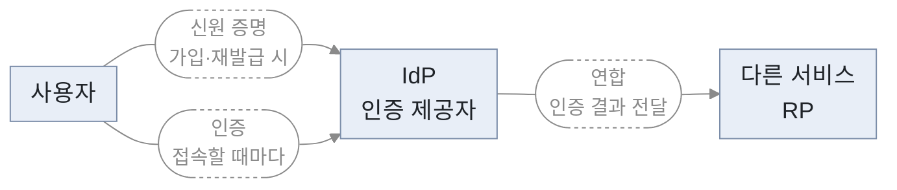
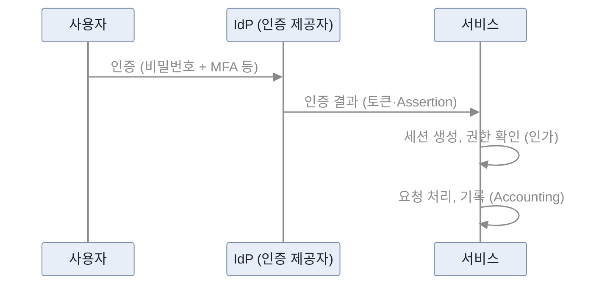
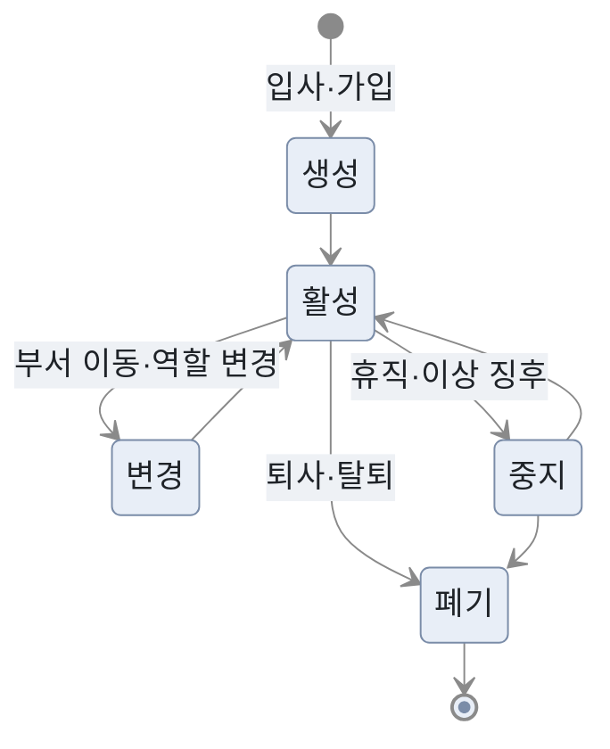

# Identity Fundamentals (신원·인증·인가 기초)

> 약어: NIST=미국 국립표준기술연구소, SP=NIST 특별 간행물, 3GPP=이동통신 표준화 기구

## 1. 개요 (What)

신원 관리(Identity Management)는 **"이 요청을 보낸 주체가 누구이고, 그 주체에게 무엇을 허락할 것인가"** 를 다루는 분야다.
로그인, 권한 관리, SSO(Single Sign-On), API(Application Programming Interface) 토큰, 서비스 간 인증이 모두 여기에 속한다.

이 분야는 비슷한 단어가 많아 혼동이 잦다. 가장 먼저 아래 네 가지를 구분한다.

| 개념 | 묻는 질문 | 예 |
|------|-----------|----|
| Identity (신원) | 이 주체는 누구인가 | 사용자 `alice`, 서비스 `payment-api`, 단말 가입자 |
| Authentication (인증) | 그 주장이 사실임을 어떻게 확인하는가 | 비밀번호, OTP(One-Time Password), Passkey, 클라이언트 인증서 |
| Authorization (인가) | 확인된 주체가 무엇을 할 수 있는가 | "주문 조회는 가능, 환불은 불가" |
| Accounting / Audit (기록) | 누가 언제 무엇을 했는가 | 접근 로그, 감사 기록 |

네 단어의 앞 글자를 따 AAA(Authentication, Authorization, Accounting)라고 부르기도 한다.
**인증은 인가가 아니다.** 로그인에 성공했다는 사실은 "누구인지 확인됐다"는 뜻일 뿐, "무엇이든 해도 된다"는 뜻이 아니다.

이 문서는 PKI & Identity 하위 영역의 출발점으로, 이후 문서(인증 방식·FIDO2·PKI·OAuth·토큰)가 함께 쓰는 용어와 구조를 정리한다.
인가 모델(RBAC·ABAC 등)의 상세는 [Access Control](../access-control/README.md)에서 다룬다.

## 2. 배경 / 원리 (Why & How)

### 2.1 신원을 이루는 요소

| 용어 | 뜻 | 예 |
|------|----|----|
| 주체 (Subject) | 신원을 가진 대상. 사람일 수도, 기계일 수도 있다 | 직원, 고객, 서버, 컨테이너, 단말 |
| 식별자 (Identifier) | 주체를 가리키는 이름표. 비밀이 아니다 | 사용자 ID, 이메일, 사번, SUPI(Subscription Permanent Identifier) |
| 속성 (Attribute / Claim) | 주체에 대한 정보 | 부서, 역할, 이메일 인증 여부 |
| 인증 수단 (Authenticator) | 주체가 자신임을 증명하는 데 쓰는 것 | 비밀번호, OTP 앱, 보안 키, 개인키 |
| 자격 증명 (Credential) | 인증 수단과 주체의 연결을 보증하는 데이터 | 패스워드 해시 기록, 인증서, 등록된 공개키 |

- **식별자는 비밀이 아니다.** 사용자 ID나 이메일은 알려져도 괜찮다고 가정하고 설계한다. 보안은 인증 수단이 담당한다.
- 이메일처럼 **바뀔 수 있는 값을 유일한 식별자로 쓰면** 이메일을 재사용·이전할 때 다른 사람이 같은 계정에 연결되는 문제가 생긴다. 내부적으로는 바뀌지 않는 고유 ID를 따로 둔다.

### 2.2 인증 요소 — 무엇으로 증명하는가

| 요소 | 뜻 | 예 | 약점 |
|------|----|----|------|
| 지식 (Something you know) | 주체만 아는 정보 | 비밀번호, PIN | 추측, 유출, 피싱 |
| 소유 (Something you have) | 주체만 가진 물건 | 휴대폰 OTP 앱, 보안 키, 스마트카드 | 분실, 탈취, SIM 바꿔치기(SMS 방식) |
| 생체 (Something you are) | 주체의 신체 특성 | 지문, 얼굴 | 바꿀 수 없음. 보통 기기 잠금 해제용으로 쓰고 서버로 보내지 않는다 |

- MFA(Multi-Factor Authentication)는 **서로 다른 요소**를 두 개 이상 조합하는 것이다. 비밀번호와 보안 질문은 둘 다 "지식"이라 MFA가 아니다.
- 인증 방식별 강약과 MFA 구현은 다음 문서 [Authentication Methods](authentication-methods.md)에서 다룬다.

### 2.3 신원 증명·인증·연합 — 서로 다른 세 기능

텍스트 설명: 세 가지는 순서대로 반드시 거치는 단계가 아니라 **서로 다른 기능**이다.
- **신원 증명**: 계정을 만들거나 인증 수단을 다시 발급할 때 "이 사람이 실제로 그 사람인가"를 확인한다(신분증 확인, 본인 인증 등).
- **인증**: 접속할 때마다 "지금 요청하는 주체가 등록된 그 주체인가"를 등록된 인증 수단으로 확인한다.
- **연합**: 한 기관(IdP)의 인증 결과나 속성을 다른 기관·서비스(RP(Relying Party))가 받아 신뢰하는 **구조**다(SSO, 소셜 로그인). 서비스가 직접 인증하면 연합은 없다.

| 기능 | 언제 일어나나 | 실패하면 |
|------|---------------|----------|
| 신원 증명 | 계정 생성·인증 수단 재발급 시 | 남의 명의로 계정 생성, 복구 절차를 통한 계정 탈취 |
| 인증 | 접속할 때마다 | 비밀번호 탈취·피싱으로 위장 접속 |
| 연합 | 다른 서비스가 IdP의 인증 결과를 신뢰하는 구조를 쓸 때만 | 위조·탈취된 인증 결과(토큰·Assertion)로 접속 |

> 해설: 많은 계정 탈취는 로그인 자체가 아니라 **복구 절차**(비밀번호 재설정, 휴대폰 번호 변경)에서 일어난다. 복구는 사실상 "신원 증명을 다시 하는 것"이므로, 로그인만큼 또는 그 이상으로 강하게 설계해야 한다.

### 2.4 인증 후의 흐름

텍스트 설명: 사용자는 IdP(Identity Provider)에 인증하고, IdP는 서명된 인증 결과를 서비스에 넘긴다. 서비스는 그 결과를 검증해 세션을 만들고,
요청마다 "이 주체가 이 작업을 해도 되는가"를 인가 정책으로 판단한 뒤 결과를 기록한다. 인증은 한 번이지만 **인가는 요청마다** 일어난다.

## 3. 상세 (Details)

### 3.1 기술별 역할 지도

이름이 비슷해도 하는 일이 다르다. "무엇을 하는 기술인가"로 구분한다.

| 기술 | 분류 | 하는 일 | 하지 않는 일 | 다루는 문서 |
|------|------|---------|--------------|-------------|
| 비밀번호·OTP·Passkey | 인증 수단 | 사용자가 자신임을 증명 | 권한 부여 | [Authentication Methods](authentication-methods.md), [FIDO2 · WebAuthn · Passkey](fido2-webauthn-passkey.md) |
| X.509 인증서·PKI(Public Key Infrastructure) | 신뢰 체계 | 공개키가 누구 것인지 보증 | 사용자 로그인 흐름 자체 | [PKI & Certificates](pki-certificates.md) |
| OAuth 2.0 | 인가 위임 프레임워크 | 사용자를 대신해 API에 접근할 권한을 위임 | **사용자 인증** (로그인 증명이 아님) | [OAuth 2.0 · OpenID Connect](oauth2-oidc.md) |
| OIDC(OpenID Connect) | 인증 계층 | OAuth 2.0 위에서 "누가 로그인했는가"를 전달 | 세부 권한 결정 | [OAuth 2.0 · OpenID Connect](oauth2-oidc.md) |
| SAML(Security Assertion Markup Language) 2.0 | 연합 인증 | 기업 SSO에서 인증 결과·속성 전달 | API 권한 위임 | [Federation & SSO](federation-sso.md) |
| JWT(JSON Web Token) | 토큰 형식 | 서명된 정보를 담아 전달 | 인증 방식 그 자체 | [Token Security](token-security.md) |
| mTLS(mutual TLS) | 통신 상호 인증 | 서비스끼리 인증서로 서로 확인 | 사용자 로그인 | [TLS Overview 3.4 mTLS](../cryptography/tls-overview.md#34-mtls--클라이언트도-인증서로-인증) |
| Kerberos | 네트워크 인증 | 기업 디렉터리 환경의 티켓 기반 인증 | 인터넷 서비스 간 연합 | [Enterprise Identity](enterprise-identity.md) |

- **"OAuth로 로그인한다"는 표현은 정확하지 않다.** 로그인(인증) 결과를 전달하는 것은 OIDC이고, OAuth 2.0 Access Token은 "API를 호출할 권한"이다. Access Token만 보고 로그인을 처리하면 다른 서비스용 토큰으로도 로그인되는 문제가 생긴다.
- JWT는 형식일 뿐이다. 같은 JWT 형식이 OIDC의 ID Token, OAuth의 Access Token, 5G SBA의 서비스 이용 토큰에 모두 쓰인다.

### 3.2 사람 신원과 워크로드 신원

| 구분 | 사람 (Human) | 워크로드 (Workload, Non-human) |
|------|--------------|-------------------------------|
| 예 | 직원, 고객, 관리자 | 서비스, 배치 작업, 컨테이너, CI/CD(Continuous Integration/Continuous Delivery) 파이프라인, AI 에이전트 |
| 인증 수단 | 비밀번호 + MFA, Passkey | 클라이언트 인증서(mTLS), 서명된 토큰, 클라우드 역할, API 키 |
| 대표 위험 | 피싱, 비밀번호 재사용 | 코드·설정에 박힌 장기 비밀, 과도한 권한, 주인 없는 계정 |
| 바람직한 방향 | 피싱에 강한 인증(FIDO2) | 짧은 수명의 자동 발급 자격 증명, 비밀 없는 신원(Workload Identity) |

- 많은 조직에서 워크로드 신원의 수가 사람 계정보다 훨씬 많고, 관리가 더 허술하다.
- 워크로드 신원 체계는 [Workload Identity](workload-identity.md), 클라우드 역할은 [Cloud IAM](../../cloud-security/iam/README.md) (작성 예정)에서 다룬다.

### 3.3 신원 생명주기

텍스트 설명: 계정은 입사·가입 때 만들어지고, 역할이 바뀌면 권한도 함께 바뀌어야 하며, 퇴사·탈퇴 시 폐기된다. 기업에서는 이를 Joiner–Mover–Leaver(입사–이동–퇴사) 흐름이라고 부른다.

- **이동(Mover)에서 권한이 쌓이는 문제**가 흔하다. 새 권한은 추가되지만 이전 부서 권한이 회수되지 않는다.
- **퇴사(Leaver) 후 남은 계정**(Orphan account)과 그 계정이 만든 API 키·토큰이 공격 경로가 된다.
- 워크로드 신원에도 같은 생명주기가 있다. 서비스가 사라져도 그 서비스용 키와 권한이 남는 경우가 많다.

### 3.4 다른 영역에서의 신원

| 영역 | 신원·인증의 모습 |
|------|------------------|
| 5G | 가입자 영구 식별자 SUPI와 은닉 식별자 SUCI(Subscription Concealed Identifier), 가입자 인증(5G-AKA(Authentication and Key Agreement)), NF(Network Function)는 인증서와 mTLS로 서로 인증 → [SUPI Exposure](../../5g-security/security-risks/01-ue-privacy/01-01-SUPI_Exposure.md), [5G-AKA Attack Surface](../../5g-security/security-risks/02-auth-nas/02-01-5G-AKA_Attack_Surface.md) |
| Cloud | 사용자 계정과 역할(Role), 워크로드에 부여되는 클라우드 신원, 키 정책 → [Cloud IAM](../../cloud-security/iam/README.md) (작성 예정) |
| Web | 로그인 세션, 소셜 로그인(OIDC), Passkey |
| AI | AI 에이전트가 사용자 대신 API를 호출할 때의 권한 위임, 에이전트용 서비스 계정 → [AI Security](../../ai-security/README.md) (로드맵, 문서 작성 예정) |

> 해설: 5G 가입자 인증은 웹 로그인과 구조가 다르다. USIM과 홈 네트워크가 미리 공유한 장기 키로 서로를 인증하고, 그 결과로 통신 보호 키까지 만든다.
> "식별자는 비밀이 아니다"라는 원칙의 예외처럼 보이는 SUPI 은닉도, 인증이 아니라 **추적 방지(프라이버시)** 를 위한 것이다.

## 4. 보안 관점 (Security Relevance)

| 실수 | 결과 | 대응 |
|------|------|------|
| 인증 성공을 곧 권한으로 취급 | 로그인한 누구나 관리 기능 접근 | 요청마다 인가 확인, 최소 권한 |
| OAuth Access Token으로 로그인 처리 | 다른 서비스용 토큰으로 로그인 | 로그인은 OIDC ID Token으로, 대상(`aud`) 검증 |
| 바뀔 수 있는 이메일을 유일 식별자로 사용 | 이메일 재사용 시 계정 탈취 | 변하지 않는 내부 고유 ID 사용 |
| IdP가 준 속성을 검증 없이 신뢰 | "이메일 인증됨" 여부 미확인으로 계정 연결 탈취 | 신뢰할 IdP와 속성 범위 명시, 인증 여부 확인 |
| 복구 절차가 로그인보다 약함 | SMS·이메일 재설정으로 계정 탈취 | 복구에도 강한 인증, 이상 징후 알림 |
| 공용·공유 계정 | 행위자 추적 불가, 퇴사자도 계속 사용 | 개인별 계정, 관리자 접근은 개별 승인 |
| 퇴사·이동 시 권한 미회수 | 주인 없는 계정·권한 누적 | 생명주기 자동화, 정기 권한 검토 |
| 워크로드 비밀을 코드에 하드코딩 | 저장소 유출 시 서비스 권한 탈취 | 짧은 수명 자격 증명, 비밀 관리 서비스 → [Key Management](../cryptography/key-management.md) |

점검 시 확인할 것: 식별자 설계(고유·불변 여부), 인증 요소 조합, 복구 절차의 강도, 인증과 인가의 분리, IdP 신뢰 범위, 계정 생명주기(입사·이동·퇴사) 처리, 공유 계정 유무, 워크로드 신원과 비밀 관리.

## 5. 심화 (Advanced)

> 보안 컨설턴트·점검자를 위한 규격 세부다. 본문만으로 개념 이해에는 충분하다.

### 5.1 *NIST SP 800-63-4*의 보증 수준

*NIST SP 800-63-4*(Digital Identity Guidelines)는 디지털 신원의 보증 수준을 **기능별로 따로** 정한다. 본문 2.3의 세 기능에 각각 대응한다.

| 축 | 평가 대상 기능 | 세부 문서 | 수준 |
|----|-------------|-----------|------|
| IAL(Identity Assurance Level) | 신원 증명 | *NIST SP 800-63A-4* | IAL1 ~ IAL3 |
| AAL(Authenticator Assurance Level) | 인증 | *NIST SP 800-63B-4* | AAL1 ~ AAL3 |
| FAL(Federation Assurance Level) | 연합과 Assertion 전달 | *NIST SP 800-63C-4* | FAL1 ~ FAL3 |

- 숫자가 클수록 강한 보증이다. 세 축은 **하나의 통합 보안 등급이 아니라** 서로 다른 기능에 대한 평가다. 예를 들어 신원 증명은 약하게(IAL1) 하되 인증은 강하게(AAL2 이상) 요구할 수 있다.
- 연합을 쓰지 않는 서비스에는 FAL이 적용되지 않는다.
- 조직은 각 기능의 위험(금전, 개인정보, 안전)에 맞춰 필요한 수준을 따로 고른다. 이 체계는 미국 연방 기관을 위한 지침이며, 일반 기업은 이를 참고 기준으로 활용한다.
- 수준별 세부 요구사항(허용 인증 수단, 피싱 저항성 요구 등)은 [Authentication Methods](authentication-methods.md), [FIDO2 · WebAuthn · Passkey](fido2-webauthn-passkey.md)에서 해당 부분과 함께 다룬다.

## 관련 문서

- 다음: [PKI & Certificates](pki-certificates.md), [Authentication Methods](authentication-methods.md)
- 인가 모델: [Access Control](../access-control/README.md)
- 암호 기반: [Digital Signature](../cryptography/digital-signature.md), [TLS Overview](../cryptography/tls-overview.md)
- 로드맵: [PKI & Identity](README.md)

## 출처

| 문서 | 지위 / 버전 | 이 문서에서의 사용 |
|------|-------------|-------------------|
| *NIST SP 800-63-4* "Digital Identity Guidelines" (*63A-4*·*63B-4*·*63C-4* 포함) | Final (네 문서 모두) | IAL·AAL·FAL 보증 수준 체계 |
| *3GPP TS 33.501 V19.7.0 (Release 19)* | — | 5G 가입자 식별자와 인증 구조 (세부는 5G 문서) |

- 그 외 내용은 신원·인증·인가의 일반 원리를 재구성한 해설이다.
