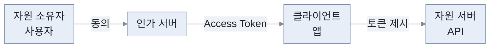
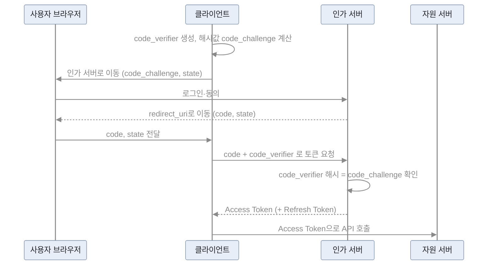
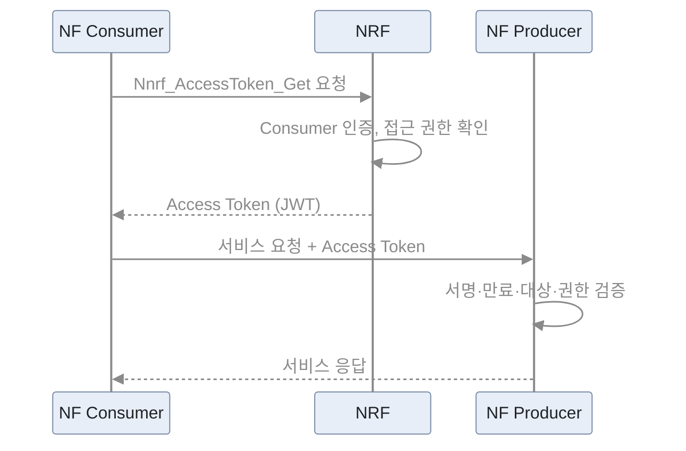

# OAuth 2.0 · OpenID Connect

> 약어: RFC=IETF 표준 문서, IETF=인터넷 표준화 기구, 3GPP=이동통신 표준화 기구

## 1. 개요 (What)

OAuth 2.0과 OIDC(OpenID Connect)는 함께 쓰이는 경우가 많지만 **푸는 문제가 다르다.**

| 구분 | OAuth 2.0 | OIDC |
|------|-----------|------|
| 성격 | **권한 위임(Delegated Authorization)** 프레임워크 | OAuth 2.0 위에 얹은 **인증(Authentication)** 계층 |
| 답하는 질문 | "이 앱이 사용자 대신 이 API를 호출해도 되는가" | "지금 로그인한 사용자가 누구인가" |
| 핵심 결과물 | Access Token (API 호출 권한) | ID Token (로그인 사실과 사용자 정보) |
| 받는 쪽 | 자원 서버 (API) | 클라이언트 (로그인을 처리하는 앱) |

비유하면 OAuth 2.0 Access Token은 **발레파킹 키**다. 주차 요원은 차를 움직일 수 있지만 트렁크는 열 수 없고, 그 키가 "차 주인이 누구인가"를 증명하지도 않는다.
OIDC의 ID Token은 **신분 확인서**다. 누가 언제 어떻게 로그인했는지를 그 앱에게 알려준다.

**Access Token은 로그인 증거가 아니다.** Access Token을 받았다는 사실만으로 로그인을 처리하면, 다른 앱을 위해 발급된 토큰을 가져와도 로그인되는 문제가 생긴다(2.4).

이 문서는 OAuth 2.0의 역할과 흐름, 현재 권장되는 Authorization Code + PKCE(Proof Key for Code Exchange), OIDC의 ID Token, 그리고 *RFC 9700*(OAuth 2.0 보안 모범 사례)이 정리한 주요 보안 요구를 다룬다.
토큰 형식(JWT(JSON Web Token), JSON은 JavaScript Object Notation)과 토큰 보호는 [Token Security](token-security.md)에서 이어서 다룬다.

## 2. 배경 / 원리 (Why & How)

### 2.1 왜 OAuth가 필요했나

OAuth 이전에는 사진 인쇄 서비스가 사용자의 사진 저장소 사진을 가져오려면 **사용자의 저장소 비밀번호를 직접 받아야** 했다.
그러면 인쇄 서비스는 사진뿐 아니라 계정 전체에 접근할 수 있고, 사용자가 권한을 일부만 주거나 나중에 회수할 방법도 없다.

OAuth 2.0은 이를 **"비밀번호 대신, 범위와 수명이 제한된 토큰을 발급"** 하는 방식으로 바꾼다.

### 2.2 네 가지 역할



텍스트 설명: 사용자(자원 소유자)가 인가 서버에서 동의하면, 인가 서버는 클라이언트(앱)에게 Access Token을 발급한다. 클라이언트는 그 토큰을 자원 서버(API)에 제시해 사용자의 자원에 접근한다.

| 역할 | 뜻 | 예 |
|------|----|----|
| 자원 소유자 (Resource Owner) | 자원의 주인. 접근을 허락하는 주체 | 사용자 |
| 클라이언트 (Client) | 사용자 대신 자원에 접근하려는 앱 | 사진 인쇄 서비스, 모바일 앱 |
| 인가 서버 (Authorization Server) | 사용자를 인증하고 동의를 받아 토큰을 발급 | 기업 IdP(Identity Provider), 소셜 로그인 제공자 |
| 자원 서버 (Resource Server) | 토큰을 검증하고 API를 제공 | 사진 저장소 API |

- OIDC에서는 인가 서버를 OP(OpenID Provider), 클라이언트를 RP(Relying Party)라고 부른다. 같은 대상을 가리키는 다른 이름이다.
- 클라이언트는 비밀을 안전하게 보관할 수 있는지에 따라 나뉜다(3.3).

### 2.3 Authorization Code + PKCE — 현재의 기본 흐름



텍스트 설명:
1. 클라이언트는 매 요청마다 임의의 비밀값 `code_verifier`를 만들고, 그 해시인 `code_challenge`를 계산한다.
2. 사용자를 인가 서버로 보낼 때 `code_challenge`와 CSRF(Cross-Site Request Forgery) 방지용 `state`를 함께 보낸다.
3. 사용자가 로그인하고 동의하면, 인가 서버는 등록된 `redirect_uri`로 사용자를 돌려보내며 일회용 **인가 코드(Authorization Code)** 를 붙인다.
4. 클라이언트는 브라우저를 거치지 않는 직접 통신(Back-channel)으로 인가 코드와 원래의 `code_verifier`를 인가 서버에 보낸다.
5. 인가 서버는 `code_verifier`의 해시가 처음 받은 `code_challenge`와 같은지 확인한 뒤 토큰을 발급한다.

- 토큰은 브라우저 주소창을 거치지 않고 Back-channel로만 전달된다. 주소창·브라우저 기록·Referer 헤더를 통한 토큰 유출을 막는다.
- **PKCE의 효과**: 공격자가 중간에서 인가 코드를 가로채도 `code_verifier`를 모르면 토큰으로 바꿀 수 없다. 클라이언트 비밀을 보관할 수 없는 모바일 앱·브라우저 앱에서 특히 중요하다.

### 2.4 OIDC — 로그인 결과를 전달하는 방법

OIDC는 위 흐름에 `scope=openid`를 추가해, 토큰 응답에 **ID Token**을 함께 받는다.

| 비교 | ID Token | Access Token |
|------|----------|--------------|
| 누구를 위한 것인가 | 클라이언트 (`aud` = 클라이언트 ID) | 자원 서버 (API) |
| 담는 내용 | 누가(`sub`), 어느 OP가(`iss`), 언제·어떻게 로그인했는가 | 어떤 권한(`scope`)으로 어떤 자원에 접근하는가 |
| 형식 | JWS(JSON Web Signature)로 서명된 JWT. 암호화는 선택이며, 할 때는 서명한 뒤 암호화한다 | 규격상 형식 자유 (JWT 또는 불투명한 문자열) |
| 어디로 보내는가 | 클라이언트가 검증하고 사용. **API에 보내지 않는다** | API 호출 시 `Authorization` 헤더로 전송 |

**왜 Access Token으로 로그인하면 안 되는가**: Access Token은 "이 토큰을 가진 자에게 API를 허락한다"는 뜻일 뿐, **어느 클라이언트를 위해** 발급됐는지 클라이언트가 확인할 방법이 규격상 없다.
공격자가 자기 앱에 로그인한 피해자의 Access Token을 얻어 다른 앱에 제시하면, Access Token만 보는 앱은 공격자를 피해자로 로그인시킨다.
ID Token은 `aud`(대상)에 클라이언트 ID가 들어 있으므로, 클라이언트가 "내 앱을 위해 발급된 로그인 결과인가"를 검증할 수 있다.

## 3. 상세 (Details)

### 3.1 토큰과 코드의 종류

| 이름 | 역할 | 수명 | 보관·전달 |
|------|------|------|-----------|
| 인가 코드 (Authorization Code) | 토큰과 바꾸는 일회용 교환권 | 매우 짧음 (분 단위), 1회 사용 | 브라우저 리다이렉트로 전달 |
| Access Token | API 호출 권한 | 짧게 (분~시간) | API 요청마다 전송 |
| Refresh Token | 사용자 개입 없이 새 Access Token을 받는 권한 | 길게 | 인가 서버에만 전송, 안전하게 보관 |
| ID Token | 로그인 결과 (OIDC) | 짧게 | 클라이언트가 검증 후 세션 생성에 사용 |

- 대부분의 Access Token은 **Bearer Token**이다. 가진 사람이 곧 사용자로 인정되므로, 유출되면 그대로 재사용된다. 이를 막는 송신자 제한 토큰(Sender-constrained Token)은 [Token Security](token-security.md)에서 다룬다.
- Refresh Token은 Access Token보다 위험하다. 수명이 길고 새 토큰을 계속 만들 수 있기 때문이다.

### 3.2 Grant 유형 — 토큰을 받는 방법

| Grant | 쓰는 곳 | 현재 상태 |
|-------|---------|-----------|
| Authorization Code + PKCE | 사용자가 있는 웹·모바일·브라우저 앱 | **기본 권장** |
| Client Credentials | 사용자 없이 서비스가 자기 자신으로 API 호출 (서버 간) | 권장 (기계 간 통신) |
| Device Authorization | 키보드가 없는 기기(TV, 콘솔): 다른 기기에서 코드 입력 후 승인 | 사용 (*RFC 8628*) |
| Refresh Token | Access Token 갱신 | 사용 (보호 조건 있음, 아래 5.1) |
| Implicit | 브라우저 앱에서 토큰을 인가 응답(주소창)으로 바로 받던 방식 | **사용하지 않아야 함** (토큰이 주소창·기록으로 노출, 송신자 제한 불가) |
| Resource Owner Password Credentials | 앱이 사용자 비밀번호를 직접 받아 토큰으로 교환 | **사용 금지** (OAuth의 목적 자체를 무너뜨림) |

- *RFC 9700*은 Implicit Grant(`response_type=token`)뿐 아니라 **인가 응답으로 Access Token을 내주는 모든 응답 유형**을 쓰지 않도록 권고하고(SHOULD NOT), Password Grant는 금지한다(MUST NOT). OAuth 2.1 초안에서는 둘 다 빠졌다(3.7).
- **Device Code 원격 피싱**: Device Authorization은 사용자가 다른 기기에서 코드를 입력하는 구조라 원격 피싱에 악용될 수 있다(*RFC 8628*도 이 위험을 다룬다).
  1. 공격자가 자기 기기에서 Device Authorization을 시작해 사용자 코드(User Code)를 받는다.
  2. 피해자에게 "이 주소에서 코드를 입력하라"는 메시지를 보낸다.
  3. 피해자는 **진짜 인가 서버**에서 자기 계정으로 로그인하고 코드를 승인한다.
  4. 공격자의 기기가 피해자 권한의 Access Token을 받는다.

  피해자가 정상 사이트에서 로그인했기 때문에 주소 확인으로는 막을 수 없다. 승인 화면에 요청한 기기·앱 정보를 분명히 보여주고, "기기에 권한을 주는 행위"임을 안내하며, 사용자 코드의 유효기간을 짧게 둔다. 필요 없는 환경에서는 이 Grant를 꺼 둔다.

### 3.3 클라이언트 유형과 클라이언트 인증

| 유형 | 뜻 | 예 | 인가 서버가 클라이언트를 확인하는 방법 |
|------|----|----|---------------------------------------|
| Confidential Client | 비밀을 안전하게 보관할 수 있다 | 서버에서 동작하는 웹 앱, 백엔드 서비스 | 클라이언트 비밀, 서명된 JWT(`private_key_jwt`), mTLS(mutual Transport Layer Security) |
| Public Client | 비밀을 숨길 수 없다 (코드를 사용자가 가져갈 수 있음) | 모바일 앱, SPA(Single Page Application) | 클라이언트 인증 없음 → **PKCE와 정확한 redirect URI가 보호의 핵심** |

- 모바일 앱이나 SPA에 클라이언트 비밀을 넣어 배포하면, 그것은 이미 비밀이 아니다.
- Confidential Client는 공유 비밀보다 **비대칭 키 기반 인증**(`private_key_jwt`, mTLS)이 더 강하다. 인가 서버가 비밀을 저장하지 않아도 되기 때문이다.

### 3.4 Scope와 Audience — 권한의 범위

- **Scope**: 클라이언트가 요청하고 사용자가 동의한 권한의 종류. 예: `photos.read`, `calendar.write`.
- **Audience**: 토큰을 받을 자원 서버. 토큰에 대상이 지정되어 있으면, 한 API용 토큰을 다른 API에서 재사용할 수 없다.

| 원칙 | 설명 |
|------|------|
| 최소 Scope | 필요한 권한만 요청한다. `*`나 관리자 Scope를 기본으로 요청하지 않는다 |
| 대상 제한 | Access Token은 특정 자원 서버용으로만 발급하고, 자원 서버는 자기가 대상인지 확인한다 |
| Scope ≠ 인가 정책 | Scope는 "앱에 위임된 범위"일 뿐이다. 자원 서버는 **그 사용자가 그 자원에 접근할 수 있는지**도 따로 확인해야 한다 |

> 해설: 세 가지를 따로 확인해야 한다. Scope는 **어떤 종류의 작업**인가, Audience는 **어느 자원 서버**에서 쓸 수 있는가, 객체 단위 인가는 **이 객체에 접근할 수 있는가**다.
> Scope `users.read`가 있다고 모든 사용자의 정보를 읽을 수 있는 것은 아니다. `GET /users/1001`에 접근할 수 있다고 `GET /users/1002`에도 접근할 수 있는 것도 아니다. 이를 혼동하면 [OWASP API Security Top 10](../web-app-security/owasp/api-security-top-10/README.md)의 BOLA(Broken Object Level Authorization) 취약점이 된다.

### 3.5 redirect URI, state, nonce

인가 코드는 브라우저 리다이렉트로 전달되므로, **어디로 돌려보내는가**가 보안의 핵심이다.

| 요소 | 막는 공격 | 규칙 |
|------|-----------|------|
| redirect URI(Uniform Resource Identifier) 정확 일치 | 공격자 사이트로 코드·토큰 유출 | 등록된 URI와 **문자열 그대로 정확히 비교**한다. 와일드카드·접두사 일치 금지 |
| `state` | CSRF(공격자의 인가 응답을 피해자 브라우저에 주입) | 요청마다 예측 불가능한 값, 사용자 세션에 묶어 확인 |
| PKCE | 인가 코드 가로채기·주입 | 모든 클라이언트에 적용, `S256` 방식 사용 |
| `nonce` (OIDC) | ID Token 재전송·주입 | 요청에 넣고 ID Token 안의 값과 일치 확인 |

- redirect URI를 느슨하게 비교하면(예: `https://app.example.com`으로 시작하면 허용), `https://app.example.com.attacker.net`이나 열린 리다이렉터(Open Redirector)를 통해 코드가 공격자에게 간다.
- redirect URI 정확 일치의 유일한 예외는 **네이티브 앱의 루프백 주소**(`127.0.0.1` 등)에서 포트 번호가 바뀌는 것이다. 일반 웹 앱으로 이 예외를 넓히지 않는다.
- CSRF 방어: *RFC 9700*은 인가 서버가 PKCE를 지원함을 **확인한 클라이언트에 한해** PKCE를 CSRF 방어로 쓸 수 있다고 본다. OIDC에서는 `nonce`도 이 역할을 한다. 그 조건이 확인되지 않으면 `state`를 쓴다. 실무에서는 함께 쓰는 경우가 많다.

### 3.6 앱 형태별 구현 방향

| 앱 형태 | 권장 방식 |
|---------|-----------|
| 서버 웹 앱 | Confidential Client + Authorization Code + PKCE. 토큰은 서버에 두고 브라우저에는 세션 쿠키만 |
| 브라우저 앱 (SPA) | 아래 표의 세 구조 중 BFF(Backend for Frontend)를 우선 고려한다 (*RFC 10017*) |
| 모바일·데스크톱 앱 | 앱 내장 웹뷰(Embedded WebView)가 아니라 **시스템 브라우저** 같은 외부 User-Agent로 로그인하고, Authorization Code + PKCE를 쓴다 (*RFC 8252*). 앱이 사용자 비밀번호를 볼 수 없고, 브라우저의 기존 로그인·Passkey를 쓸 수 있다 |
| 서버 간 통신 | Client Credentials. 가능하면 비대칭 키 클라이언트 인증 |

*RFC 10017*(OAuth 2.0 for Browser-Based Applications)은 브라우저 앱 구조를 보안 수준이 높은 순서로 세 가지로 정리한다.

| 순위 | 구조 | 특징 |
|:---:|------|------|
| 1 | BFF | 백엔드가 OAuth Client가 되어 토큰을 보관하고, API 요청도 백엔드를 거친다. 브라우저에는 세션 쿠키만 있다 |
| 2 | Token-mediating Backend | 백엔드가 토큰을 받아 오지만, 브라우저가 Access Token으로 API를 직접 호출한다 |
| 3 | Browser-based OAuth Client | 브라우저 JavaScript가 직접 OAuth Client가 되어 토큰을 관리한다 |

- 브라우저 JavaScript에 토큰이 있으면 XSS(Cross-Site Scripting) 한 번으로 토큰이 탈취된다. BFF는 토큰을 브라우저 밖에 두어 이 위험을 줄인다.
- BFF가 모든 환경의 의무는 아니며, 대신 세션 쿠키를 쓰므로 쿠키 보호 속성과 CSRF 방어가 새로 필요하다. XSS가 있으면 공격자가 브라우저 안에서 BFF를 통해 API를 호출하는 것까지 막지는 못한다.

### 3.7 OAuth 2.1 — 모범 사례를 기본값으로

OAuth 2.1은 *RFC 6749* 이후 쌓인 보안 권고를 하나로 정리하는 개정판이다. 최신 개정판은 *draft-ietf-oauth-v2-1-17*이며, **Internet-Draft 단계로 아직 최종 RFC가 아니다.**

| 변경 방향 | 내용 |
|-----------|------|
| PKCE 필수화 | Authorization Code를 쓰는 모든 클라이언트에 PKCE 요구 |
| 제거 | Implicit Grant, Resource Owner Password Credentials Grant |
| redirect URI | 정확한 문자열 일치 |
| Bearer Token 전달 | URL(Uniform Resource Locator) 쿼리 문자열로 토큰 전달 금지. 자원 서버도 그 위치의 토큰을 무시한다 |
| Refresh Token | Public Client는 송신자 제한 또는 재발급 시 교체(Rotation) |

```text
금지: GET /api/data?access_token=xxxxx
권장: GET /api/data
      Authorization: Bearer xxxxx
```

- 확정 전이라도 위 내용은 대부분 *RFC 9700*에 이미 반영된 현행 모범 사례다. 새로 설계한다면 OAuth 2.1 방향을 기준으로 삼아도 무리가 없다.

### 3.8 다른 영역에서의 사용

| 영역 | 사용 예 |
|------|---------|
| 5G | SBA(Service Based Architecture)의 NF(Network Function) 간 서비스 접근 제어. 아래 3.9 참조 |
| Web | 소셜 로그인(OIDC), 외부 앱 연동(OAuth) |
| 기업 | IdP 기반 SSO(Single Sign-On) (OIDC 또는 SAML(Security Assertion Markup Language)) → [Federation & SSO](federation-sso.md) |
| Cloud | 워크로드가 외부 IdP 토큰으로 클라우드 자격 증명을 얻는 Workload Identity Federation → [Cloud IAM](../../cloud-security/iam/README.md) (작성 예정) |
| AI | AI 에이전트가 사용자 대신 외부 API를 호출할 때의 권한 위임. 에이전트에 사용자 비밀번호나 넓은 권한 토큰을 주지 않고, 범위가 제한된 위임 토큰을 쓴다 → [AI Security](../../ai-security/README.md) (로드맵, 문서 작성 예정) |

### 3.9 5G SBA의 OAuth 2.0

*3GPP TS 33.501 V19.7.0 (Release 19)*는 5G 코어의 NF 간 서비스 호출에 OAuth 2.0을 쓴다. 사용자 없는 서버 간 통신이므로 Client Credentials Grant를 사용한다.

| OAuth 역할 | 5G SBA 구성 요소 |
|------------|------------------|
| 인가 서버 | NRF(Network Repository Function) |
| 클라이언트 | NF Service Consumer (서비스를 이용하는 NF) |
| 자원 서버 | NF Service Producer (서비스를 제공하는 NF) |



텍스트 설명: 서비스를 이용하려는 NF는 NRF에 Access Token을 요청한다. NRF는 요청한 NF를 인증하고, 그 NF 유형이 대상 서비스를 쓸 수 있는지 확인한 뒤 JWT 형식의 Access Token을 발급한다.
서비스를 제공하는 NF는 토큰의 서명, 유효기간, 대상, 허용된 서비스·작업을 확인한 뒤 요청을 처리한다.

- Access Token은 JWT이며, JWS 서명 또는 MAC(Message Authentication Code)으로 보호된다.
- 일반 웹 OAuth와 달리 **NF Instance ID, NF Type, 서비스 이름(Scope), 대상 NF(Audience)** 같은 네트워크 기능별 정보가 권한 판단의 핵심이다.
- NF 간 통신은 mTLS로 보호되며, 토큰은 그 위에서 서비스 단위의 인가를 담당한다 → [TLS Overview](../cryptography/tls-overview.md)
- 토큰 탈취·대상 검증 누락 같은 위협은 [OAuth Token Abuse](../../5g-security/security-risks/06-sba-security/06-06-OAuth_Token_Abuse.md)에서 다룬다.

## 4. 보안 관점 (Security Relevance)

| 실수 | 결과 | 대응 |
|------|------|------|
| Access Token으로 로그인 처리 | 다른 앱용 토큰으로 계정 탈취 | 로그인은 OIDC ID Token으로, `aud`·`iss`·`nonce` 검증 |
| redirect URI 접두사·와일드카드 비교 | 인가 코드·토큰이 공격자에게 전달 | 정확한 문자열 일치, 열린 리다이렉터 제거 |
| ID Token 서명·Claim 미검증, `alg=none` 허용 | 위조된 로그인 결과 수용 | 서명과 `iss`·`aud`·`exp`·`nonce` 검증, `none` 거부 |
| PKCE 미적용 또는 `plain` 방식 | 인가 코드 가로채기·주입 | 모든 클라이언트에 PKCE `S256` |
| `state` 누락 또는 세션과 무관한 값 | 로그인 CSRF, 피해자를 공격자 계정에 연결 | 세션에 묶인 예측 불가 `state` (또는 PKCE 확인) |
| Implicit·Password Grant 사용 | 토큰 노출, 앱이 비밀번호 수집 | Authorization Code + PKCE로 전환 |
| Public Client에 클라이언트 비밀 내장 | 비밀 추출 후 클라이언트 사칭 | Public Client로 등록, PKCE에 의존 |
| 과도한 Scope 요청·승인 | 토큰 유출 시 피해 확대 | 최소 Scope, 동의 화면에 권한 명확히 표시 |
| 자원 서버가 토큰 대상·Scope 미검증 | 다른 API용 토큰 재사용 | `aud`·Scope·만료 검증, 객체 단위 인가 병행 |
| Refresh Token을 Public Client에 장기 보관 | 탈취 시 장기간 토큰 재발급 | Refresh Token Rotation 또는 송신자 제한, 이상 재사용 시 전체 폐기 |
| 토큰을 URL·로그에 기록 | 기록 열람자에게 토큰 노출 | 헤더·본문으로만 전송, 로그 마스킹 |
| 여러 인가 서버를 쓰면서 응답 출처 미확인 | Mix-up 공격(다른 인가 서버의 응답으로 혼동) | 요청 시 선택한 Issuer를 세션에 저장하고 인가 응답의 `iss`와 비교 (*RFC 9207*), 또는 인가 서버별 redirect URI 분리 |
| Device Authorization 승인 화면이 불명확 | Device Code 원격 피싱으로 공격자 기기에 권한 부여 | 요청 기기 표시, 짧은 코드 유효기간, 불필요하면 비활성화 |

점검 시 확인할 것: 로그인 처리에 ID Token을 쓰는지와 그 검증 항목, redirect URI 등록·비교 방식, PKCE 적용과 방식, `state`·`nonce` 처리, 사용 중인 Grant 유형, 클라이언트 유형과 인증 방식, Scope 범위와 동의 화면, 자원 서버의 토큰 검증, Refresh Token 보호, 토큰의 로그·URL 노출 여부.

## 5. 심화 (Advanced)

> 보안 컨설턴트·점검자를 위한 규격 세부다. 본문만으로 개념 이해에는 충분하다.

### 5.1 *RFC 9700* 핵심 권고

*RFC 9700*(Best Current Practice for OAuth 2.0 Security, BCP(Best Current Practice) 240)은 *RFC 6749* 이후 알려진 공격을 반영한 현행 보안 기준이다. 규범 수준은 MUST(반드시), MUST NOT(금지), SHOULD(권고), SHOULD NOT(지양), RECOMMENDED(권장)로 구분한다.

| 주제 | 권고 | 수준 |
|------|------|:---:|
| redirect URI | 등록된 URI와 정확한 문자열 일치. 네이티브 앱 루프백 주소의 포트 변동만 예외 | MUST |
| PKCE (Public Client) | 사용 | MUST |
| PKCE (Confidential Client) | 사용 | RECOMMENDED |
| PKCE 방식 | `S256` | SHOULD |
| Implicit 및 인가 응답으로 Access Token을 내주는 응답 유형 | 사용 지양 | SHOULD NOT |
| Password Grant | 사용 금지 | MUST NOT |
| Access Token 송신자 제한 (DPoP(Demonstrating Proof of Possession)·mTLS) | 적용 | SHOULD |
| Access Token 대상·권한 제한 | 적용 | SHOULD |
| Public Client의 Refresh Token | 송신자 제한 또는 Rotation 중 하나 적용 | MUST |
| Mix-up 방어 (여러 인가 서버 사용 시) | `iss` 확인 또는 인가 서버별 redirect URI | MUST |
| 열린 리다이렉터 | 클라이언트·인가 서버 모두 노출 금지 | MUST NOT |

- Refresh Token의 만료를 짧게 하는 것만으로는 Public Client 요구를 충족하지 않는다. 송신자 제한이나 Rotation 중 하나가 있어야 한다.

### 5.2 ID Token 검증 절차 (요약)

*OpenID Connect Core 1.0 incorporating errata set 2* 기준으로 클라이언트는 ID Token에 대해 다음을 확인한다.

| 단계 | 항목 | 확인 내용 |
|:---:|------|-----------|
| 1 | 서명 | OP의 공개키(JWKS(JSON Web Key Set)에서 조회)로 JWS 서명 검증. 허용하지 않은 알고리즘은 거부 |
| 2 | `iss` | 미리 신뢰한 OP의 식별자와 정확히 일치 |
| 3 | `aud` | 자신의 클라이언트 ID 포함 |
| 4 | `azp`(Authorized Party) | `aud`가 여러 개면 `azp` 확인 권고(SHOULD). `azp`가 있으면 그 값이 자신의 클라이언트 ID인지 확인 |
| 5 | 시간 | `exp`(만료)가 지나지 않았는지, `iat`(발급 시각)가 정책상 허용 범위인지 |
| 6 | `nonce` | 인증 요청에 `nonce`를 보냈다면 반드시 일치 확인 |

- `auth_time`(인증 시각)은 `max_age`를 요청한 경우 반드시 확인한다.
- `acr`(Authentication Context Class Reference), `amr`(Authentication Methods References)은 인증 수준·수단에 대한 정책이 있을 때 확인한다. 모든 ID Token에서 필수는 아니다.
- **`alg=none`**: 원칙적으로 금지된다. 인가 엔드포인트에서 ID Token을 받지 않는 응답 유형을 쓰고, 클라이언트가 등록 시 `none`을 명시적으로 요청한 경우에만 예외적으로 허용된다. 일반 로그인 구현에서는 허용하지 않는 것이 안전하다.

- 로그인 사용자를 식별할 때는 **`iss` + `sub` 조합**을 쓴다. 서로 다른 OP에서 같은 `sub` 값이 나올 수 있기 때문이다. 이메일은 바뀌거나 재사용될 수 있어 식별자로 부적합하다 → [Identity Fundamentals 2.1 신원을 이루는 요소](identity-fundamentals.md#21-신원을-이루는-요소)
- 서명 알고리즘과 JWT 검증의 세부는 [Token Security](token-security.md)에서 다룬다.

### 5.3 주요 엔드포인트와 메타데이터

| 엔드포인트 | 역할 | 규격 |
|-----------|------|------|
| Authorization Endpoint | 사용자 로그인·동의, 인가 코드 발급 | *RFC 6749* |
| Token Endpoint | 코드·Refresh Token을 토큰으로 교환 | *RFC 6749* |
| UserInfo Endpoint | Access Token으로 사용자 속성 조회 | *OpenID Connect Core 1.0* |
| JWKS URI | 서명 검증용 공개키 목록 | *OpenID Connect Discovery 1.0*, *RFC 8414* |
| Discovery (`/.well-known/openid-configuration`) | 위 엔드포인트와 지원 기능을 자동 조회 | *OpenID Connect Discovery 1.0* |
| Revocation / Introspection | 토큰 폐기 / 토큰 상태 조회 | *RFC 7009* / *RFC 7662* |

### 5.4 확장 규격 지도

| 규격 | 해결하는 문제 |
|------|---------------|
| *RFC 7636* PKCE | 인가 코드 가로채기 |
| *RFC 8252* OAuth 2.0 for Native Apps | 모바일·데스크톱 앱의 시스템 브라우저 사용 |
| *RFC 10017* OAuth 2.0 for Browser-Based Applications | 브라우저 앱의 구조 선택 (BFF 우선) |
| *RFC 8628* Device Authorization Grant | 입력 장치가 없는 기기 |
| *RFC 8414* Authorization Server Metadata | 인가 서버 설정 자동 조회 |
| *RFC 8707* Resource Indicators | 토큰을 받을 자원 서버 지정 (대상 제한) |
| *RFC 8693* Token Exchange | 토큰을 다른 대상·권한의 토큰으로 교환 (위임·대리 호출) |
| *RFC 9126* Pushed Authorization Requests (PAR) | 인가 요청 파라미터를 브라우저가 아닌 직접 통신으로 먼저 전달해 변조 방지 |
| *RFC 9207* Authorization Server Issuer Identification | 인가 응답에 `iss`를 넣어 Mix-up 방어 |
| *RFC 9396* Rich Authorization Requests (RAR) | Scope보다 세밀한 권한 표현 (예: 특정 금액의 송금 1건) |
| *RFC 7523* JWT Profile for Client Authentication | 서명된 JWT로 클라이언트 인증 (`private_key_jwt`) |
| *RFC 8705* / *RFC 9449* | mTLS / DPoP 기반 송신자 제한 토큰 |

### 5.5 표준 문서 체계

| 규격 | 지위 | 비고 |
|------|------|------|
| *RFC 6749* The OAuth 2.0 Authorization Framework | Proposed Standard | 기본 프레임워크 |
| *RFC 6750* Bearer Token Usage | Proposed Standard | Bearer Token 전달 방법 |
| *RFC 9700* Best Current Practice for OAuth 2.0 Security | BCP 240 | 현행 보안 기준 |
| *RFC 8252* OAuth 2.0 for Native Apps | BCP 212 | 네이티브 앱. 외부 User-Agent, Authorization Code + PKCE |
| *RFC 10017* OAuth 2.0 for Browser-Based Applications | BCP 212 | 브라우저 앱. BFF·Token-mediating Backend·Browser-based OAuth Client 구조 비교 |
| *draft-ietf-oauth-v2-1-17* | Internet-Draft | OAuth 2.1, 최종 RFC 아님 |
| *OpenID Connect Core 1.0 incorporating errata set 2* | OpenID Foundation Final | ID Token, 인증 흐름 |
| *OpenID Connect Discovery 1.0 incorporating errata set 2* | OpenID Foundation Final | 메타데이터 자동 조회 |
| 확장 규격 (*RFC 8628*, *8414*, *8707*, *8693*, *9126*, *9207*, *9396*, *7523*) | Proposed Standard | 5.4 확장 규격 지도 |

- BCP 번호는 RFC 하나에 붙는 고유 번호가 아니라, 관련 모범 사례 RFC를 묶는 **컬렉션 번호**다. BCP 212에는 네이티브 앱용 *RFC 8252*와 브라우저 앱용 *RFC 10017*이 함께 속한다. 둘 다 OAuth 클라이언트 구현 지침이다.
- 각 규격의 기준 상태는 [PKI & Identity 3. 기준 표준](README.md#3-기준-표준)에도 정리되어 있다.

## 관련 문서

- 이전: [FIDO2 · WebAuthn · Passkey](fido2-webauthn-passkey.md), [Identity Fundamentals](identity-fundamentals.md)
- 다음: [Token Security](token-security.md)
- 연합 인증: [Federation & SSO](federation-sso.md)
- API 취약점: [OWASP API Security Top 10](../web-app-security/owasp/api-security-top-10/README.md)
- 5G 연결: [OAuth Token Abuse](../../5g-security/security-risks/06-sba-security/06-06-OAuth_Token_Abuse.md)
- 로드맵: [PKI & Identity](README.md)

## 출처

| 문서 | 지위 / 버전 | 이 문서에서의 사용 |
|------|-------------|-------------------|
| *RFC 6749*, *RFC 6750* | Proposed Standard | 역할, Grant 유형, Bearer Token |
| *RFC 7636* | Proposed Standard | PKCE |
| *RFC 9700* | BCP 240 | 보안 권고와 규범 수준, 폐기된 Grant, redirect URI 정확 일치 |
| *RFC 8252* / *RFC 10017* | BCP 212 / BCP 212 | 네이티브 앱 / 브라우저 앱 구조 |
| *draft-ietf-oauth-v2-1-17* | Internet-Draft | OAuth 2.1 변경 방향 |
| *OpenID Connect Core 1.0 incorporating errata set 2*, *OpenID Connect Discovery 1.0 incorporating errata set 2* | OpenID Foundation Final | ID Token, 검증 절차, `alg=none` 예외, 메타데이터 |
| *RFC 8628*, *RFC 8414*, *RFC 8707*, *RFC 8693*, *RFC 9126*, *RFC 9207*, *RFC 9396*, *RFC 7523* | Proposed Standard | 확장 규격 지도, Device Code 원격 피싱 |
| *3GPP TS 33.501 V19.7.0 (Release 19)* | — | 5G SBA의 OAuth 2.0 역할, Client Credentials Grant, JWT Access Token |

- 비유, 비교표, 앱 형태별 구현 방향은 위 규격을 바탕으로 재구성한 해설이다.
