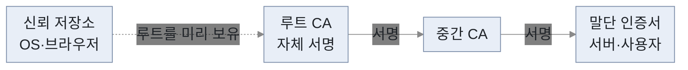
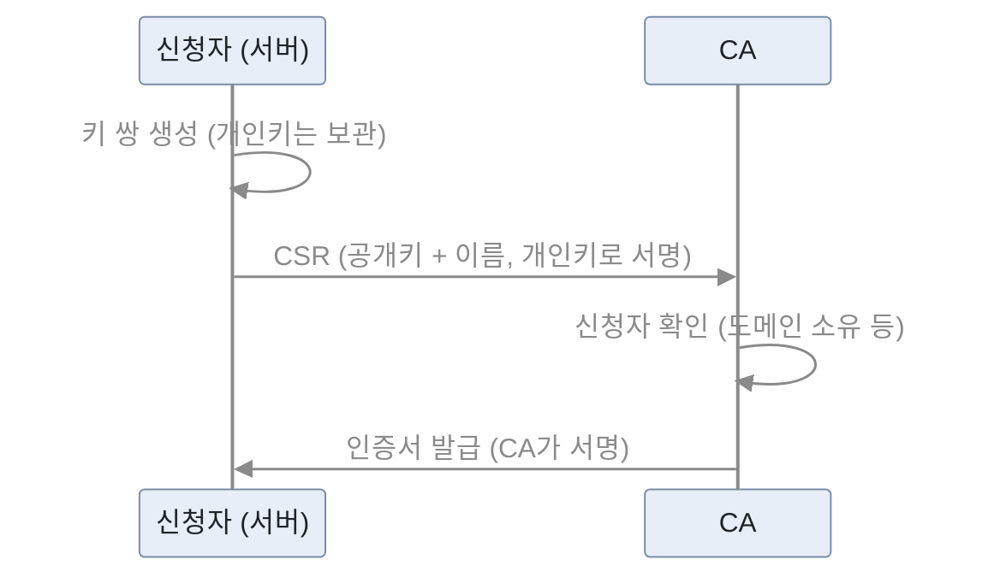

# PKI & Certificates (PKI와 인증서)

> 약어: RFC=인터넷 표준 문서, IETF=인터넷 표준화 기구, 3GPP=이동통신 표준화 기구

## 1. 개요 (What)

PKI(Public Key Infrastructure, 공개키 기반구조)는 **"이 공개키가 정말 그 주체의 것인가"를 보증하는 체계**다.
그 보증을 담은 전자 문서가 인증서(Certificate)이고, 인증서를 발급하고 서명하는 기관이 CA(Certificate Authority)다.

**왜 필요한가.** 공개키 암호와 디지털 서명은 "이 공개키의 짝인 개인키로 서명했다"는 것까지만 증명한다(→ [Digital Signature 3.4 서명의 신뢰는 공개키의 신뢰에서 나온다](../cryptography/digital-signature.md#34-서명의-신뢰는-공개키의-신뢰에서-나온다)).
공격자가 자기 공개키를 "은행 서버의 공개키"라고 속여 건네면, 서명 검증도 TLS(Transport Layer Security) 연결도 모두 성공한다.
PKI는 **신뢰할 수 있는 제3자(CA)가 "이 공개키는 이 이름의 주인 것"이라고 서명해 주는 방식**으로 이 문제를 푼다.

| 구성 요소 | 하는 일 |
|-----------|---------|
| 인증서 | 주체 이름과 공개키를 묶고, CA가 서명한 데이터 |
| CA | 주체를 확인하고 인증서에 서명해 발급 |
| 신뢰 앵커 (Trust Anchor) | 검증하는 쪽이 처음부터 믿기로 한 루트 CA 인증서 목록 |
| 폐기 정보 | 만료 전에 무효가 된 인증서 목록 또는 상태 응답 (CRL(Certificate Revocation List), OCSP(Online Certificate Status Protocol)) |

PKI는 웹 HTTPS(Hypertext Transfer Protocol Secure), 서비스 간 mTLS(mutual TLS), 코드 서명, 이메일 서명, 기기 인증, 5G 코어 NF(Network Function) 간 인증의 공통 기반이다.

## 2. 배경 / 원리 (Why & How)

### 2.1 신뢰 체인 — 루트에서 말단까지

텍스트 설명: 루트 CA는 자기 자신에게 서명한 인증서를 가진다. 루트 CA는 중간 CA 인증서에 서명하고, 중간 CA는 서버·사용자의 말단 인증서에 서명한다.
검증하는 쪽(브라우저, OS(Operating System), 애플리케이션)은 루트 CA 인증서를 신뢰 저장소에 미리 갖고 있다. 말단 인증서에서 시작해 서명을 거슬러 올라가 신뢰 저장소의 루트에 닿으면 그 인증서를 믿는다.

- **루트는 거의 쓰지 않는다.** 루트 개인키는 오프라인 HSM(Hardware Security Module)에 보관하고, 일상적인 발급은 중간 CA가 한다. 중간 CA 키가 유출되면 그 중간 CA만 폐기하면 되기 때문이다.
- **신뢰의 출발점은 결국 "미리 믿기로 한 목록"이다.** 신뢰 저장소에 공격자의 루트가 들어가면 PKI 전체가 무력화된다. 사내 프록시나 악성 프로그램이 루트를 몰래 설치하는 경우가 실제로 있다.

### 2.2 "서명 검증"과 "인증서 검증"은 다르다

| 구분 | 확인하는 것 | 이것만 하면 |
|------|------------|-------------|
| 서명 검증 | 이 인증서의 서명이 발급자 공개키로 검증되는가 (암호 연산) | 공격자가 스스로 만든 CA로 서명한 인증서도 "서명은 유효" |
| 인증서 유효성 검증 | 체인이 신뢰 앵커까지 이어지는가, 기간·이름·용도·제약·폐기 상태가 맞는가 | — (이것까지 해야 신뢰할 수 있음) |

서명 검증은 인증서 검증의 **일부**일 뿐이다. "서명이 맞다"와 "믿어도 된다"는 다른 말이다.

한 걸음 더 나아가, **인증서가 유효하다는 것과 지금 통신하는 상대를 신뢰할 수 있다는 것도 다르다.** 서명이 정상이고 유효 기간이 남은 인증서라도, 발급 CA가 내 신뢰 앵커에 없거나 인증서의 이름이 내가 접속하려던 대상과 다르면 그 연결은 신뢰하지 않는다. 인증서 검증의 목적은 "이 인증서가 멀쩡한가"가 아니라 **"지금 통신하는 상대가 내가 의도한 그 주체인가"** 를 확인하는 것이다.

### 2.3 인증서 유효성 검증의 원리

텍스트 설명: 먼저 받은 인증서들로 말단에서 신뢰 앵커까지 이어지는 경로를 만든다(체인 구축). 경로의 각 인증서 서명을 위 단계 공개키로 검증하고, 모든 인증서가 유효 기간 안에 있는지 본다.
중간 인증서가 정말 CA 권한을 가졌는지와 말단 인증서의 용도가 맞는지 확인한 뒤, 접속한 이름이 인증서의 SAN(Subject Alternative Name)과 일치하는지, 폐기되지 않았는지 확인한다.

| 단계 | 핵심 | 흔한 실패 |
|------|------|-----------|
| 체인 구축 | 서버가 보낸 중간 인증서 + 신뢰 저장소의 루트로 경로를 만든다 | 서버가 중간 인증서를 빠뜨려 일부 클라이언트에서만 실패 |
| 서명 검증 | 각 인증서가 바로 위 CA의 키로 서명되었는가 | 검증 생략 코드 |
| 기간 | 모든 인증서가 유효 기간 안인가 | 시스템 시계 오류, 만료 방치 |
| CA 제약 | 중간 인증서가 CA로 표시되었는가, 경로 길이·이름 제약을 지키는가 | 일반 인증서로 다른 인증서를 서명하는 공격을 못 막음 |
| 용도 | 말단 인증서가 이 용도(서버 인증, 클라이언트 인증, 코드 서명 등)로 발급되었는가 | 다른 용도 인증서의 오용 |
| 이름 | 접속한 호스트 이름이 SAN에 있는가 | 정상 인증서로 다른 도메인 위장 |
| 폐기 | CRL·OCSP로 폐기 여부 확인 | 폐기된 인증서 수용 |

- TLS 연결에서 이 검증이 어떤 순서로 쓰이는지는 [TLS Overview 3.3 인증서 검증](../cryptography/tls-overview.md#33-인증서-검증--tls-보안의-절반)을 참고한다. 이 문서는 각 단계의 원리를 다룬다.
- **이름 확인은 SAN으로 한다.** *RFC 9525*는 서비스 이름 확인에 주체 이름의 CN(Common Name)을 쓰지 말고 SAN 확장을 쓰도록 권고한다.

| 항목 | 용도 |
|------|------|
| SAN `dNSName` | DNS 서버 이름 확인의 기준 |
| SAN `iPAddress` | IP 주소로 접속할 때의 확인 기준 (DNS 이름과 구분) |
| Subject CN | 과거 인증서에서 이름을 담던 필드. 신규 TLS 서버 인증서의 이름 확인에는 CN으로 대신 확인(CN fallback)하지 않는다 |

## 3. 상세 (Details)

### 3.1 X.509 인증서의 주요 필드

현재 쓰이는 인증서는 대부분 X.509 버전 3 형식이다.

| 필드 | 뜻 | 점검 포인트 |
|------|----|-------------|
| Subject | 인증서 주인의 이름 | 조직·서비스 식별 |
| Issuer | 발급한 CA의 이름 | 체인 구축에 사용 |
| Serial Number | CA가 부여한 일련번호 | 폐기 목록에서 인증서를 가리킬 때 사용 |
| Validity (notBefore / notAfter) | 유효 기간 | 만료 관리 |
| Subject Public Key Info | 주체의 공개키와 알고리즘 | 키 종류·길이 (→ [Asymmetric Encryption](../cryptography/asymmetric-encryption.md)) |
| Signature Algorithm / Signature | CA의 서명 알고리즘과 서명 값 | 폐기된 해시(SHA(Secure Hash Algorithm)-1 등) 사용 여부 |

**확장 필드 (Extensions)**

| 확장 | 뜻 | 점검 포인트 |
|------|----|-------------|
| Subject Alternative Name (SAN) | 인증서가 유효한 도메인·IP·이메일 목록 | 이름 확인의 기준. 와일드카드 범위 |
| Basic Constraints | 이 인증서가 CA인지, 아래로 몇 단계까지 발급할 수 있는지 | 말단 인증서가 CA로 표시되면 안 됨 |
| Key Usage / Extended Key Usage | 키를 쓸 수 있는 용도 (서명, 키 교환, 서버 인증, 클라이언트 인증, 코드 서명 등) | 용도 외 사용 차단 |
| CRL Distribution Points | CRL을 받을 위치 | 폐기 확인 가능 여부 |
| Authority Information Access | OCSP 응답 서버, 상위 CA 인증서 위치 | 폐기 확인, 체인 구축 |
| Subject / Authority Key Identifier | 주체·발급자 키의 식별자 | 같은 이름의 CA가 여러 개일 때 체인 구축 |

### 3.2 발급 절차

텍스트 설명: 신청자는 먼저 자기 키 쌍을 만들고, 공개키와 원하는 이름을 담은 CSR(Certificate Signing Request)을 개인키로 서명해 CA에 보낸다. CSR의 서명은 "이 공개키의 개인키를 실제로 갖고 있다"는 증명이다.
CA는 신청자가 그 이름의 정당한 주인인지(웹 인증서라면 도메인 소유) 확인한 뒤 인증서에 서명해 돌려준다. **개인키는 신청자 밖으로 나가지 않는다.**

| 확인 수준 | 확인하는 것 | 비고 |
|-----------|------------|------|
| DV(Domain Validation) | 도메인을 통제하는가 | 웹 인증서 대부분. 자동 발급 가능 |
| OV(Organization Validation) | 도메인 + 조직 실재 여부 | 인증서에 조직명 포함 |
| EV(Extended Validation) | 더 엄격한 조직 확인 | 브라우저 표시가 축소됨 (아래 참고) |

- **EV 인증서와 브라우저 표시**: EV는 조직 실체를 추가로 확인하지만, 과거처럼 주소창에 회사명을 두드러지게 보여 주는 표시는 축소되거나 제거됐다. 대표 사례로 Chrome은 77부터 EV 회사명 표시를 주소창에서 페이지 정보(Page Info)로 옮겼다. 브라우저마다 UI는 다르며, EV라고 해서 사용자에게 항상 DV보다 안전한 사이트로 보이는 것은 아니다.
- **자동 발급과 갱신**: ACME(Automatic Certificate Management Environment) 프로토콜로 도메인 확인과 발급·갱신을 자동화할 수 있다. 인증서 수명이 짧아지는 추세라 수동 갱신은 만료 사고로 이어지기 쉽다.

### 3.3 만료와 폐기는 다르다

| 구분 | 만료 (Expiration) | 폐기 (Revocation) |
|------|-------------------|-------------------|
| 언제 | 정해진 유효 기간이 끝났을 때 | 유효 기간 중이라도 더 이상 믿으면 안 될 때 |
| 이유 | 계획된 수명 종료 | 개인키 유출, 잘못된 발급, 주체 정보 변경, 사용 중지 |
| 확인 방법 | 인증서 안의 notAfter만 보면 됨 | CA에 물어봐야 함 (CRL·OCSP) |
| 실패하면 | 서비스 중단 (가용성 문제) | 유출된 키로 위장 가능 (보안 문제) |

**폐기 확인 방식**

| 방식 | 동작 | 약점 |
|------|------|------|
| CRL | CA가 폐기된 인증서 일련번호 목록을 주기적으로 게시 | 목록이 커질 수 있고, 게시 주기만큼 반영이 늦다 |
| OCSP | 클라이언트가 인증서 하나의 상태를 CA의 OCSP 서버에 질의 | 응답 지연, OCSP 서버 장애, 어떤 사이트에 접속하는지 CA가 알게 됨(프라이버시) |
| OCSP stapling | 서버가 미리 받아 둔 OCSP 응답(CA 서명)을 TLS 핸드셰이크에 붙여 전달 | 서버가 붙이지 않으면 효과 없음 |

> 해설: 많은 클라이언트는 OCSP 응답을 받지 못하면 그냥 연결을 허용한다(soft-fail). 공격자가 OCSP 질의를 막으면 폐기 확인이 사실상 무력화된다.
> 그래서 실무에서는 폐기 확인만 믿지 않고 **인증서 수명을 짧게 유지**해 유출된 인증서가 쓰일 수 있는 기간 자체를 줄이는 방향으로 가고 있다.

### 3.4 공개 CA와 사설 CA

| 구분 | 공개 CA (Public CA) | 사설 CA (Private CA) |
|------|---------------------|----------------------|
| 신뢰 범위 | OS·브라우저 신뢰 저장소에 기본 포함 | 조직이 직접 배포한 신뢰 저장소에만 포함 |
| 용도 | 인터넷에 공개되는 웹사이트·API | 사내 서비스, 서비스 간 mTLS, 기기 인증, 5G 코어 NF |
| 규칙 | CA/Browser Forum 기준과 브라우저 정책을 따라야 함 | 조직이 정함 (그래서 운영 품질 편차가 큼) |
| 흔한 위험 | 잘못된 발급 | 루트 키를 온라인 서버에 평문 보관, 수명 수십 년, 폐기 체계 없음 |

- 사설 CA를 운영한다면 루트는 오프라인 HSM에 두고, 발급은 중간 CA가 하며, 발급·폐기 기록을 남기는 것이 기본이다(→ [Key Management](../cryptography/key-management.md)).

### 3.5 인증서 투명성 (Certificate Transparency)

CT(Certificate Transparency)는 공개 CA가 발급한 인증서를 **누구나 볼 수 있는 공개 로그에 기록**하게 하는 체계다.

- 도메인 소유자는 CT 로그를 모니터링해 **자기 도메인으로 몰래 발급된 인증서**를 발견할 수 있다.
- Chrome은 공개적으로 신뢰되는 TLS 인증서가 CT 정책을 지키도록 요구한다. 인증서에 담긴 SCT(Signed Certificate Timestamp, CT 로그 기록 증명)가 정책 조건을 만족하지 않으면 검증에 실패할 수 있다. Mozilla도 Root CA Program에 속한 CA의 인증서에 CT 요구사항을 적용한다.
- 이 요구는 **공개적으로 신뢰되는 인증서**에 대한 브라우저 정책이다. 사설 CA 인증서나 기업이 직접 설치한 신뢰 앵커에는 적용 범위가 다를 수 있다.
- 반대로 CT 로그는 누구나 조회할 수 있으므로, 인증서에 넣은 내부 호스트 이름·서비스 이름이 외부에 드러난다. 공개 CA로 내부 도메인이나 서비스 이름을 인증하는 설계는 피하고, 내부 전용 이름은 사설 CA로 발급한다.

### 3.6 다른 영역에서의 사용

| 영역 | 사용처 |
|------|--------|
| Web | HTTPS 서버 인증서 → [TLS Overview](../cryptography/tls-overview.md) |
| 서비스 간 통신 | mTLS 클라이언트·서버 인증서, 서비스 메시의 자동 발급 인증서 → [TLS Overview 3.4 mTLS](../cryptography/tls-overview.md#34-mtls--클라이언트도-인증서로-인증) |
| 5G | 5G 코어의 NF는 인증서로 서로를 인증한다. *3GPP TS 33.501*은 SBA(Service Based Architecture) 인증서로 *3GPP TS 33.310*의 프로파일을 참조하며, *TS 33.310*은 X.509 v3 사용, SHA-256 지원(SHA-384 권고), MD5(Message Digest 5)·SHA-1 비지원, RSA(Rivest-Shamir-Adleman)·ECDSA(Elliptic Curve Digital Signature Algorithm) 지원(신규 인증서는 ECDSA 권고) 같은 공통 규칙을 정한다 → [TLS Overview 5.4 5G SBA의 TLS 요구사항](../cryptography/tls-overview.md#54-5g-sba의-tls-요구사항) |
| 소프트웨어 공급망 | 코드 서명 인증서, 서명 시점을 증명하는 타임스탬프 → [Digital Signature 3.5 시간과 키 폐기](../cryptography/digital-signature.md#35-시간과-키-폐기) |
| 기기·IoT(Internet of Things) | 제조 시 기기 인증서를 넣어 기기 신원으로 사용 |
| Cloud | 관리형 인증서 서비스, 사설 CA 서비스, 로드 밸런서의 인증서 → [Cloud Security](../../cloud-security/README.md) (로드맵, 문서 작성 예정) |

## 4. 보안 관점 (Security Relevance)

| 실수 | 결과 | 대응 |
|------|------|------|
| 인증서 검증 비활성화·자체 서명 인증서 무조건 신뢰 | 중간자 공격 | 검증 강제, 테스트는 사설 CA 루트를 명시적으로 신뢰 |
| 서명만 검증하고 체인·이름·용도는 미확인 | 아무 CA나 만든 인증서로 위장 | 검증된 라이브러리의 전체 검증 사용 |
| 중간 인증서 누락 | 일부 클라이언트 연결 실패 | 전체 체인 구성, 외부 도구로 확인 |
| 인증서 만료 방치 | 서비스 중단 | ACME 등 자동 갱신, 만료 모니터링 |
| 서버 개인키를 여러 서버·팀이 공유, 평문 보관 | 유출 시 위장·폐기 범위 확대 | 서버별 키, HSM·KMS(Key Management Service) 보관 |
| 개인키 유출 후 폐기 지연 | 유출된 키로 위장 지속 | 폐기 절차 수립, 짧은 수명 인증서 |
| 와일드카드 인증서 남용 | 한 서버 유출이 모든 서브도메인 위장으로 확대 | 서비스별 인증서, 와일드카드 범위 최소화 |
| 사설 CA 루트를 온라인·평문 보관 | 조직 전체 인증서 위조 | 오프라인 루트, 중간 CA로 발급 |
| 신뢰 저장소 관리 부재 | 불필요하거나 악성 루트를 신뢰 | 허용 루트 목록 관리, 변경 감시 |
| 내부 이름을 공개 CA 인증서에 포함 | CT 로그로 내부 구조 노출 | 내부 전용 이름은 사설 CA |

점검 시 확인할 것: 체인 구성과 신뢰 앵커, 검증 코드(체인·이름·용도·폐기), 키 알고리즘·길이와 서명 해시, 유효 기간과 갱신 자동화, 개인키 보관 위치와 공유 여부, 폐기 절차와 확인 방식, 와일드카드 사용 범위, 사설 CA 운영(루트 보관, 발급 기록), 신뢰 저장소 관리.

## 5. 심화 (Advanced)

> 보안 컨설턴트·점검자를 위한 규격 세부다. 본문만으로 개념 이해에는 충분하다.

### 5.1 표준 문서 체계

| 문서 | 내용 | 지위 |
|------|------|------|
| *RFC 5280* | X.509 v3 인증서와 CRL 프로파일, 인증 경로 검증 절차 | Standards Track |
| *RFC 6960* | OCSP | Standards Track |
| *RFC 9525* | Service Identity in TLS — 서비스 이름 확인 (CN 대신 SAN) | 지위 확인 예정 |
| *RFC 2986* | PKCS(Public-Key Cryptography Standards) #10: Certification Request Syntax Specification Version 1.7 — CSR 형식 | Informational |
| *RFC 8555* | Automatic Certificate Management Environment (ACME) | Proposed Standard |
| *RFC 6962* | Certificate Transparency (1.0) | Experimental, *RFC 9162*에 의해 Obsoleted |
| *RFC 9162* | Certificate Transparency Version 2.0 | Experimental (Internet Standard 아님) |
| *CA/Browser Forum Baseline Requirements v2.3.1* | 공개적으로 신뢰되는 TLS 서버 인증서의 발급 기준 (확인 수준, 수명, 키 요건 등) | 2026-10-04 판 |
| *3GPP TS 33.310 V19.5.0 (Release 19)* | 3GPP 네트워크 도메인 보안 인증 체계, 인증서 공통 규칙과 프로파일 | 2026-01 판 확인 (최신판 여부 확인 예정) |

### 5.2 인증서 수명 단축 추세

공개 TLS 인증서의 최대 유효 기간은 *CA/Browser Forum Baseline Requirements*에 따라 단계적으로 단축되고 있다. 아래는 v2.3.1(2026-10-04) 기준이며, 이후 판에서 바뀔 수 있으므로 점검할 때는 현행판을 다시 확인한다.

| 인증서 발급일 | 최대 유효 기간 | 상태 (v2.3.1 기준) |
|---------------|---------------|-------------------|
| 2026-03-15 이전 | 398일 | 종료 |
| 2026-03-15 ~ 2027-03-14 | 200일 | **현재 적용** |
| 2027-03-15 ~ 2029-03-14 | 100일 | 예정 |
| 2029-03-15 이후 | 47일 | 예정 |

- 이 기준은 **공개적으로 신뢰되는 TLS 서버 인증서**에 적용된다. 사설 CA 인증서에 같은 기간이 자동으로 적용되는 것은 아니며, 사설 CA는 조직 정책으로 정한다.
- 실무 결론은 일정과 관계없이 같다. **발급과 갱신을 자동화하지 않은 시스템은 수명이 짧아질수록 만료 사고 위험이 커진다.**

## 관련 문서

- 이전: [Identity Fundamentals](identity-fundamentals.md)
- 다음: [Authentication Methods](authentication-methods.md), [FIDO2 · WebAuthn · Passkey](fido2-webauthn-passkey.md)
- 암호 기반: [Asymmetric Encryption](../cryptography/asymmetric-encryption.md), [Digital Signature](../cryptography/digital-signature.md), [TLS Overview](../cryptography/tls-overview.md)
- 로드맵: [PKI & Identity](README.md)

## 출처

| 문서 | 지위 / 버전 | 이 문서에서의 사용 |
|------|-------------|-------------------|
| *IETF RFC 5280* | Standards Track | 인증서 필드·확장, 인증 경로 검증, CRL |
| *IETF RFC 6960* | Standards Track | OCSP |
| *IETF RFC 9525* | 지위 확인 예정 | SAN 기반 이름 확인 |
| *IETF RFC 2986* | Informational | CSR 형식 |
| *IETF RFC 8555* | Proposed Standard | ACME 자동 발급 |
| *IETF RFC 6962* / *RFC 9162* | Experimental (6962는 9162에 의해 Obsoleted) | 인증서 투명성 |
| *CA/Browser Forum Baseline Requirements* | v2.3.1 (2026-10-04) | 공개 TLS 서버 인증서 확인 수준·수명 단축 일정 |
| Chrome CT 정책, Mozilla Root CA Program | 브라우저 정책 | CT 요구 범위, EV 표시 변경 |
| *3GPP TS 33.310 V19.5.0 (Release 19)* | 2026-01 판 확인 | 5G 인증서 공통 규칙 |

- 그 외 내용은 PKI와 인증서의 일반 원리를 재구성한 해설이다. 실제 CA·제품의 동작은 정책과 구현마다 다르다.
