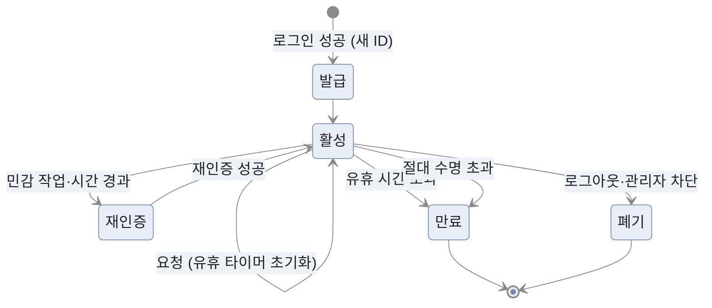
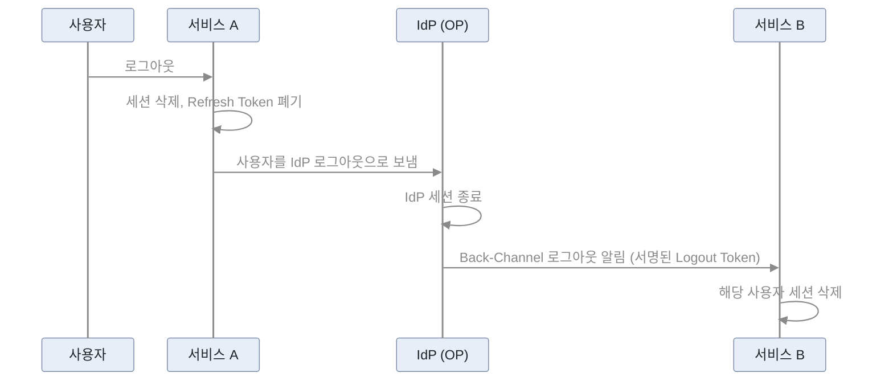

# Session & Token Lifecycle (세션·토큰 생명주기)

> 약어: RFC=IETF 표준 문서, IETF=인터넷 표준화 기구, NIST=미국 국립표준기술연구소, NIST SP=NIST 특별 간행물, W3C=웹 표준화 기구, 3GPP=이동통신 표준화 협력 기구

## 1. 개요 (What)

인증은 **한 순간**이고, 세션은 **그 뒤로 계속되는 상태**다. 사용자가 비밀번호와 MFA(Multi-Factor Authentication)로 로그인하면, 서비스는 그 결과를 세션(Session) 또는 토큰(Token)에 담아 이후 요청마다 "이미 인증된 사용자"로 취급한다.

그래서 공격자는 인증을 뚫는 대신 **인증 이후의 세션을 훔치는** 쪽을 노린다. Passkey처럼 강한 인증을 써도, 로그인 후 발급된 세션 쿠키가 탈취되면 막지 못한다 → [FIDO2 · WebAuthn · Passkey](fido2-webauthn-passkey.md)

이 문서는 세션과 토큰이 **발급 → 사용 → 갱신 → 만료·폐기**되는 전체 생명주기를 다룬다.

| 단계 | 핵심 질문 |
|------|-----------|
| 발급 | 예측할 수 없는가, 로그인 전 값을 그대로 쓰지 않는가 |
| 보관·전송 | 스크립트·네트워크·로그에서 새지 않는가 |
| 사용 | 훔친 사람이 다른 곳에서 쓸 수 있는가 |
| 갱신 | 갱신이 무한히 이어지지 않는가, 다시 인증해야 할 때를 아는가 |
| 만료·폐기 | 로그아웃·비밀번호 변경·퇴사 시 실제로 끊기는가 |

토큰 형식과 검증은 [Token Security](token-security.md), 웹 취약점 전반은 [Web & Application Security](../web-app-security/README.md)를 바탕으로 한다.

## 2. 배경 / 원리 (Why & How)

### 2.1 세션의 두 방식

| 방식 | 브라우저가 가진 것 | 상태 저장 위치 | 폐기 |
|------|-------------------|---------------|------|
| 서버 세션 | 의미 없는 무작위 세션 ID(Identifier) 쿠키 | 서버 (메모리·DB(Database)·캐시) | 서버에서 지우면 즉시 끝 |
| 토큰 기반 | 서명된 토큰 (JWT(JSON Web Token) 등) | 토큰 자체 | 만료 전까지 스스로 유효 → 짧은 수명 + 별도 폐기 수단 필요 |

- 둘은 서로 배타적이지 않다. 흔한 구조는 **브라우저에는 서버 세션 쿠키, 서버 뒤쪽에서는 Access Token**이다. 브라우저 앱의 BFF(Backend for Frontend) 구조가 이렇다 → [OAuth 2.0 · OpenID Connect 3.6 앱 형태별 구현 방향](oauth2-oidc.md#36-앱-형태별-구현-방향)
- 즉시 끊어야 하는 요구(로그아웃, 계정 정지)가 많을수록 서버가 상태를 가진 방식이 유리하다.

### 2.2 세션의 생명주기



텍스트 설명: 로그인에 성공하면 **새로 만든** 세션 ID로 세션이 발급된다. 요청이 올 때마다 유휴 타이머는 초기화되지만, 민감한 작업을 하거나 일정 시간이 지나면 재인증을 요구한다. 아무 요청이 없는 시간이 길어지면(유휴 시간 초과) 또는 로그인 후 정해진 최대 시간이 지나면(절대 수명 초과) 만료된다. 로그아웃이나 관리자 차단은 즉시 폐기다.

### 2.3 두 가지 시간 제한

| 제한 | 뜻 | 막는 위험 |
|------|----|-----------|
| 유휴 시간 제한 (Idle Timeout) | 마지막 요청 이후 일정 시간이 지나면 만료 | 자리를 비운 사이 남이 쓰는 것, 버려진 세션 |
| 절대 수명 제한 (Absolute Timeout) | 활동 여부와 상관없이 로그인 후 일정 시간이 지나면 만료 | 탈취된 세션을 계속 활동시키며 무한히 쓰는 것 |

- 유휴 제한만 있으면 공격자가 훔친 세션으로 주기적으로 요청을 보내 **영원히** 유지할 수 있다. 절대 수명이 반드시 함께 있어야 한다.
- 두 제한은 **서버에서** 강제한다. 브라우저 JavaScript 타이머나 쿠키 만료 시각만 믿으면 클라이언트를 조작해 우회할 수 있다.
- 시간 값은 서비스 위험도에 맞춰 정한다. *NIST SP 800-63B-4*의 수준별 재인증 기준은 아래 5.1 참조.

## 3. 상세 (Details)

### 3.1 발급 — 예측 불가능하게, 로그인 때 새로

| 원칙 | 설명 |
|------|------|
| 충분한 무작위성 | 세션 ID는 CSPRNG(Cryptographically Secure Pseudo-Random Number Generator, 암호학적 난수 생성기)로 만든다. OWASP(Open Worldwide Application Security Project)는 최소 64비트 엔트로피를 요구하고, 세션 ID를 직접 설계한다면 128비트 이상 크기를 권한다. 길이가 아니라 예측 불가능한 비트 수가 기준이다. 순번·시각·사용자 ID 기반 값은 추측된다 |
| 의미 없는 값 | 세션 ID 안에 사용자 정보·권한을 넣지 않는다 |
| **로그인 시 새 ID 발급** | 로그인 전 세션 ID를 로그인 후에도 그대로 쓰면, 공격자가 미리 심어 둔 ID로 피해자 세션을 공유할 수 있다(Session Fixation) |
| 권한 변경 시 새 ID | 관리자 권한으로 전환, MFA 완료 등 권한 수준이 바뀔 때도 ID를 새로 만든다 |
| 서버가 만든 ID만 인정 | 클라이언트가 보낸 처음 보는 세션 ID를 새 세션으로 받아들이지 않는다 |

- 난수 생성 원리는 [Cryptography in Practice](../cryptography/cryptography-in-practice.md)를 참조한다.

### 3.2 보관·전송 — 쿠키 속성

브라우저 세션은 대부분 쿠키로 전달된다. 쿠키 속성이 세션 보호의 첫 줄이다.

| 속성 | 효과 | 권장 |
|------|------|------|
| `HttpOnly` | JavaScript가 쿠키를 읽지 못한다. XSS(Cross-Site Scripting)로 쿠키를 직접 훔치기 어렵게 한다 | 세션 쿠키에 필수 |
| `Secure` | HTTPS(Hypertext Transfer Protocol Secure) 연결에서만 전송 | 필수. HSTS(HTTP Strict Transport Security)와 함께 |
| `SameSite` | 다른 사이트에서 시작된 요청에 쿠키를 붙일지 결정 (`Strict`·`Lax`·`None`) | `Lax` 이상. `None`이면 `Secure` 필수이고 CSRF(Cross-Site Request Forgery) 방어를 따로 해야 한다 |
| `Domain` | 쿠키를 보낼 도메인 범위 | 지정하지 않으면 발급 호스트에만 전송. 상위 도메인으로 넓히면 모든 하위 도메인이 쿠키를 받는다 |
| `Path` | 쿠키를 보낼 경로 | 보안 경계로 믿지 않는다 |
| `__Host-` 접두사 | 이름이 이 접두사로 시작하면 `Secure`·`Path=/`·`Domain` 미지정을 브라우저가 강제 | 세션 쿠키 이름에 권장 |
| `Max-Age`·`Expires` | 브라우저에 남는 기간 | 세션 쿠키는 짧게. 서버 쪽 만료가 진짜 기준이다 |

- `SameSite`를 지정하지 않으면 현대 브라우저는 `Lax`와 같은 기본 동작을 적용한다. 브라우저마다 호환성 예외가 있으므로 세션 쿠키에는 값을 명시한다 → 아래 5.3
- `SameSite=None`은 교차 사이트 요청에 쿠키를 보내도록 **허용**할 뿐이다. 브라우저의 서드파티 쿠키 차단·추적 방지 정책에 따라 실제 전송은 막힐 수 있다.
- `HttpOnly`는 XSS를 막는 것이 아니다. XSS가 있으면 공격자는 쿠키를 읽지 못해도 **피해자 브라우저 안에서 인증된 요청을 대신 보내고**, 경우에 따라 응답을 읽어 외부로 보낼 수 있다. `HttpOnly`는 XSS 방어를 대체하지 않으며, XSS 자체를 없애는 것이 우선이다.
- 세션 ID를 URL에 넣지 않는다. 브라우저 기록, 서버 로그, Referer 헤더로 샌다.
- 토큰을 브라우저 어디에 둘지는 [Token Security 3.6 토큰은 어디에 저장하는가](token-security.md#36-토큰은-어디에-저장하는가)에서 다룬다.

### 3.3 사용 — 훔친 세션을 쓰기 어렵게

세션 쿠키는 기본적으로 **Bearer**다. 가진 사람이 곧 사용자다. AiTM(Adversary-in-the-Middle) 피싱, 악성코드, 악성 브라우저 확장은 MFA를 건드리지 않고 로그인 후의 쿠키를 가져간다.

| 방어 | 설명 | 한계 |
|------|------|------|
| 이상 징후 탐지 | IP(Internet Protocol)·국가·기기·브라우저 특성이 갑자기 바뀌면 재인증 또는 차단 | 정상 사용자의 네트워크 변경과 구분이 어렵다 |
| 민감 작업 재인증 (Step-up) | 비밀번호·이메일·MFA 변경, 송금, 관리자 기능 전에 다시 인증 | 일반 조회는 보호하지 못한다 |
| 짧은 수명 | 탈취돼도 쓸 수 있는 시간이 짧다 | 사용자 불편 |
| 기기 결합 세션 | 세션을 기기 안의 추출 불가능한 키에 묶어, 쿠키만 복사해서는 다른 기기에서 쓸 수 없게 한다 | 브라우저·플랫폼 지원이 필요하다 |

- 기기 결합 세션의 대표 시도가 DBSC(Device Bound Session Credentials)다. 브라우저가 기기에서 키 쌍을 만들어 개인키를 TPM(Trusted Platform Module) 같은 보호 저장소에 두고, 서버는 세션을 그 공개키에 묶는다. 쿠키를 갱신할 때마다 브라우저가 개인키 소유를 증명하므로, 쿠키만 복사해 간 공격자는 다른 기기에서 갱신하지 못한다. W3C에서 표준화가 진행 중이고 Chrome을 중심으로 지원이 넓어지고 있지만, 브라우저 전반에서 상호운용되는 성숙한 표준은 아직 아니다(아래 5.4).
- DBSC는 쿠키가 **기기 밖으로** 빠져나간 경우를 막는다. 악성코드가 사용자 기기 안에서 브라우저 세션을 직접 조작하는 경우나 기기 자체의 무결성은 보장하지 않는다.
- API 토큰 쪽의 같은 아이디어가 DPoP·mTLS 송신자 제한 토큰이다 → [Token Security 3.4 송신자 제한 토큰 (Sender-constrained Token)](token-security.md#34-송신자-제한-토큰-sender-constrained-token)
- 동시 세션 수 제한, 활성 세션 목록과 "다른 기기에서 로그아웃" 기능은 사용자가 탈취를 스스로 발견하고 끊게 한다.

### 3.4 갱신 — 무한 연장을 막는다

| 대상 | 갱신 방식 | 주의 |
|------|-----------|------|
| 서버 세션 | 요청마다 유휴 타이머 연장 (Sliding Session) | 절대 수명은 연장하지 않는다 |
| Access Token | Refresh Token으로 새로 발급 | Access Token은 짧게 |
| Refresh Token | 쓸 때마다 새 것으로 교체 (Rotation), 이미 쓴 것이 다시 오면 전체 폐기 | Refresh Token에도 절대 수명을 둔다. 사용자가 다시 로그인해야 하는 시점이 있어야 한다 |
| IdP 세션 | IdP가 별도로 관리 | IdP 세션이 살아 있으면 서비스 세션이 끝나도 비밀번호 없이 다시 로그인된다 |

- Refresh Token Rotation과 재사용 탐지는 [Token Security 3.2 토큰 종류별 보호 방향](token-security.md#32-토큰-종류별-보호-방향)에서 다룬다.

### 3.5 만료·폐기 — 로그아웃은 여러 겹이다

SSO(Single Sign-On) 환경에서 "로그아웃"은 하나가 아니다.

| 층 | 끊어야 할 것 | 방법 |
|----|-------------|------|
| 서비스 세션 | 서버의 세션 레코드, 브라우저 쿠키 | 서버에서 세션 삭제 + 쿠키 삭제. **쿠키만 지우고 서버 세션을 남기면 복사된 쿠키는 계속 유효** |
| 서비스가 가진 토큰 | Refresh Token, 장기 Access Token | 인가 서버에 폐기 요청 (*RFC 7009*) |
| IdP 세션 | IdP의 로그인 세션 | IdP 로그아웃으로 사용자를 보냄 (OIDC(OpenID Connect) RP-Initiated Logout) |
| 같은 IdP를 쓰는 다른 서비스 | 각 서비스의 세션 | IdP가 각 서비스에 로그아웃을 알림 (Front-Channel / Back-Channel Logout) |



텍스트 설명: 사용자가 서비스 A에서 로그아웃하면, A는 자기 세션과 토큰을 정리한 뒤 사용자를 IdP(Identity Provider)의 로그아웃으로 보낸다. IdP는 자기 세션을 끝내고, 같은 사용자가 로그인해 있는 서비스 B에 서버 간 직접 통신으로 서명된 Logout Token을 보내 B의 세션도 끝내게 한다.

- Front-Channel 방식은 브라우저가 각 서비스에 로그아웃 요청을 보내게 하는 방식이라, 브라우저가 닫히거나 서드파티 쿠키가 막히면 실패하기 쉽다. **Back-Channel 방식이 더 안정적**이다.
- Back-Channel Logout을 받는 서비스는 Logout Token의 서명·발급자·대상·발급 및 만료 시각을 검증하고, IdP 세션 식별자(`sid`)나 사용자(`sub`)로 지울 세션을 찾는다. 그러려면 로그인 시 그 값을 세션과 함께 저장해 두어야 한다.

### 3.6 강제 종료가 필요한 사건

사용자가 로그아웃하지 않아도 세션·토큰을 끊어야 하는 경우가 있다.

| 사건 | 끊어야 할 범위 |
|------|---------------|
| 비밀번호 변경·재설정 | 현재 기기를 제외한 모든 세션과 Refresh Token |
| MFA·Passkey 추가·삭제 | 민감 변경이므로 다른 세션에 알리고, 의심되면 전체 종료 |
| 계정 정지·퇴사 | 모든 세션, 모든 토큰, 연합된 SaaS(Software as a Service) 세션 (SCIM(System for Cross-domain Identity Management) 비활성화 포함) → [Enterprise Identity](enterprise-identity.md) |
| 세션 탈취 의심 | 해당 사용자 전체 세션, 이상 기기 차단 |
| 권한 축소 | 이전 권한이 담긴 토큰·세션 (자체 포함형 토큰은 만료까지 남는다) |

- 서비스가 여러 개면 "누가 누구에게 알리는가"가 문제다. IdP와 서비스가 보안 이벤트(계정 정지, 세션 취소, 자격 증명 변경)를 실시간으로 주고받는 OpenID Foundation의 SSF(Shared Signals Framework)와 그 위의 프로파일 CAEP(Continuous Access Evaluation Profile)·RISC(Risk Incident Sharing and Coordination)가 이 문제를 다룬다. CAEP는 세션 종료·권한 변경 같은 접근 상태 변화를, RISC는 계정 침해 같은 위험 사건을 전한다.
- 이 규격들은 이벤트를 **전달**할 뿐, 모든 시스템의 세션을 자동으로 끊어 주지 않는다. 세션을 끊을지, 접근을 제한할지는 이벤트를 받은 서비스가 자기 정책으로 결정하고 실행해야 한다.
- 지속적 접근 평가를 Zero Trust 설계에 넣는 방법은 [Security Architecture](../security-architecture/README.md) (작성 예정)에서 다룬다.

### 3.7 다른 영역에서의 사용

| 영역 | 세션·토큰 생명주기의 모습 |
|------|---------------------------|
| Web | 세션 쿠키 속성, 로그아웃, 동시 세션 관리 |
| 기업 SSO | IdP 세션과 앱 세션의 분리, 퇴사 시 일괄 종료 → [Federation & SSO 3.5 로그아웃과 세션](federation-sso.md#35-로그아웃과-세션) |
| 5G | NRF(Network Repository Function)가 발급한 서비스 접근 토큰은 *3GPP TS 33.501 V19.7.0 (Release 19)*에서 명시적 폐기를 지원하지 않는다. 그래서 **토큰의 만료 시간(`exp`)이 핵심 수명 통제**이고, NRF는 운영자 정책에 맞게 만료를 정한다. 다만 NF(Network Function) Service Producer의 로컬 접근 정책, 서비스 권한 변경, 인증서·신뢰 관계 변경 같은 별도 통제는 그대로 쓸 수 있다 → [Token Security](token-security.md) |
| Cloud | 콘솔 세션 최대 시간, 임시 자격 증명 수명, 세션 취소(역할 세션 무효화) → [Cloud IAM](../../cloud-security/iam/README.md) (작성 예정) |
| AI | AI 에이전트의 장기 실행 세션은 사용자의 로그아웃·권한 변경이 반영되도록 짧은 위임 토큰과 재위임 절차를 쓴다 → [AI Security](../../ai-security/README.md) (로드맵, 문서 작성 예정) |

## 4. 보안 관점 (Security Relevance)

| 실수 | 결과 | 대응 |
|------|------|------|
| 로그인 후 세션 ID를 새로 만들지 않음 | Session Fixation | 로그인·권한 변경 시 새 ID |
| 예측 가능한 세션 ID | 세션 추측 | 암호학적 난수, 충분한 길이 |
| `HttpOnly`·`Secure` 누락 | XSS·평문 구간에서 쿠키 탈취 | 세션 쿠키 기본 속성으로 강제 |
| `SameSite=None` + CSRF 방어 없음 | 다른 사이트에서 피해자 권한 요청 | `Lax` 이상, 상태 변경 요청에 CSRF 토큰 |
| 쿠키 `Domain`을 상위 도메인으로 확대 | 취약한 하위 도메인이 세션 쿠키 획득·덮어쓰기 | `Domain` 미지정, `__Host-` 접두사 |
| 세션 ID를 URL에 포함 | 기록·로그·Referer로 유출 | 쿠키로만 전달 |
| 유휴 제한만 있고 절대 수명 없음 | 탈취 세션의 무한 유지 | 절대 수명 설정 |
| 로그아웃 시 쿠키만 삭제 | 복사된 쿠키가 계속 유효 | 서버 세션 삭제, 토큰 폐기 |
| 서비스 로그아웃만 하고 IdP 세션 유지 | 공용 PC에서 다음 사람이 비밀번호 없이 로그인 | IdP 로그아웃 연동, Back-Channel Logout |
| 로그아웃 후 이동 주소를 느슨하게 검증 | 로그아웃 엔드포인트가 Open Redirect(공격자 사이트로의 이동 통로)가 됨 | `post_logout_redirect_uri` 사전 등록·정확 일치 |
| Back-Channel Logout Token의 `exp`·`jti` 미검증 | 오래되거나 재전송된 로그아웃 토큰 수용 | 서명·`iss`·`aud`·`iat`·`exp`·`events` 검증, `jti` 중복 검사 |
| 비밀번호 변경 후 다른 세션 유지 | 공격자가 기존 세션으로 계속 접근 | 다른 세션·Refresh Token 전체 종료 |
| 민감 작업에 재인증 없음 | 탈취 세션으로 계정 설정 변경·탈취 확정 | Step-up 재인증 |
| Refresh Token에 절대 수명 없음 | 한 번 로그인으로 영구 접근 | 절대 수명, Rotation, 재사용 시 전체 폐기 |
| 세션 활동 기록·이상 탐지 없음 | 탈취 사실을 모름 | 세션 이벤트 로깅, 기기·위치 변화 탐지, 사용자 알림 |

점검 시 확인할 것: 세션 ID 생성 방식과 로그인 시 재발급, 쿠키 속성(`HttpOnly`·`Secure`·`SameSite`·`Domain`·접두사), URL·로그의 세션 노출, 유휴·절대 시간 제한 값, 민감 작업 재인증, 로그아웃 시 서버 세션·토큰·IdP 세션 처리, 비밀번호 변경·계정 정지 시 강제 종료 범위, Refresh Token 수명·Rotation, 동시 세션 관리, 세션 이벤트 로깅과 탐지.

## 5. 심화 (Advanced)

> 보안 컨설턴트·점검자를 위한 규격 세부다. 본문만으로 개념 이해에는 충분하다.

### 5.1 *NIST SP 800-63B-4*의 재인증 기준

*NIST SP 800-63B-4*는 인증 보증 수준(AAL(Authenticator Assurance Level))별로 세션을 얼마나 자주 다시 인증해야 하는지 정한다.

| 수준 | 전체 재인증 시간 (Overall) | 유휴 시간 (Inactivity) |
|------|---------------------------|------------------------|
| AAL1 | 30일 이내 (SHOULD) | 적용할 수 있음 (MAY), 필수 아님 |
| AAL2 | 24시간 이내 (SHOULD) | 1시간 이내 (SHOULD) |
| AAL3 | 12시간 이내 (**SHALL**) | 15분 이내 (SHOULD) |

- 전체 재인증 시간은 마지막 인증 이후 경과 시간이라, 사용자가 계속 활동해도 시간이 되면 다시 인증해야 한다. 유휴 시간은 활동이 없는 시간이다. 본문 2.3의 절대 수명·유휴 제한에 대응한다.
- **AAL2 재인증 완화**: 유휴 시간은 넘었지만 전체 재인증 시간이 남아 있으면, 검증자는 세션 비밀(Session Secret)과 **함께** 비밀번호 또는 생체 비교 하나로 재인증하도록 허용할 수 있다(MAY). 세션 비밀 없이 비밀번호만 확인해도 된다는 뜻은 아니다.
- **AAL3 재인증**: 최초 인증과 같은 AAL3 수준(인증 방식과 인증 의도(Authentication Intent) 요구 포함)으로 다시 인증한다. AAL2 같은 완화 규정은 없다.

- AAL별 인증 수단 요구는 [Authentication Methods 5.2 AAL별 인증 수단 요구 (요약)](authentication-methods.md#52-aal별-인증-수단-요구-요약) 참조.
- 미국 연방 기관 기준이지만, 민간 서비스의 세션 정책을 정할 때 참고 기준으로 쓰인다.

### 5.2 OIDC 로그아웃 규격

| 규격 | 방식 | 특징 |
|------|------|------|
| *OpenID Connect RP-Initiated Logout 1.0* | 서비스(RP(Relying Party))가 사용자를 OP(OpenID Provider)의 로그아웃 엔드포인트로 보냄 | `id_token_hint`(RECOMMENDED), 로그아웃 후 이동 주소 `post_logout_redirect_uri`(OPTIONAL) |
| *OpenID Connect Front-Channel Logout 1.0* | OP가 브라우저를 통해 각 RP의 로그아웃 주소를 호출 (iframe 등) | 서드파티 쿠키 제한의 영향을 받는다 |
| *OpenID Connect Back-Channel Logout 1.0* | OP가 각 RP에 서버 간 직접 Logout Token(JWT)을 보냄 | 브라우저와 무관해 안정적. RP가 OP에서 접근 가능해야 한다 |

- 세 규격 모두 OpenID Foundation Final이다. *Back-Channel Logout 1.0*은 Errata Set 1 반영본을 기준으로 본다.

**RP-Initiated Logout 요점**

| 항목 | 규범 수준 | 내용 |
|------|-----------|------|
| `id_token_hint` | RECOMMENDED | 현재 사용자와 RP를 알려 주는 힌트. 필수는 아니다 |
| `post_logout_redirect_uri` | OPTIONAL | 로그아웃 후 돌아갈 RP 주소 |
| 사전 등록 | MUST | `post_logout_redirect_uri`를 쓰려면 OP에 미리 등록해야 한다 |
| 정확 일치 | MUST | 요청 값이 등록 값과 정확히 같아야 한다 |
| 힌트 없는 리다이렉트 | MUST NOT | `id_token_hint` 없이 `post_logout_redirect_uri`만 오면, 다른 방법으로 정당성을 확인할 수 없는 한 리다이렉트하지 않는다 |

**Back-Channel Logout Token 요점** (Errata Set 1 반영본 기준)

| Claim | 규범 수준 | 의미 |
|-------|-----------|------|
| `iss` | REQUIRED | 발급자 (OP) |
| `aud` | REQUIRED | 받는 RP |
| `iat` | REQUIRED | 발급 시각 |
| `exp` | REQUIRED | 만료 시각 |
| `jti` | REQUIRED | 토큰 고유 식별자 |
| `events` | REQUIRED | Back-Channel Logout 이벤트 표시 |
| `sub` / `sid` | 각각 OPTIONAL, 단 둘 중 하나 이상 MUST | 사용자 / OP 세션 식별자. 지울 세션을 찾는 키 |
| `nonce` | MUST NOT | 포함 금지 |

- Logout Token은 반드시 서명한다(MUST). 암호화는 선택(MAY)이다.
- RP는 서명, `iss`, `aud`, `iat`·`exp`, `events`를 검증한다.
- **`nonce`가 있으면 거부한다.** ID Token을 Logout Token으로 악용하는 것을 막기 위해서다.
- `jti` Claim은 필수지만, 같은 `jti`를 이미 받았는지 확인하는 재전송 검사는 규격상 OPTIONAL이다. 재전송 공격을 막으려면 구현에서 적용하는 것이 좋다.

### 5.3 쿠키 규격

| 규격 | 지위 | 다루는 내용 |
|------|------|-------------|
| *RFC 6265* HTTP State Management Mechanism | Proposed Standard (*RFC 2965* 대체) | 쿠키 문법과 기본 속성 |
| *draft-ietf-httpbis-rfc6265bis-22* | Internet-Draft. Proposed Standard를 목표로 IESG(Internet Engineering Steering Group) 단계를 지나 RFC Editor 최종 승인 대기 중이며, **아직 RFC가 아니다** | `SameSite`, `__Host-`·`__Secure-` 접두사 등 현대 브라우저 동작 반영 |

- `__Host-` 쿠키 조건: `Secure` 있음, `Path=/`, `Domain` 지정 없음. 하나라도 어기면 브라우저는 쿠키를 거부한다.
- `SameSite` 값이 없거나 알 수 없는 값이면 기본 처리 모드를 쓰며, 기본 동작은 `Lax`와 같다. 일부 브라우저는 호환성을 위해 막 만들어진 쿠키에 한해 `Lax-allowing-unsafe` 동작을 적용할 수 있다.
- `SameSite=None`인데 `Secure`가 없는 쿠키는 거부된다.
- 이 동작들은 *RFC 6265*가 아니라 개정 초안과 현대 브라우저 기준이다.

```
Set-Cookie: __Host-SessionID=<무작위 값>; Secure; HttpOnly; Path=/; SameSite=Lax
```

### 5.4 표준 문서 체계

| 규격 | 다루는 내용 |
|------|-------------|
| *NIST SP 800-63B-4* | 재인증 주기, 세션 관리 요구 |
| *RFC 6265*, *draft-ietf-httpbis-rfc6265bis-22* | 쿠키 |
| *RFC 7009* | 토큰 폐기 |
| *OpenID Connect RP-Initiated Logout 1.0*, *Front-Channel Logout 1.0*, *Back-Channel Logout 1.0* | OIDC 로그아웃 |
| *OpenID Shared Signals Framework 1.0*, *OpenID CAEP 1.0*, *OpenID RISC 1.0* | 보안 이벤트 전달, 접근 상태 변화, 위험 사건 공유 |
| *W3C Device Bound Session Credentials* | 기기 결합 세션 |
| OWASP Session Management Cheat Sheet | 세션 구현 실무 권고 |

- DBSC 브라우저 지원: Chrome은 Windows(Chrome 145)에서 제공을 시작했고 macOS(Chrome 147)로 단계적 배포 중이다. Firefox·Safari의 정식 지원은 확인되지 않았다.
- 규격 상태는 [PKI & Identity 3. 기준 표준](README.md#3-기준-표준)에 정리되어 있다.

## 관련 문서

- 이전: [Workload Identity](workload-identity.md)
- 다음: [Identity Attacks](identity-attacks.md)
- 토큰: [Token Security](token-security.md), [OAuth 2.0 · OpenID Connect](oauth2-oidc.md)
- 연합 로그아웃: [Federation & SSO](federation-sso.md)
- 웹 보안: [Web & Application Security](../web-app-security/README.md)
- 로드맵: [PKI & Identity](README.md)

## 출처

| 문서 | 지위 / 버전 | 이 문서에서의 사용 |
|------|-------------|-------------------|
| *NIST SP 800-63B-4* | Final | AAL별 재인증 시간·유휴 시간과 규범 수준, AAL2·AAL3 재인증 조건 |
| *RFC 6265* / *draft-ietf-httpbis-rfc6265bis-22* | Proposed Standard / Internet-Draft, RFC 발행 전 | 쿠키 속성, `SameSite`, 접두사 |
| *RFC 7009* | Proposed Standard | 토큰 폐기 |
| *OpenID Connect RP-Initiated Logout 1.0*, *Front-Channel Logout 1.0*, *Back-Channel Logout 1.0* | OpenID Foundation Final. *Back-Channel Logout 1.0*은 Errata Set 1 반영본 | 로그아웃 방식, 파라미터·Logout Token 규범 수준 |
| *OpenID Shared Signals Framework 1.0*, *CAEP 1.0*, *RISC 1.0* | OpenID Foundation Final | 보안 이벤트 공유 |
| *W3C Device Bound Session Credentials* | First Public Working Draft. Recommendation 아님 | 기기 결합 세션 |
| Chrome 개발자 문서, Google Workspace·Chrome Enterprise 안내 | 제조사 기술 문서 | DBSC 브라우저 지원 현황 |
| *3GPP TS 33.501 V19.7.0 (Release 19)* | 3GPP 기술 규격 | NRF 서비스 접근 토큰의 폐기 미지원 |
| OWASP Session Management Cheat Sheet | OWASP 프로젝트 | 세션 ID 엔트로피, 로그인 시 재발급, 쿠키, 서버 측 시간 제한, `HttpOnly`의 한계 |

- 생명주기 구조, 실수·대응 표는 위 자료를 바탕으로 재구성한 해설이다.
