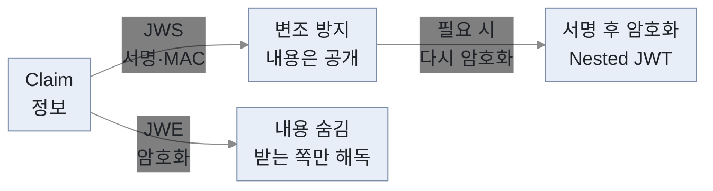
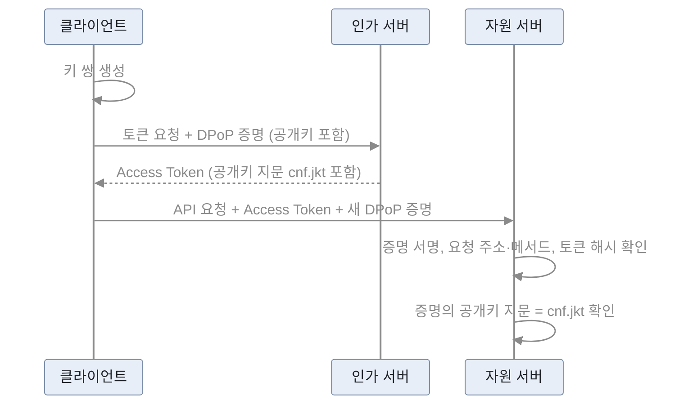

# Token Security (토큰 보안)

> 약어: RFC=IETF 표준 문서, IETF=인터넷 표준화 기구, 3GPP=이동통신 표준화 기구

## 1. 개요 (What)

토큰(Token)은 **인증이나 인가의 결과를 담아 다른 곳에 제시하는 자격 증명**이다.
[OAuth 2.0 · OpenID Connect](oauth2-oidc.md)에서 본 Access Token, Refresh Token, ID Token이 대표적이며, 5G 코어의 NF(Network Function) 간 호출이나 클라우드 API(Application Programming Interface) 호출에도 같은 구조가 쓰인다.

토큰 보안은 세 가지 질문으로 정리된다.

| 질문 | 다루는 내용 |
|------|-------------|
| 이 토큰은 진짜인가 | 서명·MAC(Message Authentication Code) 검증, 발급자·대상·만료 확인 |
| 이 토큰을 제시한 자가 정당한 소유자인가 | Bearer Token의 한계, 송신자 제한 토큰(DPoP·mTLS 바인딩) |
| 이 토큰은 아직 유효한가 | 수명, 폐기(Revocation), 상태 조회(Introspection) |

이 문서에서 가장 많이 다루는 형식은 JWT(JSON Web Token)다. JSON은 JavaScript Object Notation이다.
**JWT는 형식일 뿐 인증 방식이 아니며, 서명된 JWT는 암호화된 것이 아니다.** 이 두 가지가 토큰 관련 실수의 상당수를 설명한다.

## 2. 배경 / 원리 (Why & How)

### 2.1 두 가지 토큰 방식 — 자체 포함형과 참조형

| 구분 | 자체 포함형 (Self-contained) | 참조형 (Reference, Opaque) |
|------|------------------------------|----------------------------|
| 토큰 안에 든 것 | 사용자·권한·만료 등 정보 전체 | 의미 없는 무작위 문자열 |
| 대표 예 | JWT | Opaque Token |
| 검증 | 발급자의 공개키로 자원 서버가 직접 검증 | 인가 서버에 상태 조회 (Introspection) |
| 네트워크 의존 | 낮음 | 높음 (인가 서버 가용성에 의존) |
| 즉시 폐기 | **어렵다** | 쉽다 |
| 확장성 | 분산 환경에 유리 | 중앙 관리에 유리 |
| 주요 약점 | 폐기와 상태 동기화 | 조회 부하, 인가 서버 장애 영향 |

- 자체 포함형은 **수명을 짧게** 두는 것으로 폐기의 어려움을 보완한다.
- 클라이언트는 Access Token의 내용을 해석하지 않는 것이 원칙이다. 형식은 인가 서버와 자원 서버 사이의 약속이다.

### 2.2 JWT의 구조

JWT는 점(`.`)으로 구분된 세 부분을 각각 Base64url로 인코딩한 문자열이다.

```text
eyJhbGciOiJFUzI1NiIsImtpZCI6ImtleS0yMDI2In0 . eyJpc3MiOiJodHRwczovL...  . MEUCIQ...
          헤더 (Header)                            페이로드 (Payload)          서명 (Signature)
```

| 부분 | 내용 | 예 |
|------|------|----|
| 헤더 | 서명 알고리즘(`alg`), 키 식별자(`kid`), 토큰 유형(`typ`) | `{"alg":"ES256","kid":"key-2026","typ":"at+jwt"}` |
| 페이로드 | Claim(주장): 발급자, 주체, 대상, 만료, 권한 등 | `{"iss":"https://idp.example.com","sub":"u-123","aud":"orders-api","exp":1790000000}` |
| 서명 | 헤더와 페이로드에 대한 서명 또는 MAC | 바이너리 값을 Base64url로 인코딩 |

- **Base64url은 암호화가 아니다.** 누구나 페이로드를 디코딩해 읽을 수 있다. 비밀번호, 주민등록번호 같은 민감 정보를 넣지 않는다.
- 서명은 **변조 여부**만 보장한다. 내용을 숨기려면 암호화(JWE(JSON Web Encryption))가 필요하다.

### 2.3 서명(JWS)과 암호화(JWE)



텍스트 설명: JWS(JSON Web Signature)는 Claim에 서명이나 MAC을 붙여 변조를 막지만 내용은 누구나 읽을 수 있다. JWE는 내용을 암호화해 받는 쪽만 읽게 한다. 두 가지가 모두 필요하면 먼저 서명하고 그 결과를 다시 암호화한다(Nested JWT).

| 구분 | JWS | JWE |
|------|-----|-----|
| 목적 | 무결성·발급자 확인 | 기밀성 |
| 구성 | 3부분 (헤더.페이로드.서명) | 5부분 (헤더.암호화된 키.IV.암호문.인증 태그) |
| 일반적인 사용 | 대부분의 Access Token, 모든 ID Token | 토큰에 민감한 속성을 담아야 할 때 |

- "JWT"라고 하면 실무에서는 대부분 **JWS 형식의 JWT**를 가리킨다.
- JWE의 IV(Initialization Vector)와 인증 태그는 AEAD(Authenticated Encryption with Associated Data) 암호화의 구성 요소다 → [Symmetric Encryption](../cryptography/symmetric-encryption.md)

### 2.4 HS256은 서명이 아니라 MAC이다

JWS의 `alg`에는 두 종류가 섞여 있다. 이름은 비슷하지만 **누가 토큰을 만들 수 있는가**가 완전히 다르다.

| 종류 | 예 | 키 | 검증하는 쪽이 할 수 있는 것 |
|------|----|----|------------------------------|
| MAC (대칭 키) | HS256 (HMAC(Hash-based MAC) + SHA(Secure Hash Algorithm)-256) | 발급자와 검증자가 **같은 비밀 키**를 공유 | 검증할 수 있으면 **토큰도 만들 수 있다** |
| 디지털 서명 (비대칭 키) | RS256, PS256, ES256, EdDSA | 발급자는 개인키, 검증자는 공개키 | 검증만 할 수 있고 토큰은 만들 수 없다 |

- HS256을 쓰면 그 키를 가진 모든 자원 서버가 사실상 발급자가 될 수 있다. 자원 서버 하나만 털려도 전체 토큰 체계가 위조된다.
- 검증하는 서비스가 늘어날수록 비밀 키를 배포·교체해야 하는 곳도 늘어난다. 비대칭 서명은 공개키만 배포하면 된다.
- 여러 서비스가 검증하는 토큰에는 **비대칭 서명**(ES256, RS256 등)을 쓴다. HS256은 발급자와 검증자가 같은 시스템일 때 등 제한된 경우에만 쓴다.
- MAC과 서명의 차이는 [Hashing & MAC 3.1 MAC과 디지털 서명의 차이](../cryptography/hashing-mac.md#31-mac과-디지털-서명의-차이) 참조.

### 2.5 공개키 배포 — JWK와 JWKS

자원 서버는 발급자의 공개키를 어떻게 얻는가. 대부분 **JWKS(JSON Web Key Set)** 를 쓴다.

- JWK(JSON Web Key)는 공개키 하나를 JSON으로 표현한 것이고, JWKS는 그 목록이다.
- 인가 서버는 JWKS를 고정된 HTTPS(Hypertext Transfer Protocol Secure) 주소로 공개하고, 자원 서버는 이를 가져와 캐시한다.
- 토큰 헤더의 `kid`(Key ID)로 JWKS에서 맞는 키를 고른다.

**키 교체(Key Rotation)** 는 다음 순서로 하면 서비스 중단이 없다.

1. 새 공개키를 기존 키와 **함께** JWKS에 게시한다 (아직 서명에는 쓰지 않음).
2. 자원 서버들의 JWKS 캐시가 갱신될 시간을 기다린다.
3. 새 개인키로 서명을 시작한다.
4. 옛 키로 서명된 토큰의 **최대 유효기간**이 지날 때까지 옛 공개키를 유지한 뒤 제거한다.

- 새 키를 게시하자마자 옛 키를 지우면, 아직 유효한 토큰과 캐시를 갱신하지 않은 자원 서버 때문에 검증 실패 장애가 난다.

- 서명 개인키는 HSM(Hardware Security Module)이나 KMS(Key Management Service)에 두고, 교체 주기와 사고 시 긴급 교체 절차를 정해 둔다 → [Key Management](../cryptography/key-management.md)

## 3. 상세 (Details)

### 3.1 주요 Claim

| Claim | 뜻 | 검증 포인트 |
|-------|----|-------------|
| `iss` (Issuer) | 발급자 | 신뢰하는 발급자와 정확히 일치 |
| `sub` (Subject) | 주체 (사용자 또는 클라이언트) | 발급자 안에서만 고유 → `iss`와 함께 사용 |
| `aud` (Audience) | 이 토큰을 받을 대상 | **자기 자신이 포함되어 있는지** 확인 |
| `exp` (Expiration) | 만료 시각 | 지났으면 거부 (작은 시계 오차만 허용) |
| `nbf` (Not Before) | 이 시각 이전에는 무효 | 아직 이르면 거부 |
| `iat` (Issued At) | 발급 시각 | 너무 오래되었거나 미래면 의심 |
| `jti` (JWT ID) | 토큰 고유 ID | 재사용 탐지, 폐기 목록 관리 |
| `scope` | 위임된 권한 | 요청한 작업에 필요한 권한이 있는지 |
| `client_id` | 토큰을 요청한 클라이언트 | 클라이언트별 정책 적용 |
| `cnf` (Confirmation) | 토큰을 쓸 수 있는 키의 정보 | 송신자 제한 토큰의 키와 일치하는지 (3.4) |

### 3.2 토큰 종류별 보호 방향

토큰의 역할은 [OAuth 2.0 · OpenID Connect 3.1 토큰과 코드의 종류](oauth2-oidc.md#31-토큰과-코드의-종류)에서 정리했다. 여기서는 보호 방법을 본다.

| 토큰 | 수명 | 핵심 보호 방법 |
|------|------|----------------|
| Access Token | 짧게 (분~시간) | 대상(`aud`) 제한, 최소 Scope, 송신자 제한 |
| Refresh Token | 길게 | 인가 서버에만 전송, **Rotation**과 재사용 탐지, 또는 송신자 제한 |
| ID Token | 짧게 | 클라이언트만 사용, API 호출에 쓰지 않음 |

**Refresh Token Rotation**: Refresh Token을 쓸 때마다 새 Refresh Token을 주고 이전 것은 무효로 한다.
이미 쓴 Refresh Token이 다시 들어오면, 둘 중 하나는 탈취된 것이므로 **그 계열의 토큰 전체를 폐기**한다. 정상 사용자와 공격자 중 누가 먼저 썼는지 모르기 때문이다.

### 3.3 자원 서버의 토큰 검증 순서

JWT Access Token을 받은 자원 서버는 다음을 확인한다.

1. **알고리즘 고정**: 헤더의 `alg`를 믿지 말고, 이 발급자에게 허용한 알고리즘 목록과 비교한다. `none`은 거부한다.
2. **키 선택**: 신뢰하는 발급자의 JWKS에서 `kid`로 키를 고른다. 토큰 헤더가 알려주는 외부 주소(`jku`, `x5u`)에서 키를 받아 오지 않는다.
3. **서명 검증**
4. **유형 확인**: `typ`이 `at+jwt`(또는 `application/at+jwt`)인지 확인한다. ID Token 등 다른 용도의 JWT를 Access Token으로 받아들이지 않는다. 토큰이 암호화되어 있으면 먼저 복호화한다.
5. **Claim 검증**: `iss` 일치, `aud`에 자신 포함, `exp`·`nbf` 시간 확인.
6. **송신자 확인**: `cnf`가 있으면 요청자가 그 키를 가졌는지 확인한다 (3.4).
7. **인가**: `scope`와 함께 **요청한 객체에 대한 권한**을 따로 확인한다 → [OAuth 2.0 · OpenID Connect 3.4 Scope와 Audience — 권한의 범위](oauth2-oidc.md#34-scope와-audience--권한의-범위)

- 검증은 검증된 JOSE(JSON Object Signing and Encryption) 라이브러리에 맡기고, **허용 알고리즘·발급자·대상을 명시적으로 설정**한다. 기본값에 의존하면 위 1~5 중 일부가 빠지는 경우가 많다.
- ID Token의 검증 절차는 [OAuth 2.0 · OpenID Connect 5.2 ID Token 검증 절차 (요약)](oauth2-oidc.md#52-id-token-검증-절차-요약) 참조.

### 3.4 송신자 제한 토큰 (Sender-constrained Token)

**Bearer Token**은 "가진 사람이 주인"이다. 로그, 프록시, 브라우저 저장소, 악성 확장 프로그램 어디서든 새면 그대로 재사용된다.
**송신자 제한 토큰**은 토큰을 특정 키에 묶어, **그 키의 개인키를 가진 자만** 토큰을 쓸 수 있게 한다. 토큰이 새도 개인키가 없으면 쓸 수 없다.

| 방식 | 묶는 대상 | 증명 방법 | 쓰는 곳 |
|------|-----------|-----------|---------|
| DPoP(Demonstrating Proof of Possession) (*RFC 9449*) | 클라이언트가 만든 키 쌍 | 요청마다 개인키로 서명한 DPoP 증명(JWT)을 함께 보냄 | 브라우저 앱, 모바일 앱 등 인증서 배포가 어려운 곳 |
| mTLS(mutual Transport Layer Security) 인증서 바인딩 (*RFC 8705*) | 클라이언트 TLS 인증서 | TLS 연결에서 그 인증서로 클라이언트 인증 | 서버 간 통신, 금융 API, 인증서 운영 체계가 있는 곳 |

| 구분 | DPoP | mTLS 바인딩 |
|------|------|-------------|
| 동작 계층 | 애플리케이션 계층 (HTTP 헤더) | TLS 계층 |
| 소유 증명 | 요청마다 서명한 JWT | 클라이언트 인증서로 맺은 TLS 연결 |
| 토큰에 기록되는 값 | `cnf.jkt` (공개키 지문) | `cnf.x5t#S256` (인증서 지문) |
| 브라우저 앱 | 적용하기 쉽다 | 일반 브라우저에서는 제약이 크다 |

- *RFC 8705*의 **mTLS 클라이언트 인증**(인가 서버가 클라이언트를 인증)과 **인증서 바인딩 Access Token**(토큰을 인증서에 묶음)은 서로 다른 기능이다. 함께 쓸 수 있지만 반드시 함께 써야 하는 것은 아니다.



텍스트 설명: 클라이언트는 키 쌍을 만들고, 토큰을 요청할 때 개인키로 서명한 DPoP 증명을 보낸다. 인가 서버는 그 공개키의 지문을 토큰에 넣어 발급한다.
API를 호출할 때마다 클라이언트는 요청 주소·메서드·토큰 해시를 담은 새 DPoP 증명을 만든다. 자원 서버는 증명의 서명과 내용을 확인하고, 증명에 쓴 공개키가 토큰에 기록된 지문과 같은지 확인한다.

- DPoP 증명은 요청 주소·메서드에 묶이고 고유 ID와 발급 시각을 가지므로, 가로챈 증명을 다른 요청에 재사용하기 어렵다.
- **한계**: 클라이언트 기기 자체가 악성코드에 장악되면 공격자가 그 기기에서 개인키로 증명을 만들 수 있다. 개인키를 추출 불가능한 하드웨어·OS 키 저장소에 두면 이 위험이 줄어든다.

> 역사적 배경: Token Binding(*RFC 8471~8473*, Proposed Standard)은 TLS 계층에서 토큰을 묶으려던 방식이다. 표준으로 발표됐지만 브라우저 생태계에서 채택되지 못했다. Chrome은 정식 출시 전에 구현을 제거했고 Firefox·Safari도 지원하지 않았으며, 구형 Microsoft Edge에서 지원한 이력이 있다. 현재 토큰을 송신자에 묶는 실질적인 방법은 DPoP와 *RFC 8705*다.

### 3.5 폐기와 상태 조회

| 기능 | 하는 일 | 규격 |
|------|---------|------|
| Revocation (폐기) | 클라이언트가 더 이상 쓰지 않는 토큰을 인가 서버에 알려 무효화 (로그아웃, 앱 연결 해제) | *RFC 7009* |
| Introspection (상태 조회) | 자원 서버가 인가 서버에 "이 토큰이 지금 유효한가, 누구 것인가"를 물어봄 | *RFC 7662* |
| JWT Introspection 응답 | Introspection 응답 자체를 서명된 JWT로 받아 위변조·출처를 확인 | *RFC 9701* |

- 자체 포함형 JWT Access Token은 폐기를 요청해도 **자원 서버가 스스로 검증하는 한 만료 전까지 계속 통과**한다. 즉시 차단이 필요하면 수명을 짧게 하거나, 민감한 API에서만 Introspection을 쓰거나, 폐기 목록(`jti`)을 공유한다.
- 비밀번호 변경, 계정 정지, 기기 분실 시 **Refresh Token을 함께 폐기**해야 실제로 접근이 끊긴다.
- Introspection 엔드포인트는 토큰 정보를 돌려주므로, 자원 서버 인증 없이 열어 두면 안 된다.

### 3.6 토큰은 어디에 저장하는가

| 위치 | 위험 | 판단 |
|------|------|------|
| 브라우저 `localStorage`·`sessionStorage` | XSS(Cross-Site Scripting)로 즉시 탈취 | 피한다 |
| 브라우저 JavaScript 메모리 | XSS 중에는 여전히 접근 가능, 새로고침 시 사라짐 | 브라우저에 둬야 한다면 이쪽이 낫다 |
| 서버 (BFF(Backend for Frontend)) + `HttpOnly`·`Secure`·`SameSite` 쿠키 세션 | 토큰은 브라우저에 없음. 대신 쿠키 기반 CSRF(Cross-Site Request Forgery) 방어 필요 | 브라우저 앱에 권장 → [OAuth 2.0 · OpenID Connect 3.6 앱 형태별 구현 방향](oauth2-oidc.md#36-앱-형태별-구현-방향) |
| 모바일 OS 키 저장소 (Keychain, Keystore 등) | 기기 장악 시 위험 | 모바일 앱에 권장 |
| URL, 로그, 오류 메시지 | 저장·공유·전송 과정에서 광범위 노출 | **금지** |

- 세션 쿠키 설계와 로그아웃 처리는 [Session & Token Lifecycle](session-token-lifecycle.md)에서 다룬다.

### 3.7 다른 영역에서의 사용

| 영역 | 사용 예 |
|------|---------|
| 5G | 아래 표 참조 → [OAuth 2.0 · OpenID Connect 3.9 5G SBA의 OAuth 2.0](oauth2-oidc.md#39-5g-sba의-oauth-20), [OAuth Token Abuse](../../5g-security/security-risks/06-sba-security/06-06-OAuth_Token_Abuse.md) |
| Cloud | 클라우드 STS(Security Token Service)가 발급하는 짧은 수명의 임시 자격 증명, 워크로드 신원 토큰 → [Cloud IAM](../../cloud-security/iam/README.md) (작성 예정) |
| Web·API | JWT Access Token, API Gateway의 토큰 검증 → [OWASP API Security Top 10](../web-app-security/owasp/api-security-top-10/README.md) |
| AI | AI 에이전트가 사용자 대신 도구·API를 호출할 때 범위와 대상이 제한된 짧은 수명 토큰 사용, 토큰을 프롬프트·로그에 남기지 않기 → [AI Security](../../ai-security/README.md) (로드맵, 문서 작성 예정) |

**5G SBA의 Access Token** (*3GPP TS 33.501 V19.7.0 (Release 19)*)

NRF(Network Repository Function)가 발급하는 JWT를 서비스를 제공하는 NF(NF Service Producer)가 검증한다.

| Claim | 5G에서의 의미 |
|-------|---------------|
| `iss` | NRF의 NF Instance ID |
| `sub` | 서비스를 이용하는 NF(NF Service Consumer)의 NF Instance ID |
| `aud` | 서비스를 제공하는 NF의 NF Type 또는 NF Instance ID |
| `scope` | 허용된 NF 서비스 |
| `exp` / `iat` | 만료 시각 / 발급 시각(선택) |
| 추가 Scope | 허용된 자원과 작업 |

- S-NSSAI(Single Network Slice Selection Assistance Information), NF Set ID 같은 슬라이스·NF 집합 정보가 더 들어갈 수 있다.
- 토큰은 JWS의 **디지털 서명 또는 MAC**으로 보호된다. MAC 방식이면 NRF와 NF Service Producer가 비밀 키를 공유하므로, 검증하는 Producer도 같은 키로 토큰을 만들 수 있다(2.4의 HS256 문제와 같다).
- Producer는 발급자, 서명·MAC, `sub`가 실제 요청한 NF인지, `aud`가 자신인지, Scope와 추가 Scope, 만료를 확인한다. 직접 통신에서는 `sub`의 NF Instance ID를 Consumer TLS 클라이언트 인증서의 subjectAltName과 대조한다.
- 이 서비스 접근 토큰은 **폐기(Revocation)를 지원하지 않는다.** 만료 시간과 운영자 정책으로 유효기간을 관리하는 것이 중요하다.

## 4. 보안 관점 (Security Relevance)

| 실수 | 결과 | 대응 |
|------|------|------|
| `alg=none` 허용 | 서명 없는 위조 토큰 통과 | 허용 알고리즘 목록 고정, `none` 거부 |
| 알고리즘 혼동 (RS256 공개키를 HS256 비밀 키로 사용) | 공개키를 아는 누구나 토큰 위조 | 키마다 알고리즘을 고정, 헤더의 `alg`로 검증 방식을 고르지 않음 |
| 약한 HS256 비밀 키, 사람이 고른 비밀번호를 키로 사용 | 오프라인 무차별 대입으로 키 복원 후 위조 | 충분한 엔트로피의 무작위 키, 가능하면 비대칭 서명 |
| 여러 서비스가 HS256 키 공유 | 한 서비스 침해로 전체 토큰 위조 | 비대칭 서명, 검증자에게는 공개키만 배포 |
| 헤더의 `jku`·`x5u`·`kid`를 그대로 신뢰 | 공격자 키로 검증, SSRF(Server-Side Request Forgery), `kid`를 통한 경로·SQL(Structured Query Language)·LDAP(Lightweight Directory Access Protocol) 주입 | 발급자에 귀속된 JWKS 주소만 사용(허용 목록), `kid`는 조회용 값으로만 취급하고 쿼리에 직접 넣지 않음 |
| `aud` 미검증 | 다른 API용 토큰 재사용 | 자신이 대상인지 확인 |
| `iss` 미검증 (여러 발급자 신뢰) | 다른 발급자의 토큰 수용 | 발급자별 키·설정 분리 |
| `exp` 미검증·과도한 수명 | 유출 토큰 장기 사용 | 짧은 수명, 시계 오차 최소 허용 |
| ID Token을 Access Token으로 수용 | 다른 용도 토큰으로 API 접근 | `typ` 확인 (`at+jwt`), 용도별 검증 규칙 분리 |
| 페이로드에 민감 정보 | 디코딩만으로 정보 노출 | 최소 Claim, 필요하면 JWE 또는 참조형 토큰 |
| Refresh Token 재사용 미탐지 | 탈취된 Refresh Token으로 장기 접근 | Rotation + 재사용 시 전체 폐기, 또는 송신자 제한 |
| 로그아웃·계정 정지 후 토큰 유효 | 접근 차단 실패 | Refresh Token 폐기, 짧은 Access Token 수명, 필요 시 Introspection |
| 토큰을 URL·로그·브라우저 저장소에 보관 | 광범위한 유출 | 헤더 전송, 로그 마스킹, BFF·OS 키 저장소 |
| 서명 키를 코드·설정 파일에 보관 | 키 유출 시 무제한 위조 | HSM·KMS, 정기·긴급 교체 절차 |

점검 시 확인할 것: 허용 알고리즘 설정과 `none` 거부, 서명 방식(HS256 사용처와 키 공유 범위), JWKS 출처와 `kid` 처리, `iss`·`aud`·`exp`·`typ` 검증, 토큰 수명, Refresh Token Rotation과 재사용 탐지, 폐기·Introspection 운영, 송신자 제한 적용 범위, 토큰 저장 위치와 로그 노출, 서명 키 보관·교체 절차, 사용 중인 JOSE 라이브러리와 버전.

## 5. 심화 (Advanced)

> 보안 컨설턴트·점검자를 위한 규격 세부다. 본문만으로 개념 이해에는 충분하다.

### 5.1 JWS 알고리즘 (`alg`)

*RFC 7518*(JWA(JSON Web Algorithms))이 정의한 주요 값이다.

| `alg` | 종류 | 알고리즘 |
|-------|------|----------|
| HS256 / HS384 / HS512 | MAC | HMAC + SHA-256 / 384 / 512 |
| RS256 | 서명 | RSASSA-PKCS1-v1_5 + SHA-256 |
| PS256 | 서명 | RSASSA-PSS(Probabilistic Signature Scheme) + SHA-256 |
| ES256 | 서명 | ECDSA(Elliptic Curve Digital Signature Algorithm) P-256 + SHA-256 |
| EdDSA | 서명 | *RFC 8037*의 기존 식별자. 곡선을 특정하지 않아 *RFC 9864*에서 Deprecated |
| Ed25519 / Ed448 | 서명 | *RFC 9864*의 곡선까지 특정한(Fully-Specified) 식별자. JOSE 구현 요구는 Optional |
| none | 없음 | 서명 없음. 일반 검증에서 거부 |

- *RFC 9864*(Fully-Specified Algorithms for JOSE and COSE, 2025-10)는 *RFC 7518*·*RFC 8037*·*RFC 9053*을 갱신한다. RS256·PS256 같은 RSA 식별자는 그대로 유지된다.
- **RS256과 RSA 암호화를 혼동하지 않는다.** *RFC 8725*가 피하도록 권고하는 RSA PKCS #1 v1.5는 주로 JWE의 **암호화** 방식(RSAES-PKCS1-v1_5, `RSA1_5`)이다. RS256은 같은 표준 계열의 **서명** 방식(RSASSA-PKCS1-v1_5)으로 별개다.
- 알고리즘 원리는 [Digital Signature](../cryptography/digital-signature.md) 참조.

### 5.2 *RFC 8725* JWT 보안 모범 사례

*RFC 8725*(JSON Web Token Best Current Practices, BCP 225)는 JWT 구현에서 반복된 취약점을 정리한 현행 지침이다.

| 권고 | 수준 | 막는 공격 |
|------|:---:|-----------|
| 허용 알고리즘 목록을 호출자가 지정, 목록에 없는 알고리즘 사용 금지 | MUST / MUST NOT | `none`, 알고리즘 혼동 |
| 헤더의 `alg`·`enc`와 실제 수행하는 암호 연산 일치 | MUST | 알고리즘 혼동 |
| 키 하나에 알고리즘 하나 | MUST | 알고리즘 혼동 (같은 RSA 키를 RS256과 HS256 검증에 함께 쓰는 경우 등) |
| 암호학적으로 안전한 알고리즘만 허용 | MUST | 약한 알고리즘 |
| 애플리케이션 정책에 맞지 않는 알고리즘의 JWT 거부 | SHOULD | 약한 알고리즘 |
| 모든 암호 연산 검증 (중첩된 JWT 포함), 암호학적 입력값 검증 | MUST | 검증 누락, 잘못된 곡선 점 공격 |
| 충분한 키 엔트로피, 사람이 고른 비밀번호를 HMAC 키로 직접 사용 금지 | MUST / MUST NOT | 키 무차별 대입 |
| 발급자와 키의 소유 관계, `sub` 유효성 검증 | MUST | 다른 발급자의 키로 서명된 토큰 수용 |
| 필요한 경우 `aud` 존재와 일치 검증 | MUST | 다른 대상의 토큰 재사용 |
| `kid`를 통한 SQL·LDAP 주입 방지, `jku`·`x5u`를 통한 SSRF 방어 | SHOULD | 키 조회 경로 악용 |
| 새로운 JWT 유형에는 명시적 `typ` 사용 | RECOMMENDED | Cross-JWT Confusion |
| 서로 다른 JWT 유형의 검증 규칙을 상호 배타적으로 설계 | MUST | Cross-JWT Confusion |

- 후속 개정안 *draft-ietf-oauth-rfc8725bis-10*(2026-08-21)은 IESG(Internet Engineering Steering Group) 승인을 받아 RFC Editor 발행을 기다리는 단계다. 아직 RFC로 발행되지 않았으므로 *RFC 8725*가 현행 기준이다.

### 5.3 JWT Access Token 프로파일 (*RFC 9068*)

- 헤더 `typ`은 `at+jwt` 또는 `application/at+jwt`이며, 접두어 없는 `at+jwt`를 권장한다(SHOULD). ID Token 등과 구분하기 위해서다.
- 필수 Claim: `iss`, `exp`, `aud`, `sub`, `client_id`, `iat`, `jti`.
- JWT Access Token은 반드시 서명한다. 구현은 RS256을 지원해야 하고(MUST), 비대칭 알고리즘 사용을 권장한다(RECOMMENDED).
- 자원 서버는 `typ`이 위 두 값이 아니면 거부하고(MUST), 발급자, `aud`, 서명(`none` 거부), 만료, Scope 등 권한 Claim을 확인한다. 암호화된 토큰이면 먼저 복호화한다.

### 5.4 DPoP 증명 구조 (*RFC 9449*)

| 위치 | 항목 | 내용 |
|------|------|------|
| 헤더 | `typ` | `dpop+jwt` |
| 헤더 | `alg` | 비대칭 서명 알고리즘 (MAC·`none` 불가) |
| 헤더 | `jwk` | 클라이언트 공개키 (개인키 포함 금지) |
| 페이로드 | `jti` | 증명 고유 ID (재사용 탐지) |
| 페이로드 | `htm`, `htu` | 요청 HTTP 메서드와 대상 URI(Uniform Resource Identifier). `htu`에는 Query와 Fragment를 넣지 않는다 |
| 페이로드 | `iat` | 생성 시각 |
| 페이로드 | `ath` | 자원 서버 호출 시 필수. Access Token 문자열(ASCII(American Standard Code for Information Interchange))의 SHA-256 해시를 Base64url로 인코딩한 값 |
| 페이로드 | `nonce` | 서버가 요구한 경우 필수. 서버가 준 값 |

DPoP 요청에는 **두 개의 헤더**가 함께 간다. 하나는 토큰을, 하나는 이 요청에 대한 소유 증명을 전달한다.

```text
GET /orders HTTP/1.1
Authorization: DPoP <Access Token>
DPoP: <서명된 DPoP 증명 JWT>
```

자원 서버의 확인 순서:
1. DPoP 증명의 서명을 헤더의 `jwk`로 검증한다.
2. `jwk`의 JWK Thumbprint를 계산해 Access Token의 `cnf.jkt`와 비교한다.
3. `ath`가 실제 받은 Access Token의 해시와 같은지 확인한다.
4. `htm`·`htu`가 실제 요청과 같은지, `iat`가 허용 범위인지, `jti`가 재사용되지 않았는지, 요구한 `nonce`가 맞는지 확인한다.

- mTLS 바인딩(*RFC 8705*)에서는 `cnf`의 `x5t#S256`에 클라이언트 인증서 지문이 들어간다. 인증서의 DER(Distinguished Encoding Rules) 인코딩에 SHA-256을 적용하고 Base64url로 인코딩한 값(끝의 `=` 패딩 제거)이며, 자원 서버는 요청에 쓰인 클라이언트 인증서의 지문과 비교한다.

### 5.5 표준 문서 체계

| 규격 | 다루는 내용 |
|------|-------------|
| *RFC 7519* | JWT 형식과 등록 Claim |
| *RFC 7515* / *RFC 7516* / *RFC 7517* / *RFC 7518* | JWS / JWE / JWK / JWA |
| *RFC 8725* | JWT 보안 모범 사례 (BCP 225) |
| *RFC 9864* | JOSE·COSE의 Fully-Specified 알고리즘 식별자 (Ed25519·Ed448) |
| *RFC 9068* | JWT Access Token 프로파일 |
| *RFC 7009* / *RFC 7662* / *RFC 9701* | 토큰 폐기 / 상태 조회 / JWT 형식의 상태 조회 응답 |
| *RFC 9449* / *RFC 8705* | DPoP / mTLS 인증서 바인딩 토큰 |
| *RFC 8471~8473* | Token Binding (실무에서 쓰이지 않음, 역사적 참고) |

- 각 규격의 기준 상태는 [PKI & Identity 3. 기준 표준](README.md#3-기준-표준)에 정리되어 있다.

## 관련 문서

- 이전: [OAuth 2.0 · OpenID Connect](oauth2-oidc.md)
- 다음(확장 과정): [Federation & SSO](federation-sso.md), [Session & Token Lifecycle](session-token-lifecycle.md), [Identity Attacks](identity-attacks.md)
- 암호 기반: [Hashing & MAC](../cryptography/hashing-mac.md), [Digital Signature](../cryptography/digital-signature.md), [Key Management](../cryptography/key-management.md)
- API 취약점: [OWASP API Security Top 10](../web-app-security/owasp/api-security-top-10/README.md)
- 5G 연결: [OAuth Token Abuse](../../5g-security/security-risks/06-sba-security/06-06-OAuth_Token_Abuse.md)
- 로드맵: [PKI & Identity](README.md)

## 출처

| 문서 | 지위 / 버전 | 이 문서에서의 사용 |
|------|-------------|-------------------|
| *RFC 7519*, *RFC 7515*, *RFC 7516*, *RFC 7517*, *RFC 7518* | Proposed Standard | JWT·JWS·JWE·JWK·JWA 구조와 알고리즘 |
| *RFC 8725* | BCP 225 | JWT 보안 모범 사례와 규범 수준 |
| *draft-ietf-oauth-rfc8725bis-10* | Internet-Draft (2026-08-21), IESG 승인·RFC Editor 발행 대기 | *RFC 8725* 후속 개정안 |
| *RFC 9864* | Proposed Standard (2025-10) | EdDSA Deprecated, Ed25519·Ed448 식별자 |
| *RFC 9068* | Proposed Standard | JWT Access Token 프로파일 |
| *RFC 7009*, *RFC 7662*, *RFC 9701* | Proposed Standard (*RFC 9701*: 2025-01) | 폐기, 상태 조회, JWT 상태 조회 응답 |
| *RFC 9449*, *RFC 8705* | Proposed Standard | 송신자 제한 토큰 |
| *RFC 8037* | Proposed Standard (*RFC 9864*가 갱신) | JOSE의 기존 EdDSA 식별자 |
| *RFC 8471~8473* | Proposed Standard | Token Binding (역사적 배경) |
| *3GPP TS 33.501 V19.7.0 (Release 19)* | — | 5G SBA의 JWT Access Token Claim, 서명·MAC 보호, 검증 항목, 폐기 미지원 |

- 저장 위치 판단, 검증 순서, 실수·대응 표는 위 규격을 바탕으로 재구성한 해설이다.
