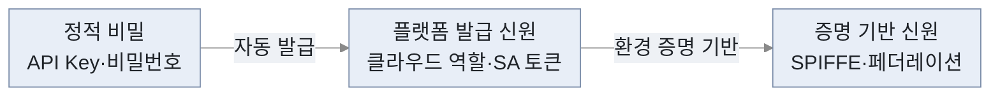
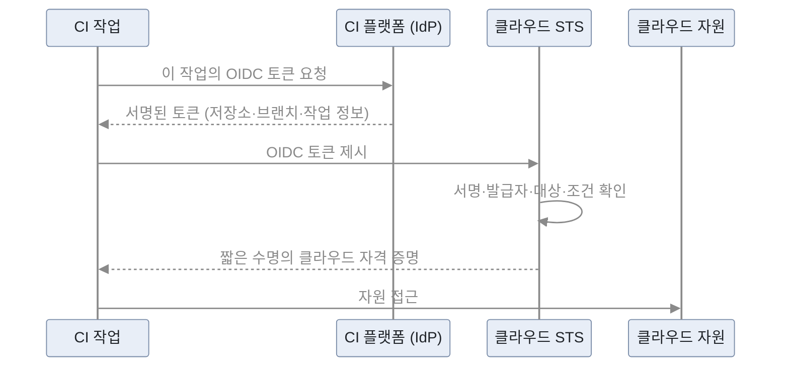
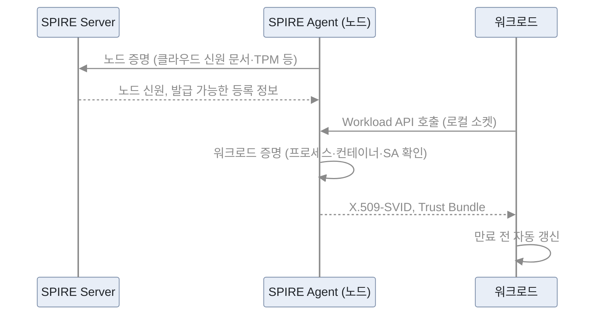

# Workload Identity (워크로드 신원)

> 약어: RFC=IETF 표준 문서, IETF=인터넷 표준화 기구, 3GPP=이동통신 표준화 기구

## 1. 개요 (What)

워크로드(Workload)는 사람이 아니라 **소프트웨어가 주체인 신원**이다. 서비스, 배치 작업, 컨테이너, 서버리스 함수, CI/CD(Continuous Integration/Continuous Delivery) 파이프라인, AI 에이전트가 모두 여기에 속한다.
워크로드도 다른 서비스·데이터베이스·클라우드 API(Application Programming Interface)를 호출할 때 "나는 누구다"를 증명해야 한다.

[Identity Fundamentals 3.2 사람 신원과 워크로드 신원](identity-fundamentals.md#32-사람-신원과-워크로드-신원)에서 본 것처럼, 워크로드 신원은 사람 신원과 출발점이 다르다.

| 구분 | 사람 | 워크로드 |
|------|------|----------|
| 인증할 때 | 비밀번호·Passkey·MFA(Multi-Factor Authentication) | 사람이 없다. 화면도 지문도 없다 |
| 수 | 직원·고객 수만큼 | 서비스·컨테이너·작업마다. 자동으로 생겼다 사라진다 |
| 수명 | 수년 | 몇 초에서 몇 달 |
| 대표 실수 | 비밀번호 재사용, 피싱 | 코드·설정·이미지에 박힌 **장기 비밀** |

그래서 워크로드 신원의 목표는 **"사람이 관리하는 장기 비밀 없이, 실행 환경이 증명한 사실을 근거로 짧은 수명의 자격 증명을 자동 발급하는 것"** 이다.
이 문서는 API Key의 한계에서 출발해 서비스 계정, 클라우드 워크로드 신원, Workload Identity Federation, mTLS, SPIFFE/SPIRE까지 그 방향을 따라간다.

## 2. 배경 / 원리 (Why & How)

### 2.1 Secret Zero 문제

워크로드가 비밀 관리 서비스에서 비밀번호를 꺼내 쓰려면, 먼저 그 서비스에 인증해야 한다. 그 인증에 쓸 **첫 번째 비밀(Secret Zero)** 은 어디에 두는가.

- 환경 변수나 설정 파일에 두면, 결국 그것이 코드·이미지·저장소로 새는 장기 비밀이 된다.
- 해결의 방향은 **비밀을 미리 나눠 주지 않고, 실행 환경이 "이 워크로드는 이 노드에서 이 이미지로 실행 중"이라는 사실을 증명**하게 하는 것이다. 이 과정을 증명(Attestation)이라 한다.

### 2.2 워크로드 자격 증명의 세 단계



텍스트 설명: 워크로드 자격 증명은 사람이 만들어 심는 **정적 비밀**에서, 클라우드·Kubernetes 같은 플랫폼이 자동으로 발급하는 **플랫폼 신원**으로, 다시 실행 환경을 증명한 뒤 짧은 수명의 신원 문서를 받는 **증명 기반 신원**으로 발전해 왔다. 오른쪽으로 갈수록 장기 비밀이 줄고, 서로 다른 플랫폼 사이에서도 같은 방식으로 신원을 쓸 수 있다.

| 단계 | 예 | 장점 | 약점 |
|------|----|------|------|
| 정적 비밀 | API Key, DB(Database) 비밀번호, 장기 클라우드 액세스 키 | 단순하다 | 유출·공유·미교체, 누가 쓰는지 모름 |
| 플랫폼 발급 신원 | 클라우드 인스턴스 역할, Kubernetes Service Account 토큰 | 비밀을 심지 않는다, 자동 교체 | 그 플랫폼 안에서만 통한다 |
| 증명 기반 신원 | SPIFFE(Secure Production Identity Framework for Everyone) SVID, Workload Identity Federation | 플랫폼을 넘나드는 표준 신원, 짧은 수명 | 구축·운영 체계가 필요하다 |

### 2.3 인증과 인가는 여기서도 다르다

워크로드 신원이 답하는 것은 "이 요청을 보낸 워크로드가 누구인가"다. **그 워크로드가 무엇을 할 수 있는가는 별도의 인가 정책**이 정한다.
mTLS로 서로를 인증했다고 해서 모든 API 호출이 허용되는 것은 아니다. 서비스 메시의 인가 정책, 클라우드 IAM(Identity and Access Management) 정책, OAuth Scope가 그 역할을 맡는다 → [Access Control](../access-control/README.md) (작성 예정)

## 3. 상세 (Details)

### 3.1 API Key의 한계

API Key는 가장 흔한 워크로드 자격 증명이지만, 구조적으로 약하다.

| 한계 | 설명 |
|------|------|
| Bearer 성격 | 가진 사람이 곧 주인이다. 로그·저장소·화면 공유 어디서든 새면 그대로 쓰인다 |
| 주체 불명확 | 키 하나를 여러 서비스·사람이 공유하면 누가 호출했는지 알 수 없다 |
| 긴 수명 | 만료 없이 수년간 쓰이는 경우가 많고, 교체하면 장애가 날까 봐 바꾸지 못한다 |
| 넓은 권한 | 계정 단위로 발급되어 필요한 것보다 많은 권한을 갖는 경우가 많다 |
| 폐기 어려움 | 어디서 쓰이는지 모르면 폐기 영향도 알 수 없다 |

- API Key는 **사용자 인증 수단이 아니다.** API Client(애플리케이션)를 식별하고 사용량 측정·호출량 제한·과금을 하는 자격 증명이다. OWASP(Open Worldwide Application Security Project) API Security도 API Key를 사용자 인증이 아니라 API Client 인증에 쓰도록 권고한다. 사용자 단위 인증과 권한이 필요하면 OAuth 2.0 등 사용자 인증 체계와 결합한다.
- 꼭 써야 한다면: 서비스별 별도 발급, 최소 권한, 출처 IP(Internet Protocol)·도메인 제한, 만료와 정기 교체, 비밀 관리 서비스 보관, 저장소 비밀 스캔을 함께 적용한다 → [Key Management](../cryptography/key-management.md)

### 3.2 Kubernetes Service Account

Kubernetes는 Pod마다 Service Account를 지정하고, 그 신원을 나타내는 **JWT(JSON Web Token)** 를 Pod에 넣어 준다.

| 구분 | 예전 방식 (Secret 기반 토큰) | 현재 방식 (Bound Service Account Token) |
|------|-----------------------------|------------------------------------------|
| 발급 | Service Account를 만들면 Secret으로 자동 생성 | TokenRequest API로 발급해 투사(Projected) 볼륨으로 Pod에 주입 |
| 수명 | 만료 없음 | 만료 시각이 있고 kubelet이 자동 갱신 |
| 대상 (`aud`) | 고정 | 요청 시 지정 가능 |
| Pod와의 결합 | 없음. Pod가 사라져도 토큰 유효 | Pod·Service Account 등의 UID에 묶여, 그 객체가 삭제되면 API 서버가 토큰을 더 이상 인정하지 않는다 |

- Kubernetes v1.24부터 Service Account를 만들 때 영구 Secret 토큰을 자동 생성하지 않는 동작이 기본 활성화됐고(Beta), v1.27에서 GA(General Availability)가 됐다. 장기 토큰은 필요하면 수동으로 만들 수 있지만 권장되지 않는다.

- 기본 Service Account를 모든 Pod가 공유하면, 한 Pod가 뚫렸을 때 같은 권한이 모두 노출된다. 워크로드마다 별도 Service Account를 만들고 RBAC(Role-Based Access Control)로 최소 권한만 준다.
- Kubernetes API를 호출할 필요가 없는 워크로드는 `automountServiceAccountToken: false`로 토큰 자동 마운트를 끈다. Pod 또는 Service Account 단위로 설정할 수 있다.

```yaml
apiVersion: v1
kind: ServiceAccount
metadata:
  name: app-sa
automountServiceAccountToken: false
```
- Kubernetes Service Account 토큰은 클러스터 밖의 클라우드 IAM에 페더레이션(3.4)해, 클라우드 자원 접근에도 쓸 수 있다.
- 컨테이너·Kubernetes 보안 전반은 [Cloud Native](../../cloud-security/cloud-native/README.md) (작성 예정)에서 다룬다.

### 3.3 클라우드 워크로드 신원과 메타데이터 서비스

클라우드의 가상 머신·컨테이너·함수에는 역할(Role)이나 관리형 신원을 붙일 수 있다. 워크로드는 실행 환경 내부의 **메타데이터 서비스**(IMDS(Instance Metadata Service) 등)에서 짧은 수명의 자격 증명을 받아 쓴다. 코드에 액세스 키를 넣을 필요가 없다.

- **위험**: 애플리케이션에 SSRF(Server-Side Request Forgery) 취약점이 있으면, 공격자가 서버를 시켜 메타데이터 서비스를 호출하게 하고 **역할 자격 증명을 빼낼 수 있다.**
- **사례**: 2019년 Capital One 침해 사건에서 공격자는 웹 애플리케이션 방화벽의 설정 오류를 이용한 SSRF로 메타데이터 서비스에서 역할 자격 증명을 얻고, 그 권한으로 클라우드 저장소의 대량 고객 정보에 접근했다. 세션 토큰이 필요 없는 예전 방식(IMDSv1)이 쓰이던 시기의 사고다.
- **대응**: 세션 토큰을 먼저 받아야 메타데이터를 조회할 수 있는 방식(AWS(Amazon Web Services) IMDSv2)을 강제하고, 컨테이너에서 메타데이터 주소 접근을 막으며, 역할 권한을 최소화한다.

| 항목 | IMDSv1 | IMDSv2 |
|------|--------|--------|
| 요청 방식 | 단순 HTTP(Hypertext Transfer Protocol) GET | 먼저 PUT으로 세션 토큰을 받고, 이후 GET에 토큰 헤더 포함 |
| 토큰 유효기간 | 해당 없음 | 1초~6시간 지정 |
| 추가 방어 | 없음 | `X-Forwarded-For`가 붙은 PUT 거부, 기본 응답 Hop Limit 1 |

- IMDSv2는 URL만 조작할 수 있는 SSRF를 크게 어렵게 만드는 **추가 방어 계층**이다. 공격자가 HTTP 메서드와 헤더까지 마음대로 정할 수 있는 SSRF라면 위험이 남으므로, 애플리케이션의 SSRF 방어를 함께 적용한다.
- 클라우드별 신원·역할 설계는 [Cloud IAM](../../cloud-security/iam/README.md) (작성 예정)에서 다룬다.

### 3.4 Workload Identity Federation — 장기 키 없이 외부 워크로드 연결

클라우드 밖의 워크로드(다른 클라우드, 온프레미스, CI/CD 파이프라인)가 클라우드 자원에 접근할 때, 예전에는 장기 액세스 키를 발급해 심었다. Workload Identity Federation은 이를 **외부 IdP(Identity Provider)가 발급한 짧은 수명의 OIDC(OpenID Connect) 토큰을 클라우드 자격 증명으로 교환**하는 방식으로 바꾼다.



텍스트 설명: CI 작업은 CI 플랫폼에서 "어느 저장소의 어느 브랜치에서 실행 중인 작업인가"를 담은 서명된 OIDC 토큰을 받는다. 클라우드의 STS(Security Token Service)는 토큰의 서명과 발급자, 대상(`aud`), 그리고 미리 정해 둔 조건(특정 저장소·브랜치)을 확인한 뒤 짧은 수명의 클라우드 자격 증명을 준다. 저장소에는 어떤 장기 비밀도 두지 않는다.

| 제공자 | 연동 방식 | 주요 검증 대상 |
|--------|-----------|----------------|
| AWS | 외부 OIDC 토큰 → `AssumeRoleWithWebIdentity` | `iss`, `aud`, `sub`와 IAM 역할의 신뢰 정책 |
| Google Cloud | Workload Identity Federation (STS Token Exchange) | 발급자, 대상, 속성 매핑과 속성 조건 |
| Microsoft Entra | Federated Identity Credential | 발급자, 주체, 대상 |

- **신뢰 조건이 전부다.** GitHub Actions처럼 여러 조직이 **하나의 발급자 주소를 공유**하는 플랫폼에서 발급자만 신뢰하면, 같은 플랫폼을 쓰는 다른 조직의 저장소도 자격 증명을 받을 수 있다. `repo:*`는 물론 `repo:my-org/*`처럼 조직 전체를 여는 조건도 저장소별 권한 분리가 필요하다면 위험하다. 저장소·브랜치·환경 단위로 주체(`sub`)와 대상(`aud`) 조건을 좁힌다. Google Cloud도 공유 발급자 환경에서는 조직·테넌트를 제한하는 속성 조건을 반드시 두도록 권고한다.
- GitHub는 2026-07-15부터 새로 만든 저장소와 이후 이름 변경·이전된 저장소에 조직 ID·저장소 ID를 포함한 **변경 불가능한 주체 형식**을 적용했다(예: `repo:octo-org@123456/octo-repo@456789:ref:refs/heads/main`). 이름 변경 후 다른 저장소가 같은 이름을 쓰는 경우의 주체 재사용 위험을 줄인다. 기존 저장소는 예전 형식(`repo:octo-org/octo-repo:ref:refs/heads/main`)을 계속 쓸 수 있으므로, 신뢰 정책을 만들 때 **실제 토큰의 `sub` 형식을 확인**한다.
- Kubernetes Service Account 토큰, 다른 클라우드의 워크로드 신원도 같은 방식으로 연결할 수 있다.
- *RFC 8693*(Token Exchange)은 외부 토큰을 검증하고 새 토큰을 발급하는 표준 모델이다. 클라우드 페더레이션은 이와 비슷한 구조를 쓰지만 실제 API는 제공자마다 다르다. Google Cloud STS는 이 모델을 직접 활용하고, AWS와 Microsoft Entra는 각자의 API와 규칙으로 동작한다.
- 토큰 교환 원리는 [OAuth 2.0 · OpenID Connect](oauth2-oidc.md)와 [Token Security](token-security.md)를 바탕으로 한다.

### 3.5 mTLS — 서비스끼리 인증서로 확인

서비스 간 통신에서는 양쪽이 모두 인증서를 제시하는 mTLS(mutual Transport Layer Security)가 워크로드 인증의 기본 수단이다 → [TLS Overview 3.4 mTLS — 클라이언트도 인증서로 인증](../cryptography/tls-overview.md#34-mtls--클라이언트도-인증서로-인증)

- **서비스 메시**는 각 워크로드 옆의 프록시(Sidecar 등)가 mTLS를 대신 처리하고, 인증서 발급·교체도 자동화한다. 애플리케이션 코드를 바꾸지 않고 서비스 간 암호화와 상호 인증을 적용할 수 있다.
- mTLS의 핵심 운영 과제는 **인증서 수명 관리**다. 수동 발급한 1년짜리 인증서는 만료 장애와 유출 위험을 함께 만든다. 시간 단위의 짧은 수명 인증서를 자동 발급·교체하는 것이 바람직하다 → [PKI & Certificates](pki-certificates.md)
- 인증서에 "무엇을" 신원으로 넣을지가 중요하다. 호스트 이름은 워크로드가 옮겨 다니면 의미가 약해진다. SPIFFE는 이를 표준 신원 형식으로 정한다(3.6).

### 3.6 SPIFFE와 SPIRE

SPIFFE는 이질적인 환경(여러 클라우드, Kubernetes, 가상 머신, 온프레미스)에서 **워크로드 신원을 같은 형식으로 표현하고 발급하는 사양군**이다. SPIRE(SPIFFE Runtime Environment)는 그 대표 구현이다.

| 개념 | 뜻 | 예 |
|------|----|----|
| SPIFFE ID | 워크로드의 이름. URI(Uniform Resource Identifier) 형식 | `spiffe://example.org/ns/payments/sa/api` |
| Trust Domain | 신뢰를 관리하는 보안 경계. DNS(Domain Name System) 도메인과 같을 필요는 없고 중앙 등록 기관도 없다 | `example.org` |
| SVID(SPIFFE Verifiable Identity Document) | SPIFFE ID를 담은 검증 가능한 신원 문서 | X.509-SVID(인증서), JWT-SVID(토큰) |
| Trust Bundle | 다른 워크로드의 SVID를 검증하는 데 쓰는 신뢰 루트 공개키 묶음 | Trust Domain별 CA(Certificate Authority) 인증서 |
| Workload API | 워크로드가 자기 SVID와 Trust Bundle을 받아 가는 API. SPIFFE 사양은 gRPC 기반 API로 정의 | SPIRE Agent가 보통 Unix Domain Socket으로 로컬 워크로드에 제공 |



텍스트 설명:
1. **노드 증명(Node Attestation)**: 각 노드의 SPIRE Agent는 클라우드가 서명한 인스턴스 신원 문서나 TPM(Trusted Platform Module) 같은 근거로 "나는 이 노드다"를 SPIRE Server에 증명한다.
2. **워크로드 증명(Workload Attestation)**: 워크로드가 로컬 Workload API를 호출하면, Agent는 호출한 프로세스의 정보(프로세스 UID(User ID)·GID(Group ID), 실행 경로, 컨테이너 이미지, Kubernetes 네임스페이스·Service Account 등)를 커널·플랫폼에서 직접 확인하고, 등록된 조건과 맞으면 SVID를 준다. 워크로드가 비밀번호를 내는 구조가 아니다.
3. 워크로드는 **비밀을 미리 가질 필요가 없다.** SVID는 짧은 수명이며 만료 전에 자동으로 갱신된다. Secret Zero 문제를 이렇게 푼다.

- X.509-SVID는 mTLS에 바로 쓸 수 있다. JWT-SVID는 L7 프록시·로드밸런서가 중간에 있어 TLS를 끝까지 유지할 수 없는 경로에서 쓴다. JWT-SVID는 Bearer 토큰이라 탈취 시 **재전송 위험**이 있으므로, SPIFFE도 가능하면 X.509-SVID를 쓰고 JWT-SVID에는 짧은 만료와 좁은 대상(`aud`)을 적용하도록 권고한다.
- 서로 다른 Trust Domain끼리는 **SPIFFE Federation**으로 신뢰를 맺는다. 상대 Trust Domain의 Bundle을 받아 **그 Trust Domain과 연결된 상태로** 보관하고, 상대 SVID는 그 Bundle로만 검증한다. 서로 신뢰하려면 양방향으로 구성한다. 여러 Trust Domain의 Bundle을 하나로 합치면 한 Trust Domain이 다른 Trust Domain의 신원을 위조할 수 있게 된다.
- SPIFFE와 SPIRE는 모두 CNCF(Cloud Native Computing Foundation) Graduated 프로젝트다(SPIFFE 2022-08-23, SPIRE 2022-08-22). 핵심 사양(SPIFFE ID, X.509-SVID, JWT-SVID, Trust Domain and Bundle, Federation, Workload API)은 Stable이지만, Filesystem Delivery처럼 Incubating인 부가 사양도 있으므로 개별 사양의 안정성 표시를 확인한다.

### 3.7 다른 영역에서의 사용

| 영역 | 사용 예 |
|------|---------|
| 5G | 5G 코어의 NF(Network Function)는 각자 인증서를 갖고 mTLS로 서로를 인증하며, NRF(Network Repository Function)가 발급한 Access Token으로 서비스 단위 인가를 받는다. 직접 통신에서 서비스를 제공하는 NF는 Access Token의 `sub`에 든 NF Instance ID가 상대 TLS 클라이언트 인증서 SAN(Subject Alternative Name)의 NF Instance ID와 **일치하는지 확인해야 한다.** 인증서 기반 신원과 토큰 기반 권한이 같은 NF를 가리키는지 보는 절차다. 신원이 일치해도 발급자, 서명·MAC(Message Authentication Code), 대상, Scope, 만료, 슬라이스·NF Set 제한은 따로 확인한다. 간접 통신·로밍 시나리오는 절차가 달라 그대로 단순화하지 않는다 → [OAuth 2.0 · OpenID Connect 3.9 5G SBA의 OAuth 2.0](oauth2-oidc.md#39-5g-sba의-oauth-20), [NF Impersonation](../../5g-security/security-risks/06-sba-security/06-01-NF_Impersonation.md) |
| Cloud | 역할 기반 워크로드 신원, Workload Identity Federation, 서비스 메시 mTLS → [Cloud IAM](../../cloud-security/iam/README.md) (작성 예정) |
| CI/CD | 파이프라인의 OIDC 토큰으로 배포 권한 획득, 장기 배포 키 제거 |
| AI | AI 에이전트를 **별도의 워크로드 신원**으로 다루고, 사용자 대신 행동할 때는 위임 토큰으로 권한을 좁힌다. 에이전트에 장기 API Key를 주지 않는다 → [AI Security](../../ai-security/README.md) (로드맵, 문서 작성 예정) |

## 4. 보안 관점 (Security Relevance)

| 실수 | 결과 | 대응 |
|------|------|------|
| API Key·액세스 키를 코드·이미지·저장소에 포함 | 저장소 유출로 서비스 권한 탈취 | 플랫폼 신원·페더레이션으로 전환, 비밀 스캔, 노출 시 즉시 폐기 |
| 여러 서비스가 한 자격 증명 공유 | 호출 주체 추적 불가, 침해 범위 확대 | 워크로드마다 별도 신원 |
| 만료 없는 서비스 자격 증명 | 유출 후 장기간 악용 | 짧은 수명, 자동 갱신 |
| 기본 Service Account 공유, 과도한 RBAC | Pod 하나 침해로 클러스터 권한 노출 | 워크로드별 Service Account, 최소 권한, 불필요한 토큰 마운트 해제 |
| 예전 방식의 만료 없는 Service Account 토큰 사용 | 유출 토큰의 영구 사용 | Bound Service Account Token으로 전환, 수동 생성 장기 토큰 정리 |
| 외부 시스템이 JWKS 서명 검증만 함 | 삭제된 Pod의 토큰을 만료 전까지 수용 | 객체 상태까지 확인해야 하면 TokenReview API 사용, 짧은 수명 |
| 메타데이터 서비스 보호 미흡 | SSRF로 클라우드 역할 자격 증명 탈취 | IMDSv2 등 세션 토큰 방식 강제, 컨테이너 접근 차단, 역할 최소 권한, 애플리케이션 SSRF 방어 병행 |
| Workload Identity Federation 조건을 넓게 설정 | 다른 조직의 저장소·작업이 자격 증명 획득 | `sub`·`aud`를 저장소·브랜치·환경 단위로 제한, 실제 `sub` 형식 확인 |
| API Key를 사용자 인증에 사용 | 사용자 구분·권한 판단 불가 | API Key는 클라이언트 식별용, 사용자 인증은 별도 체계 |
| mTLS 인증만 하고 인가 정책 없음 | 인증된 아무 서비스나 모든 API 호출 | 서비스 간 인가 정책(허용 목록) 적용 |
| 수동 발급 장기 인증서 | 만료 장애, 키 유출 시 장기 악용 | 자동 발급·교체되는 짧은 수명 인증서 |
| JWT-SVID를 넓은 대상·긴 수명으로 사용 | 토큰 재전송 | X.509-SVID 우선, `aud` 제한, 짧은 수명 |
| SPIRE 등록 조건이 느슨함 | 다른 워크로드가 신원 획득 | 이미지·네임스페이스·Service Account 등 구체적 조건으로 등록 |
| 여러 Trust Domain의 Bundle을 합쳐서 사용 | 다른 Trust Domain의 신원 위조 | Trust Domain별 Bundle 분리 유지 |
| 신원 발급 서버(SPIRE Server, 메시 CA) 보호 미흡 | 임의 워크로드 신원 위조 | 최상위 자산으로 관리, 서명 키는 HSM(Hardware Security Module)·KMS(Key Management Service) |
| 퇴역한 서비스의 신원·권한 방치 | 주인 없는 자격 증명이 공격 경로 | 워크로드 신원 목록과 생명주기 관리 |

점검 시 확인할 것: 저장소·이미지의 비밀 포함 여부, 정적 자격 증명 목록과 수명·교체 이력, 서비스별 신원 분리, Kubernetes Service Account와 RBAC 범위·토큰 방식, 메타데이터 서비스 보호 설정, Workload Identity Federation의 신뢰 조건, 서비스 간 mTLS 적용 범위와 인가 정책, 인증서 수명과 자동 교체, SPIFFE 등록 조건, 신원 발급 서버와 서명 키 보호, 퇴역 워크로드의 자격 증명 정리.

## 5. 심화 (Advanced)

> 보안 컨설턴트·점검자를 위한 규격 세부다. 본문만으로 개념 이해에는 충분하다.

### 5.1 SPIFFE ID와 SVID 규칙 (요약)

| 항목 | 규칙 |
|------|------|
| SPIFFE ID 형식 | `spiffe://<trust-domain>/<path>`. 스킴은 `spiffe`, Trust Domain은 호스트 부분 |
| SPIFFE ID 경로 | 스킴은 `spiffe`(MUST), 루트가 아닌 경로 포함(MUST) |
| X.509-SVID | SPIFFE ID를 URI SAN에 넣는다(MUST). URI SAN은 **정확히 하나**이며, 여러 개면 거부한다(MUST) |
| X.509-SVID 검증 | 말단 SVID는 Basic Constraints `cA=false`, Key Usage에 `keyCertSign`·`cRLSign`이 없어야 한다(MUST) |
| JWT-SVID | `sub`=SPIFFE ID, `aud`, `exp` 모두 필수(MUST). `aud`는 여러 값이 가능하지만 대상 하나만 넣도록 강하게 권고. 만료는 가능한 짧게 |
| 검증 | 받은 SVID의 Trust Domain에 맞는 Trust Bundle로 검증하고, SPIFFE ID를 인가 정책에 대조한다 |

### 5.2 Kubernetes Service Account 토큰의 주요 Claim

| Claim | 내용 |
|-------|------|
| `iss` | 클러스터의 Service Account 토큰 발급자 |
| `sub` | `system:serviceaccount:<네임스페이스>:<Service Account 이름>` |
| `aud` | 토큰 요청 시 지정한 대상 |
| `exp` | 만료 시각 |
| `kubernetes.io` | Kubernetes 전용 Claim 영역: 네임스페이스, Service Account 이름·UID, Pod에 결합된 토큰이면 Pod 이름·UID |

```json
{
  "iss": "https://kubernetes.example.com",
  "sub": "system:serviceaccount:payment:payment-api",
  "aud": ["https://kubernetes.default.svc"],
  "exp": 1795680000,
  "kubernetes.io": {
    "namespace": "payment",
    "pod": { "name": "payment-api-7d8f", "uid": "..." },
    "serviceaccount": { "name": "payment-api", "uid": "..." }
  }
}
```

- 모든 토큰에 Pod 정보가 들어가는 것은 아니다. Pod에 결합된 토큰인지에 따라 달라진다.
- 외부 시스템은 Service Account Issuer Discovery로 클러스터가 공개하는 OIDC 발견 문서(`/.well-known/openid-configuration`)와 JWKS(JSON Web Key Set)를 받아 서명과 `iss`·`aud`·`exp`·`sub`를 검증할 수 있다. 이것이 Kubernetes 워크로드를 클라우드 IAM에 페더레이션하는 기반이다.
- JWKS 서명 검증만으로는 **Pod가 중간에 삭제됐는지** 알 수 없어 토큰은 만료까지 유효해 보인다. 결합된 객체의 현재 상태까지 확인해야 하면 TokenReview API를 쓴다.

### 5.3 CI/CD OIDC 토큰의 신뢰 조건 설계

| 조건 | 왜 필요한가 |
|------|-------------|
| 발급자 (`iss`) | 신뢰하는 CI 플랫폼인지 |
| 대상 (`aud`) | 이 클라우드 계정·자원용으로 발급됐는지 |
| 주체 (`sub`) | 어느 조직·저장소·브랜치·환경의 작업인지. **가장 중요한 조건** |
| 추가 Claim | 워크플로 이름, 실행 환경(운영·개발), 태그 여부 등으로 더 좁힌다 |

AWS 신뢰 정책에서 특정 저장소의 `main` 브랜치만 허용하는 예:

```json
{
  "Effect": "Allow",
  "Principal": { "Federated": "arn:aws:iam::123456789012:oidc-provider/token.actions.githubusercontent.com" },
  "Action": "sts:AssumeRoleWithWebIdentity",
  "Condition": {
    "StringEquals": {
      "token.actions.githubusercontent.com:aud": "sts.amazonaws.com",
      "token.actions.githubusercontent.com:sub": "repo:my-org/payment-api:ref:refs/heads/main"
    }
  }
}
```

- 운영 배포 권한은 보호된 브랜치나 승인된 환경의 작업에만 준다. Pull Request를 통한 외부 기여자 코드가 같은 조건을 만족하지 않는지 확인한다.

### 5.4 표준 문서 체계

| 규격 | 다루는 내용 |
|------|-------------|
| CNCF SPIFFE 사양군 (SPIFFE ID, X.509-SVID, JWT-SVID, Workload API, Trust Domain and Bundle, Federation) | 워크로드 신원 형식·발급·검증 |
| Kubernetes 공식 문서 (Service Account, Bound Service Account Token) | 클러스터 워크로드 신원 |
| *RFC 8693* Token Exchange | 토큰을 다른 대상·권한의 토큰으로 교환 (페더레이션의 기반 원리) |
| *RFC 8705* | mTLS 클라이언트 인증과 인증서 바인딩 토큰 |
| *OpenID Connect Core 1.0 incorporating errata set 2*, *OpenID Connect Discovery 1.0 incorporating errata set 2* | 워크로드 OIDC 토큰과 발견 문서 |

- 규격 상태는 [PKI & Identity 3. 기준 표준](README.md#3-기준-표준)에 정리되어 있다.

## 관련 문서

- 이전: [Enterprise Identity](enterprise-identity.md)
- 다음: [Session & Token Lifecycle](session-token-lifecycle.md)
- 인증서·mTLS: [PKI & Certificates](pki-certificates.md), [TLS Overview](../cryptography/tls-overview.md)
- 토큰: [Token Security](token-security.md), [OAuth 2.0 · OpenID Connect](oauth2-oidc.md)
- 비밀 관리: [Key Management](../cryptography/key-management.md)
- 클라우드: [Cloud IAM](../../cloud-security/iam/README.md), [Cloud Native](../../cloud-security/cloud-native/README.md) (작성 예정)
- 로드맵: [PKI & Identity](README.md)

## 출처

| 문서 | 지위 / 버전 | 이 문서에서의 사용 |
|------|-------------|-------------------|
| CNCF SPIFFE 사양군 | 단일 버전 번호 없음. 핵심 사양 Stable, Filesystem Delivery Incubating. SPIFFE·SPIRE 모두 CNCF Graduated (2022-08) | SPIFFE ID, SVID 규칙, Workload API, Trust Bundle, Federation |
| SPIRE 공식 문서 | 제조사 기술 문서 | 노드·워크로드 증명 흐름 |
| Kubernetes 공식 문서 | 프로젝트 기술 문서 | Service Account, Bound Service Account Token, 장기 토큰 자동 생성 중단(v1.24 Beta, v1.27 GA), Issuer Discovery, TokenReview |
| AWS EC2 IMDS 문서 | 제조사 기술 문서 | IMDSv2 동작과 한계 |
| GitHub, Google Cloud, Microsoft Entra, AWS의 OIDC 페더레이션 문서 | 제조사 기술 문서 | 제공자별 연동 방식, 공유 발급자 위험, 변경 불가능한 주체 형식 |
| OWASP API Security Top 10 | OWASP 프로젝트 | API Key의 용도 |
| Capital One 침해 사건 관련 미국 법원 제출 문서 | 공개 법원 기록 | SSRF·메타데이터 자격 증명 탈취 사례 |
| *RFC 8693*, *RFC 8705* | Proposed Standard | 토큰 교환, mTLS |
| *OpenID Connect Core 1.0 incorporating errata set 2* | OpenID Foundation Final | 워크로드 OIDC 토큰 |
| *3GPP TS 33.501 V19.7.0 (Release 19)* | — | 직접 통신 시 토큰 `sub`와 TLS 인증서 SAN의 NF Instance ID 대조 |

- 단계별 발전 구조, 실수·대응 표는 위 자료를 바탕으로 재구성한 해설이다.
