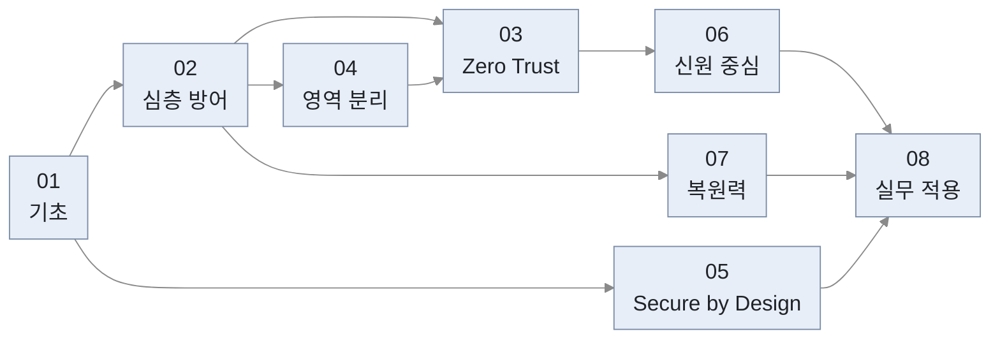

# Security Architecture (보안 아키텍처)

> 약어: NIST=미국 국립표준기술연구소, NIST SP=NIST 특별 간행물, CISA=미국 사이버보안·인프라보안청, ISO/IEC=국제표준화기구/국제전기기술위원회, 3GPP=3세대 이동통신 표준화 기구

시스템 전체를 **어떤 구조로 나누고, 어디에 어떤 통제를 두어, 한 곳이 뚫려도 전체가 무너지지 않게 할지** 정하는 설계를 다루는 하위 영역이다.
암호·신원·인가·위협 모델링이 각각의 부품이라면, 보안 아키텍처는 그 부품을 **어디에 어떻게 배치할지 정하는 설계도**다.
심층 방어, Zero Trust, 네트워크 분리, Secure by Design, 신원 중심 설계, 복원력까지 하나의 흐름으로 정리한다.

> **구분 주의**: 개별 통제의 원리는 각 하위 영역에서 다룬다. 인증과 토큰은 [PKI & Identity](../pki-identity/README.md), 인가 모델은 [Access Control](../access-control/README.md), 무엇을 막아야 하는지 찾는 방법은 [Threat Modeling](../threat-modeling/README.md)에 있다.
> 이 영역은 그것들을 **조합하는 구조와 원칙**을 다룬다.

---

## 1. 보안 아키텍처 지도

### 1.1 원칙 → 패턴 → 통제

보안 아키텍처는 세 층으로 생각하면 정리가 쉽다.

| 층 | 질문 | 예 | 문서 |
|----|------|----|:---:|
| 원칙 | 어떤 기준으로 설계하는가? | 최소 권한, 기본 거부, 완전 중재, 심층 방어, 실패 시 안전 | 01, 02 |
| 패턴 | 그 원칙을 어떤 구조로 구현하는가? | Zero Trust, 영역 분리, 신원 중심 접근, 격리된 백업 | 03, 04, 06, 07 |
| 통제 | 구조 안에 무엇을 배치하는가? | MFA(Multi-Factor Authentication), 방화벽, 정책 엔진, 암호화, 로그 | 각 하위 영역 |

텍스트 설명: 위협 모델링으로 무엇을 막아야 하는지 정하고, 설계 원칙을 기준으로 구조(패턴)를 고르고, 그 구조 안에 구체적인 통제를 배치한다.
운영과 점검에서 드러난 빈틈은 다시 위협 모델과 설계로 돌아간다.

### 1.2 경계 중심에서 신원·요청 중심으로

보안 아키텍처의 큰 흐름은 "안쪽은 믿는다"에서 "아무것도 미리 믿지 않는다"로 옮겨 왔다.

| 구분 | 경계 중심(Perimeter) | Zero Trust |
|------|----------------------|------------|
| 신뢰의 기준 | 네트워크 위치·경계 통과 여부를 중요한 근거로 삼는 경향 | 네트워크 위치만으로 암묵적 신뢰를 주지 않고, 신원·기기 상태·맥락을 정책으로 평가 |
| 주된 통제 위치 | 외곽 방화벽·VPN(Virtual Private Network) 같은 경계에 집중되는 경향 | 사용자·기기·서비스·자원 접근 지점에 분산된 PEP(Policy Enforcement Point) |
| 내부 이동 | 경계 안에서는 상대적으로 넓은 연결이 허용되기 쉽다 | 서비스·자원 간 접근을 개별 정책으로 제한해 내부 확산을 억제 |
| 약점 | 경계 안 한 곳이 침해되면 내부 확산·권한 남용에 취약할 수 있다 | 정책·신원·기기·PEP·로그 체계의 복잡도와 운영 부담. 잘못된 정책, 탈취된 신원, 과도한 권한에는 여전히 취약 |
| 상대적으로 잘 맞는 환경 | 경계가 명확한 단일 사옥·단일 데이터센터 | 클라우드, 원격 근무, 협력사, 여러 위치에 분산된 자원 |

- 위 표는 경향의 비교다. 경계 중심 설계에도 내부 통제와 호스트 기반 통제가 있고, Zero Trust도 모든 요청을 매번 처음부터 다시 인증하거나 모든 내부 트래픽을 막는다는 뜻은 아니다. 두 방식은 배타적이지 않아 함께 쓴다.
- Zero Trust는 네트워크 경계를 단순히 없애는 접근이 아니다. **네트워크 위치에 기반한 암묵적 신뢰를 없애고**, 사용자·기기·서비스·자원 단위로 인증과 인가를 한다. 네트워크 분리와 외곽 방화벽은 심층 방어의 한 겹으로 계속 쓸 수 있지만, 그것만으로 내부 접근을 신뢰하지 않는다.
- Zero Trust는 제품 이름이 아니라 설계 원칙의 묶음이다. 한 번에 바꾸는 것이 아니라 단계적으로 성숙도를 올린다.

### 1.3 설계 원칙

모든 문서에서 반복해 연결하는 원칙이다.

| 원칙 | 의미 | 깨지면 | 출처 |
|------|------|--------|------|
| 최소 권한(Least Privilege) | 필요한 만큼만, 필요한 동안만 허용 | 계정·서비스 하나의 침해가 전체로 확산 | Saltzer·Schroeder |
| 기본 거부(Fail-safe Defaults) | 명시적 허용이 없거나 판단이 실패하면 거부 | 설정 누락·장애가 곧 허용 | Saltzer·Schroeder |
| 완전 중재(Complete Mediation) | 모든 접근을 매번 검사 | 우회 경로, 캐시된 판단 악용 | Saltzer·Schroeder |
| 단순성(Economy of Mechanism) | 보안 장치는 작고 단순하게 | 검증할 수 없는 복잡한 통제 | Saltzer·Schroeder |
| 권한 분리(Separation of Privilege) | 중요한 작업은 둘 이상의 독립된 조건을 요구 | 한 사람·한 자격 증명으로 위험한 작업 완료 | Saltzer·Schroeder |
| 심층 방어(Defense in Depth) | 서로 다른 종류의 통제를 여러 겹 둔다 | 통제 하나가 뚫리면 바로 피해 | 일반 보안 설계 원칙 |
| 영역 분리·격리(Segmentation, Compartmentalization) | 신뢰 수준이 다른 것을 나누고 경계에서 통제 | 내부 확산(Lateral Movement) | 일반 보안 설계 원칙 |
| 공격 표면 최소화 | 필요 없는 기능·포트·계정을 없앤다 | 쓰지 않는 기능이 침입 경로가 됨 | 일반 보안 설계 원칙 |
| 기본 보안 설정(Secure by Default) | 처음 설치한 상태가 안전한 상태 | 사용자가 안전하게 설정하지 않으면 노출 | 일반 보안 설계 원칙 |
| 복원력(Resilience) | 침해·장애를 전제로 버티고 회복 | 한 번의 사고가 장기 중단으로 | 시스템 보안·사이버 복원력 공학 |

- Saltzer·Schroeder가 제시한 보호 설계 원칙은 여덟 가지다. 위 표의 다섯 가지 외에 Open Design, Least Common Mechanism, Psychological Acceptability가 있다. 여덟 원칙과 현대적 해석은 [Access Control Fundamentals 5.1 Saltzer·Schroeder 설계 원칙](../access-control/access-control-fundamentals.md#51-saltzerschroeder-설계-원칙)에 정리되어 있다.
- 기본 거부(Fail-safe Defaults)와 기본 보안 설정(Secure by Default)은 가깝지만 같지 않다. 앞의 것은 접근 판단의 기본값이 거부라는 원칙이고, 뒤의 것은 제품의 초기 설정 전반이 안전해야 한다는 더 넓은 원칙이다.

---

## 2. 문서 목록

| 순서 | 문서 | 핵심 내용 | 과정 |
|:---:|------|-----------|:---:|
| 01 | Security Architecture Fundamentals (작성 예정) | 보안 아키텍처의 정의와 역할, 설계 원칙의 현대적 해석, 신뢰 경계와 보안 영역, 아키텍처 산출물 | 핵심 |
| 02 | Defense in Depth (작성 예정) | 계층별 통제(신원·기기·네트워크·애플리케이션·데이터), 통제 종류의 다양성, 단일 실패 지점 제거 | 핵심 |
| 03 | Zero Trust (작성 예정) | *NIST SP 800-207*의 원칙과 논리 구성요소, 배치 모델, 성숙도 모델, 단계적 전환 | 핵심 |
| 04 | Network Segmentation (작성 예정) | 영역 분리, DMZ(Demilitarized Zone), 마이크로 세그멘테이션, East-West 트래픽 통제, 관리망 분리 | 핵심 |
| 05 | Secure by Design (작성 예정) | 기본 보안 설정, 공격 표면 축소, CISA Secure by Design 원칙, 제조사 책임 | 핵심 |
| 06 | Identity-Centric Architecture (작성 예정) | 신원을 경계로 삼는 설계, SSO(Single Sign-On)·조건부 접근, 지속적 접근 평가, 기기 신뢰 | 확장 |
| 07 | Resilience & Recovery (작성 예정) | 가용성 설계, 백업·복구와 격리, 랜섬웨어 대비, 장애 시 안전한 동작, 사이버 복원력 | 확장 |
| 08 | Security Architecture in Practice (작성 예정) | Web·Cloud·5G·AI 아키텍처 패턴, 참조 아키텍처, 아키텍처 리뷰 방법 | 확장 |

- **핵심 과정(01~05)**: 보안 설계의 원칙과 대표 패턴이다.
- **확장 과정(06~08)**: 신원 중심 설계, 복원력, 실제 시스템 적용으로 넓힌다.
- 각 문서는 일반 IT 실무자를 위한 본문과, 보안 컨설턴트·점검자를 위한 "심화" 절로 나뉜다.

### 문서 간 의존 관계

텍스트 설명: 01 기초에서 원칙과 신뢰 경계를 정리한 뒤, 여러 겹의 통제를 두는 심층 방어(02)와 처음부터 안전하게 만드는 Secure by Design(05)으로 나뉜다.
심층 방어는 네트워크를 나누는 영역 분리(04)와 요청마다 판단하는 Zero Trust(03)로 구체화되고, Zero Trust는 신원 중심 설계(06)로 이어진다.
침해를 전제로 버티는 복원력(07)까지 더해 실무 적용(08)에서 합쳐진다.

### 권장 학습 우선순위

1. **설계 원칙 + 심층 방어** — 모든 패턴의 기준 (01, 02)
2. **Zero Trust** — 현대 보안 아키텍처의 중심 개념 (03)
3. **영역 분리** — Zero Trust로 가는 과정에서도 유효한 기본 통제 (04)
4. **Secure by Design** — 제품·서비스를 만드는 쪽의 책임 (05)
5. **신원 중심 + 복원력** — 접근 판단의 중심과 침해 이후 회복 (06, 07)
6. **실무 적용** — 영역별 아키텍처 패턴과 리뷰 (08)

---

## 3. 기준 표준

각 문서가 인용하는 표준과 자료다.

| 영역 | 표준·자료 | 문서 |
|------|-----------|:---:|
| 보호 설계 원칙 | Saltzer·Schroeder, "The Protection of Information in Computer Systems" | 01, 02 |
| 보안 시스템 공학 | *NIST SP 800-160 Vol. 1 Rev. 1* | 01, 05 |
| 엔터프라이즈 보안 아키텍처 | SABSA(Sherwood Applied Business Security Architecture, 현재는 SABSA를 고유 명칭으로 쓴다) — 비즈니스 요구와 위험에서 출발하는 보안 아키텍처 방법론 | 01, 08 |
| Zero Trust 아키텍처 | *NIST SP 800-207*, *NIST SP 800-207A* | 03, 06 |
| Zero Trust 구현 | NIST NCCoE(National Cybersecurity Center of Excellence) *SP 1800-35* | 03 |
| Zero Trust 성숙도 | CISA Zero Trust Maturity Model Version 2.0 | 03 |
| 네트워크 경계·분리 | *NIST SP 800-41 Rev. 1* (방화벽), *NIST SP 800-215* (기업 네트워크) | 04 |
| Secure by Design | CISA Secure by Design 원칙 | 05 |
| 디지털 신원 | *NIST SP 800-63-4* | 06 |
| 사이버 복원력 | *NIST SP 800-160 Vol. 2 Rev. 1*, *NIST SP 800-34 Rev. 1* (비상 계획) | 07 |
| 보안 프레임워크 | NIST CSF(Cybersecurity Framework) 2.0, *ISO/IEC 27001*·*ISO/IEC 27002* | 01, 07 |
| 클라우드 아키텍처 | 클라우드 사업자의 Well-Architected 보안 원칙 | 08 |
| 5G 보안 구조 | *3GPP TS 33.501 V19.7.0 (Release 19)* | 08 |

- 공통 표준의 정의는 [Security Fundamentals References](../references/README.md)에도 정리되어 있다.

---

## 4. 범위 경계

- **인증 방식, 토큰, 세션, 지속적 접근 평가 이벤트(CAEP(Continuous Access Evaluation Profile))의 동작** → [PKI & Identity](../pki-identity/README.md). 여기서는 그것을 **아키텍처 안에 배치하는 방법**을 다룬다.
- **인가 모델과 정책 엔진** → [Access Control](../access-control/README.md)
- **위협 식별과 위험 평가** → [Threat Modeling](../threat-modeling/README.md)
- **개발 주기 안의 보안 활동** → [Secure Development](../secure-development/README.md) (작성 예정)
- **탐지·로깅·침해 대응 체계** → [Security Operations](../security-operations/README.md) (작성 예정)
- **클라우드 네트워크·IAM 세부 설정** → [Cloud Network Security](../../cloud-security/network-security/README.md) (작성 예정), [Cloud IAM](../../cloud-security/iam/README.md) (작성 예정)
- **5G SBA·RAN 보안 상세** → [5G Security](../../5g-security/README.md)

## 5. 다른 영역과의 연결

| 영역 | 연결되는 보안 아키텍처 개념 |
|------|----------------------------|
| PKI & Identity | 신원을 경계로 삼는 설계, MFA·피싱 저항 인증, 지속적 접근 평가 → [Session & Token Lifecycle](../pki-identity/session-token-lifecycle.md), [Workload Identity](../pki-identity/workload-identity.md) |
| Access Control | PEP·PDP(Policy Decision Point) 배치, 자원마다 판단하는 Zero Trust 접근 → [Access Control in Practice](../access-control/access-control-in-practice.md) |
| Threat Modeling | 신뢰 경계를 설계 입력으로, 위협별 통제를 여러 겹으로 배치 → [Threat Modeling Fundamentals](../threat-modeling/threat-modeling-fundamentals.md), [Risk Treatment](../threat-modeling/risk-treatment.md) |
| 5G | NF(Network Function) 간 상호 인증과 토큰 인가, 사업자 간 경계, 슬라이스 격리 → [5G Security Risks](../../5g-security/security-risks/README.md) |
| Cloud | 계정·구독 단위 경계, 관리 평면 보호, 공동 책임 모델 → [Cloud Security](../../cloud-security/README.md) |
| AI | 모델·도구·검색 문서를 신뢰 경계로 나누는 에이전트 아키텍처, 도구 실행 지점마다 PEP → [Threat Modeling in Practice 3.4 AI 시스템](../threat-modeling/threat-modeling-in-practice.md#34-ai-시스템) |
