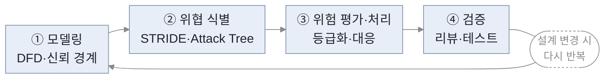
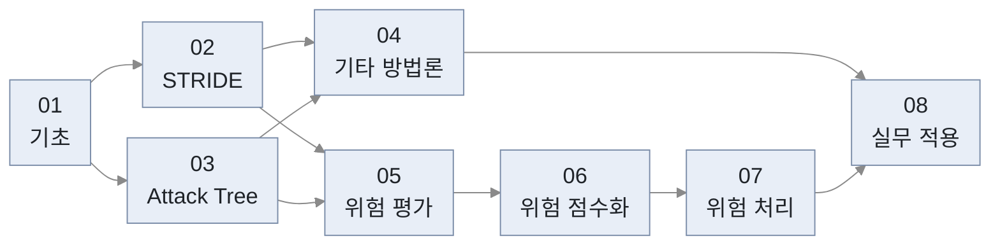

# Threat Modeling (위협 모델링)

> 약어: NIST=미국 국립표준기술연구소, NIST SP=NIST 특별 간행물, ISO/IEC=국제표준화기구/국제전기기술위원회, ENISA=유럽연합 사이버보안청, 3GPP=3세대 이동통신 표준화 기구

시스템을 만들거나 바꾸기 전에 **무엇이 잘못될 수 있는지 체계적으로 찾고, 그중 무엇을 먼저 막을지 정하는** 방법론을 다루는 하위 영역이다.
위협 식별(STRIDE(Spoofing, Tampering, Repudiation, Information disclosure, Denial of service, Elevation of privilege)·Attack Tree 등)부터 위험 평가·등급화·처리까지 하나의 흐름으로 정리한다.
5G·Cloud·AI·Web 각 영역의 위협 문서와 점검 문서는 모두 이 방법론 위에서 작성된다.

> **구분 주의**: 위협 모델링은 "설계 단계에서 생각으로 공격해 보는" 활동이다.
> 이미 만들어진 시스템에서 실제 취약점을 찾는 취약점 진단·모의해킹과는 목적과 시점이 다르다(아래 [1.2 비슷한 활동과의 차이](#12-비슷한-활동과의-차이)).

---

## 1. 위협 모델링 지도

### 1.1 네 가지 질문

위협 모델링 방법론은 많지만, 모두 아래 네 질문에 답하는 과정으로 정리할 수 있다.
Adam Shostack의 Four Question Framework를 Threat Modeling Manifesto가 핵심 질문으로 채택한 틀이다. 마지막 질문은 Manifesto에서 "Did we do a good enough job?"으로 표현한다.

| 질문 | 하는 일 | 산출물 | 문서 |
|------|---------|--------|:---:|
| ① 무엇을 만들고 있는가? | 범위를 정하고 구성요소·데이터 흐름·신뢰 경계를 그린다 | DFD(Data Flow Diagram, 데이터 흐름도), 자산 목록 | 01 |
| ② 무엇이 잘못될 수 있는가? | 위협을 체계적으로 찾는다 | 위협 목록, 공격 트리 | 02, 03, 04 |
| ③ 그래서 무엇을 할 것인가? | 위험을 평가해 순위를 매기고 처리 방법을 정한다 | 위험 등록부, 대응 계획 | 05, 06, 07 |
| ④ 충분히 잘했는가? | 빠진 위협이 없는지, 대응이 실제로 반영됐는지 확인한다 | 검토 기록, 테스트 항목 | 08 |

텍스트 설명: 시스템을 그림으로 표현하고(①), 그 그림의 각 요소와 경계에서 위협을 찾고(②),
찾은 위협의 위험을 평가해 대응을 정하고(③), 결과를 검증한다(④).
위협 모델은 한 번 만들고 끝나는 문서가 아니라 설계가 바뀔 때마다 다시 돌리는 반복 활동이다.

### 1.2 비슷한 활동과의 차이

| 활동 | 시점 | 질문 | 결과 |
|------|------|------|------|
| 위협 모델링 | 설계·변경 단계(코드 이전에도 가능) | 무엇이 잘못될 수 있는가? | 위협 목록과 설계 대응 |
| 위험 평가(Risk Assessment) | 조직·시스템 단위, 주기적 | 각 위험이 얼마나 크고 무엇을 먼저 할 것인가? | 위험 등급과 처리 결정 |
| 취약점 진단(Vulnerability Assessment) | 구현·운영 단계 | 알려진 약점이 실제로 있는가? | 취약점 목록 |
| 모의해킹(Penetration Test)·레드팀 | 구현·운영 단계 | 실제로 뚫을 수 있는가? | 공격 경로 증명 |

- 위협 모델링은 위험 평가의 **입력**이 된다. 위협이 무엇인지 모르면 위험의 크기도 잴 수 없다.
- 위협 모델링에서 나온 위협은 진단·모의해킹의 **테스트 항목**이 된다. 반대로 진단 결과는 위협 모델의 빈틈을 알려 준다.

### 1.3 방법론 비교

방법론은 "무엇을 중심으로 위협을 찾는가"로 구분한다. 실무에서는 하나만 쓰기보다 조합한다.

| 방법론 | 중심 | 강점 | 약점 | 문서 |
|--------|------|------|------|:---:|
| STRIDE | 설계 요소(DFD)별 위협 유형 | 빠르고 배우기 쉽다, 개발팀과 보안팀의 공통 언어가 된다 | 가능성·영향·위험 점수는 스스로 산출하지 않는다 | 02 |
| Attack Tree | 공격자 목표와 그 달성 경로 | 경로별 비용·난이도 분석, 가장 쉬운 경로 파악 | 목표마다 트리를 따로 만들어야 하고, 그 자체로 위험 평가가 끝나지는 않는다 | 03 |
| PASTA(Process for Attack Simulation and Threat Analysis) | 비즈니스 영향과 공격 시뮬레이션 | 공격자 관점과 비즈니스 위험을 7단계로 연결한다 | 분석 범위가 넓어 시간과 비용이 커질 수 있다 | 04 |
| LINDDUN(프라이버시 위협 유형의 머리글자) | 개인정보(프라이버시) 위협 | STRIDE가 놓치는 연결·식별·추적 위협을 다룬다 | 보안 위협 전체를 대체하지 않으므로 보안 위협은 별도로 봐야 한다 | 04 |
| OCTAVE(Operationally Critical Threat, Asset, and Vulnerability Evaluation) | 조직의 핵심 자산과 운영 위험 | 자산·위협·취약점을 업무 맥락에서 평가한다(소규모 조직용 OCTAVE-S, 정보 자산 중심 OCTAVE Allegro 변형이 있다) | 개별 시스템 설계의 위협을 세밀하게 찾는 용도는 아니다 | 04 |
| Kill Chain·MITRE ATT&CK(Adversarial Tactics, Techniques, and Common Knowledge) 매핑 | 실제 공격자의 단계와 기법 | 탐지·대응 설계와 바로 연결된다 | 설계 결함보다 침투 이후 행위에 치우친다 | 04 |

> 예: 웹 서비스 신규 기능은 STRIDE로 빠르게 훑고, 결제 탈취처럼 핵심 목표 하나는 Attack Tree로 깊게 판다.
> 개인정보를 많이 다루면 LINDDUN을 더하고, 탐지 설계는 ATT&CK 기법으로 연결한다.

### 1.4 핵심 용어

같은 단어를 문서마다 다르게 쓰지 않도록 이 영역에서 쓰는 뜻을 고정한다.

| 용어 | 뜻 | 예 |
|------|----|----|
| 자산(Asset) | 보호할 가치가 있는 것 | 고객 개인정보, 서명 키, 서비스 가용성 |
| 위협(Threat) | 자산에 피해를 줄 수 있는 사건이나 행위 | 세션 토큰 탈취, 설정 변조 |
| 위협 행위자(Threat Actor) | 위협을 실행하는 주체 | 외부 공격자, 악의적 내부자, 탈취된 서비스 계정 |
| 취약점(Vulnerability) | 위협이 실현될 수 있게 하는 약점 | 인가 검사 누락, 평문 통신 |
| 위험(Risk) | 위협이 실현될 가능성과 그 영향의 조합 | "가능성 높음 × 영향 큼 = 높음" |
| 신뢰 경계(Trust Boundary) | 신뢰 수준이 바뀌는 지점 | 인터넷 ↔ DMZ(Demilitarized Zone), 사용자 ↔ 서버, 테넌트 ↔ 테넌트 |
| 공격 표면(Attack Surface) | 공격자가 입력을 넣거나 접근할 수 있는 지점의 합 | 공개 API, 관리 콘솔, 파일 업로드 |
| 통제(Control) | 위험을 줄이는 수단 | 인증, 암호화, 입력 검증, 모니터링 |
| 잔여 위험(Residual Risk) | 통제를 적용한 뒤에도 남는 위험 | 수용 여부를 책임자가 결정한다 |

- 위협은 신뢰 경계를 넘는 지점에서 가장 많이 생긴다. DFD에서 경계를 먼저 그리는 이유다.

---

## 2. 문서 목록

| 순서 | 문서 | 핵심 내용 | 과정 |
|:---:|------|-----------|:---:|
| 01 | [Threat Modeling Fundamentals](threat-modeling-fundamentals.md) | 네 가지 질문, 범위 정하기, DFD 그리기, 자산·신뢰 경계·공격 표면 식별, 가정과 전제 기록 | 핵심 |
| 02 | [STRIDE](stride.md) | 6개 위협 유형과 보안 속성의 대응, STRIDE-per-element, 위협 문장 작성법, 대응 통제 매핑 | 핵심 |
| 03 | [Attack Tree](attack-trees.md) | 공격 목표와 하위 목표, AND·OR 노드, 비용·난이도 속성, 가장 쉬운 경로 찾기 | 핵심 |
| 04 | [Threat Modeling Methodologies](threat-modeling-methodologies.md) | PASTA, LINDDUN, OCTAVE, Kill Chain·ATT&CK·CAPEC(Common Attack Pattern Enumeration and Classification) 연계, 방법론 선택 기준 | 핵심 |
| 05 | [Risk Assessment](risk-assessment.md) | 가능성과 영향, 정성·정량 평가, 위험 평가 절차, *NIST SP 800-30 Rev. 1*·*ISO/IEC 27005*의 구조 | 핵심 |
| 06 | [Risk Scoring](risk-scoring.md) | CVSS(Common Vulnerability Scoring System), EPSS(Exploit Prediction Scoring System), OWASP(Open Worldwide Application Security Project) Risk Rating, DREAD(Damage Potential, Reproducibility, Exploitability, Affected users, Discoverability)의 한계, 위험 매트릭스 | 확장 |
| 07 | [Risk Treatment](risk-treatment.md) | 회피·완화·전가·수용, 잔여 위험과 수용 책임, 위험 등록부(Risk Register) 운영 | 확장 |
| 08 | [Threat Modeling in Practice](threat-modeling-in-practice.md) | Web·API, Cloud, 5G, AI 시스템 적용 예, 도구, 개발 주기 통합, 위협 모델 검토 | 확장 |

- **핵심 과정(01~05)**: 위협을 찾고 위험을 평가하는 데 필요한 기본 방법론이다.
- **확장 과정(06~08)**: 점수화·처리 결정·실제 시스템 적용으로 넓힌다.
- 각 문서는 일반 IT 실무자를 위한 본문과, 보안 컨설턴트·점검자를 위한 "심화" 절로 나뉜다.

### 문서 간 의존 관계

텍스트 설명: 01 기초에서 시스템을 DFD로 그리는 법을 익힌 뒤, 그 그림에서 위협을 찾는 두 대표 기법(02 STRIDE, 03 Attack Tree)으로 나뉜다.
04는 목적에 따라 고를 수 있는 다른 방법론을 비교한다. 찾은 위협은 05에서 위험으로 평가되고,
06에서 점수로 비교되며, 07에서 처리 방법이 정해진다. 08에서 앞의 내용이 실제 시스템에 합쳐진다.

### 권장 학습 우선순위

1. **DFD + 신뢰 경계** — 위협 모델의 출발점 (01)
2. **STRIDE** — 가장 널리 쓰이는 위협 식별 기법 (02)
3. **위험 평가** — 찾은 위협 중 무엇을 먼저 할지 정하는 기준 (05)
4. **Attack Tree** — 핵심 목표를 깊게 분석하는 기법 (03)
5. **점수화 + 처리** — 취약점 우선순위와 위험 수용 결정 (06, 07)
6. **다른 방법론 + 실무 적용** — 프라이버시·조직 위험·각 영역 적용 (04, 08)

---

## 3. 기준 표준

각 문서가 인용하는 표준과 자료다.

| 영역 | 표준·자료 | 문서 |
|------|-----------|:---:|
| 위협 모델링 원칙 | Threat Modeling Manifesto, Adam Shostack, *Threat Modeling: Designing for Security* | 01, 08 |
| 데이터 중심 위협 모델링 | *NIST SP 800-154* (초안) | 01 |
| STRIDE | Microsoft STRIDE, Microsoft Threat Modeling Tool | 02 |
| Attack Tree | Bruce Schneier, "Attack Trees" (*Dr. Dobb's Journal*) — 공격 목표를 트리로 분해하는 접근을 널리 소개한 글 | 03 |
| 프라이버시 위협 | LINDDUN (KU Leuven) | 04 |
| 공격 시뮬레이션 | PASTA | 04 |
| 조직 위험 평가 | OCTAVE, OCTAVE-S, OCTAVE Allegro (Carnegie Mellon University SEI(Software Engineering Institute)) | 04 |
| 공격 기법·패턴 분류 | MITRE ATT&CK, MITRE CAPEC, Lockheed Martin Cyber Kill Chain | 04, 08 |
| 위험 평가 | *NIST SP 800-30 Rev. 1*, *ISO/IEC 27005* | 05 |
| 위험 관리 체계 | *NIST SP 800-37 Rev. 2* RMF(Risk Management Framework), *NIST SP 800-39*, *ISO 31000* | 05, 07 |
| 정량 위험 분석 | FAIR(Factor Analysis of Information Risk) 모델, The Open Group Open FAIR 표준(Risk Taxonomy·Risk Analysis) | 05 |
| 취약점 점수 | FIRST(Forum of Incident Response and Security Teams) CVSS v4.0, FIRST EPSS, CISA(Cybersecurity and Infrastructure Security Agency) KEV(Known Exploited Vulnerabilities) 목록 | 06 |
| 애플리케이션 위험 등급 | OWASP Risk Rating Methodology | 06 |
| AI 위협 | MITRE ATLAS(Adversarial Threat Landscape for Artificial-Intelligence Systems), OWASP Top 10 for LLM Applications | 04, 08 |
| 5G 위협 | ENISA, "Threat Landscape for 5G Networks", MITRE FiGHT(5G Hierarchy of Threats), *3GPP TR 33.926* | 04, 08 |

- 공통 표준의 정의는 [Security Fundamentals References](../references/README.md)에도 정리되어 있다.

---

## 4. 범위 경계

- **영역별 위협 카탈로그** → [5G Security Risks](../../5g-security/security-risks/README.md), [LLM Security Risks](../../ai-security/llm-security/risks/README.md) (작성 예정). 여기서는 위협을 **찾고 평가하는 방법**만 다룬다.
- **AI 시스템 위협 모델링·레드팀** → [AI Security Assessment](../../ai-security/ai-security-assessment/README.md) (작성 예정)
- **AI 위험 관리 체계(*NIST AI RMF*·*ISO/IEC 42001*)** → [AI Governance](../../ai-security/ai-governance/README.md) (작성 예정)
- **클라우드 위험평가·인증 제도(ISMS-P 등)** → [Cloud Assessment](../../cloud-security/assessment/README.md) (작성 예정), [Cloud Posture & Compliance](../../cloud-security/posture-compliance/README.md) (작성 예정)
- **위협 대응을 위한 아키텍처 설계(Zero Trust·심층 방어)** → [Security Architecture](../security-architecture/README.md) (작성 예정)
- **개발 주기 안의 보안 활동 전체(SSDLC(Secure Software Development Life Cycle))** → [Secure Development](../secure-development/README.md) (작성 예정)
- **위협 탐지·침해 대응** → [Security Operations](../security-operations/README.md) (작성 예정)

## 5. 다른 영역과의 연결

| 영역 | 연결되는 위협 모델링 개념 |
|------|--------------------------|
| Cryptography | 공격자 능력 가정(도청·변조·Harvest Now, Decrypt Later)을 위협 모델의 전제로 기록 → [Cryptography Overview](../cryptography/cryptography-overview.md) |
| PKI & Identity | Spoofing 위협과 인증 대응, 인증 공격 시나리오 → [PKI & Identity](../pki-identity/README.md) |
| Access Control | Elevation of Privilege 위협과 인가 대응, 인가 공격 → [Authorization Attacks](../access-control/authorization-attacks.md) |
| 5G | UE(User Equipment)·RAN(Radio Access Network)·Core·SBA(Service Based Architecture) 신뢰 경계별 위협 식별, 위협 문서의 공격 시나리오 작성 → [5G Security Risks](../../5g-security/security-risks/README.md) |
| Cloud | 공동 책임 모델에 따른 신뢰 경계, 테넌트 간 경계, 관리 평면 위협 |
| Web | 사용자 입력이 서버로 넘어가는 경계, OWASP Top 10 위험과의 매핑 |
| AI | 프롬프트·검색 문서·도구 호출을 새로운 신뢰 경계로 보는 위협 모델, MITRE ATLAS 기법 매핑 |
