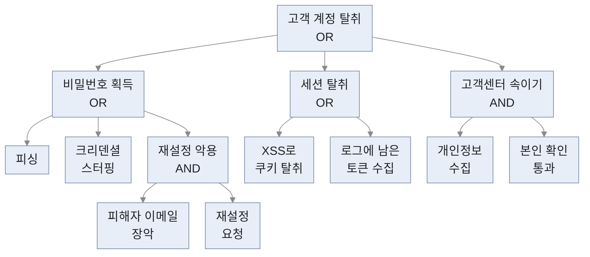

# Attack Tree (공격 트리)

## 1. 개요 (What)

Attack Tree(공격 트리)는 **공격자의 목표 하나를 뿌리(root)에 두고, 그 목표를 이루는 방법을 가지로 나눠 내려가는 트리**다.
"계정을 탈취한다"는 목표 아래에 "비밀번호를 알아낸다", "세션을 훔친다", "고객센터를 속인다"가 오고, 각 방법은 다시 더 구체적인 단계로 쪼개진다.
가장 아래의 잎(leaf)은 공격자가 실제로 하는 구체적인 행동이 된다.

Bruce Schneier가 *Dr. Dobb's Journal*에 발표한 "Attack Trees"로 널리 알려졌다. 그 글의 대표 예시가 "금고를 연다"는 목표를 자물쇠 따기·비밀번호(조합) 알아내기·절단하기·금고를 부적절하게 설치하기로 나누는 트리다.
구조는 안전 공학에서 사고 원인을 분석하는 결함 트리 분석(FTA(Fault Tree Analysis))과 닮았다. 둘 다 최상위 사건을 하위 사건으로 나누고 AND·OR로 잇지만, 같은 기법은 아니다. 결함 트리가 "사고가 어떻게 일어날 수 있나"를 묻는다면, 공격 트리는 "공격자가 어떻게 목표를 이룰 수 있나"를 묻는다.

[STRIDE](stride.md)가 설계 요소마다 넓게 훑는 방식이라면, Attack Tree는 **핵심 목표 하나를 깊게** 판다.
그래서 "결제 시스템이 뚫리면 회사가 망한다"처럼 반드시 지켜야 할 목표가 있을 때, 그 목표에 이르는 경로 중 가장 쉬운 것이 무엇인지 찾는 데 쓴다.

## 2. 배경 / 원리 (Why & How)

### 2.1 왜 트리로 그리는가

공격자는 시스템의 모든 부분을 공격하지 않는다. **가장 싸고 쉬운 길 하나**만 찾으면 된다.
방어자가 정문을 아무리 튼튼하게 해도 뒷문이 열려 있으면 소용없다. 트리는 "목표에 이르는 모든 길"을 한 장에 펼쳐서, 어느 길이 가장 약한지 비교할 수 있게 한다.

| 질문 | 트리가 주는 답 |
|------|----------------|
| 이 목표를 이루는 방법은 몇 가지인가? | 뿌리 아래 OR 가지의 수 |
| 가장 쉬운 경로는 무엇인가? | 잎의 비용·난이도를 위로 올려 계산한 결과 |
| 통제 하나를 추가하면 몇 개의 경로가 막히는가? | 그 통제가 끊는 잎과 가지 |
| 우리가 상정한 공격자(예산·기술)에게 가능한 경로는? | 공격자 능력을 넘는 잎을 지운 나머지 |

### 2.2 AND 노드와 OR 노드

트리의 각 노드는 하위 노드와의 관계에 따라 두 종류로 나뉜다.

| 노드 | 의미 | 예 |
|------|------|----|
| OR | 하위 방법 중 **하나만** 성공하면 된다 | "계정 탈취" = 비밀번호 탈취 OR 세션 탈취 OR 고객센터 사회공학 |
| AND | 하위 단계가 **모두** 성공해야 한다 | "비밀번호 재설정 악용" = 피해자 이메일 장악 AND 재설정 요청 |

- 방어 관점에서 OR 노드는 **모든 가지를 막아야** 막힌다. AND 노드는 **가지 하나만 막아도** 막힌다.
- 이 원칙은 트리가 실제 공격 경로를 빠짐없이 표현했다는 전제 위에 있다. 그림에 없는 우회 경로가 있거나 통제가 실제로 효과가 없으면 성립하지 않으므로, 통제의 실효성과 우회 가능성을 따로 확인한다.
- 그래서 AND 노드가 많은 경로는 상대적으로 막기 쉽고, OR 노드 아래에 막히지 않은 가지가 하나라도 있으면 그 노드는 여전히 열려 있다.

### 2.3 예시: 고객 계정 탈취

텍스트 설명: 뿌리 목표 "고객 계정 탈취"는 OR 노드로, 비밀번호 획득·세션 탈취·고객센터 속이기 중 하나만 성공하면 된다.
비밀번호 획득은 다시 피싱·크리덴셜 스터핑·재설정 악용 중 하나로 이룰 수 있고, 재설정 악용은 피해자 이메일 장악과 재설정 요청이 **모두** 필요한 AND 노드다.
세션 탈취는 XSS(Cross-Site Scripting)로 쿠키를 훔치거나 로그에 남은 토큰을 수집하는 방법이 있고, 고객센터 속이기는 개인정보 수집과 본인 확인 통과가 모두 필요하다.

- MFA(Multi-Factor Authentication)를 적용하면 "비밀번호 획득" 아래 가지가 모두 약해지지만, "세션 탈취"와 "고객센터 속이기"는 그대로 남는다. 트리는 이런 **남는 경로**를 보이게 한다.

## 3. 상세 (Details)

### 3.1 만드는 순서

1. **목표 정하기**: 뿌리에는 공격자의 목표를 한 문장으로 쓴다. 보안 목표("다른 고객 주문을 볼 수 없어야 한다")를 뒤집으면 공격 목표가 된다. 목표가 여러 개면 트리를 따로 만든다.
2. **첫 단계 가지 나누기**: "이 목표를 이루는 방법은 무엇인가?"를 묻고 크게 나눈다. 기술적 경로만이 아니라 사람(사회공학)·물리·공급망 경로도 넣는다.
3. **내려가며 쪼개기**: 각 노드에 "이것을 하려면?"을 반복해 묻는다. 한 노드가 여러 단계를 모두 거쳐야 하면 AND, 대안이면 OR로 표시한다.
4. **멈추는 지점**: 잎이 "실제 행동으로 바로 실행할 수 있고, 비용·난이도를 매길 수 있는" 수준이 되면 멈춘다.
5. **속성 매기기**: 잎마다 비용·난이도 등 속성을 붙인다(3.2).
6. **위로 계산하기**: AND·OR 규칙에 따라 속성을 뿌리까지 올려 가장 쉬운 경로를 찾는다(3.3).
7. **통제 대입하기**: 현재 통제와 추가할 통제를 표시하고 어떤 경로가 남는지 본다(3.4).

- 처음부터 완벽한 트리를 만들려 하지 않는다. 팀이 함께 가지를 덧붙이며 키우는 문서다.
- 같은 하위 트리가 여러 곳에 나오면(예: "관리자 자격 증명 획득") 한 번 만들고 참조한다.

### 3.2 잎에 붙이는 속성

| 속성 | 질문 | 값의 예 |
|------|------|---------|
| 가능 여부 | 지금 통제 아래에서 가능한가? | 가능 / 불가능 |
| 비용 | 공격자가 들여야 하는 돈·자원은? | 낮음·중간·높음 또는 금액 |
| 필요 기술 | 어느 수준의 공격자가 할 수 있는가? | 스크립트 사용자 / 숙련자 / 국가 수준 |
| 특수 장비·접근 | 특별한 장비나 내부 접근이 필요한가? | 필요 / 불필요 |
| 탐지 가능성 | 하면 들킬 가능성은? | 낮음·중간·높음 |
| 소요 시간 | 성공까지 걸리는 시간은? | 분·일·월 |

- 속성은 처음엔 **정성적으로**(낮음·중간·높음) 매겨도 충분하다. 정확한 숫자보다 경로끼리의 비교가 목적이다.
- 같은 잎이라도 공격자에 따라 값이 다르다. 내부자에게 "사내망 접근 필요"는 장벽이 아니다. 그래서 [Threat Modeling Fundamentals 3.6 공격자 가정](threat-modeling-fundamentals.md#36-공격자-가정)과 함께 정한다.

### 3.3 값을 위로 올리기

잎의 속성은 AND·OR 규칙에 따라 부모로 올라간다.

| 속성 | OR 노드 | AND 노드 |
|------|---------|----------|
| 가능 여부 | 하나라도 가능하면 가능 | 모두 가능해야 가능 |
| 비용 | 가장 싼 가지의 비용 | 모든 가지 비용의 합 |
| 필요 기술 | 가장 낮은 기술 수준 | 가장 높은 기술 수준 (같은 공격자가 모든 단계를 수행한다고 가정) |
| 특수 장비 | 하나라도 불필요하면 불필요 | 하나라도 필요하면 필요 |

- 가능 여부·비용·특수 장비 규칙은 Schneier의 글에 나오는 규칙이다. 필요 기술 규칙은 기술 수준을 순서가 있는 값으로 정했을 때 쓸 수 있는 같은 방식의 확장이다. 여러 공격자가 단계를 나눠 맡는다면 AND의 "가장 높은 수준" 규칙은 맞지 않을 수 있다.

예: 고객 계정 탈취 트리에서 크리덴셜 스터핑이 "비용 낮음·기술 낮음"이고 다른 가지가 모두 그보다 어렵다면, 뿌리의 비용과 기술 수준은 크리덴셜 스터핑의 값이 된다.
즉 **방어자가 신경 써야 할 첫 경로**가 크리덴셜 스터핑이라는 뜻이다.

- 공격자 능력으로 걸러 볼 수도 있다. "예산이 적고 기술이 보통인 외부 공격자"를 가정하고 그 능력을 넘는 잎을 지우면, 그 공격자에게 실제로 열려 있는 경로만 남는다.

### 3.4 통제를 어디에 둘 것인가

트리에 통제를 대입하면 **적은 통제로 많은 경로를 끊는 지점**이 보인다.

| 원칙 | 설명 | 예 |
|------|------|----|
| 뿌리에 가까운 곳 | 위쪽 노드를 막으면 그 아래 모든 경로가 막힌다 | 세션 토큰을 IP·기기에 묶으면 "세션 탈취" 아래 가지가 모두 약해진다 |
| AND 노드의 가장 쉬운 가지 | AND는 하나만 막아도 된다 | "재설정 악용"에서 재설정 시 추가 인증을 요구 |
| OR 노드의 남은 가지 | OR는 모두 막아야 하므로 빠진 가지를 찾는다 | MFA를 넣었다면 세션 탈취·고객센터 경로를 따로 확인 |
| 여러 트리에 공통인 잎 | 한 통제로 여러 목표를 지킨다 | 관리자 자격 증명 보호는 대부분의 트리에 나온다 |

- 통제를 넣은 뒤 값을 다시 계산하면 뿌리의 최소 비용이 얼마나 올라갔는지 볼 수 있다. 이것이 통제의 효과를 설명하는 근거가 된다.

### 3.5 STRIDE와 함께 쓰기

| 방법 | 쓰임 |
|------|------|
| STRIDE → Attack Tree | STRIDE로 찾은 위협 중 영향이 큰 것을 뿌리로 올려 깊게 분석 |
| Attack Tree → STRIDE | 트리의 잎이 DFD의 어느 요소에서 일어나는지 표시해 대응 위치를 정함 |
| 위험 평가 연결 | 트리에서 계산한 가장 쉬운 경로의 난이도를 위험 평가의 가능성 근거로 사용 → [Risk Assessment](risk-assessment.md) |

### 3.6 어디에 쓰이는가

| 영역 | 뿌리 목표 예 | 주요 가지 |
|------|--------------|-----------|
| Web·API | 다른 고객 주문 정보 열람 | 객체 ID 변경(BOLA(Broken Object Level Authorization)), 관리자 계정 탈취, DB 백업 유출 |
| Cloud | 고객 데이터 저장소 유출 | 공개 설정된 버킷, 유출된 액세스 키, 과도한 권한 역할 위임, 스냅숏 공유 |
| 5G | 특정 가입자 위치 추적 | 영구 식별자 노출([SUPI Exposure](../../5g-security/security-risks/01-ue-privacy/01-01-SUPI_Exposure.md)), 가짜 기지국([False Base Station](../../5g-security/security-risks/01-ue-privacy/01-05-False_Base_Station.md)), 임시 식별자 추적([Temporary Identity Tracking](../../5g-security/security-risks/01-ue-privacy/01-07-Temporary_Identity_Tracking.md)) |
| AI | 에이전트를 통해 사내 문서 외부 유출 | 직접 프롬프트 주입, 검색 문서에 숨긴 지시(간접 주입), 과도한 도구 권한, 응답의 링크·이미지를 통한 전송 |

- 5G 예시의 SUPI(Subscription Permanent Identifier)는 가입자 영구 식별자다.
- AI 예시에서 "간접 주입 AND 외부 전송 도구 사용 가능"처럼 AND로 묶이는 경우가 많다. 도구 권한 하나를 막으면 여러 경로가 함께 끊긴다.

## 4. 보안 관점 (Security Relevance)

| 실수 | 결과 | 대응 |
|------|------|------|
| 뿌리 목표가 모호함("시스템 해킹") | 가지가 끝없이 늘고 결론이 안 남 | 구체적인 공격 목표 한 문장, 목표별 별도 트리 |
| 기술 경로만 그림 | 사회공학·내부자·공급망 경로 누락 | 첫 단계에서 사람·물리·공급망 가지를 의도적으로 추가 |
| AND와 OR를 구분하지 않음 | 막기 쉬운 경로와 어려운 경로를 혼동 | 모든 노드에 AND·OR 표시 |
| 하나의 경로를 막고 목표가 안전하다고 판단 | OR 노드의 다른 가지가 그대로 열려 있음 | 통제 대입 후 남는 경로 재계산 |
| 공격자 가정 없이 속성을 매김 | 내부자·국가 수준 공격자에 대한 판단 오류 | 공격자 프로필별로 값 매기기·걸러 보기 |
| 정량 값에 과도한 의미 부여 | 근거 없는 숫자가 객관적 확률처럼 쓰임 | 정성 비교를 기본으로, 숫자는 근거와 함께 |
| 트리를 그리고 갱신하지 않음 | 새 기능·새 공격 기법이 반영되지 않음 | 설계 변경·새 공격 사례 공개 시 가지 추가 |
| 트리가 너무 커짐 | 아무도 읽지 않음 | 공통 하위 트리 분리, 목표별 분할 |

점검 시 확인할 것: 핵심 보안 목표마다 트리가 있는지, AND·OR 표시, 사람·공급망 경로 포함 여부, 잎의 속성과 공격자 가정, 가장 쉬운 경로에 대한 대응 여부, 통제 반영 후 재계산 여부.

## 5. 심화 (Advanced)

> 보안 컨설턴트·점검자를 위한 세부다. 본문만으로 개념 이해에는 충분하다.

### 5.1 확률을 올릴 때의 주의

잎에 성공 확률을 붙여 계산하는 경우가 있다. 하위 사건이 **서로 독립**이라고 가정하면 다음과 같이 올린다.

| 노드 | 계산 |
|------|------|
| AND | 하위 확률의 곱: P = p1 × p2 × … |
| OR | 1 − (모든 하위가 실패할 확률): P = 1 − (1 − p1) × (1 − p2) × … |

- 실제 공격 단계는 독립이 아닌 경우가 많다. 이메일 계정을 장악한 공격자는 재설정 요청에도 거의 확실히 성공한다. 독립 가정은 결과를 왜곡할 수 있다.
- 하위 사건이 같은 취약점·계정·도구·전제 조건을 공유하면 독립이 아니다. 이때는 조건부 확률이나 베이지안 네트워크 같은 모델이 필요하다.
- 비용과 확률을 구분한다. **비용**을 올릴 때 OR는 최솟값이 맞다. **성공 확률**을 올릴 때 OR는 위 식(하나 이상 성공할 확률)이 맞다.
  공격자가 가장 유리한 경로 하나만 고른다고 단순화한 모델에서는 그 경로의 성공 확률을 쓸 수 있지만, 이는 OR 노드 전체의 성공 확률과 다른 값이다.
- 확률 값의 근거(사고 통계, 진단 결과, 전문가 추정)를 함께 적지 않으면 숫자가 객관적인 것처럼 오해된다.

### 5.2 순서가 있는 AND

일반 AND는 하위 단계의 순서를 따지지 않는다. 하지만 공격은 대부분 순서가 있다. "정찰 → 초기 접근 → 권한 상승 → 유출"처럼 앞 단계가 성공해야 다음 단계를 할 수 있다.
이를 표현하려고 순서가 있는 AND(Sequential AND, SAND)를 쓰는 확장이 있다. 순서를 표시하면 **앞 단계에서 끊는 통제**(초기 접근 차단)와 **뒤 단계에서 끊는 통제**(유출 탐지)를 구분해 배치할 수 있다.

### 5.3 공격-방어 트리

기본 트리는 공격만 그린다. 공격-방어 트리(Attack-Defense Tree)는 노드에 **방어 노드**를 붙이고, 방어에 대한 공격의 대응(방어를 우회하는 공격)까지 번갈아 그린다.

| 단계 | 예 |
|------|----|
| 공격 | 크리덴셜 스터핑으로 로그인 |
| 방어 | MFA 요구 |
| 방어를 넘는 공격 | MFA 피로 공격, 실시간 피싱 프록시 |
| 그에 대한 방어 | 피싱 저항형 인증(FIDO2), 번호 일치 확인 |

- 통제가 "있다"에서 끝나지 않고 **그 통제를 넘는 방법**까지 생각하게 만든다. 인증 쪽 사례는 [Identity Attacks](../pki-identity/identity-attacks.md)에서 다룬다.
- 학계에서는 공격-방어 트리를 형식적으로 정의하고 계산하는 연구와 도구(ADTool 등)가 있다.

### 5.4 공격 지식 베이스와 연결

잎을 공격 기법 분류에 연결하면 트리의 근거와 탐지 설계가 보강된다.

| 연결 대상 | 쓰임 | 예 |
|-----------|------|----|
| MITRE ATT&CK(Adversarial Tactics, Techniques, and Common Knowledge) | 잎을 실제 공격 기법에 대응시키고, 기법별 탐지·완화를 가져온다 | "크리덴셜 스터핑" → T1110.004 Credential Stuffing |
| MITRE CAPEC(Common Attack Pattern Enumeration and Classification) | 잎을 공격 패턴에 대응시키고, 전제 조건·완화를 참고한다 | 파라미터 조작, 세션 하이재킹 패턴 |
| CVE(Common Vulnerabilities and Exposures) | 잎이 알려진 취약점에 기대면 해당 번호를 붙인다 | 사용 중인 라이브러리의 공개 취약점 |

- 잎마다 ATT&CK 기법을 붙여 두면, 그 경로를 끊지 못했을 때 **어떤 로그로 탐지할지**까지 이어진다. 탐지 체계는 [Security Operations](../security-operations/README.md) (작성 예정)에서 다룬다.

### 5.5 Attack Tree와 Attack Graph

| 구분 | Attack Tree | Attack Graph |
|------|-------------|--------------|
| 출발점 | 공격자의 목표 하나 | 공격자의 초기 상태와 여러 공격 상태 |
| 작성 방식 | 사람이 설계 단계에서 그린다 | 네트워크 토폴로지·서비스 구성·취약점·호스트 간 도달 가능성으로 자동 생성하는 경우가 많다(수동·반자동도 있다) |
| 구조 | 트리(목표 → 하위 목표, 비순환) | 그래프(상태와 상태 전이). 모델에 따라 순환이 있거나, 순환을 없앤 DAG(Directed Acyclic Graph)로 표현한다 |
| 쓰임 | 설계 위협 분석, 통제 위치 결정 | 운영 중인 환경의 침투 경로·내부 확산 분석 |

- 전통적인 Attack Graph는 네트워크 취약점 기반이다. Active Directory의 그룹·ACL(Access Control List)·위임 관계나 클라우드 IAM(Identity and Access Management)의 역할·정책 관계로 "이 계정에서 관리자까지 가는 경로"를 그리는 권한 경로 그래프도 넓게는 같은 계열이지만, 분석 대상이 네트워크가 아니라 **권한 관계**라는 점에서 구분한다.
- 설계 단계에는 Attack Tree, 운영 단계에는 Attack Graph를 쓰고, 그래프에서 발견된 경로를 트리의 가지로 되돌려 반영할 수 있다.

## 관련 문서

- 이전: [STRIDE](stride.md)
- 다음: [Threat Modeling Methodologies](threat-modeling-methodologies.md)
- 공격자 가정: [Threat Modeling Fundamentals 3.6 공격자 가정](threat-modeling-fundamentals.md#36-공격자-가정)
- 로드맵: [Threat Modeling](README.md)

## 출처

| 문서 | 이 문서에서의 사용 |
|------|-------------------|
| Bruce Schneier, "Attack Trees" (*Dr. Dobb's Journal*) | 트리 구조, AND·OR 노드, 속성과 값 전파, 금고 예시 |
| Adam Shostack, *Threat Modeling: Designing for Security* | 위협 모델링 안에서의 Attack Tree 활용 |
| Kordy·Mauw·Radomirović·Schweitzer, "Foundations of Attack-Defense Trees", "Attack-Defense Trees" | 공격-방어 트리 개념, ADTool |
| "Attack Trees with Sequential Conjunction" | 순서가 있는 AND(SAND) |
| 공격 트리·공격 그래프 자동 생성 관련 연구 | Attack Tree와 Attack Graph 비교 |
| MITRE ATT&CK, MITRE CAPEC | 잎과 공격 기법 연결 |

- 그 외 내용은 Attack Tree의 일반 원리를 재구성한 해설이다.
