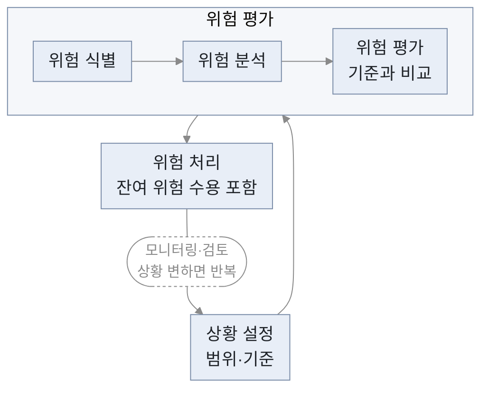

# Risk Assessment (위험 평가)

> 약어: NIST=미국 국립표준기술연구소, SP=NIST 특별 간행물, ISO/IEC=국제표준화기구/국제전기기술위원회

## 1. 개요 (What)

위험 평가(Risk Assessment)는 찾아낸 위협 하나하나가 **얼마나 일어날 것 같고(가능성), 일어나면 얼마나 아픈지(영향)** 를 따져서, 무엇부터 대응할지 순서를 정하는 일이다.

[STRIDE](stride.md)나 [Attack Tree](attack-trees.md)로 위협을 찾으면 보통 수십 개가 나온다. 예산과 시간은 한정되어 있으니 모두 같은 무게로 다룰 수 없다.
"관리 콘솔이 인터넷에 열려 있다"와 "내부 통계 화면이 가끔 느려질 수 있다"는 둘 다 위협이지만 대응의 급함은 전혀 다르다. 위험 평가는 이 차이를 **근거를 갖고 설명할 수 있게** 만든다.

위협 모델링이 "무엇이 잘못될 수 있는가?"에 답한다면, 위험 평가는 네 가지 질문 중 세 번째 "그래서 무엇을 할 것인가?"의 앞부분, 즉 **무엇을 먼저 할 것인가**에 답한다.
점수 체계는 [Risk Scoring](risk-scoring.md), 처리 결정은 [Risk Treatment](risk-treatment.md)에서 이어서 다룬다.

## 2. 배경 / 원리 (Why & How)

### 2.1 위험을 이루는 요소

위험은 하나의 숫자가 아니라 여러 요소가 엮인 결과다.

| 요소 | 질문 | 주문 서비스 예 |
|------|------|----------------|
| 위협 출처(Threat Source) | 누가·무엇이 일으키는가? | 인터넷의 금전 목적 공격자 |
| 위협 사건(Threat Event) | 무슨 일이 일어나는가? | 다른 고객의 주문 정보를 조회 |
| 취약점(Vulnerability) | 왜 가능한가? | 주문 API가 객체 소유자를 확인하지 않음 |
| 선행 조건(Predisposing Condition) | 가능성이나 영향을 키우는 조건은? | 주문 API가 인터넷에 공개, 고객 수가 많음 |
| 가능성(Likelihood) | 실제로 일어날 것 같은가? | 높음 — 인증된 사용자 누구나 ID만 바꾸면 됨 |
| 영향(Impact) | 일어나면 얼마나 아픈가? | 높음 — 개인정보 유출, 신고·과징금, 신뢰 하락 |
| 위험(Risk) | 가능성과 영향을 합치면? | 높음 → 최우선 대응 |

- 취약점이 있어도 위협 출처가 없거나 접근할 수 없으면 가능성은 낮다. 반대로 위협 출처가 많아도 영향이 작으면 위험은 낮다. **두 축을 함께 봐야** 순서가 맞다.
- *NIST SP 800-30 Rev. 1*도 위협 출처, 위협 사건, 취약점, 선행 조건, 가능성, 영향을 위험 모델의 요소로 둔다. 취약점은 위협 사건을 가능하게 하는 약점이고, 선행 조건은 위협 사건의 가능성이나 영향에 영향을 주는 조건으로 서로 다른 개념이다.

### 2.2 위험 관리 절차 안의 위험 평가

위험 평가는 더 큰 위험 관리 절차의 한 부분이다. *ISO/IEC 27005*와 *ISO 31000*은 아래와 같은 흐름을 쓴다.



텍스트 설명: 먼저 범위와 위험을 판단할 기준(어느 수준부터 받아들일 수 없는가)을 정한다(상황 설정).
그다음 위험을 찾고(식별), 가능성과 영향으로 크기를 매기고(분석), 그 크기를 미리 정한 기준과 비교해 대응 여부와 순서를 정한다(평가).
이후 위험을 처리한다. 처리 선택지에는 회피·감소·공유와 함께 수용이 있고, 처리 후 남은 위험도 책임자가 수용 여부를 결정한다. 상황이 바뀌면 처음부터 다시 돈다.
의사소통·협의와 모니터링·검토는 순서상의 한 단계가 아니라 모든 단계에 걸쳐 계속 수행되는 활동이다.

- "위험 평가"는 넓게는 식별·분석·평가 세 단계 전체를, 좁게는 마지막 "기준과 비교하는 단계"를 가리킨다. 이 문서에서는 넓은 뜻으로 쓴다.
- 위협 모델링은 이 흐름의 **위험 식별**에 해당하는 입력을 만든다.

## 3. 상세 (Details)

### 3.1 시작 전에 정할 것: 위험 기준

위험 기준이 없으면 같은 위협을 사람마다 다르게 평가한다. 시작하기 전에 아래를 정해 둔다.

| 항목 | 의미 | 예 |
|------|------|----|
| 가능성 척도 | 가능성을 몇 단계로, 무엇을 기준으로 나누는가 | 낮음·중간·높음, 각 단계의 판단 기준 문장 |
| 영향 척도 | 영향을 어떤 관점에서 몇 단계로 나누는가 | 금전 손실 구간, 영향 고객 수, 법적 신고 대상 여부 |
| 위험 수준 결정 방법 | 가능성과 영향을 어떻게 합치는가 | 3×3 위험 매트릭스 |
| 위험 수용 기준 | 어느 수준까지 받아들이는가, 누가 승인하는가 | "중간 이하는 팀장 승인으로 수용, 높음은 임원 승인 필요" |

- 위험 수용 기준은 조직의 **위험 성향**(Risk Appetite, 감수할 의향이 있는 위험의 양)에서 나온다. 보안팀이 혼자 정하는 것이 아니라 경영진이 결정한다.
- 척도마다 **판단 기준 문장**을 적는다. "높음 = 인증 없이 인터넷에서 자동화 도구로 가능" 같은 문장이 있어야 평가자마다 결과가 비슷해진다.

### 3.2 가능성 판단

가능성은 "이 위협이 실제로 일어날 것 같은가"다. 아래 요인을 본다.

| 요인 | 가능성을 높이는 쪽 | 가능성을 낮추는 쪽 |
|------|-------------------|-------------------|
| 노출 | 인터넷에 공개, 인증 전 접근 가능 | 내부망 전용, 강한 인증 뒤 |
| 공격 난이도 | 공개 도구·자동화로 가능 | 특수 장비·내부 정보·고급 기술 필요 |
| 공격자 동기 | 금전 가치가 큰 데이터, 표적이 되는 업종 | 공격자가 얻을 것이 적음 |
| 악용 정보 | 공개 공격 코드, 실제 악용 사례 | 이론적 가능성만 있음 |
| 기존 통제 | 통제 없음 또는 우회 가능 | 효과가 검증된 통제가 있음 |
| 탐지 | 탐지·차단이 어려움 | 시도 단계에서 탐지·차단됨 |

- [Attack Tree](attack-trees.md)에서 계산한 "가장 쉬운 경로"의 난이도는 가능성의 좋은 근거다.
- 알려진 취약점이라면 실제 악용 여부와 악용 가능성 예측 정보가 가능성 판단을 크게 바꾼다. 이 지표들은 [Risk Scoring](risk-scoring.md)에서 다룬다.
- 가능성은 **기존 통제를 반영해** 평가한다. 통제가 있다고 적혀 있어도 실제로 동작하는지 확인되지 않았다면 없는 것으로 본다.

### 3.3 영향 판단

영향은 "일어나면 무엇이 얼마나 깨지는가"다. 기술적 영향을 사업 언어로 번역하는 것이 핵심이다.

| 관점 | 질문 | 예 |
|------|------|----|
| 기밀성 | 무엇이 누구에게 노출되는가? | 고객 10만 명의 연락처 유출 |
| 무결성 | 무엇이 잘못 바뀌는가? | 결제 금액 조작, 회계 데이터 오류 |
| 가용성 | 무엇이 얼마나 멈추는가? | 주문 서비스 4시간 중단 |
| 금전 | 직접·간접 손실은? | 매출 손실, 복구 비용, 배상 |
| 법·규제 | 신고·처벌 대상인가? | 개인정보 유출 신고, 과징금 |
| 평판·신뢰 | 고객·거래처가 떠나는가? | 언론 보도, 계약 해지 |
| 안전 | 사람이 다칠 수 있는가? | 의료·제어 시스템 오동작 |
| 개인 | 정보 주체에게 어떤 피해가 있는가? | 사기, 차별, 사생활 침해 |

- 영향은 **최악의 경우가 아니라 현실적인 경우**를 기준으로 하되, 최악의 경우가 치명적이면 따로 적는다.
- 영향을 판단할 때 [Threat Modeling Fundamentals 3.1 범위 정하기](threat-modeling-fundamentals.md#31-범위-정하기)에서 적은 보안 목표("절대 일어나면 안 되는 일")를 기준으로 삼는다.

### 3.4 위험 수준 정하기: 정성·반정량·정량

| 방식 | 방법 | 장점 | 단점 |
|------|------|------|------|
| 정성(Qualitative) | 낮음·중간·높음 같은 등급으로 가능성·영향을 매기고 매트릭스로 결합 | 빠르고 이해하기 쉽다 | 등급 경계가 주관적, 같은 등급 안의 차이를 구분 못 함 |
| 반정량(Semi-quantitative) | 등급에 숫자(1~5 등)를 붙여 계산·정렬 | 정렬과 집계가 쉽다 | 숫자는 순서일 뿐 실제 크기의 비율이 아니어서, 곱셈·평균 결과를 확률·금액처럼 해석하면 왜곡된다 |
| 정량(Quantitative) | 발생 빈도와 손실 금액을 수치(범위)로 추정 | 투자 대비 효과를 금액으로 비교 | 데이터·전문성이 필요하고 시간이 든다 |

정성 매트릭스의 예(3×3):

| 가능성 ＼ 영향 | 낮음 | 중간 | 높음 |
|:---:|:---:|:---:|:---:|
| **높음** | 중간 | 높음 | 높음 |
| **중간** | 낮음 | 중간 | 높음 |
| **낮음** | 낮음 | 낮음 | 중간 |

- 1~5 같은 점수는 순서형 척도다. 4점이 2점의 두 배 위험이라는 뜻이 아니고, 점수 사이 간격이 같다는 보장도 없다. 조직이 정한 산식으로 우선순위를 나누는 데는 쓸 수 있지만, 결과를 실제 위험의 크기로 읽으면 안 된다.
- 대부분의 조직은 정성 또는 반정량으로 시작하고, 큰 투자 결정이 걸린 위험만 정량으로 분석한다.
- 매트릭스의 설계와 점수 체계의 함정은 [Risk Scoring](risk-scoring.md)에서 다룬다.

### 3.5 분석 접근 방식

같은 위험 평가도 출발점이 다를 수 있다. *NIST SP 800-30 Rev. 1*은 세 접근을 설명한다.

| 접근 | 출발점 | 맞는 경우 |
|------|--------|-----------|
| 위협 중심(Threat-oriented) | 위협 출처와 위협 사건 | 위협 모델링 결과가 있을 때, 표적 공격이 걱정될 때 |
| 자산·영향 중심(Asset/Impact-oriented) | 핵심 자산과 치명적 영향 | 지켜야 할 자산이 분명할 때, 사업 연속성 관점 |
| 취약점 중심(Vulnerability-oriented) | 알려진 취약점과 전제 조건 | 진단 결과가 많은 운영 중 시스템 |

- 어느 방향에서 시작하든 결국 위협·취약점·자산·영향을 모두 연결해야 한다. 출발점은 **누락을 줄이는 순서**의 차이다.

### 3.6 위험 평가의 범위 수준

위험 평가는 다루는 높이에 따라 결과의 쓰임이 다르다. NIST는 이를 세 계층으로 나눈다.

| 계층 | 질문 | 결과의 쓰임 |
|------|------|-------------|
| 조직 | 조직 전체가 감당할 수 없는 위험은 무엇인가? | 보안 전략, 예산, 위험 성향 결정 |
| 임무/업무 프로세스(Mission/Business Process) | 핵심 업무(주문, 결제, 정산)를 멈추게 하는 위험은? | 업무별 보호 수준, 연속성 계획 |
| 정보 시스템 | 이 시스템의 구성요소별 위험은? | 시스템 설계·통제 선택, 운영 승인 |

- 위협 모델링 결과는 주로 **정보 시스템** 계층의 위험 평가에 쓰이고, 그 결과가 모여 위 계층의 판단 근거가 된다.

### 3.7 위협 모델에서 위험 등록부로

위협 모델의 위협을 위험 평가로 넘기는 형식의 예다. 주문 서비스 위협 일부를 3×3 매트릭스로 평가했다.

| ID | 위협 | 기존 통제 | 가능성 | 영향 | 위험 | 근거 |
|----|------|-----------|:---:|:---:|:---:|------|
| R-01 | 로그인한 고객이 주문 ID를 바꿔 다른 고객 주문 조회 | 없음 | 높음 | 높음 | **높음** | 인증된 누구나 가능, 개인정보 유출 신고 대상 |
| R-02 | 요청 본문 금액 변조로 저가 결제 | 결제사 금액 검증 일부 | 중간 | 높음 | **높음** | 일부 결제 수단만 검증, 직접 금전 손실 |
| R-03 | 운영자가 감사 로그 삭제 | 로그 별도 저장 없음 | 낮음 | 중간 | **낮음** | 운영자 수 적음, 사고 조사 불가 |
| R-04 | 대량 조회로 DB 과부하 | 게이트웨이 전체 속도 제한 | 중간 | 중간 | **중간** | 사용자별 제한 없음, 수 시간 중단 가능 |

- **근거 칸**이 가장 중요하다. 나중에 결과를 다시 볼 때 "왜 이 등급이었는지"를 알 수 있어야 상황이 바뀌었을 때 재평가할 수 있다.
- 위험 등록부(Risk Register)에는 여기에 담당자, 처리 결정, 목표 일정, 잔여 위험이 더해진다 → [Risk Treatment](risk-treatment.md).

### 3.8 어디에 쓰이는가

| 영역 | 위험 평가의 쓰임 |
|------|------------------|
| Web·API | 취약점 진단 결과의 조치 우선순위, 출시 전 보안 승인 |
| Cloud | 공동 책임 모델에 따른 고객 책임 영역의 위험 식별, 인증 제도 요건(ISMS-P(정보보호 및 개인정보보호 관리체계) 등)의 위험 평가 → [Cloud Assessment](../../cloud-security/assessment/README.md) (작성 예정) |
| 5G | 위협 문서의 영향(Impact) 절을 위험 판단으로 연결, 망 구성요소별 보호 우선순위 → [5G Security Risks](../../5g-security/security-risks/README.md) |
| AI | AI 시스템의 위험을 식별·측정·관리하는 체계(*NIST AI RMF*) 안의 위험 평가 → [AI Governance](../../ai-security/ai-governance/README.md) (작성 예정) |

## 4. 보안 관점 (Security Relevance)

| 실수 | 결과 | 대응 |
|------|------|------|
| 위험 기준 없이 평가 시작 | 평가자마다 결과가 달라 비교 불가 | 척도별 판단 기준 문장, 수용 기준을 먼저 합의 |
| 가능성만 또는 영향만 봄 | 흔하지만 사소한 위협이나 드물지만 치명적인 위협을 잘못 처리 | 두 축을 모두 평가하고 근거 기록 |
| 동작이 확인되지 않은 통제를 반영 | 가능성을 과소평가 | 통제의 실제 동작 확인 후 반영 |
| 기술 영향만 적음 | 경영진이 우선순위를 이해하지 못함 | 금전·법·평판·고객 영향으로 번역 |
| 반정량 점수의 곱·평균을 실제 위험 크기로 해석 | 순서형 점수의 산식에 따라 순위가 바뀌고, "20점 = 10점의 두 배 위험"처럼 오해 | 산식을 쓰더라도 상대적 우선순위 분류로만 사용, 크기 비교가 필요하면 빈도·손실액과 불확실성을 쓰는 정량 모델 |
| 근거 없이 등급만 기록 | 재평가·감사 시 설명 불가 | 등급마다 근거 문장 |
| 한 번 평가하고 방치 | 새 위협·새 취약점·구성 변경이 반영 안 됨 | 변경·사고·주기마다 재평가 |
| 보안팀이 수용 결정까지 함 | 사업 책임자가 위험을 모름 | 수용은 위험 소유자(사업 책임자)가 승인 |
| 개인에게 미치는 피해를 빼고 조직 피해만 봄 | 개인정보 위험 과소평가 | 정보 주체 관점의 영향 추가 |

점검 시 확인할 것: 위험 기준과 수용 기준의 문서화와 승인, 척도별 판단 기준, 위협–취약점–자산–영향 연결, 등급별 근거, 기존 통제의 실효성 확인, 위험 소유자 지정, 재평가 주기와 계기.

## 5. 심화 (Advanced)

> 보안 컨설턴트·점검자를 위한 세부다. 본문만으로 개념 이해에는 충분하다.

### 5.1 NIST SP 800-30 Rev. 1의 절차

*NIST SP 800-30 Rev. 1*은 위험 평가를 네 단계로 나눈다.

| 단계 | 내용 |
|------|------|
| 준비(Prepare) | 목적·범위·가정과 제약·정보 출처·위험 모델과 분석 접근을 정한다 |
| 수행(Conduct) | 위협 출처 식별 → 위협 사건 식별 → 취약점과 선행 조건 식별 → 가능성 결정 → 영향 결정 → 위험 결정 (6개 작업) |
| 결과 전달(Communicate) | 평가 결과를 의사결정자에게 전달하고 근거를 공유한다 |
| 유지(Maintain) | 위험 요인의 변화를 지속적으로 모니터링하고 평가를 갱신한다 |

- 수행 단계의 가능성은 "위협 사건이 시작(적대적)·발생(비적대적)할 가능성"과 "발생했을 때 실제 피해로 이어질 가능성"을 함께 보고 종합한다. 두 값을 합치는 방식과, 가능성과 영향을 합쳐 위험을 정하는 방식은 곱셈으로 고정되어 있지 않고 조직의 평가 기준에 따라 정한다.
- 위협 출처는 적대적(공격자), 비의도적(실수), 구조적(장비 고장), 환경적(재해)으로 나눈다. 위협 모델링은 주로 적대적 출처를 다루지만, 위험 평가에서는 나머지 출처도 함께 본다.
- 적대적 출처는 **능력·의도·표적화**로 특성화하고, 비적대적 출처는 사건이 미치는 영향의 범위(Range of Effects)로 특성화한다. 이는 발생 확률이 아니라 영향 범위의 특성이다.

### 5.2 ISO/IEC 27005의 두 접근

*ISO/IEC 27005:2022*는 위험 식별에 두 접근을 둔다.

| 접근 | 방법 | 맞는 경우 |
|------|------|-----------|
| 사건 기반(Event-based) | 위험 원인과 사건 시나리오에서 출발해 전략적 수준에서 위험을 식별 | 고수준 평가, 자산 목록이 아직 불완전할 때 |
| 자산 기반(Asset-based) | 자산 목록에서 출발해 자산별 위협과 취약점을 식별 | 상세 평가, 시스템 단위 분석 |

- 두 접근은 함께 쓸 수 있다. 사건 기반으로 큰 그림을 먼저 잡고, 중요한 영역은 자산 기반으로 상세화한다.
- *ISO/IEC 27005*는 *ISO/IEC 27001*의 정보보호 관리체계에서 요구하는 위험 평가·처리를 수행하는 지침이다. *ISO/IEC 27001*은 반복 수행한 위험 평가가 일관되고 유효하며 비교 가능한 결과를 내도록 요구한다. 특정 방법이나 5점 척도를 강제하지는 않으며, 조직이 정한 방법이 이 결과를 보장하는지를 본다.

### 5.3 고전적 정량 지표: ALE

정량 분석의 가장 단순한 형태는 연간 예상 손실(ALE(Annualized Loss Expectancy))이다.

| 지표 | 식 | 의미 |
|------|----|------|
| SLE(Single Loss Expectancy) | 자산 가치(AV(Asset Value)) × 노출 계수(EF(Exposure Factor)) | 한 번 발생할 때의 손실 |
| ARO(Annualized Rate of Occurrence) | 추정 | 1년에 발생할 것으로 예상되는 횟수 |
| ALE | SLE × ARO | 1년 평균 예상 손실 |

- 예: 자산 가치 10억 원, 사고 시 30% 손실(EF 0.3), 연평균 0.1회 발생(ARO 0.1, 평균으로 10년에 한 번 꼴이지 정확히 10년마다 한 번이라는 뜻은 아니다)이면 ALE = 10억 × 0.3 × 0.1 = 3천만 원. 연 1천만 원짜리 통제로 ARO를 0.02로 낮출 수 있다면 ALE가 6백만 원으로 줄어 통제 비용보다 이득이 크다.
- 한계: 값 하나로 추정하면 불확실성이 사라진 것처럼 보인다. 드물지만 큰 손실(꼬리 위험)을 평균이 가린다.

### 5.4 FAIR 모델

FAIR(Factor Analysis of Information Risk)는 위험을 **손실 사건 빈도와 손실 규모**로 분해해 정량화하는 모델이다. FAIR Institute가 FAIR 모델 표준을 관리하고, The Open Group은 이를 바탕으로 한 Open FAIR 표준(Risk Taxonomy·Risk Analysis)을 관리한다. 아래는 FAIR 모델 v3.0 기준이다.

```text
위험 = 손실 사건 빈도(LEF) × 손실 규모(LM)
  손실 사건 빈도(LEF) = 위협 사건 빈도(TEF) × 손실 취약성(Susceptibility)
    위협 사건 빈도(TEF) = 접촉 빈도(Contact Frequency) × 행동 확률(Probability of Action)
    손실 취약성 = 위협 능력(Threat Capability)이 저항 강도(Resistance Strength)를 넘을 확률
  손실 규모(LM) = 1차 손실 + 2차 손실
```

- LEF(Loss Event Frequency), LM(Loss Magnitude), TEF(Threat Event Frequency)다. 여기서 Susceptibility는 "약점이 있다/없다"가 아니라 **위협 사건이 손실 사건으로 이어질 확률**이다. 이전 판에서는 같은 요소를 Vulnerability라고 불렀으므로, 문헌을 읽을 때 판을 확인한다.
- 2차 손실은 평판 손실, 규제 제재, 소송, 고객 이탈처럼 1차 손실에서 파생되는 손실이며, 그 자체의 발생 가능성과 규모를 따로 추정한다.
- 값은 하나의 숫자가 아니라 최솟값·최빈값·최댓값 같은 **범위**로 추정하고, 몬테카를로 시뮬레이션으로 손실 분포를 계산하는 방식이 흔하다.
- FAIR는 위험을 정량화하는 모델이지 위협을 찾는 방법론이 아니다. 위협 식별은 위협 모델링이 맡는다.

### 5.5 추정의 편향 줄이기

| 편향 | 증상 | 줄이는 방법 |
|------|------|-------------|
| 과신 | 범위를 너무 좁게 추정 | 값 하나 대신 90% 신뢰 구간처럼 범위로 추정, 추정 훈련(보정) |
| 최근 사건 편향 | 최근 뉴스가 된 공격을 과대평가 | 사고 통계·업계 데이터와 대조 |
| 앵커링 | 처음 나온 숫자에 끌려감 | 평가자가 각자 먼저 추정한 뒤 비교 |
| 집단 동조 | 목소리 큰 사람의 의견으로 수렴 | 익명 사전 추정, 근거 중심 토론 |

### 5.6 위험 관리 체계와의 연결

| 체계 | 위험 평가의 위치 |
|------|------------------|
| *NIST SP 800-37 Rev. 2* RMF(Risk Management Framework) | 준비·분류·통제 선택·구현·평가·승인·모니터링 7단계 전반에서 위험 평가 결과를 근거로 쓴다 |
| *NIST SP 800-39* | 조직·임무/업무 프로세스·정보 시스템 3계층의 위험 관리 구조 |
| *ISO/IEC 27001* | 정보보호 관리체계의 요구사항으로 위험 평가·처리를 요구 |
| *ISO 31000* | 분야를 가리지 않는 위험 관리의 원칙과 절차 |

## 관련 문서

- 이전: [Threat Modeling Methodologies](threat-modeling-methodologies.md)
- 다음: [Risk Scoring](risk-scoring.md)
- 위협 식별: [STRIDE](stride.md), [Attack Tree](attack-trees.md)
- 로드맵: [Threat Modeling](README.md)

## 출처

| 문서 | 이 문서에서의 사용 |
|------|-------------------|
| *NIST SP 800-30 Rev. 1* | 위험 모델 요소, 평가 절차, 분석 접근, 위협 출처 분류 |
| *NIST SP 800-39*, *NIST SP 800-37 Rev. 2* | 3계층 구조, RMF 단계 |
| *ISO/IEC 27005:2022* | 위험 관리 절차, 사건 기반·자산 기반 접근 |
| *ISO 31000* | 위험 관리 절차 |
| *ISO/IEC 27001* | 위험 평가 요구(일관·유효·비교 가능한 결과) |
| FAIR Institute FAIR 모델 v3.0, The Open Group Open FAIR 표준 | 정량 위험 분해 |

- 그 외 내용은 위험 평가의 일반 원리를 재구성한 해설이다.
