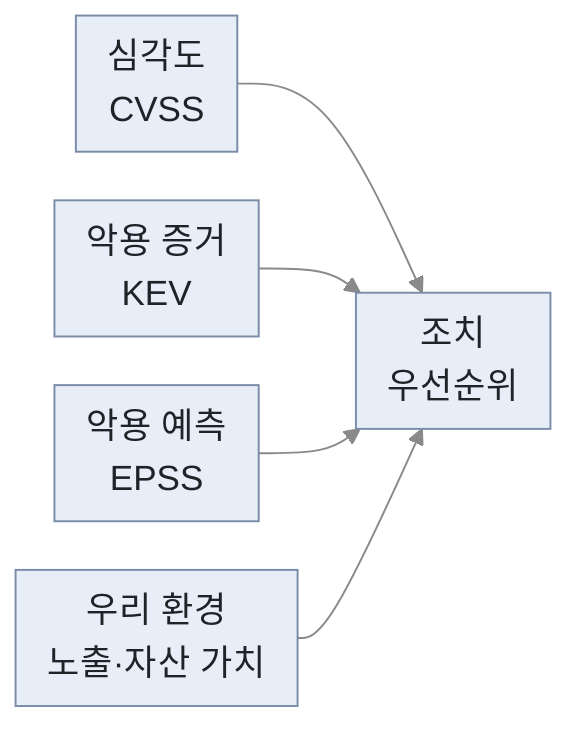

# Risk Scoring (위험 점수화)

> 약어: NIST=미국 국립표준기술연구소

## 1. 개요 (What)

위험 점수화(Risk Scoring)는 위협이나 취약점에 **비교 가능한 등급·점수**를 붙여, 무엇을 먼저 처리할지 정하는 방법이다.
[Risk Assessment](risk-assessment.md)가 "가능성과 영향을 따져 위험을 판단한다"는 원리라면, 이 문서는 실무에서 그 판단을 빠르고 일관되게 하도록 돕는 **도구들**을 다룬다.

가장 많이 쓰이는 도구는 셋이다.

| 도구 | 답하는 질문 | 값 |
|------|-------------|----|
| CVSS(Common Vulnerability Scoring System) | 이 취약점은 기술적으로 얼마나 **심각한가**? | 0.0~10.0 점수와 등급 |
| EPSS(Exploit Prediction Scoring System) | 이 취약점이 곧 **악용될 가능성**은? | 0~1 확률 |
| KEV(Known Exploited Vulnerabilities) 목록 | 이 취약점이 **실제로 악용되었는가**? | 목록에 있음 / 없음 |

여기에 애플리케이션 위협을 평가하는 OWASP(Open Worldwide Application Security Project) Risk Rating, 결정 트리로 조치 수준을 정하는 SSVC(Stakeholder-Specific Vulnerability Categorization), 그리고 조직이 직접 설계하는 위험 매트릭스가 더해진다.

핵심은 하나다. **심각도는 위험이 아니다.** CVSS 9.8짜리 취약점도 인터넷에서 닿지 않는 시험 서버에 있으면 급하지 않고, 6.5짜리도 실제로 악용되고 있고 고객 데이터가 걸려 있으면 가장 급하다.

## 2. 배경 / 원리 (Why & How)

### 2.1 왜 점수가 필요하고, 왜 점수만으로는 안 되는가

조직은 매달 수백~수천 건의 취약점과 위협을 받는다. 전부 같은 날 고칠 수 없으니 순서가 필요하고, 순서를 사람마다 다르게 정하면 설명할 수 없다. 점수는 이 순서를 **일관되고 설명 가능하게** 만든다.

하지만 점수 하나에는 한계가 있다.

| 점수 | 반영하는 것 | 반영하지 않는 것 |
|------|-------------|------------------|
| CVSS Base | 취약점 자체의 기술적 특성 | 우리 환경의 노출, 자산 가치, 실제 악용 여부 |
| EPSS | 전체 인터넷에서의 악용 가능성 | 우리 조직이 표적인지, 우리 자산의 중요도 |
| KEV | 실제 악용 사실 | 아직 목록에 오르지 않은 악용, 우리 환경의 영향 |

그래서 실무에서는 여러 신호를 **겹쳐서** 우선순위를 정한다.



텍스트 설명: 취약점의 기술적 심각도(CVSS), 실제 악용 사실(KEV), 악용 가능성 예측(EPSS), 그리고 우리 환경에서의 노출과 자산 가치를 함께 보고 조치 우선순위를 정한다. 어느 하나만으로 정하지 않는다.

### 2.2 취약점 점수와 위협 점수

| 대상 | 성격 | 주로 쓰는 도구 |
|------|------|----------------|
| 알려진 취약점(CVE(Common Vulnerabilities and Exposures) 번호가 있는 것) | 제품의 결함, 패치로 해결 | CVSS, EPSS, KEV, SSVC |
| 설계·애플리케이션 위협(위협 모델링 결과, 진단 발견사항) | 우리 시스템 고유의 문제 | OWASP Risk Rating, 위험 매트릭스, CVSS(진단 보고서 관행) |

- 위협 모델링으로 찾은 설계 위협에는 CVE도 EPSS 값도 없다. 이런 위협은 [Risk Assessment](risk-assessment.md)의 가능성·영향 판단이나 OWASP Risk Rating으로 평가한다.

## 3. 상세 (Details)

### 3.1 CVSS

CVSS는 FIRST(Forum of Incident Response and Security Teams)가 관리하는 **취약점 심각도** 평가 체계다. 현행 버전은 CVSS v4.0이다.

**지표 그룹**

| 그룹 | 무엇을 반영하는가 | 누가 매기는가 |
|------|-------------------|---------------|
| Base | 시간·환경과 무관한 취약점 고유 특성(공격 경로, 복잡도, 필요한 권한, 영향) | 주로 제조사·취약점 공개 기관 |
| Threat | 현재의 위협 상황(공격 코드 성숙도) | 사용 조직 또는 위협 정보 제공자 |
| Environmental | 사용 조직의 환경(자산의 보안 요구 수준, 적용된 완화 통제) | 사용 조직 |
| Supplemental | 점수에 반영하지 않는 추가 정보(안전 영향, 자동화 가능성, 복구 특성 등) | 제조사·사용 조직 |

- 어떤 그룹까지 반영했는지를 이름으로 구분한다. Base만 쓰면 CVSS-B, Threat를 더하면 CVSS-BT, Environmental까지 더하면 CVSS-BE 또는 CVSS-BTE다.
- 취약점 데이터베이스(NIST NVD(National Vulnerability Database) 등)에 공개된 점수는 대부분 **Base 점수**다. 우리 환경의 위험을 뜻하지 않는다.

**등급**

| 점수 | 등급 |
|:---:|------|
| 0.0 | None |
| 0.1–3.9 | Low |
| 4.0–6.9 | Medium |
| 7.0–8.9 | High |
| 9.0–10.0 | Critical |

**벡터 문자열**: 점수와 함께 각 지표 값을 적은 문자열을 남긴다. 점수만 보면 왜 그 점수인지 알 수 없다.

```text
CVSS:4.0/AV:N/AC:L/AT:N/PR:N/UI:N/VC:H/VI:H/VA:H/SC:N/SI:N/SA:N
```

네트워크로(AV:N), 쉽게(AC:L), 특별한 조건 없이(AT:N), 권한 없이(PR:N), 사용자 개입 없이(UI:N) 공격할 수 있고, 취약한 시스템의 기밀성·무결성·가용성이 모두 크게 깨지며(VC/VI/VA:H), 다른 시스템으로는 영향이 없다(SC/SI/SA:N)는 뜻이다. 이 벡터의 CVSS-B 점수는 9.3으로 Critical 등급이다.

- FIRST도 CVSS Base 점수는 **심각도**를 나타낼 뿐 위험 평가의 전부로 쓰면 안 된다고 명시한다. 우리 환경의 위험을 보려면 Threat·Environmental 지표를 채우거나 다른 신호와 결합한다.

### 3.2 EPSS

EPSS는 FIRST의 EPSS SIG(Special Interest Group)가 관리하는 **악용 예측** 모델이다.
공개된 CVE마다 **앞으로 30일 안에 실제 악용 활동이 관찰될 확률**을 0~1 사이 값으로 추정하고, 매일 갱신한다.

| 값 | 의미 | 예 |
|----|------|----|
| 확률(Probability) | 30일 안에 악용 활동이 관찰될 추정 확률 | 0.92 = 92% |
| 백분위(Percentile) | 전체 CVE 중 이 값보다 낮은 CVE의 비율 | 0.99 = 상위 1% |

- 대부분의 CVE는 확률이 매우 낮다. 소수의 CVE에 높은 확률이 몰려 있으므로, EPSS는 "CVSS High 이상 수천 건" 중에서 **실제로 먼저 볼 것**을 고르는 데 효과적이다.
- EPSS는 전체 인터넷 기준의 예측이다. 우리 조직이 특별히 표적이 되는지, 그 자산이 노출되어 있는지는 반영하지 않는다.
- 확률이 낮다고 안전한 것은 아니다. 새로 공개된 취약점은 데이터가 쌓이기 전이라 값이 낮게 나올 수 있다.

### 3.3 KEV 목록

CISA(Cybersecurity and Infrastructure Security Agency)의 KEV 목록은 **실제로 악용된 것이 확인된** 취약점의 목록이다.
목록에 오르려면 CVE 번호가 있고, 실제 악용 증거가 있으며, 공급사 패치나 완화 조치 같은 실행 가능한 조치 방법이 있어야 한다.

- 미국 연방 민간 행정부 기관에 KEV 취약점의 기한 내 조치를 의무화한 것은 구속력 있는 운영 지침(BOD(Binding Operational Directive)) 22-01이다. 이후 CISA는 BOD 26-04 "Prioritizing Security Updates Based on Risk"를 내, KEV 기반 조치 요구를 이어받으면서 BOD 19-02·22-01의 취약점 조치 체계를 위험 기반 우선순위로 통합·조정했다. 민간 조직에는 의무가 아니지만, 우선순위 기준으로 널리 쓰인다.
- KEV는 "있다/없다"의 신호다. 목록에 없다고 악용되지 않는 것은 아니다. 목록은 확인된 사례만 담는다.

### 3.4 SSVC

SSVC(Stakeholder-Specific Vulnerability Categorization)는 점수 대신 **결정 트리**로 조치 수준을 정하는 방법이다. 카네기멜런대 SEI(Software Engineering Institute)가 CISA와 협력해 만들었고, CISA가 자체 결정 트리를 운영한다.
CISA 버전은 아래 판단 요소를 차례로 물어 네 가지 결정 중 하나를 낸다.

| 판단 요소 | 값 |
|-----------|----|
| 악용 상태(Exploitation) | 없음 / 공개 개념 증명(PoC(Proof of Concept)) / 실제 악용(Active) |
| 기술적 영향(Technical Impact) | 부분적 / 전체 |
| 자동화 가능성(Automatable) | 예 / 아니오 |
| 임무·복지 영향(Mission & Well-being) | 낮음 / 중간 / 높음 — 별도 판단 요소인 임무 보급도(Mission Prevalence, 조직 임무가 그 제품에 얼마나 기대는가)와 공공 복지 영향(Public Well-being Impact)을 합쳐 정한다 |

| 결정 | 의미 |
|------|------|
| Track | 지금은 조치 불필요, 표준 일정으로 관리 |
| Track* | 표준 일정으로 관리하되 변화가 있는지 면밀히 지켜봄 |
| Attend | 상급자 주의가 필요, 표준보다 빠르게 조치 |
| Act | 최우선, 가능한 한 빨리 조치 |

- 장점: "8.1점과 7.9점의 차이" 같은 의미 없는 비교 대신 **행동**으로 답이 나온다. 판단 요소마다 근거를 적기 쉽다.
- 임무 보급도와 공공 복지 영향은 조직이 자산별로 미리 정해 두어야 빠르게 판단할 수 있다.
- Track·Track*·Attend·Act는 CISA 결정 트리의 결과값이다. 다른 SSVC 트리(예: 공급사용)는 다른 결과값을 쓴다.

### 3.5 신호를 겹쳐 우선순위 정하기

조직마다 기준은 다르지만, 흔히 쓰는 결합 방식의 예다.

| 조건 | 우선순위 | 예시 목표 기한 |
|------|----------|----------------|
| KEV 목록에 있음 + 인터넷 노출 자산 | 긴급 | 가능한 한 즉시 |
| EPSS 상위권 또는 공개 공격 코드 + 중요 자산 | 높음 | 짧은 기한 |
| CVSS High 이상 + 내부 자산, 악용 신호 없음 | 중간 | 정기 패치 주기 |
| CVSS Medium 이하 + 노출 없음 | 낮음 | 다음 정기 점검 |

- 기한 값은 조직의 위험 수용 기준([Risk Assessment 3.1 시작 전에 정할 것: 위험 기준](risk-assessment.md#31-시작-전에-정할-것-위험-기준))에서 정한다. 위 표의 기한은 예시다.
- 자산 목록과 노출 정보가 없으면 이 결합을 할 수 없다. 점수 체계보다 **자산 목록**이 먼저다.

### 3.6 OWASP Risk Rating Methodology

OWASP Risk Rating은 애플리케이션 위협(진단 발견사항, 위협 모델링 결과)의 위험을 **가능성 요인과 영향 요인**으로 나눠 평가하는 방법이다.

| 축 | 요인 묶음 | 요인 |
|----|-----------|------|
| 가능성 | 위협 행위자 | 기술 수준, 동기, 기회, 규모 |
| 가능성 | 취약점 | 발견 용이성, 악용 용이성, 알려진 정도, 침입 탐지 |
| 영향 | 기술적 영향 | 기밀성·무결성·가용성 손실, 책임 추적성 손실 |
| 영향 | 사업 영향 | 금전 피해, 평판 피해, 규정 미준수, 개인정보 침해 |

- 요인마다 0~9로 매기고, 가능성과 영향 각각의 평균을 낮음(0~3 미만)·중간(3~6 미만)·높음(6~9)으로 나눈 뒤 매트릭스로 전체 심각도를 정한다.
- 사업 영향이 궁극적으로 더 중요하므로, 사업 영향 정보가 확보되면 이를 중심으로 판단한다. 확보하지 못했다면 기술적 영향 분석 결과를 사업 담당자에게 제공해 판단을 돕는다.
- 장점: 설계 위협처럼 CVE가 없는 위협에도 쓸 수 있고, 요인이 나뉘어 있어 근거를 남기기 쉽다.
- 주의: 요인 점수는 순서형이라 평균은 대략적 분류일 뿐이다. 조직에 맞게 요인과 가중치를 조정하는 것을 전제로 한다.

### 3.7 DREAD와 그 한계

DREAD는 Microsoft에서 쓰던 위협 점수화 방식으로, 다섯 항목의 머리글자다.

| 항목 | 질문 |
|------|------|
| Damage Potential | 피해가 얼마나 큰가? |
| Reproducibility | 얼마나 쉽게 재현되는가? |
| Exploitability | 공격하기 얼마나 쉬운가? |
| Affected Users | 얼마나 많은 사용자가 영향을 받는가? |
| Discoverability | 취약점을 찾기 얼마나 쉬운가? |

각 항목에 점수를 매겨 평균을 낸다. 단순해서 아직도 교육 자료에 자주 나오지만 한계가 뚜렷하다.

- **주관성**: 항목별 판단 기준이 없어 평가자마다 점수가 크게 다르다.
- **Discoverability의 함정**: 객관적으로 매기기 어렵고, "찾기 어렵다"는 이유로 점수를 낮추면 숨기기에 기대는 보안(Security through Obscurity)이 된다. 일부 실무 가이드(OpenSSF Security Assessments Guide 등)는 이 항목을 따로 평가하지 않고 최고값으로 고정하는 방법을 제안한다.
- **가능성과 영향의 혼합**: 영향(Damage, Affected Users)과 가능성(Reproducibility, Exploitability, Discoverability)을 한 평균에 섞어 어느 쪽이 높은지 알 수 없다.
- 이런 이유로 새로 체계를 만든다면 DREAD보다 가능성·영향을 분리하는 방식(OWASP Risk Rating, 위험 매트릭스)이 낫다.

### 3.8 위험 매트릭스 설계

조직 위험 평가에서 가장 흔한 도구는 가능성×영향 매트릭스다. 단순한 만큼 설계를 잘못하면 잘못된 우선순위를 만든다.

| 설계 항목 | 권장 |
|-----------|------|
| 단계 수 | 3×3 또는 5×5. 단계를 늘려도 판단 기준이 없으면 정밀해지지 않는다 |
| 단계 정의 | 각 단계에 **판단 기준 문장**과 가능하면 수치 구간(빈도, 금액, 영향 고객 수)을 붙인다 |
| 칸의 등급 | 대칭으로 기계적으로 채우지 말고, "영향 최고 + 가능성 낮음"처럼 치명적인 칸은 따로 판단한다 |
| 등급별 행동 | 등급마다 처리 기한, 승인 권한자, 보고 대상을 정한다 |
| 같은 칸 안의 비교 | 같은 등급 안에서는 근거를 보고 사람이 판단한다 |

- Tony Cox는 "What's Wrong with Risk Matrices?"에서 매트릭스의 한계를 네 가지로 지적했다. 실제로 크게 다른 위험을 같은 등급으로 묶는 해상도 부족(Poor Resolution), 더 작은 위험에 더 높은 등급을 주는 오류(Errors), 위험 저감 자원의 잘못된 배분(Suboptimal Resource Allocation), 입력과 결과의 해석이 평가자마다 달라지는 모호성(Ambiguous Inputs and Outputs)이다. 매트릭스는 **대략적 분류 도구**로 쓰고, 큰 결정은 근거와 정량 분석으로 보완한다.

### 3.9 어디에 쓰이는가

| 영역 | 점수화의 쓰임 |
|------|----------------|
| Web·API | 진단·버그 바운티 발견사항의 심각도(CVSS 또는 OWASP Risk Rating), 조치 기한 |
| Cloud | 보안 설정 점검 도구(CSPM(Cloud Security Posture Management))가 내는 발견사항의 등급, 컨테이너 이미지 취약점의 EPSS·KEV 기반 우선순위 |
| 5G | 망 장비·NF(Network Function) 소프트웨어 취약점의 CVSS 평가, 장비 공급사 보안 권고의 조치 우선순위 |
| AI | CVSS는 프롬프트 주입·모델 오염 같은 AI 고유 위험을 잘 표현하지 못한다. AI 위험은 위험 매트릭스와 AI 위험 관리 체계로 평가한다 → [AI Governance](../../ai-security/ai-governance/README.md) (작성 예정) |

## 4. 보안 관점 (Security Relevance)

| 실수 | 결과 | 대응 |
|------|------|------|
| CVSS Base 점수를 위험으로 사용 | 노출 없는 자산의 고점수에 시간 낭비, 실제 악용 중인 중간 점수 방치 | KEV·EPSS·자산 노출·중요도와 결합 |
| "CVSS 7.0 이상만 조치" 같은 단일 기준 | 악용 중인 6점대 취약점 누락 | 악용 신호가 있으면 점수와 무관하게 상향 |
| 벡터 없이 점수만 기록 | 왜 그 점수인지 검증·재평가 불가 | 벡터 문자열 함께 기록 |
| CVSS 버전을 섞어 비교 | 같은 취약점도 버전마다 점수가 달라 순위 왜곡 | 버전 명시, 비교는 같은 버전끼리 |
| EPSS 낮음 = 안전으로 해석 | 신규·표적 공격 취약점 방치 | EPSS는 우선순위 보조 신호로만 사용 |
| KEV에 없음 = 악용 안 됨으로 해석 | 확인 전 단계의 악용 놓침 | 위협 정보·공급사 권고 병행 |
| DREAD의 Discoverability로 점수 낮춤 | 숨기기에 기대는 판단 | 발견 용이성은 최고값으로 고정해 평가 |
| 순서형 점수의 평균을 정밀한 값처럼 사용 | 소수점 차이로 우선순위 결정 | 등급 단위로 분류, 같은 등급은 근거로 판단 |
| 자산 목록 없이 점수 체계 도입 | 노출·중요도를 반영할 수 없음 | 자산 목록과 소유자부터 정비 |

점검 시 확인할 것: 우선순위 기준에 악용 신호(KEV·EPSS)와 자산 노출·중요도가 포함되는지, 점수와 벡터의 기록, 사용 중인 CVSS 버전, 등급별 조치 기한과 실제 준수율, 설계 위협의 평가 방식, 예외(조치 연기)의 승인 기록.

## 5. 심화 (Advanced)

> 보안 컨설턴트·점검자를 위한 세부다. 본문만으로 개념 이해에는 충분하다.

### 5.1 CVSS v4.0 Base 지표

| 묶음 | 지표 | 값 |
|------|------|----|
| 악용 가능성 | AV(Attack Vector) | Network / Adjacent / Local / Physical |
| 악용 가능성 | AC(Attack Complexity) | Low / High |
| 악용 가능성 | AT(Attack Requirements) | None / Present |
| 악용 가능성 | PR(Privileges Required) | None / Low / High |
| 악용 가능성 | UI(User Interaction) | None / Passive / Active |
| 취약한 시스템 영향 | VC·VI·VA(Vulnerable System Confidentiality·Integrity·Availability) | High / Low / None |
| 후속 시스템 영향 | SC·SI·SA(Subsequent System Confidentiality·Integrity·Availability) | High / Low / None |

- Threat 그룹: E(Exploit Maturity) — Attacked / POC(Proof-of-Concept) / Unreported / Not Defined(X).
- Environmental 그룹: CR·IR·AR(기밀성·무결성·가용성 요구 수준, High / Medium / Low / Not Defined)과, Base 지표를 우리 환경에 맞게 고친 Modified 지표(MAV, MAC, MAT, MPR, MUI, MVC, MVI, MVA, MSC, MSI, MSA).
- Supplemental 그룹: Safety(S), Automatable(AU), Recovery(R), Value Density(V), Vulnerability Response Effort(RE), Provider Urgency(U). 점수를 바꾸지 않는 참고 정보다.

### 5.2 CVSS v3.1과 v4.0의 주요 차이

| 항목 | v3.1 | v4.0 |
|------|------|------|
| 영향 범위 | Scope(변경 여부) 지표 | Scope를 없애고 취약한 시스템 영향과 후속 시스템 영향을 따로 평가 |
| 공격 조건 | AC에 포함 | AT(Attack Requirements)를 별도 지표로 분리 |
| 사용자 개입 | None / Required | None / Passive / Active |
| 시간 지표 | Temporal 그룹(Exploit Code Maturity, Remediation Level, Report Confidence) | Threat 그룹으로 단순화(Exploit Maturity만 남고 Remediation Level·Report Confidence는 제거) |
| 추가 정보 | 없음 | Supplemental 그룹 |
| 명칭 | 점수 종류 표기 관례 없음 | CVSS-B / BT / BE / BTE |

- 같은 취약점도 v3.1과 v4.0 점수가 다를 수 있다. 데이터베이스와 공급사 권고가 어느 버전으로 점수를 냈는지 확인하고, 내부 기준에 사용할 버전을 정해 둔다.

### 5.3 EPSS를 해석할 때

- 확률과 백분위는 다르다. 확률 0.05는 낮아 보이지만 백분위로는 상위권일 수 있다. 조직 기준을 정할 때 어느 값을 쓸지 명시한다.
- 임계값을 정할 때는 **효율**(조치한 것 중 실제 악용된 비율)과 **포괄**(실제 악용된 것 중 조치한 비율) 사이의 균형을 본다. 임계값을 낮추면 포괄은 늘지만 조치 대상도 늘어난다.
- EPSS는 CVSS를 대체하지 않는다. CVSS는 "악용되면 얼마나 심각한가", EPSS는 "악용될 것 같은가"를 답하므로 함께 쓴다.

### 5.4 OWASP Risk Rating 계산 예

주문 API의 "주문 ID 변경으로 다른 고객 주문 조회" 위협을 평가한 예다.

| 요인 | 점수 | 근거 |
|------|:---:|------|
| 기술 수준 | 6 | 프록시 도구 기본 사용 정도 |
| 동기 | 6 | 개인정보 판매 가치 |
| 기회 | 7 | 고객 계정만 있으면 됨 |
| 규모 | 9 | 가입한 모든 고객 |
| 발견 용이성 | 7 | 응답의 순차 ID로 쉽게 추측 |
| 악용 용이성 | 8 | 요청 하나 수정 |
| 알려진 정도 | 6 | 널리 알려진 취약점 유형 |
| 침입 탐지 | 8 | 정상 요청과 구분 안 되고 기록 없음 |
| **가능성 평균** | **7.1 → 높음** | |
| 금전 피해 | 5 | 대응·신고 비용 |
| 평판 피해 | 7 | 언론 보도 가능 |
| 규정 미준수 | 7 | 개인정보 유출 신고 대상 |
| 개인정보 침해 | 7 | 수만 명 이상 |
| **영향 평균(사업 영향)** | **6.5 → 높음** | |

가능성 높음 × 영향 높음 → 전체 심각도 **Critical**. 이 결과는 [Risk Assessment 3.7 위협 모델에서 위험 등록부로](risk-assessment.md#37-위협-모델에서-위험-등록부로)의 R-01과 같은 결론이다.

### 5.5 SSVC를 조직에 맞게 쓰기

- SSVC는 이해관계자별로 트리가 다르다. 패치를 적용하는 조직(Deployer), 패치를 만드는 공급사(Supplier), 조정 기관(Coordinator)이 묻는 질문이 다르다. 위 표는 CISA가 적용 조직 관점으로 운영하는 버전이다.
- 임무 보급도와 공공 복지 영향을 자산 목록의 속성으로 미리 매겨 두면, 새 취약점이 나왔을 때 악용 상태와 기술적 영향만 확인해 바로 결정을 낼 수 있다.
- 결정 결과(Track·Track*·Attend·Act)를 조직의 조치 기한에 대응시켜 두어야 실제 행동으로 이어진다.

## 관련 문서

- 이전: [Risk Assessment](risk-assessment.md)
- 다음: [Risk Treatment](risk-treatment.md)
- 로드맵: [Threat Modeling](README.md)

## 출처

| 문서 | 이 문서에서의 사용 |
|------|-------------------|
| FIRST CVSS v4.0 Specification | 지표 그룹, 등급, 벡터, 명칭 |
| FIRST CVSS v3.1 Specification | 버전 간 차이 |
| FIRST EPSS | 악용 예측 확률과 백분위 |
| CISA Known Exploited Vulnerabilities Catalog, BOD 22-01, BOD 26-04 | KEV 목록 기준과 연방 기관 조치 의무 |
| CISA SSVC, Carnegie Mellon University SEI SSVC | 결정 트리 |
| OWASP Risk Rating Methodology | 가능성·영향 요인과 계산 |
| Microsoft DREAD, Adam Shostack, *Threat Modeling: Designing for Security*, OpenSSF Security Assessments Guide | DREAD와 그 한계 |
| Louis Anthony (Tony) Cox Jr., "What's Wrong with Risk Matrices?", *Risk Analysis* | 위험 매트릭스의 한계 |

- 그 외 내용은 위험 점수화의 일반 원리를 재구성한 해설이다.
