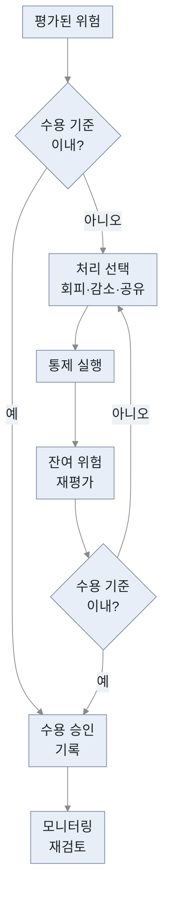

# Risk Treatment (위험 처리)

> 약어: NIST=미국 국립표준기술연구소, SP=NIST 특별 간행물, ISO/IEC=국제표준화기구/국제전기기술위원회

## 1. 개요 (What)

위험 처리(Risk Treatment)는 평가한 위험마다 **무엇을 할지 결정하고, 그 결정을 실행하고, 남은 위험을 누가 책임질지 정하는** 일이다.

[Risk Assessment](risk-assessment.md)와 [Risk Scoring](risk-scoring.md)으로 "무엇이 얼마나 위험한가"를 알았다면, 이제 각 위험에 대해 네 가지 중 하나를 고른다.

| 선택 | 한 줄 의미 | 예 |
|------|-----------|----|
| 회피(Avoid) | 위험을 만드는 활동을 하지 않는다 | 쓰지 않는 관리 API를 없앤다 |
| 감소(Mitigate·Modify) | 통제를 더해 가능성이나 영향을 줄인다 | 주문 API에 객체 소유자 확인을 넣는다 |
| 공유·전가(Share·Transfer) | 위험의 일부를 다른 주체와 나눈다 | 카드 정보 저장을 결제사 토큰화로 대체, 사이버 보험 |
| 수용(Accept·Retain) | 위험을 알고 받아들인다 | 내부 통계 화면의 낮은 가용성 위험을 그대로 둔다 |

처리 후에도 위험은 0이 되지 않는다. 남은 위험(잔여 위험)을 **사업 책임자가 알고 승인했다는 기록**이 있어야 위험 처리가 끝난 것이다.
네 가지 질문으로 보면 이 문서는 "그래서 무엇을 할 것인가?"의 마지막 부분이다.

## 2. 배경 / 원리 (Why & How)

### 2.1 왜 "처리 결정"이 따로 필요한가

위험 평가에서 끝나면 결과는 보고서로만 남는다. 처리 결정이 없으면 다음 일이 생긴다.

- 높은 위험이 "알고 있었지만 아무도 맡지 않은" 상태로 방치된다.
- 고치지 않기로 한 위험이 결정이 아니라 **방치**로 남아, 사고 뒤에 누가 판단했는지 알 수 없다.
- 같은 위험을 여러 팀이 서로 다른 방식으로 처리하거나, 아무도 처리하지 않는다.

위험 처리는 위험마다 **담당자, 결정, 기한, 잔여 위험의 승인자**를 붙여 이 문제를 막는다.

### 2.2 처리 흐름

텍스트 설명: 평가된 위험이 조직의 수용 기준 이내라면 위험 소유자가 수용을 승인하고 기록한다.
기준을 넘으면 회피·감소·공유 중 처리 방법을 고르고 통제를 실행한 뒤, 남은 위험을 다시 평가한다. 잔여 위험이 기준 이내가 되면 수용을 승인하고, 아니면 처리를 반복한다.
수용한 위험도 끝이 아니라 모니터링 대상이며, 상황이 바뀌면 다시 평가한다.

- 기준을 넘는 위험을 처리하지 못하는 경우도 있다(예산, 기술적 제약, 사업 일정). 이때는 **더 높은 권한자의 예외 승인**으로 수용하고, 기한과 보완 통제를 붙인다(3.5).

## 3. 상세 (Details)

### 3.1 네 가지 선택 자세히

**회피(Avoid)**
- 기능을 없애거나, 범위를 줄이거나, 다른 방식으로 설계해서 위험 자체를 없앤다.
- 예: 꼭 필요하지 않은 개인정보 항목을 수집하지 않는다, 관리 기능을 인터넷에 노출하지 않는다, 위험한 서드파티 연동을 쓰지 않는다.
- 가장 확실하지만 사업 기능을 포기하는 대가가 있다. 위협 모델링이 설계 단계에서 하는 이유 중 하나가, 이때는 회피 비용이 가장 싸기 때문이다.

**감소(Mitigate·Modify)**
- 통제를 더해 가능성을 낮추거나(예방), 일어났을 때 빨리 알아채거나(탐지), 피해를 줄이고 복구한다(교정).
- 가장 흔한 선택이다. 통제 종류와 고르는 법은 3.2에서 다룬다.

**공유·전가(Share·Transfer)**
- 위험의 일부를 계약·보험·위탁으로 다른 주체와 나눈다.
- 예: 카드 정보 처리를 결제 대행사에 맡김, 사이버 보험 가입, 클라우드 사업자의 관리형 서비스 사용.
- **책임은 넘어가지 않는다.** 보험은 금전 손실 일부를 보전할 뿐 유출 사고의 법적 책임과 평판 피해는 그대로다. 위탁해도 정보 주체에 대한 책임은 위탁한 조직에 남는 경우가 많다(3.8).

**수용(Accept·Retain)**
- 위험을 알고, 아무것도 더 하지 않기로 **결정**한다.
- 수용 기준 이내의 위험, 처리 비용이 위험보다 큰 경우에 쓴다.
- 수용은 방치와 다르다. 누가, 어떤 근거로, 언제까지 수용했는지가 기록되어야 한다.

### 3.2 통제 고르기

통제는 **언제 작동하는가**와 **어떤 형태인가**로 나눈다. 한 위험에 여러 종류를 겹쳐 쓰는 것이 원칙이다.

| 기능 | 의미 | 예(주문 서비스) |
|------|------|-----------------|
| 예방(Preventive) | 위협이 실현되지 않게 막는다 | 객체 소유자 확인, 서버 측 금액 재계산 |
| 탐지(Detective) | 실현되었거나 시도 중임을 알아챈다 | 다른 고객 ID 반복 조회 탐지, 감사 로그 |
| 교정(Corrective) | 피해를 줄이고 원래 상태로 되돌린다 | 세션 강제 종료, 백업 복구, 사고 대응 절차 |
| 억제(Deterrent) | 시도할 의욕을 꺾는다 | 접근 기록 고지, 법적 경고 |
| 보완(Compensating) | 원래 통제를 쓸 수 없을 때 대신 위험을 낮춘다 | 패치할 수 없는 장비를 별도 망으로 격리 |

| 형태 | 예 |
|------|----|
| 기술적(Technical) | 인증, 암호화, 방화벽, 로그 |
| 관리적(Administrative) | 정책, 절차, 교육, 권한 검토 |
| 물리적(Physical) | 출입 통제, 잠금 장치, CCTV(Closed-Circuit Television) |

- 두 분류는 기준이 다르다. 기능은 "무슨 역할을 하는가", 형태는 "어떤 수단으로 구현하는가"이므로 하나의 통제가 둘 다에 속한다(예: MFA(Multi-Factor Authentication)는 기술적·예방 통제). 실무에서 널리 쓰는 분류이며, 모든 표준이 이 분류를 고정해 요구하지는 않는다.

통제를 고를 때 확인할 것:
- **위협 문장의 전제 조건을 깨는가**: [STRIDE 5.2 위협 문장의 구조화](stride.md#52-위협-문장의-구조화)에서처럼 전제 조건을 없애는 통제가 가장 효과적이다.
- **탐지와 교정이 함께 있는가**: 예방만 있으면 예방이 뚫렸을 때 알 수 없다.
- **검증할 수 있는가**: "보안 강화"가 아니라 "주문 취소 API는 요청자와 소유자가 같은지 확인한다"처럼 테스트 가능한 문장으로 쓴다.
- **새 위험을 만들지 않는가**: 계정 잠금은 무차별 대입을 막지만 서비스 거부 수단이 될 수 있다.
- 여러 계층에 통제를 겹치는 설계 원칙은 [Security Architecture](../security-architecture/README.md) (작성 예정)의 심층 방어에서 다룬다.

### 3.3 비용과 효과 비교

통제는 위험을 줄이는 대신 비용이 든다. 처리 결정은 둘을 비교해 내린다.

| 비교 항목 | 내용 |
|-----------|------|
| 위험 감소 | 통제 전후의 위험 등급 또는 예상 손실 차이 |
| 직접 비용 | 도입·구현·라이선스·운영 인력 |
| 간접 비용 | 성능 저하, 사용성 저하, 개발 일정 지연 |
| 부수 효과 | 같은 통제가 다른 위험도 줄이는가 |

- 정량 분석을 쓴다면 통제 전후의 연간 예상 손실 차이를 통제의 연간 비용과 비교한다 → [Risk Assessment 5.3 고전적 정량 지표: ALE](risk-assessment.md#53-고전적-정량-지표-ale).
- 정성 평가라면 "높음 → 중간으로 낮추는 데 드는 비용"을 위험끼리 비교해, 같은 예산으로 가장 많은 위험을 낮추는 조합을 고른다.
- 법·규제로 의무화된 통제는 비용 비교 대상이 아니다. 먼저 적용하고 나머지를 비교한다.

### 3.4 잔여 위험과 수용 승인

| 개념 | 의미 |
|------|------|
| 고유 위험(Inherent Risk) | 통제가 없다고 가정한 위험 |
| 현재 위험(Current Risk) | 지금 있는 통제를 반영한 위험 |
| 잔여 위험(Residual Risk) | 위험 처리 조치와 통제를 고려한 뒤에도 남는 위험 |

- 잔여 위험은 두 가지로 나눠 기록하면 혼동이 줄어든다. **현재 잔여 위험**은 이미 구현되어 동작이 확인된 통제만 반영한 값이고, **예상 잔여 위험**은 계획한 처리가 모두 끝나고 효과적으로 동작한다고 가정한 값이다. 아직 구현하지 않은 조치를 현재 값에 반영하지 않는다.
- 잔여 위험의 수용은 **위험 소유자**가 승인한다. 위험 소유자는 그 위험이 걸린 업무·자산에 대해 결정 권한과 책임이 있는 사람(보통 사업 책임자)이다. 보안팀은 위험을 설명하고 권고하지만, 수용 결정의 주체가 아니다.
- 위험 등급이 높을수록 승인 권한자의 직급을 높인다(예: 낮음은 팀장, 중간은 본부장, 높음은 임원).
- 수용에는 **만료일**을 둔다. 상황이 바뀌어도 수용이 영원히 유효하면 안 된다.

### 3.5 예외 관리

정책상 처리해야 하는 위험을 당장 처리할 수 없을 때(패치 불가 장비, 사업 일정, 공급사 수정 대기) 쓰는 절차다.

| 예외 요청에 담을 것 | 예 |
|---------------------|----|
| 대상 위험과 근거 | R-04: 사용자별 속도 제한 미적용 |
| 처리하지 못하는 이유 | 게이트웨이 교체 전까지 기능 없음 |
| 보완 통제 | 대량 조회 탐지 알림, DB 읽기 복제본 분리 |
| 잔여 위험 등급 | 중간 → 낮음(보완 통제 후) |
| 만료일과 해소 계획 | 게이트웨이 교체 예정일까지 |
| 승인자 | 위험 등급에 맞는 위험 소유자 |

- 만료일이 지나면 자동으로 재검토하거나 상위 보고로 올린다.
- 예외 목록 자체가 중요한 위험 지표다. 예외가 계속 늘고 연장만 반복된다면 처리 역량이나 우선순위 설정에 문제가 있다는 신호다.

### 3.6 위험 등록부

위험 등록부(Risk Register)는 위험과 그 처리 상태를 한곳에서 추적하는 목록이다. 위협 모델과 위험 평가의 결과가 여기로 모인다.

| 항목 | 내용 |
|------|------|
| ID·제목 | R-01 다른 고객 주문 조회 |
| 위협 문장 | 누가·조건·행위·결과 |
| 관련 자산·시스템 | 주문 API, 주문 DB |
| 위험 소유자 | 주문 서비스 책임자 |
| 현재 위험 | 가능성·영향·등급과 근거 |
| 처리 결정 | 감소 |
| 처리 계획 | 객체 소유자 확인 추가, 반복 조회 탐지 |
| 담당자·기한 | 개발팀 A, 목표 일정 |
| 잔여 위험 | 예상 잔여 위험(목표 등급), 처리 후 현재 잔여 위험, 수용 승인 기록 |
| 상태 | 계획 / 진행 중 / 완료 / 수용 / 예외 |
| 검토 기록 | 재평가 시점과 결과 |

- 등록부의 처리 계획은 이슈 추적 시스템의 작업 항목과 연결해야 실제로 진행된다.
- 등록부는 조직 위험 평가와 시스템 위험 평가를 **같은 형식**으로 모을 때 가장 쓸모가 크다. 경영진은 등록부의 상위 위험만 보고 판단한다.

### 3.7 진행 상황 추적

| 지표 | 보는 것 |
|------|---------|
| 등급별 미처리 위험 수 | 높음 위험이 줄고 있는가 |
| 기한 초과 비율 | 처리 계획이 지켜지는가 |
| 평균 처리 기간 | 등급별 목표 기한 안에 처리되는가 |
| 수용·예외 건수와 만료 임박 건수 | 수용이 방치로 바뀌고 있지 않은가 |
| 재평가 누락 | 오래된 평가가 남아 있지 않은가 |

### 3.8 공유·전가의 함정

| 방식 | 넘어가는 것 | 남는 것 |
|------|-------------|---------|
| 사이버 보험 | 보장 범위 안의 금전 손실 일부 | 법적 책임, 평판, 업무 중단, 면책 조항에 걸리는 손실. 사고 가능성과 기술적 피해 자체는 그대로 |
| 업무 위탁 | 운영 작업 | 정보 주체에 대한 책임, 수탁자 관리·감독 의무 |
| 클라우드 관리형 서비스 | 사업자 책임 영역(물리·하이퍼바이저 등)의 운영 | 고객 책임 영역(설정, 계정, 데이터, 접근 권한) |
| 결제 대행·토큰화 | 카드 정보 저장·처리 | 연동 구간의 보안, 토큰의 오용 |

- 사이버 보험은 상품과 약관에 따라 MFA·백업·패치 관리 같은 보안 통제를 가입 요건이나 계속 유지할 의무로 요구할 수 있다. 이 의무를 지키지 않거나 가입 시 보안 상태를 사실과 다르게 알린 경우, 약관에 따라 보장이 제한되거나 보험금 지급이 거절될 수 있다. 보험이 통제를 대신할 수 없다.
- 클라우드의 책임 경계는 [Cloud Security](../../cloud-security/README.md)의 공동 책임 모델에서 다룬다.

### 3.9 어디에 쓰이는가

| 영역 | 위험 처리의 예 |
|------|----------------|
| Web·API | 진단 발견사항의 조치 기한·예외 관리, 출시 전 잔여 위험 승인 |
| Cloud | 설정 점검 도구 발견사항의 예외(태그 기반 예외 처리)와 만료 관리, 관리형 서비스 사용에 따른 공유 |
| 5G | 패치를 바로 적용하기 어려운 망 장비에 대한 보완 통제(망 분리, 접근 제한, 탐지 강화)와 공급사 수정 일정 관리 |
| AI | 모델 출력 오류처럼 완전히 없앨 수 없는 위험에 대해 사람 검토 단계를 넣고(감소) 남은 위험을 수용, 고위험 용도는 회피 |

## 4. 보안 관점 (Security Relevance)

| 실수 | 결과 | 대응 |
|------|------|------|
| 처리 결정 없이 평가 보고서로 끝남 | 높은 위험이 담당자 없이 방치 | 위험마다 소유자·결정·기한 지정 |
| 수용을 기록하지 않음 | 방치와 수용을 구분할 수 없고 사고 후 책임 불명확 | 수용 근거·승인자·만료일 기록 |
| 보안팀이 수용을 결정 | 사업 책임자가 위험을 모름 | 위험 소유자 승인, 보안팀은 권고 |
| 수용에 만료일이 없음 | 상황이 바뀌어도 예전 결정이 유지 | 만료일과 자동 재검토 |
| 보험·위탁으로 책임까지 넘어갔다고 판단 | 통제 공백, 법적 책임 남음 | 남는 책임과 고객 책임 영역 명시 |
| 예방 통제만 적용 | 우회되면 알 수 없음 | 탐지·교정 통제 병행 |
| 통제가 새 위험을 만듦 | 계정 잠금이 서비스 거부 수단이 됨 | 통제 도입 시 위협 모델 재검토 |
| 통제를 넣고 잔여 위험을 재평가하지 않음 | 효과 없는 통제로 안심 | 통제 동작 확인 후 재평가 |
| 예외가 연장만 반복 | 사실상 영구 예외 | 연장 횟수 제한, 상위 보고 |
| 등록부와 작업 추적이 분리 | 계획이 실행되지 않음 | 처리 계획을 이슈 추적과 연결 |

점검 시 확인할 것: 위험 등록부의 존재와 최신성, 위험별 소유자·결정·기한, 수용 승인 기록과 승인 권한의 적절성, 만료일, 예외의 보완 통제와 연장 이력, 처리 후 재평가 기록, 기한 초과 현황, 공유·전가 시 남는 책임의 명시.

## 5. 심화 (Advanced)

> 보안 컨설턴트·점검자를 위한 세부다. 본문만으로 개념 이해에는 충분하다.

### 5.1 표준별 처리 선택 용어

| 이 문서 | *ISO/IEC 27005* | *ISO 31000* | *NIST SP 800-39* |
|---------|-----------------|-------------|------------------|
| 회피 | Risk avoidance | 위험을 일으키는 활동을 시작하거나 계속하지 않음 | Risk avoidance |
| 감소 | Risk modification | 위험원 제거, 가능성 변경, 결과 변경 | Risk mitigation |
| 공유·전가 | Risk sharing | 위험 공유(계약, 보험 등) | Risk sharing, Risk transfer (별도 유형) |
| 수용 | Risk retention | 정보에 입각한 결정으로 위험 보유 | Risk acceptance |

- *ISO 31000*은 여기에 "기회를 추구하기 위해 위험을 감수하거나 키우는 것"도 선택지로 둔다. 위험을 피할 대상만이 아니라 사업 기회와 함께 보는 관점이다. *ISO/IEC 27005*는 정보보안 위험 처리에서 이 선택지를 쓰지 않는다.
- *NIST SP 800-39*는 수용·회피·완화·공유·이전의 다섯 유형을 둔다. 공유(Sharing)는 위험에 대한 책임이나 대응을 다른 조직과 나누는 것이고, 이전(Transfer)은 책임을 다른 조직으로 넘기는 것이다(보험이 대표적). 두 유형은 겹칠 수 있다.
- 용어가 달라도 뜻은 거의 같다. 조직 안에서는 한 가지 용어로 통일한다.

### 5.2 ISO/IEC 27001의 위험 처리 산출물

*ISO/IEC 27001* 기반 정보보호 관리체계는 위험 처리에서 다음 산출물을 요구한다.

| 산출물 | 내용 |
|--------|------|
| 위험 처리 계획(Risk Treatment Plan) | 위험별 처리 선택, 통제, 담당, 일정 |
| 적용성 보고서(SoA(Statement of Applicability)) | 필요한 통제와 포함 사유, 구현 여부, 표준 통제 목록 중 제외한 통제와 그 사유 |
| 위험 소유자 승인 | 처리 계획 승인과 잔여 위험 수용 |

- 처리에 필요한 통제를 먼저 정하고, 표준의 통제 목록과 비교해 **빠진 통제가 없는지 확인**하는 순서다. 통제 목록에서 거꾸로 골라 위험에 맞추는 방식이 아니다. 표준의 통제 목록이 필요한 통제의 전부는 아니어서, 목록 밖의 통제를 추가할 수 있다.
- SoA에는 필요한 통제, 포함 사유, 구현 여부, 목록 통제를 제외한 사유가 들어가야 한다. 구현 상태는 실무 관행이 아니라 요구 항목이다.
- 심사에서는 SoA의 "적용 제외" 사유가 위험 평가 결과와 맞는지, 처리 계획이 실제로 실행되었는지를 본다.

### 5.3 NIST RMF의 위험 수용

*NIST SP 800-37 Rev. 2* RMF(Risk Management Framework)에서 시스템 운영의 최종 위험 수용은 **승인 단계(Authorize)** 에서 이루어진다.

| 요소 | 내용 |
|------|------|
| 승인권자(AO(Authorizing Official)) | 시스템 운영이나 공통 통제 제공으로 생기는 위험을 조직을 대표해 수용할 권한과 책임을 가진 고위 관리자 |
| 승인 패키지 | 요약 보고서(Executive Summary), 보안·개인정보 계획, 보안·개인정보 평가 보고서, 조치 계획(POA&M) |
| POA&M(Plan of Action and Milestones) | 남은 약점을 언제 어떻게 해소할지 적은 조치 계획 |
| 승인 결정 | 운영 승인(ATO(Authorization to Operate)), 공통 통제 승인(Common Control Authorization), 사용 승인(ATU(Authorization to Use), 다른 조직이 승인한 시스템·서비스를 쓰는 것에 대한 승인), 승인 거부(Denial of Authorization) |

- 클라우드·공유 서비스를 쓰는 환경에서는 사용 승인(ATU)이 특히 중요하다. 남이 승인한 서비스라도 우리 조직이 쓰는 데 따른 위험은 우리 승인권자가 수용한다.
- 이 구조는 민간 조직에도 그대로 옮길 수 있다. "출시 승인자 = 잔여 위험 수용자"로 정하고, 남은 발견사항을 POA&M 형태로 관리한다.
- 승인 이후에도 모니터링 단계에서 위험을 계속 추적하고, 상황이 바뀌면 재승인한다.

### 5.4 핵심 위험 지표

핵심 위험 지표(KRI(Key Risk Indicator))는 위험이 커지고 있다는 **앞선 신호**다. 처리 결과(사고 건수)보다 먼저 움직이는 지표를 고른다.

| 위험 | KRI 예 | 임계값 예 |
|------|--------|-----------|
| 계정 탈취 | MFA 미적용 계정 비율 | 1% 초과 시 보고 |
| 알려진 취약점 악용 | KEV(Known Exploited Vulnerabilities) 목록 취약점의 기한 초과 건수 | 1건 이상 시 즉시 보고 |
| 권한 남용 | 90일 이상 검토되지 않은 특권 계정 수 | 0 초과 시 보고 |
| 처리 지연 | 만료된 위험 수용·예외 건수 | 0 초과 시 보고 |

- KRI마다 임계값과 넘었을 때의 행동(누구에게 보고, 어떤 처리)을 정한다. 임계값 없는 지표는 보기만 하는 숫자다.

## 관련 문서

- 이전: [Risk Scoring](risk-scoring.md)
- 다음: [Threat Modeling in Practice](threat-modeling-in-practice.md)
- 위험 평가: [Risk Assessment](risk-assessment.md)
- 대응 결정의 출발점: [STRIDE 3.4 대응 통제 연결](stride.md#34-대응-통제-연결)
- 로드맵: [Threat Modeling](README.md)

## 출처

| 문서 | 이 문서에서의 사용 |
|------|-------------------|
| *ISO/IEC 27005* | 위험 처리 선택(avoidance, modification, sharing, retention) |
| *ISO 31000* | 위험 처리 선택지, 기회 추구 관점 |
| *ISO/IEC 27001* | 위험 처리 계획, 적용성 보고서, 위험 소유자 승인 |
| *NIST SP 800-39* | 위험 대응 5유형 |
| *NIST SP 800-37 Rev. 2* | 승인 단계, 승인권자, 승인 패키지, 승인 결정 유형 |

- 그 외 내용은 위험 처리의 일반 원리를 재구성한 해설이다.
