# STRIDE

## 1. 개요 (What)

STRIDE는 위협을 **여섯 가지 유형**으로 나눠, 설계의 각 요소에 "이 유형의 위협이 있는가"를 차례로 묻게 하는 위협 식별 기법이다.
이름은 여섯 유형의 머리글자다. Spoofing(위장), Tampering(변조), Repudiation(부인), Information disclosure(정보 노출), Denial of service(서비스 거부), Elevation of privilege(권한 상승).
Microsoft의 Loren Kohnfelder와 Praerit Garg가 제품 위협을 분류하려고 만들었고, 이후 Microsoft SDL(Security Development Lifecycle)과 여러 위협 모델링 도구의 기본 분류가 되었다.

"무엇이 잘못될 수 있는가?"를 백지에서 떠올리면 아는 공격만 나오고 나머지는 빠진다.
STRIDE는 빈칸이 여섯 개인 점검표처럼 작동해서, 경험이 적은 개발자도 빠짐없이 질문하게 만든다.

STRIDE가 답하는 것은 **위협이 무엇인가**까지다. 위협이 얼마나 위험한지(가능성·영향·점수)는 스스로 산출하지 않으므로 [Risk Assessment](risk-assessment.md)와 [Risk Scoring](risk-scoring.md)에서 따로 평가한다.

## 2. 배경 / 원리 (Why & How)

### 2.1 위협은 보안 속성의 위반이다

STRIDE의 여섯 유형은 각각 지키려는 보안 속성 하나를 깨뜨리는 행위다. 그래서 위협 유형을 알면 필요한 대응 통제의 방향도 바로 정해진다.

| 위협 | 깨지는 속성 | 질문 | 대응 방향 |
|------|-------------|------|-----------|
| **S**poofing (위장) | 인증(Authentication) | 다른 누군가인 척할 수 있는가? | 인증 강화 |
| **T**ampering (변조) | 무결성(Integrity) | 데이터·코드·설정을 몰래 바꿀 수 있는가? | 무결성 보호, 접근 통제 |
| **R**epudiation (부인) | 부인방지(Non-repudiation), 책임 추적성 | 한 일을 안 했다고 잡아뗄 수 있는가? | 감사 로그, 서명 |
| **I**nformation disclosure (정보 노출) | 기밀성(Confidentiality) | 볼 권한 없는 정보를 볼 수 있는가? | 암호화, 접근 통제, 최소 노출 |
| **D**enial of service (서비스 거부) | 가용성(Availability) | 정상 사용자가 서비스를 못 쓰게 만들 수 있는가? | 용량·속도 제한, 이중화 |
| **E**levation of privilege (권한 상승) | 인가(Authorization) | 허락되지 않은 일을 할 수 있는가? | 인가 검사, 최소 권한 |

- 첫 세 속성(기밀성·무결성·가용성)은 CIA(Confidentiality, Integrity, Availability)이고, STRIDE는 여기에 인증·부인방지·인가를 더해 여섯 개를 다룬다.
- 하나의 공격이 여러 유형에 걸칠 수 있다. 세션 토큰 탈취는 정보 노출(I)이면서 그 토큰으로 위장(S)하는 공격으로 이어진다. 분류를 정확히 맞히는 것보다 **빠뜨리지 않는 것**이 목적이다.

### 2.2 DFD 요소에 대입하기

STRIDE는 [Threat Modeling Fundamentals 3.2 DFD 그리기](threat-modeling-fundamentals.md#32-dfd-그리기)에서 그린 DFD(Data Flow Diagram) 위에서 쓴다.
요소마다 여섯 질문을 던지는 대신, **요소 유형별로 해당하는 위협만** 묻는 방법이 STRIDE-per-element다.

| DFD 요소 | S | T | R | I | D | E |
|----------|:-:|:-:|:-:|:-:|:-:|:-:|
| 외부 엔터티 | ✔ |   | ✔ |   |   |   |
| 프로세스 | ✔ | ✔ | ✔ | ✔ | ✔ | ✔ |
| 데이터 저장소 |   | ✔ |   | ✔ | ✔ |   |
| 데이터 흐름 |   | ✔ |   | ✔ | ✔ |   |

- 위 표는 Microsoft가 써 온 기본 분류다. 데이터 저장소의 기본 분류는 T·I·D다.
- 확장 검토: 데이터 저장소가 감사 로그처럼 **기록 자체가 증거**라면 Repudiation 관점을 추가로 본다. 로그가 기록·보존·무결성을 보장하지 못하면 행위자가 부인할 수 있기 때문이다. 기본 표에 있는 고정 매핑은 아니다.
- 외부 엔터티는 우리가 통제하지 못하므로 "누군가 외부 엔터티를 위장하는가(S)"와 "외부 엔터티가 한 일을 부인하는가(R)"만 본다.
- 프로세스는 코드가 실행되는 곳이라 여섯 유형이 모두 해당한다.
- 데이터 흐름과 저장소는 "데이터"이므로 바꾸고(T), 보고(I), 막는(D) 위협이 중심이다.

```mermaid
%%{init: {"theme": "base", "themeVariables": {"fontSize": "18px", "primaryColor": "#e8eef7", "primaryTextColor": "#1f2328", "primaryBorderColor": "#7a8ca8", "secondaryColor": "#eef1f5", "tertiaryColor": "#f5f7fa", "lineColor": "#8a8a8a", "edgeLabelBackground": "#eef1f5", "clusterBkg": "#f5f7fa", "clusterBorder": "#7a8ca8", "actorBkg": "#e8eef7", "actorBorder": "#7a8ca8", "actorTextColor": "#1f2328", "actorLineColor": "#8a8a8a", "signalColor": "#8a8a8a", "signalTextColor": "#8a8a8a", "noteBkgColor": "#fff8dc", "noteTextColor": "#1f2328", "noteBorderColor": "#c9b458"}, "flowchart": {"nodeSpacing": 25, "rankSpacing": 30, "padding": 8}, "sequence": {"width": 110, "height": 40, "boxMargin": 6, "noteMargin": 6, "actorMargin": 40}}}%%
flowchart LR
    A["DFD"] --- P1(["요소마다<br>유형 확인"]) --> B["해당 STRIDE<br>질문"]
    B --- P2(["구체적<br>위협 문장"]) --> C["위협 목록"]
    C --- P3(["통제 연결<br>대응 결정"]) --> D["대응 계획"]
    classDef aux fill:transparent,stroke:#8a8a8a,stroke-dasharray:3 3,color:#8a8a8a,font-size:15px
    class P1,P2,P3 aux
```



텍스트 설명: DFD의 각 요소에 대해 유형을 확인하고, 표에서 해당하는 STRIDE 질문을 던진다.
"그렇다"는 답이 나오면 누가 어떻게 무엇을 하는지 구체적인 위협 문장으로 쓰고, 각 위협에 대응 통제와 처리 결정을 붙인다.

## 3. 상세 (Details)

### 3.1 여섯 유형 자세히

**Spoofing (위장)** — 다른 사용자·시스템·구성요소인 척한다.
- 예: 탈취한 비밀번호로 로그인, 위조한 이메일 발신자, 가짜 기지국, 서명 검증 없이 받은 토큰을 다른 사용자의 것으로 사용, 같은 이름의 악성 패키지
- 대응: 강한 인증(MFA(Multi-Factor Authentication), FIDO2), 상호 TLS(Transport Layer Security), 토큰 서명 검증, 패키지 출처 검증
- 관련: [Identity Attacks](../pki-identity/identity-attacks.md)

**Tampering (변조)** — 저장된 데이터, 전송 중 데이터, 코드, 설정을 허락 없이 바꾼다.
- 예: 요청의 가격 필드 수정, DB 레코드 직접 수정, 전송 중 메시지 변조, 배포 파일 바꿔치기, 설정 파일 변경
- 대응: 서버 측 재계산·검증, MAC(Message Authentication Code)·서명, TLS, 쓰기 권한 최소화, 코드 서명, 변경 감시
- 관련: [Hashing & MAC](../cryptography/hashing-mac.md), [Digital Signature](../cryptography/digital-signature.md)

**Repudiation (부인)** — 한 행위를 했다는 증거가 없어서 "안 했다"고 주장할 수 있다.
- 예: 공용 관리자 계정으로 설정 변경, 로그가 없는 송금 승인, 로그를 지울 수 있는 운영자
- 대응: 개인별 계정, 감사 로그(누가·언제·무엇을·결과), 로그의 별도 저장과 변경 방지, 중요한 거래는 전자 서명
- 공격자 입장에서는 흔적 지우기와 같은 위협이다. 탐지·사고 조사가 불가능해진다.

**Information disclosure (정보 노출)** — 볼 권한이 없는 사람에게 정보가 보인다.
- 예: 평문 통신 도청, 다른 고객의 데이터 조회, 상세한 오류 메시지·스택 트레이스, 로그에 남은 비밀번호·토큰, 공개된 스토리지 버킷
- 대응: 전송·저장 암호화, 객체 단위 인가, 최소한의 응답 필드, 오류 메시지 일반화, 로그 마스킹
- 관련: [Symmetric Encryption](../cryptography/symmetric-encryption.md), [TLS Overview](../cryptography/tls-overview.md)

**Denial of service (서비스 거부)** — 정상 사용자가 서비스를 쓰지 못하게 한다.
- 예: 대량 요청, 비싼 연산을 유발하는 요청(정규식·압축 폭탄·복잡한 쿼리), 계정 잠금 악용, 디스크·연결 고갈, 무선 재밍
- 대응: 속도 제한, 요청 크기·시간 제한, 자원 할당량, 이중화·자동 확장, 계정 잠금 대신 점진적 지연
- 기능 장애뿐 아니라 **비용 폭증**(클라우드 자동 확장, LLM(Large Language Model) 토큰 과금)도 이 유형으로 본다.

**Elevation of privilege (권한 상승)** — 받은 권한보다 많은 일을 한다.
- 예: 일반 사용자가 관리자 API 호출, 다른 사용자의 객체 수정, 입력 값으로 코드 실행, 컨테이너 탈출, 과도한 권한의 서비스 계정 악용
- 대응: 서버 측 인가, 기본 거부, 최소 권한, 입력 검증, 샌드박스·격리
- 관련: [Authorization Attacks](../access-control/authorization-attacks.md), [Least Privilege](../access-control/least-privilege.md)

- 각 유형의 대응은 **출발점**이지 그것 하나로 충분한 통제가 아니다. 인증을 붙여도 인증 수단의 강도와 세션·토큰 보호가 약하면 Spoofing이 남고, 로그를 남겨도 로그의 무결성·시각 동기화·보존·행위자 식별이 없으면 Repudiation이 남는다. 속도 제한 하나로 모든 DoS가, RBAC(Role-Based Access Control) 하나로 모든 권한 상승이 막히지도 않는다.
- STRIDE는 통제 목록이 아니라 위협을 빠짐없이 묻기 위한 분류다. 공격자 관점의 사고를 대신하지 못하므로 [5.5 STRIDE의 한계](#55-stride의-한계)를 함께 본다.

### 3.2 예시: 온라인 주문 서비스

[Threat Modeling Fundamentals 3.2 DFD 그리기](threat-modeling-fundamentals.md#32-dfd-그리기)의 주문 서비스 DFD에 STRIDE-per-element를 적용한 일부다.

| 요소 | 유형 | 위협 | 대응 |
|------|:----:|------|------|
| 고객 브라우저(외부 엔터티) | S | 탈취한 자격 증명으로 다른 고객으로 로그인한다 | MFA, 비정상 로그인 탐지 |
| 고객 브라우저(외부 엔터티) | R | 고객이 주문을 하고 나서 하지 않았다고 주장한다 | 주문 확인 기록, 주문 시점의 인증 정보 기록 |
| 고객 → 주문 API(흐름) | T | 요청 본문의 결제 금액을 바꿔 싸게 주문한다 | 금액은 서버가 장바구니에서 다시 계산 |
| 주문 API(프로세스) | E | 주문 ID만 바꿔 다른 고객의 주문을 취소한다 | 객체 소유자 확인(객체 단위 인가) |
| 주문 API(프로세스) | D | 대량 주문 조회 요청으로 DB를 과부하시킨다 | 사용자별 속도 제한, 페이지 크기 제한 |
| 주문 API(프로세스) | I | 오류 응답에 DB 쿼리와 내부 경로가 나온다 | 일반화된 오류 메시지, 상세는 서버 로그에만 |
| 주문 DB(저장소) | I | 백업 파일이 암호화 없이 저장소에 남는다 | 백업 암호화, 백업 접근 권한 분리 |
| 감사 로그(저장소) | R | 운영자가 자신의 작업 기록을 지운다 | 로그를 별도 계정·저장소로 전송, 삭제 불가 설정 |
| 운영자 콘솔 → 주문 API(흐름) | S | 관리 API를 운영자 인증 없이 내부망에서 호출한다 | 관리 API에도 인증·인가, 접근 경로 제한 |
| 주문 API → 결제사(흐름) | T | 결제 결과 응답을 위조해 미결제 주문을 완료 처리한다 | 결제사 응답 서명 검증, 결제사에 상태 재조회 |

- 같은 요소에도 여러 위협이 나오고, 같은 위협이 여러 요소에 걸칠 수 있다. 중복은 나중에 합친다.
- "결제 금액 변조"는 흐름의 T이면서, 서버가 그 값을 믿는 프로세스의 설계 결함이다. 대응은 흐름 보호(TLS)가 아니라 **서버가 값을 믿지 않는 것**이다. TLS는 통신 경로에서 제3자가 도청·변조하는 것을 막지만, 요청을 만드는 클라이언트 자체의 조작(개발자 도구·프록시 도구로 값 변경, 인증된 사용자가 남의 객체 ID 요청)은 막지 못한다. 이런 요청도 TLS로 안전하게 전달될 뿐이므로, 서버가 입력 검증과 객체·기능 단위 인가를 해야 한다.

### 3.3 위협 문장 쓰기

"SQL Injection", "DoS"처럼 이름만 적으면 대응을 정할 수 없다. 위협마다 아래 요소를 담아 한 문장으로 쓴다.

```text
[누가] [어떤 조건에서] [무엇을 해서] [어떤 결과]를 일으킨다
```

| 나쁜 예 | 좋은 예 |
|---------|---------|
| 주문 API 변조 | 로그인한 고객이 요청 본문의 금액 필드를 바꿔, 실제보다 낮은 금액으로 결제가 완료된다 |
| 로그 문제 | 관리자 권한을 가진 운영자가 감사 로그 테이블을 직접 지워, 자신의 설정 변경을 추적할 수 없게 만든다 |
| DoS | 인증 없는 사용자가 검색 API에 와일드카드 쿼리를 반복해, DB CPU가 포화되어 주문이 실패한다 |

- 조건(인증 여부, 필요한 권한, 위치)이 들어가야 가능성을 판단할 수 있다.
- 결과(무엇이 깨지는지)가 들어가야 영향을 판단할 수 있다. 이 두 가지가 [Risk Assessment](risk-assessment.md)의 입력이 된다.

### 3.4 대응 통제 연결

위협마다 처리 결정을 하나 고르고, 완화라면 구체적인 통제를 적는다.

| 결정 | 의미 | 예 |
|------|------|----|
| 완화(Mitigate) | 통제를 추가해 가능성이나 영향을 줄인다 | 서버 측 금액 재계산 추가 |
| 제거(Eliminate) | 기능이나 경로를 없애 위협 자체를 없앤다 | 쓰지 않는 관리 API 삭제 |
| 전가(Transfer) | 다른 주체에게 책임을 넘긴다 | 카드 정보 저장을 결제사 토큰화로 대체 |
| 수용(Accept) | 위험을 알고 받아들인다(책임자 승인) | 내부 통계 화면의 낮은 가용성 위협 |

- 결정과 잔여 위험 관리는 [Risk Treatment](risk-treatment.md)에서 자세히 다룬다.
- 대응은 "보안을 강화한다"가 아니라 **검증 가능한 문장**으로 쓴다. 예: "주문 취소 API는 요청자와 주문 소유자가 같은지 서버에서 확인한다." 이 문장이 그대로 테스트 항목이 된다.

### 3.5 진행 방법

1. DFD를 준비한다(Level 0 또는 Context Diagram부터).
2. 신뢰 경계를 넘는 흐름과 그 흐름을 받는 프로세스부터 시작한다. 위협이 가장 많은 곳이다.
3. 요소마다 STRIDE-per-element 표의 해당 질문을 던진다.
4. "그렇다"면 위협 문장으로 적고, 이미 있는 통제를 확인한다.
5. 통제가 없거나 약하면 대응 결정을 적고 담당자·추적 번호를 붙인다.
6. 한 번에 끝내려 하지 말고 1~2시간 단위로 끊어 진행한다. 개발·운영 담당이 함께 있어야 "그 흐름은 실제로 이렇게 동작한다"는 답을 바로 얻는다.

### 3.6 어디에 쓰이는가

| 영역 | STRIDE로 본 대표 위협 |
|------|------------------------|
| Web·API | S: 세션 탈취 / T: 파라미터 변조 / I: 다른 사용자 데이터 조회 / E: 관리자 기능 직접 호출 |
| Cloud | S: 유출된 액세스 키 사용 / T: 관리 평면에서 보안 그룹 변경 / R: 감사 로그 비활성화 / I: 공개 버킷 / E: 과도한 IAM(Identity and Access Management) 역할 위임 |
| 5G | S: [가짜 기지국](../../5g-security/security-risks/01-ue-privacy/01-05-False_Base_Station.md) / T: [NAS 메시지 변조](../../5g-security/security-risks/01-ue-privacy/01-12-NAS_Message_Tampering.md) / I: [SUPI 노출](../../5g-security/security-risks/01-ue-privacy/01-01-SUPI_Exposure.md) / D: [Registration 요청 폭주](../../5g-security/security-risks/02-auth-nas/02-08-Registration_Request_Flooding.md) / E: [OAuth 토큰 오용](../../5g-security/security-risks/06-sba-security/06-06-OAuth_Token_Abuse.md) |
| AI | S: 다른 사용자·시스템 지시로 위장한 프롬프트 / T: 학습·검색 데이터 오염 / I: 시스템 프롬프트·다른 사용자 대화 노출 / D: 토큰 과소비 유발 / E: 에이전트가 사용자 권한을 넘는 도구 호출 |

- 5G 예시의 NAS(Non-Access Stratum)는 단말과 코어망 사이의 제어 신호 계층, SUPI(Subscription Permanent Identifier)는 가입자 영구 식별자다.
- AI 시스템은 같은 입력이 데이터이면서 지시가 될 수 있어서, 하나의 프롬프트 주입이 S·T·E에 동시에 걸치는 경우가 많다.

## 4. 보안 관점 (Security Relevance)

| 실수 | 결과 | 대응 |
|------|------|------|
| DFD 없이 STRIDE 여섯 단어만 놓고 토론 | 막연한 위협만 나오고 구성요소별로 빠짐 | DFD 요소마다 STRIDE-per-element 적용 |
| 위협 이름만 적음("DoS 가능") | 가능성·영향 판단과 대응 결정 불가 | 누가·조건·행위·결과를 담은 위협 문장 |
| 분류 논쟁에 시간 소모 | 진행이 막힘 | 분류보다 누락 방지가 목적, 애매하면 둘 다 적음 |
| STRIDE 결과를 위험 순위로 착각 | 모든 위협을 같은 무게로 처리하거나 중요한 것을 뒤로 미룸 | 별도 위험 평가로 우선순위 결정 |
| 외부 엔터티 내부의 위협까지 분석 | 통제할 수 없는 영역에 시간 낭비 | 경계를 넘어 들어오는 흐름과 받는 쪽 검증에 집중 |
| Repudiation을 건너뜀 | 사고가 나도 누가 했는지 모름 | 감사 로그의 범위·보존·변경 방지 확인 |
| 전송 암호화로 모든 변조를 막았다고 판단 | 사용자 본인의 요청 조작을 놓침 | 서버가 클라이언트 값을 믿는지 따로 확인 |
| 대응이 "보안 강화" 수준으로 모호함 | 구현·테스트가 안 됨 | 검증 가능한 통제 문장, 이슈 추적과 연결 |
| 프라이버시 위협을 STRIDE로만 봄 | 연결·식별·추적 위협을 놓침 | 개인정보 시스템은 LINDDUN 병행 |

점검 시 확인할 것: 위협 목록이 DFD 요소와 연결되어 있는지, 신뢰 경계를 넘는 흐름이 모두 분석되었는지, 위협 문장의 구체성, 위협별 대응 결정과 담당자, 대응이 테스트로 검증되었는지, Repudiation과 운영 경로가 다뤄졌는지.

## 5. 심화 (Advanced)

> 보안 컨설턴트·점검자를 위한 세부다. 본문만으로 개념 이해에는 충분하다.

### 5.1 STRIDE-per-interaction

STRIDE-per-element는 요소 하나씩 보지만, 위협은 실제로 **두 요소가 데이터를 주고받는 상호작용**에서 생기는 경우가 많다.
STRIDE-per-interaction은 DFD 요소 간 상호작용, 특히 데이터 흐름을 분석 단위로 삼아 송신 측·흐름·수신 측에서 생길 수 있는 위협을 검토한다.
실무에서는 "출발 요소 → 흐름 → 도착 요소"를 한 묶음으로 놓고 질문하는 방식으로 진행한다.

| 상호작용 | 질문 예 |
|----------|---------|
| 외부 엔터티 → 프로세스 | 프로세스가 보낸 쪽을 확인하는가(S)? 받은 입력으로 권한 밖의 일이 가능한가(E)? 요청 폭주를 견디는가(D)? |
| 프로세스 → 데이터 저장소 | 저장 중 값이 바뀔 수 있는가(T)? 다른 프로세스가 같은 저장소를 읽는가(I)? |
| 프로세스 → 프로세스(경계 넘음) | 호출하는 쪽을 인증하는가(S)? 응답을 그대로 믿는가(T)? |

- 요소 수가 많은 시스템에서는 상호작용 수가 빠르게 늘어나므로, 신뢰 경계를 넘는 상호작용부터 적용한다.

### 5.2 위협 문장의 구조화

위협 문장을 일정한 틀로 쓰면 검색·집계·우선순위화가 쉬워진다. AWS Threat Composer 같은 도구는 아래와 같은 구조로 위협 문장을 만든다. 실제 출력 문구는 이 구조를 따르되 표현이 조금씩 다를 수 있다.

```text
[위협 출처]가 [전제 조건]을 갖추면 [위협 행위]를 할 수 있고,
이는 [위협 영향]으로 이어져 [영향받는 자산]의 [영향받는 목표]를 떨어뜨린다
```

| 칸 | 예 |
|----|----|
| 위협 출처 | 로그인한 고객 |
| 전제 조건 | 주문 API가 요청 본문의 금액을 그대로 사용할 때 |
| 위협 행위 | 금액 필드를 낮은 값으로 바꿔 요청 |
| 위협 영향 | 실제보다 낮은 금액으로 결제 완료 |
| 영향받는 목표·자산 | 주문 데이터의 무결성, 매출 |

- 전제 조건 칸은 대응과 바로 연결된다. 전제 조건을 깨는 통제(서버 측 재계산)가 가장 효과적인 완화다.

### 5.3 다른 분류 체계와의 연결

STRIDE는 설계 단계의 **분류**이고, 공격 기법 지식 베이스와 연결하면 구체성과 탐지 설계가 보강된다.

| 연결 대상 | 쓰임 | 예 |
|-----------|------|----|
| MITRE CAPEC(Common Attack Pattern Enumeration and Classification) | 위협 유형별 구체적 공격 패턴 목록 | Tampering → 파라미터 조작 패턴 |
| CWE(Common Weakness Enumeration) | 위협을 가능하게 하는 약점 | Elevation of privilege → CWE-862 Missing Authorization |
| MITRE ATT&CK(Adversarial Tactics, Techniques, and Common Knowledge) | 침투 이후 행위와 탐지 | Repudiation → T1070 Indicator Removal |
| OWASP(Open Worldwide Application Security Project) Top 10 | 웹 위험 범주와의 대응 | Elevation of privilege → A01:2025 Broken Access Control |

- OWASP Top 10 항목은 여러 약점을 묶은 위험 범주다. 예를 들어 CWE-862는 A01:2025에 포함되는 구체적 약점 중 하나이고, T1070도 로그 삭제만이 아니라 흔적 제거 전반을 다루는 기법이다.
- 한 STRIDE 유형은 여러 CAPEC·CWE·ATT&CK 항목에 대응한다. 1:1 매핑표로 고정하지 말고, 위협 문장마다 관련 항목을 붙인다.

### 5.4 변형과 보조 도구

| 이름 | 내용 |
|------|------|
| STRIDE-LM | Lockheed Martin이 STRIDE에 Lateral Movement(내부 확산)를 더한 변형. 침투 이후 확산을 설계 단계에서 고려하게 한다 |
| Elevation of Privilege 카드 게임 | Microsoft가 공개한 카드 게임. STRIDE 유형별 카드로 팀이 위협을 돌아가며 제시한다 |
| LINDDUN | 프라이버시 위협 분류. STRIDE와 같은 DFD 위에서 함께 쓸 수 있다 → [Threat Modeling Methodologies 3.2 LINDDUN](threat-modeling-methodologies.md#32-linddun) |

### 5.5 STRIDE의 한계

- **위험 크기 없음**: 위협을 찾을 뿐 우선순위를 주지 않는다. 별도 평가가 필요하다.
- **설계 그림 의존**: DFD에 없는 요소는 분석되지 않는다. 그림의 품질이 결과의 상한이다.
- **비즈니스 로직 위협**: "쿠폰을 여러 번 쓴다", "환불 후 상품 유지"처럼 업무 규칙을 악용하는 위협은 여섯 유형 어디에도 딱 맞지 않아 놓치기 쉽다. 보안 목표("한 쿠폰은 한 번만 쓴다")를 먼저 적고 그 위반을 따로 묻는다.
- **목표 중심 분석 부족**: "결제 시스템 장악" 같은 하나의 목표에 이르는 경로 전체는 보여 주지 않는다. 이때는 [Attack Tree](attack-trees.md)를 함께 쓴다.

## 관련 문서

- 이전: [Threat Modeling Fundamentals](threat-modeling-fundamentals.md)
- 다음: [Attack Tree](attack-trees.md)
- 위장·인증 공격: [Identity Attacks](../pki-identity/identity-attacks.md)
- 권한 상승·인가 공격: [Authorization Attacks](../access-control/authorization-attacks.md)
- 로드맵: [Threat Modeling](README.md)

## 출처

| 문서 | 이 문서에서의 사용 |
|------|-------------------|
| Loren Kohnfelder·Praerit Garg, "The Threats to Our Products" | STRIDE의 기원 |
| Adam Shostack, *Threat Modeling: Designing for Security* | STRIDE-per-element, STRIDE-per-interaction |
| Microsoft SDL, Microsoft Threat Modeling Tool | 위협 유형과 보안 속성 대응, 요소별 적용 |
| AWS Threat Composer | 위협 문장 틀 |
| MITRE CAPEC, MITRE ATT&CK, CWE, OWASP Top 10:2025 | 분류 체계 연결 |

- 그 외 내용은 STRIDE의 일반 원리를 재구성한 해설이다.
