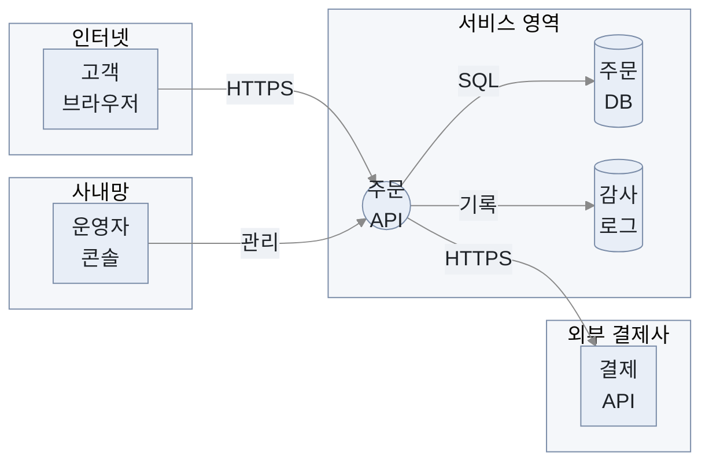

# Threat Modeling Fundamentals (위협 모델링 기초)

> 약어: NIST=미국 국립표준기술연구소, SP=NIST 특별 간행물

## 1. 개요 (What)

위협 모델링(Threat Modeling)은 **시스템의 설계를 보고 "무엇이 잘못될 수 있는가"를 미리, 체계적으로 찾는 활동**이다.
코드를 실행해 보거나 취약점을 스캔하는 것이 아니라, 구성요소와 데이터가 어떻게 움직이는지 그림으로 그리고 그 그림 위에서 공격자의 입장으로 생각한다.

집을 짓기 전에 도면을 놓고 "현관 말고 들어올 길이 있나, 열쇠는 누가 갖나, 금고는 어디 두나"를 따져 보는 것과 같다.
공사가 끝난 뒤에 벽을 뚫어 창문을 막는 것보다 도면에서 고치는 편이 훨씬 싸고 확실하다.

위협 모델링의 결과물은 세 가지다.
- 시스템을 표현한 그림(주로 DFD(Data Flow Diagram, 데이터 흐름도))과 보호할 자산 목록
- 찾아낸 위협과 각 위협에 대한 대응 결정
- 분석의 전제가 된 가정 목록

이 문서는 위협 모델링의 네 가지 질문 중 첫 번째, **"무엇을 만들고 있는가?"** 에 답하는 방법을 다룬다.
위협을 찾는 기법은 [STRIDE](stride.md)와 [Attack Tree](attack-trees.md)에서, 위험 평가는 [Risk Assessment](risk-assessment.md)에서 다룬다.

## 2. 배경 / 원리 (Why & How)

### 2.1 왜 설계 단계에서 하는가

보안 결함에는 두 종류가 있다.

| 종류 | 예 | 찾는 방법 |
|------|----|-----------|
| 구현 버그 | SQL(Structured Query Language) Injection, 버퍼 오버플로, 누락된 입력 검증 | 코드 리뷰, SAST(Static Application Security Testing), DAST(Dynamic Application Security Testing), 퍼징, 취약점 진단 |
| 설계 결함 | 인가를 클라이언트에서만 판단, 관리 기능이 인터넷에 노출, 서비스 간 통신을 무조건 신뢰, 키 관리 구조 문제 | **위협 모델링**, 아키텍처·설계 리뷰 (코드 리뷰가 보완) |

SAST 같은 코드 중심 도구는 구현 단계의 취약점을 찾는 데 효과적이고, 일부 권한 검사 오류나 보안 API 오용도 잡아낸다.
하지만 신뢰 경계를 어디에 둘지, 서비스 사이에 무엇을 믿을지 같은 설계 결함은 코드가 "설계대로 정확히" 동작하기 때문에 코드만 봐서는 의도와의 차이를 판단하기 어렵다.
또한 구조를 바꿔야 고칠 수 있어서 출시 후에 발견하면 비용이 크다. 그래서 코드 분석과 함께 위협 모델링·설계 리뷰를 병행해, 이 종류의 결함을 코드보다 먼저 잡는다.

### 2.2 네 가지 질문

위협 모델링은 아래 네 질문에 차례로 답하는 과정이다. 각 질문과 문서의 대응은 [Threat Modeling 1.1 네 가지 질문](README.md#11-네-가지-질문)에 정리되어 있다.

1. 무엇을 만들고 있는가? — 범위, DFD, 자산, 신뢰 경계 (이 문서)
2. 무엇이 잘못될 수 있는가? — 위협 식별
3. 그래서 무엇을 할 것인가? — 위험 평가와 대응
4. 충분히 잘했는가? — 검토와 검증

첫 질문을 대충 넘기면 나머지가 모두 흔들린다. 그림에 없는 구성요소의 위협은 아무도 찾지 않기 때문이다.

### 2.3 언제 하는가

위협 모델은 한 번 작성하고 끝나는 문서가 아니다. 아래 상황이 생기면 새로 만들거나 기존 모델을 고친다.

- 새 시스템·새 기능의 설계 단계
- 새로운 외부 연결이 생길 때 (외부 API(Application Programming Interface), 제3자 SaaS(Software as a Service), 새 사용자 유형)
- 다루는 데이터의 민감도가 바뀔 때 (개인정보·결제정보를 새로 저장)
- 인증·인가 방식, 배포 환경(온프레미스 → 클라우드), 네트워크 구조가 바뀔 때
- 보안 사고 이후 — 사고가 모델의 어느 빈틈으로 들어왔는지 확인

큰 시스템 전체를 한 번에 하기보다 **변경되는 기능 단위**로 작게, 자주 하는 편이 실무에 맞다.

### 2.4 누가 하는가

위협 모델링은 보안팀 혼자 하는 일이 아니다. 시스템을 가장 잘 아는 사람이 함께 해야 그림이 정확해진다.

| 참여자 | 기여 |
|--------|------|
| 개발자·아키텍트 | 실제 구성요소, 데이터 흐름, 구현 방식 |
| 운영·인프라 담당 | 배포 구조, 관리 경로, 백업·모니터링 연결 |
| 제품 담당 | 업무상 중요한 자산과 "절대 일어나면 안 되는 일" |
| 보안 담당 | 위협 유형, 공격 사례, 대응 통제, 진행 방식 |

## 3. 상세 (Details)

### 3.1 범위 정하기

시작 전에 무엇을 분석하고 무엇을 분석하지 않을지 적는다.

- **포함 범위**: 이번에 분석할 기능·구성요소 (예: "주문·결제 API와 주문 DB")
- **제외 범위**: 다른 모델에서 다루거나 이번에 보지 않는 것 (예: "결제사 내부 시스템", "사내 HR(Human Resources) 시스템")
- **보안 목표**: 이 시스템에서 **절대 일어나면 안 되는 일**을 문장으로 적는다.
  - 예: "다른 고객의 주문 내역을 볼 수 없어야 한다", "결제 금액을 사용자가 바꿀 수 없어야 한다", "주문 서비스는 영업시간에 멈추면 안 된다"

보안 목표는 이후 위협 식별의 출발점이자 위험 평가의 영향 판단 기준이 된다.

### 3.2 DFD 그리기

DFD는 **데이터가 어디서 와서 어디로 가고 어디에 저장되는지**를 표현하는 그림이다.
네트워크 구성도나 클래스 다이어그램과 달리 "데이터의 움직임"에 집중하므로 위협을 찾기 좋다.
아래 표기는 위협 모델링에서 흔히 쓰는 관례이며, 도구와 표기 체계에 따라 일부 기호는 달라진다.

| 요소 | 의미 | 예 | 흔한 표기 |
|------|------|----|-----------|
| 외부 엔터티(External Entity) | 시스템이 통제하지 못하는 사람·시스템 | 사용자, 브라우저, 외부 결제사 | 사각형 |
| 프로세스(Process) | 데이터를 받아 처리하는 코드 | API 서버, 배치 작업, 함수 | 원 |
| 데이터 저장소(Data Store) | 데이터가 머무는 곳 | DB, 파일, 캐시, 로그, 메시지 큐 | 평행선 (열린 사각형·원통도 쓴다) |
| 데이터 흐름(Data Flow) | 요소 사이를 오가는 데이터 | HTTP 요청, SQL 쿼리, 메시지 | 화살표 |
| 신뢰 경계(Trust Boundary) | 신뢰 수준이 바뀌는 지점 | 인터넷과 서버 사이, 서비스와 외부 업체 사이 | 점선 또는 경계 상자 |

아래는 간단한 온라인 주문 서비스의 DFD다. 각 묶음(subgraph)이 하나의 신뢰 영역이고, 묶음의 경계가 신뢰 경계다.

텍스트 설명: 고객 브라우저(외부 엔터티)는 인터넷에서 HTTPS(Hypertext Transfer Protocol Secure)로 주문 API(프로세스)를 호출한다.
주문 API는 서비스 영역 안의 주문 DB와 감사 로그(데이터 저장소)에 데이터를 쓰고, 외부 결제사의 결제 API로 결제를 요청한다.
운영자는 사내망의 콘솔에서 주문 API의 관리 기능을 쓴다. 화살표가 묶음의 경계를 넘는 곳 — 고객→API, 운영자→API, API→결제사 — 이 신뢰 경계를 넘는 흐름이다.

그릴 때의 요령:
- **처음엔 한 장으로**: 시스템 전체를 프로세스 하나로 두고 외부 엔터티와의 흐름만 그린 그림(Context Diagram, 자료에 따라 Level 0이라고도 부른다)부터 시작한다. 필요한 부분만 Level 1, Level 2로 펼친다.
- **운영 경로를 빠뜨리지 않는다**: 관리 콘솔, 배포 파이프라인(CI/CD(Continuous Integration/Continuous Delivery)), 백업, 모니터링 에이전트, 로그 수집은 사용자 기능보다 권한이 크고 자주 빠진다.
- **화살표마다 무엇이 흐르는지 적는다**: 프로토콜, 데이터 종류, 인증 방식. "API → DB"보다 "API → DB: SQL, 주문·고객 정보, 서비스 계정 인증"이 위협을 찾기 쉽다.
- **실제와 맞춘다**: 설계 문서가 아니라 실제 배포 상태를 그린다. 그림과 현실이 다르면 그 차이가 곧 위협이다.

### 3.3 자산 식별

자산은 "보호할 가치가 있는 것"이다. 데이터만이 아니라 기능과 상태도 자산이다.

| 분류 | 의미 | 예 |
|------|------|----|
| 공격자가 원하는 것(Things attackers want) | 탈취·악용 가치가 있는 것 | 고객 개인정보, 결제 정보, 계정 자격 증명 |
| 우리가 지키려는 것(Things you protect) | 손상되면 업무·신뢰가 깨지는 것 | 주문 데이터의 정확성, 서비스 가용성, 회사 평판 |
| 디딤돌(Stepping stones) | 그 자체보다 다음 공격의 발판이 되는 것 | 서비스 계정 키, 관리 콘솔 접근, 배포 파이프라인 권한 |

- 세 분류는 겹칠 수 있다. 서명 키는 공격자가 원하는 것이면서 디딤돌이다.
- 디딤돌은 자주 놓친다. "이 서버엔 중요한 데이터가 없다"는 판단이 틀리는 대부분의 경우가, 그 서버가 다른 시스템으로 가는 길이기 때문이다.
- 각 자산에 **어떤 보안 속성이 중요한지**(기밀성·무결성·가용성)를 적어 두면 위협 식별과 영향 판단이 쉬워진다.

### 3.4 신뢰 경계 찾기

신뢰 경계는 **한쪽이 다른 쪽을 그대로 믿을 수 없는 지점**이다. 위협은 대부분 이 경계를 넘는 흐름에서 생긴다.

경계가 생기는 대표적인 지점:

| 변화 | 예 |
|------|----|
| 소유·통제 주체가 바뀜 | 고객 기기 ↔ 서버, 우리 서비스 ↔ 외부 업체 |
| 네트워크 영역이 바뀜 | 인터넷 ↔ DMZ(Demilitarized Zone) ↔ 내부망 |
| 권한 수준이 바뀜 | 일반 사용자 ↔ 관리자, 사용자 모드 ↔ 커널, 컨테이너 ↔ 호스트 |
| 사용자·조직이 바뀜 | 테넌트 A ↔ 테넌트 B |
| 실행 주체가 바뀜 | 서비스 ↔ 플러그인·스크립트, LLM(Large Language Model) ↔ 도구·외부 문서 |

경계를 넘는 흐름마다 아래를 확인한다.
- 상대가 누구인지 확인하는가 (인증)
- 그 상대가 이 요청을 해도 되는가 (인가)
- 들어온 데이터를 검증하는가 (입력 검증)
- 전송 중 데이터가 보호되는가 (암호화·무결성)
- 이 흐름이 기록되는가 (감사)

"내부망이니까 믿는다"는 가정은 가장 흔한 실수다. 내부의 한 서버가 뚫리면 그 가정이 공격자에게 그대로 넘어간다.
매 요청을 경계로 보고 검증하는 설계는 [Security Architecture](../security-architecture/README.md) (작성 예정)의 Zero Trust에서 다룬다.

### 3.5 공격 표면

공격 표면(Attack Surface)은 공격자가 **입력을 넣거나 접근을 시도할 수 있는 모든 지점**의 합이다. DFD에서는 신뢰 경계를 넘어 들어오는 흐름과 그 흐름을 받는 프로세스가 공격 표면이다.

| 종류 | 예 |
|------|----|
| 진입점 | 공개 API, 로그인 화면, 파일 업로드, 웹훅 수신, 메시지 큐 구독 |
| 관리 경로 | 관리 콘솔, SSH(Secure Shell), 클라우드 관리 API, 배포 파이프라인 |
| 데이터 출구 | API 응답, 오류 메시지, 로그, 내보내기 기능 |
| 의존성 | 오픈소스 라이브러리, 컨테이너 이미지, 외부 SaaS 연동 |

- 공격 표면은 **줄이는 것**이 가장 확실한 대응이다. 쓰지 않는 엔드포인트, 열린 관리 포트, 기본 계정을 없앤다.
- 줄일 수 없는 표면은 위협 식별에서 집중적으로 본다.

### 3.6 공격자 가정

누가, 어디에서, 무엇을 할 수 있는지를 정해 두지 않으면 위협 목록이 끝없이 늘어나거나 중요한 것이 빠진다.

| 공격자 위치 | 할 수 있는 것 | 예 |
|-------------|---------------|----|
| 인증 전 외부 사용자 | 공개 진입점에 아무 입력이나 보냄 | 인터넷의 익명 사용자, 봇 |
| 인증된 일반 사용자 | 자기 권한 안에서 요청을 조작 | 다른 고객의 주문 ID로 바꿔 요청 |
| 통신 경로 위 공격자 | 전송 중 데이터를 보거나 바꿈 | 공용 Wi-Fi, 잘못 설정된 프록시 |
| 탈취된 내부 구성요소 | 내부 신뢰를 이용해 다른 시스템에 접근 | 침해된 서버, 유출된 서비스 계정 키 |
| 악의적 내부자 | 정당한 권한을 남용 | 운영자, 협력업체 직원 |
| 공급망 | 우리가 가져다 쓰는 코드·이미지를 조작 | 악성 패키지, 변조된 빌드 |

- 이번 모델에서 **다루지 않는 공격자**도 적는다(예: "국가 수준의 하드웨어 공격은 범위 밖"). 범위 밖이라는 결정 자체가 기록으로 남아야 나중에 다시 검토할 수 있다.
- 암호 관점의 공격자 능력(도청, 변조, 저장 후 미래 해독)은 [Cryptography Overview](../cryptography/cryptography-overview.md)에 정리되어 있다.

### 3.7 가정과 전제 기록

분석은 항상 무언가를 믿고 시작한다. 그 믿음을 **명시적으로** 적어 둔다.

- 예: "주문 DB는 주문 API 서브넷에서만 접근할 수 있다"
- 예: "결제 금액은 서버가 장바구니로부터 다시 계산한다"
- 예: "운영자 콘솔은 MFA(Multi-Factor Authentication)를 거친다"

가정마다 **누가 어떻게 확인했는지**를 함께 적는다. 확인되지 않은 가정은 위협 후보다.
나중에 진단·모의해킹에서 가정이 깨진 것이 발견되면, 그 가정에 기대고 있던 판단을 모두 다시 본다.

### 3.8 산출물 정리

위협 모델 문서는 형식보다 **계속 고칠 수 있는 것**이 중요하다. 아래 항목을 갖추면 충분하다.

| 항목 | 내용 |
|------|------|
| 범위와 보안 목표 | 3.1 |
| DFD | 3.2 (그림 + 흐름별 프로토콜·데이터·인증 방식) |
| 자산 목록 | 3.3 (자산별 중요한 보안 속성) |
| 신뢰 경계·공격 표면 | 3.4, 3.5 |
| 공격자 가정·범위 밖 공격자 | 3.6 |
| 가정 목록 | 3.7 (확인 여부와 확인자) |
| 위협 목록과 대응 | 위협마다 담당자, 대응 결정(완화·수용 등), 추적 번호 |
| 미해결 사항·검토 기록 | 다음 검토 때 볼 것 |

- 위협과 대응은 이슈 추적 시스템의 작업 항목과 연결해야 실제로 반영된다. 문서에만 남은 위협은 대부분 고쳐지지 않는다.
- DFD와 문서는 코드 저장소에 함께 두면 설계 변경과 같이 갱신하기 쉽다.

### 3.9 어디에 쓰이는가

같은 방법이 영역마다 다른 경계와 자산에 적용된다.

| 영역 | 주요 신뢰 경계 | 주요 자산 |
|------|----------------|-----------|
| Web·API | 브라우저 ↔ 서버, 사용자 ↔ 사용자(객체 소유) | 계정, 개인정보, 세션 |
| Cloud | 고객 ↔ 클라우드 사업자(공동 책임 모델), 테넌트 ↔ 테넌트, 데이터 평면 ↔ 관리 평면 | 관리 API 자격 증명, 저장 데이터, 키 |
| 5G | UE(User Equipment) ↔ 무선 구간 ↔ gNB(next generation Node B, 5G 기지국), RAN(Radio Access Network) ↔ Core, NF(Network Function) ↔ NF, 홈망 ↔ 방문망 | 가입자 식별자, 인증 키, 시그널링 무결성 |
| AI | 사용자 프롬프트 ↔ 모델, 외부 문서·검색 결과 ↔ 모델, 모델 ↔ 도구 호출 | 시스템 프롬프트, 학습·검색 데이터, 도구 권한 |

- 5G 위협 문서의 "공격 대상" 절은 이 경계 위에서 작성되어 있다. 예: [SUPI Exposure](../../5g-security/security-risks/01-ue-privacy/01-01-SUPI_Exposure.md).
- AI 시스템은 **외부 문서가 모델의 지시처럼 작동할 수 있다**는 점에서 데이터 흐름이 곧 제어 흐름이 된다. 그래서 검색 문서·도구 응답도 신뢰 경계 밖의 입력으로 그린다.

## 4. 보안 관점 (Security Relevance)

위협 모델링 자체가 잘못되면 "검토했다"는 안심만 남고 위협은 그대로다.

| 실수 | 결과 | 대응 |
|------|------|------|
| 네트워크 구성도만 그리고 데이터 흐름은 그리지 않음 | 어떤 데이터가 어느 경계를 넘는지 모름 | DFD로 흐름·데이터·인증 방식을 표시 |
| 내부 서비스 사이에 신뢰 경계를 두지 않음 | 서버 하나 침해 후 내부 확산(Lateral Movement) | 서비스 간 흐름도 경계로 보고 인증·인가 확인 |
| 관리·배포·백업 경로를 그림에서 뺌 | 가장 권한이 큰 경로가 분석되지 않음 | 운영 경로를 DFD에 포함 |
| 디딤돌 자산을 무시 | "중요 데이터 없는 서버"를 통해 핵심 시스템 침해 | 자격 증명·관리 권한을 자산으로 등록 |
| 가정을 적지 않음 | 깨진 가정이 발견돼도 영향 범위를 모름 | 가정 목록과 확인자 기록 |
| 범위를 너무 크게 잡음 | 끝나지 않거나 피상적인 결과 | 기능 단위로 나눠 작게 반복 |
| 한 번 만들고 갱신하지 않음 | 실제 시스템과 모델이 달라짐 | 설계 변경·사고 시 갱신, 저장소에 함께 관리 |
| 보안팀 혼자 작성 | 실제 구현과 다른 그림 | 개발·운영 담당과 함께 작성 |
| 위협 목록에 담당자·추적 번호가 없음 | 찾은 위협이 고쳐지지 않음 | 이슈 추적 시스템과 연결 |

점검 시 확인할 것: 최신 DFD 존재 여부와 실제 배포와의 일치, 신뢰 경계 표시, 운영 경로 포함 여부, 자산과 보안 속성, 공격자 가정과 범위 밖 결정, 가정의 확인 여부, 위협별 대응 결정과 추적, 마지막 갱신 계기.

## 5. 심화 (Advanced)

> 보안 컨설턴트·점검자를 위한 세부다. 본문만으로 개념 이해에는 충분하다.

### 5.1 DFD 요소별로 기록할 속성

DFD를 위협 식별에 바로 쓰려면 요소마다 아래 속성을 적어 둔다. 위협 모델링 도구(Microsoft Threat Modeling Tool, OWASP(Open Worldwide Application Security Project) Threat Dragon 등)는 DFD 요소의 유형과 속성, 선택한 템플릿·규칙을 바탕으로 위협 후보를 생성하거나 제안한다.
자동 생성 결과는 완전한 위협 목록이 아니므로 분석자가 검토해 수락·수정·추가해야 한다.

| 요소 | 기록할 속성 |
|------|-------------|
| 외부 엔터티 | 사람인지 시스템인지, 인증 방식, 신뢰 수준 |
| 프로세스 | 실행 권한(계정·역할), 실행 환경(컨테이너·서버리스 등), 처리하는 데이터 분류 |
| 데이터 저장소 | 저장 데이터 분류, 저장 시 암호화, 접근 가능한 주체, 백업·복제 위치 |
| 데이터 흐름 | 프로토콜, 전송 보호(TLS(Transport Layer Security) 등), 인증 방식, 데이터 분류, 방향 |
| 신뢰 경계 | 경계 양쪽의 신뢰 수준, 경계에서 집행하는 통제 |

- 이 속성들은 [STRIDE 2.2 DFD 요소에 대입하기](stride.md#22-dfd-요소에-대입하기)의 STRIDE-per-element에서 요소별로 위협을 대입할 때 그대로 쓰인다.

### 5.2 데이터 중심 위협 모델링

*NIST SP 800-154*(초안)는 시스템 전체가 아니라 **특정 데이터를 중심으로** 위협을 모델링하는 방법을 제시한다.
"이 데이터가 어디에 저장되고, 어디로 전송되고, 어디서 처리되는가"를 따라가며 각 지점의 공격 벡터와 통제를 분석한다.

대략의 흐름은 다음과 같다.
1. **시스템과 대상 데이터 식별·특성화** — 데이터가 저장·전송·실행되는 위치, 입력과 출력, 시스템 안에서의 이동, 데이터의 보안 목표(기밀성·무결성·가용성), 접근 권한이 있는 사람과 프로세스를 파악한다.
2. **공격 벡터 식별·선택** — 각 위치에 적용할 수 있는 공격 벡터 중 모델에 포함할 것을 고른다.
3. **완화 통제 특성화** — 공격 벡터를 줄이는 통제마다 효과, 도입·구현 비용, 운영·유지 비용, 기능성·사용성·성능에 주는 부정적 영향을 정리한다.
4. **위협 모델 분석** — 통제 대안의 효과성과 효율성을 비교해, 위험을 비용 대비 효과적으로 줄이는 조합을 판단한다.

- 개인정보·결제정보처럼 **데이터 하나가 핵심 자산**인 시스템에서 유용하다. DFD 기반 분석과 함께 쓸 수 있다.
- 정식판이 아닌 초안이므로 절차를 그대로 요구사항으로 인용하기보다 방법론 참고로 쓴다.

### 5.3 Threat Modeling Manifesto의 가치

Threat Modeling Manifesto는 방법론을 고르는 기준이 될 가치를 "A보다 B" 형태로 제시한다. 요지를 정리하면 다음과 같다.

| 더 중시하는 것 | 덜 중시하는 것 |
|----------------|----------------|
| 설계 결함을 찾고 고치는 문화 | 체크박스식 규정 준수 |
| 사람과 협업 | 절차·방법론·도구 |
| 이해를 넓혀 가는 과정 | 특정 시점의 보안·프라이버시 스냅숏 |
| 실제로 위협 모델링을 하는 것 | 위협 모델링에 대해 말하는 것 |
| 지속적인 개선 | 한 번의 납품 |

- 점검자 관점에서는 "위협 모델 문서가 있는가"보다 **"설계가 바뀔 때 갱신되고, 찾은 위협이 실제로 처리되는가"** 가 성숙도를 더 잘 보여 준다.

### 5.4 큰 시스템을 나누는 방법

| 방법 | 설명 | 적합한 경우 |
|------|------|-------------|
| 기능 단위 | 새 기능·변경 기능마다 별도 모델 | 애자일 개발, 잦은 배포 |
| 신뢰 영역 단위 | DMZ, 내부 서비스, 관리 영역별로 모델 | 인프라·네트워크 중심 시스템 |
| 데이터 단위 | 핵심 데이터 하나의 생명주기를 따라 모델 | 개인정보·결제 시스템 (5.2) |
| 계층 펼치기 | Level 0 전체 그림에서 위험한 부분만 Level 1·2로 상세화 | 처음 모델을 만드는 대형 시스템 |

- 나눈 모델 사이의 **접점**(한 모델의 외부 엔터티가 다른 모델의 프로세스인 경우)은 양쪽에 같은 이름으로 표시해 빠짐이 없게 한다.

## 관련 문서

- 다음: [STRIDE](stride.md), [Attack Tree](attack-trees.md)
- 신뢰 경계와 인가: [Access Control Fundamentals](../access-control/access-control-fundamentals.md)
- 공격자 능력 가정: [Cryptography Overview](../cryptography/cryptography-overview.md)
- 로드맵: [Threat Modeling](README.md)

## 출처

| 문서 | 이 문서에서의 사용 |
|------|-------------------|
| Threat Modeling Manifesto | 네 가지 질문, 가치 |
| Adam Shostack, *Threat Modeling: Designing for Security* | 네 가지 질문, DFD 요소, 자산 분류 |
| *NIST SP 800-154* (초안) | 데이터 중심 위협 모델링 4단계 |
| Microsoft Threat Modeling Tool, OWASP Threat Dragon | DFD 요소 속성, 위협 후보 생성 |

- 그 외 내용은 위협 모델링의 일반 원리를 재구성한 해설이다.
