# Threat Modeling in Practice (위협 모델링 실무 적용)

> 약어: 3GPP=3세대 이동통신 표준화 기구

## 1. 개요 (What)

앞의 문서들이 위협 모델링과 위험 평가의 **방법**을 다뤘다면, 이 문서는 그 방법을 **실제 시스템과 조직에 적용하는 법**을 다룬다.

- 위협 모델링을 개발 주기 어디에, 얼마나 가볍게 넣을 것인가
- 워크숍을 어떻게 준비하고 진행할 것인가
- Web·API, Cloud, 5G, AI 시스템에서 신뢰 경계와 대표 위협은 무엇인가
- 어떤 도구를 쓰고, 결과를 어떻게 테스트와 진단으로 잇는가
- 네 번째 질문 "충분히 잘했는가?"를 어떻게 확인하는가

위협 모델링이 실패하는 가장 흔한 이유는 방법론을 몰라서가 아니라 **너무 무겁게 시작해서 한 번 하고 멈추는 것**이다. 실무 적용의 핵심은 작게, 자주, 개발 흐름 안에서 하는 것이다.

## 2. 배경 / 원리 (Why & How)

### 2.1 개발 주기 안의 위치

```mermaid
%%{init: {"theme": "base", "themeVariables": {"fontSize": "18px", "primaryColor": "#e8eef7", "primaryTextColor": "#1f2328", "primaryBorderColor": "#7a8ca8", "secondaryColor": "#eef1f5", "tertiaryColor": "#f5f7fa", "lineColor": "#8a8a8a", "edgeLabelBackground": "#eef1f5", "clusterBkg": "#f5f7fa", "clusterBorder": "#7a8ca8", "actorBkg": "#e8eef7", "actorBorder": "#7a8ca8", "actorTextColor": "#1f2328", "actorLineColor": "#8a8a8a", "signalColor": "#8a8a8a", "signalTextColor": "#8a8a8a", "noteBkgColor": "#fff8dc", "noteTextColor": "#1f2328", "noteBorderColor": "#c9b458"}, "flowchart": {"nodeSpacing": 25, "rankSpacing": 30, "padding": 8}, "sequence": {"width": 110, "height": 40, "boxMargin": 6, "noteMargin": 6, "actorMargin": 40}}}%%
flowchart LR
    A["설계"] --- P1(["위협 모델<br>작성·갱신"]) --> B["구현"]
    B --- P2(["위협별<br>테스트 항목"]) --> C["테스트"]
    C --- P3(["진단 범위<br>잔여 위험 승인"]) --> D["출시·운영"]
    D --- P4(["사고·변경 시<br>모델 갱신"]) --> A
    classDef aux fill:transparent,stroke:#8a8a8a,stroke-dasharray:3 3,color:#8a8a8a,font-size:15px
    class P1,P2,P3,P4 aux
```



텍스트 설명: 설계 단계에서 위협 모델을 만들거나 고치고, 구현 단계에서는 위협마다 대응 통제와 테스트 항목을 만든다.
테스트 단계에서는 위협 모델이 진단·모의해킹의 범위를 정하고, 출시 전에 잔여 위험을 승인한다. 운영 중 사고나 구성 변경이 생기면 다시 설계 단계의 모델로 돌아간다.

- 위협 모델링은 **설계 단계의 활동**이지만, 결과물은 개발 주기 전체에서 쓰인다. 개발 주기 전체의 보안 활동은 [Secure Development](../secure-development/README.md) (작성 예정)에서 다룬다.

### 2.2 무게를 조절하는 법

모든 변경에 같은 깊이를 요구하면 아무도 하지 않는다. 변경의 크기에 따라 세 단계로 나눈다.

| 단계 | 대상 | 방법 | 시간 |
|------|------|------|------|
| 질문 체크 | 대부분의 기능 변경 | 아래 다섯 질문에 하나라도 "예"면 다음 단계로 | 몇 분 |
| 경량 모델 | 질문 체크에서 걸린 변경 | 변경 부분의 DFD(Data Flow Diagram) + STRIDE, 결과를 작업 항목으로 | 1~2시간 |
| 정식 모델 | 신규 시스템, 핵심 업무, 큰 구조 변경 | 전체 DFD, STRIDE + Attack Tree, 위험 평가, 승인 | 며칠~몇 주 |

질문 체크의 다섯 질문:
1. 새로운 **신뢰 경계**를 넘는 흐름이 생기는가? (새 외부 API, 새 사용자 유형, 새 외부 업체)
2. 새로운 **민감 데이터**를 다루거나, 기존 데이터를 새 곳으로 보내는가?
3. **인증·인가** 방식이 바뀌는가?
4. 새로운 **관리 기능·운영 경로**가 생기는가?
5. 새로운 **외부 의존성**(라이브러리, SaaS(Software as a Service), AI 모델)이 들어오는가?

- 질문 체크는 설계 문서 템플릿이나 PR(Pull Request) 템플릿에 넣으면 자연스럽게 습관이 된다.

### 2.3 워크숍 진행

| 단계 | 내용 |
|------|------|
| 준비 | 범위와 보안 목표를 정하고, 개발 담당이 DFD 초안을 미리 그려 온다 |
| 역할 | 진행자(보안 담당 또는 보안 챔피언), 기록자, 개발·운영 담당, 필요하면 제품 담당 |
| 진행 (60~90분) | DFD 확인(15분) → 신뢰 경계를 넘는 흐름부터 STRIDE 질문(45분) → 상위 위협의 대응과 담당 정하기(15분) |
| 마무리 | 위협 목록을 작업 항목으로 등록, 미해결 질문과 가정을 기록, 다음 검토 계기 정하기 |

- 진행자는 정답을 말하는 사람이 아니라 **질문하는 사람**이다. "이 흐름은 누가 보낸 것인지 서버가 어떻게 아나요?" 같은 질문이 위협을 끌어낸다.
- 한 번에 전부 끝내려 하지 않는다. 남은 부분은 다음 세션으로 넘긴다.
- 보안 챔피언(각 개발팀 안에서 보안 활동을 이끄는 개발자)을 두면 보안팀이 모든 워크숍에 들어가지 않아도 된다.

## 3. 상세 (Details)

### 3.1 Web·API

**구성**: 브라우저의 SPA(Single Page Application) → API Gateway → 업무 API → DB, 외부 IdP(Identity Provider)로 로그인, 웹훅으로 외부 서비스에 알림.

| 신뢰 경계 | 대표 위협 (STRIDE) | 대응 | 관련 문서 |
|-----------|--------------------|------|-----------|
| 브라우저 ↔ API | S: 탈취된 토큰 재사용 / I: 브라우저 저장소의 토큰을 XSS(Cross-Site Scripting)로 탈취 | 짧은 토큰 수명, 토큰 저장 위치 설계, XSS 방어 | [Token Security](../pki-identity/token-security.md) |
| 사용자 ↔ 사용자(객체) | E: 객체 ID 변경으로 남의 데이터 접근 | 객체 단위 인가 | [Authorization Attacks](../access-control/authorization-attacks.md) |
| API ↔ IdP | S: 토큰 서명·발급자·대상 미검증 | 서명·`iss`·`aud`·만료 검증 | [OAuth 2.0 · OpenID Connect](../pki-identity/oauth2-oidc.md) |
| API → 외부 웹훅 URL | I·E: 사용자가 지정한 URL로 내부 자원에 요청(SSRF(Server-Side Request Forgery)) | 허용 목록, 내부 주소 차단, 별도 송신 구간 | — |
| 운영자 ↔ 관리 API | S·E: 관리 기능이 일반 API와 같은 경로·인증 | 관리 경로 분리, 강한 인증, 접근 경로 제한 | [PAM](../access-control/pam.md) |

### 3.2 Cloud

**구성**: 컨테이너 기반 서비스, 클라우드 관리형 DB·스토리지, CI/CD(Continuous Integration/Continuous Delivery) 파이프라인이 클라우드 역할로 배포.

| 신뢰 경계 | 대표 위협 | 대응 | 관련 문서 |
|-----------|-----------|------|-----------|
| 고객 ↔ 클라우드 사업자 | 고객 책임 영역(설정·계정·데이터)을 사업자 책임으로 오해 | 공동 책임 모델 기준으로 책임 영역 표시 | [Cloud Security](../../cloud-security/README.md) |
| 관리 평면(콘솔·관리 API) | S·E: 유출된 액세스 키로 관리 API 호출, 과도한 역할 위임 | 장기 키 제거, 최소 권한 역할, 관리 API 감사 로그 | [Least Privilege](../access-control/least-privilege.md) |
| 워크로드 → 인스턴스 메타데이터 서비스 | I·E: SSRF로 메타데이터 서비스에서 임시 자격 증명 탈취 | 세션 토큰이 있어야 응답하는 방식 강제(AWS IMDSv2 등), 추가 방어로 토큰 발급 응답의 IP 홉 제한, 애플리케이션 SSRF 방어, 워크로드 권한 최소화 | [Workload Identity 3.3 클라우드 워크로드 신원과 메타데이터 서비스](../pki-identity/workload-identity.md#33-클라우드-워크로드-신원과-메타데이터-서비스) |
| CI/CD → 클라우드 | S·T: 파이프라인 신원 위조, 다른 저장소·브랜치가 배포 역할을 얻음 | 클라우드 측 신뢰 정책에서 OIDC(OpenID Connect) 토큰의 `sub`·`aud`와 필요한 클레임을 검증해 저장소·브랜치·환경·워크플로를 최소 범위로 제한 | [Workload Identity 5.3 CI/CD OIDC 토큰의 신뢰 조건 설계](../pki-identity/workload-identity.md#53-cicd-oidc-토큰의-신뢰-조건-설계) |
| 테넌트 ↔ 테넌트 | I: 공유 스토리지·캐시를 통한 다른 고객 데이터 노출 | 테넌트 식별자 기반 격리, 테넌트 간 접근 테스트 | — |

- 홉 제한은 토큰 발급 응답이 인스턴스 밖으로 전달되기 어렵게 하는 추가 계층이다. 컨테이너 환경에서는 네트워크 구성에 따라 값을 조정해야 한다. 세션 토큰 방식도 공격자가 토큰 발급과 사용을 모두 할 수 있는 SSRF라면 막지 못하므로, 애플리케이션의 SSRF 방어와 함께 쓴다.
- CI/CD 플랫폼의 `sub` 형식은 바뀔 수 있다(GitHub의 변경 불가능한 주체 형식 등). 신뢰 정책을 만들 때 실제 토큰의 형식을 확인한다.
- Cloud에서는 **관리 평면**이 가장 큰 신뢰 경계다. DFD에 데이터 평면만 그리면 가장 위험한 경로가 빠진다.

### 3.3 5G

**구성**: UE(User Equipment) ↔ gNB(next generation Node B, 5G 기지국) ↔ 5G Core. Core의 NF(Network Function)는 SBA(Service Based Architecture)로 서로 API를 호출한다. NRF(Network Repository Function)는 NF 프로필 등록·관리와 서비스 탐색을 지원하고, *3GPP TS 33.501 V19.7.0 (Release 19)*의 OAuth 2.0 서비스 접근 인가 구조에서는 인가 서버를 맡는다. 서비스를 요청하는 NF(Consumer)가 NRF에서 Access Token을 받고, 서비스를 제공하는 NF(Producer)가 토큰을 검증한다. 로밍 시 다른 사업자 망과 연결된다.

| 신뢰 경계 | 대표 위협 | 관련 문서 |
|-----------|-----------|-----------|
| UE ↔ 무선 구간 ↔ gNB | S: 가짜 기지국 / I: 가입자 식별자 노출 | [False Base Station](../../5g-security/security-risks/01-ue-privacy/01-05-False_Base_Station.md), [SUPI Exposure](../../5g-security/security-risks/01-ue-privacy/01-01-SUPI_Exposure.md) |
| UE ↔ Core(NAS(Non-Access Stratum)) | T: 시그널링 메시지 변조 / D: 등록 요청 폭주 | [NAS Message Tampering](../../5g-security/security-risks/01-ue-privacy/01-12-NAS_Message_Tampering.md), [Registration Request Flooding](../../5g-security/security-risks/02-auth-nas/02-08-Registration_Request_Flooding.md) |
| NF ↔ NF(SBA 내부) | S: NF 위장 / E: 접근 토큰 오용, NF 간 과도한 신뢰 | [NF Impersonation](../../5g-security/security-risks/06-sba-security/06-01-NF_Impersonation.md), [OAuth Token Abuse](../../5g-security/security-risks/06-sba-security/06-06-OAuth_Token_Abuse.md), [Inter-NF Trust Abuse](../../5g-security/security-risks/06-sba-security/06-10-Inter-NF_Trust_Abuse.md) |
| NF ↔ NRF | T: 탐색 결과 오염 / E: NRF 장악 | [NF Discovery Poisoning](../../5g-security/security-risks/06-sba-security/06-02-NF_Discovery_Poisoning.md), [NRF Compromise](../../5g-security/security-risks/06-sba-security/06-03-NRF_Compromise.md) |
| RAN ↔ UPF(사용자 평면 터널) | S: 터널 패킷 위조 | [GTP-U Spoofing](../../5g-security/security-risks/05-core-security/05-09-GTP-U_Spoofing.md) |

- 5G는 **"망 내부라서 믿는다"는 가정**이 가장 위험하다. SBA 내부 NF 사이도 신뢰 경계로 그리고, 상호 인증과 토큰 기반 인가가 실제로 적용되는지 본다.
- 상호 인증(상대 NF가 누구인가)과 토큰 기반 인가(그 NF가 이 서비스·작업을 해도 되는가)는 서로 다른 기능이다. 둘 중 하나만 있으면 위협이 남는다. 인증서 신원과 토큰 주체를 맞춰 보는 절차는 [Workload Identity 3.7 다른 영역에서의 사용](../pki-identity/workload-identity.md#37-다른-영역에서의-사용)에 있다.
- 표준이 정의한 보안 기능과 실제 장비·설정이 다를 수 있다. 위협 모델의 가정 목록에 "이 보안 기능이 실제로 켜져 있다"를 적고 확인한다.
- 5G 고유 공격 기법은 MITRE FiGHT로 보강한다 → [Threat Modeling Methodologies 3.7 영역 특화 지식 베이스](threat-modeling-methodologies.md#37-영역-특화-지식-베이스).

### 3.4 AI 시스템

**구성**: 사용자가 사내 LLM(Large Language Model) 에이전트에 질문 → 에이전트가 RAG(Retrieval-Augmented Generation)로 사내 문서를 검색 → 메일 발송·티켓 생성 도구를 호출 → 외부 모델 API로 추론.

| 신뢰 경계 | 대표 위협 | 대응 |
|-----------|-----------|------|
| 사용자 ↔ 에이전트 | T·E: 프롬프트 주입으로 지시 무시, 권한 밖 작업 요청 | 모델 지시에 의존하지 않는 서버 측 인가, 입력·출력 검사 |
| 검색 문서 ↔ 모델 | T·E: 문서에 숨긴 지시(간접 프롬프트 주입) | 검색 결과를 데이터로 취급, 출처 표시, 고위험 작업 전 사람 확인 |
| 모델 ↔ 도구 | E: 과도한 도구 권한으로 데이터 유출·변경(과도한 행위 권한) | 도구별 최소 권한, 사용자 권한으로 위임 범위 제한, 쓰기·발송 작업 승인 |
| 검색 계층 ↔ 사내 문서 | I: 사용자가 볼 권한 없는 문서가 검색돼 응답에 포함 | 검색 단계에서 사용자 권한으로 문서 필터 |
| 에이전트 ↔ 외부 모델 API | I: 민감 데이터가 외부로 전송, 응답 기록 보관 | 전송 데이터 최소화·마스킹, 계약상 보관·학습 사용 조건 확인 |
| 응답 ↔ 사용자 화면 | I: 응답의 링크·이미지 자동 로딩으로 데이터를 외부에 전송 | 안전한 출력 렌더링, 외부 링크·이미지 자동 로딩 제한 |

- AI 시스템에서는 **데이터가 곧 지시**가 될 수 있다. 그래서 검색 문서와 도구 응답도 신뢰 경계 밖의 입력으로 그린다.
- 검색 단계의 권한 확인은 모델에게 맡기지 않는다. 원본 문서의 접근 권한을 검색 색인의 조각(청크)에도 연결하고, 검색 시점에 요청한 사용자의 권한으로 걸러낸다.
- 응답 화면이 Markdown 이미지나 링크 미리보기를 자동으로 불러오면, 주입된 지시가 URL에 민감 정보를 담아 외부로 보낼 수 있다. 출력은 안전하게 렌더링하고 외부 요청을 제한한다.
- 에이전트의 권한은 "에이전트가 할 수 있는 일"이 아니라 **"이 사용자가 할 수 있는 일 중 이 작업에 필요한 것"** 으로 제한한다 → [Access Control](../access-control/README.md).
- AI 위험 범주와 공격 기법은 OWASP(Open Worldwide Application Security Project) Top 10 for LLM Applications와 MITRE ATLAS로 보강한다 → [LLM Security](../../ai-security/llm-security/README.md) (작성 예정), [AI Security Assessment](../../ai-security/ai-security-assessment/README.md) (작성 예정).

### 3.5 도구

| 도구 | 성격 | 맞는 경우 |
|------|------|-----------|
| 화이트보드·일반 다이어그램 도구 | 자유 형식 DFD | 첫 워크숍, 빠른 경량 모델 |
| Microsoft Threat Modeling Tool | DFD 작성 + 템플릿 기반 위협 후보 생성 | STRIDE 중심, Windows 데스크톱 환경에서 사용 |
| OWASP Threat Dragon | 오픈소스 DFD 도구, 규칙 기반 위협 후보 제안 | 오픈소스 선호, 웹 기반 협업 |
| OWASP pytm | 시스템을 Python 코드로 정의해 DFD·시퀀스 다이어그램과 위협 목록·보고서를 생성 | 위협 모델을 코드 저장소에서 관리 |
| Threagile | YAML로 아키텍처·자산을 정의하고 위험 규칙을 실행해 위험과 완화 방안을 분석 | CLI·Docker·REST 방식, 파이프라인에서 자동 분석 |
| AWS Threat Composer | 위협 문장 틀, 위협·대응 목록 관리 | 위협 문장 품질 관리 |

- 도구가 생성한 위협은 **후보**다. 팀이 검토해 수락·수정·추가해야 한다.
- 도구 선택보다 **결과가 작업 항목으로 이어지는지**가 중요하다. 도구 안에만 남은 위협 목록은 고쳐지지 않는다.
- LLM으로 위협 후보를 만드는 방식도 쓰이지만, 시스템에 없는 위협을 그럴듯하게 만들거나 중요한 위협을 빠뜨릴 수 있다. 후보 생성 보조로만 쓰고 결과는 사람이 검토한다.

### 3.6 결과를 테스트와 진단으로 잇기

| 위협 모델 산출물 | 이어지는 활동 | 예 |
|------------------|---------------|----|
| 위협 문장 | 오용 사례(Abuse Case)·보안 테스트 | "고객 A의 토큰으로 고객 B의 주문을 조회하면 403이 나온다" |
| 대응 통제 | 단위·통합 테스트, 설정 점검 규칙 | 객체 소유자 확인 테스트, 버킷 공개 금지 정책 |
| 공격 트리의 쉬운 경로 | 모의해킹 시나리오 | 크리덴셜 스터핑 → 세션 탈취 경로 검증 |
| 가정 목록 | 가정 검증 항목 | "DB는 API 서브넷에서만 접근 가능" 네트워크 점검 |
| ATT&CK 기법 | 탐지 규칙과 로그 요구사항 | 관리 API의 비정상 호출 탐지 |

- 진단·모의해킹에서 발견된 문제는 반대로 **위협 모델에 없던 위협**인지 확인한다. 없었다면 모델의 빈틈이므로 DFD와 가정을 고친다.

### 3.7 "충분히 잘했는가?" 확인하기

| 질문 | 확인 방법 |
|------|-----------|
| 그림이 실제와 맞는가? | 실제 배포 구성·네트워크 정책·IAM(Identity and Access Management) 설정과 DFD 대조 |
| 빠진 요소가 없는가? | 운영 경로(관리·배포·백업·모니터링)가 그림에 있는지 |
| 모든 경계 흐름을 봤는가? | 신뢰 경계를 넘는 흐름마다 위협 검토 기록이 있는지 |
| 모든 위협에 결정이 있는가? | 위협별 처리 결정·담당·기한 |
| 대응이 실제로 반영되었는가? | 대응마다 테스트·점검 결과 |
| 가정이 확인되었는가? | 가정별 확인자와 방법 |
| 사고에서 배웠는가? | 사고 후 "모델이 왜 못 잡았나"를 검토하고 반영 |

### 3.8 조직 수준의 성숙도

OWASP SAMM(Software Assurance Maturity Model)은 설계(Design) 업무 기능 아래 위협 평가(Threat Assessment) 실천 영역을 두고, 애플리케이션 위험 프로필(Application Risk Profile)과 위협 모델링(Threat Modeling) 두 흐름의 성숙 단계를 제시한다. 아래 표는 이를 참고한 일반적인 모습이다.

| 수준 | 모습 |
|------|------|
| 시작 | 보안팀이 일부 핵심 시스템에만 비정기적으로 수행 |
| 확산 | 질문 체크·경량 모델이 개발 절차에 들어가고, 보안 챔피언이 진행 |
| 정착 | 위협 모델이 코드 저장소에서 관리되고, 변경 시 갱신, 결과가 테스트·위험 등록부와 연결 |
| 개선 | 사고·진단 결과로 모델의 빈틈을 측정하고 방법을 개선 |

## 4. 보안 관점 (Security Relevance)

| 실수 | 결과 | 대응 |
|------|------|------|
| 모든 변경에 정식 모델 요구 | 일정 압박으로 위협 모델링 자체를 건너뜀 | 질문 체크 → 경량 → 정식의 단계화 |
| 보안팀이 혼자 그림을 그림 | 실제 구현과 다른 모델 | 개발 담당이 DFD 초안, 보안은 질문 |
| 위협 목록이 문서·도구에만 남음 | 고쳐지지 않음 | 작업 항목·위험 등록부와 연결 |
| Cloud 관리 평면·CI/CD를 그림에서 뺌 | 가장 큰 권한 경로가 분석되지 않음 | 관리·배포 경로를 DFD에 포함 |
| 5G 망 내부·SBA를 신뢰 영역으로 처리 | NF 위장·토큰 오용 위협 누락 | NF 간 흐름도 신뢰 경계로 그림 |
| AI 에이전트의 검색 문서·도구 응답을 신뢰 | 간접 프롬프트 주입으로 데이터 유출 | 외부 콘텐츠를 신뢰 경계 밖 입력으로 그림 |
| 도구·LLM이 만든 위협을 그대로 채택 | 무관한 위협과 누락이 섞임 | 후보로만 쓰고 팀이 검토 |
| 진단 결과를 모델에 반영하지 않음 | 같은 종류의 빈틈이 반복 | 진단 발견사항을 모델 갱신 계기로 |
| 출시 후 갱신하지 않음 | 모델과 실제가 점점 달라짐 | 변경·사고 시 갱신, 저장소에서 관리 |

점검 시 확인할 것: 위협 모델링 적용 기준(어떤 변경에 어떤 깊이), 최근 주요 변경의 위협 모델 존재, DFD와 실제 구성의 일치, 위협–작업 항목–테스트 연결, 진단 결과의 모델 반영, 보안 챔피언 등 수행 체계.

## 5. 심화 (Advanced)

> 보안 컨설턴트·점검자를 위한 세부다. 본문만으로 개념 이해에는 충분하다.

### 5.1 위협 모델 문서 템플릿

```markdown
# {시스템명} 위협 모델

## 1. 범위와 보안 목표
- 포함 / 제외 범위
- 절대 일어나면 안 되는 일

## 2. 시스템 모델
- DFD (Mermaid 또는 도구 산출물)
- 흐름별 프로토콜·데이터 분류·인증 방식

## 3. 자산과 신뢰 경계
## 4. 공격자 가정 / 범위 밖 공격자
## 5. 가정 목록 (확인자·방법)

## 6. 위협 목록
| ID | 요소·흐름 | STRIDE | 위협 문장 | 현재 통제 | 위험 | 결정 | 담당·작업 번호 |

## 7. 잔여 위험과 승인
## 8. 검토 기록 (갱신 계기와 변경 내용)
```

- Markdown과 Mermaid로 작성하면 코드 저장소에서 설계와 함께 버전 관리하고, 변경을 리뷰로 확인할 수 있다.

### 5.2 위협 모델을 코드로 관리하기

| 방식 | 내용 | 장점 | 주의 |
|------|------|------|------|
| 문서형(Markdown + 다이어그램) | 사람이 읽는 문서를 저장소에 둠 | 도입이 쉽다, 리뷰가 자연스럽다 | 자동 분석은 안 된다 |
| 모델 정의형(pytm, Threagile 등) | 요소·흐름·속성을 코드나 YAML로 정의 | 규칙 기반 위협 후보 자동 생성, 파이프라인 연동 | 정의가 실제와 달라지면 결과도 틀린다. 자동 분석이 모든 위험을 찾아 주지는 않는다 |
| 하이브리드 | 핵심 속성은 정의 파일, 해설과 결정은 문서 | 자동화와 판단 기록을 함께 | 두 곳의 일관성 유지 |

- 파이프라인에서 "새 외부 흐름이 생겼는데 위협 모델이 갱신되지 않았다"를 검출하면 갱신 누락을 줄일 수 있다.

### 5.3 컨설팅 산출물 구성

위협 모델링·위험 평가를 외부 산출물로 낼 때의 일반적인 구성이다.

| 구성 | 내용 |
|------|------|
| 요약 | 범위, 핵심 발견 3~5개, 상위 위험과 권고, 전체 위험 수준 |
| 범위와 방법 | 대상, 제외 범위, 사용 방법론(STRIDE·Attack Tree 등), 위험 기준 |
| 시스템 모델 | DFD, 신뢰 경계, 자산, 가정 |
| 위협·위험 목록 | 위협 문장, 위험 등급과 근거, 관련 공격 기법(ATT&CK 등) |
| 권고 | 위협별 대응 통제, 우선순위, 예상 잔여 위험 |
| 부속 | 상세 공격 트리, 워크숍 기록, 미확인 가정 |

- 경영진용 요약에는 기술 용어보다 **사업 영향**과 **결정이 필요한 사항**(예산, 수용 승인)을 쓴다.
- 미확인 가정은 숨기지 않고 따로 적는다. 결과의 신뢰도를 판단하는 근거가 된다.

### 5.4 효과 측정

| 지표 | 의미 |
|------|------|
| 위협 모델 적용률 | 기준에 해당하는 변경 중 위협 모델이 있는 비율 |
| 설계 단계 발견 비율 | 전체 보안 결함 중 위협 모델링에서 먼저 찾은 비율 |
| 위협 처리율 | 위협 모델에서 나온 위협 중 결정·처리된 비율 |
| 진단 대비 누락 | 진단에서 발견됐지만 모델에 없던 위협 수 |
| 갱신 지연 | 주요 변경 후 모델 갱신까지 걸린 기간 |

- "진단 대비 누락"이 줄어든다면 모델의 품질이 오르고 있다는 신호다.

## 관련 문서

- 이전: [Risk Treatment](risk-treatment.md)
- 처음부터: [Threat Modeling Fundamentals](threat-modeling-fundamentals.md)
- 로드맵: [Threat Modeling](README.md)

## 출처

| 문서 | 이 문서에서의 사용 |
|------|-------------------|
| Threat Modeling Manifesto | 반복·협업 중심의 적용 원칙 |
| Adam Shostack, *Threat Modeling: Designing for Security* | 워크숍 진행, 개발 주기 통합 |
| OWASP SAMM | 위협 평가 활동의 성숙도 |
| Microsoft Threat Modeling Tool, OWASP Threat Dragon, OWASP pytm, Threagile, AWS Threat Composer | 도구 |
| OWASP Top 10 for LLM Applications, MITRE ATLAS, MITRE FiGHT | AI·5G 위협 보강 |
| *3GPP TS 33.501 V19.7.0 (Release 19)* | 5G SBA 구조와 NF 간 인가 |

- 그 외 내용은 위협 모델링 실무 적용의 일반 원리를 재구성한 해설이다.
