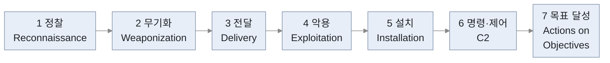

# Threat Modeling Methodologies (위협 모델링 방법론)

> 약어: ENISA=유럽연합 사이버보안청

## 1. 개요 (What)

[STRIDE](stride.md)와 [Attack Tree](attack-trees.md) 말고도 위협 모델링 방법론은 많다. 방법론마다 **무엇을 중심에 두고 위협을 찾는지**가 다르다.
이 문서는 실무에서 자주 만나는 방법론과 공격 지식 베이스를 비교하고, 상황에 따라 무엇을 골라 어떻게 조합할지 정리한다.

| 중심 | 방법론·자료 | 한 줄 요약 |
|------|-------------|-----------|
| 비즈니스 위험 | PASTA | 사업 목표에서 출발해 공격을 시뮬레이션하고 위험으로 끝나는 7단계 절차 |
| 개인정보 | LINDDUN | STRIDE의 프라이버시 버전. 연결·식별·추적 위협을 찾는다 |
| 조직 자산 | OCTAVE 계열 | 조직의 핵심 정보 자산과 운영 위험을 평가한다 |
| 공격자 행동 | Cyber Kill Chain, MITRE ATT&CK | 실제 공격자가 밟는 단계와 기법으로 위협을 본다 |
| 공격 패턴 | MITRE CAPEC | 설계·구현 약점을 노리는 공격 패턴 사전 |
| 특정 영역 | MITRE ATLAS, MITRE FiGHT | AI 시스템, 5G 네트워크에 특화된 공격 기법 지식 베이스 |

어느 하나가 정답인 것은 아니다. 방법론을 고르는 일은 "이번 분석에서 가장 놓치면 안 되는 것이 무엇인가"를 정하는 일이다.

## 2. 배경 / 원리 (Why & How)

### 2.1 왜 여러 방법론이 있는가

위협 모델링의 네 가지 질문([Threat Modeling 1.1 네 가지 질문](README.md#11-네-가지-질문))은 같지만, "무엇이 잘못될 수 있는가"를 묻는 **관점**이 다르면 찾는 위협도 달라진다.

| 관점 | 묻는 질문 | 강한 방법론 | 놓치기 쉬운 것 |
|------|-----------|-------------|----------------|
| 소프트웨어 설계 | 이 구성요소에 어떤 위협 유형이 있나? | STRIDE | 사업 영향, 공격자 동기 |
| 공격자 | 공격자는 어떤 목표를 어떤 단계로 이루나? | Attack Tree, Kill Chain, ATT&CK | 설계 결함의 근본 원인 |
| 자산·사업 | 무엇을 잃으면 가장 아픈가? | PASTA, OCTAVE | 구성요소 단위 세부 위협 |
| 개인정보 | 개인이 식별·추적·노출되는가? | LINDDUN | 일반 보안 위협 |

- 한 관점만 쓰면 그 관점의 사각지대가 그대로 남는다. 그래서 실무에서는 **주 방법론 하나 + 보조 관점 하나**로 조합하는 경우가 많다.

### 2.2 방법론과 지식 베이스의 차이

| 구분 | 무엇인가 | 예 |
|------|----------|----|
| 방법론 | 위협을 찾고 평가하는 **절차** | STRIDE, PASTA, LINDDUN, OCTAVE |
| 모델 | 공격의 흐름을 단계로 나눈 **틀** | Cyber Kill Chain |
| 지식 베이스 | 실제로 관찰된 공격 기법·패턴의 **목록** | MITRE ATT&CK, CAPEC, ATLAS, FiGHT |

- 지식 베이스는 그 자체로 위협 모델링 절차가 아니다. 방법론으로 찾은 위협을 **구체화하고, 빠진 것을 확인하고, 탐지·대응과 연결**하는 데 쓴다.

## 3. 상세 (Details)

### 3.1 PASTA

PASTA(Process for Attack Simulation and Threat Analysis)는 사업 목표에서 출발해 공격을 시뮬레이션하고, 위험과 영향 분석으로 끝나는 7단계 방법론이다.
기술적 위협을 "그래서 사업에 얼마나 아픈가"로 번역하는 데 초점이 있다.

| 단계 | 이름 | 하는 일 |
|:---:|------|---------|
| 1 | Define Objectives | 사업 목표, 규제 요건, 위험 허용 수준을 정한다 |
| 2 | Define Technical Scope | 기술 범위(구성요소, 인프라, 의존성)를 정한다 |
| 3 | Application Decomposition | DFD(Data Flow Diagram)·신뢰 경계·자산으로 시스템을 분해한다 |
| 4 | Threat Analysis | 위협 정보(공격 동향, 사고 사례)로 현실적인 위협을 고른다 |
| 5 | Vulnerability Analysis | 기존 진단 결과와 약점을 위협에 연결한다 |
| 6 | Attack Modeling | 공격 트리 등으로 공격을 시뮬레이션한다 |
| 7 | Risk and Impact Analysis | 위험과 사업 영향을 평가하고 대응을 정한다 |

- 자료에 따라 5단계를 Weakness and Vulnerability Analysis, 6단계를 Attack Modeling & Simulation, 7단계를 Risk Analysis & Management처럼 부르기도 한다. 단계의 내용은 같다.
- 3단계에는 [Threat Modeling Fundamentals](threat-modeling-fundamentals.md)의 DFD, 6단계에는 [Attack Tree](attack-trees.md)가 그대로 쓰인다. PASTA는 다른 기법을 **담는 그릇**에 가깝다.
- 강점: 경영진·사업 담당이 이해하는 언어로 결과가 나온다.
- 약점: 분석 범위가 넓어 시간과 비용이 크다. 작은 기능 변경마다 돌리기에는 무겁다.

### 3.2 LINDDUN

LINDDUN은 KU Leuven의 DistriNet 연구 그룹이 만든 **프라이버시 위협 모델링** 방법론이다. 이름은 7개 위협 유형의 머리글자다.
STRIDE처럼 DFD 위에서 요소별로 위협 유형을 대입한다.

| 유형 | 의미 | 예 |
|------|------|----|
| **L**inking (연결) | 서로 다른 데이터·행동이 같은 사람의 것임을 이어 붙인다 | 여러 서비스의 방문 기록을 같은 기기 식별자로 묶음 |
| **I**dentifying (식별) | 데이터로 특정 개인을 알아낸다 | 익명 처리한 위치 기록에서 집·회사 위치로 사람을 특정 |
| **N**on-repudiation (부인 불가) | 개인이 자신의 행위를 부인할 수 없게 된다 | 내부 고발 시스템이 제보자를 증명 가능하게 기록 |
| **D**etecting (탐지) | 어떤 데이터가 존재한다는 사실만으로 정보가 드러난다 | 특정 질환 상담 서비스에 계정이 있다는 사실 자체 |
| **D**ata Disclosure (데이터 노출) | 필요 이상의 개인정보를 수집·저장·공유한다 | 배송에 필요 없는 생년월일 수집 |
| **U**nawareness & Unintervenability (인지·개입 불가) | 개인이 처리 사실을 모르거나 통제할 수 없다 | 동의 철회·삭제 요청 기능 없음 |
| **N**on-compliance (규정 미준수) | 개인정보 보호 법규·정책을 지키지 않는다 | 보존 기간 초과 보관 |

- 위 표는 현재 LINDDUN 공식 명칭이다. 초기 연구는 Linkability·Identifiability·Non-repudiation·Detectability·Disclosure of Information·Unawareness·Non-compliance처럼 명사형 이름을 썼다. 초기 문헌을 인용할 때는 그 문헌의 표기를 따른다.
- **Non-repudiation이 STRIDE와 반대 방향**이라는 점에 주의한다. STRIDE에서 부인방지는 지켜야 할 속성이지만, LINDDUN에서는 개인의 행위가 그 개인에게 **과도하거나 부적절하게 귀속**되는 것이 프라이버시 위협이다(예: 민감한 서비스 이용 사실을 부인할 수 없게 기록). 모든 책임 추적 기능이 곧 프라이버시 위협이라는 뜻은 아니다. 같은 시스템에서 두 요구가 부딪히면 어느 쪽이 우선인지 명시적으로 결정한다.
- LINDDUN은 깊이에 따라 세 방식을 제공한다.
  - LINDDUN GO: 카드 기반의 가벼운 분석. 팀이 함께 브레인스토밍하며 빠르게 위협을 찾는다.
  - LINDDUN PRO: DFD 기반의 체계적 분석. 요소 간 상호작용을 차례로 돌며 위협을 찾는다.
  - LINDDUN MAESTRO: 모델 중심 분석. 위협 유형별로 추가 정보를 담은 확장 시스템 모델(Enriched System Model)을 만들어 더 정밀하게 분석한다.
- 강점: STRIDE가 놓치는 "정당한 처리 안의 과도한 수집·연결" 같은 위협을 찾는다. 이런 위협은 공격자가 없어도 생긴다.
- 약점: 보안 위협 전체를 대체하지 않는다. 개인정보를 다루는 시스템은 STRIDE와 함께 쓴다.

### 3.3 OCTAVE 계열

OCTAVE(Operationally Critical Threat, Asset, and Vulnerability Evaluation)는 Carnegie Mellon University SEI(Software Engineering Institute)가 만든 **조직 중심의 정보보안 위험 평가** 프레임워크다.
개별 시스템의 설계보다 "조직이 어떤 정보 자산에 기대고 있고, 그것이 어떻게 위협받는가"를 본다.

| 변형 | 특징 |
|------|------|
| OCTAVE | 조직 단위로 핵심 자산·위협·취약점을 평가 |
| OCTAVE-S | 소규모 조직에 맞게 간소화 |
| OCTAVE Allegro | 정보 자산과, 그 자산이 저장·전송·처리되는 곳인 컨테이너(서버·DB 같은 기술적 컨테이너, 문서·저장 매체 같은 물리적 컨테이너, 담당자·외부 업체 같은 사람 컨테이너)를 중심으로 평가 |

- 강점: 업무 담당자가 참여해 "무엇이 정말 중요한가"를 조직 맥락에서 정한다. 보안 투자 우선순위를 잡는 데 맞다.
- 약점: 개별 시스템 설계의 위협을 세밀하게 찾는 용도는 아니다. 시스템 단위 분석은 STRIDE 등으로 보완한다.
- 조직 위험 평가 절차 전체는 [Risk Assessment](risk-assessment.md)에서 *NIST SP 800-30 Rev. 1*·*ISO/IEC 27005*와 함께 다룬다.

### 3.4 Cyber Kill Chain

Lockheed Martin의 Cyber Kill Chain은 표적 공격이 거치는 단계를 7개로 나눈 모델이다.

텍스트 설명: 공격자는 대상을 조사하고(정찰), 공격 도구를 만들고(무기화), 이메일·웹 등으로 보내고(전달), 취약점을 이용해 실행시키고(악용), 지속 접근 수단을 심고(설치), 외부에서 원격 조종 채널을 열고(명령·제어, C2(Command and Control)), 정보 탈취·파괴·조작·시스템 교란 같은 최종 목적을 이룬다(목표 달성).

- 핵심 아이디어는 **어느 한 단계만 끊어도 공격이 실패한다**는 것이다. 방어자는 단계마다 탐지·차단 통제를 배치한다.
- 위협 모델링에서는 "우리 시스템에서 각 단계가 어디서 일어나고, 어디서 끊을 수 있는가"를 묻는 데 쓴다.
- 한계: 외부 공격자의 침투 과정을 이해하는 데 유용하지만, 내부자 위협, 클라우드 관리 평면 악용, 여러 조직에 걸친 공급망 침해, 침투 후 반복되는 권한 상승·내부 확산처럼 반복·분기·동시 진행이 많은 공격을 **하나의 선형 흐름**으로 표현하는 데 한계가 있다. 이런 공격도 단계에 대응시켜 볼 수는 있지만, 세부 분석은 ATT&CK 같은 행동 중심 프레임워크로 보완한다.

### 3.5 MITRE ATT&CK

MITRE ATT&CK(Adversarial Tactics, Techniques, and Common Knowledge)은 **실제 공격에서 관찰된 공격자 행동**을 전술과 기법으로 정리한 지식 베이스다.

| 구성 | 의미 | 예 |
|------|------|----|
| 전술(Tactic) | 공격자의 단계별 목적("왜") | 초기 접근, 권한 상승, 방어 회피, 유출 |
| 기법(Technique) | 목적을 이루는 방법("어떻게") | T1078 Valid Accounts |
| 하위 기법(Sub-technique) | 기법의 구체적 변형 | T1110.004 Credential Stuffing |
| 절차(Procedure) | 특정 공격 그룹·도구가 기법을 실제로 쓴 사례 | 기법 페이지의 사례 설명 |

- 절차는 전술·기법처럼 별도의 분류 계층이라기보다, 기법·하위 기법의 실제 사용 사례다.
- 하나의 기법이 여러 전술에 걸칠 수 있다. 예: T1078 Valid Accounts는 초기 접근·지속성·권한 상승·방어 회피에 모두 쓰인다.
- Enterprise(Windows·Linux·macOS·클라우드·컨테이너 등), Mobile, ICS(Industrial Control System) 영역별 매트릭스가 있다.
- 기법마다 **탐지 방법과 완화 방법**이 연결되어 있어, 위협 모델의 위협을 운영 단계의 탐지 규칙으로 이어 준다.
- 위협 모델링에서의 쓰임:
  - STRIDE·Attack Tree로 찾은 위협이 실제로 쓰이는 기법인지 확인
  - "침투 이후"(권한 상승, 내부 확산, 지속성, 유출)처럼 설계 분석에서 빠지기 쉬운 단계 점검
  - 위협별로 어떤 로그가 있어야 탐지할 수 있는지 정하기
- 한계: 이미 관찰된 행동의 목록이라 새로운 설계의 고유한 결함(비즈니스 로직 결함 등)은 담고 있지 않다.

### 3.6 MITRE CAPEC

MITRE CAPEC(Common Attack Pattern Enumeration and Classification)은 공격자가 **특정 약점이나 조건을 이용하는 공격 방식**을 패턴으로 체계화한 카탈로그다. 소프트웨어 설계·구현 약점을 노리는 패턴이 많지만 그것에만 한정되지는 않는다.

| 구분 | ATT&CK | CAPEC |
|------|--------|-------|
| 초점 | 실제 관찰된 공격자의 전술과 행동 | 공격 패턴과 그 수행 방법 |
| 분석 관점 | 공격자가 시스템에서 무엇을 하는가 | 특정 약점·조건을 어떻게 공격하는가 |
| 주요 정보 | 전술, 기법, 절차, 공격 그룹, 소프트웨어, 탐지·완화 | 전제 조건, 실행 흐름, 관련 CWE(Common Weakness Enumeration), 완화, 관련 패턴 |
| 특히 유용한 곳 | 위협 인텔리전스, 탐지·대응, 공격 에뮬레이션 | 설계·구현 단계의 공격 시나리오 분석, 보안 테스트 |

- 두 체계는 배타적이지 않고 서로 보완한다. ATT&CK도 설계 단계 위협 모델링에 쓸 수 있고, CAPEC 패턴도 실제 공격 사례와 연결된다.

- 예: "파라미터 조작", "세션 고정", "XML 외부 엔터티 주입" 같은 패턴에는 전제 조건, 실행 흐름, 관련 CWE, 완화 방법이 정리되어 있다. 항목마다 정보의 상세 수준은 다르다.
- STRIDE로 찾은 위협을 **테스트 항목**으로 바꿀 때 특히 유용하다.

### 3.7 영역 특화 지식 베이스

| 영역 | 자료 | 쓰임 |
|------|------|------|
| AI | MITRE ATLAS(Adversarial Threat Landscape for Artificial-Intelligence Systems) | 모델 회피, 데이터 오염, 모델 탈취, 프롬프트 주입 등 AI 시스템 공격 기법을 ATT&CK과 비슷한 구조로 정리 |
| AI | OWASP(Open Worldwide Application Security Project) Top 10 for LLM Applications | LLM(Large Language Model) 애플리케이션의 주요 위험 범주 |
| 5G | MITRE FiGHT(5G Hierarchy of Threats) | 5G 시스템 대상 공격 전술·기법을 ATT&CK을 본떠 정리. 기법마다 이론적(Theoretical)·개념 증명(Proof of Concept)·실제 관찰(Observed) 수준을 구분한다 |
| 5G | ENISA, "Threat Landscape for 5G Networks" | 5G 위협 지형과 자산 분류 → [ENISA Framework](../../5g-security/references/enisa-framework/README.md) |

- FiGHT의 기법이 모두 실제 공격에서 관찰된 것은 아니다. 위험 평가에서 가능성을 판단할 때 이 수준 구분을 그대로 유지한다.
- 영역 특화 자료는 일반 방법론으로 찾은 위협에 **그 영역 고유의 공격 기법**을 채워 넣는 데 쓴다.
- 5G 위협 문서는 이런 자료를 근거로 작성되어 있다 → [5G Security Risks](../../5g-security/security-risks/README.md).

### 3.8 무엇을 고를 것인가

| 상황 | 주 방법론 | 함께 쓸 것 |
|------|-----------|------------|
| 신규 기능·잦은 배포의 개발팀 | STRIDE | 핵심 목표 하나는 Attack Tree |
| 결제·핵심 업무 시스템, 경영진 보고가 필요 | PASTA | STRIDE(3단계 분해), Attack Tree(6단계) |
| 개인정보를 많이 다루는 서비스 | STRIDE + LINDDUN | 개인정보 영향평가 |
| 조직 전체의 보안 투자 우선순위 | OCTAVE 계열, 조직 위험 평가 | 시스템별 STRIDE |
| 탐지·대응 설계, 레드팀 시나리오 | Kill Chain, ATT&CK | Attack Tree |
| 보안 테스트 항목 도출 | STRIDE | CAPEC, CWE |
| AI·LLM 시스템 | STRIDE(프롬프트·도구를 신뢰 경계로) | ATLAS, OWASP LLM Top 10 |
| 5G 네트워크 | STRIDE·Attack Tree | FiGHT, ENISA 5G 위협 지형 |

- 고르는 기준은 세 가지다. **시간**(몇 시간인가, 몇 주인가), **참여자**(개발팀인가, 사업 담당까지인가), **놓치면 안 되는 것**(설계 결함, 사업 영향, 개인정보, 탐지).
- 방법론의 이름보다 **네 가지 질문에 모두 답했는가**가 중요하다.

## 4. 보안 관점 (Security Relevance)

| 실수 | 결과 | 대응 |
|------|------|------|
| 방법론 하나를 모든 상황에 강제 | 작은 변경엔 과하고, 핵심 시스템엔 부족 | 상황별 주 방법론 + 보조 관점 |
| PASTA를 작은 기능마다 적용 | 일정 부담으로 위협 모델링 자체가 생략됨 | 기능 단위는 STRIDE, 핵심 시스템만 PASTA |
| 개인정보 시스템에 STRIDE만 적용 | 연결·식별·과도한 수집 위협 누락 | LINDDUN 병행 |
| STRIDE 부인방지와 LINDDUN 부인 불가의 충돌을 방치 | 감사 요구와 개인정보 보호가 서로 모순된 설계 | 우선순위와 범위(가명 처리 등)를 명시적으로 결정 |
| ATT&CK 매트릭스를 위협 모델로 착각 | 설계 고유 결함을 찾지 않음 | 설계 분석은 STRIDE·Attack Tree, ATT&CK은 보강·탐지 연결 |
| Kill Chain만으로 클라우드·내부자 위협 분석 | 관리 평면 악용·내부자 경로 누락 | ATT&CK Cloud 기법, 내부자 공격자 가정 추가 |
| 지식 베이스 항목을 근거 없이 나열 | 시스템과 무관한 위협 목록 | DFD 요소·경로에 연결된 항목만 채택 |

점검 시 확인할 것: 방법론 선택의 근거, 개인정보 시스템의 프라이버시 위협 분석 여부, 침투 이후 단계의 점검 여부, 위협과 ATT&CK·CAPEC 연결 여부, 영역 특화 자료 반영 여부.

## 5. 심화 (Advanced)

> 보안 컨설턴트·점검자를 위한 세부다. 본문만으로 개념 이해에는 충분하다.

### 5.1 PASTA 단계별 산출물

| 단계 | 주요 산출물 |
|:---:|-------------|
| 1 | 사업 목표, 규제 요건, 위험 허용 수준, 영향 기준 |
| 2 | 기술 구성요소·인프라·외부 의존성 목록 |
| 3 | DFD, 신뢰 경계, 사용 사례와 오용 사례, 자산 목록 |
| 4 | 대상에 맞는 위협 시나리오, 위협 정보 근거 |
| 5 | 위협과 연결된 약점·취약점 목록(CWE·CVE(Common Vulnerabilities and Exposures)·진단 결과) |
| 6 | 공격 트리, 공격 시나리오, 시뮬레이션·테스트 결과 |
| 7 | 위험 등급, 사업 영향, 대응 계획과 잔여 위험 |

- 5단계는 취약점 진단, 6단계는 모의해킹 결과를 입력으로 받을 수 있다. 운영 중인 시스템에 PASTA를 적용할 때 이 연결이 특히 쓸모 있다.

### 5.2 STRIDE와 LINDDUN을 같은 DFD에 적용하기

| DFD 요소 | STRIDE 질문 예 | LINDDUN 질문 예 |
|----------|----------------|-----------------|
| 외부 엔터티(사용자) | 다른 사용자로 위장할 수 있는가? | 사용자가 처리 사실을 알고 통제할 수 있는가? |
| 데이터 흐름 | 전송 중 변조·노출되는가? | 흐름의 메타데이터(시각·위치)로 행동이 연결되는가? |
| 데이터 저장소 | 권한 없이 읽거나 바꿀 수 있는가? | 필요 이상 수집·보관하는가? 존재 자체가 민감한가? |
| 프로세스 | 권한 밖의 일을 할 수 있는가? | 여러 출처 데이터를 결합해 개인을 식별하는가? |

- 한 번의 워크숍에서 두 질문 목록을 함께 돌리면 DFD를 두 번 그릴 필요가 없다.
- 가명화·최소 수집 같은 프라이버시 통제는 [Cryptography](../cryptography/README.md)의 기법과 데이터 거버넌스로 이어진다.

### 5.3 ATT&CK을 위협 모델에 연결하는 방법

1. DFD의 각 신뢰 경계와 자산에 대해, ATT&CK 전술 순서(초기 접근 → 실행 → 지속성 → 권한 상승 → 방어 회피 → 자격 증명 접근 → 탐색 → 내부 확산 → 수집 → 유출 등)를 따라 "이 시스템에서 이 전술은 어떻게 가능한가"를 묻는다.
2. 해당하는 기법을 위협 목록에 붙인다. 예: 관리 콘솔 → T1078 Valid Accounts, 공개 API → T1190 Exploit Public-Facing Application.
3. 기법마다 연결된 완화를 현재 통제와 비교하고, 탐지에 필요한 데이터 원천(로그 종류)이 수집되는지 확인한다.
4. 탐지가 불가능한 기법은 위험 평가에서 가능성을 높게 보거나, 설계 통제로 막는다.

- Kill Chain은 단계의 순서를 직관적으로 보여 주고, ATT&CK은 각 단계의 기법을 구체화한다. 둘을 함께 쓰면 "어디서 끊을지(Kill Chain)"와 "무엇을 탐지할지(ATT&CK)"가 함께 나온다.

### 5.4 방법론 선택 시 점검 질문

| 질문 | "예"이면 |
|------|----------|
| 개인정보를 수집·결합·공유하는가? | LINDDUN 추가 |
| 결과를 경영진·사업 담당에게 위험 언어로 보고해야 하는가? | PASTA 또는 위험 평가 연계 |
| 지켜야 할 핵심 목표가 한두 개로 분명한가? | Attack Tree 추가 |
| 운영 중 탐지·대응 설계가 목적에 포함되는가? | ATT&CK 연결 |
| 결과를 보안 테스트 항목으로 바꿔야 하는가? | CAPEC·CWE 연결 |
| AI 모델·LLM 에이전트가 포함되는가? | ATLAS, OWASP LLM Top 10 |
| 이동통신망 구성요소가 포함되는가? | FiGHT, ENISA 5G 위협 지형 |

## 관련 문서

- 이전: [Attack Tree](attack-trees.md)
- 다음: [Risk Assessment](risk-assessment.md)
- 기본 기법: [STRIDE](stride.md), [Threat Modeling Fundamentals](threat-modeling-fundamentals.md)
- 로드맵: [Threat Modeling](README.md)

## 출처

| 문서 | 이 문서에서의 사용 |
|------|-------------------|
| Tony UcedaVélez·Marco M. Morana, *Risk Centric Threat Modeling: Process for Attack Simulation and Threat Analysis* — PASTA를 체계적으로 소개한 대표 저서 | PASTA 7단계 |
| LINDDUN (KU Leuven DistriNet) | LINDDUN 위협 유형, GO·PRO·MAESTRO |
| Carnegie Mellon University SEI, OCTAVE·OCTAVE-S·OCTAVE Allegro | OCTAVE 계열 |
| Lockheed Martin, Cyber Kill Chain | 7단계 모델 |
| MITRE ATT&CK, MITRE CAPEC, MITRE ATLAS, MITRE FiGHT | 공격 지식 베이스 구조 |
| OWASP Top 10 for LLM Applications | AI 위험 범주 |
| ENISA, "Threat Landscape for 5G Networks" | 5G 위협 지형 |

- 그 외 내용은 위협 모델링 방법론의 일반 원리를 재구성한 해설이다.
